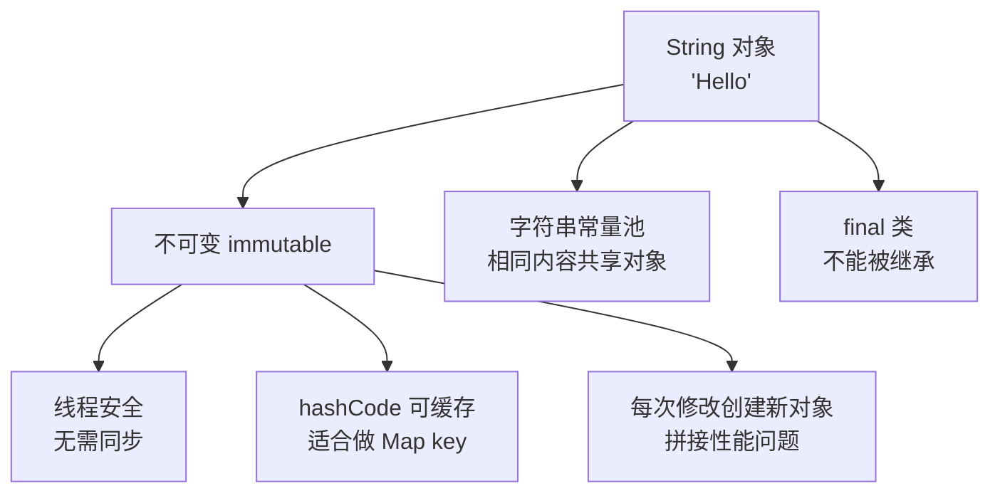
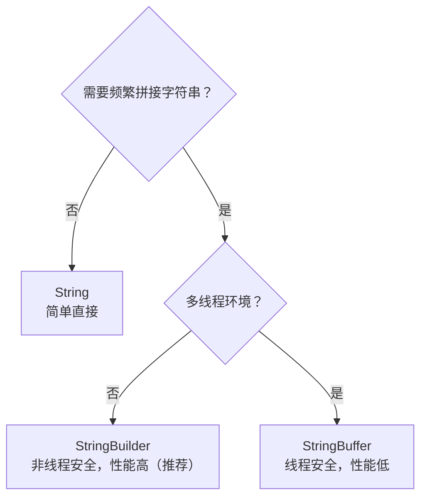

# 字符串与字符串生成器

> 本文由原「字符串操作」与「字符串生成器」两篇（第 08、09 篇）合并而成。
> 前置：[异常处理](07-异常处理) · 后续：[常用工具类与数字处理](10-常用工具类) · 相关：[泛型与枚举](14-泛型与枚举)。

字符串是 Java 程序中经常处理的对象,如果字符串运用得不好,将影响到程序运行的效率。在 Java 中字符串作为 `String` 类的实例来处理,以对象的方式处理字符串,将使字符串更加灵活、方便。同时由于 `String` 不可变,高频修改字符串还需要借助**字符串生成器**（`StringBuilder`/`StringBuffer`）,本章一并讲解。

## String 类概述



Java 中 `String` 是一个非常重要的类,用于表示和操作字符串。`String` 类位于 `java.lang` 包中,是 Java 核心类之一。由于字符串在程序中非常常用,Java 对 `String` 类进行了高度优化,使其成为不可变（immutable）的、线程安全的对象。

单个字符可以用 `char` 类型保存,多个字符组成的文本就需要保存在 `String` 对象中。`String` 通常被称为字符串,一个 `String` 对象最多可以保存 `Integer.MAX_VALUE`（约 21.4 亿）个字符的文本内容。

## String 的不可变性原理

### 什么是不可变性

不可变性（Immutability）是指：一旦 `String` 对象被创建,它的值就不能被改变。所有看起来修改字符串的操作,实际上都是创建了一个新的字符串对象。

### 底层实现机制

**JDK 8 及之前**：
- `String` 类内部使用 `final char[] value` 存储字符数据
- `final` 修饰符保证引用不可变
- 没有提供修改字符数组的方法

**JDK 9 及之后**：
- 改为使用 `final byte[] value` + `byte coder` 存储数据
- 支持 Compact Strings 优化,根据内容选择 Latin-1 或 UTF-16 编码
- 对于纯 ASCII 字符串,空间占用减少一半

```java
// JDK 8 源码
public final class String {
    private final char[] value;
    // ...
}

// JDK 9+ 源码
public final class String {
    private final byte[] value;
    private final byte coder;  // 编码标识
    // ...
}
```

### 不可变性的保证

1. **final 类修饰**：`String` 类被 `final` 修饰,不能被继承
2. **final 字段**：存储数据的数组被 `final` 修饰,引用不可变
3. **私有访问**：字符数组私有,外部无法访问
4. **无修改方法**：不提供任何修改内容的方法

### 为什么设计为不可变

::: tip 不可变性的优势

**1. 线程安全**
- 不可变对象本质上是线程安全的
- 多线程环境下无需额外同步机制
- 可以自由地在多个线程间共享

**2. 安全性**
- 字符串常用于类加载器、网络连接、文件路径等敏感场景
- 不可变性防止恶意修改
- 作为参数传递时,确保内容不被意外改变

**3. 缓存优化**
- 不可变性使得字符串常量池成为可能
- 相同内容的字符串可以共享,节省内存
- 哈希值可以被缓存,提高性能

**4. 性能优化**
- 字符串哈希值可以缓存（`hashCode()` 只计算一次）
- 作为 HashMap 的 key 时性能更好
- 适合作为常量使用

:::

### 不可变性的代价

::: warning 性能考虑

**1. 拼接开销**
- 每次拼接都创建新对象
- 循环中拼接产生大量临时对象
- 建议使用 `StringBuilder` 或 `StringBuffer`

**2. 内存占用**
- 创建大量不同字符串会占用较多内存
- 部分字符串可能留在常量池中无法回收

**3. 更新成本**
- 任何修改操作都需要创建新对象
- 频繁修改的场景应使用可变字符串类

:::

```java
// 不可变性示例
String str = "Hello";
str = str + " World";  // 创建了一个新的字符串对象

// 内存中实际存在：
// 1. "Hello" 字符串（可能在常量池）
// 2. " World" 字符串（可能在常量池）
// 3. "Hello World" 字符串（新创建）

System.out.println(str);  // 输出: Hello World
```

## 字符串常量池（String Pool）

### 常量池的概念

字符串常量池（String Pool / String Constant Pool）是 Java 堆内存中的一块特殊区域,用于存储字符串字面量,以提高内存利用率并优化性能。

### 常量池的位置演进

| JDK 版本 | 位置 | 说明 |
|---------|------|------|
| JDK 6 及之前 | 方法区（永久代） | 大小受限于永久代,容易 OOM |
| JDK 7 | 堆内存 | 从永久代移到堆中,更容易管理 |
| JDK 8 及之后 | 堆内存 | 元空间取代永久代,但字符串常量池仍在堆中 |

### 常量池的工作原理

::: code-group

```java [基本原理]
String str1 = "Hello";  // 创建字符串字面量
String str2 = "Hello";  // 复用常量池中的对象

// 过程：
// 1. 创建 str1 时,JVM 检查常量池
// 2. 常量池没有 "Hello",创建并放入池中
// 3. 创建 str2 时,JVM 检查常量池
// 4. 常量池已有 "Hello",直接返回引用

System.out.println(str1 == str2);  // true,指向同一对象
```

```java [new String()]
String str1 = new String("Hello");
String str2 = new String("Hello");

// 过程：
// 1. 编译时,"Hello" 放入常量池
// 2. 运行时,new 创建堆对象,复制常量池的值
// 3. 每次new都创建新对象

System.out.println(str1 == str2);  // false,不同对象
System.out.println(str1 == "Hello");  // false,堆对象 vs 常量池对象
```

```java [intern() 方法]
String str1 = new String("Hello");
String str2 = str1.intern();  // 将字符串加入常量池
String str3 = "Hello";

System.out.println(str2 == str3);  // true
System.out.println(str1 == str2);  // false

// intern() 方法：
// 1. 检查常量池中是否存在相等字符串
// 2. 存在则返回常量池引用
// 3. 不存在则添加到常量池并返回引用
```

:::

### 常量池的内存分析

```java
String s1 = "Hello";
String s2 = new String("Hello");
String s3 = s2.intern();

// 内存布局：
// ┌─────────────────┐
// │  字符串常量池    │  "Hello" ← s1, s3
// └─────────────────┘
// ┌─────────────────┐
// │      堆内存      │  String对象 ← s2
// └─────────────────┘

System.out.println(s1 == s2);  // false
System.out.println(s1 == s3);  // true
System.out.println(s2 == s3);  // false
```

### 字符串对象的创建过程

**字面量创建**：
```java
String str = "Hello";
```
1. 编译期：`"Hello"` 被放入 class 文件的常量池
2. 类加载时：将字符串常量放入字符串常量池
3. 运行时：直接返回常量池中的引用

**new 创建**：
```java
String str = new String("Hello");
```
1. 编译期：`"Hello"` 被放入 class 文件的常量池
2. 类加载时：将 `"Hello"` 放入字符串常量池
3. 运行时：在堆中创建新的 String 对象
4. 新对象复制常量池中 `"Hello"` 的值

### 常量池的优化建议

:::: tip 最佳实践

**1. 优先使用字面量**
```java
// 推荐
String str = "Hello";

// 不推荐
String str = new String("Hello");  // 创建不必要的堆对象
```

**2. 合理使用 intern()**
```java
// 适用于：大量重复字符串的场景
// 例如：从数据库读取的状态值、国家代码等

// 注意：不要滥用,可能导致常量池过大
```

**3. 字符串拼接优化**
```java
// 编译期可确定的拼接,编译器会优化
String str = "Hello" + " " + "World";  // 编译为 "Hello World"

// 运行时拼接,Java 8 编译器会转为 StringBuilder
String result = str1 + str2 + str3;  // Java 9+ 改用 invokedynamic 动态拼接,语义不变
```

::::

## 可变字符串：StringBuilder 与 StringBuffer

在 Java 中，**字符串生成器**是用于高效构建和操作字符串的工具类。由于 `String` 是不可变的，每次对字符串进行修改（如拼接、替换等）都会创建一个新的字符串对象，这在频繁操作字符串时会导致性能问题（详见下文「常见误区」与「字符串拼接优化」）。为了解决这个问题，Java 提供了两种字符串生成器类：



1. **`StringBuilder`**：非线程安全，性能较高（**推荐使用**）
2. **`StringBuffer`**：线程安全，性能较低

### 三者对比

| 特性 | String | StringBuilder | StringBuffer |
|------|--------|--------------|--------------|
| **可变性** | 不可变 | 可变 | 可变 |
| **线程安全** | 是（不可变） | 否 | 是（synchronized） |
| **方法同步** | — | 无同步 | 所有方法都使用 `synchronized` |
| **性能** | 低（频繁拼接） | 最高 | 中等（同步开销） |
| **引入版本** | JDK 1.0 | JDK 5 | JDK 1.0 |
| **适用场景** | 字符串常量、少量拼接 | 单线程大量拼接 | 多线程共享实例 |

### 何时使用哪个？

- **优先使用 `StringBuilder`**：在单线程环境下，`StringBuilder` 性能更好，是首选
- **使用 `StringBuffer`**：只有在多线程环境下需要共享同一个字符串生成器时才使用 `StringBuffer`
- **注意**：即使是在多线程环境下，如果每个线程都有自己的字符串生成器实例，也应该使用 `StringBuilder`

**String 的适用场景**（何时不需要生成器）：

- 字符串常量、不需要修改的字符串
- 少量字符串拼接（编译器会自动优化，见「字符串拼接优化」一节）

### StringBuilder 与 StringBuffer 常用方法

`StringBuilder` 和 `StringBuffer` 提供几乎完全相同的 API（`StringBuffer` 只是多了同步），以下以 `StringBuilder` 为例介绍常用方法及其功能。

#### 创建字符串生成器

- `StringBuilder()`：创建一个空的 `StringBuilder` 对象
- `StringBuilder(int capacity)`：创建一个指定初始容量的 `StringBuilder` 对象
- `StringBuilder(String str)`：创建一个包含指定字符串的 `StringBuilder` 对象

```java
StringBuilder sb1 = new StringBuilder(); // 空对象
StringBuilder sb2 = new StringBuilder(100); // 初始容量为 100
StringBuilder sb3 = new StringBuilder("Hello"); // 初始内容为 "Hello"
```

#### 追加字符串 append()

`append()` 方法有多个重载版本，可以将各种类型的数据追加到字符串生成器中。该方法返回 `StringBuilder` 对象本身，支持链式调用。

**常用重载版本：**

- `append(String str)`：追加字符串
- `append(char c)`：追加字符
- `append(int i)`：追加整数
- `append(long l)`：追加长整数
- `append(double d)`：追加双精度浮点数
- `append(boolean b)`：追加布尔值
- `append(Object obj)`：追加对象（调用 `toString()` 方法）
- `append(char[] str)`：追加字符数组
- `append(CharSequence s)`：追加字符序列

```java
StringBuilder sb = new StringBuilder("Hello");
sb.append(" World");
System.out.println(sb.toString()); // 输出: Hello World

// 链式调用
StringBuilder sb2 = new StringBuilder();
sb2.append("Name: ").append("张三").append(", Age: ").append(25);
System.out.println(sb2.toString()); // 输出: Name: 张三, Age: 25

// 追加不同类型的数据
StringBuilder sb3 = new StringBuilder();
sb3.append("数字: ").append(100)
   .append(", 字符: ").append('A')
   .append(", 布尔: ").append(true)
   .append(", 浮点: ").append(3.14);
System.out.println(sb3.toString());
// 输出: 数字: 100, 字符: A, 布尔: true, 浮点: 3.14
```

#### 插入字符串 insert()

`insert()` 方法在指定位置插入数据，也有多个重载版本，支持插入各种类型的数据。

**常用重载版本：**

- `insert(int offset, String str)`：在指定位置插入字符串
- `insert(int offset, char c)`：在指定位置插入字符
- `insert(int offset, int i)`：在指定位置插入整数
- `insert(int offset, Object obj)`：在指定位置插入对象

```java
StringBuilder sb = new StringBuilder("Hello World");
sb.insert(5, " Beautiful");
System.out.println(sb.toString()); // 输出: Hello Beautiful World

// 插入不同类型的数据
StringBuilder sb2 = new StringBuilder("Java");
sb2.insert(0, "Hello ");        // 在开头插入
sb2.insert(sb2.length(), "!");   // 在末尾插入
System.out.println(sb2.toString()); // 输出: Hello Java!

// 插入数字
StringBuilder sb3 = new StringBuilder("Year: ");
sb3.insert(6, 2024);
System.out.println(sb3.toString()); // 输出: Year: 2024
```

#### 删除字符串 delete()

`delete(int start, int end)`：删除从 `start` 到 `end`（不包括 `end`）之间的字符

```java
StringBuilder sb = new StringBuilder("Hello World");
sb.delete(5, 11); // 删除 " World"
System.out.println(sb.toString()); // 输出: Hello
```

#### 替换字符串 replace()

`replace(int start, int end, String str)`：用指定的字符串替换从 `start` 到 `end` 之间的字符

```java
StringBuilder sb = new StringBuilder("Hello World");
sb.replace(6, 11, "Java");
System.out.println(sb.toString()); // 输出: Hello Java
```

#### 反转字符串 reverse()

`reverse()`：反转字符串生成器中的字符

```java
StringBuilder sb = new StringBuilder("Hello");
sb.reverse();
System.out.println(sb.toString()); // 输出: olleH
```

#### 获取长度和容量

- **`length()`**：返回当前字符串的长度
- **`capacity()`**：返回当前字符串生成器的容量（内部缓冲区的大小）

```java
StringBuilder sb = new StringBuilder("Hello");
System.out.println(sb.length());    // 输出: 5
System.out.println(sb.capacity());  // 输出: 21（默认容量 16 + 初始字符串长度 5）
```

#### 设置长度和容量

- **`setLength(int newLength)`**：设置字符串生成器的长度
  - 如果 `newLength` 大于当前长度，会在末尾填充空字符（`\u0000`）
  - 如果 `newLength` 小于当前长度，会截断字符串
- **`ensureCapacity(int minimumCapacity)`**：确保字符串生成器的容量至少为指定值

```java
StringBuilder sb = new StringBuilder("Hello");
sb.setLength(10); // 设置长度为 10
System.out.println(sb.toString()); // 输出: Hello

sb.setLength(3); // 设置长度为 3
System.out.println(sb.toString()); // 输出: Hel
```

#### 字符操作

- **`charAt(int index)`**：返回指定索引处的字符
- **`setCharAt(int index, char ch)`**：将指定索引处的字符设置为 `ch`

```java
StringBuilder sb = new StringBuilder("Hello");
System.out.println(sb.charAt(1)); // 输出: e
sb.setCharAt(1, 'a');
System.out.println(sb.toString()); // 输出: Hallo
```

#### 查找和替换

- **`indexOf(String str)`**：返回指定子串第一次出现的索引，如果未找到返回 -1
- **`indexOf(String str, int fromIndex)`**：从指定位置开始查找子串第一次出现的索引
- **`lastIndexOf(String str)`**：返回指定子串最后一次出现的索引
- **`lastIndexOf(String str, int fromIndex)`**：从指定位置开始向前查找子串最后一次出现的索引

**注意：**

- `StringBuilder` 和 `StringBuffer` 没有直接的 `replaceAll` 方法，但可以通过循环和 `replace` 方法实现全局替换

```java
StringBuilder sb = new StringBuilder("Hello Hello World");
int index = sb.indexOf("Hello"); // 返回: 0
int lastIndex = sb.lastIndexOf("Hello"); // 返回: 6
System.out.println("First index: " + index); // 输出: First index: 0
System.out.println("Last index: " + lastIndex); // 输出: Last index: 6

// 替换第一个匹配的子串
sb.replace(0, 5, "Hi");
System.out.println(sb.toString()); // 输出: Hi Hello World

// 实现全局替换（替换所有匹配的子串）
StringBuilder sb2 = new StringBuilder("Hello Hello Hello");
String oldStr = "Hello";
String newStr = "Hi";
int pos = 0;
while ((pos = sb2.indexOf(oldStr, pos)) != -1) {
    sb2.replace(pos, pos + oldStr.length(), newStr);
    pos += newStr.length();
}
System.out.println(sb2.toString()); // 输出: Hi Hi Hi
```

#### 获取子串 substring()

- **`substring(int start)`**：返回从 `start` 开始到末尾的子串
- **`substring(int start, int end)`**：返回从 `start` 到 `end`（不包括 `end`）之间的子串

**注意：** `substring()` 方法返回的是一个新的 `String` 对象，不会修改原 `StringBuilder` 对象。

```java
StringBuilder sb = new StringBuilder("Hello World");
String sub1 = sb.substring(6); // 从索引 6 开始到末尾
System.out.println(sub1); // 输出: World

String sub2 = sb.substring(0, 5); // 从索引 0 到 5（不包括 5）
System.out.println(sub2); // 输出: Hello

// substring() 不会修改原对象
System.out.println(sb.toString()); // 输出: Hello World
```

### 性能对比

#### StringBuilder vs String

在频繁进行字符串拼接操作时，`StringBuilder` 的性能远优于 `String`：

```java
// 测试 String 拼接性能
long startTime = System.nanoTime();
String result = "";
for (int i = 0; i < 10000; i++) {
    result += i; // 每次拼接都创建新对象
}
long endTime = System.nanoTime();
System.out.println("String time: " + (endTime - startTime) / 1_000_000.0 + " ms");

// 测试 StringBuilder 性能
startTime = System.nanoTime();
StringBuilder sb = new StringBuilder();
for (int i = 0; i < 10000; i++) {
    sb.append(i); // 在同一个对象上操作
}
String result2 = sb.toString();
endTime = System.nanoTime();
System.out.println("StringBuilder time: " + (endTime - startTime) / 1_000_000.0 + " ms");
```

**典型输出：**

```text
String time: 150.5 ms
StringBuilder time: 2.3 ms
```

（数值为量级示意，实际因数据量与 JVM 环境而异，下同。）

**性能差异原因：**

- `String` 拼接：每次 `+=` 操作都会创建新的 `String` 对象，产生大量临时对象，导致频繁的垃圾回收
- `StringBuilder` 拼接：在同一个对象上操作，只在必要时扩容，避免了大量对象创建

#### StringBuilder vs StringBuffer（单线程环境）

在单线程环境中，`StringBuilder` 的性能优于 `StringBuffer`，因为 `StringBuilder` 不需要进行同步操作。

```java
long startTime = System.nanoTime();
StringBuilder sb = new StringBuilder();
for (int i = 0; i < 100000; i++) {
  sb.append("a");
}
long endTime = System.nanoTime();
System.out.println("StringBuilder time: " + (endTime - startTime) / 1_000_000.0 + " ms");

startTime = System.nanoTime();
StringBuffer sbf = new StringBuffer();
for (int i = 0; i < 100000; i++) {
  sbf.append("a");
}
endTime = System.nanoTime();
System.out.println("StringBuffer time: " + (endTime - startTime) / 1_000_000.0 + " ms");
```

**典型输出：**

```text
StringBuilder time: 3.5 ms
StringBuffer time: 5.2 ms
```

（量级示意,差距通常在 20%~50% 之间,实际因环境而异。）

**性能差异原因：**

- `StringBuffer` 的所有方法都使用 `synchronized` 关键字，在多线程环境下保证线程安全，但同步操作会带来性能开销
- 在单线程环境下，`StringBuilder` 避免了同步开销，性能更好

#### 多线程环境

- 在多线程环境中，`StringBuffer` 是线程安全的，适合用于共享的字符串操作
- `StringBuilder` 不是线程安全的，可能会导致数据不一致

```java
// 多线程环境下使用 StringBuffer
StringBuffer sbf = new StringBuffer();
Runnable task = () -> {
    for (int i = 0; i < 1000; i++) {
        sbf.append("a");
    }
};

Thread t1 = new Thread(task);
Thread t2 = new Thread(task);
t1.start();
t2.start();
try {
    t1.join();
    t2.join();
} catch (InterruptedException e) {
    e.printStackTrace();
}
System.out.println("StringBuffer length: " + sbf.length()); // 输出: 2000
```

### 底层实现

#### 内部数据结构

- `StringBuilder` 和 `StringBuffer` 内部使用一个 `char[]` 数组（在 Java 9+ 中改为 `byte[]`）来存储字符数据
- 初始容量为 **16**，当字符数量超过当前容量时，会自动扩容

#### 扩容机制

扩容规则：

1. **默认扩容策略**：当字符数量超过当前容量时，新容量 = `(当前容量 + 1) * 2`
2. **最小容量要求**：如果计算出的新容量小于所需的最小容量，则使用最小容量
3. **最大容量限制**：软上限为 `MAX_ARRAY_SIZE`（`Integer.MAX_VALUE - 8`），需求更大时最多到 `Integer.MAX_VALUE`（此时大概率抛出 `OutOfMemoryError`）

扩容过程：

1. 创建一个新的更大的数组
2. 将旧数组中的数据复制到新数组中
3. 更新容量引用

**性能影响：**

- 扩容操作会带来一定的性能开销（数组复制）
- 可以通过指定初始容量来减少扩容次数，提高性能

```java
// 如果知道大概的字符串长度，可以预先指定容量
StringBuilder sb = new StringBuilder(100); // 指定初始容量为 100

// 示例：减少扩容次数
StringBuilder sb1 = new StringBuilder(); // 默认容量 16，可能需要多次扩容
for (int i = 0; i < 1000; i++) {
    sb1.append("a");
}

StringBuilder sb2 = new StringBuilder(1000); // 预先指定容量，避免扩容
for (int i = 0; i < 1000; i++) {
    sb2.append("a");
}
// sb2 的性能通常更好，因为避免了扩容操作
```

#### 容量与长度的区别

- **`length()`**：返回当前字符串的实际长度（字符数量）
- **`capacity()`**：返回当前内部数组的容量（可以存储的字符数量，不包括扩容）

```java
StringBuilder sb = new StringBuilder("Hello");
System.out.println("Length: " + sb.length());     // 输出: Length: 5
System.out.println("Capacity: " + sb.capacity()); // 输出: Capacity: 21 (16 + 5)

// 容量会随着扩容而增加
for (int i = 0; i < 100; i++) {
    sb.append("a");
}
System.out.println("Length: " + sb.length());     // 输出: Length: 105
System.out.println("Capacity: " + sb.capacity()); // 输出: Capacity: 某个更大的值
```

**扩容源码（简化版,完整实现还含 `MAX_ARRAY_SIZE` 溢出检查）**：

```java
private int newCapacity(int minCapacity) {
    int oldCapacity = value.length >> coder;
    int newCapacity = (oldCapacity << 1) + 2;  // 等价于 (当前容量 + 1) * 2
    if (newCapacity - minCapacity < 0) {
        newCapacity = minCapacity;
    }
    return newCapacity;
}
```

**扩容示例**：

```java
StringBuilder sb = new StringBuilder(16); // 容量: 16
for (int i = 0; i < 20; i++) {
    sb.append('a');
    // 当字符数超过16时，扩容到 (16+1)*2 = 34
}
```

### 最佳实践和注意事项

#### 1. 优先使用 StringBuilder

在单线程环境下，优先使用 `StringBuilder` 而不是 `StringBuffer`，除非确实需要线程安全。

```java
// √ 推荐
StringBuilder sb = new StringBuilder();

//  仅在需要线程安全时使用
StringBuffer sbf = new StringBuffer();
```

#### 2. 预估容量以减少扩容

如果能够预估字符串的大致长度，应该预先指定容量，以减少扩容次数，提高性能。

```java
// √ 推荐：预估容量
StringBuilder sb = new StringBuilder(estimatedSize);

// × 不推荐：频繁扩容
StringBuilder sb = new StringBuilder(); // 默认容量 16，可能需要多次扩容
```

#### 3. 避免在循环中使用 String 拼接

在循环中进行字符串拼接时，应该使用 `StringBuilder` 而不是 `String`。

```java
// × 不推荐：性能差
String result = "";
for (int i = 0; i < 1000; i++) {
    result += i;
}

// √ 推荐：性能好
StringBuilder sb = new StringBuilder();
for (int i = 0; i < 1000; i++) {
    sb.append(i);
}
String result = sb.toString();
```

#### 4. 利用链式调用

`StringBuilder` 的方法返回自身，可以利用链式调用使代码更简洁。

```java
// √ 推荐：链式调用
StringBuilder sb = new StringBuilder()
    .append("Name: ").append(name)
    .append(", Age: ").append(age)
    .append(", City: ").append(city);

// × 不推荐：冗长
StringBuilder sb = new StringBuilder();
sb.append("Name: ");
sb.append(name);
sb.append(", Age: ");
sb.append(age);
```

#### 5. 注意索引边界

使用 `insert()`、`delete()`、`replace()` 等方法时，要注意索引边界，避免 `StringIndexOutOfBoundsException`。

```java
StringBuilder sb = new StringBuilder("Hello");
// × 错误：索引越界
// sb.insert(10, "World"); // 抛出 StringIndexOutOfBoundsException

// √ 正确：检查索引
if (sb.length() >= 5) {
    sb.insert(5, " World");
}
```

#### 6. 线程安全注意事项

- `StringBuilder` 不是线程安全的，在多线程环境下共享同一个实例可能导致数据不一致
- 如果需要在多线程环境下使用，应该使用 `StringBuffer` 或者为每个线程创建独立的 `StringBuilder` 实例

```java
// × 错误：多线程共享 StringBuilder
StringBuilder sb = new StringBuilder();
// 多个线程同时操作 sb 会导致数据不一致

// √ 正确方式 1：使用 StringBuffer
StringBuffer sbf = new StringBuffer();
// 多个线程可以安全地操作 sbf

// √ 正确方式 2：每个线程使用独立的 StringBuilder
// 每个线程创建自己的 StringBuilder 实例
```

#### 7. 及时转换为 String

在不需要继续修改时，应该及时调用 `toString()` 转换为 `String`，释放 `StringBuilder` 占用的额外内存。

```java
StringBuilder sb = new StringBuilder();
sb.append("Hello").append(" World");
String result = sb.toString(); // 及时转换
// 之后如果不再需要修改，可以释放 sb 引用
```

## StringJoiner 类

`StringJoiner` 是 Java 8 引入的一个实用工具类，位于 `java.util` 包中。它用于更方便地拼接字符串，特别是在需要添加分隔符、前缀和后缀的情况下。

### 为什么需要 StringJoiner？

在 Java 8 之前，拼接带分隔符的字符串通常需要手动处理：

```java
// Java 8 之前的方式
StringBuilder sb = new StringBuilder();
String[] items = {"Apple", "Banana", "Cherry"};
for (int i = 0; i < items.length; i++) {
    if (i > 0) {
        sb.append(", ");
    }
    sb.append(items[i]);
}
String result = sb.toString(); // "Apple, Banana, Cherry"
```

使用 `StringJoiner` 可以简化这个过程：

```java
// 使用 StringJoiner
StringJoiner sj = new StringJoiner(", ");
sj.add("Apple");
sj.add("Banana");
sj.add("Cherry");
String result = sj.toString(); // "Apple, Banana, Cherry"
```

### 功能特点

- **分隔符支持**：自动处理元素之间的分隔符
- **前缀和后缀**：可以轻松添加前缀和后缀（如 `[item1, item2, item3]`）
- **空值处理**：可以灵活地处理空值（`null`）
- **简洁的 API**：比手动使用 `StringBuilder` 更简洁

### 与其他方法的对比

| 方法                   | 适用场景               | 优点                   | 缺点               |
| ---------------------- | ---------------------- | ---------------------- | ------------------ |
| `StringJoiner`         | 需要分隔符、前缀、后缀 | API 简洁，代码可读性好 | 需要逐个添加元素   |
| `String.join()`        | 已有数组或集合         | 一行代码完成           | 不支持前缀和后缀   |
| `Collectors.joining()` | 流操作中               | 与 Stream API 集成     | 仅适用于流操作     |
| `StringBuilder`        | 复杂字符串构建         | 灵活，性能好           | 需要手动处理分隔符 |

### 构造方法

`StringJoiner` 提供了以下几种构造方法：

1. 基本构造方法 `public StringJoiner(CharSequence delimiter)`。`delimiter`：分隔符，用于分隔拼接的字符串

   ```java
   StringJoiner sj = new StringJoiner(", ");
   sj.add("Apple");
   sj.add("Banana");
   sj.add("Cherry");
   System.out.println(sj.toString()); // 输出: Apple, Banana, Cherry
   ```

2. 带前缀和后缀的构造方法 `public StringJoiner(CharSequence delimiter, CharSequence prefix, CharSequence suffix)`

   1. `delimiter`：分隔符
   2. `prefix`：前缀，拼接结果的开头
   3. `suffix`：后缀，拼接结果的结尾

   ```java
   StringJoiner sj = new StringJoiner(", ", "[", "]");
   sj.add("Apple");
   sj.add("Banana");
   sj.add("Cherry");
   System.out.println(sj.toString()); // 输出: [Apple, Banana, Cherry]
   ```

### StringJoiner 常用方法

#### 添加字符串 add()

向 `StringJoiner` 中添加一个元素

```java
StringJoiner sj = new StringJoiner(", ");
sj.add("Apple");
sj.add("Banana");
sj.add("Cherry");
System.out.println(sj.toString()); // 输出: Apple, Banana, Cherry
```

#### 默认返回值 setEmptyValue()

`setEmptyValue(CharSequence emptyValue)` 设置当 `StringJoiner` 中没有元素时的返回值

```java
StringJoiner sj = new StringJoiner(", ", "[", "]");
sj.setEmptyValue("No elements");
System.out.println(sj.toString()); // 输出: No elements

sj.add("Apple");
System.out.println(sj.toString()); // 输出: [Apple]
```

#### 合并 merge()

将另一个 `StringJoiner` 的内容合并到当前 `StringJoiner` 中

- 只追加对方的内容（不含其前缀和后缀），结果使用当前 `StringJoiner` 的前缀、后缀和分隔符
- 若对方为空（未添加任何元素），本次合并无效果

```java
StringJoiner sj1 = new StringJoiner(", ");
sj1.add("Apple");
sj1.add("Banana");

StringJoiner sj2 = new StringJoiner(", ");
sj2.add("Cherry");
sj2.add("Date");

sj1.merge(sj2);
System.out.println(sj1.toString()); // 输出: Apple, Banana, Cherry, Date
```

#### toString()

返回拼接后的字符串

```java
StringJoiner sj = new StringJoiner(", ");
sj.add("Apple");
sj.add("Banana");
System.out.println(sj.toString()); // 输出: Apple, Banana
```

### 使用场景

#### 1. 拼接数组或集合

使用 `StringJoiner` 可以方便地将数组或集合中的元素拼接成一个字符串：

```java
import java.util.Arrays;
import java.util.StringJoiner;

public class Main {
  public static void main(String[] args) {
    String[] fruits = {"Apple", "Banana", "Cherry"};
    StringJoiner sj = new StringJoiner(", ");
    for (String fruit : fruits) {
      sj.add(fruit);
    }
    System.out.println(sj.toString()); // 输出: Apple, Banana, Cherry
  }
}
```

**对比：使用 `String.join()`（更简洁，但不支持前缀和后缀）**

```java
String[] fruits = {"Apple", "Banana", "Cherry"};
String result = String.join(", ", fruits);
System.out.println(result); // 输出: Apple, Banana, Cherry
```

#### 2. 带前缀和后缀的拼接

使用 `StringJoiner` 可以轻松添加前缀和后缀，这在生成 JSON、SQL 等格式的字符串时非常有用：

```java
// 生成类似 JSON 数组的格式
StringJoiner sj = new StringJoiner(", ", "[", "]");
sj.add("Apple");
sj.add("Banana");
sj.add("Cherry");
System.out.println(sj.toString()); // 输出: [Apple, Banana, Cherry]

// 生成 SQL IN 子句
StringJoiner sqlJoiner = new StringJoiner(", ", "SELECT * FROM users WHERE id IN (", ")");
sqlJoiner.add("1").add("2").add("3");
String sql = sqlJoiner.toString();
System.out.println(sql); // 输出: SELECT * FROM users WHERE id IN (1, 2, 3)
```

#### 3. 在 Stream 中使用

虽然 `Collectors.joining()` 更常用，但 `StringJoiner` 也可以与 Stream 结合使用：

```java
import java.util.Arrays;
import java.util.stream.Collectors;

// 使用 Collectors.joining()（推荐）
String result = Arrays.asList("Apple", "Banana", "Cherry")
    .stream()
    .collect(Collectors.joining(", ", "[", "]"));
System.out.println(result); // 输出: [Apple, Banana, Cherry]

// 使用 StringJoiner（较少使用）
StringJoiner sj = new StringJoiner(", ", "[", "]");
Arrays.asList("Apple", "Banana", "Cherry")
    .forEach(sj::add);
System.out.println(sj.toString()); // 输出: [Apple, Banana, Cherry]
```

#### 4. 处理空值和空集合

`StringJoiner` 提供了 `setEmptyValue()` 方法来处理空集合的情况：

```java
StringJoiner sj = new StringJoiner(", ", "[", "]");
sj.setEmptyValue("No elements");
System.out.println(sj.toString()); // 输出: No elements

sj.add("Apple");
System.out.println(sj.toString()); // 输出: [Apple]
```

#### 5. 处理 null 值

默认情况下，`StringJoiner` 会将 `null` 转换为字符串 `"null"`：

```java
StringJoiner sj = new StringJoiner(", ");
sj.add("Apple");
sj.add(null); // null 会被转换为 "null"
sj.add("Banana");
System.out.println(sj.toString()); // 输出: Apple, null, Banana
```

如果需要忽略 `null` 值，需要手动处理：

```java
StringJoiner sj = new StringJoiner(", ");
sj.add("Apple");
// 手动过滤 null
String value = null;
if (value != null) {
    sj.add(value);
}
sj.add("Banana");
System.out.println(sj.toString()); // 输出: Apple, Banana
```

#### 6. 合并多个 StringJoiner

使用 `merge()` 方法可以合并多个 `StringJoiner`：

```java
StringJoiner sj1 = new StringJoiner(", ", "[", "]");
sj1.add("Apple").add("Banana");

StringJoiner sj2 = new StringJoiner(", ", "[", "]");
sj2.add("Cherry").add("Date");

sj1.merge(sj2);
System.out.println(sj1.toString()); // 输出: [Apple, Banana, Cherry, Date]
```

### 选择建议

- **需要前缀和后缀**：使用 `StringJoiner`
- **已有数组/集合，不需要前缀后缀**：使用 `String.join()`
- **在 Stream 操作中**：使用 `Collectors.joining()`
- **复杂的字符串构建**：使用 `StringBuilder`

## 字符串拼接优化

### 编译器优化

**1. 字面量拼接**
```java
// 编译期优化：直接合并为一个字符串
String str = "Hello" + " " + "World";
// 编译后：String str = "Hello World";
```

**2. 常量表达式拼接**
```java
final String PREFIX = "Hello";
final String SUFFIX = "World";

// 编译期优化
String str = PREFIX + " " + SUFFIX;  // "Hello World"
```

**3. 运行时拼接优化（Java 8 为 StringBuilder,Java 9+ 为 invokedynamic）**
```java
// Java 8 会自动使用 StringBuilder 优化
String str = str1 + str2 + str3;

// Java 8 编译后等价于：
String str = new StringBuilder()
    .append(str1)
    .append(str2)
    .append(str3)
    .toString();
// Java 9+ 改用 invokedynamic(StringConcatFactory)在运行期生成拼接代码,语义不变
```

### 不同场景的拼接方式

::: code-group

```java [少量拼接]
// 推荐：直接使用 +
String message = "Hello, " + name + "!";

// 或使用 concat()
String greeting = "Hello".concat(name);
```

```java [循环中拼接]
// 错误：性能极差
String result = "";
for (int i = 0; i < 1000; i++) {
    result += i;  // 每次循环都创建新对象
}

// 推荐：使用 StringBuilder
StringBuilder sb = new StringBuilder();
for (int i = 0; i < 1000; i++) {
    sb.append(i);
}
String result = sb.toString();

// 预分配容量（如果知道大概长度）
StringBuilder sb2 = new StringBuilder(4000);  // 预分配容量
```

```java [集合拼接]
// 推荐：使用 String.join()
List<String> list = Arrays.asList("Apple", "Banana", "Orange");
String result = String.join(", ", list);  // "Apple, Banana, Orange"

// 或使用 StringJoiner
StringJoiner joiner = new StringJoiner(", ", "[", "]");
list.forEach(joiner::add);
String result2 = joiner.toString();  // "[Apple, Banana, Orange]"

// Java 8+ Stream
String result3 = list.stream()
    .collect(Collectors.joining(", "));  // "Apple, Banana, Orange"

String result4 = list.stream()
    .collect(Collectors.joining(", ", "[", "]"));  // "[Apple, Banana, Orange]"
```

```java [多线程环境]
// 使用 StringBuffer
StringBuffer sb = new StringBuffer();
for (int i = 0; i < 1000; i++) {
    sb.append(i);
}
String result = sb.toString();
```

:::

### 拼接性能对比

```java
public class ConcatenationPerformance {
    public static void main(String[] args) {
        int count = 100000;
        
        // 1. 使用 + 拼接（性能最差）
        long start1 = System.currentTimeMillis();
        String result1 = "";
        for (int i = 0; i < count; i++) {
            result1 += i;
        }
        System.out.println("+: " + (System.currentTimeMillis() - start1) + "ms");
        
        // 2. 使用 StringBuilder（推荐）
        long start2 = System.currentTimeMillis();
        StringBuilder sb = new StringBuilder(count * 5);  // 预分配容量
        for (int i = 0; i < count; i++) {
            sb.append(i);
        }
        String result2 = sb.toString();
        System.out.println("StringBuilder: " + (System.currentTimeMillis() - start2) + "ms");
        
        // 3. 使用 String.concat()
        long start3 = System.currentTimeMillis();
        String result3 = "";
        for (int i = 0; i < count; i++) {
            result3 = result3.concat(String.valueOf(i));
        }
        System.out.println("concat: " + (System.currentTimeMillis() - start3) + "ms");
        
        // 4. 使用 String.format()
        long start4 = System.currentTimeMillis();
        StringBuilder sb4 = new StringBuilder();
        for (int i = 0; i < count; i++) {
            sb4.append(String.format("%d", i));
        }
        System.out.println("format: " + (System.currentTimeMillis() - start4) + "ms");
    }
}

// 典型输出（100000次拼接）：
// +: 5000ms+
// StringBuilder: 5ms
// concat: 1000ms+
// format: 200ms+
```

### 拼接优化建议

:::: tip 最佳实践

**1. 少量拼接（< 5 个字符串）**
- 直接使用 `+` 操作符
- 编译器会自动优化

**2. 循环中拼接**
- 必须使用 `StringBuilder` 或 `StringBuffer`
- 预分配容量（如果知道大概长度）

**3. 集合拼接**
- 使用 `String.join()` 或 `Collectors.joining()`
- 代码简洁,性能良好

**4. 多线程环境**
- 使用 `StringBuffer`
- 线程安全但性能稍低

**5. 格式化拼接**
- 使用 `String.format()`
- 代码可读性好,但性能稍低

**6. 大量重复拼接**
- 考虑使用字符串缓冲池
- 或使用第三方库（如 Guava Joiner）

::::

## 字符串编码与解码

### 字符编码基础

**常见字符编码**：
- **ASCII**：美国标准编码,支持 128 个字符
- **ISO-8859-1**：扩展 ASCII,支持 256 个字符
- **GB2312/GBK**：中文编码标准
- **UTF-8**：变长编码,兼容 ASCII,支持所有 Unicode 字符
- **UTF-16**：定长编码,Java 内部使用

### Java 中的字符串编码

```java
// Java 内部使用 UTF-16 编码
String str = "Hello 你好";

// JDK 8: char[] 存储 UTF-16 编码单元
// JDK 9+: byte[] 存储,根据内容选择 Latin-1 或 UTF-16
```

### 字符串与字节数组转换

```java
// 字符串转字节数组
String str = "Hello 你好";

// 1. 使用默认字符集（不推荐）
byte[] bytes1 = str.getBytes();  // 使用平台默认字符集

// 2. 指定字符集（推荐）
byte[] bytes2 = str.getBytes("UTF-8");
byte[] bytes3 = str.getBytes(StandardCharsets.UTF_8);  // 推荐（无异常）

// 3. 其他编码
byte[] bytes4 = str.getBytes("GBK");
byte[] bytes5 = str.getBytes("ISO-8859-1");

// 字节数组转字符串
byte[] bytes = str.getBytes(StandardCharsets.UTF_8);

// 1. 使用默认字符集（不推荐）
String str1 = new String(bytes);

// 2. 指定字符集（推荐）
String str2 = new String(bytes, StandardCharsets.UTF_8);
String str3 = new String(bytes, "UTF-8");

// 3. 其他编码
String str4 = new String(bytes, "GBK");
```

### 常见编码问题

::: code-group

```java [乱码问题]
// 问题：编码和解码使用不同字符集
String str = "你好世界";

// 错误：编码使用 UTF-8,解码使用 GBK
byte[] bytes = str.getBytes(StandardCharsets.UTF_8);
String wrong = new String(bytes, "GBK");  // 乱码

// 正确：编码和解码使用相同字符集
String right = new String(bytes, StandardCharsets.UTF_8);  // "你好世界"
```

```java [文件读写编码]
// 文件读取
try (BufferedReader reader = new BufferedReader(
        new InputStreamReader(
            new FileInputStream("file.txt"), 
            StandardCharsets.UTF_8))) {
    String line;
    while ((line = reader.readLine()) != null) {
        System.out.println(line);
    }
} catch (IOException e) {
    e.printStackTrace();
}

// 文件写入
try (BufferedWriter writer = new BufferedWriter(
        new OutputStreamWriter(
            new FileOutputStream("file.txt"), 
            StandardCharsets.UTF_8))) {
    writer.write("你好世界");
} catch (IOException e) {
    e.printStackTrace();
}

// Java 11+: 更简便的写法
String content = Files.readString(Path.of("file.txt"), StandardCharsets.UTF_8);
Files.writeString(Path.of("output.txt"), "你好世界", StandardCharsets.UTF_8);
```

```java [网络传输编码]
// HTTP 请求参数编码
String param = "你好世界";
String encoded = URLEncoder.encode(param, StandardCharsets.UTF_8);
// "%E4%BD%A0%E5%A5%BD%E4%B8%96%E7%95%8C"

// HTTP 请求参数解码
String decoded = URLDecoder.decode(encoded, StandardCharsets.UTF_8);
// "你好世界"

// Base64 编码
String original = "Hello World";
String base64 = Base64.getEncoder().encodeToString(original.getBytes());
// "SGVsbG8gV29ybGQ="

// Base64 解码
byte[] decodedBytes = Base64.getDecoder().decode(base64);
String decodedStr = new String(decodedBytes, StandardCharsets.UTF_8);
// "Hello World"
```

:::

### 编码最佳实践

::: warning 编码建议

**1. 始终显式指定字符集**
```java
// 不推荐：使用平台默认字符集
byte[] bytes = str.getBytes();

// 推荐：显式指定字符集
byte[] bytes = str.getBytes(StandardCharsets.UTF_8);
```

**2. 统一使用 UTF-8**
```java
// 推荐：全局统一使用 UTF-8
public static final Charset DEFAULT_CHARSET = StandardCharsets.UTF_8;
```

**3. 处理中文等非 ASCII 字符**
```java
// 必须指定正确的字符集
String chinese = "你好世界";
byte[] bytes = chinese.getBytes("GBK");  // 或 UTF-8
String decoded = new String(bytes, "GBK");  // 必须与编码一致
```

**4. 注意平台差异**
```java
// 不同平台的默认字符集可能不同
// Windows: GBK
// Linux/Mac: UTF-8
// 必须显式指定字符集以保持跨平台一致性
```

**5. 使用 StandardCharsets**
```java
// 推荐：使用 StandardCharsets 常量（无异常）
byte[] bytes = str.getBytes(StandardCharsets.UTF_8);

// 不推荐：使用字符串（可能抛异常）
byte[] bytes;
try {
    bytes = str.getBytes("UTF-8");
} catch (UnsupportedEncodingException e) {
    // 理论上 UTF-8 不会不支持,但仍需处理异常
}
```

:::

## 实战案例

### 案例 1：字符串工具类

```java
public class StringUtils {
    
    /**
     * 判断字符串是否为空
     */
    public static boolean isEmpty(String str) {
        return str == null || str.isEmpty();
    }
    
    /**
     * 判断字符串是否为空白
     */
    public static boolean isBlank(String str) {
        if (str == null || str.isEmpty()) {
            return true;
        }
        for (int i = 0; i < str.length(); i++) {
            if (!Character.isWhitespace(str.charAt(i))) {
                return false;
            }
        }
        return true;
    }
    
    /**
     * 首字母大写
     */
    public static String capitalize(String str) {
        if (isEmpty(str)) {
            return str;
        }
        return str.substring(0, 1).toUpperCase() + str.substring(1);
    }
    
    /**
     * 首字母小写
     */
    public static String uncapitalize(String str) {
        if (isEmpty(str)) {
            return str;
        }
        return str.substring(0, 1).toLowerCase() + str.substring(1);
    }
    
    /**
     * 驼峰转下划线
     */
    public static String camelToSnake(String str) {
        if (isEmpty(str)) {
            return str;
        }
        StringBuilder result = new StringBuilder();
        result.append(Character.toLowerCase(str.charAt(0)));
        for (int i = 1; i < str.length(); i++) {
            char c = str.charAt(i);
            if (Character.isUpperCase(c)) {
                result.append('_').append(Character.toLowerCase(c));
            } else {
                result.append(c);
            }
        }
        return result.toString();
    }
    
    /**
     * 下划线转驼峰
     */
    public static String snakeToCamel(String str) {
        if (isEmpty(str)) {
            return str;
        }
        StringBuilder result = new StringBuilder();
        boolean nextUpper = false;
        for (int i = 0; i < str.length(); i++) {
            char c = str.charAt(i);
            if (c == '_') {
                nextUpper = true;
            } else {
                if (nextUpper) {
                    result.append(Character.toUpperCase(c));
                    nextUpper = false;
                } else {
                    result.append(c);
                }
            }
        }
        return result.toString();
    }
    
    /**
     * 反转字符串
     */
    public static String reverse(String str) {
        if (isEmpty(str)) {
            return str;
        }
        return new StringBuilder(str).reverse().toString();
    }
    
    /**
     * 判断字符串是否为数字
     */
    public static boolean isNumeric(String str) {
        if (isEmpty(str)) {
            return false;
        }
        for (int i = 0; i < str.length(); i++) {
            if (!Character.isDigit(str.charAt(i))) {
                return false;
            }
        }
        return true;
    }
    
    /**
     * 填充字符串到指定长度
     */
    public static String padLeft(String str, int length, char padChar) {
        if (str == null) {
            str = "";
        }
        if (str.length() >= length) {
            return str;
        }
        StringBuilder sb = new StringBuilder();
        for (int i = 0; i < length - str.length(); i++) {
            sb.append(padChar);
        }
        sb.append(str);
        return sb.toString();
    }
    
    /**
     * 截断字符串
     */
    public static String truncate(String str, int maxLength) {
        if (isEmpty(str) || str.length() <= maxLength) {
            return str;
        }
        return str.substring(0, maxLength) + "...";
    }
}
```

### 案例 2：敏感信息脱敏

```java
public class SensitiveDataMasker {
    
    /**
     * 手机号脱敏：138****5678
     */
    public static String maskPhone(String phone) {
        if (phone == null || phone.length() < 7) {
            return phone;
        }
        return phone.substring(0, 3) + "****" + phone.substring(phone.length() - 4);
    }
    
    /**
     * 身份证号脱敏：370***********1234
     */
    public static String maskIdCard(String idCard) {
        if (idCard == null || idCard.length() < 8) {
            return idCard;
        }
        return idCard.substring(0, 3) + "***********" + idCard.substring(idCard.length() - 4);
    }
    
    /**
     * 银行卡号脱敏：6222 **** **** 1234
     */
    public static String maskBankCard(String cardNo) {
        if (cardNo == null || cardNo.length() < 8) {
            return cardNo;
        }
        return cardNo.substring(0, 4) + " **** **** " + cardNo.substring(cardNo.length() - 4);
    }
    
    /**
     * 邮箱脱敏：u***@example.com
     */
    public static String maskEmail(String email) {
        if (email == null || !email.contains("@")) {
            return email;
        }
        int atIndex = email.indexOf("@");
        if (atIndex <= 1) {
            return email;
        }
        return email.charAt(0) + "***" + email.substring(atIndex);
    }
    
    /**
     * 姓名脱敏：张**
     */
    public static String maskName(String name) {
        if (name == null || name.isEmpty()) {
            return name;
        }
        return name.charAt(0) + "**";
    }
    
    /**
     * 地址脱敏：北京市朝阳区***
     */
    public static String maskAddress(String address) {
        if (address == null || address.length() < 6) {
            return address;
        }
        return address.substring(0, 6) + "***";
    }
}

// 使用示例
public class Demo {
    public static void main(String[] args) {
        System.out.println(SensitiveDataMasker.maskPhone("13812345678"));
        // 输出: 138****5678
        
        System.out.println(SensitiveDataMasker.maskIdCard("370123199001011234"));
        // 输出: 370***********1234
        
        System.out.println(SensitiveDataMasker.maskEmail("user@example.com"));
        // 输出: u***@example.com
    }
}
```

### 案例 3：字符串解析器

```java
public class StringParser {
    
    /**
     * 解析键值对字符串
     * 示例："name=John&age=25&city=Beijing"
     */
    public static Map<String, String> parseKeyValue(String str, String pairSeparator, String kvSeparator) {
        Map<String, String> result = new HashMap<>();
        if (str == null || str.isEmpty()) {
            return result;
        }
        
        String[] pairs = str.split(pairSeparator);
        for (String pair : pairs) {
            String[] kv = pair.split(kvSeparator, 2);
            if (kv.length == 2) {
                result.put(kv[0].trim(), kv[1].trim());
            }
        }
        return result;
    }
    
    /**
     * 解析 CSV 行
     */
    public static List<String> parseCSVLine(String line) {
        List<String> result = new ArrayList<>();
        if (line == null || line.isEmpty()) {
            return result;
        }
        
        StringBuilder field = new StringBuilder();
        boolean inQuotes = false;
        
        for (int i = 0; i < line.length(); i++) {
            char c = line.charAt(i);
            
            if (c == '"') {
                if (inQuotes && i + 1 < line.length() && line.charAt(i + 1) == '"') {
                    field.append('"');
                    i++;  // 跳过下一个引号
                } else {
                    inQuotes = !inQuotes;
                }
            } else if (c == ',' && !inQuotes) {
                result.add(field.toString());
                field.setLength(0);
            } else {
                field.append(c);
            }
        }
        result.add(field.toString());
        return result;
    }
    
    /**
     * 提取字符串中的所有数字
     */
    public static List<String> extractNumbers(String str) {
        List<String> numbers = new ArrayList<>();
        Pattern pattern = Pattern.compile("\\d+(?:\\.\\d+)?");
        Matcher matcher = pattern.matcher(str);
        
        while (matcher.find()) {
            numbers.add(matcher.group());
        }
        return numbers;
    }
    
    /**
     * 提取 HTML 标签中的文本
     */
    public static String extractTextFromHtml(String html) {
        if (html == null) {
            return "";
        }
        // 移除 HTML 标签
        return html.replaceAll("<[^>]+>", "");
    }
    
    /**
     * 统计单词出现次数
     */
    public static Map<String, Integer> countWords(String text) {
        Map<String, Integer> wordCount = new HashMap<>();
        if (text == null || text.isEmpty()) {
            return wordCount;
        }
        
        // 转小写,分割单词
        String[] words = text.toLowerCase().split("\\W+");
        for (String word : words) {
            if (!word.isEmpty()) {
                wordCount.put(word, wordCount.getOrDefault(word, 0) + 1);
            }
        }
        return wordCount;
    }
}
```

### 案例 4：构建 SQL 查询语句

```java
public class SqlBuilder {
    
    /**
     * 构建 SELECT 语句
     */
    public static String buildSelectQuery(String table, List<String> columns, 
                                         String whereClause, String orderBy) {
        StringBuilder sql = new StringBuilder("SELECT ");
        
        // 添加列名
        if (columns == null || columns.isEmpty()) {
            sql.append("*");
        } else {
            for (int i = 0; i < columns.size(); i++) {
                if (i > 0) {
                    sql.append(", ");
                }
                sql.append(columns.get(i));
            }
        }
        
        sql.append(" FROM ").append(table);
        
        // 添加 WHERE 子句
        if (whereClause != null && !whereClause.isEmpty()) {
            sql.append(" WHERE ").append(whereClause);
        }
        
        // 添加 ORDER BY 子句
        if (orderBy != null && !orderBy.isEmpty()) {
            sql.append(" ORDER BY ").append(orderBy);
        }
        
        return sql.toString();
    }
    
    /**
     * 构建 IN 子句
     */
    public static String buildInClause(List<?> values) {
        if (values == null || values.isEmpty()) {
            return "()";
        }
        
        StringBuilder sb = new StringBuilder("(");
        for (int i = 0; i < values.size(); i++) {
            if (i > 0) {
                sb.append(", ");
            }
            Object value = values.get(i);
            if (value instanceof String) {
                sb.append("'").append(value).append("'");
            } else {
                sb.append(value);
            }
        }
        sb.append(")");
        return sb.toString();
    }
    
    public static void main(String[] args) {
        // 构建 SELECT 查询
        List<String> columns = Arrays.asList("id", "name", "email");
        String query = buildSelectQuery("users", columns, "status = 'ACTIVE'", "created_at DESC");
        System.out.println(query);
        // 输出: SELECT id, name, email FROM users WHERE status = 'ACTIVE' ORDER BY created_at DESC
        
        // 构建 IN 子句
        List<Integer> ids = Arrays.asList(1, 2, 3, 4, 5);
        String inClause = buildInClause(ids);
        System.out.println(inClause); // 输出: (1, 2, 3, 4, 5)
        
        List<String> names = Arrays.asList("Alice", "Bob", "Charlie");
        String inClause2 = buildInClause(names);
        System.out.println(inClause2); // 输出: ('Alice', 'Bob', 'Charlie')
    }
}
```

### 案例 5：日志格式化器

```java
public class LogFormatter {
    
    private static final String TIMESTAMP_FORMAT = "yyyy-MM-dd HH:mm:ss.SSS";
    private static final int MAX_MESSAGE_LENGTH = 1000;
    
    /**
     * 格式化日志消息
     * 格式: [时间戳] [日志级别] [类名] - 消息内容
     */
    public static String formatLog(String level, String className, String message) {
        StringBuilder log = new StringBuilder(256); // 预估容量
        
        // 时间戳
        String timestamp = LocalDateTime.now().format(DateTimeFormatter.ofPattern(TIMESTAMP_FORMAT));
        log.append("[").append(timestamp).append("] ");
        
        // 日志级别（固定宽度）
        log.append(String.format("[%-5s] ", level));
        
        // 类名（限制长度）
        String shortClassName = className.length() > 30 
            ? "..." + className.substring(className.length() - 27) 
            : className;
        log.append("[").append(shortClassName).append("] ");
        
        // 消息内容
        log.append("- ");
        if (message.length() > MAX_MESSAGE_LENGTH) {
            log.append(message.substring(0, MAX_MESSAGE_LENGTH)).append("...");
        } else {
            log.append(message);
        }
        
        return log.toString();
    }
    
    /**
     * 格式化异常堆栈
     */
    public static String formatException(Exception e) {
        StringBuilder sb = new StringBuilder(512);
        sb.append(e.getClass().getName()).append(": ").append(e.getMessage()).append("\n");
        
        for (StackTraceElement element : e.getStackTrace()) {
            sb.append("    at ").append(element.getClassName())
              .append(".").append(element.getMethodName())
              .append("(").append(element.getFileName())
              .append(":").append(element.getLineNumber()).append(")\n");
        }
        
        return sb.toString();
    }
    
    public static void main(String[] args) {
        String log = formatLog("INFO", "com.example.UserService", "用户登录成功");
        System.out.println(log);
        // 输出: [2024-01-15 10:30:45.123] [INFO ] [com.example.UserService] - 用户登录成功
        
        try {
            throw new RuntimeException("测试异常");
        } catch (Exception e) {
            System.out.println(formatException(e));
        }
    }
}
```

### 案例 6：CSV 文件生成器

```java
public class CsvBuilder {
    
    private static final String CSV_DELIMITER = ",";
    private static final String CSV_LINE_SEPARATOR = "\n";
    
    /**
     * 将数据转换为 CSV 格式
     */
    public static String toCsv(List<String[]> data) {
        if (data == null || data.isEmpty()) {
            return "";
        }
        
        StringBuilder csv = new StringBuilder(data.size() * 100); // 预估容量
        
        for (String[] row : data) {
            appendRow(csv, row);
            csv.append(CSV_LINE_SEPARATOR);
        }
        
        return csv.toString();
    }
    
    /**
     * 追加一行数据
     */
    private static void appendRow(StringBuilder csv, String[] row) {
        for (int i = 0; i < row.length; i++) {
            if (i > 0) {
                csv.append(CSV_DELIMITER);
            }
            appendField(csv, row[i]);
        }
    }
    
    /**
     * 追加一个字段（处理特殊字符）
     */
    private static void appendField(StringBuilder csv, String field) {
        if (field == null) {
            return;
        }
        
        // 如果字段包含逗号、引号或换行符，需要用引号包围并转义引号
        boolean needsQuotes = field.contains(CSV_DELIMITER) 
                           || field.contains("\"") 
                           || field.contains("\n");
        
        if (needsQuotes) {
            csv.append("\"");
            // 转义引号（" -> ""）
            for (int i = 0; i < field.length(); i++) {
                char c = field.charAt(i);
                if (c == '"') {
                    csv.append("\"\"");
                } else {
                    csv.append(c);
                }
            }
            csv.append("\"");
        } else {
            csv.append(field);
        }
    }
    
    public static void main(String[] args) {
        List<String[]> data = new ArrayList<>();
        data.add(new String[]{"姓名", "年龄", "城市"});
        data.add(new String[]{"张三", "25", "北京"});
        data.add(new String[]{"李四", "30", "上海,浦东"});
        data.add(new String[]{"王五", "28", "广州\"天河\""});
        
        String csv = toCsv(data);
        System.out.println(csv);
        // 输出:
        // 姓名,年龄,城市
        // 张三,25,北京
        // 李四,30,"上海,浦东"
        // 王五,28,"广州""天河"""
    }
}
```

### 案例 7：JSON 字符串构建器

```java
public class JsonBuilder {
    
    private StringBuilder json;
    private boolean firstElement;
    
    public JsonBuilder() {
        this.json = new StringBuilder(256);
        this.firstElement = true;
    }
    
    /**
     * 开始构建 JSON 对象
     */
    public JsonBuilder startObject() {
        json.append("{");
        firstElement = true;
        return this;
    }
    
    /**
     * 结束 JSON 对象
     */
    public JsonBuilder endObject() {
        json.append("}");
        return this;
    }
    
    /**
     * 开始构建 JSON 数组
     */
    public JsonBuilder startArray() {
        json.append("[");
        firstElement = true;
        return this;
    }
    
    /**
     * 结束 JSON 数组
     */
    public JsonBuilder endArray() {
        json.append("]");
        return this;
    }
    
    /**
     * 添加字符串属性
     */
    public JsonBuilder put(String key, String value) {
        addCommaIfNeeded();
        json.append("\"").append(key).append("\": ");
        if (value == null) {
            json.append("null");
        } else {
            json.append("\"").append(escapeJson(value)).append("\"");
        }
        return this;
    }
    
    /**
     * 添加数字属性
     */
    public JsonBuilder put(String key, Number value) {
        addCommaIfNeeded();
        json.append("\"").append(key).append("\": ");
        if (value == null) {
            json.append("null");
        } else {
            json.append(value);
        }
        return this;
    }
    
    /**
     * 添加布尔属性
     */
    public JsonBuilder put(String key, Boolean value) {
        addCommaIfNeeded();
        json.append("\"").append(key).append("\": ");
        if (value == null) {
            json.append("null");
        } else {
            json.append(value);
        }
        return this;
    }
    
    /**
     * 添加原始 JSON 值
     */
    public JsonBuilder putRaw(String key, String jsonValue) {
        addCommaIfNeeded();
        json.append("\"").append(key).append("\": ").append(jsonValue);
        return this;
    }
    
    private void addCommaIfNeeded() {
        if (!firstElement) {
            json.append(", ");
        }
        firstElement = false;
    }
    
    /**
     * 转义 JSON 特殊字符
     */
    private String escapeJson(String str) {
        StringBuilder escaped = new StringBuilder();
        for (int i = 0; i < str.length(); i++) {
            char c = str.charAt(i);
            switch (c) {
                case '"': escaped.append("\\\""); break;
                case '\\': escaped.append("\\\\"); break;
                case '\n': escaped.append("\\n"); break;
                case '\r': escaped.append("\\r"); break;
                case '\t': escaped.append("\\t"); break;
                default: escaped.append(c);
            }
        }
        return escaped.toString();
    }
    
    public String build() {
        return json.toString();
    }
    
    public static void main(String[] args) {
        // 构建复杂 JSON 对象
        String json = new JsonBuilder()
            .startObject()
                .put("id", 1001)
                .put("name", "张三")
                .put("age", 25)
                .put("active", true)
                .putRaw("tags", "[\"Java\", \"Python\", \"Go\"]")
                .put("address", "北京市\"海淀区\"")
            .endObject()
            .build();
        
        System.out.println(json);
        // 输出: {"id": 1001, "name": "张三", "age": 25, "active": true, "tags": ["Java", "Python", "Go"], "address": "北京市\"海淀区\""}
    }
}
```

### 案例 8：文本表格生成器

```java
public class TableBuilder {
    
    private List<String[]> rows;
    private int[] columnWidths;
    private String columnSeparator = " | ";
    private String rowSeparator = "-";
    
    public TableBuilder() {
        this.rows = new ArrayList<>();
    }
    
    /**
     * 添加行
     */
    public TableBuilder addRow(String... cells) {
        rows.add(cells);
        
        // 更新列宽
        if (columnWidths == null) {
            columnWidths = new int[cells.length];
        }
        
        for (int i = 0; i < cells.length; i++) {
            int width = cells[i] != null ? cells[i].length() : 0;
            columnWidths[i] = Math.max(columnWidths[i], width);
        }
        
        return this;
    }
    
    /**
     * 设置列分隔符
     */
    public TableBuilder setColumnSeparator(String separator) {
        this.columnSeparator = separator;
        return this;
    }
    
    /**
     * 构建表格字符串
     */
    public String build() {
        if (rows.isEmpty()) {
            return "";
        }
        
        StringBuilder table = new StringBuilder(rows.size() * 100);
        
        // 构建分隔线
        StringBuilder separatorLine = new StringBuilder();
        for (int width : columnWidths) {
            separatorLine.append("+");
            for (int i = 0; i < width; i++) {
                separatorLine.append(rowSeparator);
            }
        }
        separatorLine.append("+");
        
        // 添加表格行
        for (int i = 0; i < rows.size(); i++) {
            String[] row = rows.get(i);
            
            // 如果是表头，添加上分隔线
            if (i == 0) {
                table.append(separatorLine).append("\n");
            }
            
            // 添加行内容
            for (int j = 0; j < row.length; j++) {
                table.append("|");
                String cell = row[j] != null ? row[j] : "";
                // 左对齐
                table.append(String.format("%-" + columnWidths[j] + "s", cell));
            }
            table.append("|\n");
            
            // 如果是表头，添加下分隔线
            if (i == 0) {
                table.append(separatorLine).append("\n");
            }
        }
        
        // 添加底部分隔线
        table.append(separatorLine);
        
        return table.toString();
    }
    
    public static void main(String[] args) {
        String table = new TableBuilder()
            .addRow("姓名", "年龄", "城市", "职业")
            .addRow("张三", "25", "北京", "工程师")
            .addRow("李四", "30", "上海", "设计师")
            .addRow("王五", "28", "广州", "产品经理")
            .build();
        
        System.out.println(table);
        // 输出:
        // +--+--+--+----+
        // |姓名|年龄|城市|职业  |
        // +--+--+--+----+
        // |张三|25|北京|工程师 |
        // |李四|30|上海|设计师 |
        // |王五|28|广州|产品经理|
        // +--+--+--+----+
        // (注:%-Ns 按字符数而非显示宽度填充,汉字占 2 个显示列宽但按 1 个字符计)
    }
}
```

## 常见误区与性能陷阱

### 误区 1：使用 == 比较字符串

```java
// × 错误：使用 == 比较字符串内容
String str1 = new String("Hello");
String str2 = new String("Hello");
if (str1 == str2) {  // false,比较的是引用
    System.out.println("相等");
}

// √ 正确：使用 equals() 比较字符串内容
if (str1.equals(str2)) {  // true,比较内容
    System.out.println("相等");
}

// √ 更安全：常量在前,避免空指针
if ("Hello".equals(str1)) {  // 推荐
    System.out.println("相等");
}
```

### 误区 2：循环中使用 + 拼接

```java
// × 错误：循环中使用 + 拼接,性能极差
String result = "";
for (int i = 0; i < 10000; i++) {
    result += i;  // 每次都创建新对象,O(n²) 时间复杂度
}

// √ 正确：使用 StringBuilder
StringBuilder sb = new StringBuilder();
for (int i = 0; i < 10000; i++) {
    sb.append(i);  // O(n) 时间复杂度
}
String result = sb.toString();
```

### 误区 3：滥用 intern()

```java
// × 错误：所有字符串都 intern(),可能导致常量池过大
public void processData(List<String> data) {
    for (String item : data) {
        String interned = item.intern();  // 滥用!
        // ...
    }
}

// √ 正确：仅对大量重复的字符串使用 intern()
public void processData(List<String> data) {
    for (String item : data) {
        // 仅对有限的状态值使用 intern()
        if (isStatusValue(item)) {
            String interned = item.intern();
        }
    }
}
```

### 误区 4：不指定字符编码

```java
// × 错误：不指定字符编码,跨平台可能出错
byte[] bytes = str.getBytes();  // 使用平台默认字符集
String decoded = new String(bytes);

// √ 正确：显式指定字符编码
byte[] bytes = str.getBytes(StandardCharsets.UTF_8);
String decoded = new String(bytes, StandardCharsets.UTF_8);
```

### 误区 5：substring() 内存泄漏（JDK 6）

```java
// JDK 6 中,substring() 会共享原字符数组
// 如果原字符串很大,substring 后的小字符串会持有大数组引用

// × JDK 6 问题代码
String large = new String(new char[1000000]);  // 1MB 字符串
String small = large.substring(0, 10);  // 只需要 10 字符
// 但 small 仍持有 1MB 数组的引用!

// √ 解决方案：创建新字符串
String small = new String(large.substring(0, 10));

// JDK 7+ 已修复此问题,substring() 会创建新数组
```

### 误区 6：忽视字符串常量池的位置变化

```java
// JDK 6: 字符串常量池在永久代,大小有限
// JDK 7+: 字符串常量池在堆中,更容易管理

// 在 JDK 6 中大量使用 intern() 可能导致 PermGen OOM
// 在 JDK 7+ 中会抛出 Java heap space OOM
```

### 误区 7：字符串拼接的编译器优化误解

```java
// 编译器优化有限,仅适用于常量表达式

// √ 编译期优化
String str1 = "Hello" + " " + "World";  // 编译为 "Hello World"

// × 运行时无法优化
String str2 = getString() + " " + getString();  // 运行时拼接

// √ 循环外无法优化
String str3 = "";
for (int i = 0; i < 10; i++) {
    str3 += i;  // 必须使用 StringBuilder
}
```

### 误区 8：忽视线程安全问题

```java
// × 错误：多线程共享 StringBuilder
public class SharedBuilder {
    private StringBuilder sb = new StringBuilder(); // 线程不安全！
    
    public void append(String str) {
        sb.append(str);
    }
}

// √ 正确方式1：使用 StringBuffer
public class SharedBuilder {
    private StringBuffer sb = new StringBuffer(); // 线程安全
    
    public void append(String str) {
        sb.append(str);
    }
}

// √ 正确方式2：每个线程独立实例
public class ThreadLocalBuilder {
    private ThreadLocal<StringBuilder> threadLocalBuilder = 
        ThreadLocal.withInitial(StringBuilder::new);
    
    public void append(String str) {
        threadLocalBuilder.get().append(str);
    }
}
```

### 误区 9：StringBuilder 作为类成员变量

```java
// × 错误：StringBuilder 作为成员变量，可能导致线程安全和内存问题
public class MessageBuilder {
    private StringBuilder message = new StringBuilder();
    
    public void append(String part) {
        message.append(part);
    }
    
    public String build() {
        return message.toString();
    }
    
    // 问题：多次调用 build() 会累积内容
}

// √ 正确：每次构建创建新的 StringBuilder
public class MessageBuilder {
    public String build(List<String> parts) {
        StringBuilder sb = new StringBuilder();
        for (String part : parts) {
            sb.append(part);
        }
        return sb.toString();
    }
}
```

### 误区 10：混淆 length() 和 capacity()

```java
StringBuilder sb = new StringBuilder(100);
sb.append("Hello");

// × 误解：capacity() 返回字符串长度
System.out.println(sb.capacity()); // 输出: 100（实际容量）
System.out.println(sb.length());   // 输出: 5（字符串长度）

// 注意：
// - length(): 字符串的实际长度
// - capacity(): 内部数组的容量（包含未使用的空间）
```

### 误区 11：忽视 setLength() 的副作用

```java
StringBuilder sb = new StringBuilder("Hello World");

// × 错误理解：setLength() 只是截断字符串
sb.setLength(5);
System.out.println(sb); // 输出: Hello

// 但如果设置更大的长度：
sb.setLength(10);
System.out.println(sb); // 输出: Hello     （填充了空字符 \u0000）
System.out.println(Arrays.toString(sb.toString().getBytes()));
// 输出: [72, 101, 108, 108, 111, 0, 0, 0, 0, 0]
```

### 误区 12：误解 substring() 的行为

```java
StringBuilder sb = new StringBuilder("Hello World");

// × 误解：substring() 会修改原对象
String sub = sb.substring(0, 5);
System.out.println(sub);    // 输出: Hello
System.out.println(sb);     // 输出: Hello World（原对象未修改）

// 注意：substring() 返回新的 String 对象，不修改 StringBuilder
```

## 面试要点

### 1. String 的不可变性

**Q: String 为什么是不可变的?有什么好处?**

A:
- **为什么不可变**:
  - 使用 `final` 修饰类,不可继承
  - 使用 `final` 修饰存储数组(JDK 8 为 `char[]`,JDK 9+ 为 `byte[]`),引用不可变
  - 不提供修改内容的方法
  
- **好处**:
  - 线程安全: 不可变对象天然线程安全
  - 安全性: 防止恶意修改,适合存储敏感信息
  - 缓存优化: 支持字符串常量池,减少内存占用
  - 哈希优化: 哈希值可以缓存,提高性能

### 2. 字符串常量池

**Q: 字符串常量池是什么?有什么作用?**

A:
- **定义**: 堆内存中的一块特殊区域,存储字符串字面量
- **位置**: JDK 6 在永久代,JDK 7+ 在堆中
- **作用**: 
  - 复用字符串对象,减少内存占用
  - 提高字符串比较性能（相同字符串共享引用）
- **机制**: 
  - 字面量自动进入常量池
  - `new String()` 不进入常量池
  - `intern()` 手动加入常量池

### 3. String、StringBuilder、StringBuffer 的区别

**Q: String、StringBuilder、StringBuffer 的区别?**

A:
| 特性 | String | StringBuilder | StringBuffer |
|------|--------|--------------|--------------|
| 可变性 | 不可变 | 可变 | 可变 |
| 线程安全 | 是 | 否 | 是 |
| 性能 | 低 | 最高 | 中等 |

- **String**: 不可变,适合少量拼接、字符串常量
- **StringBuilder**: 可变,非线程安全,适合单线程大量拼接(单线程首选)
- **StringBuffer**: 可变,线程安全(所有方法用 `synchronized` 修饰),适合多线程共享实例
- **引入版本**: `StringBuffer` 为 JDK 1.0,`StringBuilder` 为 JDK 5

### 4. String.intern()

**Q: String.intern() 方法的作用?**

A:
- **作用**: 将字符串加入字符串常量池
- **JDK 6**: 复制字符串到常量池
- **JDK 7+**: 在常量池中记录堆对象的引用
- **应用**: 大量重复字符串场景,减少内存占用
- **注意**: 不要滥用,可能导致常量池过大

### 5. 为什么循环中 String 拼接性能差？

**Q: 为什么在循环中使用 String 拼接性能很差？**

A:
- **不可变性**：`String` 是不可变的，每次拼接都创建新对象
- **内存开销**：产生大量临时对象，增加垃圾回收压力
- **时间复杂度**：`O(n²)`（n 次拼接，每次复制之前的内容）
- **StringBuilder 优势**：
  - 可变对象，在原对象上修改
  - `O(n)` 时间复杂度
  - 避免大量临时对象创建

```java
// String 拼接：O(n²) 时间复杂度
String result = "";
for (int i = 0; i < n; i++) {
    result += i; // 每次复制之前的内容 + 新内容
}

// StringBuilder：O(n) 时间复杂度
StringBuilder sb = new StringBuilder();
for (int i = 0; i < n; i++) {
    sb.append(i); // 直接追加，无需复制之前的内容
}
```

### 6. StringBuilder 的扩容机制

**Q: StringBuilder 的扩容机制是怎样的？**

A:
- **初始容量**：默认 16，可通过构造方法指定
- **扩容规则**：`(当前容量 + 1) * 2`，不足时取最小需求容量
- **扩容过程**：创建新数组 → 复制旧数组内容 → 更新引用
- **性能影响**：扩容操作有数组复制开销；预估容量可避免频繁扩容
- 详见上文「底层实现与扩容机制」

### 7. 如何选择字符串拼接方式？

**Q: 在不同场景下如何优化/选择字符串拼接方式？**

A:
| 场景 | 推荐方式 | 原因 |
|------|---------|------|
| 少量拼接（<5次） | `String +` | 编译器优化，代码简洁 |
| 循环中拼接 | `StringBuilder` | 避免创建大量临时对象 |
| 集合拼接（无前缀后缀） | `String.join()` | 代码最简洁 |
| 集合拼接（有前缀后缀） | `StringJoiner` | 支持前缀后缀 |
| Stream 操作 | `Collectors.joining()` | 与 Stream API 集成 |
| 多线程环境 | `StringBuffer` | 线程安全 |

- **预分配**：为 `StringBuilder` 预分配容量
- **格式化拼接**：`String.format()` 可读性好但性能稍低

### 8. == vs equals()

**Q: == 和 equals() 的区别?**

A:
- `==`: 比较引用（地址）,判断是否为同一对象
- `equals()`: 比较内容,判断字符串内容是否相同
- **推荐**: 始终使用 `equals()` 比较字符串内容
- **安全**: 常量在前,避免空指针: `"constant".equals(variable)`

### 9. String 的 hashCode()

**Q: String 的 hashCode() 是如何实现的?**

A:
```java
// JDK 源码
public int hashCode() {
    int h = hash;
    if (h == 0 && value.length > 0) {
        char val[] = value;
        for (int i = 0; i < value.length; i++) {
            h = 31 * h + val[i];
        }
        hash = h;
    }
    return h;
}
```

- 使用公式: `s[0]*31^(n-1) + s[1]*31^(n-2) + ... + s[n-1]`
- 选择 31 的原因:
  - 质数,减少冲突
  - 31 * i == (i << 5) - i,优化计算
  - 哈希值缓存,只计算一次

### 10. JDK 9 String 变化

**Q: JDK 9 中 String 的变化?**

A:
- **Compact Strings**: 使用 `byte[]` 代替 `char[]`
- **编码优化**: 根据内容选择 Latin-1 或 UTF-16
- **空间节省**: 纯 ASCII 字符串空间减半
- **兼容性**: API 不变,对开发者透明

### 11. 字符串反转

**Q: 如何反转字符串?**

A:
```java
// 方法 1: 使用 StringBuilder
String reversed = new StringBuilder(str).reverse().toString();

// 方法 2: 手动反转
char[] chars = str.toCharArray();
for (int i = 0, j = chars.length - 1; i < j; i++, j--) {
    char temp = chars[i];
    chars[i] = chars[j];
    chars[j] = temp;
}
String reversed = new String(chars);
```

### 12. 字符串编码

**Q: 字符串编码的注意事项?**

A:
- **始终显式指定字符集**: 避免使用平台默认字符集
- **统一使用 UTF-8**: 支持所有 Unicode 字符
- **编码解码一致**: 编码和解码必须使用相同字符集
- **使用 StandardCharsets**: 避免处理 UnsupportedEncodingException

### 13. StringJoiner 的应用场景

**Q: StringJoiner 适合什么场景？**

A:
- **需要分隔符**：自动处理元素之间的分隔符
- **需要前缀后缀**：轻松添加前缀和后缀
- **代码简洁**：比手动使用 `StringBuilder` 更简洁
- **典型场景**：
  - 构建 SQL IN 子句
  - 构建 JSON 数组
  - 拼接带格式的字符串

```java
// 构建 SQL IN 子句
StringJoiner sj = new StringJoiner(", ", "IN (", ")");
sj.add("1").add("2").add("3");
// 结果: IN (1, 2, 3)
```

### 14. StringBuilder 和 String 的转换

**Q: StringBuilder 和 String 如何互相转换？**

A:
- **StringBuilder → String**：
  ```java
  StringBuilder sb = new StringBuilder("Hello");
  String str = sb.toString();
  ```
  
- **String → StringBuilder**：
  ```java
  String str = "Hello";
  StringBuilder sb1 = new StringBuilder(str);
  StringBuilder sb2 = new StringBuilder().append(str);
  ```

### 15. StringBuilder 的线程安全性

**Q: StringBuilder 为什么不是线程安全的？**

A:
- **无同步机制**：方法没有 `synchronized` 修饰
- **竞态条件**：多线程同时调用 `append()` 可能导致：
  - 数据覆盖
  - 数据丢失
  - 数组越界
  
- **解决方案**：
  1. 使用 `StringBuffer`（线程安全但性能低）
  2. 每个线程独立实例（推荐）
  3. 使用同步块（增加复杂度）

### 16. StringJoiner vs String.join()

**Q: StringJoiner 和 String.join() 有什么区别？**

A:
| 特性 | StringJoiner | String.join() |
|------|-------------|--------------|
| 前缀后缀 | 支持 | 不支持 |
| 参数类型 | 逐个添加 | 数组或集合 |
| 链式调用 | 支持 | 不支持 |
| 空值处理 | `setEmptyValue()` | 直接返回空字符串 |
| 适用场景 | 需要前缀后缀 | 简单的分隔符拼接 |

### 17. StringBuilder 性能优化技巧

**Q: 使用 StringBuilder 有哪些性能优化技巧？**

A:
1. **预估容量**：避免频繁扩容
2. **链式调用**：代码简洁，减少临时引用
3. **及时转换**：不再修改时调用 `toString()` 释放内存
4. **避免冗余**：避免不必要的 `toString()` 调用
5. **选择合适方法**：根据场景选择 `StringBuilder`、`StringJoiner` 或 `String.join()`

### 18. StringBuilder 源码分析

**Q: StringBuilder 的核心实现原理是什么？**

A:
- **继承关系**：继承 `AbstractStringBuilder`
- **数据结构**：
  - JDK 8：`char[] value` 数组
  - JDK 9+：`byte[] value` 数组（Compact Strings）
- **关键字段**：`value`（存储字符数据）、`count`（实际字符数量，即 length）
- **扩容逻辑**：`(oldCapacity << 1) + 2`，详见上文「底层实现与扩容机制」

## 最佳实践总结

1. **优先使用字符串字面量**: 节省内存,提高性能
2. **使用 equals() 比较内容**: 不要使用 `==` 比较字符串内容,常量在前可避免空指针
3. **大量拼接使用 StringBuilder**: 避免在循环中使用 `+` 拼接
4. **单线程用 StringBuilder,多线程共享用 StringBuffer**: 或为每个线程创建独立实例
5. **预分配 StringBuilder 容量**: 知道大概长度时预估容量,减少扩容次数
6. **利用链式调用**: `append()` 返回自身,链式写法更简洁
7. **及时转换为 String**: 构建完成后调用 `toString()`,不要把 `StringBuilder` 当长期持有的成员变量
8. **明确指定字符编码**: 处理非 ASCII 字符时统一使用 UTF-8 与 `StandardCharsets`
9. **合理使用字符串常量池**: 利用 `intern()` 优化内存,但不要滥用
10. **理解字符串不可变性**: 避免不必要的字符串创建
11. **使用 Java 11+ 新特性**: `strip()`、`isBlank()`、`repeat()` 等
12. **使用 String.join()/StringJoiner**: 连接数组或集合中的字符串,需要前缀后缀时用 `StringJoiner`
13. **预编译正则表达式**: 频繁使用时使用 `Pattern.compile()`
14. **注意字符串编码**: 文件、网络传输时统一使用 UTF-8
15. **敏感信息脱敏**: 手机号、身份证、银行卡等需要脱敏处理
16. **性能测试**: 关键路径进行性能测试和优化

## 版本差异(旧版 → Java 21)

| 特性 | 旧版(Java 8) | Java 11/15/21 |
|------|--------------|---------------|
| 去除空白 | `trim()` 仅去 ASCII 空格 | `strip()` 按 Unicode 空白处理（Java 11） |
| 空白判断 | `trim().isEmpty()` 手写 | `isBlank()`（Java 11） |
| 重复/分割 | 手写循环拼接 | `repeat()`、`lines()`（Java 11） |
| 多行文本 | `+` 拼接 + 手工转义 | 文本块 `"""..."""`（Java 15 正式）+ `formatted()` |
| 函数式转换 | 无 | `transform()`（Java 12）、`indent()`（Java 12） |
| 分隔符连接 | `StringJoiner`/`String.join`（Java 8） | 不变;文本块进一步简化多行拼接 |
| `+` 拼接底层 | 编译器转为 `StringBuilder` | Java 9+ 改用 invokedynamic 动态生成,语义不变 |
| 线程安全选择 | `StringBuffer` 同步 | 不变;单线程优先 `StringBuilder` |

## 继续阅读

- 上一章：[异常处理](07-异常处理)
- 下一章：[常用工具类与数字处理](10-常用工具类)
