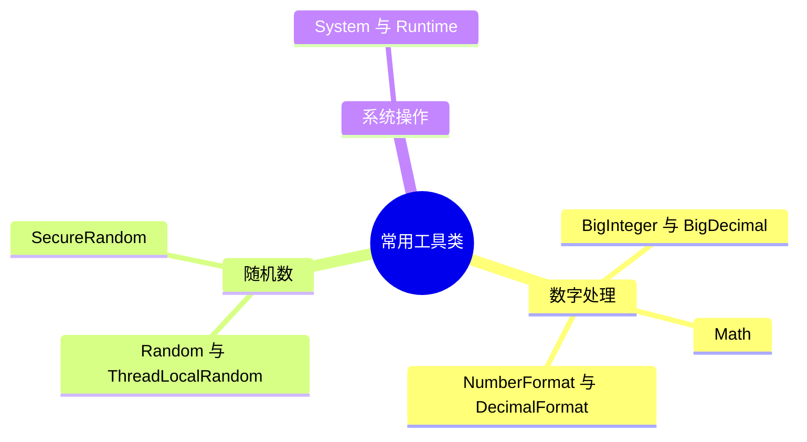

# 常用工具类与数字处理

> 本文由原「常用类」一篇改型而成,聚焦数字处理与系统/随机工具类;原篇中的包装类型(与数据类型篇重复)、枚举类、JavaBean 与记录类已分别并入[语言基础与数据类型](01-语言基础与数据类型)与[泛型与枚举](14-泛型与枚举)。
> 前置：[字符串与字符串生成器](08-字符串与字符串生成器) · 后续：[集合框架](11-集合框架)。

Java 提供了丰富的标准类库,涵盖了数字处理、数学运算、随机数生成、系统操作等各个方面。掌握这些常用工具类能够大大提高开发效率。



> 包装类型(Wrapper)与自动装箱/拆箱、Integer 缓存等内容本篇不再展开,详见 [语言基础与数据类型](01-语言基础与数据类型) 的「包装类与自动装箱」一节。

## 数字处理

在 Java 中数字处理是非常常见的操作,包括基本的数学运算、大数处理、高精度计算、数字格式化等。Java 提供了丰富的类库来支持这些操作。

### BigInteger 类

`BigInteger` 类位于 `java.math` 包中，用于表示任意大小的整数，适用于超出 `long` 范围（-2^63 到 2^63-1）的大整数运算。

**特点：**
- 不可变对象，所有运算都返回新的 `BigInteger` 对象
- 可以表示任意大小的整数（理论上只受内存限制）
- 适用于大数运算、密码学、科学计算等场景

**创建方式：**
- `new BigInteger(String val)`：通过字符串创建
- `BigInteger.valueOf(long val)`：将 `long` 值转换为 `BigInteger`
- `BigInteger.ONE`、`BigInteger.ZERO`、`BigInteger.TEN`：常用常量

| 方法名                           | 功能描述                     |
| -------------------------------- | ---------------------------- |
| `add(BigInteger val)`            | 加法运算                     |
| `subtract(BigInteger val)`       | 减法运算                     |
| `multiply(BigInteger val)`       | 乘法运算                     |
| `divide(BigInteger val)`         | 除法运算                     |
| `mod(BigInteger val)`            | 取模运算                     |
| `pow(int exponent)`              | 幂运算                       |
| `gcd(BigInteger val)`            | 返回两个数的最大公约数       |
| `isProbablePrime(int certainty)` | 判断是否为素数（概率性测试） |
| `intValue()` / `longValue()`       | 转换为基本数据类型(注意溢出) |
| `toString()`                       | 转换为字符串                 |

**示例代码：**

```java
import java.math.BigInteger;

public class BigIntegerExample {
  public static void main(String[] args) {
    BigInteger a = new BigInteger("12345678901234567890");
    BigInteger b = new BigInteger("98765432109876543210");

    System.out.println("加法: " + a.add(b));
    // 输出: 加法: 111111111011111111100

    // 幂运算、最大公约数
    System.out.println("幂运算: " + a.pow(2));
    System.out.println("最大公约数: " + a.gcd(b));

    // 判断素数(概率性测试,certainty 越大越准确但越慢)
    System.out.println("17 是否为素数: " + new BigInteger("17").isProbablePrime(100));

    // 比较大小
    System.out.println("比较结果: " + a.compareTo(b)); // -1 (a < b)

    // 阶乘:100! 远超 long 范围,只能用 BigInteger
    BigInteger factorial = BigInteger.ONE;
    for (int i = 2; i <= 100; i++) {
      factorial = factorial.multiply(BigInteger.valueOf(i));
    }
    System.out.println("100! 共 " + factorial.toString().length() + " 位数字");
  }
}
```

**注意事项：**
- `BigInteger` 是不可变的，所有运算都返回新对象
- 转换为基本类型时要注意溢出问题
- 大数运算性能较低，只在必要时使用

### BigDecimal 类

`BigDecimal` 类位于 `java.math` 包中，用于表示高精度的浮点数，适用于需要精确计算的场景（如金融计算、货币计算）。

**为什么需要 BigDecimal？**

`double` 和 `float` 类型使用二进制浮点数表示，无法精确表示某些十进制小数，会导致精度丢失：

```java
// 精度问题示例
double d1 = 0.1;
double d2 = 0.2;
System.out.println(d1 + d2); // 输出: 0.30000000000000004（精度丢失）

// 使用 BigDecimal 可以精确计算
BigDecimal bd1 = new BigDecimal("0.1");
BigDecimal bd2 = new BigDecimal("0.2");
System.out.println(bd1.add(bd2)); // 输出: 0.3（精确）
```

**特点：**
- 不可变对象，所有运算都返回新的 `BigDecimal` 对象
- 可以精确表示任意精度的十进制数
- 适用于金融、科学计算等需要精确计算的场景

**创建方式：**
- `new BigDecimal(String val)`：**推荐**，通过字符串创建（精确）
- `new BigDecimal(double val)`：不推荐，可能丢失精度
- `BigDecimal.valueOf(double val)`：将 `double` 值转换为 `BigDecimal`

| 方法名                                                         | 功能描述                         |
| -------------------------------------------------------------- | -------------------------------- |
| `add(BigDecimal val)`                                          | 加法运算                         |
| `subtract(BigDecimal val)`                                     | 减法运算                         |
| `multiply(BigDecimal val)`                                     | 乘法运算                         |
| `divide(BigDecimal val, int scale, RoundingMode roundingMode)` | 除法运算，指定小数位数和舍入模式 |
| `setScale(int newScale, RoundingMode roundingMode)`            | 设置小数位数和舍入模式           |
| `compareTo(BigDecimal val)`                                    | 比较两个 `BigDecimal` 的值       |
| `doubleValue()` / `floatValue()`                               | 转换为基本数据类型               |

**舍入模式（RoundingMode）：**
- `HALF_UP`：四舍五入（最常用）
- `HALF_DOWN`：五舍六入
- `CEILING`：向上舍入（向正无穷方向）
- `FLOOR`：向下舍入（向负无穷方向）
- `UP`：远离零方向舍入
- `DOWN`：向零方向舍入

**示例代码：**

```java
import java.math.BigDecimal;
import java.math.RoundingMode;

public class BigDecimalExample {
  public static void main(String[] args) {
    BigDecimal a = new BigDecimal("123.456");
    BigDecimal b = new BigDecimal("78.901");

    System.out.println("加法: " + a.add(b));       // 输出: 加法: 202.357
    System.out.println("减法: " + a.subtract(b));  // 输出: 减法: 44.555

    // 除法(必须指定精度和舍入模式)
    System.out.println("除法: " + a.divide(b, 2, RoundingMode.HALF_UP)); // 1.56

    // 设置小数位数
    System.out.println("设置小数位: " + a.setScale(2, RoundingMode.HALF_UP)); // 123.46

    // equals 比较值和精度,compareTo 只比较值
    BigDecimal c = new BigDecimal("123.456");
    BigDecimal d = new BigDecimal("123.4560");
    System.out.println("equals: " + c.equals(d));       // false(精度不同)
    System.out.println("compareTo: " + c.compareTo(d)); // 0(值相同)

  }
}
```

**注意事项：**
- **必须使用字符串构造**，避免使用 `double` 构造（会丢失精度）
- 除法运算必须指定精度和舍入模式，否则可能抛出 `ArithmeticException`
- 比较时使用 `compareTo()` 而不是 `equals()`（`equals()` 会比较精度）
- 性能比基本类型慢，只在需要精确计算时使用

### NumberFormat 类

`NumberFormat` 类位于 `java.text` 包中，用于格式化数字为字符串，或将字符串解析为数字。它支持本地化，可以根据不同的地区显示不同格式的数字。

**获取实例：**
- `NumberFormat.getInstance(locale)`：数字格式化器;`getCurrencyInstance(locale)`：货币;`getPercentInstance(locale)`：百分比

| 方法名                                     | 功能描述             |
| ------------------------------------------ | -------------------- |
| `format(double number)`                    | 将数字格式化为字符串 |
| `format(long number)`                      | 将长整数格式化为字符串 |
| `parse(String source)`                     | 将字符串解析为数字   |
| `setMinimumFractionDigits(int newMinimum)` | 设置最小小数位数     |
| `setMaximumFractionDigits(int newMaximum)` | 设置最大小数位数     |
| `setGroupingUsed(boolean newValue)`         | 设置是否使用分组（千位分隔符） |

**示例代码：**

```java
import java.text.NumberFormat;
import java.util.Locale;

public class NumberFormatExample {
  public static void main(String[] args) {
    // 基本数字格式化(千位分隔)
    NumberFormat nf = NumberFormat.getInstance(Locale.US);
    System.out.println(nf.format(1234567.89)); // 1,234,567.89

    // 货币格式化
    System.out.println(NumberFormat.getCurrencyInstance(Locale.US).format(1234.56));    // $1,234.56
    System.out.println(NumberFormat.getCurrencyInstance(Locale.CHINA).format(1234.56)); // ¥1,234.56

    // 百分比格式化
    System.out.println(NumberFormat.getPercentInstance(Locale.US).format(0.1234)); // 12%
  }
}
```

### DecimalFormat 类

`DecimalFormat` 是 `NumberFormat` 的子类，提供了更灵活的数字格式化功能，可以使用模式字符串自定义格式。

**常用模式符号：**
- `0`：数字，不足位数补 0
- `#`：数字，不足位数不补 0
- `.`：小数点
- `,`：千位分隔符
- `%`：百分比
- `E`：科学计数法

**示例代码：**

```java
import java.text.DecimalFormat;

public class DecimalFormatExample {
  public static void main(String[] args) {
    double number = 1234.5678;

    // 保留两位小数
    DecimalFormat df1 = new DecimalFormat("#.00");
    System.out.println(df1.format(number)); // 输出: 1234.57

    // 千位分隔符，保留两位小数
    DecimalFormat df2 = new DecimalFormat("#,##0.00");
    System.out.println(df2.format(number)); // 输出: 1,234.57

    // 固定位数，不足补 0
    DecimalFormat df3 = new DecimalFormat("0000.00");
    System.out.println(df3.format(12.3)); // 输出: 0012.30

    // 百分比格式
    DecimalFormat df4 = new DecimalFormat("0.00%");
    System.out.println(df4.format(0.1234)); // 输出: 12.34%

    // 科学计数法
    DecimalFormat df5 = new DecimalFormat("0.00E0");
    System.out.println(df5.format(1234.56)); // 输出: 1.23E3
  }
}
```

## 数学运算

### Math 类

`Math` 类位于 `java.lang` 包中，提供了常用的数学运算方法。所有方法都是静态方法，可以直接通过类名调用。

**常用方法：**

| 方法名                    | 功能描述           |
| ------------------------- | ------------------ |
| `abs(double a)`           | 返回绝对值         |
| `max(double a, double b)` | 返回两个数中的较大值 |
| `min(double a, double b)` | 返回两个数中的较小值 |
| `pow(double a, double b)` | 返回 a 的 b 次幂   |
| `sqrt(double a)`          | 返回平方根         |
| `ceil(double a)`          | 向上取整           |
| `floor(double a)`         | 向下取整           |
| `round(double a)`         | 四舍五入           |
| `random()`                | 返回 [0.0, 1.0) 的随机数 |
| `sin/cos/tan(double a)`   | 三角函数（参数为弧度） |
| `log(double a)`           | 自然对数           |
| `exp(double a)`           | e 的 a 次幂        |

**示例代码：**

```java
public class MathExample {
  public static void main(String[] args) {
    // 绝对值
    System.out.println("绝对值: " + Math.abs(-10)); // 输出: 10

    // 最大值和最小值
    System.out.println("最大值: " + Math.max(10, 20)); // 输出: 20
    System.out.println("最小值: " + Math.min(10, 20)); // 输出: 10

    // 幂运算
    System.out.println("2的3次方: " + Math.pow(2, 3)); // 输出: 8.0

    // 平方根
    System.out.println("16的平方根: " + Math.sqrt(16)); // 输出: 4.0

    // 取整
    System.out.println("向上取整: " + Math.ceil(3.2)); // 输出: 4.0
    System.out.println("向下取整: " + Math.floor(3.8)); // 输出: 3.0
    System.out.println("四舍五入: " + Math.round(3.5)); // 输出: 4

    // 随机数（0.0 到 1.0 之间）
    System.out.println("随机数: " + Math.random());

    // 三角函数(注意参数是弧度):Math.sin(Math.PI / 4) ≈ 0.707
    double rad = Math.toRadians(90); // 角度转弧度

    // 常用常量
    System.out.println("π: " + Math.PI); // 输出: 3.141592653589793
    System.out.println("e: " + Math.E);  // 输出: 2.718281828459045
  }
}
```

## 随机数生成

### Random 类

`Random` 类位于 `java.util` 包中，用于生成随机数。可以生成各种类型的随机数，包括整数、浮点数、布尔值等。

**构造方法：**
- `Random()`：使用当前时间作为种子
- `Random(long seed)`：使用指定种子（相同种子产生相同序列）

**常用方法：**

| 方法名                    | 功能描述                           |
| ------------------------- | ---------------------------------- |
| `nextInt()`               | 返回随机整数（所有 int 值）        |
| `nextInt(int bound)`      | 返回 [0, bound) 的随机整数         |
| `nextLong()`              | 返回随机长整数                     |
| `nextDouble()`            | 返回 [0.0, 1.0) 的随机浮点数       |
| `nextFloat()`             | 返回 [0.0, 1.0) 的随机浮点数       |
| `nextBoolean()`           | 返回随机布尔值                     |
| `nextBytes(byte[] bytes)` | 生成随机字节数组                   |

**示例代码：**

```java
import java.util.Random;

public class RandomExample {
  public static void main(String[] args) {
    Random random = new Random();

    // 生成 [0, 100] 的随机整数
    System.out.println("0-100随机数: " + random.nextInt(101));

    // 生成指定范围的随机数(例如:10 到 20)
    int min = 10, max = 20;
    System.out.println("10-20随机数: " + (random.nextInt(max - min + 1) + min));

    // 使用种子(相同种子产生相同序列,可用于可复现测试)
    Random seededRandom = new Random(12345);
    System.out.println("种子随机数: " + seededRandom.nextInt(100));
  }
}
```

**注意事项：**
- 如果需要可重现的随机序列，使用带种子的构造方法
- `nextInt(bound)` 的范围是 [0, bound)，不包括 bound
- 在 Java 7+ 中，也可以使用 `ThreadLocalRandom` 在多线程环境下生成随机数（性能更好）

### 随机数选型与常用工具

| 场景 | 推荐方式 |
|------|---------|
| 一般随机数(单线程) | `Random` |
| 多线程环境 | `ThreadLocalRandom.current()`(Java 7+,无竞争) |
| 安全场景(密码/密钥/验证码) | `SecureRandom`(不可预测) |
| 唯一标识 | `UUID.randomUUID()` |

```java
import java.util.UUID;
import java.util.concurrent.ThreadLocalRandom;
import java.security.SecureRandom;

// 指定范围随机整数 [min, max)
int dice = ThreadLocalRandom.current().nextInt(1, 7);      // 1~6

// 6 位数字验证码
String code = String.valueOf(100000 + ThreadLocalRandom.current().nextInt(900000));

// 安全随机字节(如生成密钥素材)
SecureRandom secureRandom = new SecureRandom();
byte[] bytes = new byte[16];
secureRandom.nextBytes(bytes);

// UUID
String uuid = UUID.randomUUID().toString().replace("-", "");
```

> `Random` 使用固定算法 + 种子:相同种子产生相同序列,且序列可被预测;安全敏感场景务必使用 `SecureRandom`。

## 系统操作

### System 类

`System` 类位于 `java.lang` 包中，提供了与系统相关的属性和方法。所有方法都是静态方法。

**常用方法：**

| 方法名                          | 功能描述                     |
| ------------------------------- | ---------------------------- |
| `currentTimeMillis()`           | 返回当前时间的毫秒数         |
| `nanoTime()`                    | 返回当前时间的纳秒数（高精度） |
| `exit(int status)`              | 终止当前运行的 Java 虚拟机   |
| `gc()`                          | 建议运行垃圾回收器           |
| `getProperty(String key)`       | 获取系统属性                 |
| `setProperty(String key, String val)` | 设置系统属性           |
| `arraycopy(...)`                | 复制数组                     |

**示例代码：**

```java
public class SystemExample {
  public static void main(String[] args) {
    // 获取当前时间（毫秒）
    long currentTime = System.currentTimeMillis();
    System.out.println("当前时间（毫秒）: " + currentTime);

    // 获取当前时间（纳秒，用于高精度计时）
    long startTime = System.nanoTime();
    // 执行一些操作...
    long endTime = System.nanoTime();
    System.out.println("耗时（纳秒）: " + (endTime - startTime));

    // 获取系统属性
    System.out.println("操作系统: " + System.getProperty("os.name"));
    System.out.println("Java版本: " + System.getProperty("java.version"));
    // 数组复制
    int[] source = {1, 2, 3, 4, 5};
    int[] dest = new int[5];
    System.arraycopy(source, 0, dest, 0, source.length);
    System.out.println("复制后的数组: " + java.util.Arrays.toString(dest));
    }
}
```

### Runtime 类

`Runtime` 类提供了与 Java 运行时环境交互的接口，可以获取内存信息、执行系统命令等。

**获取实例：**
- `Runtime.getRuntime()`：获取当前运行时实例（单例）

**常用方法：**

| 方法名                    | 功能描述                     |
| ------------------------- | ---------------------------- |
| `totalMemory()`           | 返回 JVM 总内存（字节）      |
| `freeMemory()`            | 返回 JVM 空闲内存（字节）    |
| `maxMemory()`             | 返回 JVM 最大可用内存（字节） |
| `availableProcessors()`   | 返回可用处理器数量           |
| `gc()`                    | 建议运行垃圾回收器           |
| `exec(String command)`    | 执行系统命令                 |

**示例代码：**

```java
public class RuntimeExample {
  public static void main(String[] args) {
    Runtime runtime = Runtime.getRuntime();

    // 获取内存信息
    long totalMemory = runtime.totalMemory();
    long freeMemory = runtime.freeMemory();
    long maxMemory = runtime.maxMemory();
    long usedMemory = totalMemory - freeMemory;

    System.out.println("总内存: " + totalMemory / 1024 / 1024 + " MB");
    System.out.println("空闲内存: " + freeMemory / 1024 / 1024 + " MB");
    System.out.println("已用内存: " + usedMemory / 1024 / 1024 + " MB");
    System.out.println("最大内存: " + maxMemory / 1024 / 1024 + " MB");

    // 获取处理器数量
    int processors = runtime.availableProcessors();
    System.out.println("可用处理器: " + processors);
    }
}
```

## 实战案例

### 案例 1:金融计算工具(BigDecimal)

```java
import java.math.BigDecimal;
import java.math.RoundingMode;

/**
 * 金融计算工具类:利息、复利、等额本息月供
 */
public class FinancialCalculator {

    private static final int SCALE = 2;
    private static final RoundingMode ROUNDING = RoundingMode.HALF_UP;

    /** 单利利息:本金 × 年利率 × 年数 */
    public static BigDecimal calculateInterest(BigDecimal principal, BigDecimal rate, int years) {
        return principal.multiply(rate)
                       .multiply(BigDecimal.valueOf(years))
                       .setScale(SCALE, ROUNDING);
    }

    /** 复利:P × (1 + r)^n */
    public static BigDecimal calculateCompoundInterest(BigDecimal principal, BigDecimal rate, int years) {
        BigDecimal multiplier = BigDecimal.ONE.add(rate);
        return principal.multiply(multiplier.pow(years))
                        .setScale(SCALE, ROUNDING);
    }

    /** 等额本息月供:P × r × (1+r)^n / ((1+r)^n - 1),r 为 0 时直接本金分期 */
    public static BigDecimal calculateMonthlyPayment(BigDecimal principal, BigDecimal annualRate, int months) {
        BigDecimal monthlyRate = annualRate.divide(BigDecimal.valueOf(12), 10, RoundingMode.HALF_UP);
        if (monthlyRate.compareTo(BigDecimal.ZERO) == 0) {
            return principal.divide(BigDecimal.valueOf(months), SCALE, ROUNDING);
        }
        BigDecimal temp = BigDecimal.ONE.add(monthlyRate).pow(months);
        return principal.multiply(monthlyRate).multiply(temp)
                .divide(temp.subtract(BigDecimal.ONE), SCALE, ROUNDING);
    }

    public static void main(String[] args) {
        BigDecimal principal = new BigDecimal("10000.00");
        BigDecimal rate = new BigDecimal("0.05");
        System.out.println("年利息: " + calculateInterest(principal, rate, 1));          // 500.00
        System.out.println("3年复利: " + calculateCompoundInterest(principal, rate, 3)); // 11576.25
        System.out.println("月供: " + calculateMonthlyPayment(new BigDecimal("500000.00"), new BigDecimal("0.049"), 360)); // 2653.63
    }
}
```

## 常见误区与陷阱

### 1. 使用 double 进行精确计算 / 用 double 构造 BigDecimal

```java
// × 错误:二进制浮点无法精确表示部分十进制小数
System.out.println(0.1 + 0.2); // 0.30000000000000004

// × 错误:new BigDecimal(0.1) 构造时就已丢失精度
System.out.println(new BigDecimal(0.1));
// 0.1000000000000000055511151231257827021181583404541015625

// √ 正确:使用字符串构造或 valueOf
BigDecimal total = new BigDecimal("0.1").add(new BigDecimal("0.2"));
new BigDecimal("0.1");    // 0.1
BigDecimal.valueOf(0.1);  // 0.1
```

### 2. BigDecimal 比较与除法

比较数值一律用 `compareTo()`(`equals()` 会比较精度,`1.0` 与 `1.00` 不相等);除法若除不尽且未指定 scale/舍入模式,会抛出 `ArithmeticException`(`Non-terminating decimal expansion`),务必使用 `divide(divisor, scale, roundingMode)`。

### 3. Random 的种子与线程安全问题

- 相同种子的 `Random` 产生完全相同的序列:适合可复现测试,不能用于安全场景
- 多线程共享 `Random` 实例存在 CAS 竞争,应改用 `ThreadLocalRandom`

### 4. BigInteger 转换为基本类型溢出

```java
BigInteger big = new BigInteger("12345678901234567890");
// × 直接 longValue() 会静默溢出
// √ 先检查范围
if (big.compareTo(BigInteger.valueOf(Long.MAX_VALUE)) > 0) {
    System.out.println("数值超出 long 范围");
}
```

## 面试要点

### 1. BigDecimal 的应用场景与注意事项

- **场景**:金融货币计算、需要精确十进制运算、超出 double 精度的计算
- **注意**:字符串构造;除法必须指定精度与舍入模式(常用 `HALF_UP` 四舍五入、`HALF_EVEN` 银行家舍入);比较用 `compareTo()`;性能比基本类型低,按需使用

### 2. BigInteger 的特点

- 任意精度(理论上只受内存限制)、不可变(所有运算返回新对象)、性能较低(比基本类型慢 10-100 倍)
- 适用:超出 `long` 范围的大整数、密码学计算、大数阶乘/斐波那契

### 3. Random、ThreadLocalRandom、SecureRandom 的区别

| 特性 | Random | ThreadLocalRandom | SecureRandom |
|------|--------|-------------------|--------------|
| 线程安全 | 有竞争 | 无竞争(线程独立) | 线程安全 |
| 可预测性 | 可预测 | 可预测 | 不可预测 |
| 引入版本 | JDK 1.0 | JDK 7 | JDK 1.4 |
| 典型场景 | 单线程一般随机 | 多线程一般随机 | 密码/密钥/验证码 |

### 4. Math 类的常用方法

- 基本:`abs()`/`max()`/`min()`;幂与根:`pow()`/`sqrt()`;取整:`ceil()`/`floor()`/`round()`;三角与对数(参数为弧度):`sin/cos/tan`/`log`;常量:`Math.PI`、`Math.E`

### 5. System 类的常见用途

- 时间测量:`currentTimeMillis()`(毫秒)、`nanoTime()`(纳秒,高精度计时)
- 系统属性:`getProperty()`/`setProperty()`;数组复制:`arraycopy()`
- 程序控制:`exit(status)`、`gc()`(仅是建议)

### 6. System.currentTimeMillis() 与 nanoTime() 的区别?

- 前者是墙钟时间(可被系统调整,适合时间戳/日期),后者是单调时钟(不受系统时间调整影响,适合测量耗时)

### 7. 如何生成安全的随机数?

- 使用 `SecureRandom`:`nextBytes()` 生成密钥素材、`nextInt()` 生成验证码;不要用 `Random`(算法固定、序列可预测)

## 总结

### 类库选择指南

| 场景                 | 推荐类库           | 说明                           |
| -------------------- | ------------------ | ------------------------------ |
| 大整数运算           | `BigInteger`       | 超出 long 范围的整数           |
| 精确浮点数计算       | `BigDecimal`       | 金融、货币计算                 |
| 数字格式化           | `NumberFormat`     | 本地化数字格式化               |
| 自定义数字格式       | `DecimalFormat`    | 使用模式字符串自定义格式       |
| 数学运算             | `Math`             | 三角函数、对数、幂运算等       |
| 随机数生成           | `Random`           | 各种类型的随机数               |
| 系统属性、时间       | `System`           | 系统信息、时间戳               |
| 内存信息、系统命令   | `Runtime`          | JVM 内存、执行命令             |

### 最佳实践

1. **精确计算使用 BigDecimal**
   - 使用字符串构造，避免精度丢失
   - 除法必须指定精度和舍入模式
   - 使用 `compareTo()` 而不是 `equals()` 比较

2. **性能考虑**
   - `BigInteger` 和 `BigDecimal` 性能较低，只在必要时使用
   - 基本类型运算优先使用 `Math` 类
   - 预先计算并缓存结果

3. **随机数生成**
   - 单线程使用 `Random`
   - 多线程使用 `ThreadLocalRandom`（Java 7+）
   - 安全场景使用 `SecureRandom`

4. **时间测量**
   - 一般计时使用 `System.currentTimeMillis()`
   - 高精度计时使用 `System.nanoTime()`

5. **格式化选择**
   - 本地化格式：`NumberFormat`
   - 自定义格式：`DecimalFormat`
   - 简单格式：`String.format()`

6. **数值比较**
   - `BigInteger` 和 `BigDecimal` 使用 `compareTo()`
   - 不要使用 `equals()`（会比较精度）

7. **异常处理**
   - 除法运算指定舍入模式，避免 `ArithmeticException`
   - 类型转换前检查范围，避免溢出

## 相关主题

- **包装类型与自动装箱**:见 [语言基础与数据类型](01-语言基础与数据类型) 的「包装类与自动装箱」(Integer 缓存、`equals` 比较、拆箱 NPE)。
- **枚举类型、JavaBean 与记录类(record)**:见 [泛型与枚举](14-泛型与枚举) 的「枚举类型」与「JavaBean 与记录类」章节。

## 版本差异(旧版 → Java 21)

| 特性 | 旧版(Java 8/11) | Java 16/17/21 |
|------|----------------|---------------|
| 十六进制格式化 | 手写循环转换 | `HexFormat`（Java 17+） |
| 随机数 | Random / ThreadLocalRandom | `RandomGenerator` 统一接口（Java 17+），`RandomGenerator.getDefault()` 随机源选择 |
| 字节码生成 | 无专门 API | `ClassFile` API 预览（Java 22+） |

## 继续阅读

- 上一章：[字符串与字符串生成器](08-字符串与字符串生成器)
- 下一章：[集合框架](11-集合框架)
