# SpringBoot 数据访问

::: tip 分工声明：Spring 事务三视角
数据访问组件与声明式事务的**源码视角**分别由本篇与 [32-声明式事务原理与传播机制](32-声明式事务原理与传播机制.md) 承担；事务的**原理视角**（接入机制、传播行为、失效场景）见 [05-Spring/事务管理与失效场景](../05-Spring/03-事务管理与失效场景.md)，**整合/使用视角**（JdbcTemplate 与 SSM 声明式事务，原 08-SSM 整合篇已解体并入该篇附录）同样见 [05-Spring/事务管理与失效场景](../05-Spring/03-事务管理与失效场景.md)。SQL 日志审计与 P6Spy 单独成篇：[31-SQL日志审计与P6Spy](31-SQL日志审计与P6Spy.md)。
:::

## SpringBoot 数据访问

### 概述

数据访问层是 Spring Boot 应用与持久化存储交互的核心。本篇深入分析 Spring Data JPA、MyBatis-Plus 的自动配置原理，以及数据源、连接池等关键组件的源码级工作机制。声明式事务的源码原理单独成篇，见 [32-声明式事务原理与传播机制](32-声明式事务原理与传播机制.md)。

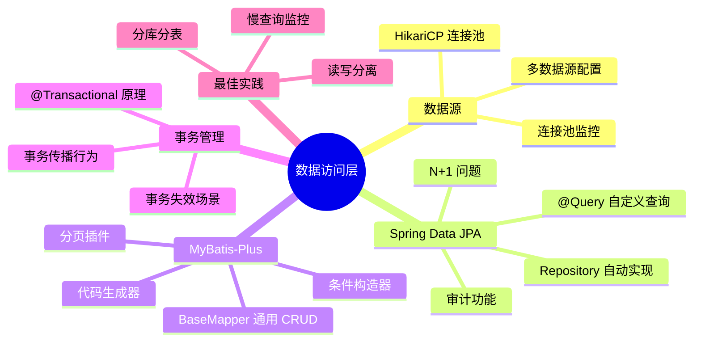

### 数据源自动配置原理

#### DataSourceAutoConfiguration 源码分析

```java
// Spring Boot 自动配置数据源的核心逻辑
@Configuration(proxyBeanMethods = false)
@ConditionalOnClass({ DataSource.class, EmbeddedDatabaseType.class })
@ConditionalOnMissingBean(type = "io.r2dbc.spi.ConnectionFactory")
@EnableConfigurationProperties(DataSourceProperties.class)
@Import({
    DataSourcePoolMetadataProvidersConfiguration.class,
    DataSourceInitializationConfiguration.class
})
public class DataSourceAutoConfiguration {

    // 内嵌数据库配置（H2/HSQL/Derby）
    @Configuration(proxyBeanMethods = false)
    @Conditional(EmbeddedDatabaseCondition.class)
    @ConditionalOnMissingBean({ DataSource.class, XADataSource.class })
    @Import(EmbeddedDataSourceConfiguration.class)
    protected static class EmbeddedDatabaseConfiguration {}

    // 连接池配置（HikariCP 优先）
    @Configuration(proxyBeanMethods = false)
    @Conditional(PooledDataSourceCondition.class)
    @ConditionalOnMissingBean({ DataSource.class, XADataSource.class })
    @Import({
        HikariConfiguration.class,   // 优先使用 HikariCP
        Tomcat.class,                 // 其次 Tomcat JDBC Pool
        Dbcp2.class,                  // 再次 DBCP2
        Generic.class,
        DataSourceJmxConfiguration.class
    })
    protected static class PooledDataSourceConfiguration {}
}
```

::: tip 为什么 HikariCP 是默认连接池
HikariCP 的性能优势来自：
1. 字节码级别优化（FastList 替代 ArrayList）
2. ConcurrentBag 无锁设计
3. 代理对象极简（ProxyConnection 只拦截 close()）
4. 主动检测连接泄漏（leakDetectionThreshold）

在大多数基准测试中，HikariCP 的获取/归还连接性能是其他连接池的 2-3 倍。
:::

#### DataSource 配置详解

##### DataSourceBuilder 源码分析

DataSourceBuilder 是 Spring Boot 提供的数据源构建器，支持链式调用创建各种类型的数据源。

```java
// DataSourceBuilder 核心源码
public final class DataSourceBuilder<T extends DataSource> {

    private Class<? extends DataSource> type;
    private ClassLoader classLoader;
    private Map<String, String> properties = new LinkedHashMap<>();

    // 根据类路径自动推断数据源类型
    public static Class<? extends DataSource> findType(ClassLoader classLoader) {
        // 优先级：HikariCP > Tomcat > DBCP2 > Oracle UCP > Generic
        if (ClassUtils.isPresent("com.zaxxer.hikari.HikariDataSource", classLoader)) {
            return HikariDataSource.class;
        }
        if (ClassUtils.isPresent("org.apache.tomcat.jdbc.pool.DataSource", classLoader)) {
            return org.apache.tomcat.jdbc.pool.DataSource.class;
        }
        if (ClassUtils.isPresent("org.apache.commons.dbcp2.BasicDataSource", classLoader)) {
            return BasicDataSource.class;
        }
        // ... 其他数据源类型
        return null;
    }

    // 构建数据源实例
    public T build() {
        Class<? extends DataSource> type = getType();
        DataSource dataSource = BeanUtils.instantiateClass(type);
        // 通过反射设置属性
        bind(dataSource);
        return (T) dataSource;
    }
}
```

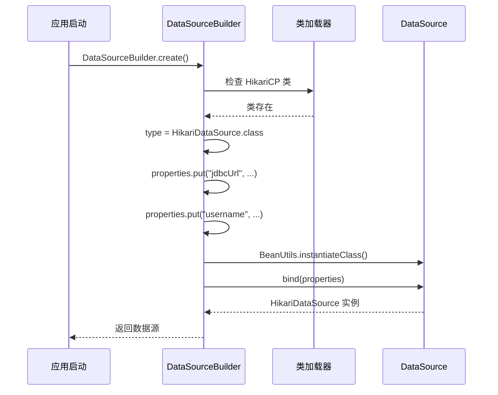

##### 多数据源配置实战

在实际项目中，经常需要连接多个数据库，例如主库和从库、业务库和日志库等。Spring Boot 支持灵活的多数据源配置。

```java
// 多数据源配置示例
@Configuration
public class MultiDataSourceConfig {

    // 主数据源（primary）
    @Bean
    @Primary
    @ConfigurationProperties(prefix = "spring.datasource.primary")
    public DataSource primaryDataSource() {
        return DataSourceBuilder.create().type(HikariDataSource.class).build();
    }

    // 从数据源（secondary）
    @Bean
    @ConfigurationProperties(prefix = "spring.datasource.secondary")
    public DataSource secondaryDataSource() {
        return DataSourceBuilder.create().type(HikariDataSource.class).build();
    }
}
```

```yaml
# application.yml 多数据源配置
spring:
  datasource:
    primary:
      jdbc-url: jdbc:mysql://localhost:3306/main_db?useSSL=false&serverTimezone=Asia/Shanghai
      username: root
      password: root123
      driver-class-name: com.mysql.cj.jdbc.Driver
      hikari:
        maximum-pool-size: 20
        minimum-idle: 5
    secondary:
      jdbc-url: jdbc:mysql://localhost:3306/log_db?useSSL=false&serverTimezone=Asia/Shanghai
      username: root
      password: root123
      driver-class-name: com.mysql.cj.jdbc.Driver
      hikari:
        maximum-pool-size: 10
        minimum-idle: 2
```

::: warning 多数据源配置注意事项
1. 必须指定一个 `@Primary` 数据源作为默认数据源
2. 每个数据源需要独立的 SqlSessionFactory 或 EntityManagerFactory
3. 事务管理器也需要分别配置，注意事务边界
4. 使用 `@Qualifier` 注解指定要注入的数据源
:::

##### JPA 多数据源配置

```java
// 主数据源 JPA 配置
@Configuration
@EnableJpaRepositories(
    basePackages = "com.example.repository.primary",
    entityManagerFactoryRef = "primaryEntityManagerFactory",
    transactionManagerRef = "primaryTransactionManager"
)
public class PrimaryJpaConfig {

    @Bean
    @Primary
    public LocalContainerEntityManagerFactoryBean primaryEntityManagerFactory(
            EntityManagerFactoryBuilder builder,
            @Qualifier("primaryDataSource") DataSource dataSource) {
        return builder
            .dataSource(dataSource)
            .packages("com.example.entity.primary")
            .persistenceUnit("primary")
            .build();
    }

    @Bean
    @Primary
    public PlatformTransactionManager primaryTransactionManager(
            @Qualifier("primaryEntityManagerFactory") EntityManagerFactory emf) {
        return new JpaTransactionManager(emf);
    }
}

// 从数据源 JPA 配置
@Configuration
@EnableJpaRepositories(
    basePackages = "com.example.repository.secondary",
    entityManagerFactoryRef = "secondaryEntityManagerFactory",
    transactionManagerRef = "secondaryTransactionManager"
)
public class SecondaryJpaConfig {

    @Bean
    public LocalContainerEntityManagerFactoryBean secondaryEntityManagerFactory(
            EntityManagerFactoryBuilder builder,
            @Qualifier("secondaryDataSource") DataSource dataSource) {
        return builder
            .dataSource(dataSource)
            .packages("com.example.entity.secondary")
            .persistenceUnit("secondary")
            .build();
    }

    @Bean
    public PlatformTransactionManager secondaryTransactionManager(
            @Qualifier("secondaryEntityManagerFactory") EntityManagerFactory emf) {
        return new JpaTransactionManager(emf);
    }
}
```

##### MyBatis-Plus 多数据源配置

```java
// MyBatis-Plus 多数据源配置
@Configuration
public class MybatisPlusMultiDataSourceConfig {

    @Bean
    @Primary
    public SqlSessionFactory primarySqlSessionFactory(
            @Qualifier("primaryDataSource") DataSource dataSource) throws Exception {
        MybatisSqlSessionFactoryBean factory = new MybatisSqlSessionFactoryBean();
        factory.setDataSource(dataSource);
        factory.setMapperLocations(new PathMatchingResourcePatternResolver()
            .getResources("classpath:mapper/primary/**/*.xml"));
        return factory.getObject();
    }

    @Bean
    public SqlSessionFactory secondarySqlSessionFactory(
            @Qualifier("secondaryDataSource") DataSource dataSource) throws Exception {
        MybatisSqlSessionFactoryBean factory = new MybatisSqlSessionFactoryBean();
        factory.setDataSource(dataSource);
        factory.setMapperLocations(new PathMatchingResourcePatternResolver()
            .getResources("classpath:mapper/secondary/**/*.xml"));
        return factory.getObject();
    }
}
```

##### 动态数据源切换

动态数据源允许在运行时根据上下文切换数据源，常用于多租户、读写分离等场景。

```java
// 动态数据源上下文持有者
public class DynamicDataSourceContextHolder {

    private static final ThreadLocal<String> CONTEXT_HOLDER = new ThreadLocal<>();

    // 设置当前数据源标识
    public static void setDataSourceKey(String key) {
        CONTEXT_HOLDER.set(key);
    }

    // 获取当前数据源标识
    public static String getDataSourceKey() {
        return CONTEXT_HOLDER.get();
    }

    // 清除数据源标识
    public static void clearDataSourceKey() {
        CONTEXT_HOLDER.remove();
    }
}

// 动态数据源实现
public class DynamicDataSource extends AbstractRoutingDataSource {

    @Override
    protected Object determineCurrentLookupKey() {
        return DynamicDataSourceContextHolder.getDataSourceKey();
    }
}

// 动态数据源配置
@Configuration
public class DynamicDataSourceConfig {

    @Bean
    public DataSource dynamicDataSource(
            @Qualifier("primaryDataSource") DataSource primaryDataSource,
            @Qualifier("secondaryDataSource") DataSource secondaryDataSource) {
        
        DynamicDataSource dynamicDataSource = new DynamicDataSource();
        
        Map<Object, Object> targetDataSources = new HashMap<>();
        targetDataSources.put("primary", primaryDataSource);
        targetDataSources.put("secondary", secondaryDataSource);
        
        dynamicDataSource.setTargetDataSources(targetDataSources);
        dynamicDataSource.setDefaultTargetDataSource(primaryDataSource);
        
        return dynamicDataSource;
    }
}
```

```java
// 自定义注解标记数据源
@Target({ElementType.METHOD, ElementType.TYPE})
@Retention(RetentionPolicy.RUNTIME)
@Documented
public @interface DataSource {
    String value() default "primary";
}

// AOP 切面实现数据源切换
@Aspect
@Component
@Order(Ordered.HIGHEST_PRECEDENCE)  // 确保在事务切面之前执行
public class DataSourceAspect {

    @Around("@annotation(dataSource)")
    public Object around(ProceedingJoinPoint point, DataSource dataSource) throws Throwable {
        String key = dataSource.value();
        try {
            DynamicDataSourceContextHolder.setDataSourceKey(key);
            return point.proceed();
        } finally {
            DynamicDataSourceContextHolder.clearDataSourceKey();
        }
    }
}

// 使用示例
@Service
public class UserService {

    @DataSource("primary")
    public User findById(Long id) {
        // 使用主数据源查询
        return userMapper.selectById(id);
    }

    @DataSource("secondary")
    public List<User> findLogs(Long userId) {
        // 使用从数据源查询日志
        return logMapper.selectByUserId(userId);
    }
}
```

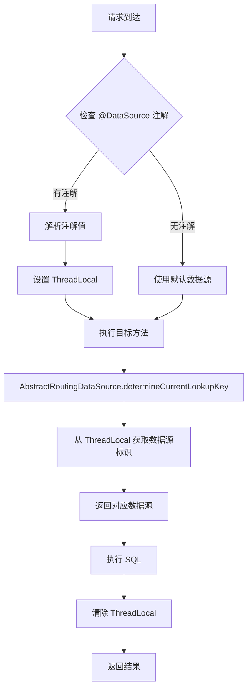

::: danger 动态数据源与事务的冲突
动态数据源切换必须在事务开启之前完成，否则事务会绑定到错误的数据源。解决方案：
1. 使用 `@Order(Ordered.HIGHEST_PRECEDENCE)` 确保数据源切面在事务切面之前执行
2. 或者在 Service 方法内部手动切换数据源，而不是通过 AOP
3. 不同数据源的事务无法合并，需要使用分布式事务（如 Seata）
:::

### Spring Data JPA 深度实践

#### Repository 自动实现原理

```java
// @EnableJpaRepositories 触发 Repository 初始化
// JpaRepositoryFactoryBean 创建 Repository 代理
public class JpaRepositoryFactoryBean<T extends Repository<S, ID>, S, ID>
    extends TransactionalRepositoryFactoryBeanSupport<T, S, ID> {

    @Override
    protected RepositoryFactorySupport doCreateRepositoryFactory() {
        return new JpaRepositoryFactory(entityManager);
    }
}

// SimpleJpaRepository 是所有 JPA Repository 的默认实现
@Repository
@Transactional(readOnly = true)
public class SimpleJpaRepository<T, ID> implements JpaRepositoryImplementation<T, ID> {

    @Override
    public Optional<T> findById(ID id) {
        T entity = em.find(domainClass, id);
        return entity != null ? Optional.of(entity) : Optional.empty();
    }

    @Override
    @Transactional
    public <S extends T> S save(S entity) {
        if (entityInformation.isNew(entity)) {
            em.persist(entity);  // 新增
            return entity;
        } else {
            return em.merge(entity);  // 更新
        }
    }
}
```

#### Entity 生命周期

JPA 实体（Entity，即与数据库表映射的 Java 对象）具有明确的生命周期状态，理解这些状态对于正确使用 JPA 至关重要。

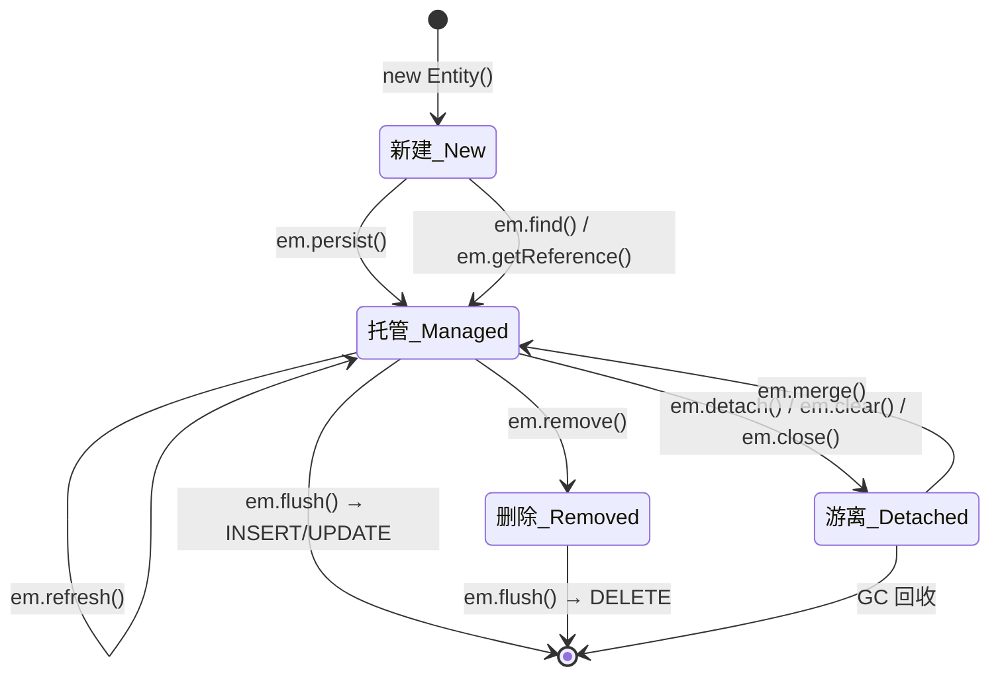

| 生命周期状态 | 说明 | 持久化上下文跟踪 | 数据库同步 |
|---|---|---|---|
| New（新建） | 刚创建，无主键 | 否 | 否 |
| Managed（托管） | 在持久化上下文中 | 是 | 是（flush 时同步） |
| Detached（游离） | 脱离持久化上下文 | 否 | 否 |
| Removed（删除） | 标记为删除 | 是 | 是（flush 时执行 DELETE） |

```java
// Entity 生命周期回调示例
@Entity
@Table(name = "t_user")
@EntityListeners(AuditingEntityListener.class)  // JPA 审计监听器
public class User {

    @Id
    @GeneratedValue(strategy = GenerationType.IDENTITY)
    private Long id;

    private String username;

    // 生命周期回调方法
    @PrePersist  // 持久化之前（INSERT 之前）
    private void prePersist() {
        System.out.println("即将插入用户：" + username);
    }

    @PostPersist  // 持久化之后（INSERT 之后，已有主键）
    private void postPersist() {
        System.out.println("用户已插入，ID=" + id);
    }

    @PreUpdate  // 更新之前（UPDATE 之前）
    private void preUpdate() {
        System.out.println("即将更新用户：" + username);
    }

    @PostUpdate  // 更新之后（UPDATE 之后）
    private void postUpdate() {
        System.out.println("用户已更新");
    }

    @PreRemove  // 删除之前（DELETE 之前）
    private void preRemove() {
        System.out.println("即将删除用户：" + id);
    }

    @PostRemove  // 删除之后（DELETE 之后）
    private void postRemove() {
        System.out.println("用户已删除");
    }

    @PostLoad  // 加载之后（SELECT 之后）
    private void postLoad() {
        System.out.println("用户已加载：" + username);
    }
}
```

::: tip 生命周期回调的使用场景
- `@PrePersist`：设置创建时间、初始化默认值
- `@PreUpdate`：设置更新时间
- `@PostLoad`：计算派生属性、缓存解密字段
- `@PreRemove`：检查是否允许删除、级联清理关联数据
:::

#### JPA 审计功能

JPA 审计（Auditing）自动记录实体的创建时间、修改时间、创建人、修改人等审计信息，是数据合规的重要手段。

```java
// 1. 启用 JPA 审计
@Configuration
@EnableJpaAuditing(auditorAwareRef = "auditorAware")
public class JpaAuditingConfig {}

// 2. 实现 AuditorAware 接口，提供当前操作人
@Component
public class SpringSecurityAuditorAware implements AuditorAware<String> {

    @Override
    public Optional<String> getCurrentAuditor() {
        // 从 Spring Security 上下文获取当前用户
        Authentication authentication = SecurityContextHolder.getContext().getAuthentication();
        if (authentication == null || !authentication.isAuthenticated()) {
            return Optional.of("system");  // 系统自动操作
        }
        return Optional.of(authentication.getName());
    }
}

// 3. 审计基类——所有实体继承此类即可获得审计功能
@MappedSuperclass
@EntityListeners(AuditingEntityListener.class)
public abstract class BaseEntity {

    @CreatedDate  // 创建时间
    @Column(name = "created_at", updatable = false)
    private LocalDateTime createdAt;

    @LastModifiedDate  // 最后修改时间
    @Column(name = "updated_at")
    private LocalDateTime updatedAt;

    @CreatedBy  // 创建人
    @Column(name = "created_by", updatable = false, length = 50)
    private String createdBy;

    @LastModifiedBy  // 最后修改人
    @Column(name = "updated_by", length = 50)
    private String updatedBy;
}

// 4. 实体继承审计基类
@Entity
@Table(name = "t_order")
public class Order extends BaseEntity {
    @Id
    @GeneratedValue(strategy = GenerationType.IDENTITY)
    private Long id;

    private String orderNo;
    private BigDecimal amount;
}
```

::: warning 审计字段与 @DynamicUpdate
如果使用了 `@DynamicUpdate`（只更新变化的字段），审计字段 `updatedAt` 和 `updatedBy` 每次都会被更新，即使业务字段没有变化。如果需要只在业务字段变化时才更新审计字段，需要自定义 `EntityListener` 逻辑。
:::

#### @Query 高级用法

```java
public interface UserRepository extends JpaRepository<User, Long> {

    // 1. JPQL 查询（面向对象，使用实体类名和属性名）
    @Query("SELECT u FROM User u WHERE u.username = :username")
    Optional<User> findByUsername(@Param("username") String username);

    // 2. 原生 SQL 查询（nativeQuery = true）
    @Query(value = "SELECT * FROM t_user WHERE DATE(created_at) = :date", nativeQuery = true)
    List<User> findByCreatedDate(@Param("date") LocalDate date);

    // 3. 更新操作（必须加 @Modifying + @Transactional）
    @Modifying
    @Transactional
    @Query("UPDATE User u SET u.status = :status WHERE u.id IN :ids")
    int batchUpdateStatus(@Param("status") Integer status, @Param("ids") List<Long> ids);

    // 4. 删除操作
    @Modifying
    @Transactional
    @Query("DELETE FROM User u WHERE u.lastLoginAt < :expireDate")
    int deleteInactiveUsers(@Param("expireDate") LocalDateTime expireDate);

    // 5. 联表查询 + DTO 投影
    @Query("SELECT new com.example.dto.UserOrderDTO(u.username, COUNT(o.id), SUM(o.amount)) " +
           "FROM User u LEFT JOIN u.orders o " +
           "GROUP BY u.username " +
           "HAVING SUM(o.amount) > :minAmount")
    List<UserOrderDTO> findUserOrderStats(@Param("minAmount") BigDecimal minAmount);

    // 6. 使用 SpEL 表达式引用实体类名
    @Query("SELECT e FROM #{#entityName} e WHERE e.deleted = false")
    List<User> findAllActive();

    // 7. LIKE 模糊查询——注意拼接方式
    @Query("SELECT u FROM User u WHERE u.username LIKE CONCAT('%', :keyword, '%')")
    List<User> searchByKeyword(@Param("keyword") String keyword);
}
```

::: danger @Modifying 的坑
1. `@Modifying` 必须配合 `@Transactional` 使用，否则抛出 `InvalidDataAccessApiUsageException`
2. 默认情况下，`@Modifying` 执行后持久化上下文中的实体可能过时。如果需要刷新，使用 `@Modifying(clearAutomatically = true, flushAutomatically = true)`
3. `clearAutomatically = true` 会清除持久化上下文，后续访问实体需要重新查询
4. `flushAutomatically = true` 在执行更新前先 flush，确保未保存的变更不会丢失
:::

#### Specification 动态查询

Specification（规范查询）是 JPA 提供的类型安全动态查询机制，适合构建复杂的动态条件查询。

```java
// 1. 实现 Specification 接口
public class UserSpecs {

    // 用户名模糊查询
    public static Specification<User> usernameLike(String username) {
        return (root, query, cb) ->
            StringUtils.isBlank(username) ? null :
            cb.like(root.get("username"), "%" + username + "%");
    }

    // 状态精确匹配
    public static Specification<User> statusEqual(Integer status) {
        return (root, query, cb) ->
            status == null ? null : cb.equal(root.get("status"), status);
    }

    // 创建时间范围查询
    public static Specification<User> createdAtBetween(LocalDateTime start, LocalDateTime end) {
        return (root, query, cb) ->
            start == null || end == null ? null :
            cb.between(root.get("createdAt"), start, end);
    }

    // 关联查询：订单金额大于指定值
    public static Specification<User> hasOrderAmountGreaterThan(BigDecimal amount) {
        return (root, query, cb) -> {
            Join<User, Order> orderJoin = root.join("orders", JoinType.INNER);
            return cb.greaterThan(orderJoin.get("amount"), amount);
        };
    }
}

// 2. Repository 继承 JpaSpecificationExecutor
public interface UserRepository extends JpaRepository<User, Long>,
        JpaSpecificationExecutor<User> {
}

// 3. Service 层组合动态查询
@Service
@RequiredArgsConstructor
public class UserService {

    private final UserRepository userRepository;

    public Page<User> search(UserQueryDTO queryDTO, Pageable pageable) {
        // 动态组合查询条件
        Specification<User> spec = Specification
            .where(UserSpecs.usernameLike(queryDTO.getUsername()))
            .and(UserSpecs.statusEqual(queryDTO.getStatus()))
            .and(UserSpecs.createdAtBetween(queryDTO.getStartTime(), queryDTO.getEndTime()));

        return userRepository.findAll(spec, pageable);
    }
}
```

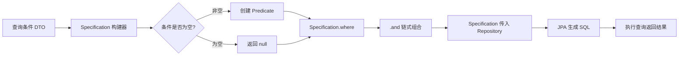

::: tip Specification 的优势
1. 类型安全——编译期检查属性名，避免字符串拼写错误
2. 可复用——每个条件封装为独立的 Specification，可自由组合
3. 可测试——每个 Specification 可以单独单元测试
4. 动态组合——根据前端传参灵活拼接条件，空条件自动忽略
:::

#### 投影查询

投影（Projection）只查询需要的字段，避免查询整行数据，提升查询性能。

```java
// 1. 基于接口的投影（动态代理实现）
public interface UserSummary {
    Long getId();
    String getUsername();
    String getEmail();

    // 支持 SpEL 表达式计算派生值
    @Value("#{target.username + ' <' + target.email + '>'}")
    String getDisplayName();
}

public interface UserRepository extends JpaRepository<User, Long> {
    // 返回接口投影
    List<UserSummary> findByStatus(Integer status);

    // 基于 @Query 的投影
    @Query("SELECT u.id AS id, u.username AS username FROM User u WHERE u.deleted = false")
    List<UserSummary> findActiveUserSummaries();
}

// 2. 基于类的投影（DTO）
public record UserOrderCountDTO(String username, Long orderCount) {}

@Query("SELECT new com.example.dto.UserOrderCountDTO(u.username, COUNT(o.id)) " +
       "FROM User u LEFT JOIN u.orders o GROUP BY u.username")
List<UserOrderCountDTO> findUserOrderCounts();

// 3. 基于记录类（Java 16+ Record）的投影
public record UserBriefProjection(Long id, String username, LocalDateTime createdAt) {}

List<UserBriefProjection> findAllProjectedBy();
```

::: warning 接口投影的性能陷阱
接口投影在运行时通过动态代理生成实现类，每个属性访问都会通过代理调用。在大量数据场景下，DTO 投影（基于类或 Record）性能更好，因为直接通过构造函数赋值，没有代理开销。
:::

#### 自定义 Repository

当 Spring Data JPA 提供的默认方法无法满足需求时，可以通过自定义 Repository 扩展功能。

```java
// 1. 定义自定义 Repository 接口
public interface CustomUserRepository {
    // 批量插入（使用 JDBC 批处理提升性能）
    void batchInsert(List<User> users);

    // 复杂统计查询
    UserStatisticsDTO getUserStatistics(Long userId);
}

// 2. 实现自定义 Repository
public class CustomUserRepositoryImpl implements CustomUserRepository {

    @PersistenceContext
    private EntityManager entityManager;

    @Override
    @Transactional
    public void batchInsert(List<User> users) {
        for (int i = 0; i < users.size(); i++) {
            entityManager.persist(users.get(i));
            // 每 50 条 flush 一次，避免内存溢出
            if (i % 50 == 0) {
                entityManager.flush();
                entityManager.clear();  // 清除持久化上下文，释放内存
            }
        }
    }

    @Override
    public UserStatisticsDTO getUserStatistics(Long userId) {
        // 使用原生 SQL 执行复杂统计
        Query query = entityManager.createNativeQuery(
            "SELECT COUNT(*) AS order_count, SUM(amount) AS total_amount " +
            "FROM t_order WHERE user_id = :userId"
        );
        query.setParameter("userId", userId);
        Object[] row = (Object[]) query.getSingleResult();
        return new UserStatisticsDTO(
            ((Number) row[0]).longValue(),
            (BigDecimal) row[1]
        );
    }
}

// 3. 让 Repository 接口继承自定义接口
public interface UserRepository extends JpaRepository<User, Long>,
        JpaSpecificationExecutor<User>,
        CustomUserRepository {  // 继承自定义接口
    // Spring Data JPA 会自动将 CustomUserRepositoryImpl 的方法
    // 合并到 UserRepository 的代理中
}
```

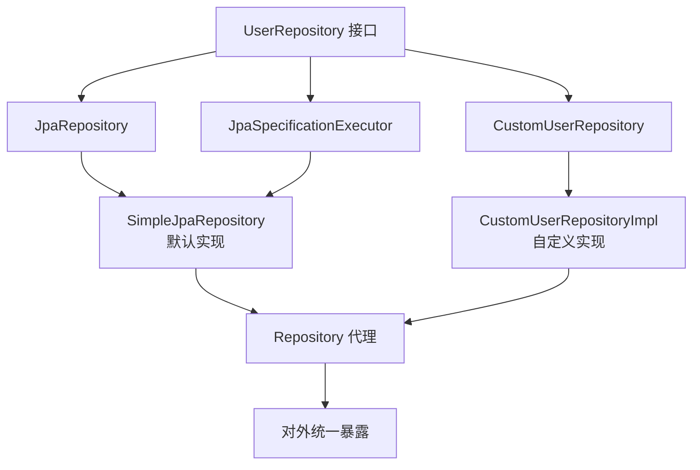

::: tip 自定义 Repository 的命名约定
自定义实现类的名称必须是 `接口名 + Impl`，例如 `CustomUserRepository` 的实现类必须是 `CustomUserRepositoryImpl`。如果使用其他命名，需要在 `@EnableJpaRepositories` 中配置 `repositoryImplementationPostfix` 参数。
:::

#### N+1 查询问题

```java
// × N+1 问题：查询 N 个用户，每个用户触发 1 次订单查询
@GetMapping("/users")
public List<User> getUsers() {
    List<User> users = userRepository.findAll();  // 1 次查询
    // 延迟加载 orders，每个用户触发 1 次查询 = N 次查询
    users.forEach(u -> u.getOrders().size());  // N 次查询！
    return users;
}

// √ 方式1：JOIN FETCH 一次性加载
@Query("SELECT u FROM User u LEFT JOIN FETCH u.orders")
List<User> findAllWithOrders();

// √ 方式2：@EntityGraph 声明式加载
@EntityGraph(attributePaths = "orders")
List<User> findAll();

// √ 方式3：@NamedEntityGraph 在实体上定义
@NamedEntityGraph(
    name = "User.withOrders",
    attributeNodes = @NamedAttributeNode("orders")
)
@Entity
public class User { ... }

// 在 Repository 中引用
@EntityGraph(value = "User.withOrders", type = EntityGraphType.LOAD)
List<User> findAll();

// √ 方式4：关闭 OSIV + 在 Service 层完成加载
```

::: danger Open Session In View (OSIV) 的陷阱
Spring Boot 默认开启 `spring.jpa.open-in-view=true`，这会在请求开始时打开 EntityManager，请求结束时关闭。虽然方便了延迟加载，但会导致：
1. 数据库连接占用时间过长（从请求开始到结束）
2. 隐藏了 N+1 问题——因为 EM 一直开着，延迟加载不会报错
3. 事务边界模糊——Service 层事务结束后，Controller 层仍在查询数据库

**生产环境建议关闭 OSIV**：`spring.jpa.open-in-view=false`，在 Service 层完成所有数据加载。
:::

### 事务管理源码分析

> 本节为数据访问场景下的事务机制速览；声明式事务完整的源码 Debug（生效原理、工作原理、传播行为）见 [32-声明式事务原理与传播机制](32-声明式事务原理与传播机制.md)。

#### @Transactional 的实现原理

```java
// Spring 通过 AOP 代理实现声明式事务
// TransactionInterceptor 拦截 @Transactional 方法
public class TransactionInterceptor extends TransactionAspectSupport
    implements MethodInterceptor {

    @Override
    public Object invoke(MethodInvocation invocation) throws Throwable {
        // 获取事务属性
        TransactionAttributeSource tas = getTransactionAttributeSource();
        TransactionAttribute txAttr = tas.getTransactionAttribute(method, targetClass);

        // 获取 PlatformTransactionManager
        PlatformTransactionManager tm = determineTransactionManager(txAttr);

        // 创建事务
        TransactionInfo txInfo = createTransactionIfNecessary(tm, txAttr, joinpointIdentification);

        try {
            // 执行目标方法
            Object retVal = invocation.proceedWithInvocation();
            return retVal;
        } catch (Throwable ex) {
            // 异常回滚
            completeTransactionAfterThrowing(txInfo, ex);
            throw ex;
        } finally {
            cleanupTransactionInfo(txInfo);
        }
    }
}
```

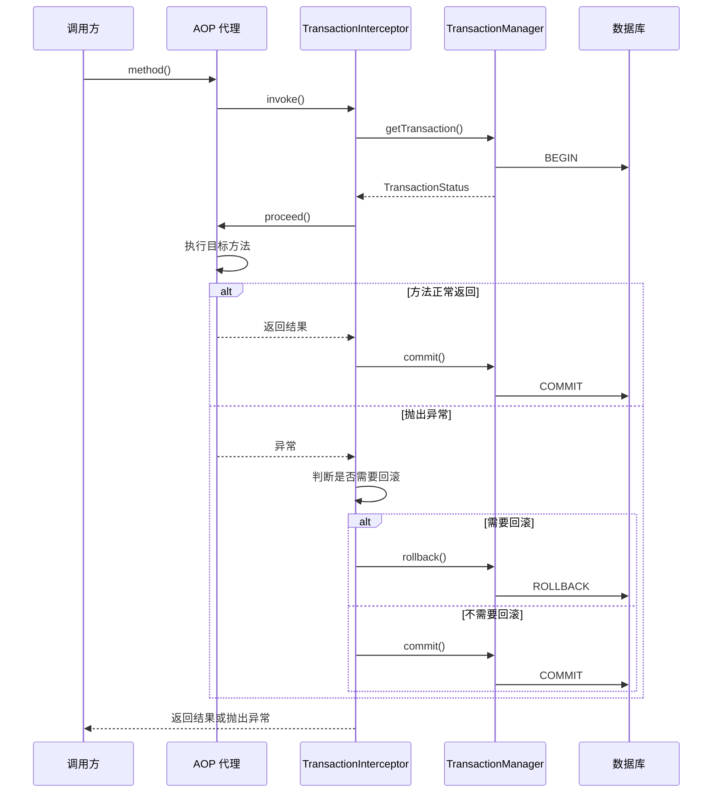

#### 事务传播行为详解

事务传播行为（Propagation Behavior）定义了当一个事务方法被另一个事务方法调用时，事务应该如何传播。Spring 提供了 7 种传播行为。

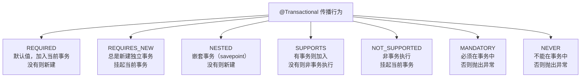

| 传播行为 | 当前有事务 | 当前无事务 | 典型场景 |
|---|---|---|---|
| **REQUIRED**（默认） | 加入当前事务 | 新建事务 | 大部分业务方法 |
| **REQUIRES_NEW** | 挂起当前事务，新建事务 | 新建事务 | 日志记录、独立操作 |
| **NESTED** | 在当前事务中创建 savepoint | 新建事务 | 部分回滚场景 |
| **SUPPORTS** | 加入当前事务 | 非事务执行 | 查询方法 |
| **NOT_SUPPORTED** | 挂起当前事务，非事务执行 | 非事务执行 | 不需要事务的操作 |
| **MANDATORY** | 加入当前事务 | 抛出 `IllegalTransactionStateException` | 必须在事务中调用的方法 |
| **NEVER** | 抛出 `IllegalTransactionStateException` | 非事务执行 | 不允许事务的操作 |

##### REQUIRED 传播行为源码分析

```java
// AbstractPlatformTransactionManager.handleExistingTransaction() 核心逻辑
// 当传播行为为 REQUIRED 且当前已有事务时
if (definition.getPropagationBehavior() == TransactionDefinition.PROPAGATION_REQUIRED) {
    // 直接加入当前事务，不做任何处理
    return new TransactionStatusForExistingTransaction(
        transaction, null, newSynchronization, debugEnabled, null
    );
}

// 当传播行为为 REQUIRED 且当前无事务时
// 在 getTransaction() 中会创建新事务
if (definition.getPropagationBehavior() == TransactionDefinition.PROPAGATION_REQUIRED) {
    // 启动新事务
    doBegin(transaction, definition);
    // ... 注册同步回调
}
```

##### REQUIRES_NEW 传播行为源码分析

```java
// REQUIRES_NEW：总是新建独立事务，挂起当前事务
if (definition.getPropagationBehavior() == TransactionDefinition.PROPAGATION_REQUIRES_NEW) {
    // 挂起当前事务
    SuspendedResourcesHolder suspendedResources = suspend(transaction);
    try {
        // 创建新事务
        boolean newSynchronization = (getTransactionSynchronization() != SYNCHRONIZATION_NEVER);
        DefaultTransactionStatus status = newTransactionStatus(
            definition, transaction, true, newSynchronization, debugEnabled, suspendedResources);
        doBegin(transaction, definition);
        prepareSynchronization(status, definition);
        return status;
    } catch (RuntimeException | Error ex) {
        // 新事务创建失败，恢复挂起的事务
        resume(transaction, suspendedResources);
        throw ex;
    }
}
```

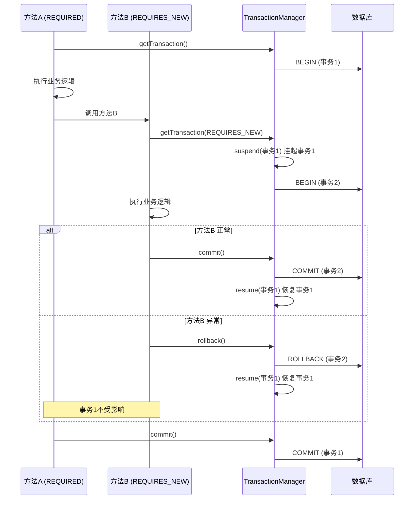

##### NESTED 嵌套事务源码分析

```java
// NESTED：在当前事务中创建 savepoint
if (definition.getPropagationBehavior() == TransactionDefinition.PROPAGATION_NESTED) {
    // 检查是否支持 savepoint
    if (!isNestedTransactionAllowed()) {
        throw new NestedTransactionNotSupportedException(
            "Nested transaction not supported");
    }
    // 使用 savepoint 实现嵌套
    if (useSavepointForNestedTransaction()) {
        // 在当前事务中创建 savepoint
        SavepointManager savepointManager = getSavepointManager(transaction);
        Object savepoint = savepointManager.createSavepoint();
        return new DefaultTransactionStatus(
            transaction, false, false, newSynchronization, debugEnabled, savepoint);
    }
}
```

```java
// NESTED vs REQUIRES_NEW 的区别
@Service
public class OrderService {

    // NESTED：内层事务回滚不影响外层（通过 savepoint）
    @Transactional
    public void createOrder() {
        orderMapper.insert(order);
        try {
            this.saveLog();  // NESTED 传播
        } catch (Exception e) {
            // 日志保存失败，只回滚到 savepoint，订单不受影响
        }
    }

    @Transactional(propagation = Propagation.NESTED)
    public void saveLog() {
        logMapper.insert(log);
        // 如果这里抛出异常，只回滚到 savepoint
    }
}
```

::: tip NESTED 与 REQUIRES_NEW 的选择
- **NESTED**：内层事务是外层事务的一部分，共享同一个数据库连接。内层回滚到 savepoint，外层可以继续。如果外层回滚，内层也会回滚。
- **REQUIRES_NEW**：内层事务完全独立，使用新的数据库连接。内层回滚不影响外层，外层回滚也不影响内层。
- 大多数场景下，如果只是想"部分失败不影响整体"，优先使用 NESTED，性能更好。
:::

#### 事务隔离级别

事务隔离级别（Isolation Level）定义了一个事务必须与其它事务隔离的程度。隔离级别越高，数据一致性越好，但并发性能越低。

| 隔离级别 | 脏读 | 不可重复读 | 幻读 | 说明 |
|---|---|---|---|---|
| READ_UNCOMMITTED | 可能 | 可能 | 可能 | 最低隔离，能读到未提交数据 |
| READ_COMMITTED | 不会 | 可能 | 可能 | Oracle 默认，只读已提交数据 |
| REPEATABLE_READ | 不会 | 不会 | 可能 | MySQL InnoDB 默认，同一事务内读取一致 |
| SERIALIZABLE | 不会 | 不会 | 不会 | 最高隔离，完全串行化执行 |

```java
// Spring 中设置隔离级别
@Transactional(isolation = Isolation.REPEATABLE_READ)
public User findById(Long id) {
    return userMapper.selectById(id);
}

// AbstractPlatformTransactionManager 中隔离级别的处理
protected DefaultTransactionStatus startTransaction(
        TransactionDefinition definition, Object transaction,
        boolean newSynchronization, boolean debugEnabled) {
    
    // 根据隔离级别设置数据库连接的隔离级别
    if (definition.getIsolationLevel() != TransactionDefinition.ISOLATION_DEFAULT) {
        doSetIsolationLevel(transaction, definition.getIsolationLevel());
    }
    // ...
}
```

::: warning MySQL InnoDB 对幻读的处理
MySQL InnoDB 在 REPEATABLE_READ 隔离级别下，通过 Next-Key Lock（间隙锁 + 行锁）在一定程度上避免了幻读。但这是 InnoDB 的实现增强，并非 SQL 标准的要求。在特定场景下（如先快照读再当前读），仍可能出现幻读现象。
:::

#### 事务超时

```java
// 事务超时设置（单位：秒）
@Transactional(timeout = 30)  // 30 秒超时
public void processOrder(Long orderId) {
    // 如果 30 秒内未完成，事务自动回滚
    orderMapper.updateStatus(orderId, "PROCESSING");
    // ... 耗时操作
}

// TransactionTemplate 编程式事务超时
TransactionTemplate txTemplate = new TransactionTemplate(transactionManager);
txTemplate.setTimeout(30);  // 30 秒超时
txTemplate.execute(status -> {
    // 事务操作
    return result;
});
```

#### 事务失效的常见场景

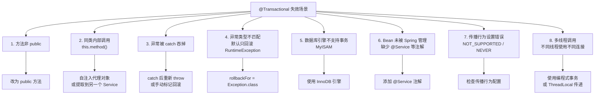

##### 场景1：同类内部调用

```java
@Service
public class OrderService {
    // × 外部调用 createOrder() 有事务，但内部调用 deductStock() 不走代理
    @Transactional
    public void createOrder(OrderDTO dto) {
        orderMapper.insert(dto);
        this.deductStock(dto.getProductId());  // 不走代理，事务不生效！
    }

    @Transactional(propagation = Propagation.REQUIRES_NEW)
    public void deductStock(Long productId) {
        // 期望独立事务，但实际没有
    }
}

// √ 方式1：自注入代理
@Service
@RequiredArgsConstructor
public class OrderService {
    private final OrderService self;  // 代理对象

    @Transactional
    public void createOrder(OrderDTO dto) {
        orderMapper.insert(dto);
        self.deductStock(dto.getProductId());  // 走代理
    }
}

// √ 方式2：提取到另一个 Service
@Service
@RequiredArgsConstructor
public class OrderService {
    private final StockService stockService;

    @Transactional
    public void createOrder(OrderDTO dto) {
        orderMapper.insert(dto);
        stockService.deductStock(dto.getProductId());  // 走代理
    }
}
```

##### 场景2：异常被 catch 吞掉

```java
@Service
public class OrderService {

    // × 异常被 catch，事务不会回滚
    @Transactional
    public void createOrder(OrderDTO dto) {
        try {
            orderMapper.insert(dto);
            stockService.deductStock(dto.getProductId());
        } catch (Exception e) {
            log.error("创建订单失败", e);
            // 异常被吞掉，事务不会回滚！
        }
    }

    // √ 方式1：catch 后重新抛出
    @Transactional
    public void createOrder(OrderDTO dto) {
        try {
            orderMapper.insert(dto);
            stockService.deductStock(dto.getProductId());
        } catch (Exception e) {
            log.error("创建订单失败", e);
            throw e;  // 重新抛出，触发回滚
        }
    }

    // √ 方式2：手动标记回滚
    @Transactional
    public void createOrder(OrderDTO dto) {
        try {
            orderMapper.insert(dto);
            stockService.deductStock(dto.getProductId());
        } catch (Exception e) {
            log.error("创建订单失败", e);
            TransactionAspectSupport.currentTransactionStatus().setRollbackOnly();
        }
    }
}
```

##### 场景3：异常类型不匹配

```java
@Service
public class OrderService {

    // × 默认只回滚 RuntimeException 和 Error，不回滚 checked Exception
    @Transactional
    public void createOrder(OrderDTO dto) throws IOException {
        orderMapper.insert(dto);
        throw new IOException("文件写入失败");  // 不会回滚！
    }

    // √ 指定 rollbackFor = Exception.class，所有异常都回滚
    @Transactional(rollbackFor = Exception.class)
    public void createOrder(OrderDTO dto) throws IOException {
        orderMapper.insert(dto);
        throw new IOException("文件写入失败");  // 会回滚
    }
}
```

::: danger rollbackFor 的最佳实践
**始终使用 `@Transactional(rollbackFor = Exception.class)`**，这是最安全的做法。Spring 默认只回滚 `RuntimeException` 和 `Error`，不回滚 checked Exception（如 `IOException`、`SQLException`），这在大多数业务场景中是不符合预期的。
:::

##### 场景4：多线程调用

```java
@Service
public class OrderService {

    // × 多线程中事务不共享
    @Transactional
    public void batchProcess(List<Long> orderIds) {
        orderIds.parallelStream().forEach(id -> {
            // 每个线程获取不同的数据库连接，不在同一事务中
            orderMapper.updateStatus(id, "PROCESSED");
        });
    }

    // √ 使用编程式事务管理
    @Autowired
    private PlatformTransactionManager transactionManager;

    public void batchProcess(List<Long> orderIds) {
        orderIds.forEach(id -> {
            TransactionTemplate txTemplate = new TransactionTemplate(transactionManager);
            txTemplate.execute(status -> {
                orderMapper.updateStatus(id, "PROCESSED");
                return null;
            });
        });
    }
}
```

::: warning 多线程事务的本质
Spring 事务基于 `ThreadLocal` 存储事务上下文，不同线程天然无法共享事务。如果需要跨线程事务一致性，需要使用分布式事务方案（如 Seata AT 模式），或者将操作串行化在同一个线程中执行。
:::

### MyBatis-Plus 整合实践

#### 自动配置原理

```java
// MybatisPlusAutoConfiguration.java
@Configuration
@ConditionalOnClass({SqlSessionFactory.class, SqlSessionFactoryBean.class})
@EnableConfigurationProperties(MybatisPlusProperties.class)
@AutoConfigureAfter({DataSourceAutoConfiguration.class})
public class MybatisPlusAutoConfiguration {

    @Bean
    @ConditionalOnMissingBean
    public SqlSessionFactory sqlSessionFactory(DataSource dataSource,
                                                MybatisPlusProperties properties) throws Exception {
        MybatisSqlSessionFactoryBean factory = new MybatisSqlSessionFactoryBean();
        factory.setDataSource(dataSource);
        factory.setConfiguration(properties.getConfiguration());
        factory.setPlugins(properties.getPlugins());  // 注册插件
        return factory.getObject();
    }
}
```

#### BaseMapper 通用 CRUD

```java
@Mapper
public interface UserMapper extends BaseMapper<User> {
    // 自动拥有：insert / deleteById / updateById / selectById / selectList / selectPage
}

// 条件构造器示例
@Service
@RequiredArgsConstructor
public class UserService {
    private final UserMapper userMapper;

    public List<User> searchUsers(String name, String status) {
        LambdaQueryWrapper<User> wrapper = new LambdaQueryWrapper<>();
        wrapper.like(StringUtils.isNotBlank(name), User::getUsername, name)
               .eq(StringUtils.isNotBlank(status), User::getStatus, status)
               .orderByDesc(User::getCreatedAt);
        return userMapper.selectList(wrapper);
    }
}
```

#### 分页插件配置

MyBatis-Plus 提供了开箱即用的分页插件，支持多种数据库方言。

```java
// 分页插件配置
@Configuration
public class MybatisPlusConfig {

    @Bean
    public MybatisPlusInterceptor mybatisPlusInterceptor() {
        MybatisPlusInterceptor interceptor = new MybatisPlusInterceptor();
        // 添加分页插件，指定数据库类型
        interceptor.addInnerInterceptor(
            new PaginationInnerInterceptor(DbType.MYSQL)
        );
        return interceptor;
    }
}
```

```java
// 分页查询使用示例
@Service
@RequiredArgsConstructor
public class UserService {

    private final UserMapper userMapper;

    // 基础分页查询
    public IPage<User> pageQuery(int pageNum, int pageSize, String keyword) {
        Page<User> page = new Page<>(pageNum, pageSize);
        LambdaQueryWrapper<User> wrapper = new LambdaQueryWrapper<>();
        wrapper.like(StringUtils.isNotBlank(keyword), User::getUsername, keyword)
               .orderByDesc(User::getCreatedAt);
        return userMapper.selectPage(page, wrapper);
    }

    // 自定义 SQL 分页查询
    // UserMapper.java
    @Select("SELECT u.*, d.name AS dept_name FROM t_user u " +
            "LEFT JOIN t_dept d ON u.dept_id = d.id " +
            "WHERE u.status = #{status}")
    IPage<UserVO> selectUserVOPage(
        Page<UserVO> page,  // MyBatis-Plus 自动处理分页参数
        @Param("status") Integer status
    );
}
```

```java
// Controller 层分页响应封装
@GetMapping("/users")
public Result<PageResult<UserVO>> listUsers(
        @RequestParam(defaultValue = "1") Integer pageNum,
        @RequestParam(defaultValue = "10") Integer pageSize,
        @RequestParam(required = false) String keyword) {
    
    IPage<User> page = userService.pageQuery(pageNum, pageSize, keyword);
    
    PageResult<UserVO> result = new PageResult<>();
    result.setList(BeanUtil.copyToList(page.getRecords(), UserVO.class));
    result.setTotal(page.getTotal());
    result.setPageNum(page.getCurrent());
    result.setPageSize(page.getSize());
    
    return Result.success(result);
}
```

::: tip 分页插件的优化建议
1. 对于深分页（如 `LIMIT 100000, 10`），性能会急剧下降。建议使用游标分页（基于 ID 的 `WHERE id > lastId LIMIT 10`）
2. 设置分页上限防止恶意请求：`paginationInterceptor.setMaxLimit(500L)`
3. 开启 count 查询优化：对于复杂 JOIN 查询，count 语句可能很慢，可以手动指定 count SQL
:::

#### 乐观锁插件

乐观锁（Optimistic Locking）通过版本号机制实现并发控制，适合读多写少的场景。

```java
// 1. 配置乐观锁插件
@Configuration
public class MybatisPlusConfig {

    @Bean
    public MybatisPlusInterceptor mybatisPlusInterceptor() {
        MybatisPlusInterceptor interceptor = new MybatisPlusInterceptor();
        interceptor.addInnerInterceptor(new PaginationInnerInterceptor(DbType.MYSQL));
        interceptor.addInnerInterceptor(new OptimisticLockerInnerInterceptor());  // 乐观锁
        return interceptor;
    }
}

// 2. 实体类添加 @Version 字段
@Data
@TableName("t_product")
public class Product {
    @TableId
    private Long id;

    private String name;
    private BigDecimal price;
    private Integer stock;

    @Version  // 乐观锁版本号
    private Integer version;
}

// 3. 使用乐观锁更新
@Service
@RequiredArgsConstructor
public class ProductService {

    private final ProductMapper productMapper;

    @Transactional
    public boolean deductStock(Long productId, Integer quantity) {
        // 先查询获取当前版本号
        Product product = productMapper.selectById(productId);
        if (product.getStock() < quantity) {
            throw new BusinessException("库存不足");
        }
        
        // 设置扣减数量，MyBatis-Plus 自动在 UPDATE 中添加 version 条件
        product.setStock(product.getStock() - quantity);
        int rows = productMapper.updateById(product);
        // 生成的 SQL：UPDATE t_product SET stock=?, version=version+1 
        //            WHERE id=? AND version=原版本号
        
        if (rows == 0) {
            // 版本号不匹配，说明已被其他线程修改
            throw new BusinessException("并发冲突，请重试");
        }
        return true;
    }
}
```

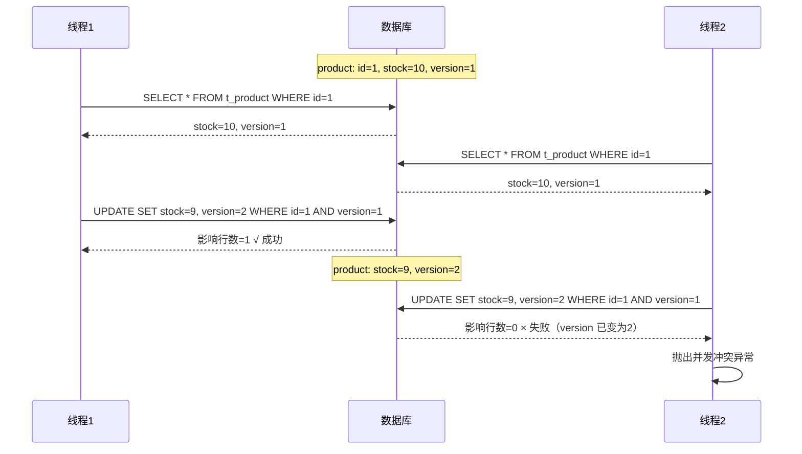

#### 逻辑删除

逻辑删除（Logical Delete）不真正删除数据，而是标记为"已删除"状态，保留数据用于审计和恢复。

```java
// 1. 全局配置逻辑删除
// application.yml
mybatis-plus:
  global-config:
    db-config:
      logic-delete-field: deleted    # 全局逻辑删除字段名
      logic-delete-value: 1          # 删除值
      logic-not-delete-value: 0      # 未删除值

// 2. 实体类添加逻辑删除字段
@Data
@TableName("t_user")
public class User {
    @TableId
    private Long id;

    private String username;

    @TableLogic  // 逻辑删除字段
    private Integer deleted;
}

// 3. 使用效果
// deleteById() → UPDATE t_user SET deleted=1 WHERE id=? AND deleted=0
// selectById() → SELECT * FROM t_user WHERE id=? AND deleted=0
// selectList() → SELECT * FROM t_user WHERE deleted=0
```

::: warning 逻辑删除的注意事项
1. `@TableLogic` 字段会自动追加到所有查询的 WHERE 条件中，包括 JOIN 查询
2. 如果某些场景需要查询已删除的数据，需要自定义 SQL 并手动处理 `deleted` 条件
3. 唯一索引需要包含 `deleted` 字段，否则逻辑删除后无法重新插入相同业务主键的记录
4. 逻辑删除与物理删除混用时需要特别注意，建议全局统一使用一种方式
:::

#### 自动填充

自动填充（AutoFill）在插入和更新时自动填充指定字段，如创建时间、更新时间等。

```java
// 1. 实体类标注填充策略
@Data
@TableName("t_user")
public class User {
    @TableId
    private Long id;

    private String username;

    @TableField(fill = FieldFill.INSERT)  // 插入时填充
    private LocalDateTime createTime;

    @TableField(fill = FieldFill.INSERT_UPDATE)  // 插入和更新时填充
    private LocalDateTime updateTime;

    @TableField(fill = FieldFill.INSERT)  // 插入时填充
    private String createBy;

    @TableField(fill = FieldFill.INSERT_UPDATE)  // 插入和更新时填充
    private String updateBy;
}

// 2. 实现 MetaObjectHandler 接口
@Component
public class MyMetaObjectHandler implements MetaObjectHandler {

    @Override
    public void insertFill(MetaObject metaObject) {
        this.strictInsertFill(metaObject, "createTime", LocalDateTime.class, LocalDateTime.now());
        this.strictInsertFill(metaObject, "updateTime", LocalDateTime.class, LocalDateTime.now());
        this.strictInsertFill(metaObject, "createBy", String.class, getCurrentUser());
        this.strictInsertFill(metaObject, "updateBy", String.class, getCurrentUser());
    }

    @Override
    public void updateFill(MetaObject metaObject) {
        this.strictUpdateFill(metaObject, "updateTime", LocalDateTime.class, LocalDateTime.now());
        this.strictUpdateFill(metaObject, "updateBy", String.class, getCurrentUser());
    }

    private String getCurrentUser() {
        Authentication auth = SecurityContextHolder.getContext().getAuthentication();
        return auth != null ? auth.getName() : "system";
    }
}
```

::: tip strictInsertFill vs setFieldValByName
- `strictInsertFill`：只有当字段为 null 时才填充，不会覆盖已有值
- `setFieldValByName`：无论字段是否有值都会覆盖
- 推荐使用 `strictInsertFill`，避免覆盖业务代码中手动设置的值
:::

#### 多租户

多租户（Multi-Tenancy）通过在 SQL 中自动追加租户条件，实现数据隔离。

```java
// 1. 实现 TenantLineHandler 接口
@Component
public class CustomTenantHandler implements TenantLineHandler {

    // 获取当前租户 ID
    @Override
    public Expression getTenantId() {
        Long tenantId = TenantContextHolder.getTenantId();
        return new LongValue(tenantId != null ? tenantId : 0);
    }

    // 获取租户字段名
    @Override
    public String getTenantIdColumn() {
        return "tenant_id";
    }

    // 判断哪张表不需要租户隔离
    @Override
    public boolean ignoreTable(String tableName) {
        // 系统表不需要租户隔离
        return "sys_config".equals(tableName) ||
               "sys_dict".equals(tableName);
    }
}

// 2. 配置多租户插件
@Configuration
public class MybatisPlusConfig {

    @Bean
    public MybatisPlusInterceptor mybatisPlusInterceptor(
            CustomTenantHandler tenantHandler) {
        MybatisPlusInterceptor interceptor = new MybatisPlusInterceptor();
        // 多租户插件必须放在最前面
        interceptor.addInnerInterceptor(new TenantLineInnerInterceptor(tenantHandler));
        interceptor.addInnerInterceptor(new PaginationInnerInterceptor(DbType.MYSQL));
        interceptor.addInnerInterceptor(new OptimisticLockerInnerInterceptor());
        return interceptor;
    }
}

// 3. 租户上下文
public class TenantContextHolder {
    private static final ThreadLocal<Long> TENANT_ID = new ThreadLocal<>();

    public static void setTenantId(Long tenantId) {
        TENANT_ID.set(tenantId);
    }

    public static Long getTenantId() {
        return TENANT_ID.get();
    }

    public static void clear() {
        TENANT_ID.remove();
    }
}
```

```java
// 使用效果
// 原始 SQL：SELECT * FROM t_user WHERE id = 1
// 自动追加租户条件后：SELECT * FROM t_user WHERE id = 1 AND tenant_id = 100

// INSERT 也会自动追加租户 ID
// 原始 SQL：INSERT INTO t_user (username, age) VALUES ('张三', 25)
// 自动追加后：INSERT INTO t_user (username, age, tenant_id) VALUES ('张三', 25, 100)
```

::: danger 多租户插件的执行顺序
MyBatis-Plus 的多个 InnerInterceptor 按添加顺序执行。多租户插件必须放在最前面，确保所有 SQL 都经过租户条件追加。如果放在分页插件之后，分页的 count 查询可能不会追加租户条件，导致数据泄漏。
:::

#### 代码生成器

MyBatis-Plus 提供代码生成器（Code Generator），可以根据数据库表结构自动生成 Entity、Mapper、Service、Controller 等代码。

```java
// 代码生成器配置（MyBatis-Plus 3.5.x 新版 API）
public class CodeGenerator {

    public static void main(String[] args) {
        // 数据源配置
        DataSourceConfig.Builder dataSourceConfig = new DataSourceConfig.Builder(
            "jdbc:mysql://localhost:3306/my_db",
            "root",
            "root123"
        );

        // 全局配置
        GlobalConfig globalConfig = new GlobalConfig.Builder()
            .outputDir(System.getProperty("user.dir") + "/src/main/java")
            .author("generator")
            .enableSwagger()  // 开启 Swagger 注解
            .dateType(DateType.TIME_PACK)  // 使用 LocalDateTime
            .build();

        // 包配置
        PackageConfig packageConfig = new PackageConfig.Builder()
            .parent("com.example")
            .moduleName("system")
            .entity("entity")
            .mapper("mapper")
            .service("service")
            .serviceImpl("service.impl")
            .controller("controller")
            .build();

        // 策略配置
        StrategyConfig strategyConfig = new StrategyConfig.Builder()
            .addInclude("t_user", "t_order", "t_product")  // 要生成的表
            .addTablePrefix("t_")  // 表名前缀，生成时去除
            .entityBuilder()
                .enableLombok()  // 使用 Lombok
                .enableTableFieldAnnotation()  // 所有字段加 @TableField
                .logicDeleteColumnName("deleted")  // 逻辑删除字段
                .versionColumnName("version")  // 乐观锁字段
                .addTableFills(
                    new Column("create_time", FieldFill.INSERT),
                    new Column("update_time", FieldFill.INSERT_UPDATE)
                )
            .mapperBuilder()
                .enableMapperAnnotation()  // 添加 @Mapper 注解
                .enableBaseResultMap()  // 生成 BaseResultMap
            .serviceBuilder()
                .formatServiceFileName("%sService")  // 不加 I 前缀
            .controllerBuilder()
                .enableRestStyle()  // @RestController
            .build();

        // 执行生成
        AutoGenerator generator = new AutoGenerator(dataSourceConfig)
            .global(globalConfig)
            .packageInfo(packageConfig)
            .strategy(strategyConfig)
            .templateEngine(new FreemarkerTemplateEngine());  // 使用 Freemarker 模板

        generator.execute();
    }
}
```

::: tip 代码生成器的最佳实践
1. 生成代码后务必检查，不要盲目使用——生成的代码只是骨架
2. 自定义模板以匹配项目规范（如统一返回格式、异常处理等）
3. 建议只生成一次，后续手动维护，避免覆盖已有修改
4. 可以只生成 Entity 和 Mapper，Service 和 Controller 手写以保持灵活性
:::

### HikariCP 连接池调优

#### 生产级配置

```yaml
spring:
  datasource:
    hikari:
      maximum-pool-size: 20            # 最大连接数
      minimum-idle: 5                   # 最小空闲连接数
      connection-timeout: 30000         # 获取连接超时（ms）
      idle-timeout: 600000              # 空闲连接超时（ms）
      max-lifetime: 1800000             # 连接最大存活时间（ms）
      leak-detection-threshold: 60000   # 连接泄漏检测阈值（ms）
      pool-name: MyHikariCP             # 连接池名称，便于监控
      connection-test-query: SELECT 1   # 连接测试语句
      validation-timeout: 5000          # 连接验证超时（ms）
```

::: tip 连接池大小计算公式
HikariCP 作者推荐：`connections = ((core_count * 2) + effective_spindle_count)`
- 4 核 CPU + SSD = `(4 * 2) + 0 = 8` 个连接
- 大多数应用 10-20 个连接就够了，不要盲目设置过大
:::

#### HikariCP 核心源码分析

```java
// HikariCP 获取连接的核心流程
public class HikariPool extends PoolBase implements HikariPoolMXBean, IBagStateTarget {

    // ConcurrentBag：无锁连接池
    private final ConcurrentBag<HikariProxyConnection> connectionBag;

    // 获取连接
    public Connection getConnection(final long hardTimeout) throws SQLException {
        long startTime = currentTime();
        long timeout = hardTimeout;
        do {
            // 1. 从 ThreadLocal 获取连接（最快路径）
            HikariProxyConnection connection = connectionBag.borrow(timeout, MILLISECONDS);
            if (connection == null) {
                break;  // 超时
            }
            // 2. 检查连接是否存活
            if (!connection.isMarkedEvicted() && isConnectionAlive(connection)) {
                return connection;  // 返回可用连接
            }
            // 3. 连接已失效，关闭并重试
            closeConnection(connection);
            timeout = hardTimeout - elapsedMillis(startTime);
        } while (timeout > 0L);
        
        // 超时抛出异常
        throw new SQLTransientConnectionException(
            "Connection is not available, request timed out after " + elapsedMillis(startTime) + "ms.");
    }
}

// ConcurrentBag：无锁并发容器
public class ConcurrentBag<T extends IConcurrentBagEntry> implements AutoCloseable {

    // ThreadLocal 缓存：每个线程优先从自己的列表获取连接
    private final ThreadLocal<List<Object>> threadList;

    // 分享队列：其他线程归还的连接
    private final CopyOnWriteArrayList<T> sharedList;

    public T borrow(long timeout, final TimeUnit timeUnit) {
        // 1. 优先从 ThreadLocal 获取（无锁）
        List<Object> list = threadList.get();
        for (int i = list.size() - 1; i >= 0; i--) {
            Object entry = list.remove(i);
            if (CAS((T) entry, STATE_NOT_IN_USE, STATE_IN_USE)) {
                return (T) entry;
            }
        }
        // 2. 从 sharedList 获取（CAS 无锁）
        for (T entry : sharedList) {
            if (CAS(entry, STATE_NOT_IN_USE, STATE_IN_USE)) {
                return entry;
            }
        }
        // 3. 等待其他线程归还连接
        listener.addBagEntry(waiter);
        timeout = timeUnit.toNanos(timeout);
        do {
            // ... 等待逻辑
        } while (timeout > 0);
        return null;
    }
}
```

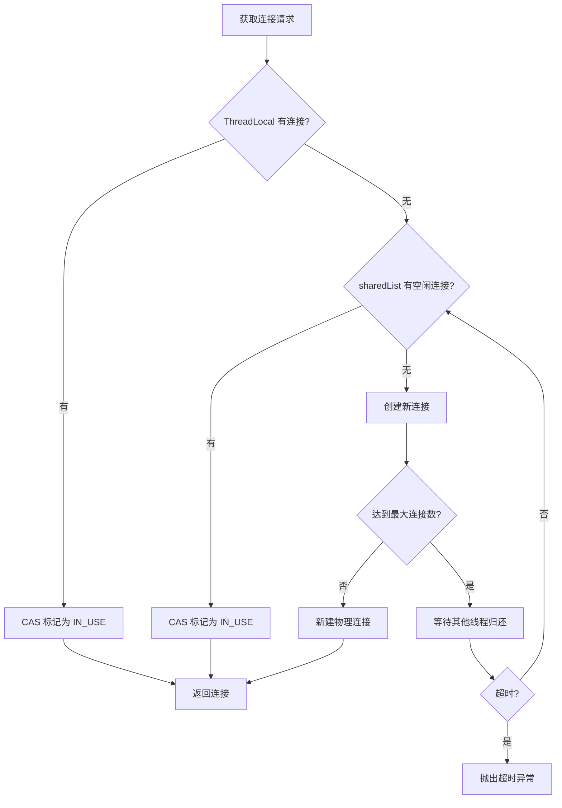

### JdbcTemplate 实践

JdbcTemplate（JDBC 模板）是 Spring 提供的轻量级 JDBC 封装，适合简单的数据库操作场景，无需引入 ORM 框架。

#### 基本使用

```java
// Spring Boot 自动配置 JdbcTemplate
// 只需引入 spring-boot-starter-jdbc 依赖即可
@Service
@RequiredArgsConstructor
public class UserJdbcService {

    private final JdbcTemplate jdbcTemplate;

    // 查询列表
    public List<User> findAll() {
        String sql = "SELECT id, username, email, status FROM t_user WHERE deleted = 0";
        return jdbcTemplate.query(sql, (rs, rowNum) -> {
            User user = new User();
            user.setId(rs.getLong("id"));
            user.setUsername(rs.getString("username"));
            user.setEmail(rs.getString("email"));
            user.setStatus(rs.getInt("status"));
            return user;
        });
    }

    // 查询单条记录
    public User findById(Long id) {
        String sql = "SELECT id, username, email, status FROM t_user WHERE id = ? AND deleted = 0";
        return jdbcTemplate.queryForObject(sql, new UserRowMapper(), id);
    }

    // 查询统计值
    public int countByStatus(Integer status) {
        String sql = "SELECT COUNT(*) FROM t_user WHERE status = ? AND deleted = 0";
        return jdbcTemplate.queryForObject(sql, Integer.class, status);
    }

    // 插入数据
    public int insert(User user) {
        String sql = "INSERT INTO t_user (username, email, status) VALUES (?, ?, ?)";
        return jdbcTemplate.update(sql, user.getUsername(), user.getEmail(), user.getStatus());
    }

    // 插入并获取自增主键
    public Long insertAndGetId(User user) {
        String sql = "INSERT INTO t_user (username, email, status) VALUES (?, ?, ?)";
        KeyHolder keyHolder = new GeneratedKeyHolder();
        jdbcTemplate.update(connection -> {
            PreparedStatement ps = connection.prepareStatement(sql, Statement.RETURN_GENERATED_KEYS);
            ps.setString(1, user.getUsername());
            ps.setString(2, user.getEmail());
            ps.setInt(3, user.getStatus());
            return ps;
        }, keyHolder);
        return keyHolder.getKey().longValue();
    }

    // 更新数据
    public int update(Long id, String email) {
        String sql = "UPDATE t_user SET email = ? WHERE id = ?";
        return jdbcTemplate.update(sql, email, id);
    }

    // 删除数据
    public int deleteById(Long id) {
        String sql = "UPDATE t_user SET deleted = 1 WHERE id = ?";
        return jdbcTemplate.update(sql, id);
    }
}

// RowMapper 实现
public class UserRowMapper implements RowMapper<User> {
    @Override
    public User mapRow(ResultSet rs, int rowNum) throws SQLException {
        User user = new User();
        user.setId(rs.getLong("id"));
        user.setUsername(rs.getString("username"));
        user.setEmail(rs.getString("email"));
        user.setStatus(rs.getInt("status"));
        user.setCreatedAt(rs.getTimestamp("created_at").toLocalDateTime());
        return user;
    }
}
```

#### 批量操作

```java
@Service
@RequiredArgsConstructor
public class BatchJdbcService {

    private final JdbcTemplate jdbcTemplate;

    // 批量插入
    public int[] batchInsert(List<User> users) {
        String sql = "INSERT INTO t_user (username, email, status) VALUES (?, ?, ?)";
        return jdbcTemplate.batchUpdate(sql, new BatchPreparedStatementSetter() {
            @Override
            public void setValues(PreparedStatement ps, int i) throws SQLException {
                User user = users.get(i);
                ps.setString(1, user.getUsername());
                ps.setString(2, user.getEmail());
                ps.setInt(3, user.getStatus());
            }

            @Override
            public int getBatchSize() {
                return users.size();
            }
        });
    }

    // 大批量插入（分片处理，避免内存溢出）
    public void largeBatchInsert(List<User> users) {
        int batchSize = 500;  // 每批 500 条
        jdbcTemplate.batchUpdate(
            "INSERT INTO t_user (username, email, status) VALUES (?, ?, ?)",
            users,  // 直接传入集合
            batchSize,
            (ps, user) -> {
                ps.setString(1, user.getUsername());
                ps.setString(2, user.getEmail());
                ps.setInt(3, user.getStatus());
            }
        );
    }
}
```

::: tip JdbcTemplate vs ORM 的选择
- **JdbcTemplate 适合**：简单 CRUD、报表查询、批量操作、对 SQL 有完全控制需求的场景
- **JPA 适合**：领域模型驱动、复杂对象关系映射、需要自动建表的场景
- **MyBatis-Plus 适合**：SQL 灵活度要求高、团队 SQL 能力强、需要快速 CRUD 的场景
- 实际项目中可以混合使用，但建议统一技术栈，降低维护成本
:::

#### NamedParameterJdbcTemplate

```java
// NamedParameterJdbcTemplate 支持命名参数，可读性更好
@Service
@RequiredArgsConstructor
public class NamedParamJdbcService {

    private final NamedParameterJdbcTemplate namedTemplate;

    // 使用命名参数
    public User findByUsernameAndStatus(String username, Integer status) {
        String sql = "SELECT * FROM t_user WHERE username = :username AND status = :status";
        MapSqlParameterSource params = new MapSqlParameterSource()
            .addValue("username", username)
            .addValue("status", status);
        return namedTemplate.queryForObject(sql, params, new UserRowMapper());
    }

    // 使用 Bean 属性作为参数
    public List<User> findByCondition(UserQueryDTO queryDTO) {
        String sql = "SELECT * FROM t_user WHERE username LIKE :username " +
                     "AND status = :status AND created_at > :startTime";
        // BeanPropertySqlParameterSource 自动从 DTO 中提取属性值
        BeanPropertySqlParameterSource params = new BeanPropertySqlParameterSource(queryDTO);
        return namedTemplate.query(sql, params, new UserRowMapper());
    }

    // IN 查询
    public List<User> findByIds(List<Long> ids) {
        String sql = "SELECT * FROM t_user WHERE id IN (:ids)";
        MapSqlParameterSource params = new MapSqlParameterSource()
            .addValue("ids", ids);  // 自动展开为 ?, ?, ?
        return namedTemplate.query(sql, params, new UserRowMapper());
    }
}
```

### 读写分离方案

读写分离（Read-Write Separation）将写操作路由到主库，读操作路由到从库，是提升数据库并发能力的常用方案。

#### 基于 MyBatis-Plus 的读写分离

```java
// 1. 配置主从数据源
@Configuration
public class MasterSlaveDataSourceConfig {

    @Bean
    @ConfigurationProperties(prefix = "spring.datasource.master")
    public DataSource masterDataSource() {
        return DataSourceBuilder.create().type(HikariDataSource.class).build();
    }

    @Bean
    @ConfigurationProperties(prefix = "spring.datasource.slave")
    public DataSource slaveDataSource() {
        return DataSourceBuilder.create().type(HikariDataSource.class).build();
    }
}

// 2. 使用 dynamic-datasource-spring-boot-starter（推荐）
// 引入依赖
// <dependency>
//     <groupId>com.baomidou</groupId>
//     <artifactId>dynamic-datasource-spring-boot-starter</artifactId>
//     <version>4.3.0</version>
// </dependency>

// application.yml 配置
// spring:
//   datasource:
//     dynamic:
//       primary: master
//       strict: true  # 严格匹配，找不到数据源时报错
//       datasource:
//         master:
//           url: jdbc:mysql://localhost:3306/main_db
//           username: root
//           password: root123
//         slave_1:
//           url: jdbc:mysql://localhost:3307/main_db
//           username: root
//           password: root123
//         slave_2:
//           url: jdbc:mysql://localhost:3308/main_db
//           username: root
//           password: root123
```

```java
// 3. 使用 @DS 注解切换数据源
@Service
@RequiredArgsConstructor
public class UserService {

    private final UserMapper userMapper;

    // 写操作走主库
    @DS("master")
    @Transactional
    public void createUser(User user) {
        userMapper.insert(user);
    }

    // 读操作走从库
    @DS("slave_1")
    public User findById(Long id) {
        return userMapper.selectById(id);
    }

    // 默认走主库（@DS 可以标注在类上作为默认值）
    public List<User> findAll() {
        return userMapper.selectList(null);
    }
}

// 4. 在 Mapper 层标注（更细粒度）
@Mapper
@DS("slave_1")  // 默认走从库
public interface UserMapper extends BaseMapper<User> {

    @DS("master")  // 写操作走主库
    int insert(User user);

    @DS("master")
    int updateById(User user);

    // 继承的方法默认走从库
}
```

#### 自定义 DataSource 实现读写分离

```java
// 自定义读写分离路由数据源
public class ReadWriteSplittingDataSource extends AbstractRoutingDataSource {

    private final DataSource masterDataSource;
    private final List<DataSource> slaveDataSources;
    private final AtomicInteger slaveIndex = new AtomicInteger(0);

    public ReadWriteSplittingDataSource(DataSource masterDataSource,
                                         List<DataSource> slaveDataSources) {
        this.masterDataSource = masterDataSource;
        this.slaveDataSources = slaveDataSources;
        
        Map<Object, Object> targetDataSources = new HashMap<>();
        targetDataSources.put("master", masterDataSource);
        for (int i = 0; i < slaveDataSources.size(); i++) {
            targetDataSources.put("slave_" + i, slaveDataSources.get(i));
        }
        
        this.setTargetDataSources(targetDataSources);
        this.setDefaultTargetDataSource(masterDataSource);
    }

    @Override
    protected Object determineCurrentLookupKey() {
        // 判断当前操作是读还是写
        // 通过 ThreadLocal 中的标记判断
        Boolean readOnly = ReadOnlyContextHolder.isReadOnly();
        if (readOnly != null && readOnly && !slaveDataSources.isEmpty()) {
            // 简单轮询负载均衡
            int index = slaveIndex.getAndIncrement() % slaveDataSources.size();
            return "slave_" + index;
        }
        return "master";
    }
}

// 只读上下文持有者
public class ReadOnlyContextHolder {
    private static final ThreadLocal<Boolean> READ_ONLY = new ThreadLocal<>();

    public static void setReadOnly(boolean readOnly) {
        READ_ONLY.set(readOnly);
    }

    public static Boolean isReadOnly() {
        return READ_ONLY.get();
    }

    public static void clear() {
        READ_ONLY.remove();
    }
}

// AOP 切面自动标记只读
@Aspect
@Component
@Order(Ordered.HIGHEST_PRECEDENCE)
public class ReadOnlyAspect {

    // 所有查询方法标记为只读
    @Before("execution(* com.example..service..find*(..)) || " +
            "execution(* com.example..service..get*(..)) || " +
            "execution(* com.example..service..query*(..)) || " +
            "execution(* com.example..service..list*(..)) || " +
            "execution(* com.example..service..count*(..))")
    public void setReadOnly() {
        ReadOnlyContextHolder.setReadOnly(true);
    }

    @After("execution(* com.example..service..*(..))")
    public void clearReadOnly() {
        ReadOnlyContextHolder.clear();
    }
}
```

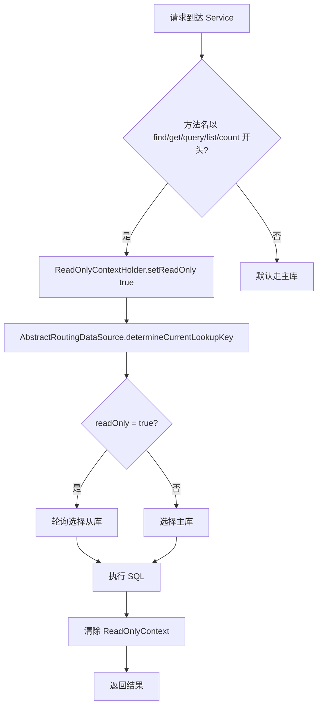

::: warning 读写分离的一致性问题
1. **主从延迟**：主库写入后，从库同步可能有毫秒到秒级延迟。写入后立即读取可能读到旧数据
2. **解决方案**：写入后的读操作强制路由到主库（通过 `@DS("master")` 或在 AOP 中判断）
3. **事务中的读**：事务开启后，所有操作应走主库，避免从库延迟导致数据不一致
4. **从库故障**：需要实现从库健康检查和自动摘除机制
:::

### 实战场景

#### 数据迁移

数据迁移（Data Migration）是系统升级、分库分表等场景中的常见需求。

```java
// 数据迁移服务
@Service
@RequiredArgsConstructor
@Slf4j
public class DataMigrationService {

    private final JdbcTemplate sourceJdbcTemplate;
    private final JdbcTemplate targetJdbcTemplate;

    // 分批迁移数据
    public void migrateUsers(int batchSize) {
        long lastId = 0;
        int totalMigrated = 0;

        while (true) {
            // 从源库分批读取
            String querySql = "SELECT id, username, email, status, created_at " +
                              "FROM t_user WHERE id > ? ORDER BY id LIMIT ?";
            List<Map<String, Object>> batch = sourceJdbcTemplate.queryForList(
                querySql, lastId, batchSize);

            if (batch.isEmpty()) {
                break;  // 迁移完成
            }

            // 写入目标库
            String insertSql = "INSERT INTO t_user (id, username, email, status, created_at) " +
                               "VALUES (?, ?, ?, ?, ?)";
            targetJdbcTemplate.batchUpdate(insertSql, new BatchPreparedStatementSetter() {
                @Override
                public void setValues(PreparedStatement ps, int i) throws SQLException {
                    Map<String, Object> row = batch.get(i);
                    ps.setLong(1, ((Number) row.get("id")).longValue());
                    ps.setString(2, (String) row.get("username"));
                    ps.setString(3, (String) row.get("email"));
                    ps.setInt(4, ((Number) row.get("status")).intValue());
                    ps.setTimestamp(5, (Timestamp) row.get("created_at"));
                }

                @Override
                public int getBatchSize() {
                    return batch.size();
                }
            });

            // 更新游标
            lastId = ((Number) batch.get(batch.size() - 1).get("id")).longValue();
            totalMigrated += batch.size();
            log.info("已迁移 {} 条用户数据，当前游标 ID: {}", totalMigrated, lastId);
        }

        log.info("用户数据迁移完成，共迁移 {} 条", totalMigrated);
    }
}
```

::: tip 数据迁移的最佳实践
1. **分批迁移**：避免一次性加载大量数据导致内存溢出
2. **记录游标**：使用自增 ID 作为游标，支持断点续传
3. **数据校验**：迁移后对比源库和目标库的记录数和关键字段
4. **回滚方案**：迁移前备份目标库，确保可以回滚
5. **增量同步**：全量迁移后，通过 binlog 实时同步增量数据
:::

#### 批量操作优化

```java
@Service
@RequiredArgsConstructor
@Slf4j
public class BatchOperationService {

    private final UserMapper userMapper;
    private final SqlSessionFactory sqlSessionFactory;
    private final UserService userService;

    // × 逐条插入——性能极差
    public void insertOneByOne(List<User> users) {
        users.forEach(userMapper::insert);
        // 逐条发送 SQL，N 条数据 = N 次网络往返
    }

    // √ 方式1：MyBatis-Plus saveBatch
    @Transactional
    public void insertWithSaveBatch(List<User> users) {
        // IService.saveBatch() 内部使用 JDBC batch
        // 默认每 1000 条执行一次 batch
        userService.saveBatch(users, 500);
    }

    // √ 方式2：SqlSession 批量模式
    @Transactional
    public void insertWithSqlSessionBatch(List<User> users) {
        try (SqlSession sqlSession = sqlSessionFactory.openSession(ExecutorType.BATCH)) {
            UserMapper mapper = sqlSession.getMapper(UserMapper.class);
            for (int i = 0; i < users.size(); i++) {
                mapper.insert(users.get(i));
                // 每 500 条 flush 一次
                if (i > 0 && i % 500 == 0) {
                    sqlSession.flushStatements();
                    sqlSession.clearCache();
                }
            }
            sqlSession.flushStatements();  // 最后 flush 剩余的
        }
    }

    // √ 方式3：自定义批量插入 SQL
    @Transactional
    public void insertWithCustomBatchSql(List<User> users) {
        // 拼接多值 INSERT：INSERT INTO t_user (username, email) VALUES (?, ?), (?, ?), ...
        userMapper.batchInsert(users);
    }
}

// Mapper 接口
@Mapper
public interface UserMapper extends BaseMapper<User> {

    // 自定义批量插入
    @Insert({
        "<script>",
        "INSERT INTO t_user (username, email, status) VALUES ",
        "<foreach collection='list' item='item' separator=','>",
        "(#{item.username}, #{item.email}, #{item.status})",
        "</foreach>",
        "</script>"
    })
    int batchInsert(@Param("list") List<User> users);
}
```

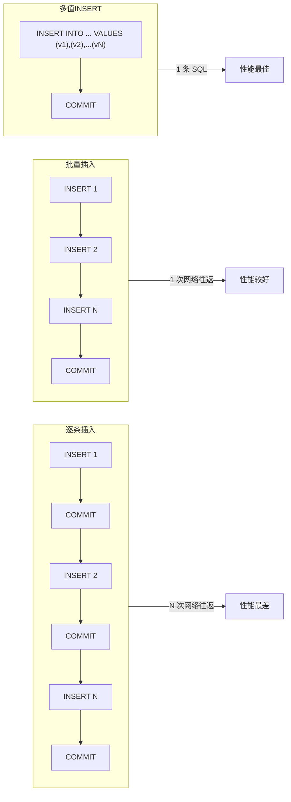

::: danger MySQL 的 max_allowed_packet 限制
多值 INSERT 方式拼接的 SQL 可能很长，超过 MySQL 的 `max_allowed_packet` 限制（默认 4MB）。解决方案：
1. 分批执行，每批 500-1000 条
2. 调大 MySQL 的 `max_allowed_packet` 参数
3. 使用 SqlSession BATCH 模式，由驱动自动分批发送
:::

#### JSON 字段处理

MySQL 5.7+ 支持 JSON 字段类型，MyBatis-Plus 和 JPA 都可以方便地处理 JSON 数据。

```java
// 1. MyBatis-Plus JSON 字段处理
@Data
@TableName(value = "t_product", autoResultMap = true)  // autoResultMap 必须开启
public class Product {
    @TableId
    private Long id;

    private String name;

    // JSON 字段——自动序列化/反序列化
    @TableField(typeHandler = JacksonTypeHandler.class)
    private ProductAttribute attributes;  // 自定义 Java 对象

    // JSON 数组字段
    @TableField(typeHandler = JacksonTypeHandler.class)
    private List<String> tags;
}

// JSON 字段对应的 Java 类
@Data
public class ProductAttribute {
    private String color;
    private String size;
    private Integer weight;
    private Map<String, Object> extra;  // 动态属性
}
```

```java
// 2. JPA JSON 字段处理
@Entity
@Table(name = "t_product")
public class Product {
    @Id
    @GeneratedValue(strategy = GenerationType.IDENTITY)
    private Long id;

    private String name;

    // 使用 @Convert 注解自定义类型转换
    @Column(columnDefinition = "JSON")
    @Convert(converter = ProductAttributeConverter.class)
    private ProductAttribute attributes;
}

// 自定义 JPA AttributeConverter
@Converter(autoApply = false)
public class ProductAttributeConverter
        implements AttributeConverter<ProductAttribute, String> {

    private static final ObjectMapper objectMapper = new ObjectMapper();

    @Override
    public String convertToDatabaseColumn(ProductAttribute attribute) {
        // Java 对象 → JSON 字符串
        try {
            return attribute == null ? null : objectMapper.writeValueAsString(attribute);
        } catch (JsonProcessingException e) {
            throw new RuntimeException("JSON 序列化失败", e);
        }
    }

    @Override
    public ProductAttribute convertToEntityAttribute(String json) {
        // JSON 字符串 → Java 对象
        try {
            return StringUtils.isBlank(json) ? null :
                objectMapper.readValue(json, ProductAttribute.class);
        } catch (JsonProcessingException e) {
            throw new RuntimeException("JSON 反序列化失败", e);
        }
    }
}
```

```java
// 3. JSON 字段查询
// MyBatis-Plus 中查询 JSON 字段
@Service
@RequiredArgsConstructor
public class ProductService {

    private final ProductMapper productMapper;

    // 使用原生 SQL 查询 JSON 字段(JSON_UNQUOTE 去掉引号后才能与普通字符串比较)
    @Select("SELECT * FROM t_product WHERE JSON_UNQUOTE(JSON_EXTRACT(attributes, '$.color')) = #{color}")
    List<Product> findByColor(@Param("color") String color);

    // MySQL 5.7+ 简写语法(->> 等价 JSON_UNQUOTE(JSON_EXTRACT(...));单箭头 -> 返回的 JSON 字符串带引号,直接比较会失配)
    @Select("SELECT * FROM t_product WHERE attributes->>'$.color' = #{color}")
    List<Product> findByColorShort(@Param("color") String color);

    // 查询 JSON 数组是否包含某个值
    @Select("SELECT * FROM t_product WHERE JSON_CONTAINS(tags, CONCAT('\"', #{tag}, '\"'))")
    List<Product> findByTag(@Param("tag") String tag);
}
```

::: warning JSON 字段的查询性能
1. JSON 字段不支持普通索引，查询需要全表扫描
2. MySQL 8.0 支持在 JSON 字段上创建多值索引（Multi-Valued Index），可以优化 `JSON_CONTAINS` 查询
3. 如果需要频繁查询 JSON 中的某个属性，建议将其提取为独立列并建立索引
4. JSON 字段适合存储不常查询但需要灵活结构的半结构化数据
:::

### 面试要点

#### 1. Spring Data JPA 的 findById 和 getReferenceById 有什么区别？

**答案：** `findById()` 立即执行 `em.find()`，从数据库加载数据；`getReferenceById()` 返回延迟加载的代理对象（`em.getReference()`），只有在访问属性时才真正查询。设置外键关联时应该用 `getReferenceById()`，避免不必要的查询。

#### 2. @Transactional 的传播行为有哪些？

**答案：** 7 种传播行为：
- **REQUIRED**（默认）：有事务则加入，没有则新建
- **REQUIRES_NEW**：总是新建独立事务，挂起当前事务
- **NESTED**：在当前事务中创建 savepoint，支持部分回滚
- **SUPPORTS**：有事务则加入，没有则非事务执行
- **NOT_SUPPORTED**：非事务执行，挂起当前事务
- **MANDATORY**：必须在事务中调用，否则抛出异常
- **NEVER**：不能在事务中调用，否则抛出异常

最常用的是 REQUIRED 和 REQUIRES_NEW。NESTED 与 REQUIRES_NEW 的区别在于 NESTED 共享同一个连接，外层回滚时内层也会回滚。

> 传播行为的完整语义与决策流程见 [05-Spring/事务管理与失效场景](../05-Spring/03-事务管理与失效场景.md)；源码级 Debug 见 [32-声明式事务原理与传播机制](32-声明式事务原理与传播机制.md)。

#### 3. @Transactional 失效的场景有哪些？

**答案：** 常见失效场景：
1. 方法非 public——Spring AOP 默认只拦截 public 方法
2. 同类内部调用——`this.method()` 不走代理，事务注解不生效
3. 异常被 catch 吞掉——事务感知不到异常，不会回滚
4. 异常类型不匹配——默认只回滚 RuntimeException，checked Exception 不回滚
5. 数据库引擎不支持事务——如 MySQL MyISAM
6. Bean 未被 Spring 管理——缺少 `@Service` 等注解
7. 传播行为设置错误——如 NOT_SUPPORTED
8. 多线程调用——不同线程使用不同的数据库连接

> 各失效场景的完整代码演示见 [05-Spring/事务管理与失效场景](../05-Spring/03-事务管理与失效场景.md)。

#### 4. JPA 的 N+1 问题如何解决？

**答案：** N+1 问题是指查询 N 条主记录时，每条记录的关联数据各触发一次查询。解决方案：
1. **JOIN FETCH**：在 JPQL 中使用 `LEFT JOIN FETCH` 一次性加载关联数据
2. **@EntityGraph**：声明式指定要加载的关联属性，无需修改 JPQL
3. **@NamedEntityGraph**：在实体上定义加载图，Repository 中引用
4. **关闭 OSIV**：在 Service 层完成所有数据加载，避免 Controller 层触发延迟加载
5. **批量加载**：配置 `hibernate.default_batch_fetch_size`，将 N+1 优化为 N/batchSize+1

#### 5. HikariCP 为什么比其他连接池快？

**答案：** HikariCP 的性能优势来自：
1. **ConcurrentBag 无锁设计**：使用 ThreadLocal 缓存 + CAS 替代锁，减少线程竞争
2. **FastList 替代 ArrayList**：避免 `iterator()` 创建对象，使用 `get(index)` 直接访问
3. **极简代理**：ProxyConnection 只拦截 `close()` 方法，其他方法直接委托给真实连接
4. **主动检测连接泄漏**：`leakDetectionThreshold` 参数可以检测连接未归还的情况
5. **快速验证**：使用 `Connection.isValid()` 替代执行 `SELECT 1` 验证连接

#### 6. MyBatis-Plus 的插件执行顺序有什么讲究？

**答案：** MyBatis-Plus 的 InnerInterceptor 按添加顺序执行，顺序很重要：
1. **多租户插件**必须放在最前面，确保所有 SQL 都追加租户条件
2. **动态表名插件**也需要靠前
3. **分页插件**放在中间
4. **乐观锁插件**放在后面
5. **防全表更新插件**放在最后作为安全兜底

如果顺序错误，可能导致分页的 count 查询缺少租户条件，或者乐观锁的 version 条件被分页插件截断。

#### 7. 如何实现动态数据源切换？

**答案：** 核心思路是继承 `AbstractRoutingDataSource`，重写 `determineCurrentLookupKey()` 方法，根据 ThreadLocal 中的标识返回对应的数据源 key。配合自定义注解 `@DataSource` 和 AOP 切面，在方法执行前设置 ThreadLocal，执行后清除。需要注意：
1. 数据源切换必须在事务开启之前完成（`@Order` 优先级高于事务切面）
2. 不同数据源的事务无法合并，需要分布式事务方案
3. 推荐使用 `dynamic-datasource-spring-boot-starter` 简化配置

#### 8. 读写分离如何保证数据一致性？

**答案：** 读写分离面临的核心问题是主从复制延迟：
1. **强制主库读**：写入后的读操作路由到主库，通过 ThreadLocal 标记"刚写入过"
2. **事务内走主库**：事务开启后所有操作走主库，避免从库延迟导致不一致
3. **半同步复制**：MySQL 配置半同步复制，主库写入后等待至少一个从库确认
4. **中间件方案**：使用 ShardingSphere 等中间件自动处理主从路由和一致性
5. **业务层妥协**：对一致性要求不高的场景允许短暂不一致，通过缓存失效策略缓解

#### 9. JPA Entity 的四种生命周期状态是什么？

**答案：** JPA 实体有四种生命周期状态：
1. **New（新建/瞬态）**：刚 `new` 出来的对象，没有主键，不在持久化上下文中
2. **Managed（托管/持久态）**：通过 `em.persist()` 或 `em.find()` 进入持久化上下文，属性变更会自动同步到数据库（dirty checking）
3. **Detached（游离/脱管态）**：脱离持久化上下文的对象（`em.detach()`、`em.clear()`、事务提交后），属性变更不会同步
4. **Removed（删除态）**：通过 `em.remove()` 标记为删除，flush 时执行 DELETE

理解生命周期对于正确使用 `persist()` vs `merge()`、避免 detached entity 错误至关重要。

#### 10. 如何优化批量插入的性能？

**答案：** 批量插入的性能优化方案（从差到优）：
1. **逐条 insert**：最差，每条 SQL 一次网络往返
2. **MyBatis-Plus saveBatch**：使用 JDBC batch，每 1000 条 flush 一次
3. **SqlSession BATCH 模式**：手动控制 flush 时机，更灵活
4. **多值 INSERT**：`INSERT INTO ... VALUES (v1),(v2),...` 一条 SQL 插入多行，性能最佳
5. **LOAD DATA INFILE**：MySQL 专有，从文件批量加载，适合超大数据量

关键配置：MySQL 连接 URL 添加 `rewriteBatchedStatements=true`，让 JDBC 驱动将 batch 语句重写为多值 INSERT。

>  相关文档：[21-自动配置与Starter机制](21-自动配置与Starter机制.md) · [23-Bean生命周期源码](23-Bean生命周期源码.md) · [07-性能优化](07-性能优化.md)

## 版本差异(旧版 → Spring Boot 3.5.x)

| 特性 | 旧版(Spring Boot 2.x) | Spring Boot 3.5.x |
|------|----------------------|-------------------|
| 数据源 | HikariCP（2.x 默认） | HikariCP（不变） |
| 事务/JPA 注解包名 | javax.transaction、javax.persistence | jakarta.transaction、jakarta.persistence（javax.sql 等 JDK 内的 JDBC 包名不变） |
| 事务管理 | @Transactional（Spring 5） | 不变；Spring 6 声明式事务语义相同 |
| 多数据源 | 手动配置 | 不变；社区常用 dynamic-datasource-spring-boot-starter |
