# SpringBoot 启动主流程

::: tip 分工声明
本篇聚焦启动主流程（3.5.x 源码视角为主，文末附 2.1.x 源码的 Debug 逐步走读）。启动引导（`@SpringBootApplication`、包扫描）与 fat-jar 运行原理见 [34-可执行jar与启动引导](34-可执行jar与启动引导.md)；GraalVM Native Image 与 AOT 见 [33-GraalVM与AOT](33-GraalVM与AOT.md)；自动装配细节见 [21-自动配置与Starter机制](21-自动配置与Starter机制.md)。
:::

## 启动主流程

### 概述

Spring Boot 的启动流程是理解框架运行机制的基础。从 `main()` 方法到应用就绪，整个过程涉及类加载、环境准备、容器创建、Bean 注册、自动配置、内嵌容器启动等多个阶段。理解这条链路，是排查启动问题、优化启动性能、定制启动行为的前提。

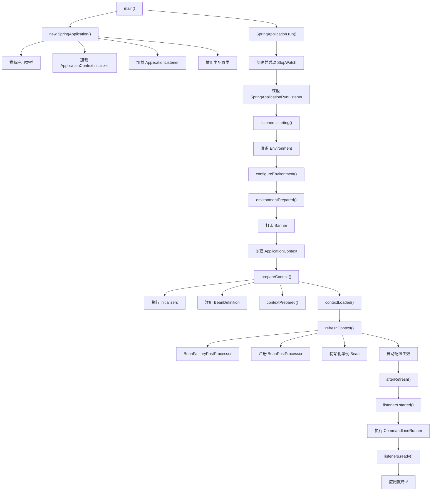

### SpringApplication 构造阶段

#### 源码入口

```java
// SpringApplication.java
public static ConfigurableApplicationContext run(Class<?> primarySource, String... args) {
    return run(new Class<?>[] { primarySource }, args);
}

public static ConfigurableApplicationContext run(Class<?>[] primarySources, String[] args) {
    return new SpringApplication(primarySources).run(args);
}
```

启动分为两步：**构造 SpringApplication** → **执行 run()**。

#### 构造函数源码

```java
// SpringApplication.java
public SpringApplication(ResourceLoader resourceLoader, Class<?>... primarySources) {
    this.resourceLoader = resourceLoader;
    Assert.notNull(primarySources, "PrimarySources must not be null");
    this.primarySources = new LinkedHashSet<>(Arrays.asList(primarySources));

    // 1. 推断应用类型（Servlet / Reactive / None）
    this.webApplicationType = WebApplicationType.deduceFromClasspath();

    // 2. 从 spring.factories 加载 ApplicationContextInitializer
    setInitializers((Collection) getSpringFactoriesInstances(ApplicationContextInitializer.class));

    // 3. 从 spring.factories 加载 ApplicationListener
    setListeners((Collection) getSpringFactoriesInstances(ApplicationListener.class));

    // 4. 推断主配置类（main 方法所在类）
    this.mainApplicationClass = deduceMainApplicationClass();
}
```

#### 应用类型推断

```java
// WebApplicationType.java
static WebApplicationType deduceFromClasspath() {
    // 如果有 Reactive 的 DispatcherHandler 且没有 Servlet 的 DispatcherServlet
    if (ClassUtils.isPresent("org.springframework.web.reactive.DispatcherHandler", null)
        && !ClassUtils.isPresent("org.springframework.web.servlet.DispatcherServlet", null)) {
        return REACTIVE;
    }
    // 如果没有 Servlet 或 Spring MVC 的核心类
    for (String className : SERVLET_INDICATOR_CLASSES) {
        if (!ClassUtils.isPresent(className, null)) {
            return NONE;
        }
    }
    // 默认：Servlet Web 应用
    return SERVLET;
}
```

| 应用类型 | 条件 | 创建的 ApplicationContext |
|---------|------|--------------------------|
| `SERVLET` | classpath 有 `jakarta.servlet.Servlet` + `DispatcherServlet` | `AnnotationConfigServletWebServerApplicationContext` |
| `REACTIVE` | classpath 有 `DispatcherHandler` 无 `DispatcherServlet` | `AnnotationConfigReactiveWebServerApplicationContext` |
| `NONE` | 都没有 | `AnnotationConfigApplicationContext` |

::: tip 强制指定应用类型
如果自动推断不符合预期，可以手动设置：
```java
SpringApplication app = new SpringApplication(Application.class);
app.setWebApplicationType(WebApplicationType.SERVLET); // 强制 Servlet
app.run(args);
```
这在引入了 Reactive 依赖但实际使用 Servlet 的项目中很有用。
:::

### run() 执行阶段

#### 完整时序图

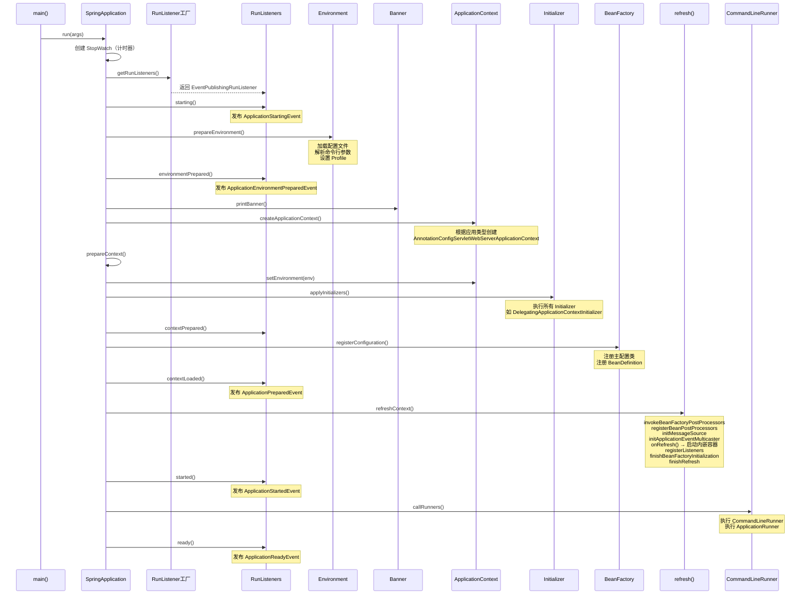

#### 关键步骤详解

##### 1. 准备 Environment

```java
// SpringApplication.java
private ConfigurableEnvironment prepareEnvironment(
        SpringApplicationRunListeners listeners,
        ApplicationArguments applicationArguments) {
    // 创建 Environment（Servlet → StandardServletEnvironment）
    ConfigurableEnvironment environment = getOrCreateEnvironment();

    // 配置 Environment：命令行参数、Profile 等
    configureEnvironment(environment, applicationArguments.getSourceArgs());

    // 将 ConfigurationProperties 绑定到 SpringApplication
    ConfigurationPropertySources.attach(environment);

    // 发布 EnvironmentPrepared 事件
    listeners.environmentPrepared(environment);

    return environment;
}
```

::: warning Environment 准备阶段
`environmentPrepared()` 事件触发时，`ApplicationContext` 还没创建。这意味着此时不能使用任何 Bean，但可以利用 `EnvironmentPostProcessor` 修改配置——这是在容器创建前注入自定义配置的官方扩展点。
:::

##### 2. 创建 ApplicationContext

```java
// SpringApplication.java
protected ConfigurableApplicationContext createApplicationContext() {
    return this.applicationContextFactory.create(this.webApplicationType);
}

// ApplicationContextFactory 默认实现
switch (webApplicationType) {
    case SERVLET:
        return new AnnotationConfigServletWebServerApplicationContext();
    case REACTIVE:
        return new AnnotationConfigReactiveWebServerApplicationContext();
    default:
        return new AnnotationConfigApplicationContext();
}
```

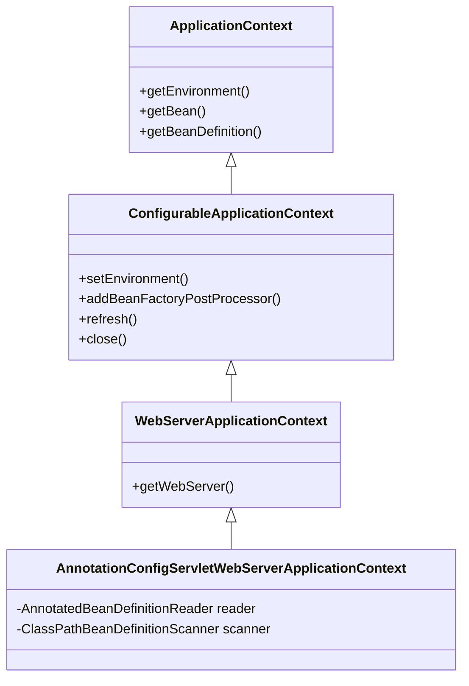

##### 2.5 prepareContext() 详解

`prepareContext()` 是 `createApplicationContext()` 和 `refreshContext()` 之间的桥梁，完成以下关键工作：

```java
// SpringApplication.java
private void prepareContext(ConfigurableApplicationContext context,
        ConfigurableEnvironment environment, SpringApplicationRunListeners listeners,
        ApplicationArguments applicationArguments, Banner banner) {

    // 1. 设置 Environment
    context.setEnvironment(environment);

    // 2. 后处理 ApplicationContext（设置 BeanNameGenerator、ResourceLoader 等）
    postProcessApplicationContext(context);

    // 3. 执行所有 ApplicationContextInitializer
    applyInitializers(context);

    // 4. 发布 ApplicationContextInitializedEvent
    listeners.contextPrepared(context);

    // 5. 关闭 DefaultBootstrapContext（早期引导阶段到此结束）
    bootstrapContext.close();

    // 6. 注册主配置类的 BeanDefinition
    Set<Object> sources = getAllSources();
    Assert.notEmpty(sources, "No sources found");
    load(context, sources.toArray(new Object[0]));

    // 7. 发布 ApplicationPreparedEvent
    listeners.contextLoaded(context);
}
```

::: tip prepareContext 的扩展窗口
`applyInitializers()` 是 `prepareContext()` 中最重要的扩展点。此时 `ApplicationContext` 已创建但未刷新，可以：
1. 注册额外的 `BeanDefinition`
2. 修改 `Environment`
3. 添加 `BeanFactoryPostProcessor`
4. 设置 `ApplicationContext` 的属性

但注意：**此时 Bean 还没实例化**，不能调用 `getBean()`。
:::

##### 3. refresh() — 最核心的步骤

`refresh()` 是 Spring 容器初始化的核心方法，定义在 `AbstractApplicationContext` 中：

> **版本注**: 以下为 Spring Framework 6.0.x 及更早版本的方法签名（`synchronized` 保护）。Spring Framework 6.1（Spring Boot 3.2+）起已将 `startupShutdownMonitor` 的监视器锁替换为 `ReentrantLock`（`startShutdown`），但 **12 个初始化步骤本身完全不变**。

```java
// AbstractApplicationContext.java
public void refresh() throws BeansException, IllegalStateException {
    synchronized (this.startupShutdownMonitor) {
        // 1. 准备刷新：记录启动时间、设置状态标志
        prepareRefresh();

        // 2. 获取 BeanFactory（刚创建的空工厂）
        ConfigurableListableBeanFactory beanFactory = obtainFreshBeanFactory();

        // 3. 配置 BeanFactory：注册标准 BeanPostProcessor
        prepareBeanFactory(beanFactory);

        try {
            // 4. 子类后处理：注册 Web 相关的 Scope 等
            postProcessBeanFactory(beanFactory);

            // 5. 执行 BeanFactoryPostProcessor（关键！）
            invokeBeanFactoryPostProcessors(beanFactory);

            // 6. 注册 BeanPostProcessor
            registerBeanPostProcessors(beanFactory);

            // 7. 初始化 MessageSource（国际化）
            initMessageSource();

            // 8. 初始化事件广播器
            initApplicationEventMulticaster();

            // 9. 子类特殊初始化：启动内嵌 Web 容器
            onRefresh();

            // 10. 注册监听器
            registerListeners();

            // 11. 初始化所有单例 Bean（非 lazy-init）
            finishBeanFactoryInitialization(beanFactory);

            // 12. 完成刷新：发布 ContextRefreshedEvent
            finishRefresh();
        } catch (BeansException ex) {
            destroyBeans();
            cancelRefresh(ex);
            throw ex;
        }
    }
}
```

::: tip invokeBeanFactoryPostProcessors 是自动配置生效的入口
步骤 5 `invokeBeanFactoryPostProcessors()` 会执行所有 `BeanFactoryPostProcessor`，其中包括 `ConfigurationClassPostProcessor`——它负责解析 `@Configuration` 类、处理 `@Import`、加载自动配置类。**自动配置的协商就发生在这里。**
:::

##### 4. onRefresh() — 启动内嵌容器

```java
// ServletWebServerApplicationContext.java
protected void onRefresh() {
    super.onRefresh();
    try {
        createWebServer();  // 创建并启动 Tomcat/Jetty/Undertow
    } catch (Throwable ex) {
        throw new ApplicationContextException("Unable to start web server", ex);
    }
}

private void createWebServer() {
    WebServer webServer = this.webServer;
    ServletContext servletContext = getServletContext();

    if (webServer == null && servletContext == null) {
        // 获取 ServletWebServerFactory（TomcatServletWebServerFactory 等）
        ServletWebServerFactory factory = getWebServerFactory();
        this.webServer = factory.getWebServer(getSelfInitializer());
    }
    // ...
}
```

##### 5. finishBeanFactoryInitialization() — 创建所有单例 Bean

```java
// AbstractApplicationContext.java
protected void finishBeanFactoryInitialization(ConfigurableListableBeanFactory beanFactory) {
    // 初始化 ConversionService
    if (beanFactory.containsBean(CONVERSION_SERVICE_BEAN_NAME)
        && beanFactory.isTypeMatch(CONVERSION_SERVICE_BEAN_NAME, ConversionService.class)) {
        beanFactory.setConversionService(
            beanFactory.getBean(CONVERSION_SERVICE_BEAN_NAME, ConversionService.class));
    }

    // 注册嵌入式值解析器（解析 ${...} 占位符）
    if (!beanFactory.hasEmbeddedValueResolver()) {
        beanFactory.addEmbeddedValueResolver(strVal -> getEnvironment().resolveRequiredPlaceholders(strVal));
    }

    // 初始化所有单例 Bean
    beanFactory.preInstantiateSingletons();
}
```

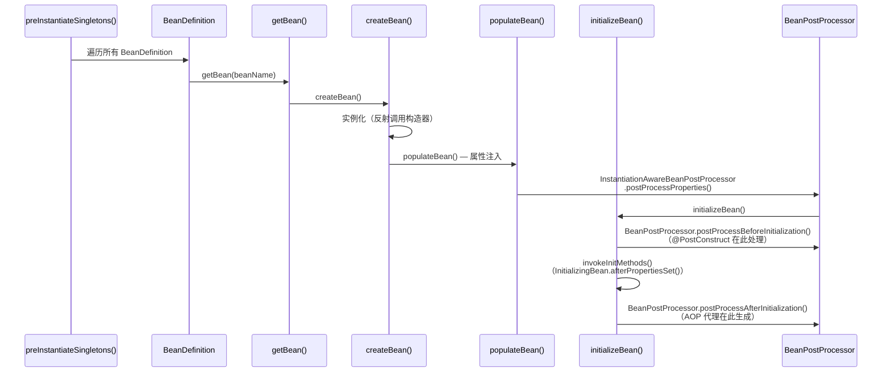

### 启动事件体系

Spring Boot 启动过程中发布的事件按顺序如下：

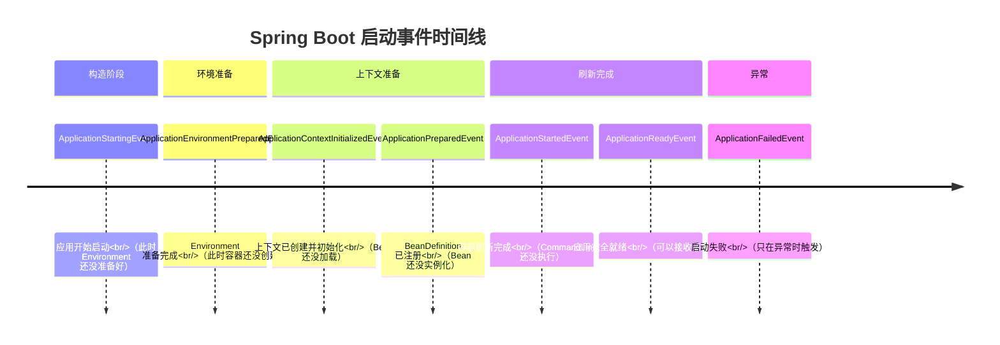

#### 监听事件的两种方式

**方式一：@EventListener（推荐）**

```java
@Component
public class StartupListener {

    @EventListener
    public void onReady(ApplicationReadyEvent event) {
        // 所有 Bean 已就绪，可以执行预热逻辑
        log.info("应用已就绪，开始预热缓存...");
    }

    @EventListener
    public void onFailed(ApplicationFailedEvent event) {
        // 启动失败，发送告警
        log.error("应用启动失败：{}", event.getException().getMessage());
    }
}
```

**方式二：实现 ApplicationListener**

```java
// 在容器创建之前生效的事件，需要通过 spring.factories 注册
public class EarlyListener implements ApplicationListener<ApplicationEnvironmentPreparedEvent> {
    @Override
    public void onApplicationEvent(ApplicationEnvironmentPreparedEvent event) {
        // 修改 Environment 配置
        event.getEnvironment().getSystemProperties().put("custom.key", "custom.value");
    }
}
```

```properties
# META-INF/spring.factories
org.springframework.context.ApplicationListener=\
  com.example.EarlyListener
```

::: warning 早期事件的监听方式
`ApplicationStartingEvent` 和 `ApplicationEnvironmentPreparedEvent` 发生在 `ApplicationContext` 创建之前，此时还没有 Bean 容器，因此 `@EventListener` 不起作用——必须通过 `spring.factories` 或 `SpringApplication.addListeners()` 注册。
:::

### ApplicationContextInitializer 扩展点

`ApplicationContextInitializer` 在上下文刷新之前执行，可以用来编程式地修改 `ApplicationContext` 的内部结构。

```java
// 自定义 Initializer
public class MyInitializer implements ApplicationContextInitializer<ConfigurableApplicationContext> {
    @Override
    public void initialize(ConfigurableApplicationContext context) {
        // 在容器刷新前添加自定义 BeanDefinition
        context.getBeanFactory().registerSingleton("myBean", new MyBean());

        // 或修改 Environment
        context.getEnvironment().getSystemProperties().put("my.key", "my.value");
    }
}
```

**注册方式：**

```properties
# META-INF/spring.factories
org.springframework.context.ApplicationContextInitializer=\
  com.example.MyInitializer
```

```java
// 或通过代码注册
SpringApplication app = new SpringApplication(Application.class);
app.addInitializers(new MyInitializer());
app.run(args);
```

#### Spring Boot 内置的 Initializer

| Initializer | 作用 |
|------------|------|
| `DelegatingApplicationContextInitializer` | 委托给 `context.initializer.classes` 配置的 Initializer |
| `ContextIdApplicationContextInitializer` | 设置 ApplicationContext 的 ID |
| `ConfigurationWarningsApplicationContextInitializer` | 检查常见的配置问题（如 @ComponentScan 位置不当） |
| `SharedMetadataReaderFactoryContextInitializer` | 创建共享的 `CachingMetadataReaderFactory`，避免重复 ASM 字节码解析 |
| `LifecycleProperiesInitializer` | 处理 `spring.lifecycle.timeout-per-shutdown-phase` 配置 |

### EnvironmentPostProcessor 扩展点

`EnvironmentPostProcessor` 在 `ApplicationContext` 创建之前执行，是修改 `Environment` 的官方推荐方式。比 `ApplicationContextInitializer` 更早，且专门为环境配置设计。

```java
// 自定义 EnvironmentPostProcessor
public class MyEnvironmentPostProcessor implements EnvironmentPostProcessor {
    @Override
    public void postProcessEnvironment(ConfigurableEnvironment environment,
                                       SpringApplication application) {
        // 根据运行环境动态设置配置
        String env = environment.getProperty("app.env", "dev");

        Map<String, Object> defaults = new HashMap<>();
        if ("prod".equals(env)) {
            defaults.put("server.tomcat.max-threads", "500");
            defaults.put("spring.datasource.hikari.maximum-pool-size", "50");
        } else {
            defaults.put("server.tomcat.max-threads", "100");
            defaults.put("spring.datasource.hikari.maximum-pool-size", "10");
        }

        // 添加默认属性（优先级最低，可被其他配置源覆盖）
        environment.getPropertySources()
            .addLast(new MapPropertySource("myDefaults", defaults));
    }
}
```

**注册方式：**

```properties
# META-INF/spring.factories
org.springframework.boot.env.EnvironmentPostProcessor=\
  com.example.MyEnvironmentPostProcessor
```

::: tip EnvironmentPostProcessor 的典型用途
1. **根据运行环境动态设置配置**：如生产环境自动调大连接池
2. **从外部配置中心加载配置**：如从 Vault、Consul 拉取敏感配置
3. **设置合理的默认值**：确保关键配置有兜底值
4. **配置加密解密**：自动解密 `ENC(xxx)` 格式的加密配置
:::

::: warning EnvironmentPostProcessor 的执行时机
`EnvironmentPostProcessor` 在 `environmentPrepared` 事件中执行，此时 `ApplicationContext` 还没创建。因此：
1. 不能使用任何 Bean（包括 `@Autowired`）
2. 不能使用 `@Value` 注解
3. 如果需要依赖其他 Bean，应该使用 `@ConfigurationProperties` + `@Bean` 的方式，而非 `EnvironmentPostProcessor`
:::

### getSpringFactoriesInstances 加载机制

`SpringFactoriesLoader` 是 Spring Boot 加载扩展点的核心机制，几乎所有启动阶段的扩展组件都通过它加载。

#### Spring Boot 2.x 的加载方式

```java
// SpringFactoriesLoader.java
public static <T> List<T> loadFactories(Class<T> factoryType, @Nullable ClassLoader classLoader) {
    ClassLoader classLoaderToUse = classLoader;
    if (classLoaderToUse == null) {
        classLoaderToUse = SpringFactoriesLoader.class.getClassLoader();
    }
    // 加载所有 META-INF/spring.factories 中指定类型的实现类名
    List<String> factoryImplementationNames = loadFactoryNames(factoryType, classLoaderToUse);
    // 实例化每个实现类
    List<T> result = new ArrayList<>(factoryImplementationNames.size());
    for (String factoryImplementationName : factoryImplementationNames) {
        result.add(instantiateFactory(factoryImplementationName, factoryType, classLoaderToUse));
    }
    AnnotationAwareOrderComparator.sort(result);  // 按 @Order 排序
    return result;
}
```

#### Spring Boot 3.x 的变化

Spring Boot 3.x 引入了 `AutoConfiguration.imports` 文件替代 `spring.factories` 中的自动配置类注册：

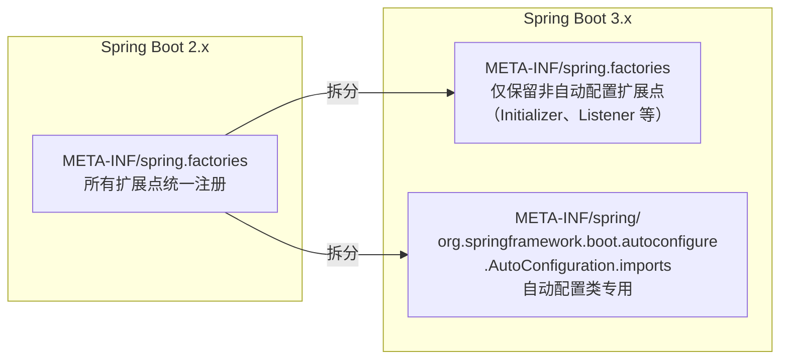

::: details spring.factories 文件示例（Spring Boot 2.x）
```properties
# org.springframework.boot.autoconfigure.EnableAutoConfiguration
org.springframework.boot.autoconfigure.web.servlet.WebMvcAutoConfiguration,\
org.springframework.boot.autoconfigure.web.servlet.DispatcherServletAutoConfiguration,\
org.springframework.boot.autoconfigure.jdbc.DataSourceAutoConfiguration,\
org.springframework.boot.autoconfigure.data.redis.RedisAutoConfiguration

# org.springframework.context.ApplicationContextInitializer
org.springframework.boot.context.ConfigurationWarningsApplicationContextInitializer,\
org.springframework.boot.context.ContextIdApplicationContextInitializer

# org.springframework.context.ApplicationListener
org.springframework.boot.context.config.AnsiOutputApplicationListener,\
org.springframework.boot.context.listener.LoggingApplicationListener
```
:::

::: details AutoConfiguration.imports 文件示例（Spring Boot 3.x）
```
org.springframework.boot.autoconfigure.web.servlet.WebMvcAutoConfiguration
org.springframework.boot.autoconfigure.web.servlet.DispatcherServletAutoConfiguration
org.springframework.boot.autoconfigure.jdbc.DataSourceAutoConfiguration
org.springframework.boot.autoconfigure.data.redis.RedisAutoConfiguration
```
每行一个全限定类名，不再需要转义符 `\`，更易维护。
:::

### CommandLineRunner 与 ApplicationRunner

两者都在应用就绪后执行，区别在于参数类型：

```java
// ApplicationRunner：接收 ApplicationArguments（解析好的参数）
@Component
@Order(1)  // 数字越小优先级越高
public class MyApplicationRunner implements ApplicationRunner {
    @Override
    public void run(ApplicationArguments args) throws Exception {
        // args.getOptionValues("key") 获取选项参数
        // args.getNonOptionArgs() 获取非选项参数
        log.info("ApplicationRunner 执行，参数：{}", args.getSourceArgs());
    }
}

// CommandLineRunner：接收原始 String[]
@Component
@Order(2)
public class MyCommandLineRunner implements CommandLineRunner {
    @Override
    public void run(String... args) throws Exception {
        log.info("CommandLineRunner 执行，参数：{}", Arrays.toString(args));
    }
}
```

::: tip CommandLineRunner 的典型用途
1. **数据预热**：启动时加载热点数据到缓存
2. **健康检查**：验证外部依赖（数据库、Redis、MQ）是否可用
3. **一次性任务**：数据迁移、初始化管理员账号等
4. **通知**：启动完成后发送就绪信号（如注册到服务发现）
:::

### 启动性能优化

#### 1. 延迟初始化

```java
@SpringBootApplication
public class Application {
    public static void main(String[] args) {
        SpringApplication app = new SpringApplication(Application.class);
        app.setLazyInitialization(true);  // 所有单例 Bean 延迟初始化
        app.run(args);
    }
}
```

```yaml
# 或通过配置
spring:
  main:
    lazy-initialization: true
```

::: warning 延迟初始化的风险
- 启动更快，但首次请求会触发 Bean 创建，响应时间增加
- 延迟创建意味着启动时不会发现配置错误——可能在运行时才报错
- **生产环境慎用**，更适合开发环境加速启动
:::

#### 2. 排除不必要的自动配置

```java
@SpringBootApplication(exclude = {
    DataSourceAutoConfiguration.class,     // 不需要数据库
    HibernateJpaAutoConfiguration.class,   // 不需要 JPA
    RedisAutoConfiguration.class           // 不需要 Redis
})
public class Application { ... }
```


#### 3. 使用 GraalVM Native Image（Spring Boot 3.x）

GraalVM Native Image 的构建方式、限制与收益单独成篇，见 [33-GraalVM与AOT](33-GraalVM与AOT.md)。

#### 4. JVM 启动参数优化

```bash
# 推荐 JVM 启动参数
java -jar myapp.jar \
  -Xms512m -Xmx512m \
  -XX:+UseG1GC \
  -XX:MaxGCPauseMillis=200 \
  -XX:+HeapDumpOnOutOfMemoryError \
  -XX:HeapDumpPath=/logs/heap.hprof \
  -Djava.security.egd=file:/dev/./urandom

# 说明: 堆内存固定避免动态扩展开销;G1 GC 目标停顿 200ms;OOM 时自动 dump;
# /dev/./urandom 加快 SecureRandom 初始化。注意 bash 续行符 \ 之后不能跟行内注释。
```

### Environment 配置源加载详解

#### PropertySource 链式结构

Spring Boot 的 `Environment` 由多个 `PropertySource` 组成，按优先级从高到低排列：

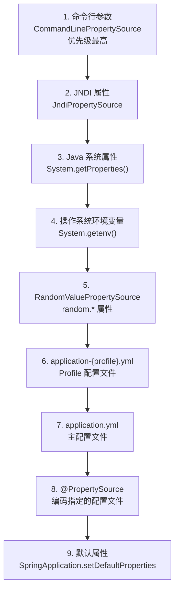

::: tip 配置优先级核心原则
**高优先级覆盖低优先级**。命令行参数优先级最高，默认属性最低。这就是为什么 `--server.port=8081` 能覆盖 `application.yml` 中的 `server.port: 8080`。
:::

#### prepareEnvironment() 源码深度追踪

```java
// SpringApplication.java
private ConfigurableEnvironment prepareEnvironment(
        SpringApplicationRunListeners listeners,
        DefaultBootstrapContext bootstrapContext,
        ApplicationArguments applicationArguments) {

    // 1. 创建或获取 Environment
    ConfigurableEnvironment environment = getOrCreateEnvironment();

    // 2. 配置 Environment：设置命令行参数、Profile
    configureEnvironment(environment, applicationArguments.getSourceArgs());

    // 3. 将 ConfigurationPropertySources 附加到 Environment
    //    这一步把所有 PropertySource 包装为 ConfigurationPropertySource
    ConfigurationPropertySources.attach(environment);

    // 4. 发布 ApplicationEnvironmentPreparedEvent
    //    触发所有 EnvironmentPostProcessor 执行
    listeners.environmentPrepared(bootstrapContext, environment);

    // 5. 将默认属性移到末尾（确保优先级最低）
    DefaultPropertiesPropertySource.moveToEnd(environment);

    // 6. 断言必须的属性是否存在
    Assert.state(!environment.containsProperty("spring.main.environment-prefix"),
        "Environment prefix cannot be set via properties");

    // 7. 绑定 spring.main.* 配置到 SpringApplication
    bindToSpringApplication(environment);

    // 8. 如果用户没有指定应用类型，根据配置再次推断
    if (!this.isCustomEnvironment) {
        environment = convertEnvironment(environment);
    }

    // 9. 创建 ConfigurationPropertySourcesPropertySource
    //    并添加到 Environment 的 PropertySource 列表首位
    ConfigurationPropertySources.finish(environment);

    return environment;
}
```

#### configureEnvironment() 详解

```java
// SpringApplication.java
protected void configureEnvironment(ConfigurableEnvironment environment, String[] args) {
    // 1. 添加命令行参数转换的 PropertySource
    if (this.addCommandLineProperties && args.length > 0) {
        // 将 --key=value 格式的参数转为 PropertySource
        // 优先级：命令行非选项参数 > 命令行选项参数
        CommandLinePropertySource<?> commandLinePropertySource =
            new SimpleCommandLinePropertySource(args);
        environment.getPropertySources().addFirst(commandLinePropertySource);
    }

    // 2. 配置 ConversionService（类型转换器）
    ConfigurationPropertySources.attach(environment);

    // 3. 设置活跃 Profile
    Set<String> profiles = new LinkedHashSet<>(this.additionalProfiles);
    profiles.addAll(Arrays.asList(environment.getActiveProfiles()));
    environment.setActiveProfiles(profiles.toArray(new String[0]));
}
```

#### ConfigData 加载机制（Spring Boot 2.4+）

Spring Boot 2.4 引入了全新的 `ConfigData` 机制来加载配置文件，替代了之前的 `ConfigFileApplicationListener`：

```java
// ConfigDataEnvironmentPostProcessor.java
public class ConfigDataEnvironmentPostProcessor implements EnvironmentPostProcessor, Ordered {

    @Override
    public void postProcessEnvironment(ConfigurableEnvironment environment,
                                       SpringApplication application) {
        // 1. 创建 ConfigDataEnvironment
        ConfigDataEnvironment configDataEnvironment =
            ConfigDataEnvironment.from(environment, this.resolvers, this.importers);

        // 2. 处理 ConfigData 导入
        //    包括 application.yml、application-{profile}.yml 等
        configDataEnvironment.processAndApply();
    }
}
```

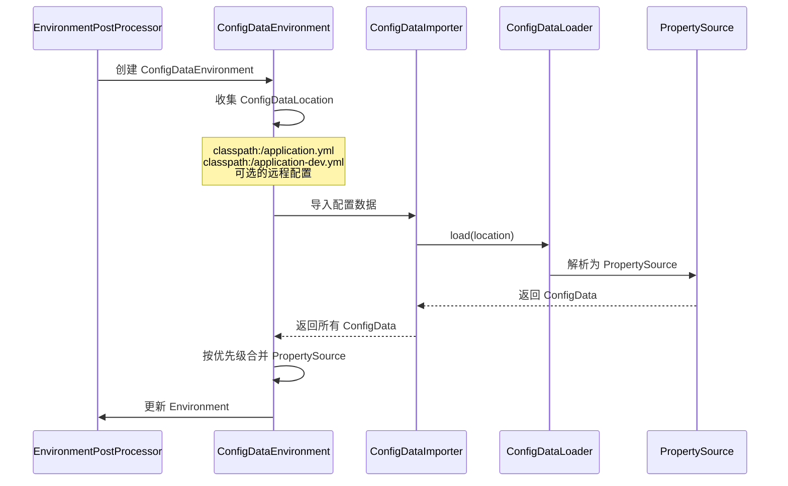

::: warning application.yml 的加载顺序变化
Spring Boot 2.4+ 对 `application.yml` 的加载顺序做了重大调整：
1. **先加载主配置** → **再加载 Profile 配置**（之前是反过来的）
2. Profile 配置不再简单地覆盖主配置，而是按导入顺序决定优先级
3. 新增 `spring.config.import` 属性，支持导入额外的配置源（如 Vault、Consul、Nacos）
:::

#### 自定义 PropertySource

```java
// 自定义 PropertySource：从数据库加载配置
public class DatabasePropertySource extends PropertySource<JdbcTemplate> {

    private final Map<String, Object> properties = new ConcurrentHashMap<>();

    public DatabasePropertySource(String name, JdbcTemplate source) {
        super(name, source);
        loadProperties();
    }

    private void loadProperties() {
        // 从数据库加载配置
        List<Map<String, Object>> rows = getSource()
            .queryForList("SELECT config_key, config_value FROM app_config");
        for (Map<String, Object> row : rows) {
            properties.put((String) row.get("config_key"), row.get("config_value"));
        }
    }

    @Override
    public Object getProperty(String name) {
        return properties.get(name);
    }
}
```

```java
// 通过 EnvironmentPostProcessor 注册自定义 PropertySource
public class DatabaseEnvironmentPostProcessor implements EnvironmentPostProcessor {

    @Override
    public void postProcessEnvironment(ConfigurableEnvironment environment,
                                       SpringApplication application) {
        // 从已有的数据源配置中获取连接信息
        String url = environment.getProperty("spring.datasource.url");
        String username = environment.getProperty("spring.datasource.username");
        String password = environment.getProperty("spring.datasource.password");

        if (url != null) {
            DataSource dataSource = DataSourceBuilder.create()
                .url(url).username(username).password(password).build();
            JdbcTemplate jdbcTemplate = new JdbcTemplate(dataSource);

            // 创建并注册 PropertySource（优先级高于 application.yml）
            DatabasePropertySource propertySource =
                new DatabasePropertySource("databaseConfig", jdbcTemplate);
            environment.getPropertySources().addAfter(
                "applicationConfigurationProperties", propertySource);
        }
    }
}
```

### Banner 自定义机制

#### Banner 加载流程

```java
// SpringApplication.java
private Banner printBanner(ConfigurableEnvironment environment) {
    if (this.bannerMode == Banner.Mode.OFF) {
        return null;
    }

    // 如果没有自定义 Banner，使用默认的 Spring Boot Banner
    if (this.bannerMode == Banner.Mode.LOG) {
        // 输出到日志
    } else {
        // 输出到控制台
    }

    ResourceLoader resourceLoader = this.resourceLoader;
    if (resourceLoader == null) {
        resourceLoader = new DefaultResourceLoader(null);
    }

    // 查找 banner.txt 文件
    SpringApplicationBannerPrinter bannerPrinter =
        new SpringApplicationBannerPrinter(resourceLoader, this.banner);

    // 优先查找图片 Banner：banner.gif / banner.jpg / banner.png
    // 其次查找文本 Banner：banner.txt
    if (this.bannerMode == Mode.LOG) {
        return bannerPrinter.print(environment, this.mainApplicationClass, logger);
    }
    return bannerPrinter.print(environment, this.mainApplicationClass, System.out);
}
```

#### Banner 查找顺序

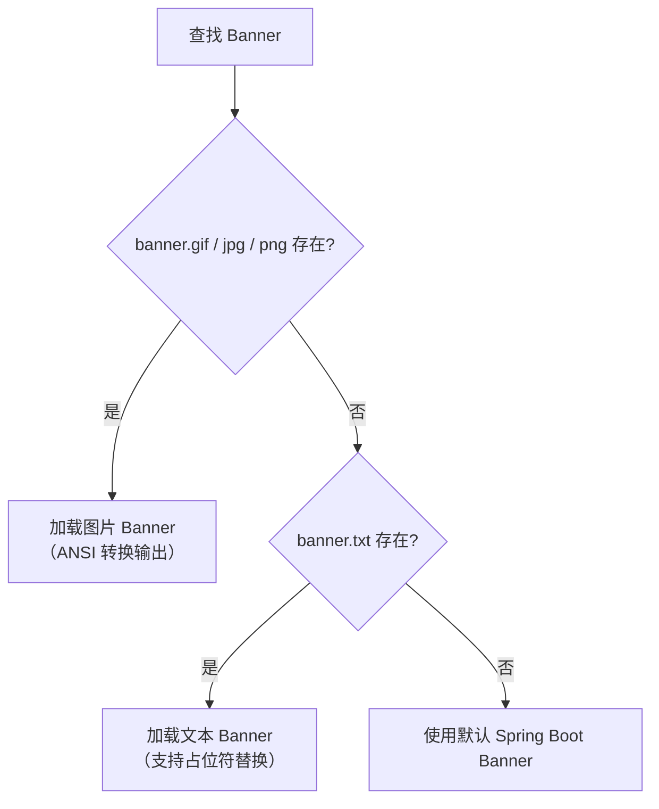

#### 自定义 Banner 示例

在 `src/main/resources/banner.txt` 中：

```text
${AnsiColor.BRIGHT_CYAN}
  ____  _     _       _
 / ___|| |__ (_)___  (_)___
| |    | '_ \| / __| | / __|
| |___ | | | | \__ \ | \__ \
 \____||_| |_|_|___/ |_|___/

${AnsiColor.DEFAULT}
:: Spring Boot ::  ${spring-boot.version}
:: Application ::  ${spring.application.name:vitepress}
:: Profile ::     ${spring.profiles.active:default}
:: Port ::        ${server.port:8080}
```

::: tip Banner 支持的占位符
- `${AnsiColor.xxx}`：ANSI 颜色控制
- `${spring-boot.version}`：Spring Boot 版本号
- `${application.title}`：应用标题（来自 MANIFEST.MF）
- `${application.version}`：应用版本
- `${spring.application.name}`：应用名称
- `${server.port}`：服务端口
- 任何 `Environment` 中的属性都可以引用
:::

#### 编程式 Banner

```java
@SpringBootApplication
public class Application {
    public static void main(String[] args) {
        SpringApplication app = new SpringApplication(Application.class);
        app.setBanner((environment, sourceClass, out) -> {
            out.println("========================================");
            out.println("  自定义应用启动中...");
            out.println("  环境: " + environment.getActiveProfiles()[0]);
            out.println("  端口: " + environment.getProperty("server.port", "8080"));
            out.println("========================================");
        });
        app.setBannerMode(Banner.Mode.CONSOLE);  // 输出到控制台
        app.run(args);
    }
}
```

#### 关闭 Banner

```java
// 方式一：代码关闭
SpringApplication app = new SpringApplication(Application.class);
app.setBannerMode(Banner.Mode.OFF);
app.run(args);

// 方式二：配置关闭
spring:
  main:
    banner-mode: off

// 方式三：命令行关闭
java -jar myapp.jar --spring.main.banner-mode=off
```

### prepareBeanFactory() 详解

`prepareBeanFactory()` 是 `refresh()` 的第 3 步，为 `BeanFactory` 配置标准特性：

```java
// AbstractApplicationContext.java
protected void prepareBeanFactory(ConfigurableListableBeanFactory beanFactory) {
    // 1. 设置 ClassLoader
    beanFactory.setBeanClassLoader(getClassLoader());

    // 2. 注册标准表达式解析器（解析 #{...} SpEL 表达式）
    beanFactory.setBeanExpressionResolver(new StandardBeanExpressionResolver(beanFactory.getBeanClassLoader()));

    // 3. 注册属性编辑器注册器（处理 XML 配置中的类型转换）
    beanFactory.addPropertyEditorRegistrar(new ResourceEditorRegistrar(this, getEnvironment()));

    // 4. 注册 ApplicationContextAwareProcessor（处理 Aware 接口回调）
    beanFactory.addBeanPostProcessor(new ApplicationContextAwareProcessor(this));

    // 5. 忽略以下接口的自动装配（因为由 AwareProcessor 处理）
    beanFactory.ignoreDependencyInterface(EnvironmentAware.class);
    beanFactory.ignoreDependencyInterface(EmbeddedValueResolverAware.class);
    beanFactory.ignoreDependencyInterface(ResourceLoaderAware.class);
    beanFactory.ignoreDependencyInterface(ApplicationEventPublisherAware.class);
    beanFactory.ignoreDependencyInterface(MessageSourceAware.class);
    beanFactory.ignoreDependencyInterface(ApplicationContextAware.class);

    // 6. 注册特殊依赖的解析规则
    //    当 Bean 声明注入这些类型时，直接返回固定对象而非去容器查找
    beanFactory.registerResolvableDependency(BeanFactory.class, beanFactory);
    beanFactory.registerResolvableDependency(ResourceLoader.class, this);
    beanFactory.registerResolvableDependency(ApplicationEventPublisher.class, this);
    beanFactory.registerResolvableDependency(ApplicationContext.class, this);

    // 7. 注册 ApplicationListenerDetector（检测实现了 ApplicationListener 的 Bean）
    beanFactory.addBeanPostProcessor(new ApplicationListenerDetector(this));

    // 8. 检测 LoadTimeWeaver（AOP 织入支持）
    if (beanFactory.containsBean(LOAD_TIME_WEAVER_BEAN_NAME)) {
        beanFactory.addBeanPostProcessor(new LoadTimeWeaverAwareProcessor(beanFactory));
        beanFactory.setTempClassLoader(new ContextTypeMatchClassLoader(beanFactory.getBeanClassLoader()));
    }

    // 9. 注册默认的环境 Bean
    if (!beanFactory.containsLocalBean(ENVIRONMENT_BEAN_NAME)) {
        beanFactory.registerSingleton(ENVIRONMENT_BEAN_NAME, getEnvironment());
    }
    if (!beanFactory.containsLocalBean(SYSTEM_PROPERTIES_BEAN_NAME)) {
        beanFactory.registerSingleton(SYSTEM_PROPERTIES_BEAN_NAME, getEnvironment().getSystemProperties());
    }
    if (!beanFactory.containsLocalBean(SYSTEM_ENVIRONMENT_BEAN_NAME)) {
        beanFactory.registerSingleton(SYSTEM_ENVIRONMENT_BEAN_NAME, getEnvironment().getSystemEnvironment());
    }
}
```

#### Aware 接口回调机制

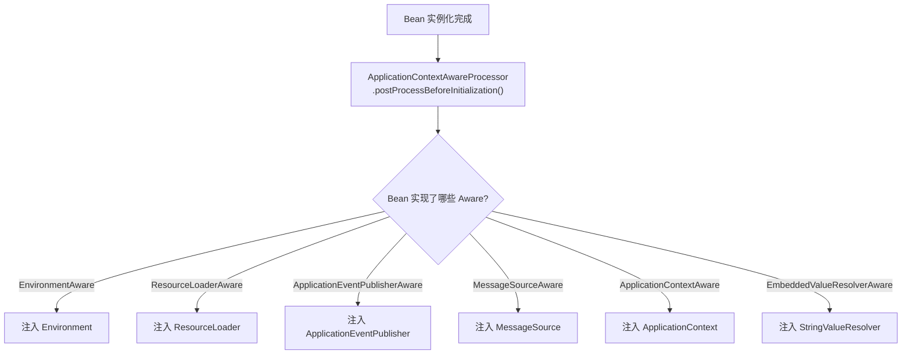

```java
// ApplicationContextAwareProcessor 核心逻辑
class ApplicationContextAwareProcessor implements BeanPostProcessor {

    private final ConfigurableApplicationContext applicationContext;

    @Override
    public Object postProcessBeforeInitialization(Object bean, String beanName) throws BeansException {
        // 依次检查并注入 Aware 接口的依赖
        invokeAwareInterfaces(bean);
        return bean;
    }

    private void invokeAwareInterfaces(Object bean) {
        if (bean instanceof EnvironmentAware environmentAware) {
            environmentAware.setEnvironment(this.applicationContext.getEnvironment());
        }
        if (bean instanceof EmbeddedValueResolverAware resolverAware) {
            resolverAware.setEmbeddedValueResolver(this.applicationContext);
        }
        if (bean instanceof ResourceLoaderAware loaderAware) {
            loaderAware.setResourceLoader(this.applicationContext);
        }
        if (bean instanceof ApplicationEventPublisherAware publisherAware) {
            publisherAware.setApplicationEventPublisher(this.applicationContext);
        }
        if (bean instanceof MessageSourceAware sourceAware) {
            sourceAware.setMessageSource(this.applicationContext);
        }
        if (bean instanceof ApplicationContextAware contextAware) {
            contextAware.setApplicationContext(this.applicationContext);
        }
    }
}
```

::: tip 为什么 Aware 接口用 ignoreDependencyInterface 忽略？
`beanFactory.ignoreDependencyInterface(EnvironmentAware.class)` 的作用是：**不让自动装配（`@Autowired`）去注入 `Environment` 类型的依赖给 `EnvironmentAware` 的 setter 方法**。因为 `ApplicationContextAwareProcessor` 已经在 `postProcessBeforeInitialization` 阶段手动调用了 setter，如果不忽略，Spring 还会尝试用自动装配再注入一次，可能导致冲突或重复调用。
:::

### invokeBeanFactoryPostProcessors() 深度剖析

这是 `refresh()` 中最核心的步骤——自动配置在此生效。

#### 执行顺序规则

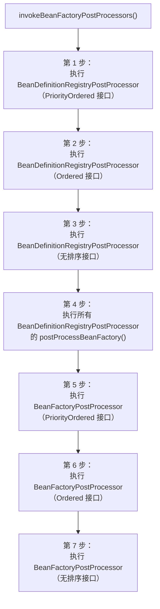

::: warning 关键理解
`BeanDefinitionRegistryPostProcessor` 是 `BeanFactoryPostProcessor` 的子接口，多了一个 `postProcessBeanDefinitionRegistry()` 方法。执行顺序的核心规则：
1. `BeanDefinitionRegistryPostProcessor` 先于 `BeanFactoryPostProcessor` 执行
2. 同类中，`PriorityOrdered` > `Ordered` > 无排序接口
3. `ConfigurationClassPostProcessor` 实现了 `PriorityOrdered`，所以最先执行——这是自动配置生效的前提
:::

#### ConfigurationClassPostProcessor 全链路

```java
// ConfigurationClassPostProcessor.java
public void postProcessBeanDefinitionRegistry(BeanDefinitionRegistry registry) {
    int registryId = registry.hashCode();
    // 防止重复处理
    if (this.registriesPostProcessed.contains(registryId)) {
        throw new IllegalStateException("postProcessBeanDefinitionRegistry already called");
    }
    this.registriesPostProcessed.add(registryId);
    processConfigBeanDefinitions(registry);
}
```

```java
public void processConfigBeanDefinitions(BeanDefinitionRegistry registry) {
    // 1. 从已有 BeanDefinition 中找出配置类
    List<BeanDefinitionHolder> configCandidates = new ArrayList<>();
    for (String beanName : registry.getBeanDefinitionNames()) {
        BeanDefinition beanDef = registry.getBeanDefinition(beanName);
        // 检查是否是 @Configuration 类
        if (ConfigurationClassUtils.checkConfigurationClassCandidate(beanDef, this.metadataReaderFactory)) {
            configCandidates.add(new BeanDefinitionHolder(beanDef, beanName));
        }
    }

    // 2. 创建配置类解析器
    ConfigurationClassParser parser = new ConfigurationClassParser(
        this.metadataReaderFactory, this.problemReporter, this.environment,
        this.resourceLoader, this.componentScanBeanNameGenerator, registry);

    // 3. 解析配置类（递归处理 @Import、@ComponentScan 等）
    Set<BeanDefinitionHolder> candidates = new LinkedHashSet<>(configCandidates);
    Set<ConfigurationClass> alreadyParsed = new HashSet<>(configCandidates.size());
    do {
        parser.parse(candidates);
        parser.validate();

        Set<ConfigurationClass> configClasses = new LinkedHashSet<>(parser.getConfigurationClasses());
        configClasses.removeAll(alreadyParsed);

        // 4. 读取配置类中定义的 Bean 并注册 BeanDefinition
        this.reader.loadBeanDefinitions(configClasses);
        alreadyParsed.addAll(configClasses);

        // 本轮解析若通过 @Import 等发现了新的配置类，则继续循环解析
        candidates = removeAlreadyParsed(candidates, alreadyParsed);
    }
    while (!candidates.isEmpty());
}
```

#### 配置类解析的递归过程

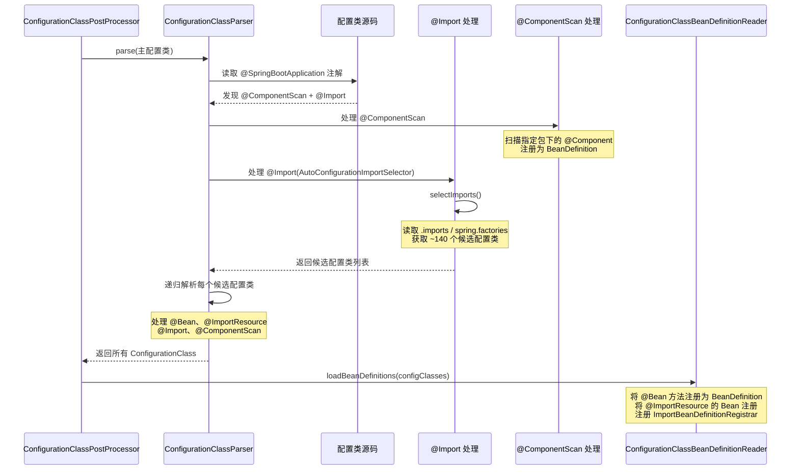

#### 自动配置协商的完整流程

```java
// AutoConfigurationImportSelector.java
protected AutoConfigurationEntry getAutoConfigurationEntry(AnnotationMetadata annotationMetadata) {
    if (!isEnabled(annotationMetadata)) {
        return EMPTY_ENTRY;
    }

    // 步骤 1：获取注解属性（exclude 等）
    AnnotationAttributes attributes = getAttributes(annotationMetadata);

    // 步骤 2：获取所有候选配置类（~140 个）
    List<String> configurations = getCandidateConfigurations(annotationMetadata, attributes);

    // 步骤 3：去重
    configurations = removeDuplicates(configurations);

    // 步骤 4：排除指定的配置类
    Set<String> exclusions = getExclusions(annotationMetadata, attributes);
    checkExcludedClasses(configurations, exclusions);
    configurations.removeAll(exclusions);

    // 步骤 5：过滤——根据条件注解快速排除不满足的配置类
    //    使用 AutoConfigurationImportFilter 进行高效过滤
    //    不需要实际加载配置类，只检查 @ConditionalOnClass 等注解元数据
    configurations = getConfigurationClassFilter().filter(configurations);

    // 步骤 6：触发自动配置导入事件
    fireAutoConfigurationImportEvents(configurations, exclusions);

    return new AutoConfigurationEntry(configurations, exclusions);
}
```

::: details 过滤器的性能优化原理
Spring Boot 2.7+ 使用 `AutoConfigurationImportFilter` 在加载配置类之前进行快速过滤。其核心思想是：**不需要把 ~140 个配置类全部加载到 JVM 中再判断条件**，而是通过读取编译时生成的元数据文件 `META-INF/spring/autoconfigure-metadata.properties` 来判断 `@ConditionalOnClass` 条件。

```properties
# META-INF/spring/autoconfigure-metadata.properties
# 编译时自动生成，记录每个自动配置类的条件（Boot 3.x 中 Servlet 类为 jakarta 命名空间）
org.springframework.boot.autoconfigure.web.servlet.WebMvcAutoConfiguration.ConditionalOnClass=jakarta.servlet.Servlet
org.springframework.boot.autoconfigure.jdbc.DataSourceAutoConfiguration.ConditionalOnClass=javax.sql.DataSource
```

这样，Spring Boot 只需检查类路径上是否有 `jakarta.servlet.Servlet`，就能判断 `WebMvcAutoConfiguration` 是否需要加载，避免了加载配置类本身的开销。
:::

### registerBeanPostProcessors() 详解

`registerBeanPostProcessors()` 是 `refresh()` 的第 6 步，负责注册所有 `BeanPostProcessor`。与 `BeanFactoryPostProcessor` 不同，`BeanPostProcessor` 作用于 **Bean 实例化之后**，可以修改 Bean 的属性或替换 Bean。

#### 注册顺序

```java
// PostProcessorRegistrationDelegate.java
public static void registerBeanPostProcessors(
        ConfigurableListableBeanFactory beanFactory, AbstractApplicationContext applicationContext) {

    // 1. 获取所有 BeanPostProcessor 的 BeanName
    String[] postProcessorNames = beanFactory.getBeanNamesForType(BeanPostProcessor.class, true, false);

    int beanProcessorTargetCount = beanFactory.getBeanPostProcessorCount() + 1 + postProcessorNames.length;

    // 2. 分类处理
    List<BeanPostProcessor> priorityOrderedPostProcessors = new ArrayList<>();
    List<BeanPostProcessor> internalPostProcessors = new ArrayList<>();
    List<String> orderedPostProcessorNames = new ArrayList<>();
    List<String> nonOrderedPostProcessorNames = new ArrayList<>();

    for (String ppName : postProcessorNames) {
        if (beanFactory.isTypeMatch(ppName, PriorityOrdered.class)) {
            BeanPostProcessor pp = beanFactory.getBean(ppName, BeanPostProcessor.class);
            priorityOrderedPostProcessors.add(pp);
            if (pp instanceof MergedBeanDefinitionPostProcessor) {
                internalPostProcessors.add(pp);
            }
        } else if (beanFactory.isTypeMatch(ppName, Ordered.class)) {
            orderedPostProcessorNames.add(ppName);
        } else {
            nonOrderedPostProcessorNames.add(ppName);
        }
    }

    // 3. 按 PriorityOrdered → Ordered → 无排序 的顺序注册
    sortPostProcessors(priorityOrderedPostProcessors, beanFactory);
    registerBeanPostProcessors(beanFactory, priorityOrderedPostProcessors);

    List<BeanPostProcessor> orderedPostProcessors = new ArrayList<>();
    for (String ppName : orderedPostProcessorNames) {
        BeanPostProcessor pp = beanFactory.getBean(ppName, BeanPostProcessor.class);
        orderedPostProcessors.add(pp);
        // ...
    }
    sortPostProcessors(orderedPostProcessors, beanFactory);
    registerBeanPostProcessors(beanFactory, orderedPostProcessors);

    List<BeanPostProcessor> nonOrderedPostProcessors = new ArrayList<>();
    for (String ppName : nonOrderedPostProcessorNames) {
        BeanPostProcessor pp = beanFactory.getBean(ppName, BeanPostProcessor.class);
        nonOrderedPostProcessors.add(pp);
        // ...
    }
    registerBeanPostProcessors(beanFactory, nonOrderedPostProcessors);

    // 4. 最后注册 MergedBeanDefinitionPostProcessor
    sortPostProcessors(internalPostProcessors, beanFactory);
    registerBeanPostProcessors(beanFactory, internalPostProcessors);

    // 5. 注册 ApplicationListenerDetector
    beanFactory.addBeanPostProcessor(new ApplicationListenerDetector(applicationContext));
}
```

#### Spring Boot 内置的关键 BeanPostProcessor

| BeanPostProcessor | 作用 | 优先级 |
|---|---|---|
| `ApplicationContextAwareProcessor` | 处理 Aware 接口回调 | 最高（在 `prepareBeanFactory()` 中注册） |
| `AutowiredAnnotationBeanPostProcessor` | 处理 `@Autowired`、`@Value` 注入 | PriorityOrdered |
| `CommonAnnotationBeanPostProcessor` | 处理 `@Resource`、`@PostConstruct`、`@PreDestroy` | PriorityOrdered |
| `ConfigurationPropertiesBindingPostProcessor` | 处理 `@ConfigurationProperties` 绑定 | PriorityOrdered |
| `MethodValidationPostProcessor` | 处理 `@Validated` 方法级校验 | 无排序 |
| `AsyncAnnotationBeanPostProcessor` | 处理 `@Async` 代理创建 | 无排序 |
| `AutoProxyCreator`（多种） | 处理 AOP 代理创建 | 低优先级 |

```mermaid
flowchart LR
    A["Bean 实例化"] --> B["InstantiationAwareBPP<br/>.postProcessBeforeInstantiation()"]
    B --> C["MergedBeanDefinitionBPP<br/>.postProcessMergedBeanDefinition()"]
    C --> D["属性填充<br/>populateBean()"]
    D --> E["InstantiationAwareBPP<br/>.postProcessProperties()"]
    E --> F["BeanPostProcessor<br/>.postProcessBeforeInitialization()"]
    F --> G["@PostConstruct<br/>初始化方法"]
    G --> H["BeanPostProcessor<br/>.postProcessAfterInitialization()"]
    H --> I["AOP 代理生成"]

```

### finishRefresh() 与容器生命周期

#### finishRefresh() 源码

```java
// AbstractApplicationContext.java
protected void finishRefresh() {
    // 1. 清除资源缓存
    clearResourceCaches();

    // 2. 初始化 LifecycleProcessor（生命周期处理器）
    initLifecycleProcessor();

    // 3. 调用 LifecycleProcessor.onRefresh()——启动所有 SmartLifecycle Bean
    getLifecycleProcessor().onRefresh();

    // 4. 发布 ContextRefreshedEvent
    publishEvent(new ContextRefreshedEvent(this));

    // 5. 向 MBeanServer 注册 JMX 信息（如果启用）
    if (!NativeDetector.inNativeImage()) {
        LiveBeansView.registerApplicationContext(this);
    }
}
```

#### Lifecycle 接口体系

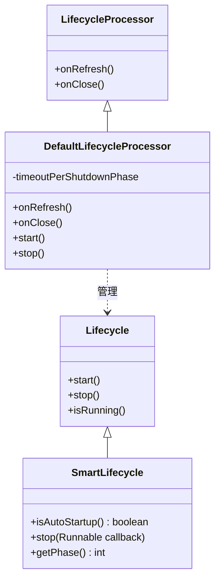

#### SmartLifecycle 的 Phase 机制

```java
// 自定义 Lifecycle Bean
@Component
public class MyLifecycleBean implements SmartLifecycle {

    private volatile boolean running = false;

    @Override
    public void start() {
        log.info("MyLifecycleBean 启动");
        this.running = true;
    }

    @Override
    public void stop() {
        log.info("MyLifecycleBean 停止");
        this.running = false;
    }

    @Override
    public void stop(Runnable callback) {
        // 支持异步停止，完成后调用 callback
        new Thread(() -> {
            try {
                Thread.sleep(1000);  // 模拟优雅停机
                stop();
            } finally {
                callback.run();
            }
        }).start();
    }

    @Override
    public boolean isRunning() {
        return this.running;
    }

    @Override
    public boolean isAutoStartup() {
        return true;  // 容器刷新时自动启动
    }

    @Override
    public int getPhase() {
        return 0;  // 数字越小越先启动、越后停止
    }
}
```

::: tip Phase 数字的含义
- **启动顺序**：Phase 数字小的先启动
- **停止顺序**：Phase 数字大的先停止
- 默认 Phase = 0
- Web Server 的 Phase = `Integer.MAX_VALUE - 1`（最后启动，最先停止——确保 Bean 都就绪后再接收请求）
:::

### 容器关闭流程详解

#### 关闭入口

```java
// SpringApplication.java
public ConfigurableApplicationContext run(String... args) {
    // ...
    try {
        // 注册 Shutdown Hook
        if (this.registerShutdownHook) {
            shutdownHook.registerApplicationContext(context);
        }
        // ...
    } catch (Throwable ex) {
        handleRunFailure(context, ex, listeners);
    }
}
```

#### doClose() 完整流程

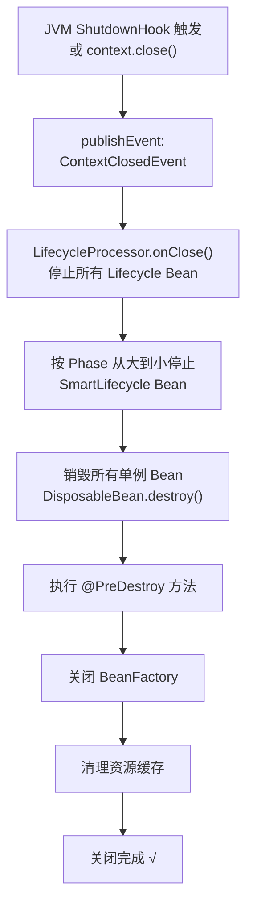

```java
// AbstractApplicationContext.java
protected void doClose() {
    // 检查是否正在运行
    if (this.active.get() && this.closed.compareAndSet(false, true)) {
        // 1. 发布 ContextClosedEvent
        publishEvent(new ContextClosedEvent(this));

        // 2. 停止所有 Lifecycle Bean
        if (this.lifecycleProcessor != null) {
            this.lifecycleProcessor.onClose();
        }

        // 3. 销毁所有单例 Bean
        destroyBeans();

        // 4. 关闭 BeanFactory
        closeBeanFactory();

        // 5. 子类清理
        onClose();

        // 6. 重置状态
        this.active.set(false);
    }
}
```

#### 优雅停机配置

```yaml
# application.yml
server:
  shutdown: graceful  # 启用优雅停机

spring:
  lifecycle:
    timeout-per-shutdown-phase: 30s  # 每个关闭阶段超时时间
```

```java
// Spring Boot 2.3+ 优雅停机工作原理
// 1. 接收 SIGTERM 信号
// 2. Web Server 停止接收新请求
// 3. 等待现有请求处理完成（最多 30s）
// 4. 关闭 Spring 容器
// 5. 销毁所有 Bean
```

::: danger 优雅停机的常见坑
1. **默认不开启**：必须显式设置 `server.shutdown=graceful`
2. **超时即强杀**：超过 `timeout-per-shutdown-phase` 后，Spring 会强制销毁 Bean，正在处理的请求会被中断
3. **只对嵌入式容器有效**：部署到外部 Tomcat 时需要配合 Tomcat 自身的 shutdown 机制
4. **线程池未关闭**：`@Async` 使用的线程池默认不会优雅关闭，需要自定义 `TaskExecutor` 并实现 `SmartLifecycle`
5. **Kubernetes 场景**：需要配合 `terminationGracePeriodSeconds`，且 `preStop` 钩子建议用 `sleep` 让 Service 注册表更新
:::

```java
// 自定义优雅停机的线程池
@Configuration
public class AsyncConfig {

    @Bean
    public TaskExecutor taskExecutor() {
        ThreadPoolTaskExecutor executor = new ThreadPoolTaskExecutor();
        executor.setCorePoolSize(10);
        executor.setMaxPoolSize(50);
        executor.setQueueCapacity(200);
        executor.setWaitForTasksToCompleteOnShutdown(true);  // 等待任务完成
        executor.setAwaitTerminationSeconds(60);  // 最多等 60 秒
        executor.initialize();
        return executor;
    }
}
```

```yaml
# Kubernetes 部署配置
# 确保 Pod 优雅终止
spec:
  terminationGracePeriodSeconds: 60
  containers:
    - name: myapp
      lifecycle:
        preStop:
          exec:
            command: ["sh", "-c", "sleep 10"]  # 等待 Service 注册表更新
```

### BootstrapContext 机制

Spring Boot 2.4 引入了 `BootstrapContext`，用于在 `ApplicationContext` 创建之前提供基础设施支持。

#### BootstrapContext 的生命周期

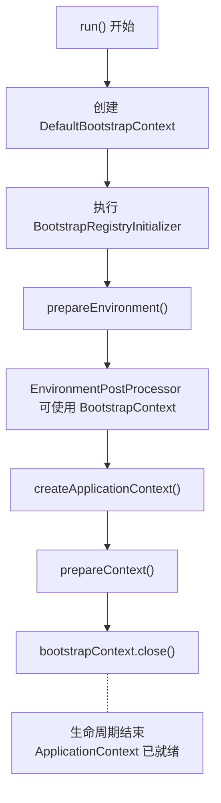

#### 注册自定义 BootstrapRegistryInitializer

```java
// 自定义 BootstrapRegistryInitializer
public class MyBootstrapRegistryInitializer implements BootstrapRegistryInitializer {

    @Override
    public void initialize(BootstrapRegistry registry) {
        // 在 ApplicationContext 创建之前注册基础设施 Bean
        registry.register(MyInfrastructureService.class, context ->
            new MyInfrastructureService(context.get(ClassLoader.class))
        );
    }
}
```

```java
// 注册方式
SpringApplication app = new SpringApplication(Application.class);
app.addBootstrapRegistryInitializer(new MyBootstrapRegistryInitializer());
app.run(args);
```

```properties
# 或通过 spring.factories 注册
org.springframework.boot.BootstrapRegistryInitializer=\
com.example.MyBootstrapRegistryInitializer
```

::: tip BootstrapContext 与 ApplicationContext 的区别
| 特性 | BootstrapContext | ApplicationContext |
|------|-----------------|-------------------|
| 存在阶段 | 容器创建之前 | 容器创建之后 |
| 功能 | 提供基础设施支持 | 完整的 IoC 容器 |
| Bean 管理 | 不支持 `@Autowired` | 支持完整的依赖注入 |
| 典型用途 | 注册早期需要的基础设施 | 注册业务 Bean |
| 生命周期 | `run()` 开始到 `prepareContext()` 结束 | 从 `createApplicationContext()` 到应用关闭 |
:::

### FailureAnalyzer 启动失败分析器

#### 工作机制

当 Spring Boot 启动失败时，`FailureAnalyzers` 会捕获异常并生成人类可读的错误报告：

```java
// Spring Boot 启动失败处理
private void handleRunFailure(ConfigurableApplicationContext context,
        Throwable exception, SpringApplicationRunListeners listeners) {

    try {
        // 1. 尝试分析异常
        FailureAnalyzers analyzers = null;
        if (context != null) {
            analyzers = new FailureAnalyzers(context);
        }

        // 2. 如果有匹配的 Analyzer，输出友好的错误报告
        FailureAnalysis analysis = analyzeFailure(exception, analyzers);
        if (analysis != null) {
            reportFailure(analysis);
        } else {
            // 3. 没有 Analyzer 能处理，输出原始异常堆栈
            log.error("Application run failed", exception);
        }
    } catch (Throwable ex) {
        log.error("Unable to provide failure analysis", ex);
    } finally {
        // 4. 清理资源
        if (context != null) {
            context.close();
        }
        listeners.failed(context, exception);
    }
}
```

#### 内置的 FailureAnalyzer

| FailureAnalyzer | 处理的异常 | 输出的建议 |
|---|---|---|
| `PortInUseFailureAnalyzer` | `PortInUseException` | 端口被占用，建议修改端口或停止占用进程 |
| `NoSuchBeanDefinitionFailureAnalyzer` | `NoSuchBeanDefinitionException` | Bean 不存在，建议检查 `@ComponentScan` 或添加依赖 |
| `MissingParameterNamesFailureAnalyzer` | `ParameterCountException` | 构造器参数名未保留，建议开启 `-parameters` 编译选项 |
| `BindFailureAnalyzer` | `BindException` | 配置绑定失败，提示具体属性和原因 |
| `UnboundConfigurationPropertyFailureAnalyzer` | `UnboundConfigurationPropertyException` | 配置属性未被绑定，提示未识别的属性 |
| `DataSourceBeanCreationFailureAnalyzer` | 数据源创建失败 | 缺少数据库配置，建议添加 `spring.datasource.*` |
| `NoSuchMethodFailureAnalyzer` | `NoSuchMethodError` | 版本冲突，建议检查依赖 |
| `NoUniqueBeanDefinitionFailureAnalyzer` | `NoUniqueBeanDefinitionException` | 多个同类型 Bean，建议使用 `@Primary` 或 `@Qualifier` |
| `ValidationExceptionFailureAnalyzer` | 配置校验异常 | 提示具体的校验错误 |

#### 自定义 FailureAnalyzer

```java
// 自定义 FailureAnalyzer：处理 Redis 连接失败
public class RedisConnectionFailureAnalyzer extends AbstractFailureAnalyzer<RedisConnectionFailureException> {

    @Override
    protected FailureAnalysis analyze(Throwable rootFailure,
                                      RedisConnectionFailureException cause) {
        return new FailureAnalysis(
            // 问题描述
            "Redis 连接失败: " + cause.getMessage(),
            // 建议的修复方案
            "请检查以下配置:\n" +
            "1. Redis 服务是否已启动\n" +
            "2. spring.data.redis.host 和 port 是否正确\n" +
            "3. 如果是远程 Redis，检查防火墙和网络连通性\n" +
            "4. 如果不需要 Redis，排除 RedisAutoConfiguration:\n" +
            "   @SpringBootApplication(exclude = RedisAutoConfiguration.class)",
            cause
        );
    }
}
```

```properties
# META-INF/spring.factories
org.springframework.boot.diagnostics.FailureAnalyzer=\
com.example.RedisConnectionFailureAnalyzer
```

### Spring Boot 3.x 启动流程变化

#### 关键变化对比

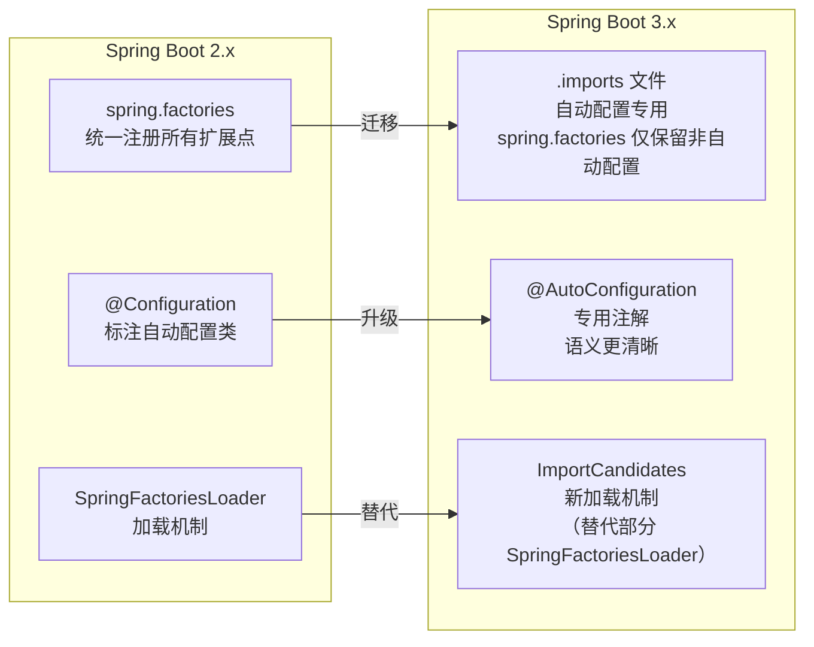


#### GraalVM AOT 处理

Spring Boot 3.x 的 AOT 处理阶段与 Native Image 详见 [33-GraalVM与AOT](33-GraalVM与AOT.md)。

#### 新的启动事件

Spring Boot 3.x 新增了 `AvailabilityChangeEvent`，替代了部分原有的启动事件：

```java
// Spring Boot 3.x 启动事件序列
@Component
public class StartupEventListener {

    // 容器就绪前的可用性状态变化
    @EventListener
    public void onAvailabilityChange(AvailabilityChangeEvent<ReadinessState> event) {
        if (event.getState() == ReadinessState.ACCEPTING_TRAFFIC) {
            // 应用已准备好接收流量
            log.info("应用已就绪，可以接收请求");
        } else if (event.getState() == ReadinessState.REFUSING_TRAFFIC) {
            // 应用拒绝流量（正在关闭）
            log.info("应用正在关闭，拒绝新请求");
        }
    }

    // 存活状态变化
    @EventListener
    public void onLivenessChange(AvailabilityChangeEvent<LivenessState> event) {
        if (event.getState() == LivenessState.CORRECT) {
            // 应用内部状态正常
            log.info("应用存活状态正常");
        } else if (event.getState() == LivenessState.BROKEN) {
            // 应用内部状态异常（如死锁、资源耗尽）
            log.error("应用存活状态异常！");
        }
    }
}
```

::: warning Readiness vs Liveness 的区别
这是 Kubernetes 探针概念的映射：
- **Readiness（就绪）**：应用是否可以接收流量？→ `ReadinessState.ACCEPTING_TRAFFIC / REFUSING_TRAFFIC`
- **Liveness（存活）**：应用内部状态是否正常？→ `LivenessState.CORRECT / BROKEN`

Spring Boot Actuator 将这些状态暴露为 `/actuator/health/readiness` 和 `/actuator/health/liveness` 端点，可以直接对接 Kubernetes 的 `readinessProbe` 和 `livenessProbe`。
:::

### 实战场景深度解析

#### 场景一：启动时动态加载配置

```java
// 从远程配置中心（如 Nacos）加载配置
public class NacosConfigEnvironmentPostProcessor implements EnvironmentPostProcessor, Ordered {

    @Override
    public void postProcessEnvironment(ConfigurableEnvironment environment,
                                       SpringApplication application) {
        String serverAddr = environment.getProperty("nacos.server-addr", "localhost:8848");
        String namespace = environment.getProperty("nacos.namespace", "public");
        String dataId = environment.getProperty("nacos.data-id", "application");

        try {
            // 从 Nacos 拉取配置
            NacosConfigService configService = new NacosConfigService(serverAddr, namespace);
            String config = configService.getConfig(dataId, "DEFAULT_GROUP", 5000);

            if (config != null) {
                // 将远程配置解析为 PropertySource 并添加到 Environment
                YamlPropertySourceLoader loader = new YamlPropertySourceLoader();
                List<PropertySource<?>> propertySources =
                    loader.load("nacosConfig", new ByteArrayResource(config.getBytes()));

                // 优先级高于 application.yml，低于命令行参数
                for (PropertySource<?> ps : propertySources) {
                    environment.getPropertySources().addAfter("applicationConfigurationProperties", ps);
                }
                log.info("从 Nacos 加载配置成功: dataId={}", dataId);
            }
        } catch (NacosException e) {
            log.warn("从 Nacos 加载配置失败，使用本地配置: {}", e.getMessage());
        }
    }

    @Override
    public int getOrder() {
        return Ordered.LOWEST_PRECEDENCE - 1;  // 在内置 EnvironmentPostProcessor(如 ConfigData)之后执行
    }
}
```

#### 场景二：启动耗时分析

```java
// 使用 BufferingApplicationStartup 记录启动耗时
@SpringBootApplication
public class Application {

    public static void main(String[] args) {
        SpringApplication app = new SpringApplication(Application.class);
        // 开启启动步骤记录
        app.setApplicationStartup(new BufferingApplicationStartup(2048));
        ConfigurableApplicationContext context = app.run(args);

        // 分析启动耗时
        analyzeStartupTime(context);
    }

    private static void analyzeStartupTime(ConfigurableApplicationContext context) {
        ApplicationStartup startup = context.getApplicationStartup();
        if (!(startup instanceof BufferingApplicationStartup buffering)) {
            return;
        }

        List<StartupStep> steps = buffering.drain();

        // 1. 找出最耗时的 10 个步骤
        System.out.println("=== 启动耗时 Top 10 ===");
        steps.stream()
            .sorted(Comparator.comparing(
                (StartupStep s) -> s.getDuration().toMillis()).reversed())
            .limit(10)
            .forEach(s -> System.out.printf(
                "%-50s %5dms%n", s.getName(), s.getDuration().toMillis()));

        // 2. 按 Category 分组统计
        System.out.println("\n=== 分类耗时统计 ===");
        Map<String, Long> categoryTime = steps.stream()
            .collect(Collectors.groupingBy(
                s -> s.getName().split("\\.")[0],
                Collectors.summingLong(s -> s.getDuration().toMillis())));

        categoryTime.entrySet().stream()
            .sorted(Map.Entry.<String, Long>comparingByValue().reversed())
            .forEach(e -> System.out.printf("%-30s %5dms%n", e.getKey(), e.getValue()));

        // 3. Bean 初始化耗时统计
        System.out.println("\n=== Bean 初始化耗时 Top 10 ===");
        steps.stream()
            .filter(s -> s.getName().equals("spring.bean.instantiate"))
            .sorted(Comparator.comparing(
                (StartupStep s) -> s.getDuration().toMillis()).reversed())
            .limit(10)
            .forEach(s -> {
                String beanName = s.getTags().stream()
                    .filter(t -> t.getKey().equals("beanName"))
                    .map(StartupStep.Tag::getValue)
                    .findFirst().orElse("unknown");
                System.out.printf("%-50s %5dms%n", beanName, s.getDuration().toMillis());
            });
    }
}
```

::: details 典型启动耗时分析结果
```text
=== 启动耗时 Top 10 ===
spring.context.refresh                                3200ms
spring.bean.instantiate                               2100ms
spring.context.beans.post-process                     1500ms
spring.context.config.import                          800ms
spring.boot.autoconfigure                             600ms

=== 分类耗时统计 ===
spring                                                7500ms
spring.beans                                          3200ms
spring.boot                                           1200ms

=== Bean 初始化耗时 Top 10 ===
dataSource                                            450ms
entityManagerFactory                                  380ms
redisConnectionFactory                                200ms
tomcatServletWebServerFactory                         180ms
```
:::

#### 场景三：条件化启动组件

```java
// 根据 Profile 动态注册不同的 Bean
public class ProfileAwareInitializer implements ApplicationContextInitializer<ConfigurableApplicationContext> {

    @Override
    public void initialize(ConfigurableApplicationContext context) {
        String[] activeProfiles = context.getEnvironment().getActiveProfiles();

        if (Arrays.asList(activeProfiles).contains("dev")) {
            // 开发环境：注册 Mock 服务
            context.getBeanFactory().registerSingleton("paymentService",
                new MockPaymentService());
            context.getBeanFactory().registerSingleton("notificationService",
                new MockNotificationService());
        } else if (Arrays.asList(activeProfiles).contains("prod")) {
            // 生产环境：注册真实服务
            // 这里只注册 BeanDefinition，实际实例化由 Spring 管理
            GenericBeanDefinition beanDefinition = new GenericBeanDefinition();
            beanDefinition.setBeanClass(RealPaymentService.class);
            context.getBeanFactory().registerBeanDefinition("paymentService", beanDefinition);
        }
    }
}
```

#### 场景四：防止重复启动

```java
// 使用文件锁防止同一应用重复启动
public class SingleInstanceInitializer implements ApplicationContextInitializer<ConfigurableApplicationContext> {

    private FileLock fileLock;
    private FileOutputStream fileOutputStream;

    @Override
    public void initialize(ConfigurableApplicationContext context) {
        try {
            String lockFile = System.getProperty("java.io.tmpdir") +
                "/myapp-" + context.getEnvironment().getProperty("server.port", "8080") + ".lock";

            fileOutputStream = new FileOutputStream(lockFile);
            fileLock = fileOutputStream.getChannel().tryLock();

            if (fileLock == null) {
                throw new IllegalStateException(
                    "应用已在运行中！请先停止已有实例。锁定文件: " + lockFile);
            }

            // 注册关闭钩子释放文件锁
            Runtime.getRuntime().addShutdownHook(new Thread(() -> {
                try {
                    if (fileLock != null) fileLock.release();
                    if (fileOutputStream != null) fileOutputStream.close();
                    new File(lockFile).delete();
                } catch (IOException e) {
                    // 忽略关闭异常
                }
            }));
        } catch (IOException e) {
            throw new RuntimeException("无法创建实例锁定文件", e);
        }
    }
}
```

::: danger 生产事故案例：重复启动导致数据错乱
某团队在定时任务服务上部署了两个实例，但未做分布式锁。结果：
1. 两个实例同时拉取消息队列消息，导致消息重复处理
2. 定时任务双倍执行，重复扣款
3. 数据库乐观锁频繁冲突

**教训：** 分布式环境下，不能仅靠文件锁防止重复启动。应使用分布式锁（Redis / ZooKeeper）或任务调度框架（XXL-JOB）来保证单实例执行。
:::

#### 场景五：启动阶段的自检

```java
// 启动完成后自动执行健康检查
@Component
@Order(1)
public class StartupHealthChecker implements ApplicationRunner {

    private final Environment environment;
    private final ApplicationContext applicationContext;

    public StartupHealthChecker(Environment environment,
                                ApplicationContext applicationContext) {
        this.environment = environment;
        this.applicationContext = applicationContext;
    }

    @Override
    public void run(ApplicationArguments args) throws Exception {
        String appName = environment.getProperty("spring.application.name", "unknown");
        String port = environment.getProperty("server.port", "8080");
        String[] activeProfiles = environment.getActiveProfiles();

        log.info("========== 启动自检 ==========");
        log.info("应用名称: {}", appName);
        log.info("服务端口: {}", port);
        log.info("活跃 Profile: {}", Arrays.toString(activeProfiles));

        // 检查关键 Bean 是否存在
        checkBean("dataSource", "数据源");
        checkBean("redisConnectionFactory", "Redis 连接工厂");

        // 检查关键配置
        checkProperty("spring.datasource.url", "数据库连接地址");
        checkProperty("spring.data.redis.host", "Redis 主机地址");

        log.info("========== 自检完成 ==========");
    }

    private void checkBean(String beanName, String description) {
        if (applicationContext.containsBean(beanName)) {
            log.info("√ {} ({}) 已加载", description, beanName);
        } else {
            log.warn(" {} ({}) 未加载", description, beanName);
        }
    }

    private void checkProperty(String key, String description) {
        String value = environment.getProperty(key);
        if (value != null) {
            log.info("√ {}: {}", description, maskSensitive(value));
        } else {
            log.warn(" {} 未配置 ({})", description, key);
        }
    }

    private String maskSensitive(String value) {
        // 脱敏处理
        if (value.contains("password") || value.contains("secret")) {
            return "******";
        }
        return value;
    }
}
```

### 常见启动问题排查

#### 1. 启动失败但错误信息不明确

```bash
# 开启 debug 模式
java -jar myapp.jar --debug

# 或设置
debug: true

# 查看 Auto-Configuration 报告
# 查看 CONDITIONS EVALUATION REPORT
```

#### 2. Bean 创建失败

```
Error creating bean with name 'xxx': Unsatisfied dependency expressed through...
```

**排查步骤：**
1. 检查 `@ComponentScan` 范围
2. 检查条件注解是否满足
3. 使用 `--debug` 查看自动配置报告
4. 检查循环依赖

#### 3. 端口冲突

```bash
# 查看端口占用
lsof -i :8080

# 修改端口
java -jar myapp.jar --server.port=8081
```

#### 4. 启动慢

```java
// 使用 SpringBootStartupReport 分析启动耗时
@SpringBootApplication
public class Application {
    public static void main(String[] args) {
        SpringApplication app = new SpringApplication(Application.class);
        app.setApplicationStartup(new BufferingApplicationStartup(2048));
        ConfigurableApplicationContext context = app.run(args);

        // 输出启动耗时报告
        ApplicationStartup startup = context.getApplicationStartup();
        if (startup instanceof BufferingApplicationStartup buffering) {
            buffering.drain()
                .stream()
                .sorted(Comparator.comparing(StartupStep::getDuration).reversed())
                .limit(10)
                .forEach(step -> log.info("Step: {} - Duration: {}ms",
                    step.getName(), step.getDuration().toMillis()));
        }
    }
}
```

### 面试要点

#### 1. Spring Boot 启动流程分几个阶段？

**答案：** 两大阶段——`SpringApplication 构造` 和 `run() 执行`。构造阶段推断应用类型、加载 Initializer 和 Listener；run 阶段按序执行：Environment 准备 → Banner 打印 → 容器创建 → 上下文准备 → 容器刷新（最核心）→ CommandLineRunner → 就绪。

#### 2. refresh() 方法做了什么？

**答案：** 12 个标准步骤，核心是：
- `invokeBeanFactoryPostProcessors()`：执行自动配置协商
- `registerBeanPostProcessors()`：注册 Bean 后处理器
- `onRefresh()`：启动内嵌容器
- `finishBeanFactoryInitialization()`：创建所有单例 Bean

#### 3. ApplicationStartingEvent 什么时候触发？能通过 @EventListener 监听吗？

**答案：** 在 run() 开始时触发，此时 ApplicationContext 还没创建，`@EventListener` 不起作用。需要通过 `spring.factories` 或 `SpringApplication.addListeners()` 注册。

#### 4. 如何优化 Spring Boot 启动速度？

**答案：**
- 延迟初始化（`spring.main.lazy-initialization=true`）
- 排除不需要的自动配置
- 使用 GraalVM Native Image（毫秒级启动）
- JVM 参数优化（`-Xms`=`-Xmx`、UseG1GC、urandom）
- 减少组件扫描范围

#### 5. Environment 的 PropertySource 优先级是怎样的？

**答案：** 从高到低：命令行参数 > JNDI > Java 系统属性 > 操作系统环境变量 > Random > application-{profile}.yml > application.yml > @PropertySource > 默认属性。高优先级覆盖低优先级。

#### 6. BeanFactoryPostProcessor 和 BeanPostProcessor 的区别？

**答案：**
- **BeanFactoryPostProcessor**：在 Bean 实例化之前执行，可以修改 BeanDefinition（如修改属性值、添加 BeanDefinition）。典型实现：`ConfigurationClassPostProcessor`
- **BeanPostProcessor**：在 Bean 实例化之后执行，可以修改 Bean 实例（如 AOP 代理）。典型实现：`AutowiredAnnotationBeanPostProcessor`
- 执行时机不同：前者在 `invokeBeanFactoryPostProcessors()` 中执行，后者在 Bean 创建过程中执行

#### 7. 优雅停机如何实现？有哪些注意事项？

**答案：**
- Spring Boot 2.3+ 设置 `server.shutdown=graceful` 开启优雅停机
- 配合 `spring.lifecycle.timeout-per-shutdown-phase` 设置超时时间
- Web Server 先停止接收新请求，等待已有请求处理完成
- 注意：默认不开启；超时会强制销毁；线程池需要单独配置优雅关闭；Kubernetes 需配合 `terminationGracePeriodSeconds`

#### 8. Spring Boot 3.x 相比 2.x 启动流程有什么变化？

**答案：**
1. 自动配置注册从 `spring.factories` 迁移到 `.imports` 文件
2. 自动配置类使用 `@AutoConfiguration` 注解替代 `@Configuration`
3. 新增 AOT 处理阶段，支持 GraalVM Native Image
4. 新增 `AvailabilityChangeEvent`（Readiness/Liveness 状态），对接 Kubernetes 探针
5. `SpringFactoriesLoader` 部分功能被 `ImportCandidates` 替代

#### 9. ConfigurationClassPostProcessor 的作用是什么？

**答案：** 它是自动配置生效的核心处理器，实现了 `BeanDefinitionRegistryPostProcessor` 和 `PriorityOrdered`。其作用：
1. 找出所有 `@Configuration` 配置类
2. 解析配置类中的 `@ComponentScan`、`@Import`、`@Bean` 等注解
3. 处理 `@EnableAutoConfiguration` 导入的 `AutoConfigurationImportSelector`
4. 加载自动配置类并注册 BeanDefinition

#### 10. 如何在容器刷新之前修改 Environment？

**答案：** 三种方式：
1. **EnvironmentPostProcessor**（推荐）：在 `environmentPrepared` 事件中执行，最早修改 Environment 的官方扩展点
2. **ApplicationContextInitializer**：在 `prepareContext()` 中执行，可修改已创建的 ApplicationContext 的 Environment
3. **自定义 SpringApplicationRunListener**：在 `environmentPrepared()` 回调中修改

优先使用 `EnvironmentPostProcessor`，因为它的执行时机最早且专为环境配置设计。

>  相关文档：[00-SpringBoot介绍](00-SpringBoot介绍.md) · [21-自动配置与Starter机制](21-自动配置与Starter机制.md) · [23-Bean生命周期源码](23-Bean生命周期源码.md)

> 启动引导与包扫描、SpringFramework/Boot 的 IoC 容器衔接、JarLauncher 与 fat-jar 启动原理，见 [34-可执行jar与启动引导](34-可执行jar与启动引导.md)。

## 版本差异(旧版 → Spring Boot 3.5.x)

| 特性 | 旧版(Spring Boot 2.x) | Spring Boot 3.5.x |
|------|----------------------|-------------------|
| 启动流程 | SpringApplication.run | 不变；核心流程稳定 |
| 启动横幅 | Banner | 不变 |
| 启动器 | spring.factories | 3.x 改 `META-INF/spring/org.springframework.boot.autoconfigure.AutoConfiguration.imports` |
| 事件监听 | ApplicationListener | 不变；新增 ApplicationStartup 指标 |
| 延迟初始化 | spring.main.lazy-initialization | 不变 |
| JDK | JDK 8+ | JDK 17-24 |
| Spring 版本 | Spring 5.1.x | Spring 6.2.x |
| 启动类注解 | @SpringBootApplication（不变） | 语义一致，新增 @AutoConfiguration 用于自动配置类 |
| 初始化器/监听器 | getSpringFactoriesInstances（spring.factories） | 仍从 spring.factories 加载，逻辑不变 |
| Web 容器 | Tomcat 9（javax） | Tomcat 10.1（jakarta） |

## Debug 视角：SpringApplication 初始化与 run() 调试（2.1.x 源码走读）

> 以下两节吸收自原独立篇《SpringBoot 启动流程分析原理》：以 Spring Boot 2.1.x 源码为基础的 Debug 逐步走读，与上文 3.5.x 视角互补——初始化器/监听器的 spring.factories 装载、run() 十二个步骤的调用栈与中间变量在这部分有更细粒度的呈现。

## 启动流程源码剖析

### 概述

Spring Boot 的启动流程是理解框架运行机制的基础。从 `main()` 方法到应用就绪，整个过程涉及类加载、环境准备、容器创建、Bean 注册、自动配置、内嵌容器启动等多个阶段。理解这条链路，是排查启动问题、优化启动性能、定制启动行为的前提。


### SpringApplication 构造阶段

#### 源码入口

```java
// SpringApplication.java
public static ConfigurableApplicationContext run(Class<?> primarySource, String... args) {
    return run(new Class<?>[] { primarySource }, args);
}

public static ConfigurableApplicationContext run(Class<?>[] primarySources, String[] args) {
    return new SpringApplication(primarySources).run(args);
}
```

启动分为两步：**构造 SpringApplication** → **执行 run()**。

#### 构造函数源码

```java
// SpringApplication.java
public SpringApplication(ResourceLoader resourceLoader, Class<?>... primarySources) {
    this.resourceLoader = resourceLoader;
    Assert.notNull(primarySources, "PrimarySources must not be null");
    this.primarySources = new LinkedHashSet<>(Arrays.asList(primarySources));

    // 1. 推断应用类型（Servlet / Reactive / None）
    this.webApplicationType = WebApplicationType.deduceFromClasspath();

    // 2. 从 spring.factories 加载 ApplicationContextInitializer
    setInitializers((Collection) getSpringFactoriesInstances(ApplicationContextInitializer.class));

    // 3. 从 spring.factories 加载 ApplicationListener
    setListeners((Collection) getSpringFactoriesInstances(ApplicationListener.class));

    // 4. 推断主配置类（main 方法所在类）
    this.mainApplicationClass = deduceMainApplicationClass();
}
```

#### 应用类型推断

```java
// WebApplicationType.java
static WebApplicationType deduceFromClasspath() {
    // 如果有 Reactive 的 DispatcherHandler 且没有 Servlet 的 DispatcherServlet
    if (ClassUtils.isPresent("org.springframework.web.reactive.DispatcherHandler", null)
        && !ClassUtils.isPresent("org.springframework.web.servlet.DispatcherServlet", null)) {
        return REACTIVE;
    }
    // 如果没有 Servlet 或 Spring MVC 的核心类
    for (String className : SERVLET_INDICATOR_CLASSES) {
        if (!ClassUtils.isPresent(className, null)) {
            return NONE;
        }
    }
    // 默认：Servlet Web 应用
    return SERVLET;
}
```

| 应用类型 | 条件 | 创建的 ApplicationContext |
|---------|------|--------------------------|
| `SERVLET` | classpath 有 `jakarta.servlet.Servlet` + `DispatcherServlet` | `AnnotationConfigServletWebServerApplicationContext` |
| `REACTIVE` | classpath 有 `DispatcherHandler` 无 `DispatcherServlet` | `AnnotationConfigReactiveWebServerApplicationContext` |
| `NONE` | 都没有 | `AnnotationConfigApplicationContext` |

::: tip 强制指定应用类型
如果自动推断不符合预期，可以手动设置：
```java
SpringApplication app = new SpringApplication(Application.class);
app.setWebApplicationType(WebApplicationType.SERVLET); // 强制 Servlet
app.run(args);
```
这在引入了 Reactive 依赖但实际使用 Servlet 的项目中很有用。
:::

### run() 执行阶段

#### 完整时序图


#### 关键步骤详解

##### 1. 准备 Environment

```java
// SpringApplication.java
private ConfigurableEnvironment prepareEnvironment(
        SpringApplicationRunListeners listeners,
        ApplicationArguments applicationArguments) {
    // 创建 Environment（Servlet → StandardServletEnvironment）
    ConfigurableEnvironment environment = getOrCreateEnvironment();

    // 配置 Environment：命令行参数、Profile 等
    configureEnvironment(environment, applicationArguments.getSourceArgs());

    // 将 ConfigurationProperties 绑定到 SpringApplication
    ConfigurationPropertySources.attach(environment);

    // 发布 EnvironmentPrepared 事件
    listeners.environmentPrepared(environment);

    return environment;
}
```

::: warning Environment 准备阶段
`environmentPrepared()` 事件触发时，`ApplicationContext` 还没创建。这意味着此时不能使用任何 Bean，但可以利用 `EnvironmentPostProcessor` 修改配置——这是在容器创建前注入自定义配置的官方扩展点。
:::

##### 2. 创建 ApplicationContext

```java
// SpringApplication.java
protected ConfigurableApplicationContext createApplicationContext() {
    return this.applicationContextFactory.create(this.webApplicationType);
}

// ApplicationContextFactory 默认实现
switch (webApplicationType) {
    case SERVLET:
        return new AnnotationConfigServletWebServerApplicationContext();
    case REACTIVE:
        return new AnnotationConfigReactiveWebServerApplicationContext();
    default:
        return new AnnotationConfigApplicationContext();
}
```


##### 2.5 prepareContext() 详解

`prepareContext()` 是 `createApplicationContext()` 和 `refreshContext()` 之间的桥梁，完成以下关键工作：

```java
// SpringApplication.java
private void prepareContext(ConfigurableApplicationContext context,
        ConfigurableEnvironment environment, SpringApplicationRunListeners listeners,
        ApplicationArguments applicationArguments, Banner banner) {

    // 1. 设置 Environment
    context.setEnvironment(environment);

    // 2. 后处理 ApplicationContext（设置 BeanNameGenerator、ResourceLoader 等）
    postProcessApplicationContext(context);

    // 3. 执行所有 ApplicationContextInitializer
    applyInitializers(context);

    // 4. 发布 ApplicationContextInitializedEvent
    listeners.contextPrepared(context);

    // 5. 关闭 DefaultBootstrapContext（早期引导阶段到此结束）
    bootstrapContext.close();

    // 6. 注册主配置类的 BeanDefinition
    Set<Object> sources = getAllSources();
    Assert.notEmpty(sources, "No sources found");
    load(context, sources.toArray(new Object[0]));

    // 7. 发布 ApplicationPreparedEvent
    listeners.contextLoaded(context);
}
```

::: tip prepareContext 的扩展窗口
`applyInitializers()` 是 `prepareContext()` 中最重要的扩展点。此时 `ApplicationContext` 已创建但未刷新，可以：
1. 注册额外的 `BeanDefinition`
2. 修改 `Environment`
3. 添加 `BeanFactoryPostProcessor`
4. 设置 `ApplicationContext` 的属性

但注意：**此时 Bean 还没实例化**，不能调用 `getBean()`。
:::

##### 3. refresh() — 最核心的步骤

`refresh()` 是 Spring 容器初始化的核心方法，定义在 `AbstractApplicationContext` 中：

> **版本注**: 以下为 Spring Framework 6.0.x 及更早版本的方法签名（`synchronized` 保护）。Spring Framework 6.1（Spring Boot 3.2+）起已将 `startupShutdownMonitor` 的监视器锁替换为 `ReentrantLock`（`startShutdown`），但 **12 个初始化步骤本身完全不变**。

```java
// AbstractApplicationContext.java
public void refresh() throws BeansException, IllegalStateException {
    synchronized (this.startupShutdownMonitor) {
        // 1. 准备刷新：记录启动时间、设置状态标志
        prepareRefresh();

        // 2. 获取 BeanFactory（刚创建的空工厂）
        ConfigurableListableBeanFactory beanFactory = obtainFreshBeanFactory();

        // 3. 配置 BeanFactory：注册标准 BeanPostProcessor
        prepareBeanFactory(beanFactory);

        try {
            // 4. 子类后处理：注册 Web 相关的 Scope 等
            postProcessBeanFactory(beanFactory);

            // 5. 执行 BeanFactoryPostProcessor（关键！）
            invokeBeanFactoryPostProcessors(beanFactory);

            // 6. 注册 BeanPostProcessor
            registerBeanPostProcessors(beanFactory);

            // 7. 初始化 MessageSource（国际化）
            initMessageSource();

            // 8. 初始化事件广播器
            initApplicationEventMulticaster();

            // 9. 子类特殊初始化：启动内嵌 Web 容器
            onRefresh();

            // 10. 注册监听器
            registerListeners();

            // 11. 初始化所有单例 Bean（非 lazy-init）
            finishBeanFactoryInitialization(beanFactory);

            // 12. 完成刷新：发布 ContextRefreshedEvent
            finishRefresh();
        } catch (BeansException ex) {
            destroyBeans();
            cancelRefresh(ex);
            throw ex;
        }
    }
}
```

::: tip invokeBeanFactoryPostProcessors 是自动配置生效的入口
步骤 5 `invokeBeanFactoryPostProcessors()` 会执行所有 `BeanFactoryPostProcessor`，其中包括 `ConfigurationClassPostProcessor`——它负责解析 `@Configuration` 类、处理 `@Import`、加载自动配置类。**自动配置的协商就发生在这里。**
:::

##### 4. onRefresh() — 启动内嵌容器

```java
// ServletWebServerApplicationContext.java
protected void onRefresh() {
    super.onRefresh();
    try {
        createWebServer();  // 创建并启动 Tomcat/Jetty/Undertow
    } catch (Throwable ex) {
        throw new ApplicationContextException("Unable to start web server", ex);
    }
}

private void createWebServer() {
    WebServer webServer = this.webServer;
    ServletContext servletContext = getServletContext();

    if (webServer == null && servletContext == null) {
        // 获取 ServletWebServerFactory（TomcatServletWebServerFactory 等）
        ServletWebServerFactory factory = getWebServerFactory();
        this.webServer = factory.getWebServer(getSelfInitializer());
    }
    // ...
}
```

##### 5. finishBeanFactoryInitialization() — 创建所有单例 Bean

```java
// AbstractApplicationContext.java
protected void finishBeanFactoryInitialization(ConfigurableListableBeanFactory beanFactory) {
    // 初始化 ConversionService
    if (beanFactory.containsBean(CONVERSION_SERVICE_BEAN_NAME)
        && beanFactory.isTypeMatch(CONVERSION_SERVICE_BEAN_NAME, ConversionService.class)) {
        beanFactory.setConversionService(
            beanFactory.getBean(CONVERSION_SERVICE_BEAN_NAME, ConversionService.class));
    }

    // 注册嵌入式值解析器（解析 ${...} 占位符）
    if (!beanFactory.hasEmbeddedValueResolver()) {
        beanFactory.addEmbeddedValueResolver(strVal -> getEnvironment().resolveRequiredPlaceholders(strVal));
    }

    // 初始化所有单例 Bean
    beanFactory.preInstantiateSingletons();
}
```

```mermaid
sequenceDiagram
    participant PreInstantiate as preInstantiateSingletons()
    participant BD as BeanDefinition
    participant GetBean as getBean()
    participant CreateStep as createBean()
    participant Populate as populateBean()
    participant Init as initializeBean()
    participant Post as BeanPostProcessor

    PreInstantiate->>BD: 遍历所有 BeanDefinition
    BD->>GetBean: getBean(beanName)
    GetBean->>CreateStep: createBean()
    CreateStep->>CreateStep: 实例化（反射调用构造器）
    CreateStep->>Populate: populateBean() — 属性注入
    Populate->>Post: InstantiationAwareBeanPostProcessor<br/>.postProcessProperties()
    Post->>Init: initializeBean()
    Init->>Post: BeanPostProcessor.postProcessBeforeInitialization()<br/>（@PostConstruct 在此处理）
    Init->>Init: invokeInitMethods()<br/>（InitializingBean.afterPropertiesSet()）
    Init->>Post: BeanPostProcessor.postProcessAfterInitialization()<br/>（AOP 代理在此生成）
```

### 启动事件体系

Spring Boot 启动过程中发布的事件按顺序如下：

```mermaid
timeline
    title Spring Boot 启动事件时间线
    section 构造阶段
        ApplicationStartingEvent : 应用开始启动<br/>（此时 Environment 还没准备好）
    section 环境准备
        ApplicationEnvironmentPreparedEvent : Environment 准备完成<br/>（此时容器还没创建）
    section 上下文准备
        ApplicationContextInitializedEvent : 上下文已创建并初始化<br/>（Bean 还没加载）
        ApplicationPreparedEvent : BeanDefinition 已注册<br/>（Bean 还没实例化）
    section 刷新完成
        ApplicationStartedEvent : 容器刷新完成<br/>（CommandLineRunner 还没执行）
        ApplicationReadyEvent : 应用完全就绪<br/>（可以接收请求了）
    section 异常
        ApplicationFailedEvent : 启动失败<br/>（只在异常时触发）
```

#### 监听事件的两种方式

**方式一：@EventListener（推荐）**

```java
@Component
public class StartupListener {

    @EventListener
    public void onReady(ApplicationReadyEvent event) {
        // 所有 Bean 已就绪，可以执行预热逻辑
        log.info("应用已就绪，开始预热缓存...");
    }

    @EventListener
    public void onFailed(ApplicationFailedEvent event) {
        // 启动失败，发送告警
        log.error("应用启动失败：{}", event.getException().getMessage());
    }
}
```

**方式二：实现 ApplicationListener**

```java
// 在容器创建之前生效的事件，需要通过 spring.factories 注册
public class EarlyListener implements ApplicationListener<ApplicationEnvironmentPreparedEvent> {
    @Override
    public void onApplicationEvent(ApplicationEnvironmentPreparedEvent event) {
        // 修改 Environment 配置
        event.getEnvironment().getSystemProperties().put("custom.key", "custom.value");
    }
}
```

```properties
# META-INF/spring.factories
org.springframework.context.ApplicationListener=\
  com.example.EarlyListener
```

::: warning 早期事件的监听方式
`ApplicationStartingEvent` 和 `ApplicationEnvironmentPreparedEvent` 发生在 `ApplicationContext` 创建之前，此时还没有 Bean 容器，因此 `@EventListener` 不起作用——必须通过 `spring.factories` 或 `SpringApplication.addListeners()` 注册。
:::

### ApplicationContextInitializer 扩展点

`ApplicationContextInitializer` 在上下文刷新之前执行，可以用来编程式地修改 `ApplicationContext` 的内部结构。

```java
// 自定义 Initializer
public class MyInitializer implements ApplicationContextInitializer<ConfigurableApplicationContext> {
    @Override
    public void initialize(ConfigurableApplicationContext context) {
        // 在容器刷新前添加自定义 BeanDefinition
        context.getBeanFactory().registerSingleton("myBean", new MyBean());

        // 或修改 Environment
        context.getEnvironment().getSystemProperties().put("my.key", "my.value");
    }
}
```

**注册方式：**

```properties
# META-INF/spring.factories
org.springframework.context.ApplicationContextInitializer=\
  com.example.MyInitializer
```

```java
// 或通过代码注册
SpringApplication app = new SpringApplication(Application.class);
app.addInitializers(new MyInitializer());
app.run(args);
```

#### Spring Boot 内置的 Initializer

| Initializer | 作用 |
|------------|------|
| `DelegatingApplicationContextInitializer` | 委托给 `context.initializer.classes` 配置的 Initializer |
| `ContextIdApplicationContextInitializer` | 设置 ApplicationContext 的 ID |
| `ConfigurationWarningsApplicationContextInitializer` | 检查常见的配置问题（如 @ComponentScan 位置不当） |
| `SharedMetadataReaderFactoryContextInitializer` | 创建共享的 `CachingMetadataReaderFactory`，避免重复 ASM 字节码解析 |
| `LifecycleProperiesInitializer` | 处理 `spring.lifecycle.timeout-per-shutdown-phase` 配置 |

### EnvironmentPostProcessor 扩展点

`EnvironmentPostProcessor` 在 `ApplicationContext` 创建之前执行，是修改 `Environment` 的官方推荐方式。比 `ApplicationContextInitializer` 更早，且专门为环境配置设计。

```java
// 自定义 EnvironmentPostProcessor
public class MyEnvironmentPostProcessor implements EnvironmentPostProcessor {
    @Override
    public void postProcessEnvironment(ConfigurableEnvironment environment,
                                       SpringApplication application) {
        // 根据运行环境动态设置配置
        String env = environment.getProperty("app.env", "dev");

        Map<String, Object> defaults = new HashMap<>();
        if ("prod".equals(env)) {
            defaults.put("server.tomcat.max-threads", "500");
            defaults.put("spring.datasource.hikari.maximum-pool-size", "50");
        } else {
            defaults.put("server.tomcat.max-threads", "100");
            defaults.put("spring.datasource.hikari.maximum-pool-size", "10");
        }

        // 添加默认属性（优先级最低，可被其他配置源覆盖）
        environment.getPropertySources()
            .addLast(new MapPropertySource("myDefaults", defaults));
    }
}
```

**注册方式：**

```properties
# META-INF/spring.factories
org.springframework.boot.env.EnvironmentPostProcessor=\
  com.example.MyEnvironmentPostProcessor
```

::: tip EnvironmentPostProcessor 的典型用途
1. **根据运行环境动态设置配置**：如生产环境自动调大连接池
2. **从外部配置中心加载配置**：如从 Vault、Consul 拉取敏感配置
3. **设置合理的默认值**：确保关键配置有兜底值
4. **配置加密解密**：自动解密 `ENC(xxx)` 格式的加密配置
:::

::: warning EnvironmentPostProcessor 的执行时机
`EnvironmentPostProcessor` 在 `environmentPrepared` 事件中执行，此时 `ApplicationContext` 还没创建。因此：
1. 不能使用任何 Bean（包括 `@Autowired`）
2. 不能使用 `@Value` 注解
3. 如果需要依赖其他 Bean，应该使用 `@ConfigurationProperties` + `@Bean` 的方式，而非 `EnvironmentPostProcessor`
:::

### getSpringFactoriesInstances 加载机制

`SpringFactoriesLoader` 是 Spring Boot 加载扩展点的核心机制，几乎所有启动阶段的扩展组件都通过它加载。

#### Spring Boot 2.x 的加载方式

```java
// SpringFactoriesLoader.java
public static <T> List<T> loadFactories(Class<T> factoryType, @Nullable ClassLoader classLoader) {
    ClassLoader classLoaderToUse = classLoader;
    if (classLoaderToUse == null) {
        classLoaderToUse = SpringFactoriesLoader.class.getClassLoader();
    }
    // 加载所有 META-INF/spring.factories 中指定类型的实现类名
    List<String> factoryImplementationNames = loadFactoryNames(factoryType, classLoaderToUse);
    // 实例化每个实现类
    List<T> result = new ArrayList<>(factoryImplementationNames.size());
    for (String factoryImplementationName : factoryImplementationNames) {
        result.add(instantiateFactory(factoryImplementationName, factoryType, classLoaderToUse));
    }
    AnnotationAwareOrderComparator.sort(result);  // 按 @Order 排序
    return result;
}
```

#### Spring Boot 3.x 的变化

Spring Boot 3.x 引入了 `AutoConfiguration.imports` 文件替代 `spring.factories` 中的自动配置类注册：

```mermaid
flowchart LR
    subgraph "Spring Boot 2.x"
        A1["META-INF/spring.factories<br/>所有扩展点统一注册"]
    end

    subgraph "Spring Boot 3.x"
        B1["META-INF/spring.factories<br/>仅保留非自动配置扩展点<br/>（Initializer、Listener 等）"]
        B2["META-INF/spring/<br/>org.springframework.boot.autoconfigure<br/>.AutoConfiguration.imports<br/>自动配置类专用"]
    end

    A1 -->|"拆分"| B1
    A1 -->|"拆分"| B2

```

::: details spring.factories 文件示例（Spring Boot 2.x）
```properties
# org.springframework.boot.autoconfigure.EnableAutoConfiguration
org.springframework.boot.autoconfigure.web.servlet.WebMvcAutoConfiguration,\
org.springframework.boot.autoconfigure.web.servlet.DispatcherServletAutoConfiguration,\
org.springframework.boot.autoconfigure.jdbc.DataSourceAutoConfiguration,\
org.springframework.boot.autoconfigure.data.redis.RedisAutoConfiguration

# org.springframework.context.ApplicationContextInitializer
org.springframework.boot.context.ConfigurationWarningsApplicationContextInitializer,\
org.springframework.boot.context.ContextIdApplicationContextInitializer

# org.springframework.context.ApplicationListener
org.springframework.boot.context.config.AnsiOutputApplicationListener,\
org.springframework.boot.context.listener.LoggingApplicationListener
```
:::

::: details AutoConfiguration.imports 文件示例（Spring Boot 3.x）
```
org.springframework.boot.autoconfigure.web.servlet.WebMvcAutoConfiguration
org.springframework.boot.autoconfigure.web.servlet.DispatcherServletAutoConfiguration
org.springframework.boot.autoconfigure.jdbc.DataSourceAutoConfiguration
org.springframework.boot.autoconfigure.data.redis.RedisAutoConfiguration
```
每行一个全限定类名，不再需要转义符 `\`，更易维护。
:::

### CommandLineRunner 与 ApplicationRunner

两者都在应用就绪后执行，区别在于参数类型：

```java
// ApplicationRunner：接收 ApplicationArguments（解析好的参数）
@Component
@Order(1)  // 数字越小优先级越高
public class MyApplicationRunner implements ApplicationRunner {
    @Override
    public void run(ApplicationArguments args) throws Exception {
        // args.getOptionValues("key") 获取选项参数
        // args.getNonOptionArgs() 获取非选项参数
        log.info("ApplicationRunner 执行，参数：{}", args.getSourceArgs());
    }
}

// CommandLineRunner：接收原始 String[]
@Component
@Order(2)
public class MyCommandLineRunner implements CommandLineRunner {
    @Override
    public void run(String... args) throws Exception {
        log.info("CommandLineRunner 执行，参数：{}", Arrays.toString(args));
    }
}
```

::: tip CommandLineRunner 的典型用途
1. **数据预热**：启动时加载热点数据到缓存
2. **健康检查**：验证外部依赖（数据库、Redis、MQ）是否可用
3. **一次性任务**：数据迁移、初始化管理员账号等
4. **通知**：启动完成后发送就绪信号（如注册到服务发现）
:::

### 启动性能优化
