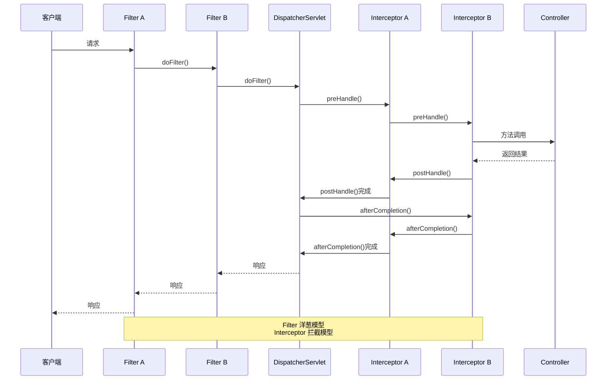
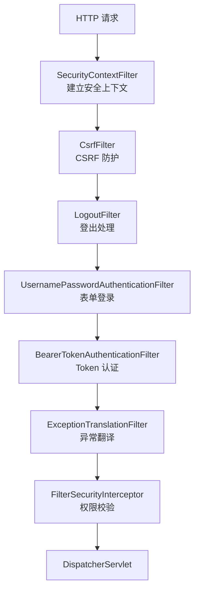
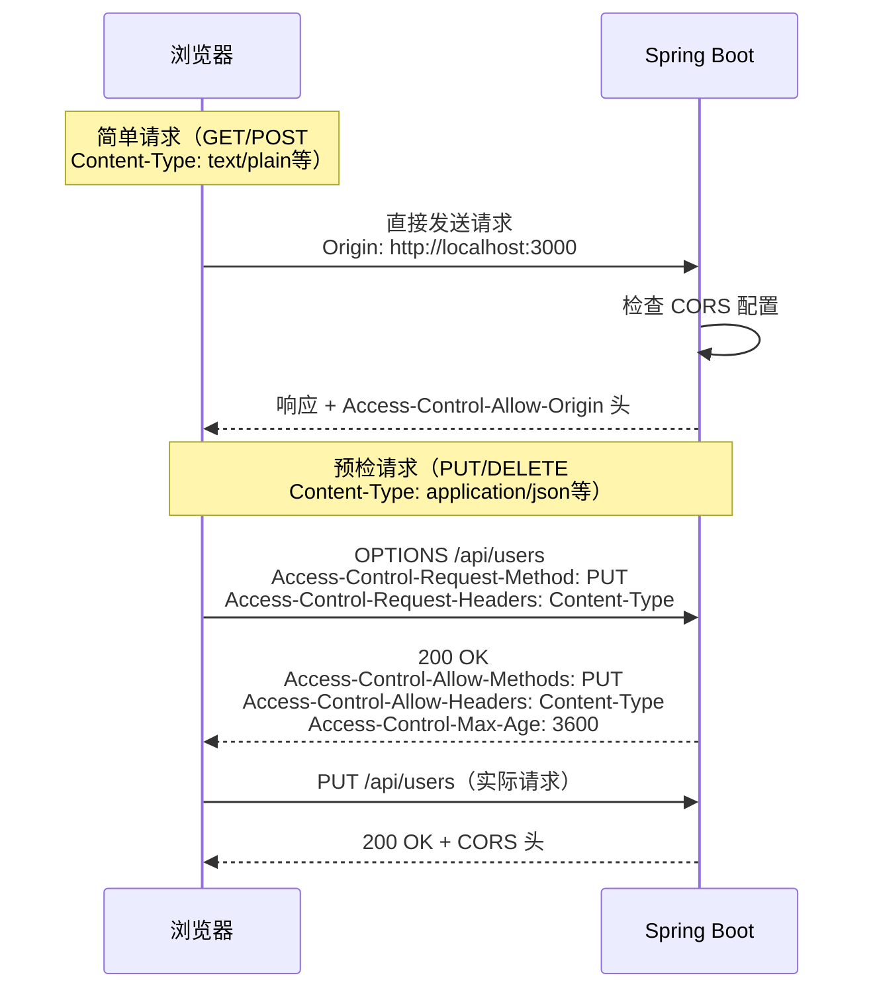
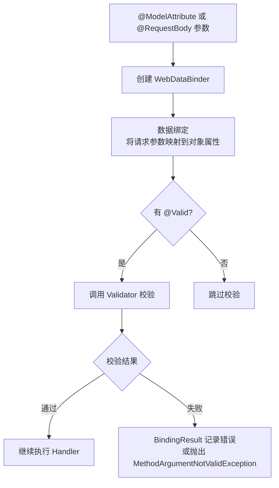
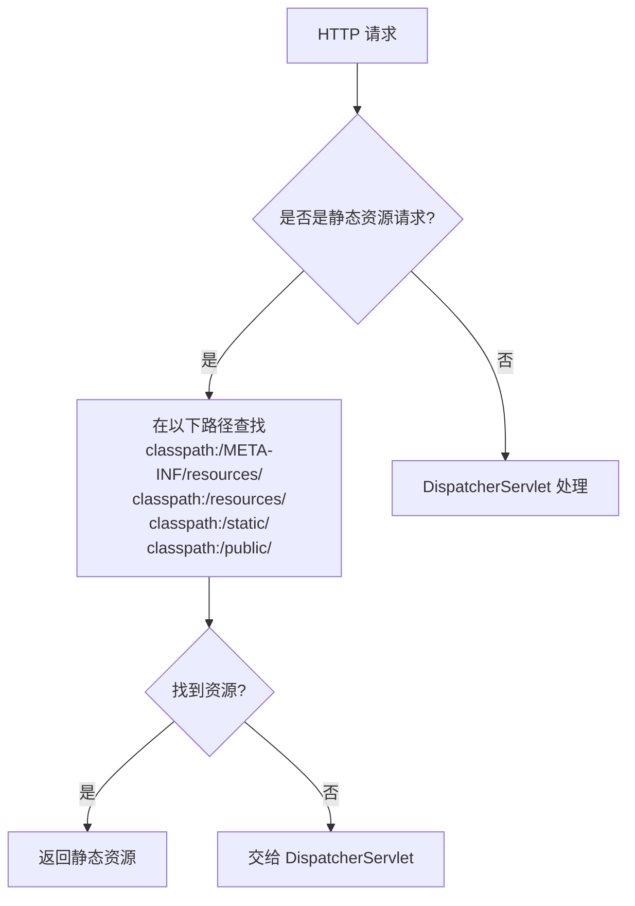

# WebMvc 定制与静态资源

::: tip 分工声明
本篇聚焦 WebMvc 的**定制与配置**（拦截器、CORS、数据校验、文件上传、静态资源、自动装配与嵌入式容器调优）；DispatcherServlet 的请求处理**源码视角**见 [36-DispatcherServlet源码](36-DispatcherServlet源码.md)；拦截器基础与请求参数绑定见 [05-Spring/SpringMVC执行流程与拦截器](../05-Spring/05-SpringMVC执行流程与拦截器.md)。
:::

## 拦截器 vs 过滤器

### 执行顺序



### 对比

| 对比项 | Filter | HandlerInterceptor |
|-------|--------|-------------------|
| 规范 | Servlet 规范 | Spring MVC 规范 |
| 作用范围 | 所有请求（包括静态资源） | 只拦截 Handler |
| 执行时机 | DispatcherServlet 之前 | Handler 执行前后 |
| 获取 Bean | 需要额外处理 | 直接 @Autowired |
| 异常处理 | 自行处理 | 被 DispatcherServlet 捕获 |
| 典型用途 | 编码、CORS、认证 | 权限校验、日志、性能监控 |
| 注册方式 | `@Bean` + `FilterRegistrationBean` | `WebMvcConfigurer.addInterceptors()` |

### Filter 链的配置

```java
// 注册 Filter 并控制执行顺序
@Configuration
public class FilterConfig {

    @Bean
    public FilterRegistrationBean<EncodingFilter> encodingFilter() {
        FilterRegistrationBean<EncodingFilter> registration = new FilterRegistrationBean<>();
        registration.setFilter(new EncodingFilter());
        registration.addUrlPatterns("/*");
        registration.setOrder(1);  // 数字越小越先执行
        return registration;
    }

    @Bean
    public FilterRegistrationBean<AuthFilter> authFilter() {
        FilterRegistrationBean<AuthFilter> registration = new FilterRegistrationBean<>();
        registration.setFilter(new AuthFilter());
        registration.addUrlPatterns("/api/*");
        registration.setOrder(2);
        return registration;
    }
}
```

### Spring Security Filter Chain

Spring Security 本质上就是一组 Filter，通过 `DelegatingFilterProxy` 代理到 Spring 容器中的 Bean：



::: tip 何时用 Filter，何时用 Interceptor？
**选 Filter 的场景：**
- 编码转换、GZIP 压缩
- CORS 预检处理
- 全局限流（包括静态资源）
- Spring Security 认证/授权

**选 Interceptor 的场景：**
- 需要 Handler 信息的日志记录
- 基于业务逻辑的权限校验
- 需要注入 Spring Bean 的操作
- 性能监控（只关注 API 请求）
:::

### 自定义与注册拦截器

HandlerInterceptor 的三个回调方法、完整实现示例与注册方式（`WebMvcConfigurer.addInterceptors()`、路径匹配与排除、执行顺序控制）已在 [05-Spring/SpringMVC执行流程与拦截器](../05-Spring/05-SpringMVC执行流程与拦截器.md) 的“拦截器详解”一节系统讲解，此处不再重复。下面给出两个生产环境中常用的实战拦截器。
### 日志拦截器实现

```java
// 请求日志拦截器
@Component
public class LoggingInterceptor implements HandlerInterceptor {

    private static final String START_TIME = "requestStartTime";

    @Override
    public boolean preHandle(HttpServletRequest request,
            HttpServletResponse response, Object handler) {
        request.setAttribute(START_TIME, System.currentTimeMillis());
        log.info("[请求开始] {} {} from {}",
            request.getMethod(), request.getRequestURI(),
            request.getRemoteAddr());
        return true;
    }

    @Override
    public void postHandle(HttpServletRequest request,
            HttpServletResponse response, Object handler,
            ModelAndView modelAndView) {
        // Handler 正常执行完成
    }

    @Override
    public void afterCompletion(HttpServletRequest request,
            HttpServletResponse response, Object handler,
            Exception ex) {
        long startTime = (Long) request.getAttribute(START_TIME);
        long duration = System.currentTimeMillis() - startTime;

        if (ex != null) {
            log.error("[请求异常] {} {} 耗时 {}ms, 异常: {}",
                request.getMethod(), request.getRequestURI(),
                duration, ex.getMessage());
        } else if (duration > 3000) {
            log.warn("[慢请求] {} {} 耗时 {}ms",
                request.getMethod(), request.getRequestURI(), duration);
        } else {
            log.info("[请求完成] {} {} 耗时 {}ms 状态 {}",
                request.getMethod(), request.getRequestURI(),
                duration, response.getStatus());
        }
    }
}
```

### 限流拦截器

```java
// 基于 Redis 的分布式限流拦截器
@Component
public class RateLimitInterceptor implements HandlerInterceptor {

    private final StringRedisTemplate redisTemplate;

    @Override
    public boolean preHandle(HttpServletRequest request,
            HttpServletResponse response, Object handler) throws Exception {

        // 从 Handler 方法上获取限流注解
        if (handler instanceof HandlerMethod handlerMethod) {
            RateLimit rateLimit = handlerMethod.getMethodAnnotation(RateLimit.class);
            if (rateLimit == null) {
                return true;  // 没有限流注解，放行
            }

            String key = "rate_limit:" + request.getRequestURI() + ":" + getClientId(request);
            int limit = rateLimit.count();
            int period = rateLimit.period();

            // 使用 Redis Lua 脚本实现滑动窗口限流
            Long current = redisTemplate.execute(rateLimitScript,
                Collections.singletonList(key),
                String.valueOf(limit), String.valueOf(period));

            if (current != null && current > limit) {
                response.setStatus(429);  // Too Many Requests
                response.setContentType("application/json;charset=UTF-8");
                response.getWriter().write("{\"code\":429,\"message\":\"请求过于频繁\"}");
                return false;
            }
        }
        return true;
    }
}

// 限流注解
@Target(ElementType.METHOD)
@Retention(RetentionPolicy.RUNTIME)
public @interface RateLimit {
    int count() default 100;   // 允许的请求次数
    int period() default 60;   // 时间窗口（秒）
}
```

::: warning 拦截器中不要做耗时操作
`preHandle()` 在每个请求中同步执行。如果在此做数据库查询、远程调用等耗时操作，会显著影响所有接口的响应时间。认证、限流等逻辑应该使用 Filter + Redis 缓存的方式，而非在拦截器中同步查询。
:::

## CORS 跨域处理

### CORS 工作原理



### 三种配置方式

```java
// 方式1：@CrossOrigin 注解（方法/类级别）
@RestController
@RequestMapping("/api/users")
@CrossOrigin(origins = "http://localhost:3000", maxAge = 3600)
public class UserController { ... }

// 方式2：全局配置（推荐）
@Configuration
public class WebMvcConfig implements WebMvcConfigurer {

    @Override
    public void addCorsMappings(CorsRegistry registry) {
        registry.addMapping("/api/**")
            .allowedOrigins("http://localhost:3000", "https://example.com")
            .allowedMethods("GET", "POST", "PUT", "DELETE", "PATCH")
            .allowedHeaders("*")
            .allowCredentials(true)
            .maxAge(3600);
    }
}

// 方式3：CorsFilter（适合需要细粒度控制的场景）
@Bean
public CorsFilter corsFilter() {
    CorsConfiguration config = new CorsConfiguration();
    config.addAllowedOrigin("http://localhost:3000");
    config.addAllowedMethod("*");
    config.addAllowedHeader("*");
    config.setAllowCredentials(true);

    UrlBasedCorsConfigurationSource source = new UrlBasedCorsConfigurationSource();
    source.registerCorsConfiguration("/api/**", config);
    return new CorsFilter(source);
}
```

::: danger CORS 安全注意事项
1. **不要使用 `allowedOrigins("*")` + `allowCredentials(true)`**：这是 CORS 规范明确禁止的组合，浏览器会拒绝响应
2. **生产环境必须明确指定允许的源**：不要用通配符
3. **Spring Security 和 CORS 的交互**：如果同时使用 Spring Security，CORS 需要在 Security 过滤器链之前处理，否则预检请求（OPTIONS）会被 Security 拦截返回 401

```java
// Spring Security + CORS 配置
@Configuration
@EnableWebSecurity
public class SecurityConfig {

    @Bean
    public SecurityFilterChain filterChain(HttpSecurity http) throws Exception {
        http.cors()  // 先启用 CORS（必须在其他配置之前）
            .and()
            .csrf().disable()
            .authorizeHttpRequests()
            .anyRequest().authenticated();
        return http.build();
    }

    @Bean
    public CorsConfigurationSource corsConfigurationSource() {
        CorsConfiguration configuration = new CorsConfiguration();
        configuration.setAllowedOrigins(List.of("https://example.com"));
        configuration.setAllowedMethods(List.of("GET", "POST", "PUT", "DELETE"));
        configuration.setAllowedHeaders(List.of("*"));
        configuration.setAllowCredentials(true);

        UrlBasedCorsConfigurationSource source = new UrlBasedCorsConfigurationSource();
        source.registerCorsConfiguration("/api/**", configuration);
        return source;
    }
}
```
:::

## 数据绑定与校验

### WebDataBinder 工作流程



### 参数校验注解

```java
// 常用校验注解
@Data
public class CreateUserRequest {

    @NotBlank(message = "用户名不能为空")
    @Size(min = 2, max = 20, message = "用户名长度 2-20 字符")
    private String username;

    @NotBlank(message = "密码不能为空")
    @Size(min = 6, max = 32, message = "密码长度 6-32 字符")
    @Pattern(regexp = "^(?=.*[A-Za-z])(?=.*\\d).+$", message = "密码必须包含字母和数字")
    private String password;

    @Email(message = "邮箱格式不正确")
    private String email;

    @Min(value = 0, message = "年龄不能小于 0")
    @Max(value = 150, message = "年龄不能大于 150")
    private Integer age;

    @Pattern(regexp = "^1[3-9]\\d{9}$", message = "手机号格式不正确")
    private String phone;
}
```

```java
// Controller 中使用校验
@RestController
@RequestMapping("/api/users")
public class UserController {

    @PostMapping
    public ApiResponse<User> createUser(
            @Valid @RequestBody CreateUserRequest request,
            BindingResult bindingResult) {  // 必须紧跟 @Valid 参数

        if (bindingResult.hasErrors()) {
            // 手动处理校验错误
            List<String> errors = bindingResult.getFieldErrors()
                .stream()
                .map(e -> e.getField() + ": " + e.getDefaultMessage())
                .collect(Collectors.toList());
            return ApiResponse.error(400, "参数校验失败", errors);
        }

        // 校验通过，继续业务逻辑
        return ApiResponse.success(userService.create(request));
    }
}
```

::: tip BindingResult 必须紧跟 @Valid 参数
如果 Controller 方法中不声明 `BindingResult` 参数，校验失败时会直接抛出 `MethodArgumentNotValidException`，由全局异常处理器处理。如果声明了 `BindingResult`，则不会抛出异常，需要手动判断和处理校验结果。

**最佳实践：** API 开发中推荐不声明 `BindingResult`，让全局异常处理器统一处理；需要精细控制的场景才手动处理。
:::

### 分组校验

```java
// 不同场景使用不同校验规则
public interface CreateGroup {}
public interface UpdateGroup {}

@Data
public class UserRequest {
    @Null(groups = CreateGroup.class, message = "创建时 ID 必须为空")
    @NotNull(groups = UpdateGroup.class, message = "更新时 ID 不能为空")
    private Long id;

    @NotBlank(groups = {CreateGroup.class, UpdateGroup.class}, message = "用户名不能为空")
    private String username;
}

@RestController
public class UserController {
    @PostMapping
    public User create(@Validated(CreateGroup.class) @RequestBody UserRequest request) {
        // 只校验 CreateGroup 的规则
    }

    @PutMapping
    public User update(@Validated(UpdateGroup.class) @RequestBody UserRequest request) {
        // 只校验 UpdateGroup 的规则
    }
}
```

### 自定义校验注解

```java
// 自定义 @Phone 校验注解
@Target({ElementType.FIELD})
@Retention(RetentionPolicy.RUNTIME)
@Constraint(validatedBy = PhoneValidator.class)
public @interface Phone {
    String message() default "手机号格式不正确";
    Class<?>[] groups() default {};
    Class<? extends Payload>[] payload() default {};
}

// 校验器实现
public class PhoneValidator implements ConstraintValidator<Phone, String> {

    private static final Pattern PHONE_PATTERN =
        Pattern.compile("^1[3-9]\\d{9}$");

    @Override
    public boolean isValid(String value, ConstraintValidatorContext context) {
        if (value == null) {
            return true;  // null 由 @NotBlank 处理
        }
        return PHONE_PATTERN.matcher(value).matches();
    }
}
```

## 文件上传与 Multipart

文件上传是 Web 应用的基础能力。Spring Boot 基于 Servlet 3.0 的 `Multipart` 规范，用 `MultipartFile` 抽象屏蔽了底层解析细节，既支持简单表单上传，也能配合流式处理大文件。

:::: tip 版本基准
文件上传由 `MultipartAutoConfiguration` 自动装配 `StandardServletMultipartResolver`（基于 Servlet 容器原生能力），无需额外依赖。以下实战内容以 **Spring Boot 3.x** 为基准。
::::

### MultipartResolver 配置

Spring Boot 自动配置了 `StandardServletMultipartResolver`：

```yaml
# 文件上传配置
spring:
  servlet:
    multipart:
      enabled: true          # 启用文件上传
      max-file-size: 10MB    # 单个文件最大大小
      max-request-size: 100MB # 整个请求最大大小
      file-size-threshold: 0  # 超过此大小写入临时文件
      location: /tmp         # 临时文件目录
```

### 文件上传 Controller

```java
@RestController
@RequestMapping("/api/files")
public class FileController {

    // 单文件上传
    @PostMapping("/upload")
    public ApiResponse<String> upload(@RequestParam("file") MultipartFile file) {
        if (file.isEmpty()) {
            return ApiResponse.error(400, "文件不能为空");
        }

        // 校验文件大小
        if (file.getSize() > 10 * 1024 * 1024) {
            return ApiResponse.error(400, "文件大小不能超过 10MB");
        }

        // 校验文件类型
        String contentType = file.getContentType();
        Set<String> allowedTypes = Set.of("image/jpeg", "image/png", "application/pdf");
        if (!allowedTypes.contains(contentType)) {
            return ApiResponse.error(400, "不支持的文件类型");
        }

        try {
            String fileName = UUID.randomUUID() + "_" + file.getOriginalFilename();
            Path filePath = Paths.get("/data/uploads", fileName);
            file.transferTo(filePath);
            return ApiResponse.success(fileName);
        } catch (IOException e) {
            return ApiResponse.error(500, "文件上传失败");
        }
    }

    // 多文件上传
    @PostMapping("/upload-batch")
    public ApiResponse<List<String>> uploadBatch(
            @RequestParam("files") MultipartFile[] files) {
        List<String> fileNames = new ArrayList<>();
        for (MultipartFile file : files) {
            String fileName = UUID.randomUUID() + "_" + file.getOriginalFilename();
            file.transferTo(Paths.get("/data/uploads", fileName));
            fileNames.add(fileName);
        }
        return ApiResponse.success(fileNames);
    }

    // 文件下载
    @GetMapping("/download/{fileName}")
    public ResponseEntity<Resource> download(@PathVariable String fileName) {
        Path filePath = Paths.get("/data/uploads", fileName);
        Resource resource = new FileSystemResource(filePath);

        if (!resource.exists()) {
            return ResponseEntity.notFound().build();
        }

        return ResponseEntity.ok()
            .header(HttpHeaders.CONTENT_DISPOSITION,
                "attachment; filename=\"" + fileName + "\"")
            .contentType(MediaType.APPLICATION_OCTET_STREAM)
            .body(resource);
    }
}
```

::: danger 文件上传安全风险
1. **路径遍历攻击**：文件名可能包含 `../`，导致文件被写到任意目录。使用 `UUID.randomUUID()` 生成文件名，不要直接使用用户提供的文件名
2. **文件类型伪造**：仅检查 Content-Type 不够，攻击者可以伪造。检查文件扩展名 + 文件内容（魔数校验）
3. **大文件攻击**：不限制文件大小可能导致磁盘空间耗尽。设置 `max-file-size` 和 `max-request-size`
4. **病毒上传**：允许上传可执行文件（.exe、.sh）可能导致服务器被感染。严格限制允许的文件类型
:::

### 基础接收

### 单文件

```java
@PostMapping("/upload")
public ResponseEntity<String> upload(@RequestParam("file") MultipartFile file) {
    if (file.isEmpty()) {
        return ResponseEntity.badRequest().body("文件为空");
    }
    String filename = file.getOriginalFilename();
    long size = file.getSize();
    return ResponseEntity.ok("收到文件：" + filename + "，大小：" + size);
}
```

### 多文件与混合字段

```java
@PostMapping("/batch")
public ResponseEntity<List<String>> batch(
        @RequestParam("files") List<MultipartFile> files,
        @RequestParam("dir") String dir) {
    return ResponseEntity.ok(files.stream()
            .map(MultipartFile::getOriginalFilename)
            .toList());
}
```

### 绑定到对象

```java
public class UploadForm {
    private String bizType;
    private MultipartFile file;
    // getter/setter
}

@PostMapping("/form")
public ResponseEntity<Void> form(@Valid UploadForm form, BindingResult result) {
    // form.getFile() 即上传文件
    return ResponseEntity.ok().build();
}
```

### 落盘：本地与对象存储

### 本地落盘（注意安全）

```java
public void saveLocal(MultipartFile file) throws IOException {
    // 防路径穿越：只取文件名，去掉路径
    String name = StringUtils.getFilename(file.getOriginalFilename());
    Path dest = Paths.get("/data/uploads", name);
    Files.createDirectories(dest.getParent());
    file.transferTo(dest);   // 推荐，比 getBytes() 更省内存
}
```

::: danger 防路径穿越
`getOriginalFilename()` 可能包含 `../../` 等路径片段。务必用 `StringUtils.getFilename()`（或自行截断目录部分）只保留纯文件名，避免写入任意路径造成覆盖或 RCE。
:::

### 上传到对象存储（OSS/S3）

```java
public void saveToOss(MultipartFile file) {
    String key = "uploads/" + UUID.randomUUID() + "-" + file.getOriginalFilename();
    s3Client.putObject(PutObjectRequest.builder()
        .bucket("my-bucket").key(key).build(),
        RequestBody.fromBytes(file.getBytes()));   // 大文件改用 InputStream
}
```

### 大小限制与异常兜底

`application.yml`：

```yaml
spring:
  servlet:
    multipart:
      enabled: true
      max-file-size: 10MB        # 单个文件上限
      max-request-size: 50MB     # 整个请求上限
      file-size-threshold: 2KB   # 超过则写临时文件而非内存
      location: /tmp/uploads      # 临时目录
```

超限时抛出 `MaxUploadSizeExceededException`，用全局异常处理返回友好提示：

```java
@ExceptionHandler(MaxUploadSizeExceededException.class)
public ResponseEntity<Map<String,String>> handleTooLarge(MaxUploadSizeExceededException e) {
    return ResponseEntity.status(413).body(Map.of("error", "文件超过大小限制"));
}
```

### 进度与流式（大文件）

对超大文件，避免 `getBytes()` 全量入内存，用 `InputStream` 流式转发：

```java
public void stream(MultipartFile file) throws IOException {
    try (InputStream in = file.getInputStream()) {
        // 边读边写/上传，控制内存占用
        IOUtils.copy(in, targetStream);
    }
}
```

上传进度需前端配合（如分片 + 自定义进度回调），后端 `MultipartFile` 不直接提供进度百分比。

### 常见陷阱

| 陷阱 | 表现 | 解决 |
|------|------|------|
| 413 被网关拦 | 文件没到 Controller | 网关（Nginx）也有限制，需同步调整 `client_max_body_size` |
| 路径穿越 | 覆盖系统文件 | 用 `StringUtils.getFilename()` 规范化文件名 |
| 内存溢出 | 大文件 `getBytes()` | 用 `transferTo` / `getInputStream` 流式处理 |
| 中文名乱码 | 文件名乱码 | 前端 `Content-Type` 带 `charset=utf-8`，或后端 `new String(name.getBytes(ISO_8859_1), UTF_8)` 兜底 |
| 临时文件堆积 | 磁盘占满 | 确认 `location` 有清理策略，或用对象存储直传 |
| 无 @RequestParam 名 | 绑定失败 | 参数名需与表单字段名一致，或显式指定 `@RequestParam("file")` |

### 上传方案小结

Spring Boot 文件上传核心是 `MultipartFile`：单/多文件用 `@RequestParam` 接收，落盘优先 `transferTo`（大文件走 `InputStream` 流式），并用 `spring.servlet.multipart` 配置大小上限。务必做文件名规范化防路径穿越、超大文件流式处理，并在网关与应用两层都放开大小限制。

**相关阅读**：全局异常处理机制见 [05-Java异常深度处理](05-Java异常深度处理.md)。

## WebMvcConfigurer 全局配置

`WebMvcConfigurer` 是定制 Spring MVC 行为的核心接口，提供了多个回调方法：

| 方法 | 作用 | 典型用途 |
|------|------|---------|
| `addInterceptors()` | 注册拦截器 | 认证、日志 |
| `addCorsMappings()` | 配置 CORS | 跨域 |
| `addResourceHandlers()` | 静态资源处理 | 自定义资源路径 |
| `configureMessageConverters()` | 消息转换器 | 自定义 JSON 序列化 |
| `addArgumentResolvers()` | 参数解析器 | 自定义参数解析 |
| `addReturnValueHandlers()` | 返回值处理器 | 自定义响应格式 |
| `configureAsyncSupport()` | 异步支持 | 超时、线程池 |
| `configurePathMatch()` | 路径匹配 | URL 规则定制 |
| `configureContentNegotiation()` | 内容协商 | 响应格式选择 |
| `configureDefaultServletHandling()` | 默认 Servlet | 静态资源兜底 |

### 自定义 JSON 序列化

```java
@Configuration
public class WebMvcConfig implements WebMvcConfigurer {

    // 自定义 Jackson ObjectMapper
    @Override
    public void configureMessageConverters(List<HttpMessageConverter<?>> converters) {
        MappingJackson2HttpMessageConverter converter = new MappingJackson2HttpMessageConverter();
        ObjectMapper mapper = new ObjectMapper();

        // 不序列化 null 值
        mapper.setSerializationInclusion(JsonInclude.Include.NON_NULL);

        // 日期格式化（不使用时间戳）
        mapper.disable(SerializationFeature.WRITE_DATES_AS_TIMESTAMPS);
        mapper.registerModule(new JavaTimeModule());

        // 反序列化时忽略未知属性
        mapper.configure(DeserializationFeature.FAIL_ON_UNKNOWN_PROPERTIES, false);

        // 自定义日期格式
        mapper.setDateFormat(new SimpleDateFormat("yyyy-MM-dd HH:mm:ss"));

        converter.setObjectMapper(mapper);
        converters.add(0, converter);  // 优先级最高
    }

    // 静态资源缓存
    @Override
    public void addResourceHandlers(ResourceHandlerRegistry registry) {
        registry.addResourceHandler("/static/**")
            .addResourceLocations("classpath:/static/")
            .setCacheControl(CacheControl.maxAge(30, TimeUnit.DAYS));
    }

    // 异步请求超时配置
    @Override
    public void configureAsyncSupport(AsyncSupportConfigurer configurer) {
        configurer.setDefaultTimeout(30000);  // 30 秒超时
        configurer.setTaskExecutor(new SimpleAsyncTaskExecutor());
    }

    // 路径匹配配置（Spring Boot 3.x）
    @Override
    public void configurePathMatch(PathMatchConfigurer configurer) {
        configurer.setPatternParser(new PathPatternParser());  // 使用新解析器
        configurer.setUseTrailingSlashMatch(true);  // 路径末尾 / 不敏感
    }
}
```

### 内容协商配置

```java
@Configuration
public class WebMvcConfig implements WebMvcConfigurer {

    @Override
    public void configureContentNegotiation(ContentNegotiationConfigurer configurer) {
        configurer
            .favorParameter(true)           // 支持 ?format=json 参数
            .parameterName("format")        // 参数名
            .ignoreAcceptHeader(false)       // 不忽略 Accept 头
            .defaultContentType(MediaType.APPLICATION_JSON)  // 默认 JSON
            .mediaType("json", MediaType.APPLICATION_JSON)
            .mediaType("xml", MediaType.APPLICATION_XML);
    }
}
```

::: tip WebMvcConfigurer vs @EnableWebMvc
- **WebMvcConfigurer**：只添加自定义配置，Spring Boot 的自动配置仍然生效
- **@EnableWebMvc**：完全接管 Spring MVC 配置，Spring Boot 的自动配置失效

**绝大多数场景使用 `WebMvcConfigurer`**，不要加 `@EnableWebMvc`——否则你会失去 Spring Boot 自动配置的所有便利（静态资源、消息转换器、CORS 等）。
:::

## 静态资源处理

### 默认静态资源路径

Spring Boot 默认的静态资源路径：



### 静态资源查找优先级

| 路径 | 优先级 | 说明 |
|------|--------|------|
| `/META-INF/resources/` | 最高 | Web JAR 资源（如 Swagger UI） |
| `/resources/` | 中 | 较少使用 |
| `/static/` | 中 | 默认推荐路径 |
| `/public/` | 低 | 公共资源 |

```yaml
# 自定义静态资源配置
spring:
  web:
    resources:
      static-locations:
        - classpath:/static/
        - classpath:/public/
      cache:
        period: 30d  # 缓存 30 天
      add-mappings: true  # 启用静态资源映射
```

### Web JAR 支持

Spring Boot 自动支持 Web JAR——将前端库打包为 JAR 并通过 classpath 提供：

```xml
<!-- 引入 Bootstrap Web JAR -->
<dependency>
    <groupId>org.webjars</groupId>
    <artifactId>bootstrap</artifactId>
    <version>5.3.0</version>
</dependency>
```

访问路径：`/webjars/bootstrap/5.3.0/css/bootstrap.min.css`

### 缓存控制

```java
// 为不同类型的静态资源设置不同的缓存策略
@Configuration
public class WebMvcConfig implements WebMvcConfigurer {

    @Override
    public void addResourceHandlers(ResourceHandlerRegistry registry) {
        // JS/CSS/图片：长期缓存
        registry.addResourceHandler("/static/**")
            .addResourceLocations("classpath:/static/")
            .setCacheControl(CacheControl.maxAge(365, TimeUnit.DAYS)
                .cachePublic());

        // HTML：短期缓存（内容可能变化）
        registry.addResourceHandler("/templates/**")
            .addResourceLocations("classpath:/templates/")
            .setCacheControl(CacheControl.maxAge(1, TimeUnit.HOURS)
                .mustRevalidate());
    }
}
```

### 请求转发与重定向

```java
@RestController
public class RedirectController {

    // 转发（服务器内部，URL 不变）
    @GetMapping("/forward-example")
    public ModelAndView forwardExample() {
        return new ModelAndView("forward:/api/users");
    }

    // 重定向（客户端重新请求，URL 变化）
    @GetMapping("/redirect-example")
    public ModelAndView redirectExample() {
        return new ModelAndView("redirect:/api/users");
    }

    // 使用 RedirectAttributes 传递参数
    @GetMapping("/redirect-with-params")
    public String redirectWithParams(RedirectAttributes attributes) {
        attributes.addFlashAttribute("message", "操作成功");
        attributes.addAttribute("id", "123");  // 出现在 URL 查询参数中
        return "redirect:/api/result";
    }
}
```

::: tip forward vs redirect
| 特性 | forward | redirect |
|------|---------|----------|
| URL 变化 | 不变 | 变化 |
| 请求次数 | 1 次 | 2 次 |
| 请求参数 | 保留 | 丢失（Flash 属性除外） |
| 适用场景 | 服务端内部路由 | 跳转到外部 URL、防止表单重复提交 |
:::


## WebMvc 自动装配与组件

### WebMvc：自动装配回顾与DispatcherServlet组件

将应用重置回刚初始化的状态，或新建一个干净的工程，只导入 `spring-boot-starter-web` 依赖，接下来开始分析 WebMvc 的一些原理。

之前分析自动装配时以 WebMvc 为实例解析过了。这里简单回顾一下 WebMvc 的自动装配都做了什么。

#### 1. WebMvc自动配置装配的核心组件

##### 1.1 WebMvcAutoConfiguration

配置 `Converter`：

```java
    @Override
    public void configureMessageConverters(List<HttpMessageConverter<?>> converters) {
        this.messageConvertersProvider
              .ifAvailable((customConverters) -> converters.addAll(customConverters.getConverters()));
    }
```

`ViewResolver`：

```java
// 最常用的视图解析器
@Bean
public InternalResourceViewResolver defaultViewResolver() {}
@Bean
public BeanNameViewResolver beanNameViewResolver() {}
@Bean
public ContentNegotiatingViewResolver viewResolver(BeanFactory beanFactory) {}
// 国际化组件
@Bean
public LocaleResolver localeResolver() {}
```

静态资源映射，`webjars` 映射：

```java
public void addResourceHandlers(ResourceHandlerRegistry registry) {
    // ......
    // 映射webjars
    if (!registry.hasMappingForPattern("/webjars/**")) {
        customizeResourceHandlerRegistration(registry.addResourceHandler("/webjars/**")
                .addResourceLocations("classpath:/META-INF/resources/webjars/")
                .setCachePeriod(getSeconds(cachePeriod)).setCacheControl(cacheControl));
    }
    // 映射静态资源路径
    String staticPathPattern = this.mvcProperties.getStaticPathPattern();
    if (!registry.hasMappingForPattern(staticPathPattern)) {
        customizeResourceHandlerRegistration(registry.addResourceHandler(staticPathPattern)
                .addResourceLocations(getResourceLocations(this.resourceProperties.getStaticLocations()))
                .setCachePeriod(getSeconds(cachePeriod)).setCacheControl(cacheControl));
    }
}
```

设置 `index.html`：

```java
private Resource getIndexHtml(String location) {
    return this.resourceLoader.getResource(location + "index.html");
}
```

应用图标：

```java
@Bean
public SimpleUrlHandlerMapping faviconHandlerMapping() {
    // ......
    mapping.setUrlMap(Collections.singletonMap("**/favicon.ico", faviconRequestHandler()));
    return mapping;
}
```

##### 1.2 DispatcherServletAutoConfiguration

DispatcherServlet：

```java
@Bean(name = DEFAULT_DISPATCHER_SERVLET_BEAN_NAME)
public DispatcherServlet dispatcherServlet() {
    DispatcherServlet dispatcherServlet = new DispatcherServlet();
    // ......
    return dispatcherServlet;
}
```

##### 1.3 ServletWebServerFactoryAutoConfiguration

TomcatServletWebServerFactory：

```java
@Bean
public TomcatServletWebServerFactory tomcatServletWebServerFactory() {
    return new TomcatServletWebServerFactory();
}
```

WebServerFactoryCustomizerBeanPostProcessor + ErrorPageRegistrarBeanPostProcessor：

```java
public void registerBeanDefinitions(AnnotationMetadata importingClassMetadata,
        BeanDefinitionRegistry registry) {
    if (this.beanFactory == null) {
        return;
    }
    // 编程式注入组件
    registerSyntheticBeanIfMissing(registry, "webServerFactoryCustomizerBeanPostProcessor",
            WebServerFactoryCustomizerBeanPostProcessor.class);
    registerSyntheticBeanIfMissing(registry, "errorPageRegistrarBeanPostProcessor",
            ErrorPageRegistrarBeanPostProcessor.class);
}
```

##### 1.4 官方文档的说明

[https://docs.spring.io/spring-boot/docs/2.1.9.RELEASE/reference/htmlsingle/#boot-features-spring-mvc-auto-configuration](https://docs.spring.io/spring-boot/docs/2.1.9.RELEASE/reference/htmlsingle/#boot-features-spring-mvc-auto-configuration)

官方文档列举的组件如下：

- 视图解析器
- webjars的资源映射
- 自动配置的转换器、格式化器（Converter、Formatter）
- Http请求转换器（HttpMessageConverter）
- 响应代码解析器
- 静态主页映射
- 网站图标映射
- 可配置的Web初始化绑定器

基本上面列举的部分都在官方文档中有描述了。

SpringWebMvc 的核心是 `DispatcherServlet`，因此 WebMvc 部分着重来看启动、配置，以及与 `DispatcherServlet` 相关的部分。

#### 2. 启动应用相关原理

在了解启动原理之前，先来了解一下Servlet3.0的一些规范，这对后续了解 **SpringWebMvc** 和 **SpringBootWebMvc** 有很大帮助。

##### 2.1 Servlet3.0规范中引导应用启动的说明

在 Servlet3.0 的规范文档的 [8.2.4 章节](https://download.oracle.com/otn-pub/jcp/servlet-3.0-fr-eval-oth-JSpec/servlet-3_0-final-spec.pdf) 中，有对运行时插件的描述。下面把关键部分的原文引入进来，方便阅读。

> An instance of the ServletContainerInitializer is looked up via the jar services API by the container at container / application startup time. The framework providing an implementation of the ServletContainerInitializer MUST bundle in the META-INF/services directory of the jar file a file called javax.servlet.ServletContainerInitializer, as per the jar services API, that points to the implementation class of the ServletContainerInitializer.

这里不贴正式的翻译，以通俗的语言描述一下。

在Servlet容器（Tomcat、Jetty等）启动应用时，会扫描应用jar包中 `ServletContainerInitializer` 的实现类。框架必须在jar包的 `META-INF/services` 的文件夹中提供一个名为 `javax.servlet.ServletContainerInitializer` 的文件，文件内容要写明 `ServletContainerInitializer` 的实现类的全限定名。

而这个 `ServletContainerInitializer` 是一个接口，实现它的类必须实现一个方法：`onStartUp` 。

```java
public interface ServletContainerInitializer {
    void onStartup(Set<Class<?>> c, ServletContext ctx) throws ServletException;
}
```

那不难猜出，要这个接口肯定是为了要执行这个 `onStartUp` 方法。

另外，还可以在这个 `ServletContainerInitializer` 的实现类上标注 `@HandlesTypes` 注解，在应用启动的时候自行加载一些附加的类，这些类会以字节码的集合形式传入 `onStartup` 方法的第一个参数中。

了解了这部分 Servlet3.0 规范后，回顾之前遇到的一个陌生的类：`SpringBootServletInitializer`。

##### 2.2 SpringBootServletInitializer的作用和原理

回顾 `SpringBoot` 应用打包启动的两种方式：

- 打jar包启动时，先创建IOC容器，在创建过程中创建了嵌入式Web容器。（详细的jar包启动会在 `JarLauncher` 篇解析）
- 打war包启动时，要先启动外部的Web服务器，Web服务器再去启动 `SpringBoot` 应用，然后才是创建IOC容器。

那么在打war包启动时，里面最核心的步骤：**Web服务器启动SpringBoot应用** 。

而这个步骤，就需要依靠 `SpringBootServletInitializer` 。下面来看外置 Web 容器是如何成功引导 `SpringBoot` 应用启动的：

1. 外部Web容器（Tomcat、Jetty、Undertow等）启动，开始加载 SpringBoot 的war 包并解压。
2. 去 SpringBoot 应用中的每一个被依赖的jar中寻找 META-INF/services/javax.servlet.SpringBootServletInitializer 的文件。
3. 根据文件中标注的全限定类名，去找这个类（就是 SpringServletContainerInitializer）。
4. 这个类的 onStartup 方法中会将 @HandlesTypes 中标注的类型的所有普通实现类（也就是非抽象子类）都实例化出来，之后分别调他们自己的 onStartup 方法。java@HandlesTypes(WebApplicationInitializer.class)
public class SpringServletContainerInitializer implements ServletContainerInitializer {
    @Override
    public void onStartup(Set<Class<?>> webAppInitializerClasses, ServletContext servletContext)
            throws ServletException {
        // SpringServletContainerInitializer会加载所有的WebApplicationInitializer类型的普通实现类

List<WebApplicationInitializer> initializers = new LinkedList<WebApplicationInitializer>();

if (webAppInitializerClasses != null) {
            for (Class<?> waiClass : webAppInitializerClasses) {
                // 如果不是接口，不是抽象类
                if (!waiClass.isInterface() && !Modifier.isAbstract(waiClass.getModifiers()) &&
                        WebApplicationInitializer.class.isAssignableFrom(waiClass)) {
                    try {
                        // 创建该类的实例
                        initializers.add((WebApplicationInitializer) waiClass.newInstance());
                    }
                    catch (Throwable ex) {
                        throw new ServletException("Failed to instantiate WebApplicationInitializer class", ex);
                    }
                }
            }
        }

if (initializers.isEmpty()) {
            servletContext.log("No Spring WebApplicationInitializer types detected on classpath");
            return;
        }

servletContext.log(initializers.size() + " Spring WebApplicationInitializers detected on classpath");
        AnnotationAwareOrderComparator.sort(initializers);
        // 调用各自的onStartup方法
        for (WebApplicationInitializer initializer : initializers) {
            initializer.onStartup(servletContext);
        }
    }
}这个 onStartup 方法的文档注释原文翻译：Delegate the ServletContext to any WebApplicationInitializer implementations present on the application classpath. Because this class declares @HandlesTypes(WebApplicationInitializer.class), Servlet 3.0+ containers will automatically scan the classpath for implementations of Spring's WebApplicationInitializer interface and provide the set of all such types to the webAppInitializerClasses parameter of this method. If no WebApplicationInitializer implementations are found on the classpath, this method is effectively a no-op. An INFO-level log message will be issued notifying the user that the ServletContainerInitializer has indeed been invoked but that no WebApplicationInitializer implementations were found. Assuming that one or more WebApplicationInitializer types are detected, they will be instantiated (and sorted if the @@Order annotation is present or the Ordered interface has been implemented). Then the WebApplicationInitializer.onStartup(ServletContext) method will be invoked on each instance, delegating the ServletContext such that each instance may register and configure servlets such as Spring's DispatcherServlet, listeners such as Spring's ContextLoaderListener, or any other Servlet API componentry such as filters.将 ServletContext 委托给应用程序类路径上存在的任何 WebApplicationInitializer 实现。 因为此类声明了 @HandlesTypes(WebApplicationInitializer.class)，所以 Servlet 3.0+ 容器将自动扫描类路径以查找 Spring 的 WebApplicationInitializer 接口的实现，并将所有此类的类型的集合提供给此方法的 webAppInitializerClasses 参数。 如果在类路径上没有找到 WebApplicationInitializer 实现，则此方法实际上是无操作的。将发出info级别的日志消息，通知用户确实已调用 ServletContainerInitializer，但是未找到 WebApplicationInitializer 实现。 假设检测到一个或多个 WebApplicationInitializer 类型，将对其进行实例化（如果存在 @Order 注解或已实现 Ordered 接口，则将对其进行排序）。然后将在每个实例上调用 WebApplicationInitializer.onStartup(ServletContext) 方法，委派 ServletContext，以便每个实例可以注册和配置 Servlet（例如 Spring 的 DispatcherServlet），监听器（例如 Spring 的 ContextLoaderListener）或任何其他 Servlet API组件（例如Filter）。
5. 因为打war包的 SpringBoot 工程会在启动类的同包下创建 ServletInitializer ，并且必须继承 SpringBootServletInitializer，所以会被服务器创建对象。
6. SpringBootServletInitializer 没有重写 onStartup 方法，去父类 SpringServletContainerInitializer 中寻找父类 SpringServletContainerInitializer 中的 onStartup 方法中有一句核心源码：WebApplicationContextrootAppContext rootAppContext = createRootApplicationContext(servletContext);java@Override
public void onStartup(ServletContext servletContext) throws ServletException {
    // Logger initialization is deferred in case an ordered
    // LogServletContextInitializer is being used
    this.logger = LogFactory.getLog(getClass());
    // 创建 父IOC容器
    WebApplicationContext rootAppContext = createRootApplicationContext(servletContext);
    if (rootAppContext != null) {
        servletContext.addListener(new ContextLoaderListener(rootAppContext) {
            @Override
            public void contextInitialized(ServletContextEvent event) {
                // no-op because the application context is already initialized
            }
        });
    }
    else {
        this.logger.debug("No ContextLoaderListener registered, as " + "createRootApplicationContext() did not "
                      + "return an application context");
    }
}

protected WebApplicationContext createRootApplicationContext(ServletContext servletContext) {
    // 使用Builder机制，前面也介绍过
    SpringApplicationBuilder builder = createSpringApplicationBuilder();
    builder.main(getClass());
    ApplicationContext parent = getExistingRootWebApplicationContext(servletContext);
    if (parent != null) {
        this.logger.info("Root context already created (using as parent).");
        servletContext.setAttribute(WebApplicationContext.ROOT_WEB_APPLICATION_CONTEXT_ATTRIBUTE, null);
        builder.initializers(new ParentContextApplicationContextInitializer(parent));
    }
    // 设置Initializer
    builder.initializers(new ServletContextApplicationContextInitializer(servletContext));
    // 在这里设置了容器启动类：AnnotationConfigServletWebServerApplicationContext
    builder.contextClass(AnnotationConfigServletWebServerApplicationContext.class);
    // 【引导】多态进入子类（自己定义）的方法中
    builder = configure(builder);
    builder.listeners(new WebEnvironmentPropertySourceInitializer(servletContext));
    // builder.build()，创建SpringApplication
    SpringApplication application = builder.build();
    if (application.getAllSources().isEmpty()
          && AnnotationUtils.findAnnotation(getClass(), Configuration.class) != null) {
        application.addPrimarySources(Collections.singleton(getClass()));
    }
    Assert.state(!application.getAllSources().isEmpty(),
               "No SpringApplication sources have been defined. Either override the "
               + "configure method or add an @Configuration annotation");
    // Ensure error pages are registered
    if (this.registerErrorPageFilter) {
        application.addPrimarySources(Collections.singleton(ErrorPageFilterConfiguration.class));
    }
    // 启动SpringBoot应用
    return run(application);
}
7. 在这个方法中：先创建 SpringApplicationBuilder 应用构建器；再创建一些环境配置；下面中间部分有一句： builder = configure(builder);这句源码由于多态，执行了子类（SpringBoot 工程中必须写的那个启动类的同包下的 ServletInitializer）重写的方法；又因为重写的格式固定，是传入了 SpringBoot 的目标运行主程序； return builder.sources(DemoApplication.class);所以下一步才能启动 SpringBoot 工程。
8. 之后就跟启动运行主程序 SpringBootApplication 没什么区别了。

以上就是 `SpringBootServletInitializer` 的作用和原理。

#### 3. @Controller标注的Bean装配MVC原理

做过 Controller 开发的读者都知道，自己写的 Controller 类只需打上 `@Controller` 或 `@RestController` 注解，即可加载到 WebMvc 中，被 `DispatcherServlet` 找到。本节来看 WebMvc 是如何将这些 Bean 注册到 WebMvc 中的。

##### 3.0 回顾IOC和AOP原理

先回想一下IOC和AOP的几个原理：

- `@Autowired` 是什么时机被解析的：`AutowiredAnnotationBeanPostProcessor` 在 `postProcessMergedBeanDefinition` 中触发。
- 代理对象是什么时机创建的：**Bean的初始化之后，`AnnotationAwareAspectJAutoProxyCreator` 负责创建代理对象** 。

那由此可以猜测，解析 `@Controller` 中 `@RequestMapping` 的时机可能也在这两种情况之内，暂且保存这个猜想。

下面根据IOC容器的启动过程，来实际探究 `@RequestMapping` 的解析时机。

##### 3.1 初始化 RequestMapping 的入口

这个入口一开始并不好找，按后置处理器的思路抓不到关键的解析部分，后来换了一个思路（可以一起体会一下这个寻找过程）：解析 `@Controller` 中的所有映射的方法，就是解析被 `@RequestMapping` 标注的方法。之前看 `WebMvcAutoConfiguration` 时又知道注册了一个 `RequestMappingHandlerMapping` 的组件，那估计可以从这个组件中找到一些端倪。

打开这个类，借助 IDEA 列举所有方法时，第一个显眼的信息是：它实现了 `InitializingBean`。可是它为什么要这么干呢？进到实现中：

```java
public void afterPropertiesSet() {
    this.config = new RequestMappingInfo.BuilderConfiguration();
    this.config.setUrlPathHelper(getUrlPathHelper());
    this.config.setPathMatcher(getPathMatcher());
    this.config.setSuffixPatternMatch(this.useSuffixPatternMatch);
    this.config.setTrailingSlashMatch(this.useTrailingSlashMatch);
    this.config.setRegisteredSuffixPatternMatch(this.useRegisteredSuffixPatternMatch);
    this.config.setContentNegotiationManager(getContentNegotiationManager());

    super.afterPropertiesSet();
}
```

这里面都是一些设置，不稀奇啊，继续进到父类的 `afterPropertiesSet` 中：

```java
public void afterPropertiesSet() {
    initHandlerMethods();
}
```

它只是调了 `initHandlerMethods` 方法，但这个方法的字面意思貌似就有些问题：初始化 `HandlerMethod` ？难不成这个方法有关键的含义吗？

##### 3.2 initHandlerMethods

```java
private static final String SCOPED_TARGET_NAME_PREFIX = "scopedTarget.";

protected void initHandlerMethods() {
    for (String beanName : getCandidateBeanNames()) {
        if (!beanName.startsWith(SCOPED_TARGET_NAME_PREFIX)) {
            processCandidateBean(beanName);
        }
    }
    handlerMethodsInitialized(getHandlerMethods());
}
```

可以发现它把IOC容器中所有Bean的名称前缀不是 `"scopedTarget."` 的都拿出来，执行一个 `processCandidateBean` 方法。

##### 3.3 processCandidateBean

```java
protected void processCandidateBean(String beanName) {
    Class<?> beanType = null;
    try {
        beanType = obtainApplicationContext().getType(beanName);
    }
    catch (Throwable ex) {
        // An unresolvable bean type, probably from a lazy bean - let's ignore it.
        if (logger.isTraceEnabled()) {
            logger.trace("Could not resolve type for bean '" + beanName + "'", ex);
        }
    }
    if (beanType != null && isHandler(beanType)) {
        detectHandlerMethods(beanName);
    }
}
```

上面的步骤是根据Bean的名称来获取Bean的类型，下面有一个判断：`isHandler`

```java
protected boolean isHandler(Class<?> beanType) {
    return (AnnotatedElementUtils.hasAnnotation(beanType, Controller.class) ||
            AnnotatedElementUtils.hasAnnotation(beanType, RequestMapping.class));
}
```

很明显它要看当前Bean是否有 `@Controller` 或 `@RequestMapping` 标注。

至此发现了重大关键点：**它真的在解析 `@Controller` 和 `@RequestMapping` 了**！证明这个寻找思路是正确的。

那判断成功后，if中的结构体就一定是解析类中标注了 `@RequestMapping` 的方法了。

##### 3.4 detectHandlerMethods

```java
protected void detectHandlerMethods(Object handler) {
    Class<?> handlerType = (handler instanceof String ?
            obtainApplicationContext().getType((String) handler) : handler.getClass());

    if (handlerType != null) {
        Class<?> userType = ClassUtils.getUserClass(handlerType);
        // 3.5 解析筛选方法
        Map<Method, T> methods = MethodIntrospector.selectMethods(userType,
                (MethodIntrospector.MetadataLookup<T>) method -> {
                    try {
                        return getMappingForMethod(method, userType);
                    }
                    catch (Throwable ex) {
                        throw new IllegalStateException("Invalid mapping on handler class [" +
                                userType.getName() + "]: " + method, ex);
                    }
                });
        if (logger.isTraceEnabled()) {
            logger.trace(formatMappings(userType, methods));
        }
        // 3.6 注册方法映射
        methods.forEach((method, mapping) -> {
            Method invocableMethod = AopUtils.selectInvocableMethod(method, userType);
            registerHandlerMethod(handler, invocableMethod, mapping);
        });
    }
}
```

上面的一开始还是拿到这个Bean的类型，下面会使用一个 `MethodInterceptor` 来筛选一些方法。

###### 3.4.0 MethodIntrospector.selectMethods

```java
public static <T> Map<Method, T> selectMethods(Class<?> targetType, final MetadataLookup<T> metadataLookup) {
    final Map<Method, T> methodMap = new LinkedHashMap<>();
    Set<Class<?>> handlerTypes = new LinkedHashSet<>();
    Class<?> specificHandlerType = null;

if (!Proxy.isProxyClass(targetType)) {
        specificHandlerType = ClassUtils.getUserClass(targetType);
        handlerTypes.add(specificHandlerType);
    }
    handlerTypes.addAll(ClassUtils.getAllInterfacesForClassAsSet(targetType));

for (Class<?> currentHandlerType : handlerTypes) {
        final Class<?> targetClass = (specificHandlerType != null ? specificHandlerType : currentHandlerType);

ReflectionUtils.doWithMethods(currentHandlerType, method -> {
            Method specificMethod = ClassUtils.getMostSpecificMethod(method, targetClass);
            T result = metadataLookup.inspect(specificMethod);
            if (result != null) {
                Method bridgedMethod = BridgeMethodResolver.findBridgedMethod(specificMethod);
                if (bridgedMethod == specificMethod || metadataLookup.inspect(bridgedMethod) == null) {
                    methodMap.put(specificMethod, result);
                }
            }
        }, ReflectionUtils.USER_DECLARED_METHODS);
    }

    return methodMap;
}
```

核心是中间的 for 循环：它会循环类中所有的方法，并且根据一个 `MetadataLookup` 类型来确定是否可以符合匹配条件。

注意 `MetadataLookup` 是一个函数式接口：

```java
@FunctionalInterface
public interface MetadataLookup<T> {
    T inspect(Method method);
}
```

回到上面的方法中，筛选方法中传入的 Lambda 表达式如下：

```java
    Map<Method, T> methods = MethodIntrospector.selectMethods(userType,
            (MethodIntrospector.MetadataLookup<T>) method -> {
                try {
                    // 3.5
                    return getMappingForMethod(method, userType);
                }
                catch (Throwable ex) {
                    throw new IllegalStateException("Invalid mapping on handler class [" +
                            userType.getName() + "]: " + method, ex);
                }
            });
```

它最终是调 `getMappingForMethod` 方法：

##### 3.5 getMappingForMethod

```java
protected RequestMappingInfo getMappingForMethod(Method method, Class<?> handlerType) {
    // 创建方法级别的RequestMappingInfo
    RequestMappingInfo info = createRequestMappingInfo(method);
    if (info != null) {
        // 创建类级别的RequestMappingInfo
        RequestMappingInfo typeInfo = createRequestMappingInfo(handlerType);
        if (typeInfo != null) {
            info = typeInfo.combine(info);
        }
        // 拼接路径前缀
        String prefix = getPathPrefix(handlerType);
        if (prefix != null) {
            info = RequestMappingInfo.paths(prefix).build().combine(info);
        }
    }
    return info;
}
```

这里面分为几个步骤：创建方法级别的 `RequestMappingInfo` ，创建类级别的 `RequestMappingInfo` ，拼接路径前缀。一步一步来看：

###### 3.5.1 createRequestMappingInfo(method)

```java
private RequestMappingInfo createRequestMappingInfo(AnnotatedElement element) {
    RequestMapping requestMapping = AnnotatedElementUtils.findMergedAnnotation(element, RequestMapping.class);
    RequestCondition<?> condition = (element instanceof Class ?
            getCustomTypeCondition((Class<?>) element) : getCustomMethodCondition((Method) element));
    return (requestMapping != null ? createRequestMappingInfo(requestMapping, condition) : null);
}
```

这部分很明显就是在解析 `@RequestMapping` 注解了！最终会把 `@RequestMapping` 及相关的属性封装到一个 `RequestMappingInfo` 对象中，逻辑比较简单。

###### 3.5.2 createRequestMappingInfo(handlerType)

这部分也是一样的道理，不过这里面有个关键的部分：如果类上声明了 `@RequestMapping` 注解，会把这段注解跟方法上的 `@RequestMapping` 做一个拼接。

```java
RequestMappingInfo typeInfo = createRequestMappingInfo(handlerType);
if (typeInfo != null) {
    info = typeInfo.combine(info); // 拼接
}
```

###### 3.5.3 getPathPrefix(handlerType)

```java
private Map<String, Predicate<Class<?>>> pathPrefixes = new LinkedHashMap<>();

String getPathPrefix(Class<?> handlerType) {
    for (Map.Entry<String, Predicate<Class<?>>> entry : this.pathPrefixes.entrySet()) {
        if (entry.getValue().test(handlerType)) {
            String prefix = entry.getKey();
            if (this.embeddedValueResolver != null) {
                prefix = this.embeddedValueResolver.resolveStringValue(prefix);
            }
            return prefix;
        }
    }
    return null;
}
```

这里面提到了一个陌生的属性：`pathPrefixes` 。

这个属性，借助IDEA发现有对应的set方法，而set方法只有一个位置有调用它：`WebMvcAutoConfiguration` ，初始化时调用过（不过它直接回调了父类 `WebMvcConfigurationSupport` 的方法）。

###### 3.5.3.1 WebMvcConfigurationSupport#requestMappingHandlerMapping

```java
public RequestMappingHandlerMapping requestMappingHandlerMapping() {
    RequestMappingHandlerMapping mapping = createRequestMappingHandlerMapping();
    // ......
    PathMatchConfigurer configurer = getPathMatchConfigurer();
    // ......
    Map<String, Predicate<Class<?>>> pathPrefixes = configurer.getPathPrefixes();
    if (pathPrefixes != null) {
        mapping.setPathPrefixes(pathPrefixes);
    }

    return mapping;
}
```

可以发现调用的set方法来自于上面的 `configurer.getPathPrefixes` ，而 `configurer` 又来源于 `getPathMatchConfigurer` 。

###### 3.5.3.2 getPathMatchConfigurer

```java
protected PathMatchConfigurer getPathMatchConfigurer() {
    if (this.pathMatchConfigurer == null) {
        this.pathMatchConfigurer = new PathMatchConfigurer();
        configurePathMatch(this.pathMatchConfigurer);
    }
    return this.pathMatchConfigurer;
}
```

这里面它专门有一个 `configurePathMatch` 方法用来配置 `PathMatch` 。

###### 3.5.2.3 configurePathMatch

```java
protected void configurePathMatch(PathMatchConfigurer configurer) {
    this.configurers.configurePathMatch(configurer);
}

public void configurePathMatch(PathMatchConfigurer configurer) {
    for (WebMvcConfigurer delegate : this.delegates) {
        delegate.configurePathMatch(configurer);
    }
}
```

可以发现这一部分是将所有IOC容器中的 `WebMvcConfigurer` 都拿出来回调 `configurePathMatch` 方法。（这也启发我们可以自定义一些配置类，实现 `WebMvcConfigurer` 接口来重写 `configurePathMatch` 方法，添加自定义规则）

到这里位置，方法的前缀路径就拼好了，下面到了最后一步：注册方法映射

##### 3.6 registerHandlerMethod：注册方法映射

```java
    methods.forEach((method, mapping) -> {
        Method invocableMethod = AopUtils.selectInvocableMethod(method, userType);
        registerHandlerMethod(handler, invocableMethod, mapping);
    });
```

这部分会根据已经筛选好的方法，来注册 `HandlerMethod` 。

```java
private final MappingRegistry mappingRegistry = new MappingRegistry();

protected void registerHandlerMethod(Object handler, Method method, T mapping) {
    this.mappingRegistry.register(mapping, handler, method);
}
```

进到 `register` 中：（关键部分注释已标注在源码中）

```java
public void register(T mapping, Object handler, Method method) {
    // 读写锁加锁
    this.readWriteLock.writeLock().lock();
    try {
        // 将Controller的类型和Controller中的方法包装为一个HandlerMethod对象
        HandlerMethod handlerMethod = createHandlerMethod(handler, method);
        assertUniqueMethodMapping(handlerMethod, mapping);
        // 将RequestMappingInfo和Controller的目标方法存入Map中
        this.mappingLookup.put(mapping, handlerMethod);

// 将注解中的映射url和RequestMappingInfo存入Map
        List<String> directUrls = getDirectUrls(mapping);
        for (String url : directUrls) {
            this.urlLookup.add(url, mapping);
        }

String name = null;
        if (getNamingStrategy() != null) {
            name = getNamingStrategy().getName(handlerMethod, mapping);
            addMappingName(name, handlerMethod);
        }

// 将Controller目标方法和跨域配置存入Map
        CorsConfiguration corsConfig = initCorsConfiguration(handler, method, mapping);
        if (corsConfig != null) {
            this.corsLookup.put(handlerMethod, corsConfig);
        }

        // uri 映射 HandlerMethod封装的MappingRegistration对象，存入Map中
        this.registry.put(mapping, new MappingRegistration<>(mapping, handlerMethod, directUrls, name));
    }
    finally {
        this.readWriteLock.writeLock().unlock();
    }
}
```

上面的源码逻辑也算比较清晰的了，外层它会保证线程安全，中间的try块会封装 `Controller` 和它的方法，变成一个 `HandlerMethod` 对象，之后分别保存三组Map映射（源码中已标注注释），完成注册。

至此，`@Controller` 中的 `@RequestMapping` 信息已经被装载进 `RequestMappingHandlerMapping` 中。

#### 小结

1. Servlet3.0规范中取消了 `web.xml`，改用 `ServletContainerInitializer` 来接管应用启动。
2. `SpringBootServletInitializer` 实现了 `WebApplicationInitializer` ，用于被 `ServletContainerInitializer` 引导 SpringBoot 应用启动。
3. Controller 中的 `@RequestMapping` 标注的方法装载时机是 `RequestMappingHandlerMapping` 的初始化阶段。

### 嵌入式容器：嵌入式Tomcat的优化和配置

[26-嵌入式Tomcat](26-嵌入式Tomcat.md) 已完整解析嵌入式 Tomcat 的启动原理。在以往的开发中，可能会根据项目本身对 Tomcat 进行一些调整，以达到最大化利用 Tomcat 的目的。SpringBoot 使用嵌入式 Tomcat，再像之前那样做 Tomcat 性能调优就显得不那么现实了，为此我们需要了解如何在 SpringBoot 内部给嵌入式 Tomcat 做性能调优。这部分文档只做定**性**的解析，深入到**量**的控制文档不作详细探讨。

#### 0. 调优前的准备

为测试当前 SpringBoot 中嵌入式 Tomcat 的最大性能，需要一个压力测试工具来辅助我们测试性能，目前应用比较多的压测工具有 **Bench** 和 **JMeter** ，文档中使用 `Bench` 作为压测工具。

测试之前，先把工具准备好：

- Bench：[https://www.apachelounge.com/download/](https://www.apachelounge.com/download/)
- JMeter：[http://jmeter.apache.org/download_jmeter.cgi](http://jmeter.apache.org/download_jmeter.cgi)

下载好之后，把这两个工具的环境变量都配置好，方便直接从控制台执行。

除此之外，把一开始的测试工程中加入一个测试的 `DemoController` ，用于接收请求压测（为模拟真实业务场景，会在 `DemoController` 中让线程随机阻塞 `100 - 500ms` ，以代替数据库连接和业务查询）。最后，把工程打成可执行jar包并启动，等待测试。

jar包启动的方式非常简单：`java -jar demo-0.0.1-SNAPSHOT.jar`

（本文档在进行压测时的物理环境：Windows10 + Intel Core i7-8750H）

#### 1. 使用Bench进行压测

在cmd中执行如下命令：

`ab -n 10000 -c 500 http://localhost:8080/test`

执行完成后会在控制台打印测试报告（**以下数据为原作者本机实测，仅供演示调优方法参考，具体数值因机器与环境而异**；报告中的指标解释已标注在行尾）：

```text
This is ApacheBench, Version 2.3 <$Revision: 1843412 $>
Copyright 1996 Adam Twiss, Zeus Technology Ltd, http://www.zeustech.net/
Licensed to The Apache Software Foundation, http://www.apache.org/

Benchmarking localhost (be patient)
Completed 1000 requests
Completed 2000 requests
Completed 3000 requests
Completed 4000 requests
Completed 5000 requests
Completed 6000 requests
Completed 7000 requests
Completed 8000 requests
Completed 9000 requests
Completed 10000 requests
Finished 10000 requests

Server Software:
Server Hostname:        localhost // 主机名
Server Port:            8080      // 端口号

Document Path:          /test
Document Length:        4 bytes

Concurrency Level:      500            // 并发量
Time taken for tests:   15.670 seconds // 所有请求的总耗时
Complete requests:      10000          // 成功的请求数
Failed requests:        0
Total transferred:      1360000 bytes  // 总传输数据量
HTML transferred:       40000 bytes    // 总响应数据量
Requests per second:    638.17 [#/sec] (mean) // 【重要】每秒执行的请求数量（吞吐量）
Time per request:       783.493 [ms] (mean)   // 【重要】客户端平均响应时间
Time per request:       1.567 [ms] (mean, across all concurrent requests) // 服务器平均请求等待时间
Transfer rate:          84.76 [Kbytes/sec] received // 每秒传输的数据量

Connection Times (ms)
              min  mean[+/-sd] median   max
Connect:        0    0   0.2      0       1
Processing:   105  738 135.1    742     993
Waiting:      105  738 135.2    742     993
Total:        105  738 135.1    742     993

Percentage of the requests served within a certain time (ms)
  50%    742
  66%    810
  75%    847
  80%    868
  90%    909
  95%    931
  98%    945
  99%    952
 100%    993 (longest request)
```

在测试报告中有两个重要的指标需要关注：

- **Requests per second**：每秒执行的请求数量（吞吐量） 吞吐量越高，代表性能越好
- **Time per request**：客户端平均响应时间 响应时间越短，代表性能越好

在这里面测得的结果是 638.17 的吞吐量，783.493ms 的平均响应时间，这个响应时间比代码中控制的阻塞时间更长，说明 Tomcat 对500的并发已经有一些吃力了。

下面再用更大的并发量来测试效果：

`ab -n 50000 -c 2000 http://localhost:8080/test`

测得的结果（截取主要部分）：

```text
Concurrency Level:      2000
Time taken for tests:   75.689 seconds
Complete requests:      50000
Failed requests:        0
Total transferred:      6800000 bytes
HTML transferred:       200000 bytes
Requests per second:    660.60 [#/sec] (mean)
Time per request:       3027.564 [ms] (mean)
Time per request:       1.514 [ms] (mean, across all concurrent requests)
Transfer rate:          87.74 [Kbytes/sec] received
```

发现**吞吐量没有什么太大的变化**，但**平均响应时间大幅提升，且大概为上面的4倍**。可以看得出来，Tomcat 的处理速度已经远远跟不上请求到来的速度，需要进行性能调优。

#### 2. 嵌入式Tomcat调优依据

调优一定要有依据。根据现状和之前对 SpringBoot 的学习和原理剖析，应该知道配置大多都是两种形式：

- 声明式配置：`application.properties` 或 `application.yml`
- 编程式配置：`XXXConfigurer` 或 `XXXCustomizer`

其中，利用配置文件进行配置，最终会映射到 SpringBoot 中的一些 Properties 类中，例如 `server.port` 配置会映射到 `ServerProperties` 类中：

```java
@ConfigurationProperties(prefix = "server", ignoreUnknownFields = true)
public class ServerProperties {
    private Integer port;
```

那我们来大体分析一下对于 Tomcat 的声明式配置，都有哪些可以控制的部分：

##### 2.1 Tomcat的声明式配置

在 `ServerProperties` 类中，有一个 Tomcat 的静态内部类：

```java
	/**
	 * Tomcat properties.
	 */
	public static class Tomcat {
        // ......
```

这就是配置嵌入式 Tomcat 的映射配置类。来看里面的核心属性：

```java
/**
 * Maximum amount of worker threads.
 * 最大工作线程数
 */
private int maxThreads = 200;

/**
 * Minimum amount of worker threads.
 * 最小工作线程数
 */
private int minSpareThreads = 10;

/**
 * Maximum number of connections that the server accepts and processes at any
 * given time. Once the limit has been reached, the operating system may still
 * accept connections based on the "acceptCount" property.
 * 服务器最大连接数
 */
private int maxConnections = 10000;

/**
 * Maximum queue length for incoming connection requests when all possible request
 * processing threads are in use.
 * 最大请求队列等待长度
 */
private int acceptCount = 100;
```

可以发现这里面的几个指标，分别控制连接数、线程数、等待数。

分析为什么上面的吞吐量不够大：请求中的关键耗时动作是 `Thread.sheep` 卡线程，导致吞吐量变大。`Thread.sleep` 模拟了IO操作、数据库交互等**非CPU高速计算的行为**，在数据库交互时，CPU资源被浪费，导致无法处理后来的请求，出现资源利用率低的现象。为此，我们需要提高请求并发数，以此来提高CPU利用率。提高请求并发的方法在上面的几个参数中很明显是 **`maxThreads`** 。

#### 3. 调整maxThreads

从源码中很明显看到默认的最大线程数是200，我们在 `application.properties` 中修改值为 500：

`server.tomcat.max-threads=500`

修改之后的测试：

```text
Concurrency Level:      2000
Time taken for tests:   30.910 seconds
Complete requests:      50000
Failed requests:        0
Total transferred:      6800000 bytes
HTML transferred:       200000 bytes
Requests per second:    1617.61 [#/sec] (mean)
Time per request:       1236.391 [ms] (mean)
Time per request:       0.618 [ms] (mean, across all concurrent requests)
Transfer rate:          214.84 [Kbytes/sec] received
```

发现吞吐量有明显的提升，且吞吐量的放大倍数大概是前面线程数为 200 时的2.5倍。继续放大该值为 2000：

`server.tomcat.max-threads=2000`

重新测试效果：

```text
Concurrency Level:      2000
Time taken for tests:   12.050 seconds
Complete requests:      50000
Failed requests:        0
Total transferred:      6800000 bytes
HTML transferred:       200000 bytes
Requests per second:    4149.38 [#/sec] (mean)
Time per request:       482.000 [ms] (mean)
Time per request:       0.241 [ms] (mean, across all concurrent requests)
Transfer rate:          551.09 [Kbytes/sec] received
```

吞吐量又一次明显上升，但注意此时的吞吐量并没有扩大到上一次的 4 倍。继续放大该值为 10000：

`server.tomcat.max-threads=10000`

重新测试效果：

```text
Concurrency Level:      2000
Time taken for tests:   13.808 seconds
Complete requests:      50000
Failed requests:        0
Total transferred:      6800000 bytes
HTML transferred:       200000 bytes
Requests per second:    3621.22 [#/sec] (mean)
Time per request:       552.300 [ms] (mean)
Time per request:       0.276 [ms] (mean, across all concurrent requests)
Transfer rate:          480.94 [Kbytes/sec] received
```

发现吞吐量竟然下降了！为什么会出现这种现象呢？

#### 4. 现象解释

要解释这个原因，就不得不提到 CPU 的工作原理了。当CPU的**核心线程数**小于当前应用线程时，CPU为了保证所有应用线程都正常执行，它会**在多个线程中来回切换**，以保证每个线程都能获得CPU时间。在一个确定的时间点中，一个CPU只能处理一个线程。

所以这个现象就可以这样解释：当开启的 Tomcat 线程过多时，CPU会消耗大量时间在这些 Tomcat 线程中来回切换，导致真正处理业务请求的时间变少，最终导致整体应用处理速度变慢。

由此也可以推出另一种可能：如果业务逻辑中有大量CPU处理工作（如运算、处理数据等），则CPU需要更多的时间用于计算，此时若 Tomcat 线程过多，则处理速度会更慢。

#### 5. 总结

由上面的情况可以总结出以下结论：

- 应用中大部分业务逻辑都是阻塞型处理（IO、数据库操作等），这种情况下CPU的压力较低，可以适当调大 `maxThreads` 的值大小。
- 应用中大部分业务逻辑都是数据处理和计算，这种情况下CPU的压力较大，应适当调小 `maxThreads` 的值大小。

至此，嵌入式容器的解析和优化配置部分完结。SpringFramework 5.x 最大的新特性莫过于 WebFlux，响应式编程见 [27-WebFlux响应式编程](27-WebFlux响应式编程.md)。


## 版本差异(旧版 → Spring Boot 3.5.x)

| 特性 | 旧版(Spring MVC 5.x) | Spring MVC 6.x |
|------|----------------------|----------------|
| 请求处理 | DispatcherServlet | 不变；核心流程稳定 |
| Servlet API | javax.servlet.* | jakarta.servlet.* |
| HandlerMapping | RequestMappingHandlerMapping | 不变；新增虚拟线程适配 |
| 参数解析 | HandlerMethodArgumentResolver | 不变 |
| 虚拟线程 | 无 | Tomcat 10.1 + Boot 3.2+ 支持虚拟线程协议 |
| MultipartFile | javax.servlet.* | jakarta.servlet.http.*（包名迁移） |
| 上传配置 | spring.servlet.multipart | 不变；属性名保持兼容 |
| 大文件 | 手动流式 | 不变；支持虚拟线程并发上传 |
| 存储 | 本地磁盘 | 不变；可集成 OSS/MinIO |
