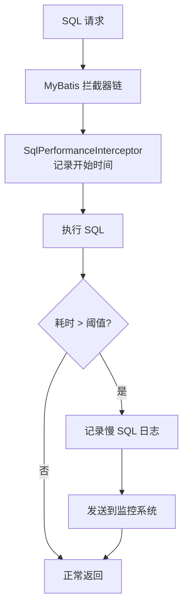

# SQL 日志审计与 P6Spy

SQL 日志审计是排查数据访问问题、定位慢 SQL 的第一手手段。本篇覆盖三类实现：Druid 内置 SQL 监控、P6Spy 全量 SQL 日志拦截、自定义 MyBatis 拦截器，并说明各自适用的环境。

::: tip 分工声明
本篇聚焦 SQL 日志与审计；数据源自动配置、连接池调优与数据访问组件见 [11-SpringBoot数据访问](11-SpringBoot数据访问.md)，运行时指标采集与告警接入见 [13-Actuator与可观测性接入](13-Actuator与可观测性接入.md)。
:::

## 慢查询监控与 SQL 日志审计

慢查询（Slow Query）是影响数据库性能的常见问题，需要通过监控手段及时发现和优化。

### Druid 监控

Druid（阿里巴巴开源的数据库连接池）内置了强大的监控功能，包括 SQL 监控、URI 监控、Spring 监控等。

```yaml
# application.yml Druid 配置
spring:
  datasource:
    type: com.alibaba.druid.pool.DruidDataSource
    druid:
      url: jdbc:mysql://localhost:3306/my_db
      username: root
      password: root123
      # 连接池配置
      initial-size: 5
      min-idle: 5
      max-active: 20
      # 监控配置
      stat-view-servlet:
        enabled: true                    # 开启监控页面
        url-pattern: /druid/*            # 访问路径
        reset-enable: false              # 禁止重置统计数据
        login-username: admin            # 登录用户名
        login-password: admin123         # 登录密码
        allow: 127.0.0.1                 # 允许访问的 IP
      web-stat-filter:
        enabled: true                    # 开启 Web 监控
        url-pattern: /*                  # 拦截路径
        exclusions: "*.js,*.gif,*.jpg,*.png,*.css,*.ico,/druid/*"
      # SQL 监控
      filter:
        stat:
          enabled: true                  # 开启 SQL 监控
          slow-sql-millis: 1000          # 慢 SQL 阈值（ms）
          log-slow-sql: true             # 打印慢 SQL 日志
        wall:
          enabled: true                  # 开启 SQL 防火墙
          config:
            multi-statement-allow: false # 禁止多语句
```

```java
// Druid 监控配置类
@Configuration
public class DruidConfig {

    @Bean
    @ConfigurationProperties(prefix = "spring.datasource.druid")
    public DataSource druidDataSource() {
        return new DruidDataSource();
    }

    // 配置 Druid 监控的 Servlet
    @Bean
    public ServletRegistrationBean<StatViewServlet> druidStatViewServlet() {
        ServletRegistrationBean<StatViewServlet> bean =
            new ServletRegistrationBean<>(new StatViewServlet(), "/druid/*");
        bean.addInitParameter("loginUsername", "admin");
        bean.addInitParameter("loginPassword", "admin123");
        bean.addInitParameter("allow", "127.0.0.1");
        return bean;
    }

    // 配置 Druid Web 监控的 Filter
    @Bean
    public FilterRegistrationBean<WebStatFilter> druidWebStatFilter() {
        FilterRegistrationBean<WebStatFilter> bean =
            new FilterRegistrationBean<>(new WebStatFilter());
        bean.addUrlPatterns("/*");
        bean.addInitParameter("exclusions", "*.js,*.gif,*.jpg,*.png,*.css,*.ico,/druid/*");
        return bean;
    }
}
```

::: tip Druid 监控页面功能
访问 `http://localhost:8080/druid/` 可以看到：
1. **SQL 监控**：每条 SQL 的执行次数、耗时、错误数
2. **SQL 防火墙**：拦截危险 SQL（如 DROP TABLE、DELETE 无 WHERE）
3. **URI 监控**：每个接口的 SQL 执行情况
4. **Session 监控**：当前用户的请求统计
5. **Spring 监控**：Spring Bean 的方法调用统计
:::

### P6Spy SQL 日志

P6Spy 是一个 SQL 日志框架，可以拦截 JDBC 调用并记录完整的 SQL 语句（包含参数值），非常适合开发环境调试。

```xml
<!-- 引入 P6Spy 依赖 -->
<dependency>
    <groupId>p6spy</groupId>
    <artifactId>p6spy</artifactId>
    <version>3.9.1</version>
</dependency>
```

```yaml
# application.yml 配置 P6Spy
spring:
  datasource:
    driver-class-name: com.p6spy.engine.spy.P6SpyDriver  # P6Spy 驱动
    url: jdbc:p6spy:mysql://localhost:3306/my_db?useSSL=false&serverTimezone=Asia/Shanghai
    # 注意 URL 前缀从 jdbc:mysql 改为 jdbc:p6spy:mysql
```

```properties
# spy.properties 配置文件
# 使用自定义日志格式
logMessageFormat=com.p6spy.engine.spy.appender.CustomLineFormat
customLogMessageFormat=执行耗时: %(executionTime)ms | SQL: %(sqlSingleLine)

# 日志输出方式
appender=com.p6spy.engine.spy.appender.StdoutLogger

# 排除的系统表
exclude=QRTZ_,ACT_

# 日期格式
dateformat=yyyy-MM-dd HH:mm:ss

# 检测长时间无响应的 SQL
outagedetection=true
outagedetectioninterval=500   # 单位: 秒
```

::: warning P6Spy 仅限开发环境
P6Spy 会显著降低 SQL 执行性能（约 30%-50%），**绝对不要在生产环境使用**。生产环境应使用数据库自带的慢查询日志（MySQL 的 `slow_query_log`）或 APM 工具（如 SkyWalking）。
:::

### 自定义 MyBatis 拦截器

```java
// 自定义 SQL 执行耗时拦截器
@Intercepts({
    @Signature(type = StatementHandler.class, method = "query", args = {
        Statement.class, ResultHandler.class
    }),
    @Signature(type = StatementHandler.class, method = "update", args = {
        Statement.class
    })
})
@Component
@Slf4j
public class SqlPerformanceInterceptor implements Interceptor {

    // 慢 SQL 阈值（毫秒）
    @Value("${mybatis.slow-sql-threshold:1000}")
    private long slowSqlThreshold;

    @Override
    public Object intercept(Invocation invocation) throws Throwable {
        long startTime = System.currentTimeMillis();
        
        try {
            // 执行原始方法
            return invocation.proceed();
        } finally {
            long costTime = System.currentTimeMillis() - startTime;
            
            if (costTime > slowSqlThreshold) {
                // 记录慢 SQL
                StatementHandler handler = (StatementHandler) invocation.getTarget();
                BoundSql boundSql = handler.getBoundSql();
                String sql = boundSql.getSql();
                
                log.warn("慢 SQL 耗时: {}ms | SQL: {}", costTime, sql);
                
                // 可以发送到监控系统
                MetricsCollector.recordSlowSql(sql, costTime);
            }
        }
    }
}

// 注册拦截器
@Configuration
public class MybatisPlusConfig {

    @Bean
    public SqlPerformanceInterceptor sqlPerformanceInterceptor() {
        return new SqlPerformanceInterceptor();
    }
}
```


