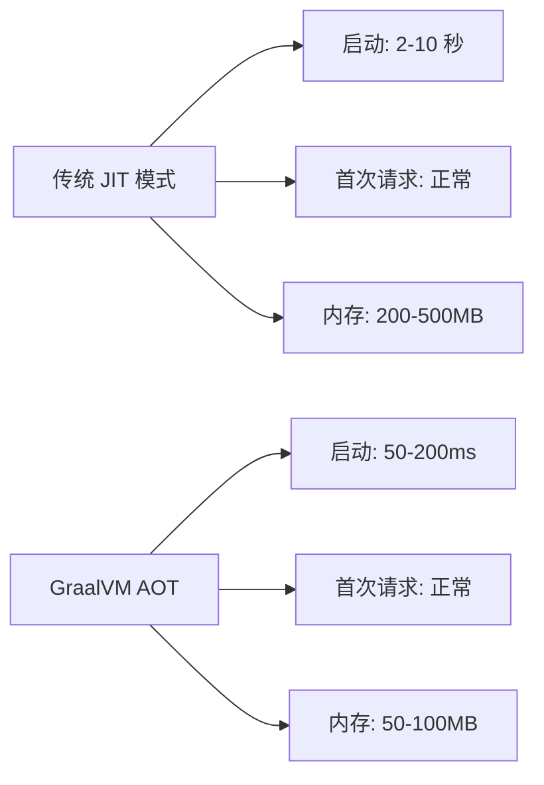
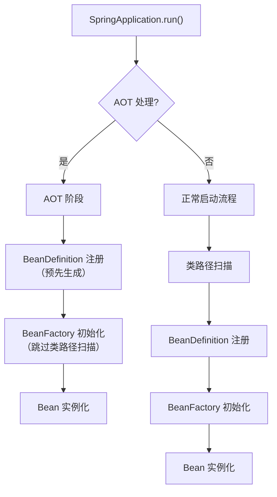

# GraalVM 与 AOT

Spring Boot 3.x 引入了 AOT（Ahead-Of-Time）处理阶段，并支持 GraalVM Native Image：应用可被提前编译为原生可执行文件，启动时间从秒级降至毫秒级。本篇汇总 Native Image 的构建方式与限制，以及 AOT 阶段在启动流程中的位置与收益。

::: tip 分工声明
本篇聚焦 GraalVM Native Image 与 AOT；启动主流程（JIT 模式）见 [20-SpringBoot启动主流程](20-SpringBoot启动主流程.md)，其中“启动性能优化”一节覆盖延迟初始化、排除自动配置、JVM 参数等常规手段；容器化部署见 [17-Docker容器化部署](17-Docker容器化部署.md)。
:::

## 使用 GraalVM Native Image（Spring Boot 3.x）

```bash
# 使用 GraalVM 编译为原生镜像
mvn -Pnative native:compile

# 启动时间从秒级降到毫秒级
./target/myapp
```



::: danger Native Image 的限制
1. 不支持动态类加载和反射（需通过 AOT 配置预先声明）
2. 不支持 CGLIB 代理（需使用接口代理）
3. 部分第三方库可能不兼容
4. 构建时间长（编译需要 1-5 分钟）
5. 调试体验不如 JIT 模式
:::


## GraalVM AOT 处理

Spring Boot 3.x 在启动前新增了 AOT（Ahead-Of-Time）处理阶段：



```java
// AOT 处理生成的代码（构建时自动生成）
// target/generated/aot/com/example/Application__BeanDefinitions.java
public class Application__BeanDefinitions implements BeanDefinitions {

    @Override
    public void accept(BeanDefinitionRegistry registry) {
        // 预先生成的 BeanDefinition 注册代码
        // 跳过了运行时的类路径扫描和条件判断
        registerBeanDefinition(registry, "myController", MyController.class);
        registerBeanDefinition(registry, "myService", MyService.class);
    }
}
```

::: tip AOT 的性能收益
1. **跳过类路径扫描**：构建时已确定所有 Bean
2. **跳过条件判断**：构建时已评估 `@Conditional` 条件
3. **跳过反射**：构建时已生成直接调用代码
4. **更快的启动**：从秒级降到毫秒级（Native Image 模式）
5. **更低的内存**：50-100MB vs 200-500MB（JIT 模式）
:::

