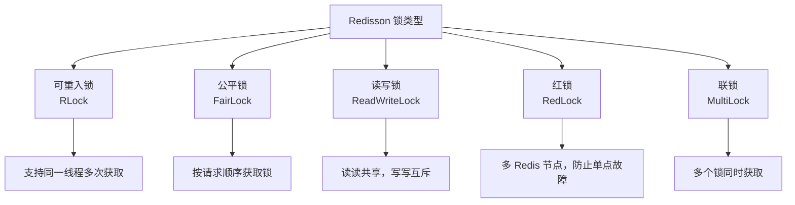
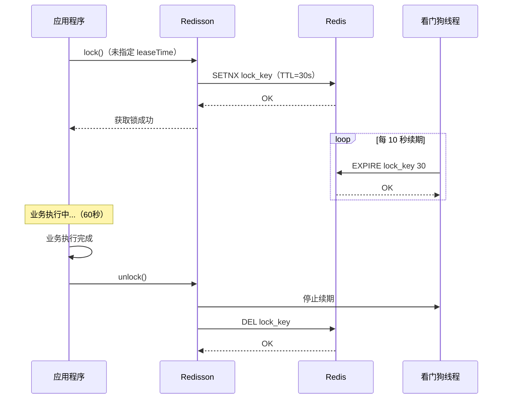
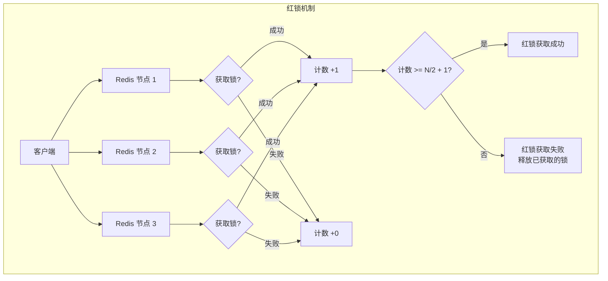
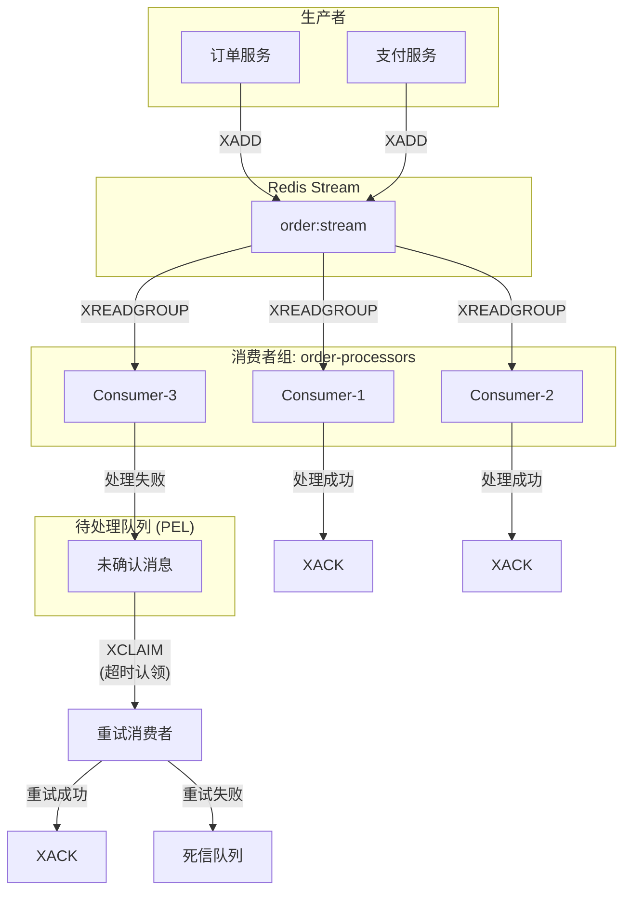
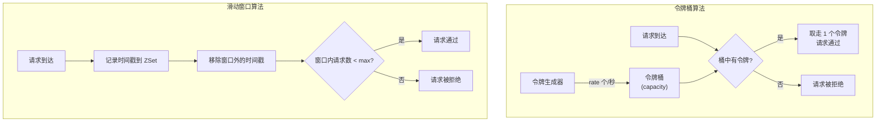

# 分布式锁与限流实战

::: tip 分工声明
本篇聚焦 Redis 分布式协同的三大实战主题：分布式锁、消息通道（Pub/Sub 与 Stream）、限流。缓存与 Spring Cache 整合见 [15-缓存与Redis实战](15-缓存与Redis实战.md)；RocketMQ/Kafka 等消息中间件的集成细节见 [13-消息队列](../13-消息队列/00-导航.md)，本篇的 Redis 消息队列仅覆盖轻量级场景。
:::

## 分布式锁深度实践

### Redisson 分布式锁原理

Redisson 是 Redis 官方推荐的分布式锁实现，提供了丰富的锁类型和高级特性。



### 可重入锁实现

```java
/**
 * Redisson 可重入锁示例
 */
@Service
@RequiredArgsConstructor
public class RedissonLockService {
    
    private final RedissonClient redissonClient;
    
    /**
     * 基本使用
     */
    public void doSomethingWithLock() {
        RLock lock = redissonClient.getLock("myLock");
        
        try {
            // 尝试获取锁（等待时间、持有时间）
            boolean acquired = lock.tryLock(10, 30, TimeUnit.SECONDS);
            
            if (acquired) {
                // 执行业务逻辑
                doBusiness();
            } else {
                // 获取锁失败
                throw new RuntimeException("获取锁失败");
            }
        } catch (InterruptedException e) {
            Thread.currentThread().interrupt();
            throw new RuntimeException("获取锁被中断", e);
        } finally {
            // 只有当前线程持有锁时才释放
            if (lock.isHeldByCurrentThread()) {
                lock.unlock();
            }
        }
    }
    
    /**
     * 可重入特性演示
     */
    public void reentrantDemo() {
        RLock lock = redissonClient.getLock("reentrantLock");
        
        lock.lock();
        try {
            log.info("第一次获取锁");
            
            // 同一线程可以再次获取锁（可重入）
            lock.lock();
            try {
                log.info("第二次获取锁（可重入）");
                
                // 还可以继续获取
                lock.lock();
                try {
                    log.info("第三次获取锁（可重入）");
                } finally {
                    lock.unlock();
                }
            } finally {
                lock.unlock();
            }
        } finally {
            lock.unlock();
        }
    }
}
```

### 看门狗机制

Redisson 的看门狗机制会自动续期，防止业务执行时间超过锁过期时间导致锁失效。

```java
/**
 * 看门狗机制演示
 */
@Service
@RequiredArgsConstructor
public class WatchdogService {
    
    private final RedissonClient redissonClient;
    
    /**
     * 自动续期（看门狗）
     * 不指定 leaseTime 时，默认 30 秒过期，每 10 秒自动续期
     */
    public void autoRenewal() {
        RLock lock = redissonClient.getLock("watchdogLock");
        
        lock.lock();  // 不指定过期时间，启用看门狗
        try {
            // 模拟长时间业务（超过默认 30 秒）
            Thread.sleep(60_000);  // 60 秒
            log.info("业务执行完成");
            // 看门狗会自动续期，锁不会过期
        } catch (InterruptedException e) {
            Thread.currentThread().interrupt();
        } finally {
            lock.unlock();
        }
    }
    
    /**
     * 手动指定过期时间（不启用看门狗）
     */
    public void manualExpire() {
        RLock lock = redissonClient.getLock("manualLock");
        
        // 指定 leaseTime，不启用看门狗
        lock.lock(30, TimeUnit.SECONDS);
        try {
            // 业务执行时间必须小于 30 秒
            doBusiness();
        } finally {
            lock.unlock();
        }
    }
}
```



::: tip 看门狗机制要点
1. **默认续期**：锁默认 30 秒过期，每 10 秒（1/3 过期时间）自动续期到 30 秒
2. **启用条件**：只有不指定 `leaseTime` 时才启用看门狗
3. **续期时机**：在锁即将过期前自动续期，确保业务执行期间锁不会失效
4. **停止续期**：调用 `unlock()` 后自动停止续期
:::

### 读写锁实现

```java
/**
 * Redisson 读写锁示例
 * 适用场景：读多写少的场景
 */
@Service
@RequiredArgsConstructor
public class ReadWriteLockService {
    
    private final RedissonClient redissonClient;
    private final Map<String, String> dataStore = new HashMap<>();
    
    /**
     * 读操作（共享锁）
     * 多个读操作可以并发执行
     */
    public String readData(String key) {
        RReadWriteLock rwLock = redissonClient.getReadWriteLock("dataRWLock");
        RLock readLock = rwLock.readLock();
        
        readLock.lock();
        try {
            // 模拟读操作
            log.info("读取数据: {}", key);
            return dataStore.get(key);
        } finally {
            readLock.unlock();
        }
    }
    
    /**
     * 写操作（排他锁）
     * 写操作与其他读写操作互斥
     */
    public void writeData(String key, String value) {
        RReadWriteLock rwLock = redissonClient.getReadWriteLock("dataRWLock");
        RLock writeLock = rwLock.writeLock();
        
        writeLock.lock();
        try {
            // 模拟写操作
            log.info("写入数据: {} = {}", key, value);
            dataStore.put(key, value);
        } finally {
            writeLock.unlock();
        }
    }
    
    /**
     * 缓存更新示例（读写锁应用）
     */
    public String getOrLoadData(String key, Supplier<String> loader) {
        RReadWriteLock rwLock = redissonClient.getReadWriteLock("cacheRWLock:" + key);
        
        // 先尝试读锁
        RLock readLock = rwLock.readLock();
        readLock.lock();
        try {
            String value = dataStore.get(key);
            if (value != null) {
                return value;
            }
        } finally {
            readLock.unlock();
        }
        
        // 缓存未命中，获取写锁
        RLock writeLock = rwLock.writeLock();
        writeLock.lock();
        try {
            // 双重检查（防止其他线程已经加载）
            String value = dataStore.get(key);
            if (value != null) {
                return value;
            }
            
            // 加载数据
            value = loader.get();
            dataStore.put(key, value);
            return value;
        } finally {
            writeLock.unlock();
        }
    }
}
```

### 红锁实现

红锁（RedLock）用于解决 Redis 单点故障问题，通过多个独立的 Redis 节点实现分布式锁。

```java
/**
 * Redisson 红锁示例
 * 适用场景：对可靠性要求极高的场景
 */
@Service
@RequiredArgsConstructor
public class RedLockService {
    
    private final RedissonClient redissonClient1;  // Redis 节点 1
    private final RedissonClient redissonClient2;  // Redis 节点 2
    private final RedissonClient redissonClient3;  // Redis 节点 3
    
    /**
     * 红锁获取
     * 需要在大多数节点（N/2 + 1）上获取锁才算成功
     */
    public boolean tryRedLock(String lockKey, long waitTime, long leaseTime) {
        RLock lock1 = redissonClient1.getLock(lockKey);
        RLock lock2 = redissonClient2.getLock(lockKey);
        RLock lock3 = redissonClient3.getLock(lockKey);
        
        // 创建红锁（需要 3 个节点中至少 2 个获取成功）
        RedissonRedLock redLock = new RedissonRedLock(lock1, lock2, lock3);
        
        try {
            boolean acquired = redLock.tryLock(waitTime, leaseTime, TimeUnit.SECONDS);
            if (acquired) {
                log.info("红锁获取成功");
                // 执行业务逻辑
                doBusiness();
                return true;
            } else {
                log.warn("红锁获取失败");
                return false;
            }
        } catch (InterruptedException e) {
            Thread.currentThread().interrupt();
            return false;
        } finally {
            redLock.unlock();
        }
    }
}
```



::: warning 红锁的争议
红锁算法存在争议，主要问题：
1. **时钟漂移**：依赖各节点时钟同步，时钟跳跃可能导致锁失效
2. **网络分区**：极端情况下可能产生多个客户端同时持有锁
3. **性能开销**：需要在多个节点上获取锁，延迟较高

**替代方案**：使用 Redis Cluster 或 ZooKeeper 实现分布式锁。
:::

### Redisson 配置

```java
/**
 * Redisson 配置类
 */
@Configuration
public class RedissonConfig {
    
    /**
     * 单节点配置
     */
    @Bean
    public RedissonClient redissonClient() {
        Config config = new Config();
        config.useSingleServer()
            .setAddress("redis://localhost:6379")
            .setPassword("your-password")
            .setDatabase(0)
            .setConnectionPoolSize(64)
            .setConnectionMinimumIdleSize(10)
            .setIdleConnectionTimeout(10000)
            .setConnectTimeout(10000)
            .setTimeout(3000)
            .setRetryAttempts(3)
            .setRetryInterval(1500);
        
        // 看门狗配置
        config.setLockWatchdogTimeout(30000);  // 默认 30 秒
        
        return Redisson.create(config);
    }
    
    /**
     * 集群配置
     */
    @Bean
    public RedissonClient redissonClusterClient() {
        Config config = new Config();
        config.useClusterServers()
            .addNodeAddress(
                "redis://192.168.1.1:6379",
                "redis://192.168.1.2:6379",
                "redis://192.168.1.3:6379"
            )
            .setPassword("your-password")
            .setMasterConnectionPoolSize(64)
            .setSlaveConnectionPoolSize(64)
            .setScanInterval(5000);  // 集群状态扫描间隔
        
        return Redisson.create(config);
    }
    
    /**
     * 哨兵配置
     */
    @Bean
    public RedissonClient redissonSentinelClient() {
        Config config = new Config();
        config.useSentinelServers()
            .setMasterName("mymaster")
            .addSentinelAddress(
                "redis://192.168.1.1:26379",
                "redis://192.168.1.2:26379",
                "redis://192.168.1.3:26379"
            )
            .setPassword("your-password")
            .setMasterConnectionPoolSize(64);
        
        return Redisson.create(config);
    }
}
```

## Redis 消息队列

### Pub/Sub 发布订阅

Redis Pub/Sub 是最简单的消息队列实现，适合实时消息推送场景。

```java
/**
 * Redis Pub/Sub 示例
 */
@Service
@RequiredArgsConstructor
public class PubSubService {
    
    private final StringRedisTemplate redisTemplate;
    
    /**
     * 发布消息
     */
    public void publish(String channel, String message) {
        redisTemplate.convertAndSend(channel, message);
    }
    
    /**
     * 消息监听器
     */
    @Bean
    public RedisMessageListenerContainer redisMessageListenerContainer(
            RedisConnectionFactory connectionFactory) {
        RedisMessageListenerContainer container = new RedisMessageListenerContainer();
        container.setConnectionFactory(connectionFactory);
        
        // 添加消息监听器
        container.addMessageListener(new OrderMessageListener(), 
            new ChannelTopic("order:created"));
        container.addMessageListener(new PaymentMessageListener(), 
            new PatternTopic("payment:*"));  // 支持通配符
        
        return container;
    }
    
    /**
     * 订单消息监听器
     */
    @Slf4j
    public static class OrderMessageListener implements MessageListener {
        @Override
        public void onMessage(Message message, byte[] pattern) {
            String channel = new String(message.getChannel());
            String body = new String(message.getBody());
            log.info("收到订单消息 - 频道: {}, 内容: {}", channel, body);
            
            // 处理订单消息
            processOrder(body);
        }
        
        private void processOrder(String orderJson) {
            // 业务处理逻辑
        }
    }
}
```

::: warning Pub/Sub 的局限性
1. **消息不持久化**：客户端离线时消息会丢失
2. **无消息确认**：无法确认消息是否被成功处理
3. **无消费者组**：不支持多消费者负载均衡
4. **适用场景**：实时通知、聊天室、配置更新广播
:::

### Stream 消息队列

Redis Stream 是专门为消息队列设计的数据结构，支持消费者组、消息确认、持久化。

```java
/**
 * Redis Stream 消息队列示例
 */
@Service
@RequiredArgsConstructor
@Slf4j
public class StreamQueueService {
    
    private final StringRedisTemplate redisTemplate;
    
    private static final String ORDER_STREAM = "order:stream";
    private static final String ORDER_GROUP = "order-processors";
    
    /**
     * 初始化消费者组
     */
    @PostConstruct
    public void initConsumerGroup() {
        try {
            // 创建消费者组（从最新消息开始）
            redisTemplate.opsForStream().createGroup(ORDER_STREAM, ORDER_GROUP);
        } catch (Exception e) {
            log.info("消费者组已存在: {}", ORDER_GROUP);
        }
    }
    
    /**
     * 生产者：发送订单消息
     */
    public String sendOrderMessage(Order order) {
        Map<String, String> message = new HashMap<>();
        message.put("orderId", order.getId().toString());
        message.put("userId", order.getUserId().toString());
        message.put("amount", order.getAmount().toString());
        message.put("timestamp", String.valueOf(System.currentTimeMillis()));
        
        RecordId recordId = redisTemplate.opsForStream().add(ORDER_STREAM, message);
        log.info("发送订单消息: {}", recordId.getValue());
        return recordId.getValue();
    }
    
    /**
     * 消费者：处理订单消息
     */
    @Scheduled(fixedDelay = 1000)
    public void consumeOrderMessages() {
        String consumerName = "consumer-" + Thread.currentThread().getId();
        
        // 读取未确认的消息
        List<MapRecord<String, Object, Object>> messages = redisTemplate.opsForStream().read(
            Consumer.from(ORDER_GROUP, consumerName),
            StreamOffset.create(ORDER_STREAM, ReadOffset.lastConsumed()),
            StreamReadOptions.empty().count(10)
        );
        
        if (messages == null || messages.isEmpty()) {
            return;
        }
        
        for (MapRecord<String, Object, Object> message : messages) {
            try {
                // 处理消息
                processOrder(message.getValue());
                
                // 确认消息
                redisTemplate.opsForStream().acknowledge(ORDER_STREAM, ORDER_GROUP, message.getId());
                log.info("订单消息处理完成: {}", message.getId().getValue());
            } catch (Exception e) {
                log.error("订单消息处理失败: {}", message.getId().getValue(), e);
                // 消息未确认，会进入待处理队列（PEL）
            }
        }
    }
    
    /**
     * 处理待处理消息（死信队列处理）
     */
    @Scheduled(fixedDelay = 60000)  // 每分钟检查一次
    public void processPendingMessages() {
        // 获取待处理消息摘要
        PendingMessagesSummary summary = redisTemplate.opsForStream()
            .pending(ORDER_STREAM, ORDER_GROUP);
        
        if (summary == null || summary.getTotalPendingMessages() == 0) {
            return;
        }
        
        log.info("待处理消息数量: {}", summary.getTotalPendingMessages());
        
        // 获取超时的待处理消息
        PendingMessages pending = redisTemplate.opsForStream().pending(
            ORDER_STREAM, 
            Consumer.from(ORDER_GROUP, "consumer-1"),
            Range.unbounded(),
            10L
        );
        
        for (PendingMessage pendingMessage : pending) {
            // 检查消息空闲时间
            if (pendingMessage.getIdleTime() > Duration.ofMinutes(5)) {
                // 认领超时消息
                List<MapRecord<String, Object, Object>> claimed = redisTemplate.opsForStream().claim(
                    ORDER_STREAM, ORDER_GROUP, "consumer-retry",
                    Duration.ofMinutes(5),
                    pendingMessage.getId()
                );
                
                // 重新处理
                for (MapRecord<String, Object, Object> message : claimed) {
                    try {
                        processOrder(message.getValue());
                        redisTemplate.opsForStream().acknowledge(
                            ORDER_STREAM, ORDER_GROUP, message.getId()
                        );
                    } catch (Exception e) {
                        log.error("重试处理失败: {}", message.getId().getValue(), e);
                    }
                }
            }
        }
    }
    
    private void processOrder(Map<Object, Object> message) {
        Long orderId = Long.parseLong(message.get("orderId").toString());
        log.info("处理订单: {}", orderId);
        // 业务处理逻辑
    }
}
```



## Redis 限流实现

### 固定窗口限流

```java
/**
 * 固定窗口限流
 * 简单但存在边界问题
 */
@Service
@RequiredArgsConstructor
public class FixedWindowRateLimiter {
    
    private final StringRedisTemplate redisTemplate;
    
    /**
     * 固定窗口限流检查
     * @param key 限流 key
     * @param windowSize 窗口大小（秒）
     * @param maxRequests 窗口内最大请求数
     */
    public boolean isAllowed(String key, long windowSize, int maxRequests) {
        long currentWindow = System.currentTimeMillis() / 1000 / windowSize;
        String windowKey = key + ":" + currentWindow;
        
        // 计数器自增
        Long count = redisTemplate.opsForValue().increment(windowKey);
        
        // 设置过期时间（首次设置）
        if (count != null && count == 1) {
            redisTemplate.expire(windowKey, Duration.ofSeconds(windowSize));
        }
        
        return count != null && count <= maxRequests;
    }
}
```

::: warning 固定窗口的边界问题
固定窗口在窗口边界可能出现 2 倍请求：
- 假设窗口大小 1 秒，限制 100 次/秒
- 在 0.9 秒来了 100 次请求，1.0 秒又来了 100 次请求
- 实际在 0.9-1.0 秒这 0.1 秒内处理了 200 次请求
:::

### 滑动窗口限流

```java
/**
 * 滑动窗口限流
 * 使用 ZSet 实现精确的滑动窗口
 */
@Service
@RequiredArgsConstructor
public class SlidingWindowRateLimiter {
    
    private final StringRedisTemplate redisTemplate;
    
    /**
     * 滑动窗口限流检查
     * @param key 限流 key
     * @param windowSize 窗口大小（毫秒）
     * @param maxRequests 窗口内最大请求数
     */
    public boolean isAllowed(String key, long windowSize, int maxRequests) {
        long now = System.currentTimeMillis();
        long windowStart = now - windowSize;
        
        // 使用 Lua 脚本保证原子性
        String script = """
            -- 移除窗口外的请求
            redis.call('ZREMRANGEBYSCORE', KEYS[1], 0, ARGV[1])
            
            -- 统计窗口内请求数
            local count = redis.call('ZCARD', KEYS[1])
            
            -- 判断是否超过限制
            if count < tonumber(ARGV[2]) then
                -- 添加当前请求
                redis.call('ZADD', KEYS[1], ARGV[3], ARGV[3])
                -- 设置过期时间
                redis.call('PEXPIRE', KEYS[1], ARGV[4])
                return 1
            else
                return 0
            end
            """;
        
        Long result = redisTemplate.execute(
            new DefaultRedisScript<>(script, Long.class),
            Collections.singletonList(key),
            String.valueOf(windowStart),  // 窗口起始时间
            String.valueOf(maxRequests),   // 最大请求数
            String.valueOf(now),           // 当前时间戳（作为 member 和 score）
            String.valueOf(windowSize + 1000)  // 过期时间（窗口大小 + 1 秒）
        );
        
        return result != null && result == 1L;
    }
    
    /**
     * 获取当前窗口内请求数
     */
    public long getCurrentCount(String key, long windowSize) {
        long now = System.currentTimeMillis();
        long windowStart = now - windowSize;
        
        // 移除窗口外的请求
        redisTemplate.opsForZSet().removeRangeByScore(key, 0, windowStart);
        
        // 统计窗口内请求数
        Long count = redisTemplate.opsForZSet().size(key);
        return count != null ? count : 0;
    }
}
```

### 令牌桶限流

```java
/**
 * 令牌桶限流
 * 使用 Redis + Lua 实现
 */
@Service
@RequiredArgsConstructor
public class TokenBucketRateLimiter {
    
    private final StringRedisTemplate redisTemplate;
    
    /**
     * 令牌桶限流检查
     * @param key 限流 key
     * @param capacity 桶容量
     * @param rate 令牌生成速率（个/秒）
     */
    public boolean isAllowed(String key, long capacity, long rate) {
        String script = """
            local key = KEYS[1]
            local capacity = tonumber(ARGV[1])
            local rate = tonumber(ARGV[2])
            local now = tonumber(ARGV[3])
            local requested = 1  -- 每次请求消耗 1 个令牌
            
            -- 获取当前令牌数和上次刷新时间
            local info = redis.call('HMGET', key, 'tokens', 'last_time')
            local tokens = tonumber(info[1])
            local lastTime = tonumber(info[2])
            
            -- 初始化
            if tokens == nil then
                tokens = capacity
                lastTime = now
            end
            
            -- 计算补充的令牌数
            local elapsed = now - lastTime
            local filled = math.floor(elapsed * rate / 1000)  -- 毫秒转秒
            tokens = math.min(capacity, tokens + filled)
            
            -- 判断是否有足够令牌
            if tokens >= requested then
                tokens = tokens - requested
                redis.call('HMSET', key, 'tokens', tokens, 'last_time', now)
                redis.call('PEXPIRE', key, math.ceil(capacity / rate * 1000) + 1000)
                return 1
            else
                redis.call('HMSET', key, 'tokens', tokens, 'last_time', now)
                return 0
            end
            """;
        
        Long result = redisTemplate.execute(
            new DefaultRedisScript<>(script, Long.class),
            Collections.singletonList(key),
            String.valueOf(capacity),
            String.valueOf(rate),
            String.valueOf(System.currentTimeMillis())
        );
        
        return result != null && result == 1L;
    }
    
    /**
     * 获取当前令牌数
     */
    public long getCurrentTokens(String key, long capacity, long rate) {
        String script = """
            local key = KEYS[1]
            local capacity = tonumber(ARGV[1])
            local rate = tonumber(ARGV[2])
            local now = tonumber(ARGV[3])
            
            local info = redis.call('HMGET', key, 'tokens', 'last_time')
            local tokens = tonumber(info[1])
            local lastTime = tonumber(info[2])
            
            if tokens == nil then
                return capacity
            end
            
            local elapsed = now - lastTime
            local filled = math.floor(elapsed * rate / 1000)
            return math.min(capacity, tokens + filled)
            """;
        
        Long result = redisTemplate.execute(
            new DefaultRedisScript<>(script, Long.class),
            Collections.singletonList(key),
            String.valueOf(capacity),
            String.valueOf(rate),
            String.valueOf(System.currentTimeMillis())
        );
        
        return result != null ? result : capacity;
    }
}
```



::: tip 限流算法对比
| 算法 | 优点 | 缺点 | 适用场景 |
|------|------|------|---------|
| 固定窗口 | 实现简单、内存占用小 | 边界问题、不精确 | 对精度要求不高的场景 |
| 滑动窗口 | 精确控制 | 内存占用较大 | 需要精确限流的场景 |
| 令牌桶 | 允许突发流量、平滑限流 | 实现复杂 | API 限流、流量整形 |
| 漏桶 | 输出恒定速率 | 无法应对突发流量 | 流量整形、保护下游 |
:::

### Redisson 限流器

```java
/**
 * Redisson 分布式限流器
 * 基于令牌桶算法
 */
@Service
@RequiredArgsConstructor
public class RedissonRateLimiterService {
    
    private final RedissonClient redissonClient;
    
    /**
     * 初始化限流器
     */
    public RRateLimiter initRateLimiter(String key, long rate, long interval) {
        RRateLimiter rateLimiter = redissonClient.getRateLimiter(key);
        
        // 设置速率：rate 个请求 / interval 时间间隔
        rateLimiter.setRate(RateType.OVERALL, rate, interval, RateIntervalUnit.SECONDS);
        
        return rateLimiter;
    }
    
    /**
     * 限流检查
     */
    public boolean tryAcquire(String key) {
        RRateLimiter rateLimiter = redissonClient.getRateLimiter(key);
        return rateLimiter.tryAcquire();
    }
    
    /**
     * 尝试获取多个许可
     */
    public boolean tryAcquire(String key, int permits) {
        RRateLimiter rateLimiter = redissonClient.getRateLimiter(key);
        return rateLimiter.tryAcquire(permits);
    }
    
    /**
     * API 限流示例
     */
    public ApiResponse callApiWithRateLimit(String apiName, Supplier<ApiResponse> apiCall) {
        String key = "api:rate:" + apiName;
        
        // 初始化限流器：100 次/秒
        RRateLimiter rateLimiter = initRateLimiter(key, 100, 1);
        
        if (rateLimiter.tryAcquire()) {
            return apiCall.get();
        } else {
            throw new RuntimeException("API 请求频率超限，请稍后重试");
        }
    }
}
```

