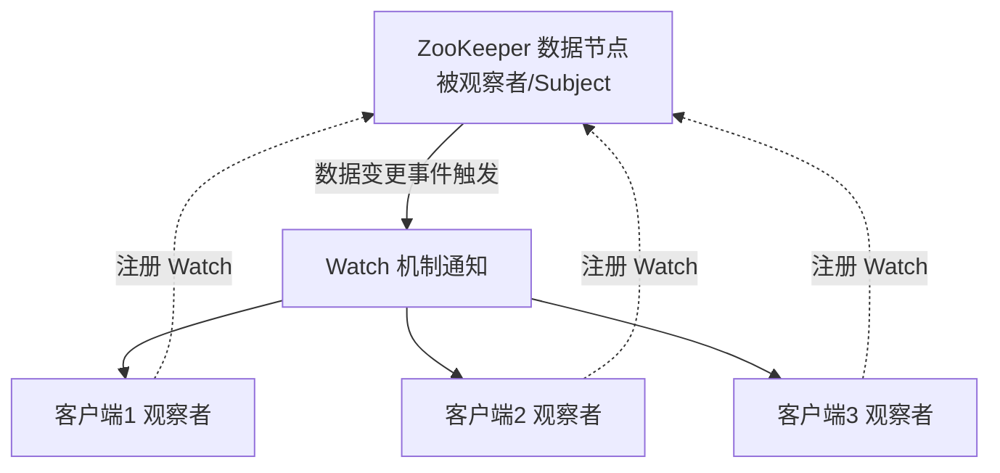
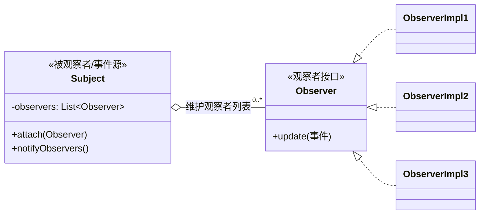

# 发布订阅模式：如何使用 Watch 机制实现分布式通知

## 概念说明

Watch 监控机制是 ZooKeeper 实现分布式通知的关键技术：客户端向服务器注册 Watch 事件后，当被监控节点的数据或状态发生变化时，客户端会收到相应的通知，并借此实现发布订阅功能。

订阅发布在日常生活中很常见：用户在视频网站订阅喜欢的剧集，新剧集发布时网站会通知该用户；用户为无库存的心仪商品开启到货通知，商品补货时会收到通知。ZooKeeper 中的 Watch 机制与这些场景模型一致——客户端就是用户，服务端的数据节点就是订阅的商品或剧集。

从技术实现的角度分析，无论是订阅剧集还是订购商品，都有几个核心环节：用户端注册服务、服务端处理请求、客户端收到回调后执行相应的操作。ZooKeeper 的 Watch 机制同样遵循这一流程。

## Watch 机制的使用方式

正如通过点击视频网站上的“收藏”按钮订阅内容，ZooKeeper 客户端通过 Watch 机制订阅服务器上某一节点的数据或状态变化通知。实现方式是向 ZooKeeper 客户端的构造方法传递 Watcher 参数：

```java
new ZooKeeper(String connectString, int sessionTimeout, Watcher watcher)

```

上面代码定义了一个 ZooKeeper 客户端对象实例，并传入三个参数：

```java
connectString：服务端地址
sessionTimeout：超时时间
Watcher：监控事件

```

这个 Watcher 将作为整个 ZooKeeper 会话期间的上下文，一直被保存在客户端 ZKWatchManager 的 defaultWatcher 中。

除此之外，ZooKeeper 客户端也可以通过 getData、exists 和 getChildren 三个接口来向 ZooKeeper 服务器注册 Watcher，从而方便地在不同的情况下添加 Watch 事件：

```java
getData(String path, Watcher watcher, Stat stat)

```

### 触发通知的条件


上图中列出了客户端在不同会话状态下，相应的在服务器节点所能支持的事件类型。例如在客户端连接服务端的时候，可以对数据节点的创建、删除、数据变更、子节点的更新等操作进行监控。

以上是从应用层角度对 ZooKeeper Watch 机制的介绍。简单几行 API 调用即可对服务器节点状态变更进行监控，但在实际生产环境中会遇到很多意想不到的问题，解决这些问题需要深入理解 Watch 的底层实现机制。

## Watch 机制的底层原理

Watch 机制涉及客户端和服务端的多个函数和操作节点，单纯按照程序执行流程分析，跳跃性大、理解难度高。从设计模式角度出发更适合分析其底层实现：


从结构上看，Watch 机制与设计模式中的“观察者模式”非常相似：一个对象或数据节点可能被多个客户端监控，当对应事件被触发时，会通知这些对象或客户端。**Watch 机制可以理解为分布式环境下的观察者模式**，下面以观察者模式的角度分析 ZooKeeper 底层 Watch 的实现。






实现观察者模式时，最核心的代码就是创建一个列表来存放观察者。

ZooKeeper 则在客户端和服务器端分别实现了两个存放观察者的列表，即 ZKWatchManager 和 WatchManager，其核心操作就是围绕这两个列表展开的。

### 客户端 Watch 注册实现过程

发送一个 Watch 监控事件的会话请求时，ZooKeeper 客户端主要做了两个工作：

- 标记该会话是一个带有 Watch 事件的请求

- 将 Watch 事件存储到 ZKWatchManager

以 getData 接口为例。当发送一个带有 Watch 事件的请求时，客户端首先会把该会话标记为带有 Watch 监控的事件请求，之后通过 DataWatchRegistration 类来保存 watcher 事件和节点的对应关系：

```java
public byte[] getData(final String path, Watcher watcher, Stat stat){
  ...
  WatchRegistration wcb = null;
  if (watcher != null) {
    wcb = new DataWatchRegistration(watcher, clientPath);
  }
  RequestHeader h = new RequestHeader();
  request.setWatch(watcher != null);
  ...
  GetDataResponse response = new GetDataResponse();
  ReplyHeader r = cnxn.submitRequest(h, request, response, wcb);
  }

```

之后客户端向服务器发送请求时，是将请求封装成一个 Packet 对象，并添加到一个等待发送队列 outgoingQueue 中：

```java
public Packet queuePacket(RequestHeader h, ReplyHeader r, ...) {
    Packet packet = null;
    ...
    packet = new Packet(h, r, request, response, watchRegistration);
    ...
    outgoingQueue.add(packet);
    ...
    return packet;
}

```

最后，ZooKeeper 客户端就会向服务器端发送这个请求，完成请求发送后，调用负责处理服务器响应的 SendThread 线程类中的 readResponse 方法接收服务端的回调，并在最后执行 finishPacket 方法将 Watch 注册到 ZKWatchManager 中：

```java
private void finishPacket(Packet p) {
        int err = p.replyHeader.getErr();
        if (p.watchRegistration != null) {
            p.watchRegistration.register(err);
        }
       ...
}

```

### 服务端 Watch 注册实现过程

Zookeeper 服务端处理 Watch 事件基本有 2 个过程：

- 解析收到的请求是否带有 Watch 注册事件

- 将对应的 Watch 事件存储到 WatchManager

对这 2 个步骤分别分析如下。

ZooKeeper 服务器接收到一个客户端请求后，首先会对请求进行解析，判断该请求是否包含 Watch 事件。这在 ZooKeeper 底层是通过 FinalRequestProcessor 类中的 processRequest 函数实现的。当 getDataRequest.getWatch() 值为 True 时，表明该请求需要进行 Watch 监控注册，并通过 zks.getZKDatabase().getData 函数将 Watch 事件注册到服务端的 WatchManager 中。

```java
public void processRequest(Request request) {
...
byte b[] =                zks.getZKDatabase().getData(getDataRequest.getPath(), stat,
        getDataRequest.getWatch() ? cnxn : null);
rsp = new GetDataResponse(b, stat);
..
}

```

### 服务端 Watch 事件的触发过程

客户端和服务端都完成 Watch 注册后，下面分析 ZooKeeper 中触发一个 Watch 事件的底层实现过程。

以 setData 接口即“节点数据内容发生变更”事件为例。在 setData 方法内部执行完对节点数据的变更后，会调用 WatchManager.triggerWatch 方法触发数据变更事件。

```java
public Stat setData(String path, byte data[], ...){
        Stat s = new Stat();
        DataNode n = nodes.get(path);
        ...
        dataWatches.triggerWatch(path, EventType.NodeDataChanged);
        return s;
    }

```

triggerWatch 函数的内部工作流程如下：首先封装一个具有会话状态、事件类型、数据节点 3 种属性的 WatchedEvent 对象；之后查询该节点注册的 Watch 事件，如果为空说明该节点没有注册过 Watch 事件；如果存在 Watch 事件则添加到定义的 Watchers 集合中，并在 WatchManager 管理中删除；最后通过调用 process 方法向客户端发送通知。

```java
 Set<Watcher> triggerWatch(String path, EventType type...) {
        WatchedEvent e = new WatchedEvent(type,
                KeeperState.SyncConnected, path);
        Set<Watcher> watchers;
        synchronized (this) {
            watchers = watchTable.remove(path);
            ...
            for (Watcher w : watchers) {
                Set<String> paths = watch2Paths.get(w);
                if (paths != null) {
                    paths.remove(path);
                }
            }
        }
        for (Watcher w : watchers) {
            if (supress != null && supress.contains(w)) {
                continue;
            }
            w.process(e);
        }
        return watchers;
    }

```

### 客户端回调的处理过程

客户端接收到服务端通知后的处理过程如下。

客户端使用 SendThread.readResponse() 方法来统一处理服务端的响应。首先反序列化服务器发送请求头信息 replyHdr.deserialize(bbia, "header")，并判断其属性字段 xid 的值为 -1，表示该请求响应为通知类型。在处理通知类型时，首先将已收到的字节流反序列化转换成 WatcherEvent 对象。接着判断客户端是否配置了 chrootPath 属性，如果为 True 说明客户端配置了 chrootPath 属性，需要对接收到的节点路径进行 chrootPath 处理。最后调用 eventThread.queueEvent 方法将接收到的事件交给 EventThread 线程进行处理。

```java
if (replyHdr.getXid() == -1) {
    ...
    WatcherEvent event = new WatcherEvent();
    event.deserialize(bbia, "response");
    ...
    if (chrootPath != null) {
        String serverPath = event.getPath();
        if(serverPath.compareTo(chrootPath)==0)
            event.setPath("/");
            ...
            event.setPath(serverPath.substring(chrootPath.length()));
            ...
    }
    WatchedEvent we = new WatchedEvent(event);
    ...
    eventThread.queueEvent( we );
}

```

EventThread.queueEvent() 方法内部的执行逻辑分为 2 点。

第 1 步按照通知的事件类型，从 ZKWatchManager 中查询注册过的客户端 Watch 信息。客户端在查询到对应的 Watch 信息后，会将其从 ZKWatchManager 的管理中删除。**注意：客户端的 Watcher 机制是一次性的，触发后就会被删除。**

```java
public Set<Watcher> materialize(...)
{
	Set<Watcher> result = new HashSet<Watcher>();
	...
	switch (type) {
    ...
	case NodeDataChanged:
	case NodeCreated:
	    synchronized (dataWatches) {
	        addTo(dataWatches.remove(clientPath), result);
	    }
	    synchronized (existWatches) {
	        addTo(existWatches.remove(clientPath), result);
	    }
	    break;
    ....
	}
	return result;
}

```

完成第 1 步工作获取到对应的 Watcher 信息后，将查询到的 Watcher 存储到 waitingEvents 队列中，EventThread 类中的 run 方法会循环取出在 waitingEvents 队列中等待的 Watcher 事件进行处理。

```java
public void run() {
	try {
	  isRunning = true;
	  while (true) {
	     Object event = waitingEvents.take();
	     if (event == eventOfDeath) {
	        wasKilled = true;
	     } else {
	        processEvent(event);
	     }
	     if (wasKilled)
	        synchronized (waitingEvents) {
	           if (waitingEvents.isEmpty()) {
	              isRunning = false;
	              break;
	           }
	        }
	  }
     ...
}

```

最后调用 processEvent(event) 方法来最终执行实现了 Watcher 接口的 process（）方法。

```java
private void processEvent(Object event) {
  ...
  if (event instanceof WatcherSetEventPair) {

WatcherSetEventPair pair = (WatcherSetEventPair) event;
      for (Watcher watcher : pair.watchers) {
          try {
              watcher.process(pair.event);
          } catch (Throwable t) {
              LOG.error("Error while calling watcher ", t);
          }
      }
  }
}

```

至此，ZooKeeper 中 Watch 机制的完整处理流程分析完毕。大体上讲，ZooKeeper 的实现方式是在客户端和服务端分别创建观察者的信息列表：客户端调用 getData、exists 等接口时，首先将对应的 Watch 事件放到本地的 ZKWatchManager 中进行管理；服务端在接收到客户端的请求后根据请求类型判断是否含有 Watch 事件，并将对应事件放到 WatchManager 中进行管理。

在事件触发的时候，服务端通过节点的路径信息查询相应的 Watch 事件并通知给客户端；客户端在接收到通知后，首先查询本地的 ZKWatchManager 获得对应的 Watch 信息并处理回调操作。这种设计不但实现了一个分布式环境下的观察者模式，而且通过将客户端和服务端各自处理 Watch 事件所需要的额外信息分别保存在两端，减少彼此通信的内容，大大提升了服务的处理性能。

## 订阅发布场景实现

发布订阅是 ZooKeeper 最典型的应用场景之一。发布订阅功能可以看作是一个一对多的关系，即一个服务或数据的发布者可以被多个不同的消费者调用。发布订阅模式的数据交互一般分为消费者主动请求生产者信息的拉取模式，和生产者数据变更时主动推送给消费者的推送模式，ZooKeeper 采用了两种模式结合的方式实现订阅发布功能。下面分析一个具体案例。

系统开发的过程中会用到各种各样的配置信息，如数据库配置项、第三方接口、服务地址等。这些配置操作在开发阶段容易完成，但放到一个大规模集群中配置起来就比较麻烦。这种集群中可以用配置管理功能自动完成服务器配置信息的维护，利用 ZooKeeper 的发布订阅功能即可解决这个问题。

具体做法是将诸如数据库配置项这样的信息存储在 ZooKeeper 数据节点中（如下图的 /confs/data_item1）。服务器集群客户端对该节点添加 Watch 事件监控，当集群中的服务启动时，会读取该节点数据获取配置信息；当该节点数据发生变化时，ZooKeeper 服务器会发送 Watch 事件给各个客户端，集群中的客户端在接收到该通知后，重新读取节点的数据库配置信息。


上述方案通过 Watch 机制实现了分布式环境下的配置管理功能：对 ZooKeeper 服务器节点添加数据变更事件后，数据库配置项信息变更时，集群中的各个客户端能接收到该变更事件的通知，并获取最新的配置信息。**要注意一点：Watch 具有一次性的特点，收到服务器通知后要再次添加 Watch 事件。**

## 实践要点

- 客户端 Watcher 是一次性的，触发即从 ZKWatchManager 中删除；需要持续监听的场景必须在回调后重新注册 Watch。
- Watch 事件的触发取决于会话的连接状态与客户端注册事件的类型：常见疑问“当服务端某一节点发生数据变更操作时，所有曾经设置了该节点监控事件的客户端都会收到服务器的通知吗？”答案是否定的——客户端会话状态或数据节点发生改变时，都会触发对应的 Watch 事件。
- 客户端与服务端各自维护 Watch 信息列表（ZKWatchManager / WatchManager），两端各存所需信息以减少通信内容，这是 ZooKeeper Watch 高性能的关键设计。
- 配置管理、集群感知等发布订阅类场景适合用 Watch 实现；对配置变更敏感的客户端应处理好 chrootPath 路径与通知线程（EventThread）的异步语义。

## 版本差异(ZooKeeper 3.6 → 3.8/3.9)

| 特性 | 旧版（本文编写时，3.6.x） | 当前（3.8.x/3.9.x） |
|------|---------------------------|---------------------|
| 稳定版本 | 3.6.x | 3.8.x（LTS）/ 3.9.x |
| Java 支持 | JDK 8 | JDK 8/11/17（3.8+） |
| 客户端 | 原生客户端 | 推荐 Curator 5.x（容器节点、持久递归监听） |
| 监控 | JConsole + 四字母命令 | 3.6+ 实验性 Prometheus 指标端点，3.8+ 完善 |
| 核心机制 | ZAB/Watch/ACL/数据模型 | 原理不变，本篇内容依然适用 |

> ZooKeeper 的核心协议（ZAB、Watch、ACL、数据模型）自 3.4 以来保持稳定，上述原理性内容在 3.8/3.9 中依然适用；部署与监控建议按 3.8/3.9 官方文档更新。
