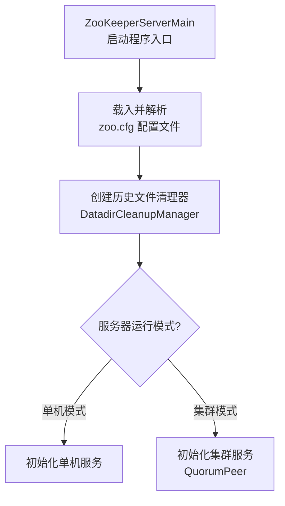
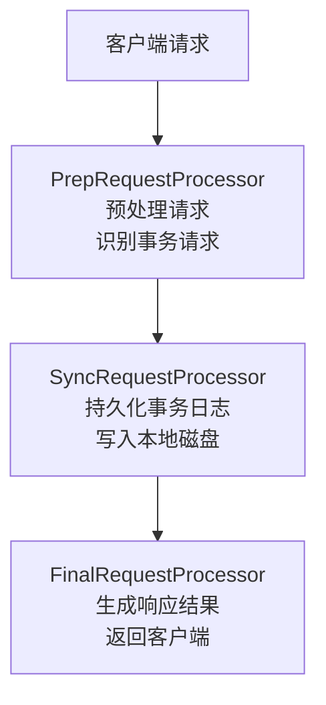

# 服务器启动：单机模式与集群模式

本文我们开始学习 ZooKeeper 服务器的启动管理与初始化相关的内容。

通过基础篇的学习我们已经掌握了 ZooKeeper 相关的基础知识，本文主要通过对单机版的 ZooKeeper 中的启动与服务的初始化过程进行分析，来学习 ZooKeeper 服务端相关的处理知识。而在日常工作中，无论是出于性能上的优势还是可靠性的考虑，单机模式都无法满足要求，因此 ZooKeeper 也采用集群的方式运行，我们还会学习集群模式下启动过程的底层实现。

## 启动准备实现

在 ZooKeeper 服务的初始化之前，首先要对配置文件等信息进行解析和载入。也就是在真正开始服务的初始化之前需要对服务的相关参数进行准备，而 ZooKeeper 服务的准备阶段大体上可分为启动程序入口、zoo.cfg 配置文件解析、创建历史文件清理器等，如下图所示：



> 启动准备阶段：入口启动 → 解析 zoo.cfg 配置 → 创建历史文件清理器，然后根据运行模式（单机/集群）初始化对应的服务器。

QuorumPeerMain 类是 ZooKeeper 服务的启动接口，可以理解为 Java 中的 main 函数。 通常我们在控制台启动 ZooKeeper 服务的时候，输入 zkServer.cmd 或 zkServer.sh 命令就是用来启动这个 Java 类的。如下代码所示，QuorumPeerMain 类函数只有一个 initializeAndRun 方法，是作用为所有 ZooKeeper 服务启动逻辑的入口。

```java
package org.apache.zookeeper.server.quorum;
public class QuorumPeerMain {
  ...
  public static void main(String[] args) {
  ...
    main.initializeAndRun(args);
  ...
  }
}

```

### 解析配置文件

知道了 ZooKeeper 服务的程序启动入口，那么我们现在就分析 ZooKeeper 的启动过程。在 ZooKeeper 启动过程中，首先要做的事情就是解析配置文件 zoo.cfg。在之前的文中我们提到过，zoo.cfg 是服务端的配置文件，在这个文件中我们可以配置数据目录、端口号等信息。所以解析 zoo.cfg 配置文件是 ZooKeeper 服务启动的关键步骤。zoo.cfg 文件的具体解析过程会在后边的文中专门展开讲解，这里我们只需要知道在服务启动的过程中会进行配置文件的解析。

### 创建文件清理器

文件清理器在我们日常的使用中非常重要，我们都知道面对大流量的网络访问，ZooKeeper 会因此产生海量的数据，如果磁盘数据过多或者磁盘空间不足，则会导致 ZooKeeper 服务器不能正常运行，进而影响整个分布式系统。所以面对这种问题，ZooKeeper 采用了 DatadirCleanupManager 类作为历史文件的清理工具类。在 3.4.0 版本后的 ZooKeeper 中更是增加了自动清理历史数据的功能以尽量避免磁盘空间的浪费。如下代码所示，DatadirCleanupManager 类有 5 个属性，其中 snapDir 和 dataLogDir 分别表示数据快照地址以及日志数据的存放地址。而我们在日常工作中可以通过在 zoo.cfg 文件中配置 autopurge.snapRetainCount 和 autopurge.purgeInterval 这两个参数实现数据文件的定时清理功能，autopurge.purgeInterval 这个参数指定了清理频率，以小时为单位，需要填写一个 1 或更大的整数，默认是 0，表示不开启自动清理功能。autopurge.snapRetainCount 这个参数和上面的参数搭配使用，这个参数指定了需要保留的文件数目，默认是保留 3 个。

```java
public class DatadirCleanupManager {
    private final File snapDir;
    private final File dataLogDir;
    private final int snapRetainCount;
    private final int purgeInterval;
    private Timer timer;
}

```

## 服务初始化

经过了上面的配置文件解析等准备阶段后，ZooKeeper 开始服务的初始化阶段。初始化阶段可以理解为根据解析准备阶段的配置信息，实例化服务对象。服务初始化阶段的主要工作是创建用于服务统计的工具类，主要有以下几种：

- ServerStats 类，它可以用于服务运行信息统计；

- FileTxnSnapLog 类，可以用于数据管理。

- 会话管理类，设置服务器 TickTime 和会话超时时间、创建启动会话管理器等操作。


下面我们就分别分析一下这几个关键步骤在 ZooKeeper 中的底层实现过程。

### ServerStats 创建

首先，我们来看一下统计工具类 ServerStats。ServerStats 类用于统计 ZooKeeper 服务运行时的状态信息。主要统计的数据有服务端向客户端发送的响应包次数、接收到的客户端发送的请求包次数、服务端处理请求的延迟情况以及处理客户端的请求次数。在日常运维工作中，监控服务器的性能以及运行状态等参数很多都是这个类负责收集的。

```java
public class ServerStats {
    private long packetsSent;
    private long packetsReceived;
    private long maxLatency;
    private long minLatency = Long.MAX_VALUE;
    private long totalLatency = 0;
    private long count = 0;
}

```

### FileTxnSnapLog 类

现在，我们再看一下另一个工具类 FileTxnSnapLog 类，该类的作用是用来管理 ZooKeeper 的数据存储等相关操作，可以看作为 ZooKeeper 服务层提供底层持久化的接口。在 ZooKeeper 服务启动过程中，它会根据 zoo.cfg 配置文件中的 dataDir 数据快照目录和 dataLogDir 事务日志目录来创建 FileTxnSnapLog 类。

```java
package org.apache.zookeeper.server.persistence;
public class FileTxnSnapLog {
  private final File dataDir;
  private final File snapDir;
  private TxnLog txnLog;
  private SnapShot snapLog;
  private final boolean autoCreateDB;
}

```

### ServerCnxnFactory 类创建

ZooKeeper 中客户端和服务端通过网络通信，其本质是通过 Java 的 IO 数据流的方式进行通信，但是传统的 IO 方式具有阻塞等待的问题，而 NIO 框架作为传统的 Java IO 框架的替代方案，在性能上大大优于前者。也正因如此，NIO 框架也被广泛应用于网络传输的解决方案中。而 ZooKeeper 最早也是使用自己实现的 NIO 框架，但是从 3.4.0 版本后，引入了第三方 Netty 等框架来满足不同使用情况的需求，而我们可以通过 ServerCnxnFactory 类来设置 ZooKeeper 服务器，从而在运行的时候使用我们指定的 NIO 框架。如代码中 ServerCnxnFactory 类通过 setServerCnxnFactory 函数来创建对应的工厂类。

```java
package org.apache.zookeeper.server;
public abstract class ServerCnxnFactory {
final public void setZooKeeperServer(ZooKeeperServer zks) {
    this.zkServer = zks;
    if (zks != null) {
        if (secure) {
            zks.setSecureServerCnxnFactory(this);
        } else {
            zks.setServerCnxnFactory(this);
        }
    }
}

```

在通过 ServerCnxnFactory 类指定了具体的 NIO 框架类后，ZooKeeper 首先会创建一个线程 Thread 类作为 ServerCnxnFactory 类的启动主线程。之后 ZooKeeper 服务再初始化具体的 NIO 类。这里请你注意的是，虽然初始化完相关的 NIO 类，比如已经设置好了服务端的对外端口，客户端也能通过诸如 2181 端口等访问到服务端，但是此时 ZooKeeper 服务器还是无法处理客户端的请求操作。**这是因为 ZooKeeper 启动后，还需要从本地的快照数据文件和事务日志文件中恢复数据**。这之后才真正完成了 ZooKeeper 服务的启动。

### 初始化请求处理链

在完成了 ZooKeeper 服务的启动后，ZooKeeper 会初始化一个请求处理逻辑上的相关类。这个操作就是初始化请求处理链。所谓的请求处理链是一种责任链模式的实现方式，根据不同的客户端请求，在 ZooKeeper 服务器上会采用不同的处理逻辑。而为了更好地实现这种业务场景，ZooKeeper 中采用多个请求处理器类依次处理客户端请求中的不同逻辑部分。这种处理请求的逻辑方式就是责任链模式。而单机版服务器的处理逻辑，主要分为 PrepRequestProcessor、SyncRequestProcessor、FinalRequestProcessor 3 个请求处理器，而在一个请求到达 ZooKeeper 服务端进行处理的过程，则是严格按照这个顺序分别调用这 3 个类处理请求中的对应逻辑，如下图所示。具体的内容，我们会在后面的内容中详细讲解。



> ZooKeeper 单机模式采用**责任链模式**处理请求：请求按 `PrepRequestProcessor → SyncRequestProcessor → FinalRequestProcessor` 顺序依次经过三个处理器，分别负责预处理、日志持久化、结果响应。

## 集群模式

前文我们了解了 ZooKeeper 在单机模式下从启动运行到对外提供服务的整个过程，接下来看集群模式。

### 什么是集群模式

为了解决单机模式下性能的瓶颈问题，以及出于对系统可靠性的高要求，集群模式的系统架构方式被业界普遍采用。那什么是集群模式呢？集群模式可以简单理解为将单机系统复制成几份，部署在不同主机或网络节点上，最终构成了一个由多台计算机组成的系统"集群"。而组成集群中的每个服务器叫作集群中的网络节点。

到现在我们对集群的组织架构形式有了大概的了解，那么你可能会产生一个问题：我们应该如何使用集群？当客户端发送一个请求到集群服务器的时候，究竟是哪台机器为我们提供服务呢？为了解决这个问题，我们先介绍一个概念名词"调度者"。调度者的工作职责就是在集群收到客户端请求后，根据当前集群中机器的使用情况，决定将此次客户端请求交给哪一台服务器或网络节点进行处理，例如我们都很熟悉的负载均衡服务器就是一种调度者的实现方式。

### ZooKeeper 集群模式的特点

通过上面的介绍，我们知道了集群是由网络中不同机器组成的一个系统，集群工作是通过集群中调度者服务器来协同工作的。那么现在我们来看一下 ZooKeeper 中的集群模式，在 ZooKeeper 集群模式中，相比上面说到的集群架构方式，在 ZooKeeper 集群中将服务器分成 Leader、Follower、Observer 三种角色服务器，在集群运行期间这三种服务器所负责的工作各不相同：

- Leader 角色服务器负责管理集群中其他的服务器，是集群中工作的分配和调度者。

- Follower 服务器的主要工作是选举出 Leader 服务器，在发生 Leader 服务器选举的时候，系统会从 Follower 服务器之间根据多数投票原则，选举出一个 Follower 服务器作为新的 Leader 服务器。

- Observer 服务器则主要负责处理来自客户端的获取数据等请求，并不参与 Leader 服务器的选举操作，也不会作为候选者被选举为 Leader 服务器。

### 集群启动的底层实现

到目前为止我们对 ZooKeeper 中集群相关的知识有了大体的了解，接下来我们就深入到 ZooKeeper 的底层，看看在服务端，集群模式是如何启动到对外提供服务的。

前文已经对 ZooKeeper 单机版服务的启动过程做了详细的介绍。而集群中的启动过程和单机版的启动过程有很多地方是一样的。所以这里我们只对 ZooKeeper 集群中的特有实现方式做重点介绍。

#### 程序启动

首先，在 ZooKeeper 服务启动后，系统会调用入口 QuorumPeerMain 类中的 main 函数。在 main 函数中的 initializeAndRun 方法中根据 zoo.cfg 配置文件，判断服务启动方式是集群模式还是单机模式。在函数中首先根据 arg 参数和 config.isDistributed() 来判断，如果配置参数中配置了相关的配置项，并且已经指定了集群模式运行，那么在服务启动的时候就会跳转到 runFromConfig 函数完成之后的集群模式的初始化工作。

```java
protected void initializeAndRun(String[] args){
  ...
  if (args.length == 1 && config.isDistributed()) {
            runFromConfig(config);
        } else {

ZooKeeperServerMain.main(args);
        }
}

```

#### QuorumPeer 类

在 ZooKeeper 服务的集群模式启动过程中，一个最主要的核心类是 QuorumPeer 类。我们可以将每个 QuorumPeer 类的实例看作集群中的一台服务器。在 ZooKeeper 集群模式的运行中，一个 QuorumPeer 类的实例通常具有 4 种状态，分别是参与 Leader 节点的选举、作为 Follower 节点同步 Leader 节点的数据、作为 Leader 节点管理集群中的 Follower 节点，以及作为 Observer 节点观察集群状态。

介绍完 QuorumPeer 类后，下面我们看一下在 ZooKeeper 服务的启动过程中，针对 QuorumPeer 类都做了哪些工作。如下面的代码所示，在一个 ZooKeeper 服务的启动过程中，首先调用 runFromConfig 函数将服务运行过程中需要的核心工具类注册到 QuorumPeer 实例中去。

这些核心工具就是前文单机版服务的启动中介绍的诸如  FileTxnSnapLog 数据持久化类、ServerCnxnFactory 类 NIO 工厂方法等。这之后还需要配置服务器地址列表、Leader 选举算法、会话超时时间等参数到 QuorumPeer 实例中。

```java
public void runFromConfig(QuorumPeerConfig config){
  ServerCnxnFactory cnxnFactory = null;
  ServerCnxnFactory secureCnxnFactory = null;
  ...
  quorumPeer = getQuorumPeer();
  quorumPeer.setElectionType(config.getElectionAlg());
  quorumPeer.setCnxnFactory(cnxnFactory);
  ...
}

```

与开篇中提到的一般构建集群的方式不同，ZooKeeper 将集群中的机器分为 Leader、Follower、Observer 三种角色，每种角色服务器在集群中起到的作用都各不相同。比如 Leader 角色服务器主要负责处理客户端发送的数据变更等事务性请求操作，并管理协调集群中的 Follower 角色服务器。而 Follower 服务器则主要处理客户端的获取数据等非事务性请求操作。Observer 角色服务器的功能和 Follower 服务器相似，唯一的不同就是不参与 Leader 头节点服务器的选举工作。

在 ZooKeeper 中的这三种角色服务器，在服务启动过程中也有各自的不同，下面我们就以 Leader 角色服务器的启动和 Follow 服务器服务的启动过程来看一下各自的底层实现原理。

#### Leader 服务器启动过程

在 ZooKeeper 集群中，Leader 服务器负责管理集群中其他角色服务器，以及处理客户端的数据变更请求。因此，在整个 ZooKeeper 服务器中，Leader 服务器非常重要。所以在整个 ZooKeeper 集群启动过程中，首先要先选举出集群中的 Leader 服务器。

在 ZooKeeper 集群选举 Leader 节点的过程中，首先会根据服务器自身的服务器 ID（SID）、最新的 ZXID、和当前的服务器 epoch （currentEpoch）这三个参数来生成一个选举标准。之后，ZooKeeper 服务会根据 zoo.cfg 配置文件中的参数，选择参数文件中规定的 Leader 选举算法，进行 Leader 头节点的选举操作。而在 ZooKeeper 中提供了三种 Leader 选举算法，分别是 LeaderElection 、AuthFastLeaderElection、FastLeaderElection。在我们日常开发过程中，可以通过在 zoo.cfg 配置文件中使用 electionAlg 参数属性来制定具体要使用的算法类型。具体的 Leader 选举算法我们会在之后的章节中展开讲解。

这里我们只需要知道，在 ZooKeeper 集群模式下服务启动后，首先会创建用来选举 Leader 节点的工具类 QuorumCnxManager 。下面这段代码给出了 QuorumCnxManager  在创建实例的时候首先要实例化 Listener 对象用于监听 Leader 选举端口。

```java
package org.apache.zookeeper.server.quorum;
public class QuorumCnxManager {
...
  public QuorumCnxManager(QuorumPeer self) {
    String cnxToValue = System.getProperty("zookeeper.cnxTimeout");
    listener = new Listener();
    listener.setName("QuorumPeerListener");
  }
 ...
}

```

而在 ZooKeeper 中，Leader 选举的大概过程，总体说来就是在集群中的所有机器中直接进行一次选举投票，选举出一个最适合的机器作为 Leader 节点。而具体的评价标准就是我们上面提到的三种选举算法。而从 3.4.0 版本开始，ZooKeeper 只支持 FastLeaderElection 这一种选举算法。同时没有被选举为 Leader 节点的机器则作为 Follow 或 Observer 节点机器存在。

#### Follow 服务器启动过程

现在，我们已经选举出 ZooKeeper 集群模式下的 Leader 节点机器了。我们再看一下 Follow 节点机器在 ZooKeeper 集群模式下服务器的启动过程。

在服务器的启动过程中，Follow 机器的主要工作就是和 Leader 节点进行数据同步和交互。当 Leader 机器启动成功后，Follower 节点的机器会主动连接 Leader 节点，而在 Leader 这一端，则是通过 LearnerCnxAcceptor 类来监听并接收来自集群中 Follower 节点的连接。该类就相当于一个接收器，专门用来接收集群中 Follower 节点的连接信息。下面这段代码中 LearnerCnxAcceptor 类首先初始化要监听的本地地址和设置收到监听的处理执行方法等操作。

```java
class LearnerCnxAcceptor extends ZooKeeperCriticalThread {
    private volatile boolean stop = false;
    public LearnerCnxAcceptor() {
        super("LearnerCnxAcceptor-" + ss.getLocalSocketAddress(), zk
                .getZooKeeperServerListener());
    }
 }

```

在接收到来自 Follower 服务器的连接后，Leader 服务器会为每个连接创建一个 LearnerHandler 类的实例，用来处理与该 Follower 服务器的数据同步等操作。

```java
package org.apache.zookeeper.server.quorum;
public class LearnerHandler extends ZooKeeperThread {
  protected final Socket sock;
  final Leader leader;
  ...
}

```

在完成数据同步后，一个 ZooKeeper 服务的集群模式下启动的关键步骤就完成了，整个服务就处于运行状态，可以对外提供服务了。

## 总结

本文我们主要学习了 ZooKeeper 单机模式与集群模式的启动过程和底层实现：单机版从启动、配置解析到服务实例化的每个步骤，理解这些过程对我们日后在工作中分析排查 ZooKeeper 产生的相关问题以及提高 ZooKeeper 服务器的稳定性或性能都有很大的帮助；集群模式则把其中的机器分成 Leader、Follower、Observer 三种角色，当作为 Leader 节点的机器失效时，系统会根据配置文件中的选举算法产生新的节点。这种方式避免了一般集群模式中产生的单点失效等问题。

通过本文的学习我们知道了 ZooKeeper 服务启动的关键步骤，下面我们来思考两个问题：

第一个问题，在我们启动单机版服务器的时候，如果 ZooKeeper 服务通过 zoo.cfg 配置文件的相关参数，利用 FileTxnSnapLog 类来实现相关数据的本地化存储。那么我们在日常的开发维护中，如何才能知道当前存储 ZooKeeper 相关数据的磁盘容量应该设置多大的空间才能满足当前业务的发展？如何才能尽量减少磁盘空间的浪费？

我们可以通过 DatadirCleanupManager 类来对历史文件进行清理以避免太多的历史数据占据磁盘空间造成不必要的浪费。

第二个问题，在我们日常使用 ZooKeeper 集群服务器的时候，集群中的机器个数应该如何选择？

答案是最好使用奇数原则，最小的集群配置应该是三个服务器或者节点。因为 Leader 选举和集群运行都要满足"大多数（过半）原则"，而 4 台与 3 台服务器的容错能力相同（都只允许 1 台宕机），采用偶数并不能带来更高的容灾能力，反而浪费一台机器，因此推荐使用奇数台。请你多注意。

## 版本差异(ZooKeeper 3.6 → 3.8/3.9)

| 特性 | 旧版（本文编写时，3.6.x） | 当前（3.8.x/3.9.x） |
|------|---------------------------|---------------------|
| 稳定版本 | 3.6.x | 3.8.x（LTS）/ 3.9.x |
| Java 支持 | JDK 8 | JDK 8/11/17（3.8+） |
| 客户端 | 原生客户端 | 推荐 Curator 5.x（容器节点、持久递归监听） |
| 监控 | JConsole + 四字母命令 | 3.6+ 实验性 Prometheus 指标端点，3.8+ 完善 |
| 核心机制 | ZAB/Watch/ACL/数据模型 | 原理不变，本文内容依然适用 |

> ZooKeeper 的核心协议（ZAB、Watch、ACL、数据模型）自 3.4 以来保持稳定，本文原理性讲解在 3.8/3.9 中依然适用；部署与监控建议按 3.8/3.9 官方文档更新。
