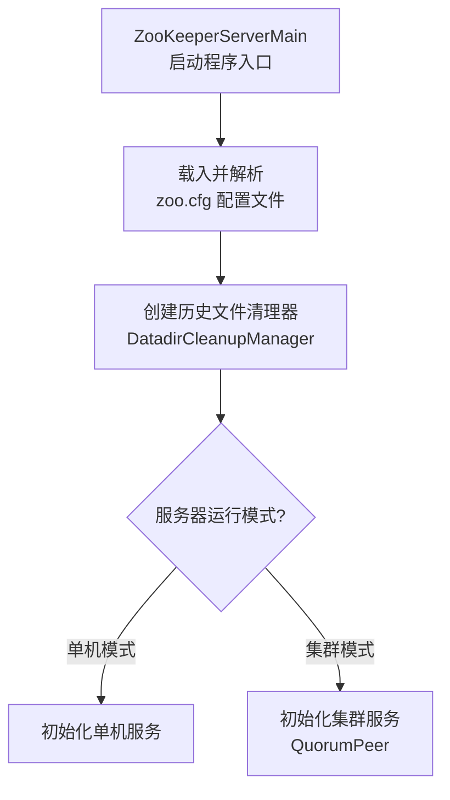
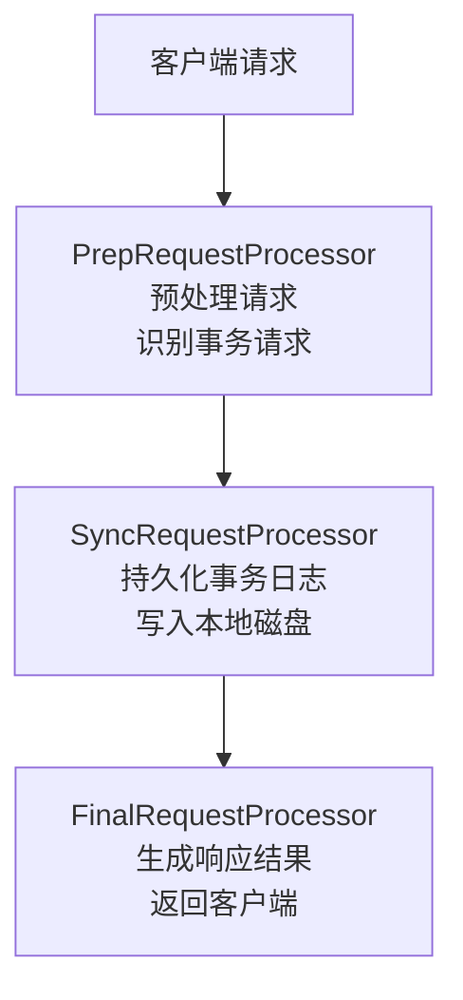

# 服务器启动：单机模式与集群模式

ZooKeeper 服务器存在单机模式与集群模式两种运行方式。单机模式便于理解服务端启动与初始化的完整流程，但无论出于性能优势还是可靠性考虑，生产环境中单机模式都无法满足要求，因此 ZooKeeper 通常以集群方式运行。本文分析单机模式下从启动准备到对外提供服务的完整过程，以及集群模式下启动过程的底层实现。

## 启动准备实现

ZooKeeper 服务初始化之前，首先要对配置文件等信息进行解析和载入。启动准备阶段大体上可分为启动程序入口、zoo.cfg 配置文件解析、创建历史文件清理器等步骤，如下图所示：



> 启动准备阶段：入口启动 → 解析 zoo.cfg 配置 → 创建历史文件清理器，然后根据运行模式（单机/集群）初始化对应的服务器。

### 启动程序入口

QuorumPeerMain 类是 ZooKeeper 服务的启动接口，可以理解为 Java 中的 main 函数。在控制台启动 ZooKeeper 服务时，输入 zkServer.cmd 或 zkServer.sh 命令就是用来启动这个 Java 类。如下代码所示，QuorumPeerMain 类只有一个 `initializeAndRun` 方法，作为所有 ZooKeeper 服务启动逻辑的入口。

```java
package org.apache.zookeeper.server.quorum;
public class QuorumPeerMain {
  ...
  public static void main(String[] args) {
  ...
    main.initializeAndRun(args);
  ...
  }
}

```

### 解析配置文件

ZooKeeper 启动过程中，首先要做的事情是解析配置文件 zoo.cfg。zoo.cfg 是服务端的配置文件，可在其中配置数据目录、端口号等信息，因此解析 zoo.cfg 是 ZooKeeper 服务启动的关键步骤。

### 创建文件清理器

面对大流量网络访问，ZooKeeper 会产生海量的数据，如果磁盘数据过多或磁盘空间不足，会导致 ZooKeeper 服务器不能正常运行，进而影响整个分布式系统。为此，ZooKeeper 采用 `DatadirCleanupManager` 类作为历史文件的清理工具类，并在 3.4.0 版本后增加了自动清理历史数据的功能，以尽量避免磁盘空间的浪费。

如下代码所示，DatadirCleanupManager 类有 5 个属性，其中 snapDir 和 dataLogDir 分别表示数据快照地址以及日志数据的存放地址。

```java
public class DatadirCleanupManager {
    private final File snapDir;
    private final File dataLogDir;
    private final int snapRetainCount;
    private final int purgeInterval;
    private Timer timer;
}

```

日常工作中可以通过在 zoo.cfg 文件中配置以下两个参数实现数据文件的定时清理功能：

| 参数 | 说明 | 默认值 |
|---|---|---|
| autopurge.purgeInterval | 清理频率，以小时为单位，需填写 1 或更大的整数 | 0（表示不开启自动清理功能） |
| autopurge.snapRetainCount | 与上面的参数搭配使用，指定需要保留的文件数目 | 3 |

## 服务初始化

经过配置文件解析等准备阶段后，ZooKeeper 进入服务初始化阶段。初始化阶段可以理解为根据准备阶段解析出的配置信息实例化服务对象，主要工作是创建用于服务统计的工具类，主要包括以下几种：

- ServerStats 类：用于服务运行信息统计。
- FileTxnSnapLog 类：用于数据管理。
- 会话管理类：设置服务器 TickTime 和会话超时时间、创建启动会话管理器等操作。


### ServerStats 创建

ServerStats 类用于统计 ZooKeeper 服务运行时的状态信息，主要统计的数据有服务端向客户端发送的响应包次数、接收到的客户端请求包次数、服务端处理请求的延迟情况以及处理客户端请求的次数。日常运维工作中监控服务器的性能与运行状态等参数，很多都由这个类负责收集。

```java
public class ServerStats {
    private long packetsSent;
    private long packetsReceived;
    private long maxLatency;
    private long minLatency = Long.MAX_VALUE;
    private long totalLatency = 0;
    private long count = 0;
}

```

### FileTxnSnapLog 类

FileTxnSnapLog 类的作用是管理 ZooKeeper 的数据存储等相关操作，可以看作 ZooKeeper 服务层的底层持久化接口。在 ZooKeeper 服务启动过程中，它会根据 zoo.cfg 配置文件中的 dataDir 数据快照目录和 dataLogDir 事务日志目录来创建。

```java
package org.apache.zookeeper.server.persistence;
public class FileTxnSnapLog {
  private final File dataDir;
  private final File snapDir;
  private TxnLog txnLog;
  private SnapShot snapLog;
  private final boolean autoCreateDB;
}

```

### ServerCnxnFactory 类创建

ZooKeeper 中客户端和服务端通过网络通信，本质是通过 Java 的 IO 数据流方式通信。传统 IO 方式存在阻塞等待的问题，而 NIO 框架作为传统 Java IO 框架的替代方案，性能大大优于前者，因此被广泛应用于网络传输的解决方案中。ZooKeeper 最早使用自己实现的 NIO 框架，从 3.4.0 版本后引入了第三方 Netty 等框架来满足不同使用情况的需求。通过 `ServerCnxnFactory` 类可以设置 ZooKeeper 服务器运行时使用的 NIO 框架。如下代码所示，ServerCnxnFactory 类通过 `setZooKeeperServer` 方法绑定服务端实例。

```java
package org.apache.zookeeper.server;
public abstract class ServerCnxnFactory {
final public void setZooKeeperServer(ZooKeeperServer zks) {
    this.zkServer = zks;
    if (zks != null) {
        if (secure) {
            zks.setSecureServerCnxnFactory(this);
        } else {
            zks.setServerCnxnFactory(this);
        }
    }
}

```

通过 ServerCnxnFactory 类指定具体的 NIO 框架类后，ZooKeeper 首先会创建一个线程 Thread 类作为 ServerCnxnFactory 类的启动主线程，之后服务再初始化具体的 NIO 类。此时虽然已经初始化完相关 NIO 类，例如已设置好服务端的对外端口，客户端也能通过 2181 等端口访问到服务端，但 ZooKeeper 服务器还无法处理客户端的请求操作。**这是因为 ZooKeeper 启动后，还需要从本地的快照数据文件和事务日志文件中恢复数据**，之后才真正完成 ZooKeeper 服务的启动。

### 初始化请求处理链

服务启动完成后，ZooKeeper 会初始化请求处理逻辑的相关类，即初始化请求处理链。请求处理链是责任链模式的一种实现：根据不同的客户端请求，ZooKeeper 服务器采用不同的处理逻辑，通过多个请求处理器类依次处理客户端请求中的不同逻辑部分。

单机版服务器的处理逻辑主要由 PrepRequestProcessor、SyncRequestProcessor、FinalRequestProcessor 3 个请求处理器构成。一个请求到达 ZooKeeper 服务端后，严格按照该顺序分别调用这 3 个类处理请求中的对应逻辑，如下图所示。



> ZooKeeper 单机模式采用**责任链模式**处理请求：请求按 `PrepRequestProcessor → SyncRequestProcessor → FinalRequestProcessor` 顺序依次经过三个处理器，分别负责预处理、日志持久化、结果响应。

## 集群模式

### 什么是集群模式

为解决单机模式的性能瓶颈问题并满足系统可靠性的高要求，集群模式被业界普遍采用。集群模式可以简单理解为将单机系统复制成几份，部署在不同主机或网络节点上，构成一个由多台计算机组成的系统"集群"，组成集群的每台服务器叫作集群中的网络节点。

集群收到客户端请求后，需要决定由哪一台机器提供服务，解决这个问题的是"调度者"角色。调度者的工作职责是在集群收到客户端请求后，根据当前集群中机器的使用情况，决定将此次客户端请求交给哪一台服务器或网络节点处理，常见的负载均衡服务器就是一种调度者的实现方式。

### ZooKeeper 集群模式的特点

与一般集群架构不同，ZooKeeper 集群将服务器分成 Leader、Follower、Observer 三种角色服务器，集群运行期间这三种服务器负责的工作各不相同：

- Leader 角色服务器负责管理集群中其他的服务器，是集群中工作的分配和调度者。
- Follower 服务器的主要工作是选举出 Leader 服务器。在发生 Leader 服务器选举时，系统会在 Follower 服务器之间根据多数投票原则，选举出一个 Follower 服务器作为新的 Leader 服务器。
- Observer 服务器主要负责处理来自客户端的获取数据等请求，不参与 Leader 服务器的选举操作，也不会作为候选者被选举为 Leader 服务器。

### 集群启动的底层实现

集群模式的启动过程与单机版有很多相同之处，以下重点介绍集群模式中的特有实现。

#### 程序启动

ZooKeeper 服务启动后，系统调用入口 QuorumPeerMain 类中的 main 函数。main 函数中的 `initializeAndRun` 方法根据 zoo.cfg 配置文件判断服务启动方式是集群模式还是单机模式：函数中首先根据 args 参数和 `config.isDistributed()` 判断，如果配置参数中配置了相关配置项且指定了集群模式运行，服务启动时就会跳转到 `runFromConfig` 函数完成之后的集群模式初始化工作。

```java
protected void initializeAndRun(String[] args){
  ...
  if (args.length == 1 && config.isDistributed()) {
            runFromConfig(config);
        } else {

ZooKeeperServerMain.main(args);
        }
}

```

#### QuorumPeer 类

ZooKeeper 集群模式启动过程中最主要的核心类是 QuorumPeer 类，每个 QuorumPeer 类的实例可以看作集群中的一台服务器。ZooKeeper 集群模式运行中，一个 QuorumPeer 类的实例通常具有 4 种状态：参与 Leader 节点的选举、作为 Follower 节点同步 Leader 节点的数据、作为 Leader 节点管理集群中的 Follower 节点、作为 Observer 节点观察集群状态。

如下面的代码所示，ZooKeeper 服务的启动过程中，首先调用 `runFromConfig` 函数将服务运行过程中需要的核心工具类注册到 QuorumPeer 实例中。这些核心工具包括前文单机版服务启动中介绍的 FileTxnSnapLog 数据持久化类、ServerCnxnFactory 类 NIO 工厂方法等。之后还需要将服务器地址列表、Leader 选举算法、会话超时时间等参数配置到 QuorumPeer 实例中。

```java
public void runFromConfig(QuorumPeerConfig config){
  ServerCnxnFactory cnxnFactory = null;
  ServerCnxnFactory secureCnxnFactory = null;
  ...
  quorumPeer = getQuorumPeer();
  quorumPeer.setElectionType(config.getElectionAlg());
  quorumPeer.setCnxnFactory(cnxnFactory);
  ...
}

```

ZooKeeper 将集群中的机器分为 Leader、Follower、Observer 三种角色，每种角色服务器在集群中起到的作用各不相同：Leader 角色服务器主要负责处理客户端发送的数据变更等事务性请求操作，并管理协调集群中的 Follower 角色服务器；Follower 服务器主要处理客户端的获取数据等非事务性请求操作；Observer 角色服务器的功能与 Follower 服务器相似，唯一的不同是不参与 Leader 头节点服务器的选举工作。

三种角色服务器在服务启动过程中也各有差异，下面以 Leader 角色服务器和 Follower 服务器的启动过程说明各自的底层实现原理。

#### Leader 服务器启动过程

Leader 服务器负责管理集群中其他角色服务器，以及处理客户端的数据变更请求，在整个 ZooKeeper 集群启动过程中，首先要选举出集群中的 Leader 服务器。

ZooKeeper 集群选举 Leader 节点的过程中，首先会根据服务器自身的服务器 ID（SID）、最新的 ZXID 和当前的服务器 epoch（currentEpoch）三个参数生成一个选举标准。之后，ZooKeeper 服务会根据 zoo.cfg 配置文件中的参数，选择参数文件中规定的 Leader 选举算法进行选举操作。ZooKeeper 中提供了三种 Leader 选举算法：LeaderElection、AuthFastLeaderElection、FastLeaderElection，日常开发中可以通过 zoo.cfg 配置文件中的 electionAlg 参数属性指定具体使用的算法类型。

ZooKeeper 集群模式下服务启动后，首先会创建用来选举 Leader 节点的工具类 QuorumCnxManager。下面这段代码给出了 QuorumCnxManager 创建实例时的关键操作：实例化 Listener 对象用于监听 Leader 选举端口。

```java
package org.apache.zookeeper.server.quorum;
public class QuorumCnxManager {
...
  public QuorumCnxManager(QuorumPeer self) {
    String cnxToValue = System.getProperty("zookeeper.cnxTimeout");
    listener = new Listener();
    listener.setName("QuorumPeerListener");
  }
 ...
}

```

Leader 选举的总体过程是在集群中的所有机器中直接进行一次选举投票，选举出一个最适合的机器作为 Leader 节点，具体的评价标准就是上述三种选举算法。从 3.4.0 版本开始，ZooKeeper 只支持 FastLeaderElection 这一种选举算法；没有被选举为 Leader 节点的机器则作为 Follower 或 Observer 节点机器存在。

#### Follower 服务器启动过程

选举出 Leader 节点后，Follower 节点机器在集群模式下的启动过程中，主要工作是与 Leader 节点进行数据同步和交互。Leader 机器启动成功后，Follower 节点机器会主动连接 Leader 节点；在 Leader 这一端，则通过 LearnerCnxAcceptor 类来监听并接收来自集群中 Follower 节点的连接。该类相当于一个接收器，专门用来接收集群中 Follower 节点的连接信息。下面代码中，LearnerCnxAcceptor 类首先初始化要监听的本地地址并设置收到监听后的处理执行方法。

```java
class LearnerCnxAcceptor extends ZooKeeperCriticalThread {
    private volatile boolean stop = false;
    public LearnerCnxAcceptor() {
        super("LearnerCnxAcceptor-" + ss.getLocalSocketAddress(), zk
                .getZooKeeperServerListener());
    }
 }

```

接收到来自 Follower 服务器的连接后，Leader 服务器会为每个连接创建一个 LearnerHandler 类的实例，用来处理与该 Follower 服务器的数据同步等操作。

```java
package org.apache.zookeeper.server.quorum;
public class LearnerHandler extends ZooKeeperThread {
  protected final Socket sock;
  final Leader leader;
  ...
}

```

完成数据同步后，ZooKeeper 集群模式下启动的关键步骤即告完成，整个服务处于运行状态，可以对外提供服务。

## 实践要点

- **磁盘容量规划与清理**：单机版服务器利用 FileTxnSnapLog 类将数据本地化存储时，通过 DatadirCleanupManager 类对历史文件进行清理，可避免过多历史数据占据磁盘空间造成浪费；同时应在 zoo.cfg 中设置 `autopurge.purgeInterval` 与 `autopurge.snapRetainCount` 开启定时清理。
- **集群机器个数选择**：最好遵循奇数原则，最小集群配置是 3 个服务器或节点。Leader 选举和集群运行都要满足"大多数（过半）原则"，而 4 台与 3 台服务器的容错能力相同（都只允许 1 台宕机），采用偶数并不能带来更高的容灾能力，反而浪费一台机器，因此推荐使用奇数台。

## 总结

ZooKeeper 单机模式的启动过程包括启动准备（程序入口 QuorumPeerMain、解析 zoo.cfg、创建 DatadirCleanupManager 历史文件清理器）、服务初始化（ServerStats、FileTxnSnapLog、ServerCnxnFactory、会话管理）、数据恢复与请求处理链（PrepRequestProcessor → SyncRequestProcessor → FinalRequestProcessor）等步骤。理解这些过程有助于分析排查 ZooKeeper 运行中的相关问题，并提高服务器的稳定性与性能。

集群模式将机器分成 Leader、Follower、Observer 三种角色：启动时通过 QuorumPeer 与 QuorumCnxManager 完成 Leader 选举，Follower 通过 LearnerCnxAcceptor 与 LearnerHandler 与 Leader 完成数据同步。当作为 Leader 节点的机器失效时，系统会根据配置文件中的选举算法产生新的 Leader 节点，这种方式避免了一般集群模式中产生的单点失效等问题。

## 版本差异(ZooKeeper 3.6 → 3.8/3.9)

| 特性 | 旧版（本文编写时，3.6.x） | 当前（3.8.x/3.9.x） |
|------|---------------------------|---------------------|
| 稳定版本 | 3.6.x | 3.8.x（LTS）/ 3.9.x |
| Java 支持 | JDK 8 | JDK 8/11/17（3.8+） |
| 客户端 | 原生客户端 | 推荐 Curator 5.x（容器节点、持久递归监听） |
| 监控 | JConsole + 四字母命令 | 3.6+ 实验性 Prometheus 指标端点，3.8+ 完善 |
| 核心机制 | ZAB/Watch/ACL/数据模型 | 原理不变，本文内容依然适用 |

> ZooKeeper 的核心协议（ZAB、Watch、ACL、数据模型）自 3.4 以来保持稳定，本文原理性讲解在 3.8/3.9 中依然适用；部署与监控建议按 3.8/3.9 官方文档更新。
