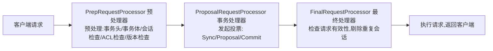
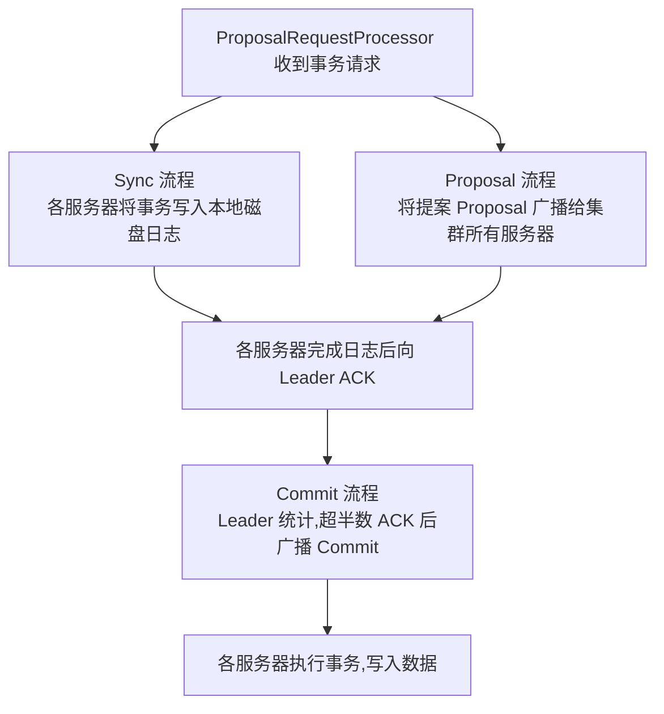

# 服务端是如何处理一次会话请求的？

## 服务端处理过程

ZooKeeper 客户端需要和服务端进行相互协调通信时，首先要建立该客户端与服务端的连接会话。在会话成功创建后，ZooKeeper 服务端就可以接收来自客户端的请求操作了。

ZooKeeper 服务端在处理一次客户端发起的会话请求时，所采用的处理过程很像是一条工厂中的流水生产线。比如在一个毛绒玩具加工厂中，一条生产线上的工人可能只负责给玩具上色这一个具体的工作。



ZooKeeper 处理会话请求的方式也像是一条流水线。在这条流水线上，主要参与工作的是三个"工人"：PrepRequestProcessor、ProposalRequestProcessor 以及 FinalRequestProcessor。这三个"工人"协同工作，最终完成一次会话的处理，其实现方式是责任链模式。

三个处理器的职责划分：

- **PrepRequestProcessor（请求预处理器）**：作为第一个处理会话请求的"工人"，主要负责请求处理的准备工作，比如判断请求是否是事务性相关的请求操作。

- **ProposalRequestProcessor（事务处理器）**：在 PrepRequestProcessor 完成工作后承接接下来的工作，对会话请求是否执行询问 ZooKeeper 服务中的所有服务器，之后执行相关的会话请求操作，变更 ZooKeeper 数据库数据。

- **FinalRequestProcessor（最终处理器）**：所有请求最后到达该处理器，完成踢出重复会话的操作。

## 底层实现

在了解了 ZooKeeper 服务端处理一次会话请求的整体过程后，再从底层实现的角度分析代码层面的实现细节。

### 请求预处理器

在 ZooKeeper 服务端，第一个负责处理请求会话的类是 PrepRequestProcessor。它是 ZooKeeper 责任链处理模式上的第一个处理器。PrepRequestProcessor 实现了 RequestProcessor 接口，并继承了线程类 Thread，说明其可以通过多线程的方式调用。在 PrepRequestProcessor 类内部有一个 RequestProcessor 类型的 nextProcessor 属性字段，从名称上就可以看出该属性字段的作用是指向下一个处理器。

```java
public class PrepRequestProcessor extends Thread implements RequestProcessor {
  RequestProcessor nextProcessor;
}

```

PrepRequestProcessor 类的主要作用是分辨要处理的请求是否是事务性请求，比如创建节点、更新数据、删除节点、创建会话等，这些请求操作都是事务性请求，在执行成功后会对服务器上的数据造成影响。当 PrepRequestProcessor 类收到请求后，如果判断出该条请求操作是事务性请求，就会针对该条请求创建请求事务头、事务体、会话检查、ACL 检查和版本检查等一系列的预处理工作。如下面的代码所示，上述所有操作的逻辑都是在 PrepRequestProcessor 类中的 pRequest 函数实现的。

```java
protected void pRequest(Request request) throws RequestProcessorException {
 switch (request.type) {
    case OpCode.create:
     CreateRequest createRequest = new CreateRequest();
     pRequest2Txn(request.type, zks.getNextZxid(), request,createRequest, true);
     break;
    case OpCode.delete:
 }
}

```

在 pRequest 函数的内部，首先根据 OpCode.create 等字段值来判断请求操作的类型是否是事务操作，如果是事务操作，就调用 pRequest2Txn 函数进行预处理，这之后将该条请求交给 nextProcessor 字段指向的处理器进行处理。

## 事务处理器

PrepRequestProcessor 预处理器执行完工作后，轮到 ProposalRequestProcessor 事务处理器。ProposalRequestProcessor 是责任链模式上的第二个处理器，其主要作用是对事务性的请求操作进行处理。从 ProposalRequestProcessor 处理器的名字中就能大概猜出其具体的工作——"提议"。所谓的"提议"是说：当处理一个事务性请求的时候，ZooKeeper 首先会在服务端发起一次投票流程，该投票的主要作用是通知 ZooKeeper 服务端的各个机器进行事务性的操作，避免因为某个机器出现问题而造成事务不一致等问题。

在 ProposalRequestProcessor 处理器阶段，其内部又分成了三个子流程，分别是：Sync 流程、Proposal 流程、Commit 流程。



### Sync 流程

Sync 流程的底层实现类是 SyncRequestProcessor 类。SyncRequestProcessor 类的作用是在处理事务性请求时，ZooKeeper 服务中的每台机器都将该条请求的操作日志记录下来，完成这个操作后，每一台机器都会向 ZooKeeper 服务中的 Leader 机器发送事务日志记录完成的通知。

### Proposal 流程

在处理事务性请求的过程中，ZooKeeper 需要取得在集群中过半数机器的投票，只有在这种情况下才能真正地将数据改变。Proposal 流程的主要工作就是投票和统计投票结果，投票的方式大体上遵循多数原则（详细机制在 ZAB 协议相关内容中展开）。

### Commit 流程

**需要注意：在完成 Proposal 流程后，ZooKeeper 服务器上的数据不会进行任何改变。** 成功通过 Proposal 流程只是说明 ZooKeeper 服务可以执行事务性的请求操作了，而要真正执行具体数据变更，需要在 Commit 流程中实现，这种实现方式很像是 MySQL 等数据库的操作方式。Commit 流程的主要作用就是完成请求的执行，其底层实现是通过 CommitProcessor 实现的。如下面的代码所示，CommitProcessor 类的内部有一个 LinkedList 类型的 queuedRequests 队列：当 CommitProcessor 收到请求后，并不会立刻对该条请求进行处理，而是将其放在 queuedRequests 队列中。

```java
class CommitProcessor {
  LinkedList queuedRequests;
}

```

之后再调用 commit 方法取出 queuedRequests 队列中等待的请求进行处理，如下面的代码所示：

```java
synchronized public void commit(Request request) {
  committedRequests.add(request);
  notifyAll();
}

```

## 最终处理器

在经过上面一系列的处理过程后，请求最终会到达责任链上的最后一个处理器：FinalRequestProcessor。该处理器的作用是检查请求的有效性。所谓的有效性就是指当前 ZooKeeper 服务所处理的请求是否已经处理过了：如果处理过了，FinalRequestProcessor 处理器就会将该条请求删除；如果不这样操作，就会重复处理会话请求，造成不必要的资源浪费。

## 小结

ZooKeeper 服务端收到一次会话请求的内部处理过程采用责任链设计模式，涉及三个核心类：预处理器 PrepRequestProcessor（判断事务性请求，创建事务头/事务体，执行会话检查、ACL 检查和版本检查）、事务处理器 ProposalRequestProcessor（经 Sync 写日志、Proposal 过半投票、Commit 执行变更三个子流程）、最终处理器 FinalRequestProcessor（检查请求有效性，剔除重复会话请求）。

结合 ZooKeeper 会话相关的完整知识体系，应掌握三个核心问题：**什么是会话、会话都有哪几种状态、会话在服务端的处理过程是怎么实现的**。这三点是理解 ZooKeeper 客户端与服务端通信机制的基础。

## 版本差异(ZooKeeper 3.6 → 3.8/3.9)

| 特性 | 旧版（本文编写时，3.6.x） | 当前（3.8.x/3.9.x） |
|------|---------------------------|---------------------|
| 稳定版本 | 3.6.x | 3.8.x（LTS）/ 3.9.x |
| Java 支持 | JDK 8 | JDK 8/11/17（3.8+） |
| 客户端 | 原生客户端 | 推荐 Curator 5.x（容器节点、持久递归监听） |
| 监控 | JConsole + 四字母命令 | 3.6+ 实验性 Prometheus 指标端点，3.8+ 完善 |
| 核心机制 | ZAB/Watch/ACL/数据模型 | 原理不变，本文内容依然适用 |

> ZooKeeper 的核心协议（ZAB、Watch、ACL、数据模型）自 3.4 以来保持稳定，本文原理性讲解在 3.8/3.9 中依然适用；部署与监控建议按 3.8/3.9 官方文档更新。
