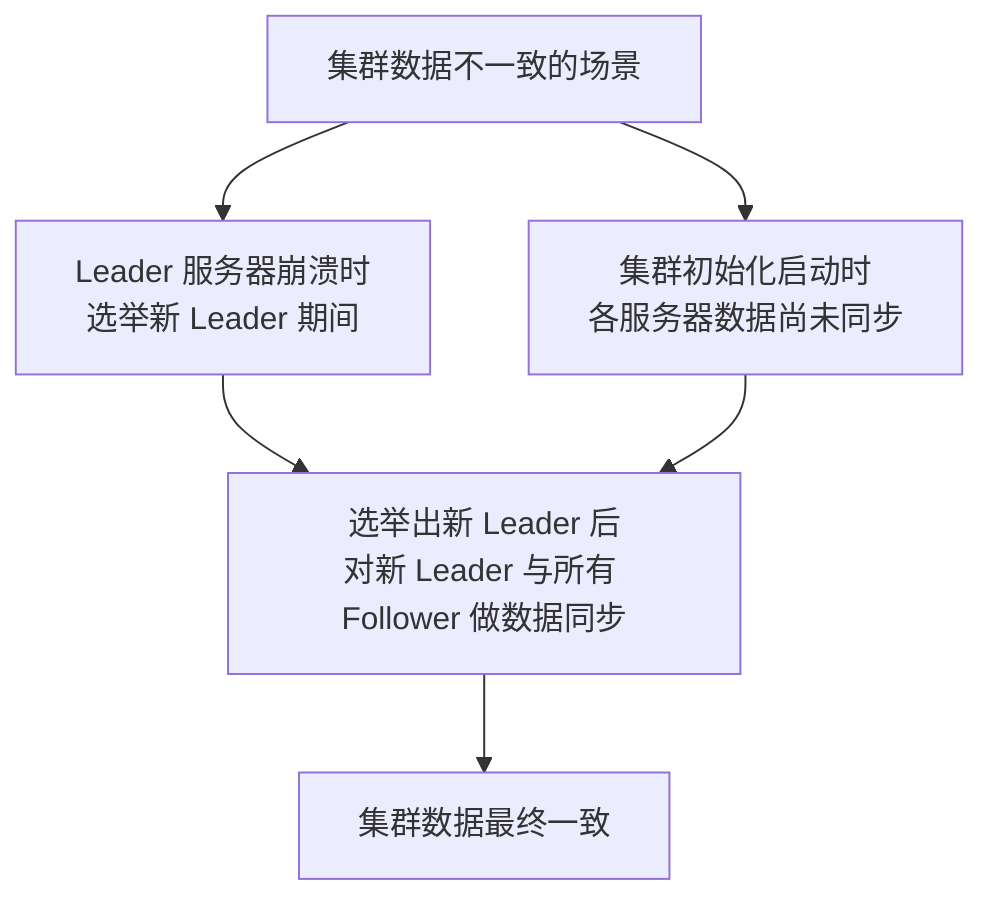
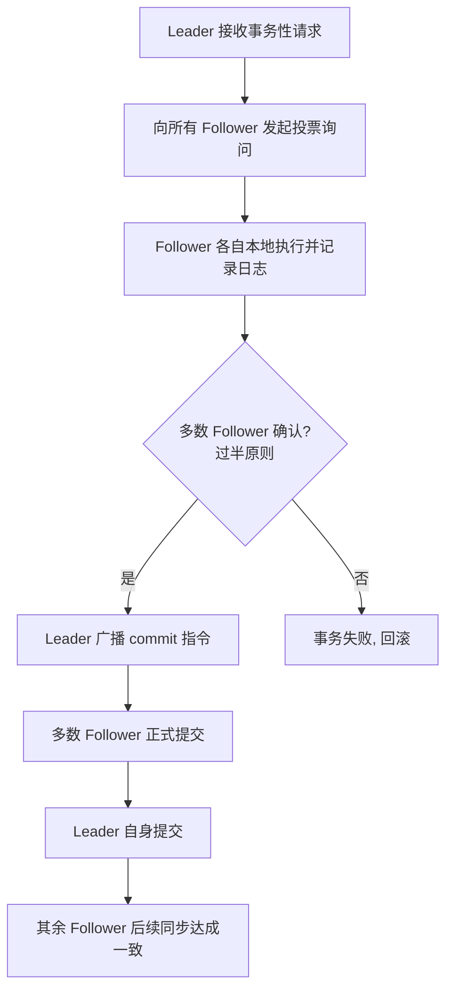
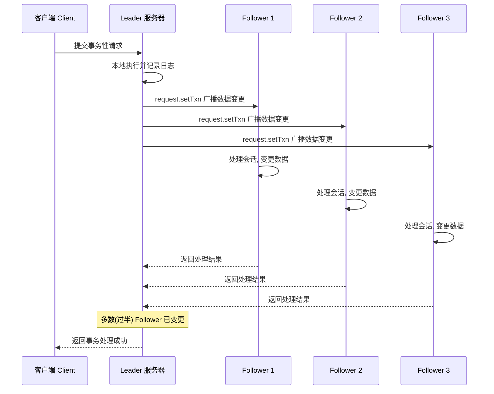

# Leader 选举与数据同步：如何保证分布式数据的一致性？

在 ZooKeeper 集群中，服务器分为 Leader 服务器、Follower 服务器以及 Observer 服务器三种角色。

可以这样认为，Leader 选举是一个过程，在这个过程中 ZooKeeper 主要做了两个重要工作：一个是选举出新的 Leader 服务器，另一个是数据同步。本文先阐述 Leader 服务器"是如何产生的"，再介绍选举之后集群如何通过数据同步保证最终一致性。

## Leader 的协调过程

在分布式系统中有一个著名的 CAP 定理，即一个分布式系统不能同时满足一致性、可用性，以及分区容错性。本节聚焦的就是其中的一致性。ZooKeeper 中实现的一致性并不是强一致性（即集群中各个服务器上的数据每时每刻都保持一致的特性），而是采用最终一致的特性，**即经过一段时间后，ZooKeeper 集群服务器上的数据最终保持一致的特性**。

在 ZooKeeper 集群中，Leader 服务器主要负责处理事务性的请求。在接收到一个客户端的事务性请求操作时，Leader 服务器会先向集群中的各个机器针对该条会话发起投票询问。

要实现 ZooKeeper 集群中的最终一致性，首先需要确定什么情况下会对 ZooKeeper 集群服务产生不一致的情况，主要有两种场景：



> 数据不一致主要发生在**集群初始化**和 **Leader 崩溃重选**两种场景，解决方式都是通过**数据同步**恢复到最终一致。

在集群初始化启动的时候，首先要同步集群中各个服务器上的数据；而在集群中 Leader 服务器崩溃时，需要选举出新的 Leader，在这一过程中会导致各个服务器上数据的不一致，所以当选举出新的 Leader 服务器后需要进行数据的同步操作。

## Leader 服务器的选举原理

Leader 服务器的作用是管理 ZooKeeper 集群中的其他服务器。因此，如果是单独一台服务器，不构成集群规模，在 ZooKeeper 服务的运行中不会选举 Leader 服务器，也不会作为 Leader 服务器运行。一个 ZooKeeper 服务要想以集群方式运行，至少需要三台服务器。下面以三台服务器组成的 ZooKeeper 集群为例，介绍 Leader 服务器选举的内部过程和底层实现。

Leader 服务器的选举操作主要发生在两种情况下：第一种是 ZooKeeper 集群服务启动的时候，第二种是 ZooKeeper 集群中旧的 Leader 服务器失效时，这时 ZooKeeper 集群需要选举出新的 Leader 服务器。

先来看 ZooKeeper 集群服务最初启动时，Leader 服务器是如何选举的。在 ZooKeeper 集群启动时，需要在集群中的服务器之间确定一台 Leader 服务器。当 ZooKeeper 集群中的三台服务器启动之后，首先会进行通信检查，如果集群中的服务器之间能够进行通信，集群中的三台机器开始尝试寻找集群中的 Leader 服务器并进行数据同步等操作。如果这时没有搜索到 Leader 服务器，说明集群中不存在 Leader 服务器，这时 ZooKeeper 集群开始发起 Leader 服务器选举。整个 ZooKeeper 集群中 Leader 选举主要可以分为三大步骤：发起投票、接收投票、统计投票。

```mermaid
flowchart TD
  A[集群服务器启动] --> B[进行通信检查,寻找已有 Leader]
  B --> C{找到 Leader?}
  C -- 是 --> D[与 Leader 进行数据同步]
  C -- 否 --> E[发起 Leader 选举]
  E --> F[1. 发起投票<br/>每台服务器投自己,如(1,0)/(2,0)/(3,0)]
  F --> G[2. 接收投票<br/>服务器间交换投票信息]
  G --> H[3. 统计投票<br/>对比 ZXID 与 myid 选出 Leader]
  H --> I[选出新 Leader,进入 FOLLOWING/LEADING 状态]
```

### 发起投票

在 ZooKeeper 服务器集群初始化启动的时候，集群中的每一台服务器都会将自己作为 Leader 服务器进行投票。**也就是每次投票时，发送的服务器的 myid（服务器标识符）和 ZXID（服务器上最新的事务 ID）等选票信息字段都指向本机服务器。** 一个投票信息就是通过这两个字段组成的。以集群中三个服务器 Serverhost1、Serverhost2、Serverhost3 为例，三个服务器的投票内容分别是：Serverhost1 的投票是（1，0）、Serverhost2 服务器的投票是（2，0）、Serverhost3 服务器的投票是（3，0）。

### 接收投票

集群中各个服务器在发起投票的同时，也通过网络接收来自集群中其他服务器的投票信息。

在接收到网络中的投票信息后，服务器内部首先会判断该条投票信息的有效性：检查该条投票信息的时效性，是否是本轮最新的投票；并检查该条投票信息是否是处于 LOOKING 状态的服务器发出的。

### 统计投票

在接收到投票后，ZooKeeper 集群就该处理和统计投票结果了。对于每条接收到的投票信息，集群中的每一台服务器都会将自己的投票信息与其接收到的 ZooKeeper 集群中的其他投票信息进行对比。主要对比的内容是 ZXID，ZXID 数值比较大的投票信息优先作为 Leader 服务器；如果每个投票信息中的 ZXID 相同，就会接着比对投票信息中的 myid 信息字段，选举出 myid 较大的服务器作为 Leader 服务器。

拿上面三个服务器组成的集群例子来说：对于 Serverhost1，其投票信息是（1，0），接收到的 Serverhost2 服务器的投票信息是（2，0）。在 ZooKeeper 集群服务运行的过程中，首先对比 ZXID，发现结果相同之后对比 myid，发现 Serverhost2 服务器的 myid 比较大，于是 Serverhost1 更新自己的投票信息为（2，0），并重新向 ZooKeeper 集群中的服务器发送新的投票信息；而 Serverhost2 服务器则保留自身的投票信息，并重新向 ZooKeeper 集群服务器发送投票信息。

每轮投票过后，ZooKeeper 服务都会统计集群中服务器的投票结果，判断是否有过半数的机器投出一样的信息。如果存在过半数投票信息指向的服务器，那么该台服务器就被选举为 Leader 服务器。在上面举的例子中，ZooKeeper 集群会选举 Serverhost2 服务器作为 Leader 服务器。


当 ZooKeeper 集群选举出 Leader 服务器后，ZooKeeper 集群中的服务器就开始更新自己的角色信息，**除被选举成 Leader 的服务器之外，其他集群中的服务器角色变更为 Following。**

### 服务运行时的 Leader 选举

上面介绍的是 ZooKeeper 集群启动时 Leader 服务器的选举方法。再看在 ZooKeeper 集群服务的运行过程中，Leader 服务器是如何进行选举的。

在 ZooKeeper 集群服务的运行过程中，Leader 服务器作为处理事务性请求以及管理其他角色服务器的角色，在 ZooKeeper 集群中起到关键的作用。当 ZooKeeper 集群中的 Leader 服务器发生崩溃时，集群会暂停处理事务性的会话请求，直到 ZooKeeper 集群中选举出新的 Leader 服务器。整个 ZooKeeper 集群在重新选举 Leader 时经过四个过程，分别是变更服务器状态、发起投票、接收投票、统计投票。其中，与初始化启动时 Leader 服务器的选举过程相比，变更状态和发起投票这两个阶段的实现是不同的。

与 ZooKeeper 集群服务器初始化阶段不同，在 ZooKeeper 集群服务运行的过程中，集群中每台服务器的角色已经确定。当 Leader 服务器崩溃后，ZooKeeper 集群中的其他服务器会首先将自身的状态信息变为 LOOKING 状态，该状态表示服务器已经做好选举新 Leader 服务器的准备，这之后整个 ZooKeeper 集群开始进入选举新的 Leader 服务器过程。

重新选举 Leader 服务器的过程中，发起投票的过程与初始化启动时基本相同：首先每个集群中的服务器都会投票给自己，将投票信息中的 ZXID 和 myid 分别指向本机服务器。

## 一致性的底层实现：多数原则与数据同步

底层实现的讲解主要围绕 ZooKeeper 集群中数据一致性的底层实现。ZooKeeper 在集群中采用的是多数原则方式，即**当一个事务性的请求导致服务器上的数据发生改变时，ZooKeeper 只要保证集群上的多数机器的数据都正确变更了，就可以保证系统数据的一致性。** 这是因为在一个 ZooKeeper 集群中，每一个 Follower 服务器都可以看作是 Leader 服务器的数据副本，需要保证集群中大多数机器数据是一致的，这样在集群中出现个别机器故障的时候，ZooKeeper 集群依然能够保证稳定运行。

在 ZooKeeper 集群服务的运行过程中，数据同步的过程如下图所示。当执行完数据变更的会话请求时，需要对集群中的服务器进行数据同步：



> ZooKeeper 采用**多数原则（过半）**保证一致性：只要多数 Follower 确认，Leader 即广播 commit，最终所有服务器数据趋于一致（最终一致性）。

### 广播模式

广播模式下，Leader 通过 `setTxn` 向 Follower 广播数据变更请求，实现数据同步：



> 广播模式下 Leader 作为"客户端"向所有 Follower 广播变更请求，过半 Follower 变更后即视为事务成功，其余随后同步。

ZooKeeper 在代码层的实现中定义了一个 HashSet 类型的变量，用来管理在集群中的 Follower 服务器，之后调用 getForwardingFollowers 函数获取在集群中的 Follower 服务器，如下面这段代码所示：

```java
public class Leader {
 HashSet<LearnerHandler> forwardingFollowers;
 public List<LearnerHandler> getForwardingFollowers() {
   synchronized (forwardingFollowers) {
       return new ArrayList<LearnerHandler>(forwardingFollowers);
 }
}

```

在 ZooKeeper 集群服务器对一个事务性的请求操作进行投票并通过后，Leader 服务器执行 isQuorumSynced 方法判断该 ZooKeeper 集群中的 Follower 节点的连接状态。由于 isQuorumSynced 方法可以被多个线程进行调用，所以在进行操作的时候要通过 forwardingFollowers 字段进行加锁操作。之后遍历集群中的 Follower 服务器，根据服务器 zxid、以及数据同步状态等条件判断服务器的执行逻辑是否成功，之后统计 Follower 服务器的 sid 并判断是否已满足过半原则。

```java
public boolean isQuorumSynced(QuorumVerifier qv) {
  HashSet<Long> ids = new HashSet<Long>();
  synchronized (forwardingFollowers) {
   for (LearnerHandler learnerHandler: forwardingFollowers){
       if(learnerHandler.synced()){
         ids.add(learnerHandler.getSid());
       }
   }
  }
  return qv.containsQuorum(ids);
}

```

经过上述过程，Leader 服务器在集群中已经完成确定 Follower 服务器状态等同步数据前的准备工作。接下来 Leader 服务器会通过 request.setTxn 方法向集群中的 Follower 服务器发送数据变更的会话请求。这个过程中，Leader 服务器可以看作是 ZooKeeper 服务中的客户端，其向集群中 Follower 服务器发送数据更新请求，集群中的 Follower 服务器收到请求后会处理该会话，之后进行数据变更操作。如下面的代码所示，在底层实现中，通过调用 request 请求对象的 setTxn 方法向 Follower 服务器发送请求，在 setTxn 函数中传入的参数有 ZooDefs.CONFIG_NODE（即 /zookeeper/config 集群配置节点的路径）以及集群配置信息，表明该操作是对集群配置节点的数据写入操作。

```java
request.setTxn(new SetDataTxn(ZooDefs.CONFIG_NODE, request.qv.toString().getBytes(), -1));

```

### 恢复模式

当 Leader 服务器崩溃后，ZooKeeper 集群也需要进行数据的恢复和同步。

当 ZooKeeper 集群中一个 Leader 服务器失效时，会重新在 Follower 服务器中选举出一个新的服务器作为 Leader 服务器。而 ZooKeeper 服务往往处在高并发的使用场景中，如果在这个过程中有新的事务性请求操作，应该如何处理呢？由于此时集群中不存在 Leader 服务器了，理论上 ZooKeeper 会直接丢失该条请求、会话不进行处理，但这样做在实际的生产中显然不可行。ZooKeeper 的具体做法如下。

在 ZooKeeper 中，重新选举 Leader 服务器会经历一段时间，因此理论上在 ZooKeeper 集群中会短暂地没有 Leader 服务器。在这种情况下接收到事务性请求操作时，ZooKeeper 服务会先将这个会话进行挂起操作，挂起的会话不会计算会话的超时时间，之后在 Leader 服务器产生后系统会同步执行这些会话操作。

综上，ZooKeeper 集群在处理一致性问题的时候基本采用了两种方式来协调集群中的服务器工作，分别是恢复模式和广播模式。

- **恢复模式**：当 ZooKeeper 集群中的 Leader 服务器崩溃后，ZooKeeper 集群就采用恢复模式的方式进行工作。在这个过程中，ZooKeeper 集群会首先进行 Leader 节点服务器的重新选择，之后在选举出 Leader 服务器后对系统中所有的服务器进行数据同步，进而保证集群中服务器上数据的一致性。

- **广播模式**：当 ZooKeeper 集群中具有 Leader 服务器并且可以正常工作时，集群中又有新的 Follower 服务器加入 ZooKeeper 参与工作，这种情况常常发生在系统性能到达瓶颈、进而对系统进行动态扩容的使用场景。在这种情况下，如果不做任何操作，那么新加入的服务器作为 Follower 服务器，其上的数据与 ZooKeeper 集群中其他服务器上的数据不一致。当有新的查询会话请求发送到 ZooKeeper 集群进行处理，而恰巧该请求实际被分发给这台新加入的 Follower 机器进行处理，就会导致明明在集群中存在的数据在这台服务器上却查询不到，出现数据查询不一致的情况。因此，当有新的 Follower 服务器加入 ZooKeeper 集群时，该台服务器会在恢复模式下启动，并找到集群中的 Leader 节点服务器，同该 Leader 服务器进行数据同步。

### LearnerHandler

在代码层面，数据同步由 LearnerHandler 类实现。LearnerHandler 类可以看作是所有 Learner 服务器内部工作的处理者，它所负责的工作有：进行 Follower、Observer 服务器与 Leader 服务器的数据同步、事务性会话请求的转发以及 Proposal 提议投票等功能。

LearnerHandler 是一个多线程的类，在 ZooKeeper 集群服务运行过程中，一个 Follower 或 Observer 服务器就对应一个 LearnerHandler。在集群服务器彼此协调工作的过程中，Leader 服务器会与每一个 Learner 服务器维持一个长连接，并启动一个单独的 LearnerHandler 线程进行处理。

如下面的代码所示，在 LearnerHandler 线程类中，最核心的方法就是 run 方法，处理数据同步等功能都在该方法中进行调用。首先通过 syncFollower 函数判断数据同步的方式是否是快照方式。如果是快照方式，就将 Leader 服务器上的数据快照序列化后发送给 Follower 等服务器，在 Follower 等服务器接收到数据快照后，在本地加载并恢复该快照，最终完成数据的同步操作。

```java
public void run() {
  boolean needSnap = syncFollower(peerLastZxid, leader.zk.getZKDatabase(), leader);
  if(needSnap){
    leader.zk.getZKDatabase().serializeSnapshot(oa);
    oa.writeString("BenWasHere", "signature");
    bufferedOutput.flush();
  }
}

```

通过操作日志的方式进行数据同步或备份的操作已经是行业中普遍采用的方式，例如 MySQL、Redis 等数据库也是采用操作日志的方式。

## Leader 选举的底层实现

在理解选举过程之后，深入 ZooKeeper 底层来看选举底层实现的关键步骤。

ZooKeeper 中实现的选举算法有三种，而实际上从 3.4.0 版本开始，ZooKeeper 就只支持"快速选举"这一种算法。在代码层面的实现中，QuorumCnxManager 作为核心的实现类，用来管理 Leader 服务器与 Follower 服务器的 TCP 通信，以及消息的接收与发送等功能。在 QuorumCnxManager 中，主要定义了 ConcurrentHashMap<Long, SendWorker> 类型的 senderWorkerMap 数据字段，用来管理每一个通信的服务器。

```java
public class QuorumCnxManager {
  final ConcurrentHashMap<Long, SendWorker> senderWorkerMap;
final ConcurrentHashMap<Long, ArrayBlockingQueue<ByteBuffer>> queueSendMap;
final ConcurrentHashMap<Long, ByteBuffer> lastMessageSent;
}

```

而在 QuorumCnxManager 类的内部，定义了 RecvWorker 内部类。该类继承了一个 ZooKeeperThread 类的多线程类，主要负责消息接收。在 ZooKeeper 的实现中，为每一个集群中的通信服务器都分配一个 RecvWorker，负责接收来自其他服务器发送的信息。在 RecvWorker 的 run 函数中，不断从 Socket 的输入流中读取消息，并加入接收队列 recvQueue 中。

```java
class RecvWorker extends ZooKeeperThread {
  Long sid;
  Socket sock;
  volatile boolean running = true;
  DataInputStream din;
  final SendWorker sw;
  public void run() {
  threadCnt.incrementAndGet();
  while (running && !shutdown && sock != null) {
    int length = din.readInt();
    if (length <= 0 || length > PACKETMAXSIZE) {
        throw new IOException(
                "Received packet with invalid packet: "
                        + length);
    }

byte[] msgArray = new byte[length];
    din.readFully(msgArray, 0, length);
    ByteBuffer message = ByteBuffer.wrap(msgArray);
    addToRecvQueue(new Message(message.duplicate(), sid));
  }

}
}

```

除了接收信息的功能外，QuorumCnxManager 内还定义了一个 SendWorker 内部类用来向集群中的其他服务器发送投票信息。如下面的代码所示，在 SendWorker 类中，不会立刻将投票信息发送到 ZooKeeper 集群中，而是将投票信息首先插入到 queueSendMap 中对应的发送队列，之后通过 pollSendQueue 方法取出并通过 send 函数进行发送。

```java
class SendWorker extends ZooKeeperThread {
  Long sid;
  Socket sock;
  RecvWorker recvWorker;
  volatile boolean running = true;
  DataOutputStream dout;
  public void run() {
    while (running && !shutdown && sock != null) {
    ByteBuffer b = null;
    try {
        ArrayBlockingQueue<ByteBuffer> bq = queueSendMap
                .get(sid);
        if (bq != null) {
            b = pollSendQueue(bq, 1000, TimeUnit.MILLISECONDS);
        } else {
            LOG.error("No queue of incoming messages for " +
                      "server " + sid);
            break;
        }
        if(b != null){
            lastMessageSent.put(sid, b);
            send(b);
        }
    } catch (InterruptedException e) {
        LOG.warn("Interrupted while waiting for message on queue",
                e);
    }
}
  }
}

```

实现了投票信息的发送与接收后，接下来看如何处理投票结果。在 ZooKeeper 的底层，这是通过 FastLeaderElection 类实现的。如下面的代码所示，在 FastLeaderElection 的内部，定义了最大通信间隔 maxNotificationInterval、服务器等待时间 finalizeWait 等属性配置。

```java
public class FastLeaderElection implements Election {
  final static int maxNotificationInterval = 60000;
  final static int IGNOREVALUE = -1;
  QuorumCnxManager manager;
}

```

在 ZooKeeper 底层通过 getVote 函数来设置本机的投票内容，如下面的代码所示，在 getVote 中通过 proposedLeader 服务器信息、proposedZxid 服务器 ZXID、proposedEpoch 投票轮次等信息封装投票信息。

```java
synchronized public Vote getVote(){
    return new Vote(proposedLeader, proposedZxid, proposedEpoch);
 }

```

在完成投票信息的封装以及投票信息的接收和发送后，一个 ZooKeeper 集群中 Leader 服务器选举底层实现的关键步骤就介绍完了。Leader 节点的底层实现过程的逻辑相对来说比较简单，基本分为封装投票信息、发送投票、接收投票等。

## 实践要点

- Leader 选举只发生在集群初始化和旧 Leader 失效两种场景，选举对比规则为先比 ZXID（数据新旧）、再比 myid（服务器标识），并以过半投票为当选条件。
- 旧 Leader 服务器崩溃后能否参与投票、能否再次当选，取决于其运行状态：若可正常运行且能与集群其他服务器通信，则可参与选举，满足条件时也可再次当选。
- Leader 崩溃期间的事务性会话会被挂起且不计算超时时间，待新 Leader 产生后统一执行；选举过程本身非常快速，不会造成大量会话积压，对集群性能影响有限。
- 集群扩容加入的新 Follower 以恢复模式启动并先与 Leader 完成数据同步，否则分发到该节点的查询会得到不一致结果。
- 数据同步的核心代码路径：Leader 侧 forwardingFollowers/isQuorumSynced（过半判断）→ setTxn 广播变更 → LearnerHandler.run 的 syncFollower/快照序列化（快照同步）。

## 总结

ZooKeeper 集群通过 Leader 选举与数据同步保证数据的一致性，Leader 服务器在集群中起到协调和管理其他角色服务器的作用。Leader 选举一般发生在 ZooKeeper 集群服务初始化和集群中旧的 Leader 服务器崩溃时，选举保证了 ZooKeeper 集群运行的可靠性；当旧的 Leader 服务器发生崩溃时，需要重新选举出新的 Leader 服务器以保证集群服务的稳定性。

集群在处理一致性时采用两种协调方式：恢复模式（Leader 崩溃后重新选举并数据同步）与广播模式（正常工作中通过多数原则同步事务变更），两者配合实现了最终一致性。

## 版本差异(ZooKeeper 3.6 → 3.8/3.9)

| 特性 | 旧版（本文编写时，3.6.x） | 当前（3.8.x/3.9.x） |
|------|---------------------------|---------------------|
| 稳定版本 | 3.6.x | 3.8.x（LTS）/ 3.9.x |
| Java 支持 | JDK 8 | JDK 8/11/17（3.8+） |
| 客户端 | 原生客户端 | 推荐 Curator 5.x（容器节点、持久递归监听） |
| 监控 | JConsole + 四字母命令 | 3.6+ 实验性 Prometheus 指标端点，3.8+ 完善 |
| 核心机制 | ZAB/Watch/ACL/数据模型 | 原理不变，本文内容依然适用 |

> ZooKeeper 的核心协议（ZAB、Watch、ACL、数据模型）自 3.4 以来保持稳定，本文原理性讲解在 3.8/3.9 中依然适用；部署与监控建议按 3.8/3.9 官方文档更新。
