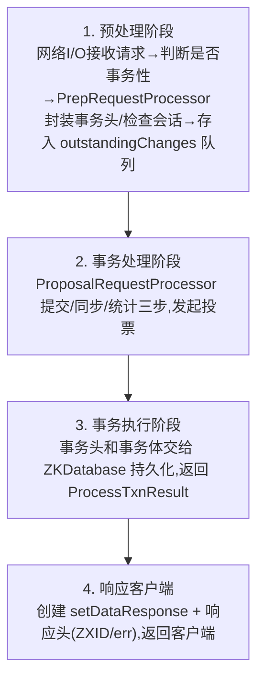

# 集群中的角色服务器：Leader、Follower 与 Observer

ZooKeeper 集群中的三种角色服务器各有分工：Leader 服务器负责处理事务性的会话请求以及管理集群中的其他角色服务器，Follower 服务器负责处理非事务请求并参与 Leader 选举，Observer 服务器则提供只读扩展。本文围绕两个核心问题展开：ZooKeeper 集群在接收到来自客户端的会话请求后，内部如何判断会话的请求类型；事务性请求又是如何转发与处理的。

## Leader：事务性请求处理

ZooKeeper 集群接收到来自客户端的会话请求操作后，首先会判断该条请求是否是事务性的会话请求。对于事务性的会话请求，ZooKeeper 集群服务端会将该请求统一转发给 Leader 服务器进行操作。Leader 服务器内部执行该条事务性的会话请求后，再将数据同步给其他角色服务器，从而保证事务性会话请求的执行顺序，进而保证整个 ZooKeeper 集群的数据一致性。

在 ZooKeeper 集群内部实现中，除 Leader 服务器外的其他角色服务器接收到来自客户端的事务性会话请求后，必须将该条会话请求转发给 Leader 服务器进行处理。ZooKeeper 集群中的 Follower 和 Observer 服务器都会检查当前接收到的会话请求是否是事务性的请求：如果是事务性的请求，那么就将该请求以 REQUEST 消息类型转发给 Leader 服务器。

ZooKeeper 集群中的服务器接收到该条消息后，会对该条消息进行解析，分析出该条消息所包含的原始客户端会话请求，之后将该条消息提交到自己的 Leader 服务器请求处理链中，开始进行事务性的会话请求操作。如果不是事务性请求，ZooKeeper 集群则交由 Follower 和 Observer 角色服务器处理该条会话请求，如查询数据节点信息。

### setData 请求的四阶段处理

以客户端发起的数据节点更新请求 setData 为例，ZooKeeper 集群接收来自客户端的一个 setData 会话请求后，其内部的处理逻辑基本可以分成四个部分：预处理阶段、事务处理阶段、事务执行阶段、响应客户端。



**预处理阶段**：主要工作是通过网络 I/O 接收来自客户端的会话请求，判断该条会话请求的类型是否是事务性的会话请求，之后将该请求提交给 PrepRequestProcessor 处理器进行处理：封装请求事务头并检查会话是否过期，最后反序列化事务请求信息创建 setDataRequest 请求。setDataRequest 记录中包含了要更新数据的节点的路径、数据节点的内容信息以及数据节点的版本信息。最后将该请求存放在 outstandingChanges 队列中等待之后的处理。

**事务处理阶段**：ZooKeeper 集群内部会将该条会话请求提交给 ProposalRequestProcessor 处理器进行处理。本阶段内部又分为提交、同步、统计三个步骤，具体处理过程在前文数据同步部分已经介绍过，不再赘述。

**事务执行阶段**：在经过预处理阶段和事务会话的投票发起等操作后，一个事务性的会话请求都已经准备好了，接下来就是在 ZooKeeper 的数据库中执行该条会话的数据变更操作。在处理数据变更的过程中，ZooKeeper 内部会将该请求会话的事务头和事务体信息直接交给内存数据库 ZKDatabase 进行事务性的持久化操作，之后返回 ProcessTxnResult 对象表明操作结果是否成功。

**响应客户端**：ZooKeeper 集群处理完客户端 setData 方法发送的数据节点更新请求后，会将处理结果发送给客户端。响应客户端的过程中，ZooKeeper 内部首先会创建一个 setDataResponse 响应体类型，该对象主要包括当前会话请求所创建的数据节点，以及其最新状态字段信息 stat；之后创建请求响应头信息。响应头作为客户端请求响应的重要信息，客户端在接收到 ZooKeeper 集群的响应后，通过解析响应头信息中的事务 ZXID 和请求结果标识符 err 来判断该条会话请求是否成功执行。

### Leader 事务处理的底层实现

从代码层面分析 ZooKeeper 在处理事务性请求时的底层核心代码实现。

ZooKeeper 集群在收到客户端发送的事务性会话请求后，会对该请求进行预处理。在代码层面，ZooKeeper 通过调用 PrepRequestProcessor 类来实现预处理阶段的全部逻辑：**在处理客户端会话请求的时候，首先调用的就是 PrepRequestProcessor 类**。而在 PrepRequestProcessor 内部，是通过 pRequest 方法判断客户端发送的会话请求类型。如果是诸如 setData 数据节点创建等事务性的会话请求，就调用 pRequest2Txn 方法进一步处理。

```java
protected void pRequest(Request request){
...
  switch (request.type) {
  case OpCode.setData:
    SetDataRequest setDataRequest = new SetDataRequest();
    pRequest2Txn(request.type, zks.getNextZxid(), request, setDataRequest, true);
    break;
   }
}

```

在 pRequest2Txn 方法的内部，实现了预处理阶段的主要逻辑。如下面的代码所示：首先通过 checkSession 方法检查该条会话请求是否有效（比如会话是否过期等），之后调用 checkACL 检查发起会话操作的客户端在 ZooKeeper 服务端是否具有相关操作的权限。最后将该条会话创建的相关信息，诸如 path 节点路径、data 节点数据信息、version 节点版本信息等字段封装成 setDataRequest 类型并传入到 setTxn 方法中，最后加入处理链中进行处理。

```java
case OpCode.setData:
    zks.sessionTracker.checkSession(request.sessionId, request.getOwner());
    SetDataRequest setDataRequest = (SetDataRequest)record;
    if(deserialize)
        ByteBufferInputStream.byteBuffer2Record(request.request, setDataRequest);
    path = setDataRequest.getPath();
    validatePath(path, request.sessionId);
    nodeRecord = getRecordForPath(path);
    checkACL(zks, request.cnxn, nodeRecord.acl, ZooDefs.Perms.WRITE, request.authInfo, path, null);
    int newVersion = checkAndIncVersion(nodeRecord.stat.getVersion(), setDataRequest.getVersion(), path);
    request.setTxn(new SetDataTxn(path, setDataRequest.getData(), newVersion));
    nodeRecord = nodeRecord.duplicate(request.getHdr().getZxid());
    nodeRecord.stat.setVersion(newVersion);
    addChangeRecord(nodeRecord);

```

## Follower：非事务请求处理与 Leader 选举

Follower 服务器在 ZooKeeper 集群中有两大职责：处理来自客户端的查询等非事务性请求，以及在 Leader 服务器崩溃时作为投票者重新选举出新的 Leader 服务器。

### 非事务性请求处理过程

ZooKeeper 集群接收到来自客户端的请求后，会首先判断该会话请求的类型，如是否是事务性请求。**所谓事务性请求，是指 ZooKeeper 服务器执行完该条会话请求后，是否会导致执行该条会话请求的服务器的数据或状态发生改变，进而导致与其他集群中的服务器出现数据不一致的情况**。

以客户端发起的数据节点查询请求为例，分析 ZooKeeper 在处理非事务性请求时的实现过程。

当 ZooKeeper 集群接收到来自客户端发送的查询会话请求后，会将该客户端请求分配给 Follower 服务器进行处理。而在 Follower 服务器的内部，也采用了责任链的处理模式来处理来自客户端的每一个会话请求。

Leader 服务器的处理链过程包含预处理器阶段、Proposal 提交处理器阶段以及 Final 处理器阶段。与 Leader 处理流程不同的是，在 Follower 角色服务器的处理链执行过程中，FollowerRequestProcessor 作为第一个处理器，主要负责筛选该条会话请求是否是事务性的会话请求：如果是事务性的会话请求，则转发给 Leader 服务器进行操作；如果不是事务性的会话请求，则交由 Follower 服务器处理链上的下一个处理器进行处理。

下一个处理器是 CommitProcessor，该处理器的作用是对来自集群中其他服务器的事务性请求和本地服务器的提交请求操作进行匹配。匹配的方式是，将本地执行的 submit 提交请求，与集群中其他服务器接收到的 Commit 会话请求进行匹配，匹配完成后再交由 Follower 处理链上的下一个处理器进行处理。最终，当一个客户端会话经过 Final 处理器操作后，就完成了整个 Follower 服务器的会话处理过程，并将结果响应给客户端。

### Follower 处理链的底层实现

从代码实现的角度讲，ZooKeeper 集群在接收到来自客户端的请求后，会将请求交给 Follower 服务器进行处理。而 Follower 服务器内部首先调用的是 FollowerZooKeeperServer 类，**该类封装了 Follower 服务器的属性和行为，相当于一台 Follower 服务器的代码抽象**。

如下图所示，FollowerZooKeeperServer 类继承了 LearnerZooKeeperServer。在一个 FollowerZooKeeperServer 类内部，定义了一个核心的 ConcurrentLinkedQueue 类型的队列字段，用于存放接收到的会话请求。


在定义了 FollowerZooKeeperServer 类之后，在该类的 setupRequestProcessors 函数中，定义了处理责任链，指定了该处理链上的各个处理器。如下面的代码所示，分别按顺序定义了起始处理器 FollowerRequestProcessor、提交处理器 CommitProcessor、同步处理器 SendAckRequestProcessor 以及最终处理器 FinalProcessor。

```java
protected void setupRequestProcessors() {
    RequestProcessor finalProcessor = new FinalRequestProcessor(this);
    commitProcessor = new CommitProcessor(finalProcessor,
            Long.toString(getServerId()), true, getZooKeeperServerListener());
    commitProcessor.start();
    firstProcessor = new FollowerRequestProcessor(this, commitProcessor);
    ((FollowerRequestProcessor) firstProcessor).start();
    syncProcessor = new SyncRequestProcessor(this,
            new SendAckRequestProcessor((Learner)getFollower()));
    syncProcessor.start();
}

```

### 参与 Leader 选举

Follower 服务器的另一个主要功能是：在 Leader 服务器崩溃的时候，重新选举出 Leader 服务器。

**ZooKeeper 集群重新选举 Leader 的过程本质上只有 Follower 服务器参与工作**。在 ZooKeeper 集群重新选举 Leader 节点的过程中（如下图所示），主要分为 Leader 失效发现、重新选举 Leader、Follower 服务器角色变更、集群同步这几个步骤。


**Leader 失效发现**：探测 Leader 服务器是否存活的方式与保持客户端活跃性的方法非常相似。首先，Follower 服务器会定期向 Leader 服务器发送网络请求，在接收到请求后，Leader 服务器会返回响应数据包给 Follower 服务器；而在 Follower 服务器接收到 Leader 服务器的响应后，如果判断 Leader 服务器运行正常，则继续进行数据同步和服务转发等工作，反之，则进行 Leader 服务器的重新选举操作。

**Leader 重新选举**：当 Follower 服务器向 Leader 服务器发送状态请求包后，如果没有得到 Leader 服务器的返回信息，**如果是集群中个别的 Follower 服务器发现返回错误，并不会导致 ZooKeeper 集群立刻重新选举 Leader 服务器，而是将该 Follower 服务器的状态变更为 LOOKING 状态，并向网络中发起投票。当 ZooKeeper 集群中有更多的机器发起投票，最后当投票结果满足多数原则的情况下，ZooKeeper 会重新选举出 Leader 服务器。**

**Follower 角色变更**：Follower 服务器作为 Leader 服务器的候选者，当被选举为 Leader 服务器之后，其在 ZooKeeper 集群中的 Follower 角色也随之发生改变，即转变为 Leader 服务器，并作为 ZooKeeper 集群中的 Leader 角色服务器对外提供服务。

**集群同步数据**：ZooKeeper 集群成功选举 Leader 服务器并且候选 Follower 服务器的角色变更后，为避免在这期间导致的数据不一致问题，ZooKeeper 集群在对外提供服务之前，会通过 Leader 角色服务器管理同步其他角色服务器。具体的数据同步方法在前文数据同步部分已详细讲解，不再赘述。

**选举的底层实现**：ZooKeeper 集群会先判断 Leader 服务器是否失效，判断的方式就是 Follower 服务器向 Leader 服务器发送请求包，之后 Follower 服务器接收到响应数据后进行解析。如下面的代码所示，Follower 服务器会根据返回的数据判断 Leader 服务器的运行状态，如果返回的是 LOOKING 关键字，表明与集群中 Leader 服务器无法正常通信。

```java
switch (rstate) {
case 0:
    ackstate = QuorumPeer.ServerState.LOOKING;
    break;
case 1:
    ackstate = QuorumPeer.ServerState.FOLLOWING;
    break;
case 2:
    ackstate = QuorumPeer.ServerState.LEADING;
    break;
case 3:
    ackstate = QuorumPeer.ServerState.OBSERVING;
    break;
default:
    continue;
}

```

之后，在 ZooKeeper 集群选举 Leader 服务器时，是通过 FastLeaderElection 类实现的。该类实现了 TCP 方式的通信连接，用于在 ZooKeeper 集群中与其他 Follower 服务器进行协调沟通。


如上图所示，FastLeaderElection 类实现了 Election 接口，定义其是用来进行选举的实现类。而在其内部，又定义了选举通信相关的一些配置参数，比如 finalizeWait 最终等待时间、最大通知间隔时间 maxNotificationInterval 等。

在选举的过程中，首先通过 ToSend 类封装本机的投票信息，并向 ZooKeeper 集群中的其他角色服务器发送。其他服务器在接收投票信息后，会对投票信息进行有效性验证等操作；之后 ZooKeeper 集群统计投票信息，如果过半数的机器投票信息一致，则集群就重新选出新的 Leader 服务器。

```java
static public class ToSend {
    static enum mType {crequest, challenge, notification, ack}
    ToSend(mType type,
            long leader,
            long zxid,
            long electionEpoch,
            ServerState state,
            long sid,
            long peerEpoch,
            byte[] configData) {
        this.leader = leader;
        this.zxid = zxid;
        this.electionEpoch = electionEpoch;
        this.state = state;
        this.sid = sid;
        this.peerEpoch = peerEpoch;
        this.configData = configData;
    }

```

## Observer：只读扩展角色

除了 Leader 和 Follower 服务器，ZooKeeper 集群中还有一个 Observer 服务器。在 ZooKeeper 集群中，Observer 服务器对于提升整个 ZooKeeper 集群运行的性能具有至关重要的作用。

### Observer 的由来

在 ZooKeeper 集群服务运行的过程中，Observer 服务器与 Follower 服务器具有一个相同的功能，那就是负责处理来自客户端的诸如查询数据节点等非事务性的会话请求操作。但与 Follower 服务器不同的是，**Observer 不参与 Leader 服务器的选举工作，也不会被选举为 Leader 服务器**。

Follower 服务器和 Observer 服务器统称为 Learner 服务器。既然 Observer 服务器做的事情几乎和 Follower 服务器一样，为什么 ZooKeeper 还要创建一个 Observer 角色服务器？

这要从 ZooKeeper 技术的发展过程说起。最早的 ZooKeeper 框架（如下图所示）中是不存在 Observer 服务器的。


在早期的 ZooKeeper 集群服务运行过程中，只有 Leader 服务器和 Follower 服务器。不过随着 ZooKeeper 在分布式环境下的广泛应用，早期模式的设计缺点也随之产生，主要带来的问题有如下几点：

- 随着集群规模的变大，集群处理写入的性能反而下降。

- ZooKeeper 集群无法做到跨域部署。

其中最主要的问题在于，当 ZooKeeper 集群的规模变大、集群中 Follower 服务器数量逐渐增多的时候，ZooKeeper 处理创建数据节点等事务性请求操作的性能就会逐渐下降。这是因为 ZooKeeper 集群在处理事务性请求操作时，要在 ZooKeeper 集群中对该事务性的请求发起投票，只有超过半数的 Follower 服务器投票一致，才会执行该条写入操作。

正因如此，随着集群中 Follower 服务器的数量越来越多，一次写入等相关操作的投票也就变得越来越复杂，并且 Follower 服务器之间彼此的网络通信也变得越来越耗时，导致随着 Follower 服务器数量的逐步增加，事务性的处理性能反而变得越来越低。

为了解决这一问题，在 ZooKeeper 3.3 版本中，ZooKeeper 集群引入了 Observer——观察者角色服务器。Observer 可以处理 ZooKeeper 集群中的非事务性请求，并且不参与 Leader 节点等投票相关的操作，这样既保证了 ZooKeeper 集群性能的扩展性，又避免了因为过多的服务器参与投票相关的操作而影响 ZooKeeper 集群处理事务性会话请求的能力。

在引入 Observer 角色服务器后，一个 ZooKeeper 集群服务在部署的拓扑结构如下图所示：


在实际部署的时候，因为 Observer 不参与 Leader 节点等操作，并不会像 Follower 服务器那样频繁地与 Leader 服务器进行通信，因此可以将 Observer 服务器部署在不同的网络区间中，这样也不会影响整个 ZooKeeper 集群的性能，也就是所谓的跨域部署。

### Observer 的底层实现

从底层代码的角度分析 ZooKeeper 是如何实现一个 Observer 服务器的。

平时开发 ZooKeeper 服务的时候，如果想让某个服务器以 Observer 角色运行，需要在该服务器的运行配置文件 zoo.cfg 文件中添加 peerType 属性。如下面的代码所示，将该服务器的 peerType 属性设置为 observer。

```properties
peerType=observer

```

而当 ZooKeeper 集群服务开始运行的时候，首先调用 ObserverZooKeeperServer 类，来实例化 ZooKeeper 集群中每个 Observer 服务器，并初始化调用链等相关操作。如下面的代码所示：

```java
ObserverZooKeeperServer(FileTxnSnapLog logFactory, QuorumPeer self, ZKDatabase zkDb) throws IOException {
    super(logFactory, self.tickTime, self.minSessionTimeout, self.maxSessionTimeout, zkDb, self);
    LOG.info("syncEnabled =" + syncRequestProcessorEnabled);

```

而在 ObserverZooKeeperServer 类的 commitRequest 函数中，设置了与 Follower 角色不同的实现方式。如下面的代码所示，Observer 不会接收网络中的 Proposal 请求，不会像 Follower 一样在 Proposal 阶段就获得 Leader 服务器发送的变更数据。Observer 服务器是从 INFORM 数据包中获得变更的数据，在 commitRequest 函数的内部实现中，提交执行来自 INFORM 数据包中的事务操作。

```java
public void commitRequest(Request request) {
    if (syncRequestProcessorEnabled) {
        // Write to txnlog and take periodic snapshot
        syncProcessor.processRequest(request);
    }
    commitProcessor.commit(request);
}

```

### INFORM 消息

Observer 不会接收来自 Leader 服务器提交的投票请求，且不会接收网络中的 Proposal 请求信息，只会从网络中接收 INFORM 类型的信息包。

而 INFORM 信息的内部只包含已经被 Commit 操作过的投票信息，因为 Observer 服务器只接收已经被提交处理的 Proposal 请求，不会接收未被提交的会话请求。这样就从底层信息的角度隔离了 Observer 参与投票操作，进而使 Observer 只负责查询等相关非事务性操作，保证扩展多个 Observer 服务器时不会对 ZooKeeper 集群写入操作的性能产生影响。

### Observer 处理链

与 Leader 和 Follower 服务器一样，在处理一条来自客户端的会话请求时，Observer 同样采用处理链的设计方式。在这个 Observer 处理链上，主要定义了三个处理器，处理器的执行顺序分别是 ObserverRequestProcessor 处理器、CommitProcessor 处理器以及 FinalRequestProcessor 处理器。

在 ObserverRequestProcessor 处理器中，首先判断客户端请求的会话类型，将所有事务性的会话请求交给 Leader 服务器处理，如下面的代码所示。

```java
public void run() {
        try {
            while (!finished) {
                Request request = queuedRequests.take();
               	...
                switch (request.type) {
                case OpCode.sync:
                    zks.pendingSyncs.add(request);
                    zks.getObserver().request(request);
                    break;
                case OpCode.create:
                case OpCode.create2:
                case OpCode.createTTL:
                case OpCode.createContainer:
                case OpCode.delete:
                case OpCode.deleteContainer:
                case OpCode.setData:
                case OpCode.reconfig:
                case OpCode.setACL:
                case OpCode.multi:
                case OpCode.check:
                    zks.getObserver().request(request);
                    break;
               	...
            }
        }
        ...
    }
}

```

之后调用 CommitProcessor 处理器，将该条会话放入到 queuedRequests 请求等待队列中，并唤醒相关线程进行会话处理。queuedRequests 队列实现了 BlockingQueue 阻塞队列：**当 queuedRequests 队列容器已满，生产者线程会被阻塞，直到队列未满；当队列容器为空时，消费者线程会被阻塞，直至队列非空时为止。** 这就形成了一个消费者—生产者模式的处理方式。

```java
public void processRequest(Request request) {
    if (stopped) {
        return;
    }
    if (LOG.isDebugEnabled()) {
        LOG.debug("Processing request:: " + request);
    }
    queuedRequests.add(request);
    wakeup();
}

```

在将会话请求放入到等待处理队列后，CommitProcessor 处理器的 run 方法从该队列中取出要处理的会话请求，然后解析会话请求中的请求服务器 zxid、请求事务信息 txn、请求头信息 hdr 等，并封装成 request 对象，然后传递给下一个处理器 FinalRequestProcessor。FinalRequestProcessor 处理器中会根据请求的类型，最终执行相关的操作。

## 三种角色对比

| 角色 | 处理事务性请求 | 处理非事务性请求 | 参与 Leader 选举投票 | 可被选举为 Leader | 典型用途 |
|---|---|---|---|---|---|
| Leader | 是（唯一处理者） | 否 | — | — | 管理集群、处理事务请求 |
| Follower | 否（转发给 Leader） | 是 | 是 | 是 | 读写分担、投票容错 |
| Observer | 否（转发给 Leader） | 是 | 否 | 否 | 读扩展、跨域部署 |

## 小结

ZooKeeper 集群处理事务性的请求过程中，Follower 和 Observer 服务器主要负责接收客户端的会话请求，并转发给 Leader 服务器，而真正处理该条会话请求的是 Leader 服务器。Follower 与 Observer 一样都可以处理 ZooKeeper 集群中的非事务性会话请求，不同之处在于，Observer 不参与 ZooKeeper 集群中 Leader 服务器的选举以及事务性会话处理的投票工作。

由此也带来一个设计上的局限：当一个业务场景在查询操作多而创建删除等事务性操作少的情况下，ZooKeeper 集群的性能表现会很好；而在极端情况下，ZooKeeper 集群只有事务性的会话请求而没有查询操作，那么 Follower 和 Observer 服务器就只能充当请求转发服务器的角色，所有的会话的处理压力都在 Leader 服务器，整个集群服务器的性能瓶颈取决于 Leader 服务器的性能。ZooKeeper 集群的作用只能保证在 Leader 节点崩溃的时候，重新选举出 Leader 服务器保证系统的稳定性，这也是 ZooKeeper 设计的一个缺点。

::: tip 生产实践要点
利用 Observer 服务器的特性提升 ZooKeeper 集群服务性能：最常见的方式是跨域部署，即将 ZooKeeper 集群中的物理机器部署在不同的地域或机房中。另外需要注意，在重新选举 Leader 服务器的过程中，ZooKeeper 集群理论上是无法进行事务性的请求处理的，因此发送到 ZooKeeper 集群中的事务性会话会被挂起、暂时不执行，等到选举出新的 Leader 服务器后再进行操作。
:::

## 版本差异(ZooKeeper 3.6 → 3.8/3.9)

| 特性 | 旧版（本文编写时，3.6.x） | 当前（3.8.x/3.9.x） |
|------|---------------------------|---------------------|
| 稳定版本 | 3.6.x | 3.8.x（LTS）/ 3.9.x |
| Java 支持 | JDK 8 | JDK 8/11/17（3.8+） |
| 客户端 | 原生客户端 | 推荐 Curator 5.x（容器节点、持久递归监听） |
| 监控 | JConsole + 四字母命令 | 3.6+ 实验性 Prometheus 指标端点，3.8+ 完善 |
| 核心机制 | ZAB/Watch/ACL/数据模型 | 原理不变，本文内容依然适用 |

> ZooKeeper 的核心协议（ZAB、Watch、ACL、数据模型）自 3.4 以来保持稳定，本文原理性讲解在 3.8/3.9 中依然适用；部署与监控建议按 3.8/3.9 官方文档更新。
