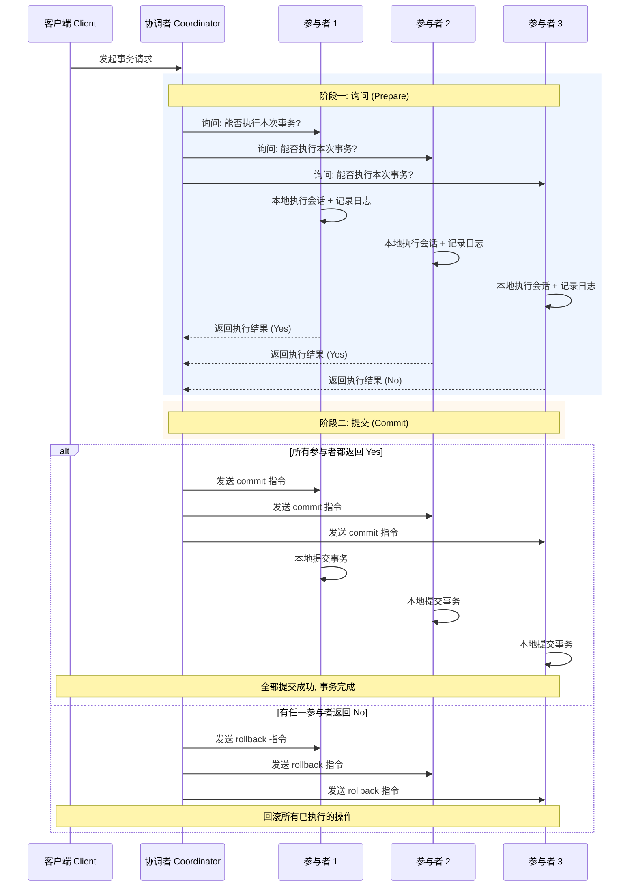
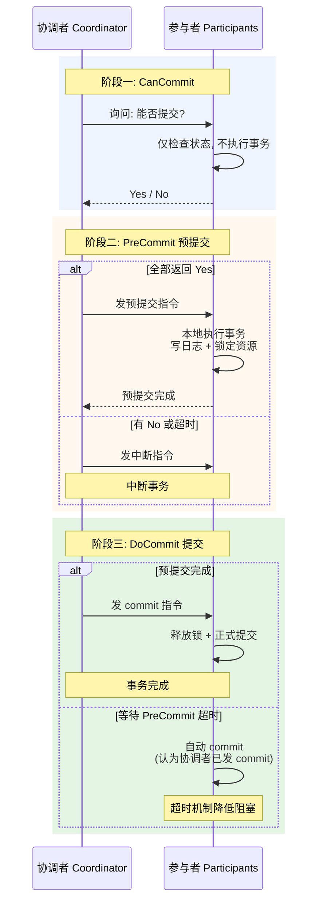
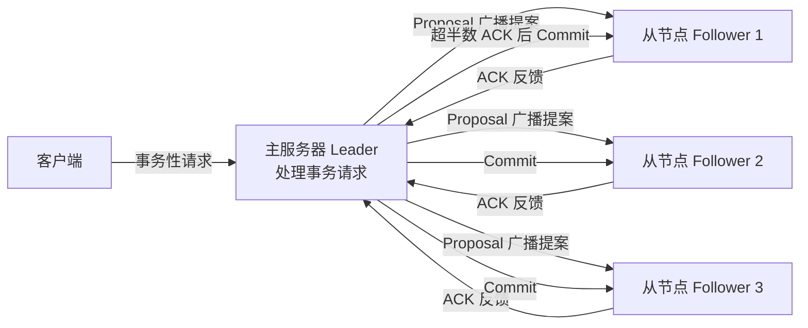
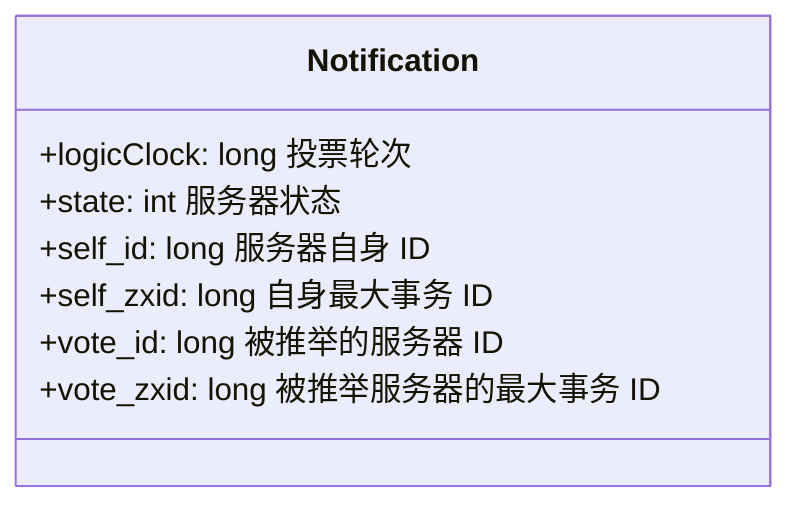
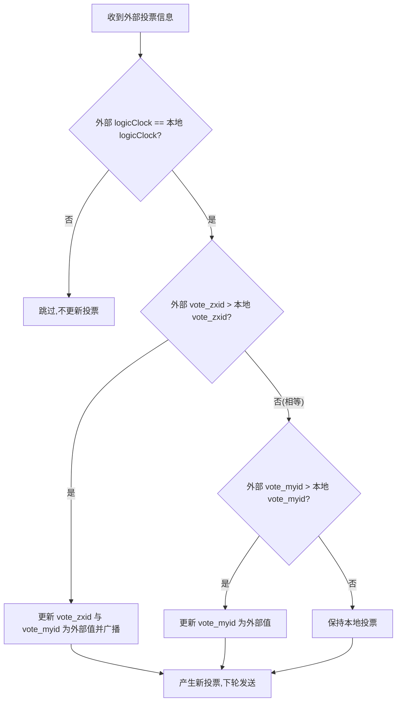
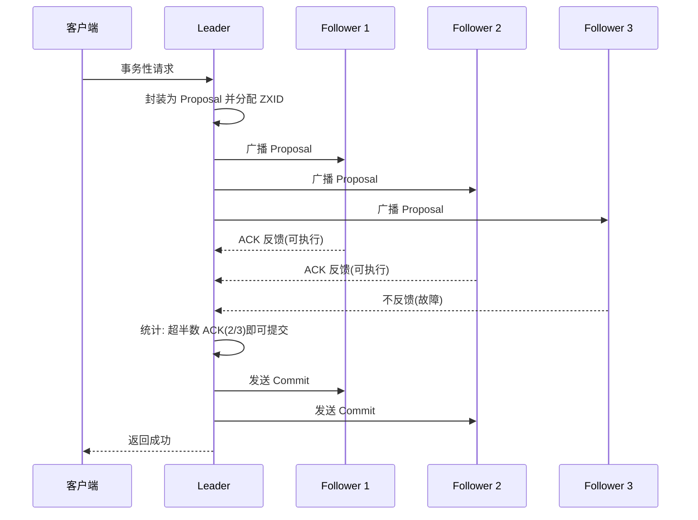

# 一致性协议：2PC、3PC、ZAB 与 Paxos

## 概念说明

ZooKeeper 在分布式系统环境中主要解决的是分布式一致性问题。数据不一致问题的成因在于：网络集群处理来自客户端的请求时，其中事务性操作会导致服务器上数据状态的变更。

为了保证数据变更请求在整个分布式环境下正确执行、不发生异常中断（即不会出现请求在某一台服务器上执行失败而在集群中其他服务器上执行成功的情况），分布式系统在处理数据变更请求的过程中引入了**分布式事务**的概念。

对于事务操作，最常见的是数据库事务：当多个线程对数据库中的同一个信息进行修改时，为保证数据的原子性、一致性、隔离性、持久性（ACID），需要进行本地事务性操作。而在分布式的网络环境下，同样会面临多个客户端的数据请求服务，处理数据变更时需要保证分布式环境下数据的正确完整，因此在分布式环境下也引入了分布式事务。

## 核心要点

- **二阶段提交（2PC）**：通过询问和提交两个阶段保证分布式事务，但存在三大问题——阻塞导致并发性能下降、协调者单点故障、提交阶段网络故障导致数据不一致。
- **三阶段提交（3PC）**：在 2PC 基础上增加预提交阶段与超时机制，将事务数据先保存到本地，当整个网络中的参与者服务器都能进行事务操作后，协调服务器才发送最终提交请求，避免了部分数据不一致的问题。
- **ZAB 协议**：ZooKeeper 专门设计用来解决集群最终一致性问题的算法，包含崩溃恢复和消息广播两个核心功能。消息广播与二阶段提交非常相似，但省去了事务中断回滚逻辑——只要超过半数的 Follower 服务器可以执行本次事务操作，Leader 就可以发送提交指令，完成数据变更。
- **ZooKeeper 的 2PC 改造实现**：借鉴二阶段提交，去掉中断回滚逻辑，通过自身的崩溃恢复机制解决二阶段提交算法中的单点故障等问题。
- **Paxos 算法**：目前最为优秀的分布式一致性算法，ZAB 等协议均在其基础上改进演变而来。它将集群服务器分为提议者（Proposer）、决策者（Acceptor）、决策学习者（Learner）三种角色。
- **ZAB 与 Paxos 的关键差异**：Paxos 的提案发起者可以是一个或多个（多副本处理方式），事务的实际执行发生在 Acceptor 服务器上，数据同步是多台 Acceptor 向多台 Learner 同步；而 ZAB 由单台 Leader 发起提案并执行事务，由单台 Leader 作为数据源向其他角色服务器同步。

## 二阶段提交

二阶段提交（Two-phase Commit）简称 2PC，是一种实现分布式事务的算法。二阶段提交算法可以保证分布在不同网络节点上的程序或服务按照事务性的方式进行调用。

### 底层实现

正如算法名字所示，二阶段提交的底层实现主要分成两个阶段：**询问阶段**和**提交阶段**。具体过程如下图所示：



> 二阶段提交存在**三大问题**：① 阻塞导致并发性能下降；② 协调者单点故障；③ 协调者发送 commit 时网络故障会导致数据不一致。

整个集群服务器被分为一台协调服务器以及集群中其他被协调的服务器。在二阶段算法的询问阶段，分布式集群服务接收到来自客户端的请求时，首先会通过协调者服务器，针对本次请求能否正常执行向集群中参与处理的服务器发起询问请求。集群服务器接收到请求后，会在本地机器上执行会话操作，并记录执行的相关日志信息，最后将结果返回给协调服务器。


协调服务器接收到来自集群中其他服务器的反馈信息后，会对信息进行统计。如果集群中的全部机器都能正确执行客户端发送的会话请求，那么协调者服务器就会再次向这些服务器发送提交命令。集群服务器接收到协调服务器的提交指令后，会根据之前处理该条会话操作的日志记录在本地提交操作，并最终完成数据的修改。

虽然二阶段提交可以有效保证客户端会话在分布式集群中的事务性，但**该算法自身存在诸多问题**，主要可归纳为：性能问题、单点问题、异常中断。

### 性能问题

在数据提交过程中，所有参与处理的服务器都处于阻塞状态，如果其他线程想访问临界区的资源，需要等待该条会话请求在本地执行完成后释放临界区资源。因此，采用二阶段提交算法会降低程序并发执行的效率。

### 单点问题

单点问题也叫单点服务器故障问题，指的是当分布式集群系统的调度服务器发生故障时，整个集群因为缺少协调者而无法进行二阶段提交算法。单点问题是二阶段提交最大的缺点，因此使用二阶段提交算法时通常需要进行一些改良，以满足对系统稳定性的要求。

### 异常中断

异常中断问题指的是：当统计确认集群中的服务器可以进行事务操作时，协调服务器会向这些服务器发送 commit 提交请求。如果在这个过程中，其中的一台或几台服务器发生网络故障，无法接收到来自协调服务器的提交请求，导致这些服务器无法完成最终的数据变更，就会造成整个分布式集群出现数据不一致的情况。

由于以上种种问题，实际应用中更推荐使用另一种分布式事务算法——三阶段提交算法。

## 三阶段提交

三阶段提交（Three-phase commit）简称 3PC，是在二阶段算法基础上进行优化和改进的算法。相比二阶段提交，三阶段提交**增加了预提交阶段**：



> 3PC 在 2PC 基础上增加**预提交阶段 + 超时机制**：CanCommit 仅检查不执行事务（避免锁资源浪费），PreCommit 实际执行但不提交，DoCommit 真正提交。参与者等不到协调者指令时会**超时自动 commit**，降低阻塞概率。


### 底层实现

**预提交阶段**

为了保证事务性操作的稳定性，同时避免二阶段提交中因为网络原因造成数据不一致等问题，完成提交准备阶段后（此时集群中的服务器已经为请求操作做好了准备），协调服务器会向参与的服务器发送预提交请求。集群服务器接收到预提交请求后，在本地执行事务操作，并将执行结果存储到本地事务日志中，同时对该条事务日志进行锁定处理。

**提交阶段**

处理完预提交阶段后，集群服务器会将执行结果返回到协调服务器，协调服务器根据返回的结果判断是否继续执行操作。如果所有参与者服务器返回的都是可以执行事务操作，协调者服务器就会再次发送提交请求到参与者服务器。参与者服务器接收到提交请求后，在本地正式提交该条事务操作，并在完成事务操作后关闭该条会话处理线程、释放系统资源。参与者服务器执行完相关操作后，会再次向协调服务器发送执行结果信息。

协调者服务器接收到返回的状态信息后进行处理：如果全部参与者服务器都正确执行并返回 yes 等状态信息，整个事务性会话请求在服务端的操作就结束了；如果接收到的信息中有参与者服务器没有正确执行，则协调者服务器会再次向参与者服务器发送 rollback 回滚事务操作请求，整个集群退回到之前的状态，从而避免数据不一致的问题。

## ZAB 协议算法：崩溃恢复和消息广播

ZooKeeper 最核心的作用就是保证分布式系统的数据一致性。无论是处理来自客户端的会话请求时，还是集群 Leader 节点发生重新选举时，都可能产生数据不一致。为解决这个问题，ZooKeeper 采用了 ZAB 协议算法。

**ZAB 协议算法**（Zookeeper Atomic Broadcast，Zookeeper 原子广播协议）是 ZooKeeper 专门设计用来解决集群最终一致性问题的算法，它的两个核心功能点是**崩溃恢复**和**消息广播**。

在整个 ZAB 协议的底层实现中，ZooKeeper 集群主要采用**主从模式**的系统架构方式来保证集群系统的一致性。当接收到来自客户端的事务性会话请求后，系统集群采用主服务器来处理该条会话请求，经过主服务器处理的结果会通过网络发送给集群中其他从节点服务器进行数据同步操作。



以 ZooKeeper 集群为例，这个操作过程可以概括为：集群接收到来自客户端的事务性会话请求后，集群中的其他 Follower 角色服务器会将该请求转发给 Leader 角色服务器处理。Leader 节点服务器处理完该条会话请求后，会将结果通过操作日志的方式同步给集群中的 Follower 角色服务器。Follower 角色服务器根据接收到的操作日志，在本地执行相关的数据处理操作，最终完成整个 ZooKeeper 集群对客户端会话的处理工作。

### 崩溃恢复

ZooKeeper 集群处理客户端会话的核心点**在一台 Leader 服务器上**，所有的业务处理和数据同步操作都要靠 Leader 服务器完成。结合二阶段提交的知识可以看出，这种架构方式**极易产生单点问题**：当集群中的 Leader 发生故障时，整个集群会因为缺少 Leader 服务器而无法处理来自客户端的事务性会话请求。为解决这个问题，ZAB 协议中设置了崩溃恢复机制。

崩溃恢复机制是保证 ZooKeeper 集群服务高可用的关键。触发 ZooKeeper 集群执行崩溃恢复的事件是集群中的 Leader 节点服务器发生异常而无法工作，此时 Follower 服务器会通过投票来决定是否选出新的 Leader 节点服务器。

**投票过程**：崩溃恢复机制开始时，ZooKeeper 集群中的每台 Follower 服务器会发起投票，并同步给集群中的其他 Follower 服务器。接收到其他 Follower 服务器的投票信息后，每个 Follower 服务器都会与自身的投票信息进行对比，如果判断新的投票信息更合适，则采用新的投票信息作为自己的投票信息。在集群中的投票信息还没有达到超过半数原则的情况下，再进行新一轮投票；最终当 ZooKeeper 集群中的 Follower 服务器超过半数投出的结果相同时，就会产生新的 Leader 服务器。

### 选票结构

投票阶段中的投票信息具有固定的结构。以 Fast Leader Election 选举的实现方式为例，一个选票的整体结构可以分为以下六个部分：



- **logicClock**：用来记录服务器的投票轮次。logicClock 从 1 开始计数，每当该台服务器经过一轮投票后，logicClock 的数值就加 1。
- **state**：用来标记当前服务器的状态。在 ZooKeeper 集群中一台服务器具有 LOOKING、FOLLOWING、LEADING、OBSERVING 这四种状态。
- **self_id**：表示当前服务器的 ID 信息，在 ZooKeeper 集群中主要用作服务器的身份标识符。
- **self_zxid**：当前服务器上所保存的数据的最大事务 ID，从 0 开始计数。
- **vote_id**：投票要被推举的服务器的唯一 ID。
- **vote_zxid**：被推举的服务器上所保存的数据的最大事务 ID，从 0 开始计数。

ZooKeeper 集群需要重新选举出新的 Leader 服务器时，就会根据上述投票信息内容进行对比，以找出最适合的服务器。

### 选票筛选

当一台 Follower 服务器接收到网络中其他 Follower 服务器的投票信息后，通过以下流程对比并更新自己的投票信息：



首先对比 logicClock（投票轮次）：当 logicClock 相同时，表明两张选票处于相同的投票阶段，进入下一阶段，否则跳过。接下来对比 vote_zxid（被推举服务器上所保存的最大事务 ID）：若接收到的外部投票信息中的 vote_zxid 字段较大，则将自己票中的 vote_zxid 与 vote_myid 更新为收到的票中的 vote_zxid 与 vote_myid，并广播出去。若对比结果相同，则继续对比 vote_myid（被推举服务器的唯一 ID）：若外部投票的 vote_myid 比较大，则将自己票中的 vote_myid 更新为收到的票中的 vote_myid。经过这些对比和替换后，该台 Follower 服务器最终会产生新的投票信息，并在下一轮投票中发送到 ZooKeeper 集群中。

### 消息广播

Leader 节点服务器处理请求后，需要通知集群中的其他角色服务器进行数据同步。ZooKeeper 集群采用消息广播的方式发送通知，底层使用原子广播协议进行消息发送，该协议的实现过程与二阶段提交过程非常相似：



当要在集群中的其他角色服务器进行数据同步时，Leader 服务器将该操作过程封装成一个 Proposal 提交事务，并将其发送给集群中其他需要进行数据同步的服务器。这些服务器接收到 Leader 服务器的数据同步事务后，会将该条事务能否在本地正常执行的结果反馈给 Leader 服务器；Leader 服务器接收到其他 Follower 服务器的反馈信息后进行统计，判断是否在集群中执行本次事务操作。

与二阶段提交的关键区别：二阶段提交需要集群中所有服务器都反馈可以执行事务操作后，主服务器才再次发送 commit 提交请求执行数据变更；而 **ZAB 协议算法省去了中断的逻辑，当 ZooKeeper 集群中有超过半数的 Follower 服务器能够正常执行事务操作后，整个集群就可以提交 Proposal 事务**。

## ZooKeeper 中二阶段提交的改造实现

ZAB 协议处理来自客户端的事务性请求时，为了保证整个集群的数据一致性，其底层实现与二阶段提交算法有相似之处；但二阶段提交算法自身存在缺点（容易发生单点故障、并发性能瓶颈），ZooKeeper 通过特有的实现方式克服了这些问题。

### 提交请求

二阶段提交的本质是协调和处理 ZooKeeper 集群中的服务器，使它们在处理事务性会话请求的过程中保证数据一致性。如果把执行在 ZooKeeper 集群中各个服务器上的事务会话处理操作分别看作不同的函数，那么整个一致性的处理逻辑就相当于包裹这些函数的事务。

在单机环境中，处理事务的逻辑是：包含在事务中的所有函数要么全部成功执行，要么全部都不执行。


不同的是，在分布式环境中，处理事务请求的各个函数分布在不同的网络服务器上的线程中，无法像单机环境一样在事务中某一个环节发生异常时回滚包裹在整个事务中的操作。因此分布式环境处理事务操作时，一般的算法会要求全部集群中的机器都成功执行操作：如果其中有一个函数执行异常，那么整个事务就会把所有函数的执行结果回滚到执行前的状态——无论正确执行的函数还是执行异常的函数，各自所做的对数据和程序状态的变更都将被删除。

### 执行请求

ZooKeeper 集群中的 Leader 服务器对该条事务性会话操作是否能够在 Follower 服务器上执行，向集群中的 Follower 服务器发起 Proposal 请求。

与二阶段提交不同，**ZooKeeper 的实现中没有中断提交的逻辑**。集群中的 Follower 服务器接收到 Proposal 请求后，只有两种处理情况：

- 第一种情况：ZooKeeper 集群中的 Follower 服务器能够正确执行操作，并向 Leader 反馈执行结果。
- 第二种情况：无法正确执行该条 Proposal 操作，直接抛弃该条请求。

这种执行逻辑使得集群中的 Leader 服务器无须等待所有服务器都执行完成并反馈，只需要接收到集群中过半数的 Follower 服务器成功执行的反馈信息，即可统计并确认：当超过半数以上服务器可以正确执行操作后，整个 ZooKeeper 集群就可以进入执行事务提交操作。

### 底层实现

从源码层面来讲，ZooKeeper 实现整个二阶段提交算法的过程可以分为 Leader 服务器端的发起 Proposal 操作和 Follower 服务器端的执行反馈操作两部分。

**Follower 服务器端**：向 Leader 服务器反馈 Proposal 执行结果。如下面的代码所示，ZooKeeper 通过 SendAckRequestProcessor 类完成执行结果的反馈。这个类实现了 RequestProcessor 接口，但它不处理来自客户端的请求信息，而是负责向 Leader 服务器反馈 Follower 服务器的执行结果。它在内部通过 processRequest 函数判断请求类型：如果不是 OpCode.sync 操作，就通过 learner.writePacket 方法把包含该请求 zxid 的 ACK 应答包发送给 Leader 服务器，供其统计是否已达到过半。

```java
public class SendAckRequestProcessor implements RequestProcessor, Flushable {
  public void processRequest(Request si) {
    if(si.type != OpCode.sync){
        QuorumPacket qp = new QuorumPacket(Leader.ACK, si.getHdr().getZxid(), null,
            null);
        try {
            learner.writePacket(qp, false);
        } catch (IOException e) {
            LOG.warn("Closing connection to leader, exception during packet send", e);
            try {
                if (!learner.sock.isClosed()) {
                    learner.sock.close();
                }
            } catch (IOException e1) {
                // Nothing to do, we are shutting things down, so an exception here is irrelevant
                LOG.debug("Ignoring error closing the connection", e1);
            }
        }
    }
}
}

```

**Leader 服务器端**：发起 Proposal 的整个处理逻辑。如下面的代码所示，这在 Leader 服务器端是通过 ProposalRequestProcessor 来完成处理的。ProposalRequestProcessor 构造函数中首先初始化了 Leader 服务器、下一个请求处理器，以及负责代表 Leader 自身对发起的 Proposal 进行 ACK 确认的 AckRequestProcessor 处理器（Leader 服务器发起的提案同样需要参与过半统计）。

```java
public ProposalRequestProcessor(LeaderZooKeeperServer zks,
        RequestProcessor nextProcessor) {
    this.zks = zks;
    this.nextProcessor = nextProcessor;
    AckRequestProcessor ackProcessor = new AckRequestProcessor(zks.getLeader());
    syncProcessor = new SyncRequestProcessor(zks, ackProcessor);
}

```

进一步看 AckRequestProcessor 处理器的内部，Leader 服务器对自己发起的 Proposal 进行 ACK 确认的实现如下。AckRequestProcessor 类同样实现了 RequestProcessor，从中可以看出：ZooKeeper 中处理 Leader 服务器的 Proposal 时，是将该 Proposal 请求当作网络中的一条会话请求来处理的。整个处理的逻辑实现也是按照处理链模式设计的，在 AckRequestProcessor 类的内部通过 processRequest 函数调用 leader.processAck，代表 Leader 服务器自身对该提案进行 ACK 反馈统计。

```java
class AckRequestProcessor implements RequestProcessor {
public void processRequest(Request request) {
    QuorumPeer self = leader.self;
    if(self != null)
        leader.processAck(self.getId(), request.zxid, null);
    else
        LOG.error("Null QuorumPeer");
}}

```

## ZAB 与 Paxos 算法的联系与区别

### Paxos 算法

在分布式一致性问题的解决方案中，Paxos 算法可以说是**目前最为优秀**的。很多方案，包括 ZooKeeper 的 ZAB 协议算法，都是在其基础上改进和演变而来的。

Paxos 算法是基于消息传递的分布式一致性算法，很多大型的网络技术公司和开源框架都采用 Paxos 算法作为其各自的底层解决方案，比如 Chubby、Megastore 以及 MySQL Group Replication。Paxos 算法在服务器发生宕机故障时能够保证数据的完整性，不要求可靠的消息传递，可容忍消息丢失、延迟、乱序以及重复，保证服务的高可用性。

### 三种角色

保证分布式系统下数据的一致性操作，本质是协调运行在不同网络服务器上的线程服务，使这些服务就某一个特定的数据执行一致性的变更操作。在整个 Paxos 算法的实现过程中，参与算法的集群中的全部服务器被分成三种角色：提议者（Proposer）、决策者（Acceptor）、决策学习者（Learner）。

- **提议者（Proposer）**：提出提案（Proposal）。Proposal 信息包括提案编号（Proposal ID）和提议的值（Value）。
- **决策者（Acceptor）**：参与决策，回应 Proposers 的提案。收到 Proposal 后可以接受提案，若 Proposal 获得超过半数 Acceptors 的许可，则称该 Proposal 被批准。
- **决策学习者**：不参与决策，从 Proposers/Acceptors 学习最新达成一致的提案（Value）。

在 Paxos 算法中处理来自客户端的事务性会话请求时，首先会触发一个或多个服务器进程，就本次会话的处理发起提案。当该提案通过网络发送到集群中的其他角色服务器后，这些服务器会就该会话在本地的执行情况反馈给发起提案的服务器。发起提案的服务器接收到这些反馈信息后进行统计，当集群中超过半数的服务器认可该条事务性的客户端会话操作后，认为该客户端会话可以在本地执行操作。

这一投票过程与 ZAB 协议十分相似，但存在一个关键差异：采用 ZAB 协议的 ZooKeeper 集群中发起投票的是集群中运行的一台 Leader 角色服务器，而 Paxos 算法采用多副本的处理方式——存在多个副本，每个副本分别包含提案者、决策者以及学习者。下图演示了三种角色的服务器之间的关系。


### 事务处理过程

Paxos 针对一次提案的处理过程可以分为三个阶段：提案准备阶段、事务处理阶段、数据同步阶段。


- **提案准备阶段**：该阶段是整个 Paxos 算法的最初阶段。所有接收到的来自客户端的事务性会话在执行之前，整个集群中的 Proposer 角色服务器或节点需要将会话发送给 Acceptor 决策者服务器。Acceptor 服务器接收到该条询问信息后，需要返回 Promise，承诺可以执行操作信息给 Proposer 角色服务器。
- **事务处理阶段**：经过提案准备阶段、确认该条事务性会话操作可以在集群中正常执行后，Proposer 提案服务器会再次向 Acceptor 决策者服务器发送 propose 提交请求。Acceptor 决策者服务器接收到该 propose 请求后，在本地执行该条事务性的会话操作。
- **数据同步阶段**：完成事务处理阶段的操作后，整个集群对该条事务性会话的数据变更已经在 Acceptor 决策者服务器上执行完成。当整个集群中有超过半数的 Acceptor 决策者服务器都成功执行后，Paxos 算法将针对本次执行结果形成一个决议，并发送给 Learner 服务器。Learner 服务器接收到该条决议信息后，同步 Acceptor 决策者服务器上的数据信息，最终完成该条事务性会话在整个集群中的处理。

### Paxos PK ZAB

Paxos 算法与 ZAB 算法的相同及不同之处如下。

**相同之处**：在执行事务性会话的处理中，两种算法最开始都需要一台服务器或者线程针对该会话在集群中发起提案或投票，只有当集群中的过半数服务器对该提案投票通过后，才能执行接下来的处理。

**不同之处**：Paxos 算法的发起者可以是一个或多个。当集群中的 Acceptor 服务器中的大多数可以执行会话请求后，提议者服务器只负责发送提交指令，事务的执行实际发生在 Acceptor 服务器上——这与 ZooKeeper 服务器上事务的执行发生在 Leader 服务器上不同。Paxos 算法在数据同步阶段，是多台 Acceptor 服务器作为数据源同步给集群中的多台 Learner 服务器；而 ZooKeeper 则是单台 Leader 服务器作为数据源同步给集群中的其他角色服务器。

## 实践要点

- 无论是 Paxos 算法还是 ZAB 协议，都是在原始的二阶段提交算法基础上针对各自要解决的问题进行修改和优化的产物；理解这一演进脉络有助于对比选型各类一致性方案。
- 提案询问与反馈本质上是一次客户端和服务器端的会话处理过程，会话超时时间的设置需要权衡：超时时间过长能保证服务器响应，但会降低整个集群的处理性能；超时时间过短，则可能因为网络延迟或事务处理耗时，导致本可以正常执行的反馈信息没有发送回提案服务器。超时参数应结合集群规模、网络状况与事务平均耗时实测调整。
- 面对复杂的网络环境，再优秀的算法也不是万能的；深入掌握算法的核心原理以及设计目的，才能更好地解决实际工作中的问题。

## 总结

- **二阶段提交（2PC）**：通过询问和提交两个阶段保证分布式事务，但存在阻塞导致并发性能下降、协调者单点故障、提交阶段网络故障导致数据不一致三大问题。
- **三阶段提交（3PC）**：在 2PC 基础上增加预提交阶段与超时机制，将事务数据先保存到本地，当整个网络中的参与者服务器都能进行事务操作后，协调服务器才发送最终提交请求，避免了部分数据不一致的问题。
- **ZAB 协议**：ZooKeeper 专门设计用来解决集群最终一致性问题的算法，包含崩溃恢复和消息广播两个核心功能。消息广播的底层实现过程与二阶段提交非常相似，但没有事务丢弃的过程——只要满足整个集群中超过半数的 Follower 服务器可以执行本次事务操作，Leader 就可以向集群中发送提交事务操作，最终完成数据的变更。
- **ZooKeeper 的 2PC 改造实现**：借鉴二阶段提交，去掉中断回滚逻辑，并通过自身的崩溃恢复机制来解决二阶段提交算法中的单点故障等问题。
- **Paxos 算法**：在解决分布式一致性问题上被广泛采用。它将集群中的服务器分为提议者（Proposer）、决策者（Acceptor）、决策学习者（Learner），在处理事务性会话请求时，由提议者服务器发起询问操作，之后由决策者服务器决定是否执行。在集群中多数服务器都正确执行会话操作后，决策学习者会同步 Acceptor 服务器上的数据，并完成最终的操作。

## 版本差异(ZooKeeper 3.6 → 3.8/3.9)

| 特性 | 旧版（本文编写时，3.6.x） | 当前（3.8.x/3.9.x） |
|------|---------------------------|---------------------|
| 稳定版本 | 3.6.x | 3.8.x（LTS）/ 3.9.x |
| Java 支持 | JDK 8 | JDK 8/11/17（3.8+） |
| 客户端 | 原生客户端 | 推荐 Curator 5.x（容器节点、持久递归监听） |
| 监控 | JConsole + 四字母命令 | 3.6+ 实验性 Prometheus 指标端点，3.8+ 完善 |
| 核心机制 | ZAB/Watch/ACL/数据模型 | 原理不变，本文内容依然适用 |

> ZooKeeper 的核心协议（ZAB、Watch、ACL、数据模型）自 3.4 以来保持稳定，本文原理性讲解在 3.8/3.9 中依然适用；部署与监控建议按 3.8/3.9 官方文档更新。
