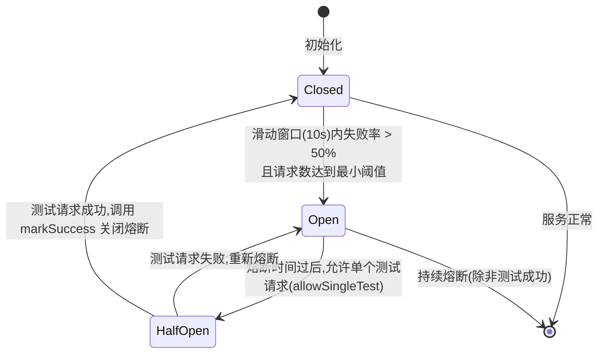

# 熔断原理：如何正确理解 HystrixCircuitBreaker 的底层实现机制？

> ⚠️ **组件状态说明**：Hystrix 已由 Netflix 官方宣布停止维护（进入维护模式，仅存量修复，Spring Cloud 自 2020.0 版本起移除对其支持）。本文保留其原理讲解价值（熔断器状态机与滑动窗口统计等底层机制并未过时，Resilience4j/Sentinel 的实现与之思想相通），生产选型请参考 [Sentinel](<../05-SpringCloudAlibaba实战/11-限流与熔断：Sentinel 在项目中的最佳实践.md>)、Resilience4j 等现代替代方案（文中组件对照见尾部版本差异表）。

## 概述

Hystrix 是最为经典的服务容错实现框架，理解其底层实现机制对掌握熔断器的设计思想很有价值。本文分析 @EnableCircuitBreaker 注解的生效原理、HystrixCircuitBreaker 熔断器的三个核心方法与状态机，以及基于 RxJava 的滑动窗口（Rolling Window）机制。

## HystrixCircuitBreaker

### @EnableCircuitBreaker 注解

日常开发中，使用 Hystrix 熔断器的最简单方法就是在 Spring Boot 应用程序中添加 @EnableCircuitBreaker 注解。该注解的作用是告诉 Spring Cloud 在该服务中启用 Hystrix，其效果相当于在应用程序中自动注入了熔断器。与负载均衡中的 LoadBalancerClient 接口一样，Spring Cloud 把 @EnableCircuitBreaker 注解作为一种公共组件放在 spring-cloud-commons 工程中，其定义如下所示：

```java
@Target(ElementType.TYPE)
@Retention(RetentionPolicy.RUNTIME)
@Documented
@Inherited
@Import(EnableCircuitBreakerImportSelector.class)
public @interface EnableCircuitBreaker {
}
```

这里通过 @Import 注解引入了 EnableCircuitBreakerImportSelector 类，该类定义如下：

```java
public class EnableCircuitBreakerImportSelector extends
              SpringFactoryImportSelector<EnableCircuitBreaker> {

       @Override
       protected boolean isEnabled() {
              return getEnvironment().getProperty(
                            "spring.cloud.circuit.breaker.enabled", Boolean.class, Boolean.TRUE);
       }
}
```

Spring Boot 中各种 ImportSelector 类的工作原理类似于 JDK 中的 SPI：它会在代码工程中的 META-INF/spring.factories 文件夹下寻找相应的配置项。上述 EnableCircuitBreakerImportSelector 类会加载 spring.factories 中标明为 EnableCircuitBreaker 的配置类，如下所示：

```xml
org.springframework.cloud.client.circuitbreaker.EnableCircuitBreaker=\
	org.springframework.cloud.netflix.hystrix.HystrixCircuitBreakerConfiguration
```

这里指向了 HystrixCircuitBreakerConfiguration 配置类，该类位于 spring-cloud-netflix-core 工程中。Hystrix 在整个 Spring Cloud Netflix 框架中的地位很高，这点从它所处的工程位置可见一斑：框架的设计者认为服务容错是最核心的机制，是所有服务都应该具备的基础功能，所以没有单独创建以 Hystrix 命名的工程，而是将其直接放在了 spring-cloud-netflix-core 工程中（实际上该工程也只包含了 Hystrix 相关的类）。

HystrixCircuitBreakerConfiguration 配置类内部构造了一个切面，即 HystrixCommandAspect。从命名上看，HystrixCommandAspect 是一个用于拦截 HystrixCommand 的切面，这个切面对应的 pointcut 如下：

```java
@Pointcut("@annotation(com.netflix.hystrix.contrib.javanica.annotation.HystrixCommand)")
public void hystrixCommandAnnotationPointcut() {
}
    @Pointcut("@annotation(com.netflix.hystrix.contrib.javanica.annotation.HystrixCollapser)")
public void hystrixCollapserAnnotationPointcut() {
}

@Around("hystrixCommandAnnotationPointcut() || hystrixCollapserAnnotationPointcut()")
public Object methodsAnnotatedWithHystrixCommand(final ProceedingJoinPoint joinPoint) throws Throwable {
}
```

使用 @HystrixCommand 注解和 @HystrixCollapser 注解修饰的方法都会被这个切面拦截，该切面的处理流程如下所示（为便于阅读，部分内容做了裁剪）：

```java
//从切点获取所调用方法的相关信息
Method method = getMethodFromTarget(joinPoint);
MetaHolderFactory metaHolderFactory = META_HOLDER_FACTORY_MAP.get(HystrixPointcutType.of(method));

//创建一个用于封装元数据的 MetaHolder，这些元数据包括方法中与 Hystrix 相关的信息
MetaHolder metaHolder = metaHolderFactory.create(joinPoint);

//根据 MetaHolder 创建出一个 HystrixInvokable 接口，而 HystrixCommand 就是 HystrixInvokable 的实现类
HystrixInvokable invokable = HystrixCommandFactory.getInstance().create(metaHolder);

//得到执行类型，包括同步、异步和响应式三种
ExecutionType executionType = metaHolder.isCollapserAnnotationPresent() ?
                metaHolder.getCollapserExecutionType() : metaHolder.getExecutionType();

        Object result;
        try {
            if (!metaHolder.isObservable()) {
                result = CommandExecutor.execute(invokable, executionType, metaHolder);
            } else {
                result = executeObservable(invokable, executionType, metaHolder);
            }
        } catch (HystrixBadRequestException e) {
            throw e.getCause();
        } catch (HystrixRuntimeException e) {
            throw hystrixRuntimeExceptionToThrowable(metaHolder, e);
        }
return result;
```

这个处理流程引出了 HystrixInvokable 接口，它实际上只是一个空接口。在 Hystrix 中存在一批以 "-able" 结尾的接口定义，例如 HystrixExecutable 和 HystrixObservable 接口都继承了 HystrixInvokable 接口，而这些接口最终都由各种以 "-Command" 结尾的类来负责实现。HystrixInvokable 接口以及相关的 Command 类的类层结构关系如下所示。

HystrixInvokable 接口的类层关系图

### HystrixCircuitBreaker 实现原理

本文的目的在于梳理整个熔断器的处理流程，因此不必对上图中的所有内容详细展开。快速浏览这些类的参数和代码结构可以发现：在 AbstractCommand 类中存在一个类型为 HystrixCircuitBreaker 接口的变量，同时在构造函数中给出了它的初始化方法，如下所示：

```java
protected final HystrixCircuitBreaker circuitBreaker;

private static HystrixCircuitBreaker initCircuitBreaker(boolean enabled, HystrixCircuitBreaker fromConstructor,
                                                            HystrixCommandGroupKey groupKey, HystrixCommandKey commandKey,
                                                            HystrixCommandProperties properties, HystrixCommandMetrics metrics) {
        if (enabled) {
            if (fromConstructor == null) {
                //通过工厂类获取 HystrixCircuitBreaker 的默认实现
                return HystrixCircuitBreaker.Factory.getInstance(commandKey, groupKey, properties, metrics);
            } else {
                return fromConstructor;
            }
        } else {
            return new NoOpCircuitBreaker();
        }
}
```

这里的 enabled 标志位就是前文介绍的 @EnableCircuitBreaker 注解中，通过 EnableCircuitBreakerImportSelector 的 isEnabled() 方法获取的配置，相当于一个控制是否启用熔断器的开关：标志位为 true 时创建一个 HystrixCircuitBreaker 实例，反之返回一个什么都不做的 NoOpCircuitBreaker。

HystrixCircuitBreaker 接口的定义如下所示：

```java
public interface HystrixCircuitBreaker {

//请求是否可被执行
	public boolean allowRequest();

//返回当前熔断器是否打开
	public boolean isOpen();

	//关闭熔断器
	void markSuccess();
}
```

HystrixCircuitBreaker 接口只有三个方法，它的实现类为 HystrixCircuitBreakerImpl，该实现类通过一个 Factory 工厂类进行创建。工厂类创建 HystrixCircuitBreaker 实例的过程如下：

```java
public static class Factory {
        private static ConcurrentHashMap<String, HystrixCircuitBreaker> circuitBreakersByCommand = new ConcurrentHashMap<String, HystrixCircuitBreaker>();

public static HystrixCircuitBreaker getInstance(HystrixCommandKey key, HystrixCommandGroupKey group, HystrixCommandProperties properties, HystrixCommandMetrics metrics) {
            HystrixCircuitBreaker previouslyCached = circuitBreakersByCommand.get(key.name());
            if (previouslyCached != null) {
                return previouslyCached;
            }

HystrixCircuitBreaker cbForCommand = circuitBreakersByCommand.putIfAbsent(key.name(), new HystrixCircuitBreakerImpl(key, group, properties, metrics));
            if (cbForCommand == null) {
                return circuitBreakersByCommand.get(key.name());
            } else {
                return cbForCommand;
            }
        }

public static HystrixCircuitBreaker getInstance(HystrixCommandKey key) {
            return circuitBreakersByCommand.get(key.name());
        }

	static void reset() {
            circuitBreakersByCommand.clear();
        }
}
```

这段代码采用了基于 Key-Value 对的缓存设计思想：Key 为 HystrixCommandKey 的 name，Value 为一个 HystrixCircuitBreakerImpl 实例。如果缓存中已存在该 Key 对应的 HystrixCircuitBreakerImpl 实例则直接返回，否则创建一个新实例并放入缓存。

HystrixCircuitBreakerImpl 对三个方法的实现如下。

**allowRequest()**

当请求到来时，HystrixCommand 会首先调用 HystrixCircuitBreaker 中的 allowRequest 方法判断服务是否已经熔断，而该判断取决于服务访问的失败率。allowRequest 方法首先判断熔断器是否被强制打开或关闭：如果是强制打开，则直接拒绝请求；如果为强制关闭，则调用 isOpen() 方法判断当前熔断器是否需要打开（但始终放行请求）。如下所示：

```java
public boolean allowRequest() {
            if (properties.circuitBreakerForceOpen().get()) {
                return false;
            }
            if (properties.circuitBreakerForceClosed().get()) {
                isOpen();
                return true;
            }
            return !isOpen() || allowSingleTest();
}
```

**isOpen()**

该方法返回当前熔断器是否打开的状态。如果熔断器为 Open 状态，则直接返回 true；如果不是，则从度量指标中获取请求健康信息并根据熔断阈值判断熔断结果，如下所示：

```java
public boolean isOpen() {
            if (circuitOpen.get()) {
                return true;
            }

HealthCounts health = metrics.getHealthCounts();

// 检查是否达到最小请求数,如果未达到的话即使请求全部失败也不会熔断
            if (health.getTotalRequests() < properties.circuitBreakerRequestVolumeThreshold().get()) {
                return false;
            }

	        // 检查错误百分比是否达到设定的阈值，如果未达到的话也不会熔断
            if (health.getErrorPercentage() < properties.circuitBreakerErrorThresholdPercentage().get()) {
                return false;
            } else {
                // 如果错误率过高，则进行熔断，并记录下熔断时间
                if (circuitOpen.compareAndSet(false, true)) {
                    circuitOpenedOrLastTestedTime.set(System.currentTimeMillis());
                    return true;
                } else {
                    return true;
                }
            }
}
```

**markSuccess()**

markSuccess 方法用于关闭熔断器。在 HystrixCommand 执行成功的情况下，通过调用该方法可以将打开的熔断器关闭，并重置度量指标对象，如下所示：

```java
public void markSuccess() {
            if (circuitOpen.get()) {
                if (circuitOpen.compareAndSet(true, false)) {
                    //重置度量指标对象
                    metrics.resetStream();
                }
            }
}
```

这三个方法的执行逻辑实际上都不复杂：HystrixCircuitBreaker 通过一个 circuitOpen 状态位控制整个熔断判断流程，而这个状态位的值取决于系统目前的执行数据和健康指标。三个方法中看到的 HealthCounts 和 HystrixCommandMetrics 都是这些指标的具体体现。针对这些指标的采集和处理过程，Hystrix 提供了一套滑动窗口（Rolling Window）机制。

HystrixCircuitBreaker 的整体状态机如下图所示：



## Hystrix 滑动窗口机制

### HealthCounts 与数据来源

先看 HystrixCircuitBreaker 的 isOpen() 中使用到的 HealthCounts 类，关注它所包含的变量以及这些变量的计算方法，如下所示：

```java
public static class HealthCounts {
        private final long totalCount;
        private final long errorCount;
	   private final int errorPercentage;

public HealthCounts plus(long[] eventTypeCounts) {
            long updatedTotalCount = totalCount;
            long updatedErrorCount = errorCount;

long successCount = eventTypeCounts[HystrixEventType.SUCCESS.ordinal()];
            long failureCount = eventTypeCounts[HystrixEventType.FAILURE.ordinal()];
            long timeoutCount = eventTypeCounts[HystrixEventType.TIMEOUT.ordinal()];
            long threadPoolRejectedCount = eventTypeCounts[HystrixEventType.THREAD_POOL_REJECTED.ordinal()];
            long semaphoreRejectedCount = eventTypeCounts[HystrixEventType.SEMAPHORE_REJECTED.ordinal()];

            updatedTotalCount += (successCount + failureCount + timeoutCount + threadPoolRejectedCount + semaphoreRejectedCount);
            updatedErrorCount += (failureCount + timeoutCount + threadPoolRejectedCount + semaphoreRejectedCount);
            return new HealthCounts(updatedTotalCount, updatedErrorCount);
        }
}
```

plus() 方法比较复杂，需要明确所传入的 eventTypeCounts 数组的数据来源，这就要引出 Hystrix 中非常核心的一个类 HealthCountsStream。这个核心类在设计上采用了一种特定的机制，即滑动窗口机制。Hystrix 在实现这一机制时采用了数据流处理和响应式编程方面的技术和框架。

### 滑动窗口和数据流处理

对数据做分析和统计时，通常首先采集一定的样本，然后进行一定的分组。采集策略上可以使用**时间维度**或**数量维度**。滑动窗口属于时间维度的采集方式，即采集过程基于一定的时间窗口，而这个时间窗口随着时间的演进而逐步向前滑动。

在 Hystrix 中，采用滑动窗口来采集的系统运行时健康数据包括成功请求数量、失败请求数、超时请求数、被拒绝的请求数等。每次取最近 10 秒的数据来进行计算，如果这 10 秒中请求的失败率计算下来超过了 50%，就会触发熔断器的熔断机制——这里的 10 秒就是一个滑动窗口。官网的示意图中，每一个格子就是一个时间间隔，格子中的数据就是这个时间间隔内所处理的请求数量，通常把这种格子称为一个**桶（Bucket）**。每当收集好一个新桶之后，就会丢弃掉最旧的一个桶，这样时间窗口就能持续向前滑动。

实现滑动窗口的思路：可以把系统运行时所产生的所有数据都视为一个个的事件，滑动窗口中每个桶的数据都来自源源不断的事件，因此滑动窗口非常适合用观察者模式来实现；同时，对于这些生成的事件，通常需要对其进行转换以便执行后续的操作。这两点构成了实现滑动窗口的设计目标和方法。

### 响应式编程和 RxJava 基础

在技术选型上，Hystrix 采用了**响应式编程框架 RxJava**。在响应式编程中，源源不断的事件被看成是一个**流（Stream）**，业界存在一个**响应式流（Reactive Stream）规范**，该规范中的流是一个发布和订阅的过程。关于响应式流以及响应式编程的核心概念以及 RxJava、Project Reactor 等框架，可参考《RxJava反应式编程》和《Spring响应式编程》。本文只给出理解 Hystrix 滑动窗口实现过程中所需的必备知识。

RxJava 实现了响应式流规范。使用 RxJava 实现的一大好处是可以通过 RxJava 的一系列操作符来实现滑动窗口，从而可以依赖 RxJava 的线程模型来确保数据写入和聚合的线程安全。RxJava 中用于健康信息采集的操作符包括 window、flatMap 和 reduce 等。

- **window 操作符。**

window 操作符用于**开窗操作**，也就是把当前流中的元素采集并合并到另外的流中。

以窗口大小为 3 为例，假设有 5 个元素从流中输入，对其进行开窗操作后，输入流就变成了两个输出流。

- **flatMap 操作符。**

flatMap，也就是拉平并转化。与常见的 map 不同，flatMap 操作符把输入流中的每个元素转换成另一个流，再把这些转换之后得到的流元素进行合并。

例如，对 1 和 5 使用 flatMap 操作，转换的逻辑是返回它们的平方值并进行合并，这样通过 flatMap 操作符之后这两个元素就变成了 1 和 25。

- **reduce 操作符。**

reduce 操作符对流中包含的所有元素进行累积计算，具体累积操作通常通过一个函数来实现。例如，假如这个函数为一个求和函数，那么对 1 到 10 的数字进行求和时，reduce 操作符的运行结果即为 55。

### HealthCountsStream

HealthCountsStream 的类层结构中，BucketedCounterStream 类代表一个窗口类，将基础数据汇总成一个个的桶。它的子类 BucketedRollingCounterStream 在它的基础上添加了滑动窗口处理，将桶汇总成滑动窗口。而 HealthCountsStream 最终表现为一个运行时健康数据流。

在 BucketedCounterStream 类中，通过以下代码把事件流汇总成 Bucket：

```java
this.bucketedStream = Observable.defer(new Func0<Observable<Bucket>>() {
            @Override
            public Observable<Bucket> call() {
                return inputEventStream
                        .observe()
	// 使用 window 操作符收集一个 Bucket 时间内的数据
.window(bucketSizeInMs, TimeUnit.MILLISECONDS)
// 将每个 window 内聚集起来的事件集合汇总成 Bucket
.flatMap(reduceBucketToSummary)                                      .startWith(emptyEventCountsToStart);                       }
});
```

这里分别使用了前面介绍的 window 和 flatMap 操作符来完成桶的构建。该方法返回的是一个 `Observable<Bucket>` 对象——在 RxJava 中，Observable 代表的就是一个**无限流对象**。

再看 BucketedRollingCounterStream 类，该类的构造函数中同样存在一个类似的方法（为避免过于复杂，裁剪了部分代码）：

```java
this.sourceStream = bucketedStream
	 //将 N 个 Bucket 进行汇总
	.window(numBuckets, 1)
	//汇总成一个窗口
	.flatMap(reduceWindowToSummary)
     …
     //添加背压控制
	.onBackpressureDrop();
```

上述方法基于父类 BucketedCounterStream 已经汇总的 bucketedStream 进行开窗处理，从而获取一个 sourceStream，这个 sourceStream 就是滑动窗口的最终形态。最后的 onBackpressureDrop() 是 RxJava 中提供的一种背压（Backpressure）机制，代表一种流量控制策略：当消费者消费速度过慢时就丢弃数据，不进行积压。这里需要展开的是传入 flatMap 操作符中的 reduceWindowToSummary 对象，该对象实际上是一个方法，用于设置 flatMap 的具体操作，定义如下：

```java
Func1<Observable<Bucket>, Observable<Output>> reduceWindowToSummary = new Func1<Observable<Bucket>, Observable<Output>>() {
            @Override
            public Observable<Output> call(Observable<Bucket> window) {
                return window.scan(getEmptyOutputValue(), reduceBucket).skip(numBuckets);
            }
};
```

这里使用了 **scan + skip** 方法组合来完成类似 reduce 操作符的功能。这样做的原因是：当数据流终结时，位于流末端的最后一个窗口内的数据往往是不完整的，需要把这些不完整的窗口过滤掉，从而确保数据不缺失。

最后回到 HealthCountsStream：它通过调用父类 BucketedRollingCounterStream 的构造函数完成自身流的构建，并在这个过程中使用了 HealthCounts 类的 plus 方法完成健康指标的计算。

作为总结，Hystrix 巧妙地运用了 RxJava 中的 window、flatMap 等操作符，将单位窗口时间内的事件（一个个窗口大小的桶）聚集到一起形成滑动窗口，并基于滑动窗口集成指标数据。这种基于流的数据处理设计思想对类似的指标采集场景具有参考价值。

## 实践要点

- @EnableCircuitBreaker 通过 @Import(EnableCircuitBreakerImportSelector) 加载 spring.factories 中的 HystrixCircuitBreakerConfiguration；可用 spring.cloud.circuit.breaker.enabled 属性控制开关。
- HystrixCommandAspect 切面拦截 @HystrixCommand/@HystrixCollapser 注解方法：MetaHolder 封装元数据 → HystrixCommandFactory 创建 HystrixInvokable → CommandExecutor 按同步/异步/响应式三种 ExecutionType 执行。
- 熔断器实例按 HystrixCommandKey 缓存在 Factory 的 ConcurrentHashMap 中，同一命令共享熔断器状态。
- 熔断判断三要素：circuitBreakerForceOpen/ForceClosed 强制开关优先；请求总数达到 circuitBreakerRequestVolumeThreshold 才开始统计；错误百分比达到 circuitBreakerErrorThresholdPercentage 才置 circuitOpen 状态位。
- 滑动窗口默认取最近 10 秒数据，错误率超过 50% 触发熔断；数据按 Bucket 采集，新桶产生时丢弃最旧桶。
- 实现 RxJava 滑动窗口的关键组合：window(时间) + flatMap(汇总成 Bucket)，window(N,1) + flatMap(汇总成窗口)，scan + skip 替代 reduce 过滤流末端的不完整窗口，onBackpressureDrop 做背压控制。

## 小结

本文从实现原理出发，结合部分源码对 Hystrix 框架的底层实现机制进行了剖析：分析了 @EnableCircuitBreaker 注解与 HystrixCommandAspect 切面的生效链路，以及 HystrixCircuitBreaker 的 allowRequest/isOpen/markSuccess 三方法与 circuitOpen 状态位驱动的熔断状态机；更重要的是介绍了 Hystrix 基于 RxJava window/flatMap/scan 操作符实现的滑动窗口机制——滑动窗口按时间维度采集运行时事件，先将事件流按窗口时间聚合成桶，再将 N 个桶汇总成窗口，从而完成对失败率等健康数据的采集和计算。

## 版本差异（Spring Cloud 旧版 → 2025.x）

| 组件 | 旧版（本文编写时） | 当前（Spring Cloud 2025.x / Boot 3.5.x） |
|------|-------------------|------------------------------------------|
| 服务注册 | Eureka 1.x（Eureka 2.x 已终止开发） | Nacos 2.x / Consul（Eureka 1.x 仍随 Spring Cloud Netflix 维护） |
| 负载均衡 | Ribbon（已停止维护） | Spring Cloud LoadBalancer |
| 网关 | Zuul 1.x（已停止维护） | Spring Cloud Gateway（基于 WebFlux） |
| 熔断 | Hystrix（已停止维护） | Resilience4j / Sentinel |
| 配置中心 | Spring Cloud Config | Nacos Config / Apollo |
| 版本对应 | Hoxton/2020.x + Boot 2.x + JDK 8 | 2025.x + Boot 3.5.x + JDK 17+ |

> 本文为 Spring Cloud 旧版课程（Hoxton/2020.x 时代）。Hystrix、Ribbon、Zuul 1.x、Eureka 已停止维护，新项目请使用 Spring Cloud Gateway + LoadBalancer + Resilience4j（或 Alibaba 系 Nacos/Sentinel/Seata），并升级到 Spring Cloud 2025.x + Spring Boot 3.5.x。
