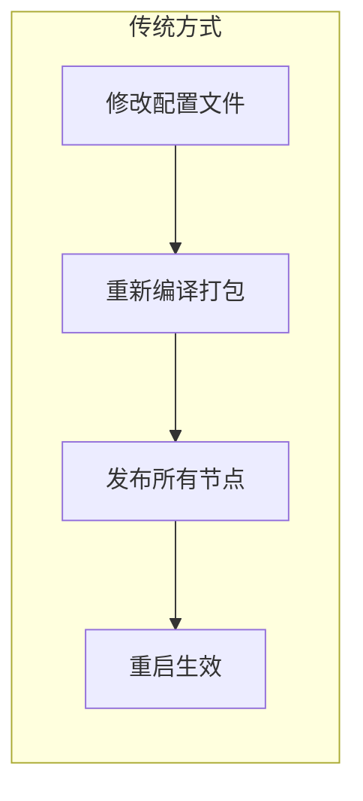

# 分布式配置中心-Apollo

本文主要讲解：配置中心解决的业务痛点、Apollo 基础知识以及如何使用、Apollo 架构设计，以及核心源码分析等内容。

## 配置中心

配置中心是用来统一管理配置信息的产品，配置中心可以在微服务等场景下极大地减轻配置管理的工作量，增强配置管理的服务能力。

目前主流的配置中心有 Apollo、Spring Cloud Config、Nacos 等开源产品，每款配置中心都能满足统一管理配置的需求，不同的点在于是否能够快速让用户使用、部署难度、功能细节、扩展方法是否足够友好。

### 产生的必然原因

在没有使用配置中心管理配置的时候，配置文件都是跟着项目走的，也就是存放在项目中的目录下，一个项目中可能有多个配置文件。

当项目发布的时候，会先编译打包，同时配置文件也会被打包进去，也就是配置文件会跟着项目一起发布。这样存在的问题是：需要修改配置的时候，必须重新在本地修改，然后重新发布才可以让新的配置生效。当请求压力越来越大，项目会从 1 个节点变成多个节点，此时如果配置需要发生变化，对应的修改操作是相同的，只需要在项目中修改一次即可，但发布操作的工作量比之前大了很多，因为要发布多个节点。

修改配置后逐个节点发布降低了整体的工作效率。为了提升工作效率，配置中心应运而生——将配置统一存放在配置中心进行管理。

### 配置中心管理配置

使用配置中心管理配置后，配置信息从项目中转移到配置中心。一般一个项目会有一个唯一的标识 ID（身份信息），通过这个 ID 从配置中心获取对应的配置内容。

主要的流程分为两个步骤：拉取和推送。拉取是在项目启动的时候通过配置中心拉取配置信息；推送则是配置中心必须具备的功能，如果没有推送功能，配置中心的重要性就大打折扣。

推送之所以是必备功能，是因为在配置中心修改配置之后，可以将配置实时地推送给客户端进行更新，项目不用重启、修改配置实时生效、延迟较低。如果没有推送功能，手动将数据存在数据库中、写个定时任务去拉取配置，同样可以做到配置统一管理，当然这是最简单的方式。

配置中心除了配置修改实时生效，还有很多其他的功能点，能够帮助解决经常碰到的问题，后文会仔细分析。

### 解决的痛点

配置中心可以解决日常工作中的很多痛点，总结为以下几点。

- 每个节点都要重启

没有使用配置中心之前，配置是跟着项目走的，会和项目一起发布。当部署多个节点以后，修改配置就需要每个节点重新发布，费时费力。

- 格式不规范

这个问题也很常见：很多项目中既有属性配置，也有 JSON 配置，甚至还有 TXT 的文本配置，五花八门。这个问题即使使用了配置中心仍可能存在——本质上是一个规范问题，配置中心本身支持多种配置文件类型，尽量在使用时进行统一，但配置中心的好处在于可以进行统一管理。

- 容易被错改

当配置文件跟着项目走的时候，为了区分多环境，一个配置文件对应一个环境，但配置文件容易被错改，比如线上的配置很有可能被改成线下的配置；配置文件都在项目中，所有人都可以修改。

- 没有历史记录

没有历史记录指的是对配置的修改没有直观的查看操作记录的地方。例如项目用 Git 管理，只能通过查找 Git 的修改记录来确认是谁修改的配置、改成了什么样，要恢复还得重新修改配置并提交。而在配置中心里可以直接在 Web 管理界面查看配置的修改记录，也可以直接一键回退到某个修改的版本。

- 安全性不高

配置跟代码存储在一起，一旦代码泄露就会导致配置信息也被别人知道，比如数据库等敏感信息是绝对不能泄露的。如果配置存放在配置中心里，就算源代码泄露了，别人也无法获取到这个项目的配置信息，配置仍旧是安全的。在配置中心里还可以将敏感的配置进行加密存储来提高安全性。

## Apollo 基础知识

### 简介

Apollo（阿波罗）是携程框架部门研发的分布式配置中心，能够集中化管理应用不同环境、不同集群的配置，配置修改后能够实时推送到应用端，并且具备规范的权限、流程治理等特性，适用于微服务配置管理场景。

### 主要功能

Apollo 的主要功能点如下。

- 统一管理不同环境、不同集群的配置

在 Apollo 中可以对配置进行环境的隔离，不同环境下的配置是不一样的，比如测试环境和线上环境。除了环境隔离还支持对集群的隔离。

- 配置修改实时生效（热发布功能）

如果修改后不能实时生效，还需要重启程序，使用配置中心就失去了意义，因此这是关键特性。

- 版本发布管理

在 Apollo 中修改任何配置都会生成对应的操作版本，当配置出现问题后，可以选择指定的版本进行回退。

- 灰度发布

通过灰度发布，可以在修改配置的时候先指定某个节点进行发布，然后观察这个节点的配置更新后有没有生效、有没有异常。如果一切正常，再将需要更新的配置在所有节点发布；如果有问题，回退到这个灰度发布节点的配置信息即可，影响面小很多。

- 权限管理、发布审核、操作审计

对于配置的操作都有相应的权限控制，防止生产环境的配置被乱改。

- 提供 Java 和 .Net 原生客户端，轻松集成，操作简单。

- 提供开放平台 API

如果项目不是使用 Java 和 .Net 语言，可以使用开放平台 API 进行配置的操作。

- 部署简单

很多框架在部署层面非常复杂，依赖各种环境和组件。Apollo 在这方面做得非常好：提供部署安装包和脚本，部署简单，对外部的依赖也少，目前只需要依赖 MySQL，用于存储配置数据。

### Apollo 和 Spring Cloud Config 对比

Spring Cloud 体系中自带的配置中心是 Spring Cloud Config。Apollo 与 Spring Cloud Config 各自的特点如下。

- 统一配置管理

Spring Cloud Config 的配置一般直接对接 Git 进行存储和管理；Apollo 中的配置信息存储在 MySQL 中（Apollo 依赖 MySQL）。

- 多环境区分

Apollo 和 Spring Cloud Config 都可以在客户端进行指定，Apollo 中还支持对集群的区分。

- 实时更新

Spring Cloud Config 还要集成 Bus 消息总线来实现；Apollo 则是用 HTTP 长连接实现的，不用依赖额外的组件。

- 定时拉取

假如推送失败，Apollo 还会有拉取的逻辑来更新配置；Spring Cloud Config 需要自行扩展来支持定时拉取功能。

- 权限控制

Spring Cloud Config 只能依赖 Git 的控制；Apollo 中有完整的权限控制。

- 版本管理

Spring Cloud Config 也只能依赖 Git；Apollo 有完整的功能实现。

- Web 管理后台

Spring Cloud Config 没有 Web 管理后台，只能使用 Git 的 Web 界面来修改配置；Apollo 有单独的后台来管理配置信息，非常方便。

总体来说，Apollo 有携程线上的业务实践，有 Web 后台管理，可以通过 Web 页面方便地管理配置。相较之下，使用 Spring Cloud Config 要么在本地修改后提交到 Git，要么使用 Git 的 Web 页面，比较不方便——Web 管理后台是 Apollo 最突出的优势。

### 概念介绍

- **应用**

应用就是指项目本身。Apollo 客户端在运行时需要知道应用的标识，从而可以根据这个标识去配置中心获取对应的配置。

应用的标识用 appId 来指定，指定方式有多种，Spring Boot 项目中建议直接配置在 application.properties 中，跟着项目走。

- **环境**

环境就是指常见的开发、测试、生产等，不同的环境对应的配置内容是不一样的。Apollo 客户端在运行时除了需要知道项目当前的身份标识，还需要知道当前项目对应的环境，从而可以根据环境去配置中心获取对应的配置。

指定项目当前环境的方式有多种，可以通过 Java System Property 或者配置文件来指定。目前支持的环境有 Local（本地环境，加载本地配置）、DEV（开发环境）、FAT（测试环境）、UAT（集成环境）、PRO（生产环境）。

- **集群**

在多机房的环境下，针对不同的机房可以划分出不同的集群，集群可以有不同的配置。指定项目对应集群的方式有多种，可以通过 Java System Property 或者配置文件来指定。

- **命名空间**

命名空间可以用来对配置做分类，不同类型的配置存放在不同的命名空间中，如数据库配置文件、消息队列配置、业务相关的配置等。命名空间还有公共的一个特性：可以让多个项目共用同一份配置，比如 Redis 集群配置。

- **权限控制**

通过权限控制可以防止配置被不相干的人误操作。比如对于开发人员，可以只分配测试环境的修改权限和发布权限，只有项目负责人才能有正式环境的权限。

## Apollo 使用

### 快速体验

官方为了方便了解 Apollo 的功能点，提供了快速体验的演示环境，可以通过演示环境（106.12.23.204:8070，账户/密码：apollo/admin）来熟悉 Apollo 的功能。

官方也提供了本地快速启动包，可以在 GitHub 上进行下载。下载后是一个压缩包，需要将 SQL 目录的脚本导入数据库中，然后修改 demo.sh 中的脚本，修改数据库的地址，最后执行 demo.sh start 来启动所有的服务。

### Spring Boot 集成 Apollo

在 Spring Boot 中集成 Apollo：首先在 pom 中加入 apollo-client 的依赖，然后在 application 属性文件中增加 Apollo 的配置信息。app.id 是项目的唯一标识，跟 Apollo 中的项目一一对应；apollo.meta 是 meta Server 的地址；namespaces 是需要加载的命名空间。上述配置中还缺少环境的配置，也就是当前的配置读取哪个环境下的信息——开发环境、测试环境还是生产环境。

Apollo 中环境的指定有多种方式。在实际使用中，推荐将环境和 meta Server 的地址配置在本地磁盘中，Linux 下配置路径是 /opt/settings/server.properties。为演示起见，也可以直接在启动的时候通过 System.setProperty 来指定对应的环境，启动类中指定了 DEV 环境。

下面演示配置的读取。第一种方式：直接注入 Config 接口，通过接口的 getProperty 方法获取配置信息。下面获取了配置 key 为 username 的配置，并指定了默认值——当配置中心无此配置时才会用默认值。访问接口可以看到输出的配置内容；在后台将配置的值修改后再次访问，可以看到值变成了最新修改的内容，秒级实时生效。

第二种方式是通过 Spring 的 @Value 注解来读取配置信息，冒号后是默认值，同样访问接口进行测试。

第三种方式是创建一个配置类，通过 @ConfigurationProperties 来读取。可以指定配置的前缀，将一组配置统一读取；使用时直接注入这个自定义的配置类，然后访问配置类的 get 方法获取对应的配置信息。

第四种是 @ApolloJsonValue 注解的使用。可以将配置的值存储成 JSON 格式，读取的时候使用 @ApolloJsonValue 将 JSON 格式的值直接转换成对应的实体对象，非常方便。

最后是配置变更监听的使用方式：只需要加一个 @ApolloConfigChangeListener 注解就可以对配置的变更进行监听，ConfigChangeEvent 可以获取变更的 key。监听可以用来实现很多扩展工作，比如动态刷新日志级别、动态控制限流速度等场景。

## Apollo 架构设计

Apollo 架构中的核心概念如下：

- **Config Service**

服务于 Client（项目中的 Apollo 客户端）对配置的操作，提供配置的查询接口，提供配置更新推送接口（基于 Http long polling）。

- **Admin Service**

服务于后台 Portal（Web 管理端），提供配置管理接口。

- **Meta Server**

Meta Server 是对 Eureka 的一个封装，提供了 HTTP 接口获取 Admin Service 和 Config Service 的服务信息。部署时和 Config Service 在一个 JVM 进程中，所以 IP、端口和 Config Service 一致。

- **Eureka**

用于提供服务注册和发现，Config Service 和 Admin Service 会向 Eureka 注册服务。为了简化部署流程，Eureka 在部署时和 Config Service 在一个 JVM 进程中，也就是说 Config Service 同时包含了 Eureka 和 Meta Server。

- **Portal**

后台 Web 界面管理配置，通过 Meta Server 获取 Admin Service 服务列表（IP + Port）进行配置的管理，客户端内做负载均衡。

- **Client**

Apollo 提供的客户端，用于项目中对配置的获取、更新。通过 Meta Server 获取 Config Service 服务列表（IP + Port）进行配置的管理，客户端内做负载均衡。

根据架构图分析 Apollo 的工作流程：

- 注册、续约、取消，也就是服务注册的操作（原理在 Eureka 相关章节中有介绍），Config Service 和 Admin Service 都会注册到 Eureka 中。

- 服务发现的逻辑：Client 需要知道所有的 Config Service，Portal 需要知道所有的 Admin Service，然后才能发起对应的操作。查找服务列表是通过负载进行转发到 Meta Server。

- Meta Server 去 Eureka 中获取对应的服务列表。

- 当获取到对应的服务信息后，就可以直接发起远程调用了。

### 推送设计

配置中心最重要的一个特性就是实时推送，正因为有这个特性，才可以依赖配置中心做很多事情。下图简要描述了配置发布的大致过程。

用户在 Portal 中进行配置的编辑和发布操作，Portal 会调用 Admin Service 提供的接口进行发布操作。Admin Service 收到请求后，发送 ReleaseMessage 给各个 Config Service，通知 Config Service 配置发生了变化。Config Service 收到 ReleaseMessage 后，通知对应的客户端，基于 HTTP 长连接实现。

### 消息设计

ReleaseMessage 消息是通过 MySQL 实现的一个简单消息队列。之所以没有采用消息中间件，是为了让 Apollo 在部署的时候尽量简单，尽可能减少外部依赖——多一个依赖就多一份维护的工作，同时也就多了一份故障的风险。

下图简要描述了发送 ReleaseMessage 的大致过程。

Admin Service 在配置发布后会往 ReleaseMessage 表插入一条消息记录，Config Service 会启动一个线程定时扫描 ReleaseMessage 表，查看是否有新的消息记录。Config Service 发现有新的消息记录，就会通知所有的消息监听器；消息监听器得到配置发布的信息后，会通知对应的客户端。

### 客户端设计

下图简要描述了 Apollo 客户端的实现原理。

客户端和服务端保持了一个长连接，保证配置的实时更新推送。定时拉取配置是客户端本地的一个定时任务，默认每 5 分钟拉取一次，也可以通过在运行时指定 System Property: apollo.refreshInterval 来进行覆盖，单位是分钟。采用推送 + 定时拉取的方式等于双保险。

客户端从 Apollo 配置中心服务端获取到应用的最新配置后，会保存在内存中。客户端还会把从服务端获取到的配置在本地文件系统中缓存一份，当服务或者网络不可用时可以使用本地的配置，也就是本地开发模式 env=Local。

### 集成 Spring

Apollo 除了支持 API 方式获取配置，也支持和 Spring/Spring Boot 集成，集成后可以直接通过 Spring 的 @Value 注解获取配置。集成的原理如下。

Spring 从 3.1 版本开始增加了 ConfigurableEnvironment 和 PropertySource：

- ConfigurableEnvironment 实现了 Environment 接口，并且包含了多个 PropertySource。

- PropertySource 可以理解为很多个 Key - Value 的属性配置。

在运行时的结构中需要注意：PropertySource 之间是有优先级顺序的，如果有一个 Key 在多个 PropertySource 中都存在，那么在前面的 PropertySource 优先级高。

集成的原理就是在应用启动阶段，Apollo 从远端获取配置，然后组装成 PropertySource 并插入到第一个即可。

### 可用性设计

Apollo 在高可用设计上考虑周全，逐项分析如下。

- **某台 Config Service 下线**

无影响，Config Service 可部署多个节点。

- **所有 Config Service 下线**

所有 Config Service 下线会影响客户端的使用，无法读取最新的配置。可以采用读取本地缓存的配置文件来过渡。

- **某台 Admin Service 下线**

无影响，Admin Service 可部署多个节点。

- **所有 Admin Service 下线**

Admin Service 服务于 Portal，所有 Admin Service 下线之后只会影响 Portal 的操作，不会影响客户端，客户端是依赖 Config Service 的。

- **某台 Portal 下线**

Portal 可部署多台，通过 Nginx 做负载，某台 Portal 下线之后不影响使用。

- **全部 Portal 下线**

对客户端读取配置没有影响，只是不能通过 Portal 去查看、修改配置。

- **数据库宕机**

当配置的数据库宕机之后，对客户端没有影响，但会导致 Portal 中无法更新配置。如果客户端重启，此时需要重新拉取配置，就会有影响。可采取开启配置缓存的选项来避免数据库宕机带来的影响。

综上，Apollo 在可用性方面对各种故障场景都有应对方案，可靠性较高。

## 核心源码分析

Apollo 推送这块的代码比较多，以下将推送部分的代码稍作简化后进行分析，便于理解核心原理（省略了许多细节，只为说明 Apollo 推送的核心机制）。

Apollo 的长连接主要分为四个步骤：

- 客户端向 Config Service 发起请求；

- 服务端通过 DeferredResult 异步方式，保持这个请求的同时释放容器线程；

- 如果这个时候配置有变更，直接返回 DeferredResult 结果；

- 如果配置没有变更，将 DeferredResult 存储到 map，并给 DeferredResult 设置超时时间，不响应结果。如果超时了，给客户端返回超时，客户端重新发起请求；如果中途发生了变更，从 map 中取出 DeferredResult，并通过 setResult 返回结果给客户端。

以上就是 Apollo 长连接推送的核心原理。下面逐步分析代码。

打开 NotificationControllerV2 类，其中定义了一个 AddMsg 的方法。发送 ReleaseMessage 的逻辑基于 AddMsg 接口，用于队列存储；测试的时候调用这个接口即可模拟配置有更新的情况，发送 ReleaseMessage 消息。

消息发送后，Config Service 会启动一个线程定时扫描 ReleaseMessage 表，查看是否有新的消息记录，然后通知客户端。这里同样启动一个线程去扫描 ReleaseMessage 表。打开 ReleaseMessageScanner 类，其中用一个线程一直负责读取队列，如果读到了数据就调用 NotificationControllerV2 中的 handleMessage 方法。handleMessage 就是当配置发生变化的时候，通知对应的客户端。

Apollo 的实时推送是基于 Spring DeferredResult 实现的。在 handleMessage() 方法中可以看到是通过 deferredResults 获取 DeferredResult，deferredResults 就是第一行的 Multimap，Key 其实就是消息内容，Value 就是 DeferredResult 的业务包装类 DeferredResultWrapper。

客户端接入流程：NotificationControllerV2 中提供了一个 /getConfig 的接口，客户端在启动的时候会调用这个接口，此时会执行 getApolloConfigNotifications() 方法获取是否有配置变更的信息。如果有的话证明配置修改过，直接就通过 deferredResultWrapper.setResult(newNotifications); 返回结果给客户端，客户端收到结果后重新拉取配置的信息进行覆盖本地的配置。

如果 getApolloConfigNotifications() 方法没有返回配置修改的信息，证明配置没有发生修改，就将 DeferredResultWrapper 对象添加到 deferredResults 中，等待后续配置发生变化时消息监听器进行通知。

在创建 DeferredResult 对象的时候指定了超时的时间和超时后返回的响应码。请求会挂起，如果 60 秒内没有消息监听器进行通知，那么这个请求就会超时，超时后客户端收到的响应码就是 304。

打开 ClientTest，首先启动 /getConfig 接口所在的服务，然后启动客户端。客户端就会发起注册请求：如果有修改直接获取结果，进行配置的更新操作；如果无修改，请求会挂起。这里客户端设置的读取超时时间是 90 秒，大于服务端的 60 秒超时时间。

每次收到结果后，无论是否有修改，都必须重新进行注册，通过这样的方式就可以达到配置实时推送的效果。可以调用之前写的 /addMsg 接口来模拟配置发生变化的情况，可以看到调用之后客户端就能马上得到返回结果。

## 小结

本文首先介绍了什么是配置中心及配置中心解决的业务痛点，然后对比了 Apollo 和 Spring Cloud Config 的优缺点，介绍了 Apollo 的基本概念及使用方式，重点分析了 Apollo 的架构设计（推送设计、消息设计、客户端设计、Spring 集成原理与可用性设计），最后剖析了 Apollo 基于 DeferredResult 的长连接推送核心源码。

## 版本差异（Spring Cloud 旧版 → 2025.x）

| 组件 | 旧版（本文编写时） | 当前（Spring Cloud 2025.x / Boot 3.5.x） |
|------|-------------------|------------------------------------------|
| 服务注册 | Eureka 1.x（Eureka 2.x 已终止开发） | Nacos 2.x / Consul（Eureka 1.x 仍随 Spring Cloud Netflix 维护） |
| 负载均衡 | Ribbon（已停止维护） | Spring Cloud LoadBalancer |
| 网关 | Zuul 1.x（已停止维护） | Spring Cloud Gateway（基于 WebFlux） |
| 熔断 | Hystrix（已停止维护） | Resilience4j / Sentinel |
| 配置中心 | Spring Cloud Config | Nacos Config / Apollo |
| 版本对应 | Hoxton/2020.x + Boot 2.x + JDK 8 | 2025.x + Boot 3.5.x + JDK 17+ |

> 本文为 Spring Cloud 旧版课程（Hoxton/2020.x 时代）。Hystrix、Ribbon、Zuul 1.x、Eureka 已停止维护，新项目请使用 Spring Cloud Gateway + LoadBalancer + Resilience4j（或 Alibaba 系 Nacos/Sentinel/Seata），并升级到 Spring Cloud 2025.x + Spring Boot 3.5.x。
