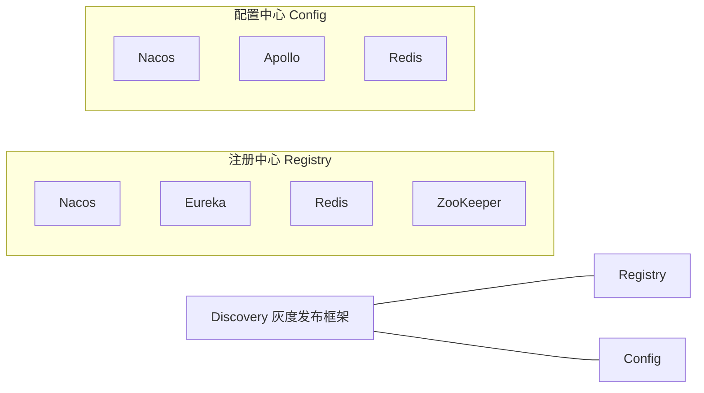

# 灰度发布实战

## 概念说明

灰度发布（又名金丝雀发布）是指在黑与白之间，能够平滑过渡的一种发布方式。在其上可以进行 A/B 测试，即让一部分用户继续使用产品特性 A，另外一部分用户开始使用产品特性 B，如果用户对特性 B 没有什么反对意见，那么逐步扩大范围，把所有用户都迁移到特性 B 上。灰度发布可以保证整体系统的稳定性，在初始灰度时就可以发现、调整问题。

很多开源框架也内置了灰度发布功能。例如配置中心 Apollo 对配置的修改可以选择灰度发布，推送到某个指定节点；如果该节点使用一段时间没有发生问题，就可以推送给全部节点；如果使用过程中出问题，直接回滚该节点的配置即可，对其他节点没有任何影响。如果没有灰度发布功能，一旦改动所有节点都生效，一个节点出问题，所有节点都会受影响。

灰度发布主要解决以下三大问题。

- **服务数量多，业务变动频繁，发布频繁。** 微服务架构下，拆分出来的服务数量成百上千，互联网的业务变动频繁，一周一迭代很正常，基本上每周都要发布新功能，每次发布涉及的服务数量都比较多。发布过程中难免出现问题，灰度发布可以做到不影响现有用户。

- **降低发布失败风险，减少影响范围。** 通过灰度发布，先让一部分用户体验新的服务，或者只让测试人员进行测试，等功能正常后再全部发布，从而降低发布失败带来的影响范围。

- **发布出现故障时可快速回滚，不影响用户。** 灰度发布只先发布一部分功能，比如只发布一个节点，而这个节点不接收正常用户的请求，只根据灰度规则处理指定用户的请求；灰度后发现该节点有问题，只需回滚这个节点即可，即使不回滚，通过灰度策略隔离也不会影响正常用户。

## 灰度发布策略

灰度发布通过一系列策略隔离请求，最常见的策略有用户策略、客户端策略、服务策略。

- **用户策略**

用户策略指对指定的用户进行灰度转发，例如让用户 ID 为 100 的用户访问灰度服务，让指定用户体验灰度和测试。

- **客户端策略**

客户端策略指让指定的客户端体验灰度功能，最常见的是 App 的内测功能：App 向部分优质用户推送消息，邀请其体验最新版功能。这相当于先发布内测版本让小部分用户使用，观察这部分用户的使用情况，没有问题再发布真正的版本。

- **服务策略**

服务策略指对指定的服务，在发布后将其变成灰度服务，此时不让正常用户请求到，一般使用 IP 加端口的方式进行隔离。

此外还有其他使用场景，例如线上某个服务出故障，需要花时间排查问题，又不能重启服务（重启意味着现场被破坏），此时可将该服务通过灰度方式隔离，不影响正常请求，再对其进行故障排查。

## Discovery 原理

Discovery 是基于 Spring Cloud 的服务注册发现、Ribbon 负载均衡、Feign 和 RestTemplate 调用等组件全方位增强的企业级微服务开源解决方案，包括灰度发布、灰度路由、服务隔离等功能。其 GitHub 地址为 [https://github.com/Nepxion/Discovery](https://github.com/Nepxion/Discovery)。

在项目中使用 Discovery 实现灰度发布非常简单，Discovery 支持多种策略，同时也支持主流的注册中心和配置。



Discovery 可用于实现灰度发布、服务隔离等高级功能。它的实现原理并不复杂：灰度发布最重要的是识别请求，然后将请求转发到匹配的服务上，具体可通过 Ribbon 的算法类实现。

除了控制 Ribbon 的路由，还需要将客户端带来的灰度信息一层层传递下去，可以将信息从 HTTP 请求头中带过去。

从上图可以看出，Discovery 对注册中心的支持非常全面，支持主流的注册中心：Nacos、Eureka、Redis、Zookeeper。

对配置中心的支持同样全面，支持 Nacos、Apollo、Redis。可以将灰度发布的规则放入配置中心，修改实时生效。

## Discovery 灰度发布实现

```mermaid
flowchart TD
  A[客户端发起请求<br/>携带灰度标识(请求头/标签)] --> B[灰度路由拦截<br/>识别请求中的灰度信息]
  B --> C[Ribbon 自定义路由算法<br/>根据灰度规则匹配目标服务]
  C --> D{目标服务命中灰度规则?}
  D -- 是 --> E[转发到灰度版本服务<br/>仅灰度用户可见新功能]
  D -- 否 --> F[转发到稳定版本服务]
  E --> G[灰度信息通过请求头逐层传递]
  F --> G
```

以下准备三个服务作为灰度发布的演示环境：一个 Zuul 网关、一个 article 服务、一个 user 服务。调用流程是网关到 article 服务，article 服务中再调用 user 服务。默认运行中的服务是 V1 版本；增加新功能需要发布 V2 版本时，要对正式用户不可见、只让测试访问，等测试没问题后再对正式用户开放，然后停掉 V1 版本。

使用 Discovery 需加入相关的 Maven 依赖：在网关中加入 Zuul、Eureka、Apollo 三个依赖；不需要配置中心时可以省略 Apollo 依赖；使用其他注册中心时也可以选择对应的依赖。在 user 和 article 服务中同样需要加入对应的依赖。如果使用了 Hystrix 的线程隔离，还需要加入 Discovery 的 Hystrix 模块依赖，用于处理线程切换后 ThreadLocal 信息丢失的问题。

在实际工作中，线上机器资源有限，增加大量机器会增加成本。因此部署新版本时通常不是重新部署一套再将流量切过去，而是将老的服务实例停掉，替换成新版本的实例。

假设每个服务有 2 个以上节点，可以通过网关来做灰度发布，因为网关重启的几率小，即使重启仍有 Nginx 可以进行自动剔除。灰度发布的实现主要通过网关路由的内部服务，具体步骤如下：

- 首先将需要发布的服务从转发过程中移除，等流量剔除之后再发布。

- 流量剔除之后，直接重新发布这个服务，metadata 中的版本进行升级，默认还是请求老的服务，新的服务通过版本来支持测试请求。

- 测试完成之后，让新的版本接收正常流量，然后部署下一个节点，以此类推。

基于 Discovery 自定义灰度路由策略可以满足上述灰度发布需求。首先定义一个配置实体类，对应 Apollo 中的配置信息，支持版本和 IP 端口两种灰度方式。

然后通过实现 DiscoveryEnabledStrategy 来决定对应的 Server 是否能够被转发。逻辑为：首先判断请求是否带有 n-d-version 这类的请求头，如果有就不往下执行，以外部带入的为准；最后获取 server 的版本并与配置中的版本进行比较，如果当前 server 的版本在配置里存在，则说明这个版本是灰度版本，不能被转发，直接过滤掉。

IP 端口判断的方式与此相同。以上是网关中的处理方式，内部服务中的处理方式一致，实际项目中可将这部分逻辑抽出来共用。如果 article-service 需要发布新版本，在发布之前会将元数据中的版本升级，然后在配置中心指定这个版本为灰度版本，这样重新发布后正常请求就不会请求到这个灰度服务。

配置内容为：

grayVersions = {"discovery-article-service":["1.01"]}。


效果演示：重新启动一个版本为 1.01 的 article-service 服务，然后访问对应的接口。可以看到正常的请求仍然请求到之前的 article-service；新版本 1.01 由于在配置中心里被指定为灰度版本，正常请求不能访问，但可以在请求头中增加 n-d-version 来访问这个灰度版本。等该版本没有问题后，将配置中心里的灰度内容去掉，该服务即可被正常请求访问，然后继续发布下一个实例。通过这样的方式即实现了灰度发布功能。

## Discovery 实现多版本调用隔离


多版本隔离调用的使用场景较多。以互联网公司常见的多需求并行开发为例：一个完整的需求需要独立上线，对应单独的代码分支。

测试环境部署时，一个分支部署一个实例，各分支的功能相互独立、互不影响。

由于注册中心是同一个，两个分支的实例都注册上去后，从网关或服务中请求对应接口时会基于 Ribbon 的算法选择实例发起请求。这意味着 A 分支的测试人员可能访问到 B 分支发布的实例，B 分支的测试人员也可能访问到 A 分支发布的实例，产生交叉错乱。

需要实现的效果就是隔离：通过多版本调用的隔离解决该问题。两个分支对应两个不同的版本，请求可以指定访问哪个版本，避免交叉调用。

具体做法是让对应的客户端在请求头中通过 n-d-version 指定访问的版本，后端在网关中转发时，或在服务中通过 Feign 和 RestTemplate 调用时，都会根据 n-d-version 的信息请求对应版本的服务。

## Discovery 实现本地复用测试服务

开发中常见这样一个问题：只需要修改一个服务，但该服务依赖了其他 3 个服务，导致本地也要启动那 3 个服务，还要启动一个 Eureka 注册中心。问题显而易见：在依赖过多的情况下，本地需要启动很多无需修改的服务。

### 本地复用测试服务-Eureka Zone


Eureka 中有 region 和 zone 的概念。

- **region**

可以简单理解为地理上的分区，比如北京、上海等，没有具体大小的限制。根据项目具体情况可以自行合理划分 region。

- **zone**

可以简单理解为 region 内的具体机房。例如 region 划分为北京，北京有两个机房，就可以在此 region 之下划分出 zone1、zone2 两个 zone。

调用的过程中会优先选择相同的 zone 发起调用，当找不到相同名称的 zone 时会选择其他的 zone 进行调用。可以利用这个特性解决本地需要启动多个服务的问题。

测试环境中部署了所有服务，需要将测试环境服务的 zone 改成同一个值，这可以在 Apollo 中指定：

```properties
eureka.instance.metadata-map.zone=test
```

本地开发时，将 Apollo 的环境改成本地开发模式：

```properties
env=Local
```

然后修改本地缓存的配置文件，将需要修改的那个服务的 zone 改成本地特有的值，只要不与测试环境一样即可：

```properties
eureka.instance.metadata-map.zone=local
```

如果需要修改 2 个服务，就改 2 个。这样访问修改的服务 A 时，假设 A 依赖 B、C、D 三个服务，其中 B 和 C 本地没有启动，D 服务也需要修改并在本地启动：D 服务有相同的 zone 就会优先调用本地的 D 服务；B 和 C 找不到相同的 zone 就会选择其他的 zone 进行调用，即调用到测试环境部署的 B 和 C 服务。这样就解决了本地部署多个服务的问题。

测试环境的调用会优先选择测试的 zone 进行调用，因此不会影响测试环境，前提是测试环境的服务都要处于启动状态，否则会调用到开发人员本地的注册服务上。

### 本地复用测试服务-版本指定


使用 Discovery 同样可以实现本地复用：本地测试时通过版本控制访问的服务，即在请求头中指定 n-d-version 的值。本地修改的服务，版本需要设置成唯一的，不能与测试环境冲突；不需要修改的服务直接依赖测试环境已有的即可。例如 A 服务需要修改且依赖 B 服务，本地不需要启动 B 服务，只需指定 A 服务的版本为本地刚修改的版本，B 服务的版本为测试环境的版本，即可实现服务复用效果。

### 本地复用测试服务-IP端口指定


除了通过版本实现复用效果，通过 IP+端口的形式也可以：只需将 n-d-version 改成 n-d-address，然后配置每个服务能够访问的 IP+端口信息，就能控制这次调用使用哪些服务。

需要注意的是，如果测试环境不在公司的内网里会存在一个问题：本地需要修改服务 C，但服务 C 是通过服务 B 调用的，服务 B 没有改动、本地不想启动，此时触发服务 C 的是测试环境的服务 B，所以必须保证网络通畅，否则测试环境无法访问到本机服务。

除上述方式外，还有一种基于环境隔离的复用方式。

**环境隔离和路由**：基于元数据 Metadata 的 env 参数进行隔离，当调用端实例和提供端实例的元数据 Metadata 环境配置值相等时才能调用。环境隔离下，调用端实例找不到符合条件的提供端实例时，会把流量路由到一个通用或者备份环境，有点类似 Eureka 中 Zone 的隔离方式。

## Discovery 核心源码分析

先看 Zuul 中如何根据 n-d-version 来选择对应服务实例版本。

discovery-plugin-strategy-starter-zuul.jar 是 Zuul 相关的代码，核心关注过滤器。请求信息的传递在 AbstractZuulStrategyRouteFilter 中，里面的逻辑主要是将版本、地区等信息添加到请求头中，传递给后端服务。

真正控制路由转发的是 discovery-plugin-strategy.jar，在 rule 包下是 Ribbon 的算法类。在 DiscoveryEnabledZoneAvoidancePredicate 类的 apply 方法中会对服务实例进行判断：返回 false 表示这个服务实例不能被使用，返回 true 表示可以被使用。

判断主要分为三种类型：版本的判断、区域的判断、地址的判断，对比的信息需要从服务实例中获取，也就是注册中心的元数据中。

只要控制了 Ribbon，就可以实现很多扩展功能，灰度发布正是这一思路的典型应用。

再看后端服务中如何根据 n-d-version 来选择对应的服务实例版本。原理相同，也是通过 Ribbon 的算法进行控制，关键在于如何获取到网关或其他服务传递过来的请求信息。

FeignStrategyInterceptor 是 Feign 的拦截器，可以在其中将信息进一步传递给其他被调用的服务；RestTemplateStrategyInterceptor 是 RestTemplate 的拦截器，做的事情相同。

DefaultCallableWrapper 用于处理 Hystrix 线程池隔离下 ThreadLocal 取值失效的问题。这也体现了一个通用规律：线程上下文传递这类基础原理可以在 Ribbon 路由、Feign 拦截器、Hystrix 隔离等多个组件场景中复用。

## 实践要点

- 灰度规则放入配置中心（Apollo/Nacos 等），修改实时生效，避免重新发布。
- 发布流程：先剔除流量 → 升级 metadata 版本重新发布 → 灰度验证 → 去掉灰度配置放量 → 逐节点滚动。
- 灰度信息通过 HTTP 请求头（n-d-version / n-d-address）携带，并在网关与后端服务之间逐层传递；使用 Hystrix 线程隔离时必须加入 Discovery 的 Hystrix 模块处理 ThreadLocal 丢失。
- 多分支并行开发场景用多版本调用隔离避免交叉调用；本地开发场景可用 Eureka Zone、版本指定或 IP+端口指定复用测试环境服务，减少本地启动数量。

## 小结

- 灰度发布通过用户、客户端、服务三类策略隔离请求，解决频繁发布、发布失败影响范围、故障快速回滚三大问题。
- Discovery 框架的核心实现点在 Ribbon 算法类（DiscoveryEnabledZoneAvoidancePredicate.apply）与请求头信息传递（Zuul 过滤器、Feign/RestTemplate 拦截器、CallableWrapper）。
- 同一套版本/地址隔离机制可同时服务于灰度发布、多版本隔离与本地服务复用三类场景。

## 版本差异（Spring Cloud 旧版 → 2025.x）

| 组件 | 旧版（本文编写时） | 当前（Spring Cloud 2025.x / Boot 3.5.x） |
|------|-------------------|------------------------------------------|
| 服务注册 | Eureka 1.x（Eureka 2.x 已终止开发） | Nacos 2.x / Consul（Eureka 1.x 仍随 Spring Cloud Netflix 维护） |
| 负载均衡 | Ribbon（已停止维护） | Spring Cloud LoadBalancer |
| 网关 | Zuul 1.x（已停止维护） | Spring Cloud Gateway（基于 WebFlux） |
| 熔断 | Hystrix（已停止维护） | Resilience4j / Sentinel |
| 配置中心 | Spring Cloud Config | Nacos Config / Apollo |
| 版本对应 | Hoxton/2020.x + Boot 2.x + JDK 8 | 2025.x + Boot 3.5.x + JDK 17+ |

> 本篇基于 Spring Cloud 旧版（Hoxton/2020.x 时代）编写。Hystrix、Ribbon、Zuul 1.x、Eureka 已停止维护，新项目请使用 Spring Cloud Gateway + LoadBalancer + Resilience4j（或 Alibaba 系 Nacos/Sentinel/Seata），并升级到 Spring Cloud 2025.x + Spring Boot 3.5.x。
