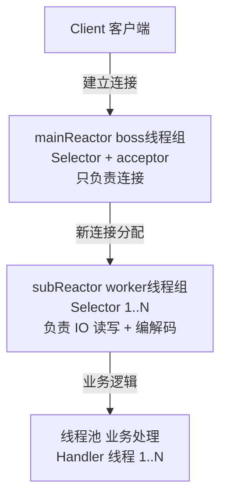

# Netty 核心

Netty 是 Java 生态中最常用的高性能网络通信框架之一。很多 RPC 框架、消息中间件客户端、网关、IM 服务、WebSocket 服务，底层都直接或间接使用了 Netty。

学习 Netty 的重点不是死记硬背 API，而是理解它如何围绕 `NIO`、事件驱动、线程模型、内存管理和协议编解码，构建出一套适合高并发场景的网络编程模型。面试问答与实战案例见 [Netty 面试要点与实战补充](03-Netty面试要点与实战补充.md)，长连接心跳的工程实践见 [HTTP 长连接与心跳机制](02-HTTP长连接与心跳机制.md)。

## 概念与背景

### 什么是 Netty

Netty 可以看作是对 Java `NIO` 的工程化封装。它在 `Selector`、`Channel`、`Buffer` 这些底层能力之上，补齐了网络开发真正难写、也最容易写错的部分，例如：连接生命周期管理、线程模型组织、编解码与协议拆包、粘包半包处理、异常传播与资源释放、内存池与高性能缓冲区。

因此，Netty 并不是"更快的 Socket API"，而是一套成熟的异步事件驱动网络框架。

### 为什么需要 Netty

直接使用原生 `BIO` 或 `NIO` 都有明显问题。`BIO` 一个连接往往对应一个线程，连接数上升到几千、几万时线程数量膨胀、上下文切换成本变高、栈内存占用显著增加、吞吐下降。

原生 `NIO` 虽然解决了"一连接一线程"的问题，但实际开发仍然很繁琐：`Selector` 事件循环代码模板化且冗长、连接状态与异常处理容易遗漏、自定义协议的拆包组包复杂、`ByteBuffer` 使用不够灵活、业务逻辑和网络逻辑容易耦合。

Netty 的价值就在于：把这些通用且复杂的网络编程问题抽象成稳定的组件和处理链，让业务代码更多聚焦在协议和业务本身。

### Netty 解决的四类问题

从工程角度看，Netty 主要解决了四类问题：

1. **连接管理复杂**：建连、断开、异常、空闲超时、写缓冲区状态等事件统一由 `Channel` 和 `ChannelHandler` 管理，而不是散落在业务代码里。
2. **原生 NIO 编程成本高**：用 `EventLoop`、`ChannelPipeline`、`Future/Promise`、编解码器体系把模板代码封装成可组合的开发模型。
3. **协议边界处理困难**：TCP 是字节流协议，Netty 提供成熟的拆包器和编码器降低粘包半包错误率。
4. **高并发下性能与稳定性要求高**：线程数可控、内存可控、阻塞可隔离、故障易恢复。

Netty 常见于 RPC 框架、网关/代理、WebSocket/IM/推送、自定义二进制协议通信等场景。如果只是一个并发量不高、协议也很简单的短连接接口，未必必须使用 Netty——框架选择应基于复杂度和收益。

## Reactor 模型与 EventLoop

Netty 的底层思想可以概括为 Reactor 模型：

- Reactor 负责感知 IO 事件
- `EventLoop` 负责轮询事件并分发任务
- `Handler` 负责处理连接、解码、业务逻辑和响应

在 Netty 中，一个 `EventLoop` 通常绑定一个固定线程，这个线程会持续执行两类工作：处理该线程负责的 `Channel` 上的 IO 事件，以及执行提交到该 `EventLoop` 的普通任务和定时任务。这种设计避免了频繁创建线程，降低了切换开销，并保证同一个 `Channel` 上的事件串行执行。源码层面 `EventLoop` 继承自 `SingleThreadEventLoop`，最终落到 `NioEventLoop`（NIO 实现）与 `EpollEventLoop`（Linux epoll 实现）；其 `run()` 循环的核心是"计算选择策略 → 阻塞等待 IO 事件 → 处理 IO 事件 → 按 `ioRatio` 控制比例执行任务队列"，并通过 `selectCnt` 计数检测 JDK 空轮询 Bug，超过阈值后重建 Selector。

### 三种 Reactor 线程模型

| 模型 | 结构 | 特点 | 问题 |
|---|---|---|---|
| 单 Reactor 单线程 | 所有 IO 在一个线程完成 | 实现简单，无线程通信开销 | 无法利用多核；一个 Handler 阻塞拖垮全部连接 |
| 单 Reactor 多线程 | Reactor 负责 IO，业务交给线程池 | 充分利用多核 | Reactor 仍需处理所有 IO，高并发时是瓶颈 |
| 主从 Reactor 多线程（Netty 默认） | mainReactor 管连接，subReactor 管 IO 读写 + 编解码 | 职责分离，性能最优 | 生产环境推荐方案 |



### bossGroup 与 workerGroup

服务端通常会有两个线程组：

- `bossGroup`：负责接收客户端连接（"接待线程"），通常 1 个线程即可
- `workerGroup`：负责处理连接建立后的读写事件（"工作线程"），默认 CPU 核心数 * 2

常见流程是：端口绑定后 `bossGroup` 收到连接请求，新连接注册到某个 `workerGroup` 中的 `EventLoop`，之后这个连接的读写、编解码、业务处理，都主要由对应的 `worker` 线程推进——这也是为什么同一个连接上的大部分处理具备天然的顺序性。

```java
// 推荐配置
EventLoopGroup bossGroup = new NioEventLoopGroup(1); // boss 只需 1 个线程
EventLoopGroup workerGroup = new NioEventLoopGroup(); // 默认 CPU 核心数 * 2

// 线程数计算公式
int threadCount = Math.max(1, SystemPropertyUtil.getInt(
    "io.netty.eventLoopThreads",
    NettyRuntime.availableProcessors() * 2
));
```

一条实践铁律：**不要阻塞 `EventLoop` 线程**。一个 `EventLoop` 往往不只服务一个连接，线程被耗时任务卡住时，它负责的所有连接都会一起受影响。耗时逻辑必须交给业务线程池（见[面试与实战补充](03-Netty面试要点与实战补充.md)）。

## Netty 核心组件

### Channel：连接的抽象

`Channel` 是 Netty 对网络连接或 IO 通道的抽象，核心方法包括 `eventLoop()`、`pipeline()`、`isActive()`、`writeAndFlush()`、`close()` 等。常见实现：

| Channel 类型 | 描述 | 适用场景 |
|---|---|---|
| NioSocketChannel / NioServerSocketChannel | 基于 Java NIO | 跨平台通用 |
| EpollSocketChannel / EpollServerSocketChannel | 基于 Linux epoll | Linux 高并发 |
| KQueueSocketChannel | 基于 macOS/BSD kqueue | macOS/BSD |
| LocalChannel | 本地进程内通信 | 测试、管道通信 |
| EmbeddedChannel | 嵌入式测试通道 | 单元测试 |

`Channel` 生命周期由注册/激活状态流转刻画：`channelRegistered → channelActive → channelInactive → channelUnregistered`，对应注册到 EventLoop、可读写、连接断开、从 EventLoop 注销四个关键节点。

### ChannelPipeline：责任链

每个 `Channel` 都会绑定一个 `ChannelPipeline`。它本质上是一条责任链，由 `head` 和 `tail` 两个固定节点串起一组 `ChannelHandlerContext`，用来组织一组 `ChannelHandler`：

```text
Inbound 事件: Head → Handler1 → Handler2 → Tail
Outbound 事件: Tail → Handler2 → Handler1 → Head
```

```java
// 服务端 Pipeline 典型配置
channel.pipeline()
    // ===== 入站处理器 (从前到后) =====
    .addLast("frameDecoder", new LengthFieldBasedFrameDecoder(1024, 0, 4, 0, 4))
    .addLast("stringDecoder", new StringDecoder(StandardCharsets.UTF_8))
    .addLast("idleStateHandler", new IdleStateHandler(60, 0, 0))
    .addLast("heartbeatHandler", new HeartbeatHandler())
    .addLast("businessHandler", new BusinessHandler())
    // ===== 出站处理器 (从后到前) =====
    .addLast("stringEncoder", new StringEncoder(StandardCharsets.UTF_8))
    .addLast("frameEncoder", new LengthFieldPrepender(4))
    .addLast("exceptionHandler", new ExceptionHandler());
```

### ChannelHandler：入站与出站

`ChannelHandler` 是 Netty 里最核心的扩展点，分为两大类：

| 特性 | ChannelInboundHandler | ChannelOutboundHandler |
|---|---|---|
| 处理方向 | 入站 (从网络到应用) | 出站 (从应用到网络) |
| 事件流向 | 从 Head 到 Tail | 从 Tail 到 Head |
| 典型事件 | channelRegistered、channelActive、channelRead、channelInactive | bind、connect、write、flush、close |
| 典型用途 | 解码、认证、业务处理、心跳 | 编码、日志、统计 |

入站事件从前往后传播（`channelRead` 等通过 `ctx.fireChannelRead(msg)` 传递），出站事件从后往前传播（`write`、`flush` 等）。不调用 `fireXxx` 方法即可短路事件传播（典型场景是认证失败直接关闭连接）。

**Handler 顺序的重要性**：出站处理器必须加在业务处理器之后，否则写入的数据无法经过编码器：

```java
// √ 正确顺序:入站解码在前,出站编码在后
pipeline.addLast("decoder", new StringDecoder());      // 入站
pipeline.addLast("business", new BusinessHandler());   // 入站
pipeline.addLast("encoder", new StringEncoder());      // 出站
```

## ByteBuf 与内存管理

### 为什么不直接使用 ByteBuffer

Netty 设计了 `ByteBuf` 而不是直接用 `ByteBuffer`：读写索引分离（双指针，无需 `flip()`）、动态扩容、支持堆内与堆外内存、配合内存池复用、提供切片与组合等零拷贝能力。在高并发网络场景下，缓冲区的分配和回收频率非常高，池化能显著降低 GC 压力。

```text
      +-------------------+------------------+------------------+
      | discardable bytes |  readable bytes  |  writable bytes  |
      +-------------------+------------------+------------------+
      0      <=      readerIndex   <=   writerIndex    <=    capacity
```

### 零拷贝

Netty 的零拷贝不仅是操作系统层面，更包括应用层面：

- `slice()` / `duplicate()`：共享底层数组，无数据复制
- `CompositeByteBuf`：多个缓冲区逻辑组合，无需先合并再拷贝
- `FileRegion`：封装 `sendfile` 系统调用，文件传输零拷贝
- 堆外内存（DirectByteBuf）：避免 JVM 堆与内核态之间的复制

### 引用计数与资源释放

Netty 缓冲区采用引用计数机制：使用中引用计数大于 0，不再使用时必须释放归零，否则直接内存泄漏。业务处理中最省心的选择是 `SimpleChannelInboundHandler`，它在处理完成后自动释放入站消息；若使用 `ChannelInboundHandlerAdapter`，必须在 `finally` 中调用 `ReferenceCountUtil.release(msg)`。开发环境可用 `-Dio.netty.leakDetection.level=PARANOID` 开启泄漏检测。

## 粘包、半包与协议设计

### 为什么会出现粘包和半包

TCP 只保证字节流可靠传输，不保证应用层消息边界。发送端写入两条消息 A、B，接收端可能一次读到半条 A、完整 A+B、或 A 加半条 B。问题的本质不是"网络不稳定"，而是应用层没有定义好消息边界。

### 常见解决方案

| 方案 | 思路 | 适用场景 |
|---|---|---|
| 固定长度协议 | 每条消息长度固定（`FixedLengthFrameDecoder`） | 长度稳定的简单协议，空间利用率低 |
| 分隔符协议 | 特殊字符分隔（`LineBasedFrameDecoder`、`DelimiterBasedFrameDecoder`） | 文本协议，需考虑转义 |
| 长度字段协议 | 消息头声明包体长度（`LengthFieldBasedFrameDecoder`） | 二进制协议、变长消息，最通用 |

### LengthFieldBasedFrameDecoder

最值得掌握的是长度字段拆包器。假设协议格式为 `[4字节消息长度][消息体]`：

```java
// 协议格式: [长度(4字节)][消息体]
pipeline.addLast(new LengthFieldBasedFrameDecoder(
    1024,   // 最大帧长度
    0,      // 长度字段偏移量
    4,      // 长度字段长度
    0,      // 长度调整值
    4       // 跳过长度字段
));
pipeline.addLast(new StringDecoder(StandardCharsets.UTF_8));
pipeline.addLast(new StringEncoder(StandardCharsets.UTF_8));
pipeline.addLast(new LengthFieldPrepender(4));  // 出站时自动补长度字段
```

它通过"先读取长度字段，再按长度读取完整消息"的方式，为 TCP 字节流建立应用层消息边界。带版本号、魔数等更复杂的协议，通过调整 `lengthFieldOffset`、`lengthAdjustment`、`initialBytesToStrip` 三个参数即可适配。

## 一个最小服务端示例

```java
public class NettyEchoServer {

    public static void main(String[] args) throws InterruptedException {
        EventLoopGroup bossGroup = new NioEventLoopGroup(1);
        EventLoopGroup workerGroup = new NioEventLoopGroup();

        try {
            ServerBootstrap serverBootstrap = new ServerBootstrap();
            serverBootstrap.group(bossGroup, workerGroup)
                    .channel(NioServerSocketChannel.class)
                    .option(ChannelOption.SO_BACKLOG, 1024)
                    .childOption(ChannelOption.SO_KEEPALIVE, true)
                    .childHandler(new ChannelInitializer<SocketChannel>() {
                        @Override
                        protected void initChannel(SocketChannel channel) {
                            channel.pipeline()
                                    // 入站：先按长度字段拆包
                                    .addLast(new LengthFieldBasedFrameDecoder(1024, 0, 4, 0, 4))
                                    // 入站：把 ByteBuf 解码成字符串
                                    .addLast(new StringDecoder(StandardCharsets.UTF_8))
                                    // 出站：在响应前补 4 字节长度字段
                                    .addLast(new LengthFieldPrepender(4))
                                    // 出站：把字符串编码成字节流
                                    .addLast(new StringEncoder(StandardCharsets.UTF_8))
                                    // 业务处理
                                    .addLast(new SimpleChannelInboundHandler<String>() {
                                        @Override
                                        protected void channelRead0(ChannelHandlerContext ctx, String message) {
                                            ctx.writeAndFlush("服务端响应：" + message);
                                        }

                                        @Override
                                        public void exceptionCaught(ChannelHandlerContext ctx, Throwable cause) {
                                            cause.printStackTrace();
                                            ctx.close();
                                        }
                                    });
                        }
                    });

            serverBootstrap.bind(8080).sync().channel().closeFuture().sync();
        } finally {
            bossGroup.shutdownGracefully().sync();
            workerGroup.shutdownGracefully().sync();
        }
    }
}
```

这个示例体现了组件栈的配合：`bossGroup` 只负责接收连接，`workerGroup` 负责读写事件，`LengthFieldBasedFrameDecoder` 解决粘包半包，`StringDecoder/StringEncoder` 负责编解码，`SimpleChannelInboundHandler` 处理业务并自动释放消息资源。如果把拆包器拿掉直接按字符串读取，客户端高频发送消息时就可能出现边界错乱。

## Netty 高性能设计要点

Netty 的性能来自一整套设计，而不是某一个点的"黑科技"：

- **事件驱动减少线程成本**：`EventLoop` 把多个连接复用到较少的线程上，降低线程数、阻塞等待与上下文切换
- **Pipeline 机制拆分职责**：编解码、鉴权、心跳、业务、异常拆成多个 `Handler`，系统更易演进和定位瓶颈
- **ByteBuf 与池化降低内存压力**：更适合网络场景的缓冲区模型 + 内存池减少分配回收的 GC 压力
- **零拷贝**：`FileRegion`、`CompositeByteBuf`、`slice()`，重点是减少不必要的数据复制与中间对象
- **底层传输工程化封装**：Linux 下 `epoll` 原生实现让高连接数场景更有优势

具体的参数调优（`SO_BACKLOG`、`TCP_NODELAY`、水位线等）与生产优化实践见[面试与实战补充](03-Netty面试要点与实战补充.md)。

## 小结

理解 Netty，至少要真正掌握下面几件事：

- 它是对 `NIO` 的工程化封装，而不是单纯的 API 包装
- 高性能的核心在于事件驱动、线程模型和内存管理
- `Channel`、`Pipeline`、`Handler` 构成了 Netty 的主干
- 粘包半包本质上是协议边界问题，不是"读几次"的问题
- 阻塞 `EventLoop`、忽视 `ByteBuf` 生命周期、协议设计粗糙，都是典型的实战坑

## 版本差异(旧版 → 当前)

| 特性 | 旧版（本文编写时） | 当前 |
|------|-------------------|------|
| Java NIO | JDK 8 | JDK 21 NIO 不变；虚拟线程可简化 IO 密集编程 |
| Netty | 4.1.x | 4.1.x 持续维护（最主流高性能网络框架） |
| HTTP | HTTP/1.1 | HTTP/2、HTTP/3（QUIC）逐步普及 |
| 心跳机制 | 自定义 | 不变；可结合 HTTP/2 PING 帧 |

> 网络编程基础（TCP/UDP、NIO、事件驱动）原理不变；Java 21 虚拟线程为 IO 密集场景提供新选择，Netty 4.1 仍是最主流的高性能网络框架选择。
