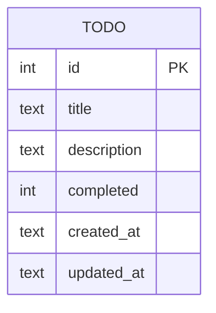
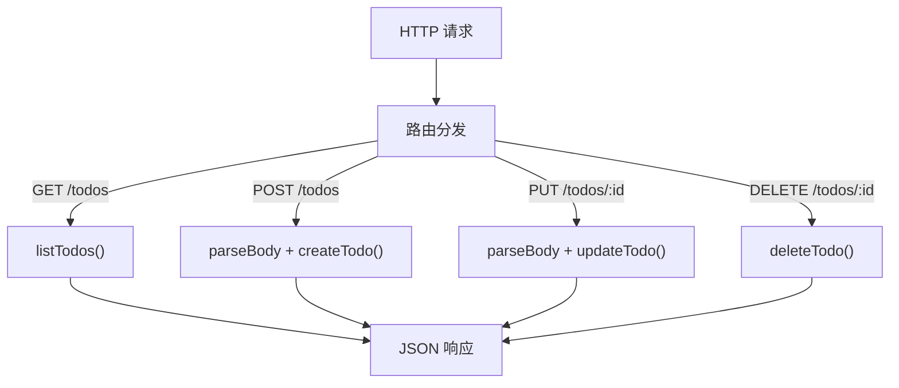

# SQLite

## 概述

SQLite 是嵌入式关系型数据库，无需独立服务进程，数据库以单文件形式存储。适合中小规模应用、原型开发、桌面/移动应用和测试场景。在 Node.js 中选择它，主要因为：

- **零配置**：无需安装独立的数据库服务器
- **便携性**：整个数据库存储在单个文件中
- **性能优秀**：对于中小型应用性能表现出色
- **跨平台**：支持各种操作系统
- **广泛应用**：被众多移动应用和桌面应用采用

Node.js 22 开始内置了 `node:sqlite` 模块（实验性），零依赖场景可以直接使用；生产环境更推荐成熟的第三方包（见「安装与工具链选择」）。

## SQLite vs 其他数据库

| 维度 | SQLite | MySQL | PostgreSQL | MongoDB |
|------|--------|-------|------------|---------|
| 部署方式 | 嵌入式（单文件） | 独立服务 | 独立服务 | 独立服务 |
| 配置复杂度 | 零配置 | 中等 | 中等 | 中等 |
| 并发写入 | 单写者 | 多写者 | 多写者 | 多写者 |
| 并发读取 | 高 | 高 | 高 | 高 |
| 数据量上限 | ~281 TB | 取决于配置 | 取决于配置 | 取决于配置 |
| 适用场景 | 原型/小型应用/测试 | Web 应用 | 复杂查询 | 文档型数据 |

### 使用场景对比

### 使用场景对比

| 场景       | SQLite      | MySQL/PostgreSQL |
| ---------- | ----------- | ---------------- |
| 桌面应用   | ✅ 完美适配 | ❌ 需要服务器    |
| 移动应用   | ✅ 内置支持 | ❌ 不适合        |
| 小型网站   | ✅ 快速开发 | ⚠️ 可以但复杂    |
| 高并发网站 | ❌ 不适合   | ✅ 专业支持      |
| 数据分析   | ✅ 轻量级   | ✅ 更强大        |
| 原型开发   | ✅ 零配置   | ⚠️ 需要设置      |

## 安装与连接

```bash
npm install sqlite3
```

```js
const sqlite3 = require('sqlite3')
const path = require('path')

const DB_PATH = path.join(__dirname, 'data.db')

const db = new sqlite3.Database(DB_PATH, (err) => {
  if (err) throw err
  console.log('SQLite connected:', DB_PATH)
})
```

### 选择合适的工具链

```bash
工具链选择建议：

新手入门 → sqlite 包 (Promise API)
           ↓
生产环境 → sqlite 包 + 连接池
           ↓
性能优化 → 索引优化 + WAL 模式
           ↓
企业应用 → 考虑 MySQL/PostgreSQL
```

## 环境准备与安装配置

### Node.js 版本要求

```bash
# 检查 Node.js 版本
node --version

# 建议使用 Node.js 22.12.0 LTS 或更高版本
# 如果版本过低，请升级到最新 LTS 版本

# 使用 nvm 升级 Node.js（推荐）
nvm install 22.12.0
nvm use 22.12.0
nvm alias default 22.12.0
```

### 内置 SQLite 模块启用

Node.js 内置的 SQLite 模块目前仍处于实验阶段，Node 22.5~22.12 需要添加 `--experimental-sqlite` 标志启用（Node 23.4、22.13 及更高版本已默认启用，无需该 flag）：

```bash
# 运行启用 SQLite 的脚本
node --experimental-sqlite your-script.js

# 或者在 package.json 中配置
{
  "scripts": {
    "start": "node --experimental-sqlite src/index.js",
    "dev": "node --experimental-sqlite --watch src/index.js"
  }
}

# TypeScript 项目配置
{
  "scripts": {
    "build": "tsc",
    "start": "node --experimental-sqlite dist/index.js",
    "dev": "tsx --experimental-sqlite src/index.ts"
  }
}
```

### 第三方包安装（推荐）

由于内置模块尚不稳定，生产环境建议使用成熟的第三方包：

```bash
# 安装 sqlite3（基础驱动）
npm install sqlite3

# 安装 sqlite（Promise 封装版本，推荐）
npm install sqlite

# 或者同时安装两者
npm install sqlite3 sqlite

# 开发环境依赖
npm install --save-dev @types/sqlite3  # TypeScript 类型支持
```

### 开发环境配置

#### 1. 项目初始化

```bash
# 创建项目目录
mkdir sqlite-project
cd sqlite-project

# 初始化 npm 项目
npm init -y

# 创建源代码目录
mkdir src
touch src/index.js
```

#### 2. 数据库文件管理

```javascript
// src/config/database.js
import path from "path"
import { fileURLToPath } from "url"

const __filename = fileURLToPath(import.meta.url)
const __dirname = path.dirname(__filename)

export const databaseConfig = {
  // 开发环境数据库文件
  development: path.join(__dirname, "../data/dev.db"),

  // 测试环境数据库文件
  test: path.join(__dirname, "../data/test.db"),

  // 生产环境数据库文件
  production: path.join(__dirname, "../data/prod.db"),

  // 内存数据库（用于单元测试）
  memory: ":memory:"
}

export const getDatabasePath = (env = process.env.NODE_ENV || "development") => {
  return databaseConfig[env] || databaseConfig.development
}
```

#### 3. 环境变量配置

```bash
# .env 文件
NODE_ENV=development
DATABASE_URL=./data/app.db
DATABASE_TIMEOUT=5000
DATABASE_BUSY_TIMEOUT=3000
```

```javascript
// src/config/env.js
import dotenv from "dotenv"
import path from "path"

// 加载环境变量
dotenv.config({ path: path.join(process.cwd(), ".env") })

export const env = {
  NODE_ENV: process.env.NODE_ENV || "development",
  DATABASE_URL: process.env.DATABASE_URL || "./data/app.db",
  DATABASE_TIMEOUT: parseInt(process.env.DATABASE_TIMEOUT) || 5000,
  DATABASE_BUSY_TIMEOUT: parseInt(process.env.DATABASE_BUSY_TIMEOUT) || 3000
}
```

#### 4. 数据库连接工具

```javascript
// src/utils/database.js
import sqlite3 from "sqlite3"
import { open } from "sqlite"
import { env } from "../config/env.js"

let dbInstance = null

export async function getDatabase() {
  if (dbInstance) {
    return dbInstance
  }

  dbInstance = await open({
    filename: env.DATABASE_URL,
    driver: sqlite3.Database,
    mode: sqlite3.OPEN_READWRITE | sqlite3.OPEN_CREATE
  })

  // 配置数据库参数
  await dbInstance.exec(`
    PRAGMA journal_mode = WAL;
    PRAGMA synchronous = NORMAL;
    PRAGMA cache_size = -64000;
    PRAGMA temp_store = MEMORY;
    PRAGMA mmap_size = 30000000;
    PRAGMA busy_timeout = ${env.DATABASE_BUSY_TIMEOUT};
  `)

  return dbInstance
}

export async function closeDatabase() {
  if (dbInstance) {
    await dbInstance.close()
    dbInstance = null
  }
}

// 优雅关闭
process.on("SIGINT", async () => {
  console.log("正在关闭数据库连接...")
  await closeDatabase()
  process.exit(0)
})

process.on("SIGTERM", async () => {
  console.log("正在关闭数据库连接...")
  await closeDatabase()
  process.exit(0)
})
```

### GUI 工具推荐

#### 1. DB Browser for SQLite

跨平台的 SQLite 数据库管理工具：

```bash
# macOS (使用 Homebrew)
brew install --cask db-browser-for-sqlite

# Windows (使用 Chocolatey)
choco install sqlitebrowser

# Ubuntu/Debian
sudo apt install sqlitebrowser
```

#### 2. SQLiteStudio

功能强大的 SQLite 管理工具：

```bash
# 下载地址
# https://sqlitestudio.pl/
```

#### 3. VS Code 插件

```bash
# SQLite Viewer
# SQLite Explorer
# SQLTools + SQLTools SQLite Driver
```

## Node.js 内置 SQLite 模块

### 基础使用示例

```javascript
// 导入内置 SQLite 模块
import { DatabaseSync } from "node:sqlite"

// 创建数据库连接（文件存储）
const database = new DatabaseSync("data.db")

// 创建表结构
database.exec(`
  CREATE TABLE IF NOT EXISTS students (
    id INTEGER PRIMARY KEY AUTOINCREMENT,
    name TEXT NOT NULL,
    age INTEGER,
    email TEXT UNIQUE,
    created_at DATETIME DEFAULT CURRENT_TIMESTAMP
  ) STRICT
`)

// 插入数据
const insertStmt = database.prepare(
  "INSERT INTO students (name, age, email) VALUES (?, ?, ?)"
)
insertStmt.run("张三", 20, "zhangsan@example.com")
insertStmt.run("李四", 21, "lisi@example.com")
insertStmt.run("王五", 22, "wangwu@example.com")

// 查询数据
const queryStmt = database.prepare("SELECT * FROM students ORDER BY id")
const results = queryStmt.all()
console.log("查询结果:", results)

// 关闭数据库连接
database.close()
```

### 事务处理

```javascript
import { DatabaseSync } from "node:sqlite"

const db = new DatabaseSync("data.db")

try {
  // 开始事务
  db.exec("BEGIN TRANSACTION")

  // 执行多个操作
  const stmt1 = db.prepare("INSERT INTO students (name, age) VALUES (?, ?)")
  stmt1.run("赵六", 23)

  const stmt2 = db.prepare("UPDATE students SET age = ? WHERE name = ?")
  stmt2.run(24, "张三")

  // 提交事务
  db.exec("COMMIT")
  console.log("事务提交成功")
} catch (error) {
  // 回滚事务
  db.exec("ROLLBACK")
  console.error("事务回滚:", error)
} finally {
  db.close()
}
```

### 内存数据库

内存数据库是一种特殊的数据库类型，数据只存在于程序运行期间，程序结束后数据会自动消失。这种数据库特别适合以下场景：

- **单元测试**：避免测试数据污染实际数据库
- **临时数据处理**：需要快速处理大量临时数据
- **原型开发**：快速验证数据结构和查询逻辑
- **缓存机制**：作为高速缓存存储热点数据

```javascript
import { DatabaseSync } from "node:sqlite"

// 创建内存数据库（数据只在程序运行期间存在）
const db = new DatabaseSync(":memory:")

// 内存数据库适合测试和临时数据处理
// 注意：程序退出后数据会完全消失
```

**使用建议**：

- 在测试环境中优先使用内存数据库
- 对于需要持久化的数据，请使用文件数据库
- 内存数据库的访问速度通常比文件数据库更快

```javascript
// 创建内存数据库示例
const db = new DatabaseSync(":memory:")

db.exec(`CREATE TABLE temp_data (
  id INTEGER PRIMARY KEY,
  value TEXT
)`)

// 使用内存数据库...
// 程序结束时自动释放
```

## 第三方 SQLite 包对比

### sqlite3 包（回调风格）

```javascript
import sqlite3 from "sqlite3"
import { Database } from "sqlite3"

// 创建数据库连接
const db = new Database("data.db")

// 序列化执行（确保操作顺序）
db.serialize(() => {
  // 创建表
  db.run(`
    CREATE TABLE IF NOT EXISTS products (
      id INTEGER PRIMARY KEY AUTOINCREMENT,
      name TEXT NOT NULL,
      price REAL,
      stock INTEGER DEFAULT 0
    )
  `)

  // 插入数据
  const stmt = db.prepare(
    "INSERT INTO products (name, price, stock) VALUES (?, ?, ?)"
  )
  stmt.run("iPhone 15", 7999.0, 100)
  stmt.run("MacBook Pro", 15999.0, 50)
  stmt.finalize()

  // 查询数据
  db.each("SELECT * FROM products", (err, row) => {
    if (err) {
      console.error("查询错误:", err)
      return
    }
    console.log(`产品: ${row.name}, 价格: ¥${row.price}, 库存: ${row.stock}`)
  })
})

// 关闭数据库
db.close()
```

**sqlite3 包特点**：
- **回调风格**：所有操作都通过回调函数处理结果
- **成熟稳定**：经过长期生产环境验证
- **功能完整**：支持 SQLite 的所有高级特性
- **性能优秀**：直接调用 SQLite C 接口

**使用建议**：
- 适合熟悉回调风格的开发者
- 对于复杂的异步流程控制可能需要额外的工具
- 在性能要求极高的场景下表现优异

### sqlite 包（Promise/Async 风格）

```javascript
import sqlite3 from "sqlite3"
import { open } from "sqlite"

async function main() {
  // 打开数据库连接
  const db = await open({
    filename: "data.db",
    driver: sqlite3.Database
  })

  try {
    // 创建表
    await db.exec(`
      CREATE TABLE IF NOT EXISTS orders (
        id INTEGER PRIMARY KEY AUTOINCREMENT,
        customer_name TEXT NOT NULL,
        total_amount REAL,
        status TEXT DEFAULT 'pending',
        created_at DATETIME DEFAULT CURRENT_TIMESTAMP
      )
    `)

    // 插入订单数据
    const insertStmt = await db.prepare(
      "INSERT INTO orders (customer_name, total_amount) VALUES (?, ?)"
    )
    await insertStmt.run("客户A", 2999.99)
    await insertStmt.run("客户B", 5999.99)
    await insertStmt.finalize()

    // 查询特定订单
    const specificOrder = await db.get(
      "SELECT * FROM orders WHERE customer_name = ?",
      ["客户A"]
    )
    console.log("特定订单:", specificOrder)

    // 查询所有订单
    const allOrders = await db.all("SELECT * FROM orders ORDER BY created_at DESC")
    console.log("所有订单:", allOrders)

    // 更新订单状态
    await db.run("UPDATE orders SET status = ? WHERE id = ?", ["completed", 1])

    // 统计订单数量和总金额
    const stats = await db.get(`
      SELECT
        COUNT(*) as total_orders,
        SUM(total_amount) as total_revenue,
        AVG(total_amount) as avg_amount
      FROM orders
    `)
    console.log("订单统计:", stats)
  } catch (error) {
    console.error("数据库操作错误:", error)
  } finally {
    await db.close()
  }
}

main()
```

## 错误处理与数据清理

### 错误处理与日志记录

```javascript
import winston from "winston"

// 配置日志
const logger = winston.createLogger({
  level: "info",
  format: winston.format.json(),
  transports: [
    new winston.transports.File({ filename: "database-error.log", level: "error" }),
    new winston.transports.File({ filename: "database-combined.log" })
  ]
})

class DatabaseManager {
  constructor(dbPath) {
    this.dbPath = dbPath
    this.db = null
  }

  async connect() {
    try {
      this.db = await open({
        filename: this.dbPath,
        driver: sqlite3.Database,
        verbose: process.env.NODE_ENV === "development" ? console.log : null
      })

      // 启用外键约束
      await this.db.exec("PRAGMA foreign_keys = ON")

      logger.info("数据库连接成功", { dbPath: this.dbPath })
      return this.db
    } catch (error) {
      logger.error("数据库连接失败", { error: error.message, dbPath: this.dbPath })
      throw error
    }
  }

  async executeWithRetry(sql, params = [], retries = 3) {
    for (let i = 0; i < retries; i++) {
      try {
        return await this.db.get(sql, params)
      } catch (error) {
        logger.warn(`数据库操作失败，重试 ${i + 1}/${retries}`, {
          error: error.message,
          sql,
          params
        })

        if (i === retries - 1) {
          logger.error("数据库操作最终失败", { error: error.message, sql, params })
          throw error
        }

        // 等待一段时间后重试
        await new Promise((resolve) => setTimeout(resolve, 100 * (i + 1)))
      }
    }
  }

  async close() {
    if (this.db) {
      await this.db.close()
      logger.info("数据库连接关闭")
    }
  }
}
```

### 数据验证与清理

```javascript
class UserRepository {
  constructor(db) {
    this.db = db
  }

  // 数据验证
  validateUser(userData) {
    const errors = []

    if (!userData.username || userData.username.length < 3) {
      errors.push("用户名至少需要3个字符")
    }

    if (!userData.email || !this.isValidEmail(userData.email)) {
      errors.push("邮箱格式不正确")
    }

    if (userData.age && (userData.age < 0 || userData.age > 150)) {
      errors.push("年龄必须在0-150之间")
    }

    if (errors.length > 0) {
      throw new Error(`数据验证失败: ${errors.join(", ")}`)
    }
  }

  isValidEmail(email) {
    const emailRegex = /^[^\s@]+@[^\s@]+\.[^\s@]+$/
    return emailRegex.test(email)
  }

  // 清理输入数据
  sanitizeInput(data) {
    const sanitized = {}

    Object.keys(data).forEach((key) => {
      if (typeof data[key] === "string") {
        sanitized[key] = data[key].trim()
      } else {
        sanitized[key] = data[key]
      }
    })

    return sanitized
  }

  async createUser(userData) {
    // 清理和验证数据
    const sanitized = this.sanitizeInput(userData)
    this.validateUser(sanitized)

    // 检查用户名是否已存在
    const existingUser = await this.db.get(
      "SELECT id FROM users WHERE username = ?",
      [sanitized.username]
    )
    if (existingUser) {
      throw new Error("用户名已存在")
    }

    // 插入数据
    const result = await this.db.run(
      `
      INSERT INTO users (username, email, age, created_at)
      VALUES (?, ?, ?, CURRENT_TIMESTAMP)
    `,
      [sanitized.username, sanitized.email, sanitized.age]
    )

    return result.lastID
  }
}
```

## 数据表设计



```js
const CREATE_TABLE_SQL = `
  CREATE TABLE IF NOT EXISTS todo (
    id          INTEGER PRIMARY KEY AUTOINCREMENT,
    title       TEXT NOT NULL,
    description TEXT DEFAULT '',
    completed   INTEGER DEFAULT 0,
    created_at  TEXT DEFAULT (datetime('now', 'localtime')),
    updated_at  TEXT DEFAULT (datetime('now', 'localtime'))
  )
`

db.run(CREATE_TABLE_SQL, (err) => {
  if (err) throw err
  console.log('Table created')
})
```

## CRUD 操作

### Create

```js
function createTodo(title, description = '') {
  return new Promise((resolve, reject) => {
    db.run(
      'INSERT INTO todo (title, description) VALUES (?, ?)',
      [title, description],
      function (err) {
        if (err) reject(err)
        else resolve({ id: this.lastID, title, description })
      }
    )
  })
}
```

### Read

```js
// 查询全部
function listTodos() {
  return new Promise((resolve, reject) => {
    db.all('SELECT * FROM todo ORDER BY created_at DESC', (err, rows) => {
      if (err) reject(err)
      else resolve(rows)
    })
  })
}

// 条件查询
function findTodo(id) {
  return new Promise((resolve, reject) => {
    db.get('SELECT * FROM todo WHERE id = ?', [id], (err, row) => {
      if (err) reject(err)
      else resolve(row)
    })
  })
}
```

### Update

```js
function updateTodo(id, { title, description, completed }) {
  const fields = []
  const values = []

  if (title !== undefined) { fields.push('title = ?'); values.push(title) }
  if (description !== undefined) { fields.push('description = ?'); values.push(description) }
  if (completed !== undefined) { fields.push('completed = ?'); values.push(completed ? 1 : 0) }

  fields.push("updated_at = datetime('now', 'localtime')")
  values.push(id)

  return new Promise((resolve, reject) => {
    db.run(
      `UPDATE todo SET ${fields.join(', ')} WHERE id = ?`,
      values,
      function (err) {
        if (err) reject(err)
        else resolve({ changes: this.changes })
      }
    )
  })
}
```

### Delete

```js
function deleteTodo(id) {
  return new Promise((resolve, reject) => {
    db.run('DELETE FROM todo WHERE id = ?', [id], function (err) {
      if (err) reject(err)
      else resolve({ deleted: this.changes > 0 })
    })
  })
}
```

## 与 HTTP 服务集成



```js
const http = require('http')
const url = require('url')

const server = http.createServer(async (req, res) => {
  const { pathname } = url.parse(req.url)
  const method = req.method

  res.setHeader('Content-Type', 'application/json; charset=utf-8')

  try {
    // GET /todos
    if (method === 'GET' && pathname === '/todos') {
      const todos = await listTodos()
      return respond(res, 200, todos)
    }

    // POST /todos
    if (method === 'POST' && pathname === '/todos') {
      const body = await parseBody(req)
      const todo = await createTodo(body.title, body.description)
      return respond(res, 201, todo)
    }

    // DELETE /todos/:id
    if (method === 'DELETE' && pathname.startsWith('/todos/')) {
      const id = pathname.split('/').pop()
      const result = await deleteTodo(id)
      return respond(res, 200, result)
    }

    respond(res, 404, { error: 'Not Found' })
  } catch (err) {
    respond(res, 500, { error: err.message })
  }
})

function respond(res, status, data) {
  res.writeHead(status)
  res.end(JSON.stringify(data))
}

function parseBody(req) {
  return new Promise((resolve) => {
    let body = ''
    req.on('data', (chunk) => { body += chunk })
    req.on('end', () => {
      try { resolve(JSON.parse(body)) }
      catch { resolve({}) }
    })
  })
}

server.listen(3000)
```

## POST 数据格式处理

HTTP 服务需支持多种请求体格式：

```js
function parseBody(req) {
  const contentType = req.headers['content-type'] || ''

  return new Promise((resolve) => {
    let body = ''
    req.on('data', (chunk) => { body += chunk })
    req.on('end', () => {
      if (contentType.includes('application/json')) {
        try { resolve(JSON.parse(body)) }
        catch { resolve({}) }
      } else if (contentType.includes('application/x-www-form-urlencoded')) {
        resolve(Object.fromEntries(new URLSearchParams(body)))
      } else {
        resolve({ raw: body })
      }
    })
  })
}
```

| Content-Type | 解析方式 | 示例 |
|-------------|---------|------|
| `application/json` | `JSON.parse()` | `{"title":"Hello"}` |
| `application/x-www-form-urlencoded` | `URLSearchParams` | `title=Hello&desc=World` |
| `multipart/form-data` | 第三方库（如 `formidable`） | 文件上传 |

## 事务处理

```js
db.serialize(() => {
  db.run('BEGIN TRANSACTION')

  db.run('INSERT INTO todo (title) VALUES (?)', ['Task 1'])
  db.run('INSERT INTO todo (title) VALUES (?)', ['Task 2'])

  // 出错自动回滚
  db.run('COMMIT', (err) => {
    if (err) {
      db.run('ROLLBACK')
      console.error('Transaction failed:', err.message)
    } else {
      console.log('Transaction committed')
    }
  })
})
```

## 数据库连接管理

```js
// 应用退出时关闭连接
process.on('SIGINT', () => {
  db.close((err) => {
    if (err) console.error('Close error:', err.message)
    process.exit(err ? 1 : 0)
  })
})

// 使用 Promise 封装
const dbAsync = {
  run(sql, params = []) {
    return new Promise((resolve, reject) => {
      db.run(sql, params, function (err) {
        if (err) reject(err)
        else resolve({ lastID: this.lastID, changes: this.changes })
      })
    })
  },
  get(sql, params = []) {
    return new Promise((resolve, reject) => {
      db.get(sql, params, (err, row) => {
        if (err) reject(err)
        else resolve(row)
      })
    })
  },
  all(sql, params = []) {
    return new Promise((resolve, reject) => {
      db.all(sql, params, (err, rows) => {
        if (err) reject(err)
        else resolve(rows)
      })
    })
  },
}
```

## 一对多关系详解

做工具的时候经常需要存储复杂的关系数据：一对多、多对多在业务中随处可见（一个部门有多个员工、一篇文章有多个标签）。如果只用 JSON 文件存储，表之间的关联查询和一致性维护会越来越难，这正是关系型数据库的用武之地。

> 以下两节代码基于 `better-sqlite3`（同步 API），与上文 `sqlite3` 的回调风格不同，选型对比见「安装与连接」。

### 概念与原理

**一对多关系**（One-to-Many）是最常见的关系类型，表示一个实体可以与多个其他实体相关联，而这些被关联的实体只能属于一个主实体。

#### 实际应用场景

| 主实体 | 从实体 | 业务场景     |
| ------ | ------ | ------------ |
| 部门   | 员工   | 组织架构管理 |
| 作者   | 文章   | 内容管理系统 |
| 订单   | 商品   | 电商订单系统 |
| 班级   | 学生   | 教育管理系统 |
| 用户   | 订单   | 用户行为跟踪 |

### 数据库设计

#### 表结构设计

```sql
-- 主表：部门表
CREATE TABLE departments (
    id INTEGER PRIMARY KEY AUTOINCREMENT,
    name VARCHAR(100) NOT NULL UNIQUE,
    description TEXT,
    created_at DATETIME DEFAULT CURRENT_TIMESTAMP,
    updated_at DATETIME DEFAULT CURRENT_TIMESTAMP
);

-- 从表：员工表（包含外键）
CREATE TABLE employees (
    id INTEGER PRIMARY KEY AUTOINCREMENT,
    name VARCHAR(100) NOT NULL,
    email VARCHAR(255) UNIQUE NOT NULL,
    department_id INTEGER NOT NULL,
    position VARCHAR(100),
    salary DECIMAL(10,2),
    hire_date DATE,
    created_at DATETIME DEFAULT CURRENT_TIMESTAMP,
    updated_at DATETIME DEFAULT CURRENT_TIMESTAMP,
    -- 外键约束
    FOREIGN KEY (department_id) REFERENCES departments(id)
        ON DELETE CASCADE
        ON UPDATE CASCADE
);

-- 优化：添加索引
CREATE INDEX idx_employees_department_id ON employees(department_id);
CREATE INDEX idx_employees_email ON employees(email);
```

#### 关键设计要点

1. **外键位置**：外键总是放在"多"的一方
2. **级联操作**：`ON DELETE CASCADE` 确保数据完整性
3. **索引优化**：为外键字段添加索引提升查询性能
4. **约束设计**：合理使用 NOT NULL、UNIQUE 等约束

### Node.js 实现

#### 环境准备

```bash
npm install sqlite3 better-sqlite3
# 或者使用更现代的 better-sqlite3
npm install better-sqlite3
```

#### 完整示例代码

```javascript
// database.js - 数据库连接管理
const Database = require("better-sqlite3")
const path = require("path")

class DatabaseManager {
  constructor(dbPath = "company.db") {
    this.db = new Database(dbPath)
    this.initializeTables()
  }

  initializeTables() {
    // 启用外键约束
    this.db.pragma("foreign_keys = ON")

    // 创建部门表
    this.db.exec(`
            CREATE TABLE IF NOT EXISTS departments (
                id INTEGER PRIMARY KEY AUTOINCREMENT,
                name VARCHAR(100) NOT NULL UNIQUE,
                description TEXT,
                created_at DATETIME DEFAULT CURRENT_TIMESTAMP,
                updated_at DATETIME DEFAULT CURRENT_TIMESTAMP
            );
        `)

    // 创建员工表
    this.db.exec(`
            CREATE TABLE IF NOT EXISTS employees (
                id INTEGER PRIMARY KEY AUTOINCREMENT,
                name VARCHAR(100) NOT NULL,
                email VARCHAR(255) UNIQUE NOT NULL,
                department_id INTEGER NOT NULL,
                position VARCHAR(100),
                salary DECIMAL(10,2),
                hire_date DATE,
                created_at DATETIME DEFAULT CURRENT_TIMESTAMP,
                updated_at DATETIME DEFAULT CURRENT_TIMESTAMP,
                FOREIGN KEY (department_id) REFERENCES departments(id)
                    ON DELETE CASCADE
                    ON UPDATE CASCADE
            );
        `)

    // 创建索引
    this.db.exec(`
            CREATE INDEX IF NOT EXISTS idx_employees_department_id ON employees(department_id);
            CREATE INDEX IF NOT EXISTS idx_employees_email ON employees(email);
        `)
  }

  close() {
    this.db.close()
  }
}

module.exports = DatabaseManager
```

#### 数据操作类

```javascript
// departmentService.js - 部门服务
class DepartmentService {
  constructor(database) {
    this.db = database
  }

  // 创建部门
  createDepartment(departmentData) {
    const { name, description } = departmentData

    const stmt = this.db.prepare(`
            INSERT INTO departments (name, description)
            VALUES (?, ?)
        `)

    try {
      const result = stmt.run(name, description)
      return this.getDepartmentById(result.lastInsertRowid)
    } catch (error) {
      if (error.code === "SQLITE_CONSTRAINT_UNIQUE") {
        throw new Error(`部门 "${name}" 已存在`)
      }
      throw error
    }
  }

  // 获取部门及其员工
  getDepartmentWithEmployees(departmentId) {
    const stmt = this.db.prepare(`
            SELECT
                d.id as department_id,
                d.name as department_name,
                d.description,
                e.id as employee_id,
                e.name as employee_name,
                e.email,
                e.position,
                e.salary,
                e.hire_date
            FROM departments d
            LEFT JOIN employees e ON d.id = e.department_id
            WHERE d.id = ?
            ORDER BY e.name
        `)

    const rows = stmt.all(departmentId)

    if (rows.length === 0) {
      return null
    }

    // 重构数据结构
    const department = {
      id: rows[0].department_id,
      name: rows[0].department_name,
      description: rows[0].description,
      employees: []
    }

    rows.forEach((row) => {
      if (row.employee_id) {
        department.employees.push({
          id: row.employee_id,
          name: row.employee_name,
          email: row.email,
          position: row.position,
          salary: row.salary,
          hire_date: row.hire_date
        })
      }
    })

    return department
  }

  // 获取部门统计信息
  getDepartmentStats() {
    const stmt = this.db.prepare(`
            SELECT
                d.id,
                d.name,
                d.description,
                COUNT(e.id) as employee_count,
                AVG(e.salary) as average_salary,
                MAX(e.salary) as max_salary,
                MIN(e.salary) as min_salary
            FROM departments d
            LEFT JOIN employees e ON d.id = e.department_id
            GROUP BY d.id, d.name, d.description
            ORDER BY employee_count DESC
        `)

    return stmt.all()
  }

  // 更新部门
  updateDepartment(departmentId, updateData) {
    const { name, description } = updateData

    const stmt = this.db.prepare(`
            UPDATE departments
            SET name = COALESCE(?, name),
                description = COALESCE(?, description),
                updated_at = CURRENT_TIMESTAMP
            WHERE id = ?
        `)

    const result = stmt.run(name, description, departmentId)

    if (result.changes === 0) {
      throw new Error(`部门 ID ${departmentId} 不存在`)
    }

    return this.getDepartmentById(departmentId)
  }

  // 删除部门（级联删除员工）
  deleteDepartment(departmentId) {
    const stmt = this.db.prepare("DELETE FROM departments WHERE id = ?")
    const result = stmt.run(departmentId)

    if (result.changes === 0) {
      throw new Error(`部门 ID ${departmentId} 不存在`)
    }

    return { deleted: true, departmentId }
  }

  getDepartmentById(departmentId) {
    const stmt = this.db.prepare("SELECT * FROM departments WHERE id = ?")
    return stmt.get(departmentId)
  }
}

module.exports = DepartmentService
```

#### 员工服务类

```javascript
// employeeService.js - 员工服务
class EmployeeService {
  constructor(database) {
    this.db = database
  }

  // 创建员工
  createEmployee(employeeData) {
    const { name, email, department_id, position, salary, hire_date } = employeeData

    // 验证部门存在性
    const deptStmt = this.db.prepare("SELECT id FROM departments WHERE id = ?")
    const department = deptStmt.get(department_id)

    if (!department) {
      throw new Error(`部门 ID ${department_id} 不存在`)
    }

    const stmt = this.db.prepare(`
            INSERT INTO employees (name, email, department_id, position, salary, hire_date)
            VALUES (?, ?, ?, ?, ?, ?)
        `)

    try {
      const result = stmt.run(
        name,
        email,
        department_id,
        position,
        salary,
        hire_date
      )
      return this.getEmployeeById(result.lastInsertRowid)
    } catch (error) {
      if (error.code === "SQLITE_CONSTRAINT_UNIQUE") {
        throw new Error(`邮箱 "${email}" 已被使用`)
      }
      throw error
    }
  }

  // 获取员工详情（包含部门信息）
  getEmployeeWithDepartment(employeeId) {
    const stmt = this.db.prepare(`
            SELECT
                e.*,
                d.name as department_name,
                d.description as department_description
            FROM employees e
            JOIN departments d ON e.department_id = d.id
            WHERE e.id = ?
        `)

    return stmt.get(employeeId)
  }

  // 更新员工部门
  transferEmployee(employeeId, newDepartmentId) {
    // 验证新部门存在性
    const deptStmt = this.db.prepare("SELECT id FROM departments WHERE id = ?")
    const department = deptStmt.get(newDepartmentId)

    if (!department) {
      throw new Error(`部门 ID ${newDepartmentId} 不存在`)
    }

    const stmt = this.db.prepare(`
            UPDATE employees
            SET department_id = ?, updated_at = CURRENT_TIMESTAMP
            WHERE id = ?
        `)

    const result = stmt.run(newDepartmentId, employeeId)

    if (result.changes === 0) {
      throw new Error(`员工 ID ${employeeId} 不存在`)
    }

    return this.getEmployeeById(employeeId)
  }

  // 分页查询员工
  getEmployeesPaged(page = 1, pageSize = 10, departmentId = null) {
    const offset = (page - 1) * pageSize

    let whereClause = ""
    let params = []

    if (departmentId) {
      whereClause = "WHERE e.department_id = ?"
      params.push(departmentId)
    }

    const countStmt = this.db.prepare(`
            SELECT COUNT(*) as total
            FROM employees e
            ${whereClause}
        `)

    const dataStmt = this.db.prepare(`
            SELECT
                e.*,
                d.name as department_name
            FROM employees e
            JOIN departments d ON e.department_id = d.id
            ${whereClause}
            ORDER BY e.name
            LIMIT ? OFFSET ?
        `)

    const total = countStmt.get(...params)?.total || 0
    params.push(pageSize, offset)
    const data = dataStmt.all(...params)

    return {
      data,
      pagination: {
        page,
        pageSize,
        total,
        totalPages: Math.ceil(total / pageSize)
      }
    }
  }

  getEmployeeById(employeeId) {
    const stmt = this.db.prepare("SELECT * FROM employees WHERE id = ?")
    return stmt.get(employeeId)
  }
}

module.exports = EmployeeService
```

#### 使用示例

```javascript
// app.js - 应用主文件
const DatabaseManager = require("./database")
const DepartmentService = require("./departmentService")
const EmployeeService = require("./employeeService")

async function main() {
  // 初始化数据库
  const dbManager = new DatabaseManager("company.db")
  const departmentService = new DepartmentService(dbManager.db)
  const employeeService = new EmployeeService(dbManager.db)

  try {
    // 1. 创建部门
    console.log("=== 创建部门 ===")
    const techDept = departmentService.createDepartment({
      name: "技术部",
      description: "负责产品研发和技术创新"
    })

    const salesDept = departmentService.createDepartment({
      name: "销售部",
      description: "负责产品销售和客户关系维护"
    })

    console.log("技术部创建成功:", techDept)
    console.log("销售部创建成功:", salesDept)

    // 2. 创建员工
    console.log("\n=== 创建员工 ===")
    const employee1 = employeeService.createEmployee({
      name: "张三",
      email: "zhangsan@company.com",
      department_id: techDept.id,
      position: "高级工程师",
      salary: 15000,
      hire_date: "2023-01-15"
    })

    const employee2 = employeeService.createEmployee({
      name: "李四",
      email: "lisi@company.com",
      department_id: techDept.id,
      position: "前端工程师",
      salary: 12000,
      hire_date: "2023-03-20"
    })

    const employee3 = employeeService.createEmployee({
      name: "王五",
      email: "wangwu@company.com",
      department_id: salesDept.id,
      position: "销售经理",
      salary: 10000,
      hire_date: "2022-11-10"
    })

    console.log("员工创建成功:", employee1, employee2, employee3)

    // 3. 查询部门及其员工
    console.log("\n=== 查询技术部及其员工 ===")
    const techDeptWithEmployees = departmentService.getDepartmentWithEmployees(
      techDept.id
    )
    console.log(JSON.stringify(techDeptWithEmployees, null, 2))

    // 4. 部门统计
    console.log("\n=== 部门统计 ===")
    const stats = departmentService.getDepartmentStats()
    console.log("部门统计:", stats)

    // 5. 分页查询员工
    console.log("\n=== 员工分页查询 ===")
    const employeesPage = employeeService.getEmployeesPaged(1, 2)
    console.log("员工分页数据:", employeesPage)

    // 6. 员工调岗
    console.log("\n=== 员工调岗 ===")
    const transferredEmployee = employeeService.transferEmployee(
      employee2.id,
      salesDept.id
    )
    console.log("员工调岗成功:", transferredEmployee)

    // 7. 验证调岗结果
    console.log("\n=== 验证调岗结果 ===")
    const updatedSalesDept = departmentService.getDepartmentWithEmployees(
      salesDept.id
    )
    console.log("销售部最新员工列表:", updatedSalesDept)
  } catch (error) {
    console.error("操作失败:", error.message)
  } finally {
    dbManager.close()
  }
}

// 运行应用
if (require.main === module) {
  main()
}

module.exports = { DatabaseManager, DepartmentService, EmployeeService }
```

### 性能优化建议

1. **索引策略**

   - 为外键字段创建索引
   - 为常用查询字段创建复合索引
   - 避免过度索引影响写入性能

2. **查询优化**

   - 使用 JOIN 代替子查询
   - 合理使用 LIMIT 和 OFFSET
   - 避免 SELECT \*，只查询需要的字段

3. **事务管理**

   - 批量操作使用事务
   - 合理设置事务隔离级别
   - 避免长事务

4. **数据完整性**
   - 使用外键约束
   - 设置适当的级联操作
   - 添加数据验证逻辑

## 多对多关系详解

### 概念与原理

**多对多关系**（Many-to-Many）表示两个实体可以相互关联，且每个实体都可以与多个对方实体相关联。这种关系需要通过**中间表**（关联表）来实现。

#### 实际应用场景

| 实体 A | 实体 B | 中间表     | 业务场景     |
| ------ | ------ | ---------- | ------------ |
| 文章   | 标签   | 文章标签表 | 内容分类系统 |
| 学生   | 课程   | 选课表     | 教育管理系统 |
| 用户   | 角色   | 用户角色表 | 权限管理系统 |
| 产品   | 分类   | 产品分类表 | 电商系统     |
| 医生   | 患者   | 就诊记录表 | 医疗管理系统 |

### 数据库设计

#### 表结构设计

```sql
-- 文章表
CREATE TABLE articles (
    id INTEGER PRIMARY KEY AUTOINCREMENT,
    title VARCHAR(200) NOT NULL,
    content TEXT,
    author VARCHAR(100),
    publish_date DATE,
    status VARCHAR(20) DEFAULT 'draft',
    view_count INTEGER DEFAULT 0,
    created_at DATETIME DEFAULT CURRENT_TIMESTAMP,
    updated_at DATETIME DEFAULT CURRENT_TIMESTAMP
);

-- 标签表
CREATE TABLE tags (
    id INTEGER PRIMARY KEY AUTOINCREMENT,
    name VARCHAR(50) NOT NULL UNIQUE,
    description TEXT,
    color VARCHAR(7) DEFAULT '#007bff',
    created_at DATETIME DEFAULT CURRENT_TIMESTAMP
);

-- 文章标签关联表（中间表）
CREATE TABLE article_tags (
    article_id INTEGER NOT NULL,
    tag_id INTEGER NOT NULL,
    created_at DATETIME DEFAULT CURRENT_TIMESTAMP,
    PRIMARY KEY (article_id, tag_id),
    FOREIGN KEY (article_id) REFERENCES articles(id)
        ON DELETE CASCADE
        ON UPDATE CASCADE,
    FOREIGN KEY (tag_id) REFERENCES tags(id)
        ON DELETE CASCADE
        ON UPDATE CASCADE
);

-- 优化索引
CREATE INDEX idx_article_tags_article_id ON article_tags(article_id);
CREATE INDEX idx_article_tags_tag_id ON article_tags(tag_id);
CREATE INDEX idx_articles_status ON articles(status);
CREATE INDEX idx_articles_publish_date ON articles(publish_date);
```

#### 设计要点

1. **复合主键**：中间表使用复合主键确保唯一性
2. **双向外键**：两个外键分别指向两个主表
3. **级联删除**：删除主表记录时自动删除关联记录
4. **时间戳**：记录关联关系的创建时间

### Node.js 实现

#### 文章服务类

```javascript
// articleService.js - 文章服务
class ArticleService {
  constructor(database) {
    this.db = database
  }

  // 创建文章（带标签）
  createArticle(articleData) {
    const { title, content, author, publish_date, status, tags } = articleData

    // 开始事务
    const transaction = this.db.transaction(() => {
      // 创建文章
      const articleStmt = this.db.prepare(`
                INSERT INTO articles (title, content, author, publish_date, status)
                VALUES (?, ?, ?, ?, ?)
            `)

      const articleResult = articleStmt.run(
        title,
        content,
        author,
        publish_date,
        status
      )
      const articleId = articleResult.lastInsertRowid

      // 处理标签
      if (tags && tags.length > 0) {
        this.addTagsToArticle(articleId, tags)
      }

      return this.getArticleById(articleId)
    })

    return transaction()
  }

  // 为文章添加标签
  addTagsToArticle(articleId, tagIds) {
    // 验证标签存在性
    const tagStmt = this.db.prepare(`
            SELECT id FROM tags WHERE id IN (${tagIds.map(() => "?").join(",")})
        `)
    const existingTags = tagStmt.all(...tagIds)

    if (existingTags.length !== tagIds.length) {
      throw new Error("部分标签不存在")
    }

    // 批量插入关联关系
    const insertStmt = this.db.prepare(`
            INSERT OR IGNORE INTO article_tags (article_id, tag_id)
            VALUES (?, ?)
        `)

    const insertMany = this.db.transaction((articleId, tagIds) => {
      for (const tagId of tagIds) {
        insertStmt.run(articleId, tagId)
      }
    })

    insertMany(articleId, tagIds)
  }

  // 获取文章详情（含标签）
  getArticleById(articleId) {
    // 获取文章基本信息
    const articleStmt = this.db.prepare("SELECT * FROM articles WHERE id = ?")
    const article = articleStmt.get(articleId)

    if (!article) {
      return null
    }

    // 获取关联标签
    const tagsStmt = this.db.prepare(`
            SELECT t.*
            FROM tags t
            JOIN article_tags at ON t.id = at.tag_id
            WHERE at.article_id = ?
            ORDER BY t.name
        `)

    const tags = tagsStmt.all(articleId)

    return {
      ...article,
      tags
    }
  }

  // 根据标签查询文章
  getArticlesByTag(tagId, page = 1, pageSize = 10) {
    const offset = (page - 1) * pageSize

    // 获取总数
    const countStmt = this.db.prepare(`
            SELECT COUNT(DISTINCT a.id) as total
            FROM articles a
            JOIN article_tags at ON a.id = at.article_id
            WHERE at.tag_id = ? AND a.status = 'published'
        `)

    // 获取分页数据
    const dataStmt = this.db.prepare(`
            SELECT DISTINCT a.*,
                   GROUP_CONCAT(t.name, ', ') as tag_names
            FROM articles a
            JOIN article_tags at ON a.id = at.article_id
            JOIN tags t ON at.tag_id = t.id
            WHERE at.tag_id = ? AND a.status = 'published'
            GROUP BY a.id
            ORDER BY a.publish_date DESC
            LIMIT ? OFFSET ?
        `)

    const total = countStmt.get(tagId)?.total || 0
    const data = dataStmt.all(tagId, pageSize, offset)

    return {
      data,
      pagination: {
        page,
        pageSize,
        total,
        totalPages: Math.ceil(total / pageSize)
      }
    }
  }

  // 获取热门标签
  getPopularTags(limit = 10) {
    const stmt = this.db.prepare(`
            SELECT
                t.*,
                COUNT(at.article_id) as article_count
            FROM tags t
            JOIN article_tags at ON t.id = at.tag_id
            JOIN articles a ON at.article_id = a.id
            WHERE a.status = 'published'
            GROUP BY t.id, t.name, t.description, t.color
            ORDER BY article_count DESC, t.name
            LIMIT ?
        `)

    return stmt.all(limit)
  }

  // 更新文章标签
  updateArticleTags(articleId, newTagIds) {
    const transaction = this.db.transaction(() => {
      // 删除现有标签关联
      const deleteStmt = this.db.prepare(
        "DELETE FROM article_tags WHERE article_id = ?"
      )
      deleteStmt.run(articleId)

      // 添加新标签
      if (newTagIds && newTagIds.length > 0) {
        this.addTagsToArticle(articleId, newTagIds)
      }

      return this.getArticleById(articleId)
    })

    return transaction()
  }

  // 删除文章
  deleteArticle(articleId) {
    const stmt = this.db.prepare("DELETE FROM articles WHERE id = ?")
    const result = stmt.run(articleId)

    if (result.changes === 0) {
      throw new Error(`文章 ID ${articleId} 不存在`)
    }

    return { deleted: true, articleId }
  }
}

module.exports = ArticleService
```

#### 标签服务类

```javascript
// tagService.js - 标签服务
class TagService {
  constructor(database) {
    this.db = database
  }

  // 创建标签
  createTag(tagData) {
    const { name, description, color } = tagData

    const stmt = this.db.prepare(`
            INSERT INTO tags (name, description, color)
            VALUES (?, ?, ?)
        `)

    try {
      const result = stmt.run(name, description, color)
      return this.getTagById(result.lastInsertRowid)
    } catch (error) {
      if (error.code === "SQLITE_CONSTRAINT_UNIQUE") {
        throw new Error(`标签 "${name}" 已存在`)
      }
      throw error
    }
  }

  // 批量创建标签
  createTagsBatch(tagsData) {
    const transaction = this.db.transaction(() => {
      const stmt = this.db.prepare(`
                INSERT OR IGNORE INTO tags (name, description, color)
                VALUES (?, ?, ?)
            `)

      const results = []
      for (const tagData of tagsData) {
        const result = stmt.run(tagData.name, tagData.description, tagData.color)
        if (result.changes > 0) {
          results.push(this.getTagById(result.lastInsertRowid))
        }
      }

      return results
    })

    return transaction()
  }

  // 获取标签及其文章
  getTagWithArticles(tagId) {
    // 获取标签信息
    const tagStmt = this.db.prepare("SELECT * FROM tags WHERE id = ?")
    const tag = tagStmt.get(tagId)

    if (!tag) {
      return null
    }

    // 获取关联文章
    const articlesStmt = this.db.prepare(`
            SELECT a.*
            FROM articles a
            JOIN article_tags at ON a.id = at.article_id
            WHERE at.tag_id = ? AND a.status = 'published'
            ORDER BY a.publish_date DESC
        `)

    const articles = articlesStmt.all(tagId)

    return {
      ...tag,
      articles,
      article_count: articles.length
    }
  }

  // 获取所有标签（含统计）
  getAllTagsWithStats() {
    const stmt = this.db.prepare(`
            SELECT
                t.*,
                COUNT(DISTINCT a.id) as article_count,
                MAX(a.publish_date) as latest_article_date
            FROM tags t
            LEFT JOIN article_tags at ON t.id = at.tag_id
            LEFT JOIN articles a ON at.article_id = a.id AND a.status = 'published'
            GROUP BY t.id, t.name, t.description, t.color
            ORDER BY article_count DESC, t.name
        `)

    return stmt.all()
  }

  // 搜索标签
  searchTags(query, limit = 10) {
    const stmt = this.db.prepare(`
            SELECT
                t.*,
                COUNT(at.article_id) as article_count
            FROM tags t
            LEFT JOIN article_tags at ON t.id = at.tag_id
            LEFT JOIN articles a ON at.article_id = a.id AND a.status = 'published'
            WHERE t.name LIKE ? OR t.description LIKE ?
            GROUP BY t.id, t.name, t.description, t.color
            ORDER BY article_count DESC, t.name
            LIMIT ?
        `)

    const searchPattern = `%${query}%`
    return stmt.all(searchPattern, searchPattern, limit)
  }

  // 更新标签
  updateTag(tagId, updateData) {
    const { name, description, color } = updateData

    const stmt = this.db.prepare(`
            UPDATE tags
            SET name = COALESCE(?, name),
                description = COALESCE(?, description),
                color = COALESCE(?, color)
            WHERE id = ?
        `)

    const result = stmt.run(name, description, color, tagId)

    if (result.changes === 0) {
      throw new Error(`标签 ID ${tagId} 不存在`)
    }

    return this.getTagById(tagId)
  }

  // 删除标签
  deleteTag(tagId) {
    const stmt = this.db.prepare("DELETE FROM tags WHERE id = ?")
    const result = stmt.run(tagId)

    if (result.changes === 0) {
      throw new Error(`标签 ID ${tagId} 不存在`)
    }

    return { deleted: true, tagId }
  }

  getTagById(tagId) {
    const stmt = this.db.prepare("SELECT * FROM tags WHERE id = ?")
    return stmt.get(tagId)
  }
}

module.exports = TagService
```

#### 完整使用示例

```javascript
// blogApp.js - 博客应用示例
const Database = require("better-sqlite3")
const ArticleService = require("./articleService")
const TagService = require("./tagService")

class BlogManager {
  constructor(dbPath = "blog.db") {
    this.db = new Database(dbPath)
    this.db.pragma("foreign_keys = ON")
    this.initializeTables()

    this.articleService = new ArticleService(this.db)
    this.tagService = new TagService(this.db)
  }

  initializeTables() {
    // 创建文章表
    this.db.exec(`
            CREATE TABLE IF NOT EXISTS articles (
                id INTEGER PRIMARY KEY AUTOINCREMENT,
                title VARCHAR(200) NOT NULL,
                content TEXT,
                author VARCHAR(100),
                publish_date DATE,
                status VARCHAR(20) DEFAULT 'draft',
                view_count INTEGER DEFAULT 0,
                created_at DATETIME DEFAULT CURRENT_TIMESTAMP,
                updated_at DATETIME DEFAULT CURRENT_TIMESTAMP
            );
        `)

    // 创建标签表
    this.db.exec(`
            CREATE TABLE IF NOT EXISTS tags (
                id INTEGER PRIMARY KEY AUTOINCREMENT,
                name VARCHAR(50) NOT NULL UNIQUE,
                description TEXT,
                color VARCHAR(7) DEFAULT '#007bff',
                created_at DATETIME DEFAULT CURRENT_TIMESTAMP
            );
        `)

    // 创建关联表
    this.db.exec(`
            CREATE TABLE IF NOT EXISTS article_tags (
                article_id INTEGER NOT NULL,
                tag_id INTEGER NOT NULL,
                created_at DATETIME DEFAULT CURRENT_TIMESTAMP,
                PRIMARY KEY (article_id, tag_id),
                FOREIGN KEY (article_id) REFERENCES articles(id)
                    ON DELETE CASCADE
                    ON UPDATE CASCADE,
                FOREIGN KEY (tag_id) REFERENCES tags(id)
                    ON DELETE CASCADE
                    ON UPDATE CASCADE
            );
        `)

    // 创建索引
    this.db.exec(`
            CREATE INDEX IF NOT EXISTS idx_article_tags_article_id ON article_tags(article_id);
            CREATE INDEX IF NOT EXISTS idx_article_tags_tag_id ON article_tags(tag_id);
            CREATE INDEX IF NOT EXISTS idx_articles_status ON articles(status);
            CREATE INDEX IF NOT EXISTS idx_articles_publish_date ON articles(publish_date);
        `)
  }

  close() {
    this.db.close()
  }
}

// 演示应用
async function main() {
  const blogManager = new BlogManager("blog.db")

  try {
    console.log("=== 创建标签 ===")
    // 批量创建标签
    const tags = blogManager.tagService.createTagsBatch([
      { name: "JavaScript", description: "JavaScript 相关文章", color: "#f7df1e" },
      { name: "Node.js", description: "Node.js 技术文章", color: "#339933" },
      { name: "数据库", description: "数据库相关技术", color: "#336791" },
      { name: "前端", description: "前端开发技术", color: "#61dafb" },
      { name: "后端", description: "后端开发技术", color: "#764abc" },
      { name: "教程", description: "技术教程和指南", color: "#ff6b6b" }
    ])

    console.log("标签创建成功，数量:", tags.length)

    console.log("\n=== 创建文章 ===")
    // 创建文章并关联标签
    const article1 = blogManager.articleService.createArticle({
      title: "Node.js SQLite 完整指南",
      content: "SQLite 是一个轻量级的关系型数据库，非常适合 Node.js 应用...",
      author: "张三",
      publish_date: "2024-01-15",
      status: "published",
      tags: [1, 2, 3, 6] // JavaScript, Node.js, 数据库, 教程
    })

    const article2 = blogManager.articleService.createArticle({
      title: "前端性能优化最佳实践",
      content: "前端性能优化是提升用户体验的关键...",
      author: "李四",
      publish_date: "2024-01-20",
      status: "published",
      tags: [1, 4, 6] // JavaScript, 前端, 教程
    })

    console.log("文章创建成功:", article1.title, article2.title)

    console.log("\n=== 查询文章详情 ===")
    // 查询文章详情
    const detailedArticle = blogManager.articleService.getArticleById(1)
    console.log("文章详情:", JSON.stringify(detailedArticle, null, 2))

    console.log("\n=== 根据标签查询文章 ===")
    // 根据标签查询文章
    const jsArticles = blogManager.articleService.getArticlesByTag(1, 1, 10)
    console.log("JavaScript 标签的文章:", jsArticles)

    console.log("\n=== 获取热门标签 ===")
    // 获取热门标签
    const popularTags = blogManager.articleService.getPopularTags(5)
    console.log("热门标签:", popularTags)

    console.log("\n=== 更新文章标签 ===")
    // 更新文章标签
    const updatedArticle = blogManager.articleService.updateArticleTags(1, [1, 2, 6])
    console.log(
      "文章标签更新成功:",
      updatedArticle.tags.map((tag) => tag.name)
    )

    console.log("\n=== 搜索标签 ===")
    // 搜索标签
    const searchResults = blogManager.tagService.searchTags("Java")
    console.log("标签搜索结果:", searchResults)

    console.log("\n=== 获取所有标签统计 ===")
    // 获取所有标签统计
    const allTagsStats = blogManager.tagService.getAllTagsWithStats()
    console.log("标签统计:", allTagsStats)
  } catch (error) {
    console.error("操作失败:", error.message)
  } finally {
    blogManager.close()
  }
}

// 运行演示
if (require.main === module) {
  main()
}

module.exports = BlogManager
```

### 多对多关系最佳实践

1. **中间表设计**

   - 使用复合主键确保唯一性
   - 添加创建时间等元数据
   - 考虑添加额外的关联属性

2. **查询优化**

   - 使用 JOIN 进行关联查询
   - 合理使用 GROUP BY 和聚合函数
   - 为关联字段创建索引

3. **事务管理**

   - 批量操作使用事务
   - 确保数据一致性
   - 处理并发操作

4. **性能考虑**
   - 避免 N+1 查询问题
   - 使用分页处理大量数据
   - 定期分析和优化查询

## 高级主题

### 复杂关系模型

#### 多层级关系

```sql
-- 分类层级结构（支持无限层级）
CREATE TABLE categories (
    id INTEGER PRIMARY KEY AUTOINCREMENT,
    name VARCHAR(100) NOT NULL,
    parent_id INTEGER,
    level INTEGER DEFAULT 0,
    path VARCHAR(500),
    FOREIGN KEY (parent_id) REFERENCES categories(id) ON DELETE CASCADE
);

-- 创建索引
CREATE INDEX idx_categories_parent_id ON categories(parent_id);
CREATE INDEX idx_categories_path ON categories(path);
```

#### 多对多关系的扩展

```sql
-- 用户-角色-权限三级关系
CREATE TABLE users (
    id INTEGER PRIMARY KEY AUTOINCREMENT,
    username VARCHAR(50) UNIQUE NOT NULL,
    email VARCHAR(255) UNIQUE NOT NULL
);

CREATE TABLE roles (
    id INTEGER PRIMARY KEY AUTOINCREMENT,
    name VARCHAR(50) UNIQUE NOT NULL,
    description TEXT
);

CREATE TABLE permissions (
    id INTEGER PRIMARY KEY AUTOINCREMENT,
    name VARCHAR(50) UNIQUE NOT NULL,
    resource VARCHAR(100),
    action VARCHAR(50)
);

-- 用户-角色关联
CREATE TABLE user_roles (
    user_id INTEGER NOT NULL,
    role_id INTEGER NOT NULL,
    assigned_at DATETIME DEFAULT CURRENT_TIMESTAMP,
    PRIMARY KEY (user_id, role_id),
    FOREIGN KEY (user_id) REFERENCES users(id) ON DELETE CASCADE,
    FOREIGN KEY (role_id) REFERENCES roles(id) ON DELETE CASCADE
);

-- 角色-权限关联
CREATE TABLE role_permissions (
    role_id INTEGER NOT NULL,
    permission_id INTEGER NOT NULL,
    PRIMARY KEY (role_id, permission_id),
    FOREIGN KEY (role_id) REFERENCES roles(id) ON DELETE CASCADE,
    FOREIGN KEY (permission_id) REFERENCES permissions(id) ON DELETE CASCADE
);
```

### 性能优化策略

#### 1. 索引优化

```sql
-- 复合索引
CREATE INDEX idx_articles_author_status_date ON articles(author, status, publish_date);

-- 部分索引（只对满足条件的数据建立索引）
CREATE INDEX idx_articles_published ON articles(publish_date)
WHERE status = 'published';

-- 覆盖索引（包含查询所需的所有字段）
CREATE INDEX idx_employees_covering ON employees(department_id, name, email, position);
```

#### 2. 查询优化

```javascript
// 使用子查询优化
const optimizedQuery = `
    SELECT a.*, u.username,
           (SELECT GROUP_CONCAT(t.name, ', ')
            FROM tags t
            JOIN article_tags at ON t.id = at.tag_id
            WHERE at.article_id = a.id) as tag_names
    FROM articles a
    JOIN users u ON a.author_id = u.id
    WHERE a.status = 'published'
    ORDER BY a.publish_date DESC
    LIMIT ? OFFSET ?
`

// 使用窗口函数（SQLite 3.25+）
const windowFunctionQuery = `
    SELECT
        a.*,
        ROW_NUMBER() OVER (PARTITION BY a.author_id ORDER BY a.publish_date DESC) as author_rank,
        COUNT(*) OVER (PARTITION BY a.author_id) as author_article_count
    FROM articles a
    WHERE a.status = 'published'
`
```

#### 3. 数据分区

```javascript
// 按时间分区存储
// ⚠️ 注意：SQLite 不支持原生表分区，CREATE TABLE ... LIKE 是 PostgreSQL 的语法，
// 以下仅作概念示意，SQLite 中应通过"按时间手工建分表 + 视图合并查询"来模拟分区
const partitionByMonth = (tableName, dateColumn) => {
  return `
        CREATE TABLE IF NOT EXISTS ${tableName}_${new Date().getFullYear()}_${(
    new Date().getMonth() + 1
  )
    .toString()
    .padStart(2, "0")} (
            LIKE ${tableName} INCLUDING ALL
        );

        CREATE INDEX IF NOT EXISTS idx_${tableName}_${new Date().getFullYear()}_${(
    new Date().getMonth() + 1
  )
    .toString()
    .padStart(2, "0")}_${dateColumn}
        ON ${tableName}_${new Date().getFullYear()}_${(new Date().getMonth() + 1)
    .toString()
    .padStart(2, "0")}(${dateColumn});
    `
}
```

### 错误处理与调试

#### 1. 错误处理策略

```javascript
class DatabaseError extends Error {
  constructor(message, code, sql) {
    super(message)
    this.name = "DatabaseError"
    this.code = code
    this.sql = sql
  }
}

const handleDatabaseError = (error, operation) => {
  console.error(`数据库操作失败: ${operation}`, {
    message: error.message,
    code: error.code,
    sql: error.sql,
    stack: error.stack
  })

  // 根据错误类型返回不同的错误信息
  switch (error.code) {
    case "SQLITE_CONSTRAINT_UNIQUE":
      throw new DatabaseError("数据已存在，无法重复创建", error.code, error.sql)
    case "SQLITE_CONSTRAINT_FOREIGNKEY":
      throw new DatabaseError("关联数据不存在，操作失败", error.code, error.sql)
    case "SQLITE_BUSY":
      throw new DatabaseError("数据库繁忙，请稍后重试", error.code, error.sql)
    default:
      throw new DatabaseError(
        `数据库操作失败: ${error.message}`,
        error.code,
        error.sql
      )
  }
}
```

#### 2. 调试技巧

```javascript
// 启用查询日志
// 注意：trace/profile 事件属于 sqlite3 驱动的 API，better-sqlite3 不支持，
// 使用 better-sqlite3 时可用 EXPLAIN QUERY PLAN 分析查询
const enableQueryLogging = (db) => {
  db.on("trace", (sql) => {
    console.log("SQL执行:", sql)
  })

  db.on("profile", (sql, time) => {
    console.log(`SQL执行耗时: ${time}ms - ${sql}`)
  })
}

// 性能分析
const analyzePerformance = (db) => {
  // 分析查询计划
  const explainQuery = (sql) => {
    const explainStmt = db.prepare(`EXPLAIN QUERY PLAN ${sql}`)
    return explainStmt.all()
  }

  // 获取数据库统计信息
  const getDatabaseStats = () => {
    return {
      tableCount: db
        .prepare("SELECT COUNT(*) as count FROM sqlite_master WHERE type='table'")
        .get().count,
      indexCount: db
        .prepare("SELECT COUNT(*) as count FROM sqlite_master WHERE type='index'")
        .get().count,
      totalSize: db
        .prepare(
          "SELECT page_count * page_size as size FROM pragma_page_count(), pragma_page_size()"
        )
        .get().size
    }
  }

  return { explainQuery, getDatabaseStats }
}
```

### 数据迁移与备份

#### 1. 数据迁移脚本

```javascript
// migration.js - 数据迁移工具
const migrateData = async (sourceDb, targetDb) => {
  try {
    // 获取所有表结构
    const tables = sourceDb
      .prepare(
        `
            SELECT name, sql
            FROM sqlite_master
            WHERE type='table' AND name NOT LIKE 'sqlite_%'
        `
      )
      .all()

    // 在目标数据库中创建表
    for (const table of tables) {
      targetDb.exec(table.sql)
    }

    // 复制数据
    for (const table of tables) {
      const tableName = table.name
      console.log(`迁移表: ${tableName}`)

      // 获取源数据
      const sourceData = sourceDb.prepare(`SELECT * FROM ${tableName}`).all()

      if (sourceData.length > 0) {
        // 构建插入语句
        const columns = Object.keys(sourceData[0])
        const placeholders = columns.map(() => "?").join(",")
        const insertStmt = targetDb.prepare(`
                    INSERT INTO ${tableName} (${columns.join(",")})
                    VALUES (${placeholders})
                `)

        // 批量插入
        const insertMany = targetDb.transaction((data) => {
          for (const row of data) {
            const values = columns.map((col) => row[col])
            insertStmt.run(...values)
          }
        })

        insertMany(sourceData)
        console.log(`迁移完成: ${tableName} - ${sourceData.length} 条记录`)
      }
    }

    console.log("数据迁移完成")
  } catch (error) {
    console.error("数据迁移失败:", error)
    throw error
  }
}
```

#### 2. 备份策略

```javascript
// backup.js - 备份工具
const fs = require("fs")
const path = require("path")

class BackupManager {
  constructor(dbPath, backupDir = "./backups") {
    this.dbPath = dbPath
    this.backupDir = backupDir
    this.ensureBackupDir()
  }

  ensureBackupDir() {
    if (!fs.existsSync(this.backupDir)) {
      fs.mkdirSync(this.backupDir, { recursive: true })
    }
  }

  // 创建备份
  createBackup() {
    const timestamp = new Date().toISOString().replace(/[:.]/g, "-")
    const backupFile = path.join(this.backupDir, `backup_${timestamp}.db`)

    try {
      // 使用 SQLite 的备份 API
      const sourceDb = new Database(this.dbPath)
      const backupDb = new Database(backupFile)

      // 执行备份
      sourceDb
        .backup(backupFile)
        .then(() => {
          console.log(`备份创建成功: ${backupFile}`)
          sourceDb.close()
          backupDb.close()

          // 清理旧备份（保留最近7天）
          this.cleanupOldBackups(7)
        })
        .catch((error) => {
          console.error("备份创建失败:", error)
          sourceDb.close()
          backupDb.close()
        })

      return backupFile
    } catch (error) {
      console.error("备份过程失败:", error)
      throw error
    }
  }

  // 清理旧备份
  cleanupOldBackups(daysToKeep) {
    const cutoffDate = new Date()
    cutoffDate.setDate(cutoffDate.getDate() - daysToKeep)

    const files = fs.readdirSync(this.backupDir)

    files.forEach((file) => {
      const filePath = path.join(this.backupDir, file)
      const stats = fs.statSync(filePath)

      if (stats.mtime < cutoffDate && file.startsWith("backup_")) {
        fs.unlinkSync(filePath)
        console.log(`删除旧备份: ${file}`)
      }
    })
  }

  // 恢复备份
  restoreBackup(backupFile) {
    try {
      // 验证备份文件存在
      if (!fs.existsSync(backupFile)) {
        throw new Error(`备份文件不存在: ${backupFile}`)
      }

      // 创建当前数据库的临时备份
      const tempBackup = this.dbPath + ".temp"
      if (fs.existsSync(this.dbPath)) {
        fs.copyFileSync(this.dbPath, tempBackup)
      }

      try {
        // 恢复备份
        fs.copyFileSync(backupFile, this.dbPath)
        console.log(`数据库恢复成功: ${backupFile}`)

        // 删除临时备份
        if (fs.existsSync(tempBackup)) {
          fs.unlinkSync(tempBackup)
        }
      } catch (error) {
        // 恢复失败时回滚
        if (fs.existsSync(tempBackup)) {
          fs.copyFileSync(tempBackup, this.dbPath)
          fs.unlinkSync(tempBackup)
        }
        throw error
      }
    } catch (error) {
      console.error("数据库恢复失败:", error)
      throw error
    }
  }
}

module.exports = BackupManager
```

## 性能优化建议

### 索引优化

```javascript
// 1. 为经常查询的列创建索引
await db.exec("CREATE INDEX idx_users_email ON users(email)")
await db.exec("CREATE INDEX idx_users_username ON users(username)")

// 2. 复合索引
await db.exec("CREATE INDEX idx_orders_user_status ON orders(user_id, status)")

// 3. 部分索引（只为满足条件的行创建索引）
await db.exec(`
  CREATE INDEX idx_active_users ON users(created_at)
  WHERE is_active = 1
`)

// 4. 查看查询计划
const queryPlan = await db.all(
  "EXPLAIN QUERY PLAN SELECT * FROM users WHERE email = ?",
  ["test@example.com"]
)
console.log("查询计划:", queryPlan)
```

### 批量操作优化

```javascript
// 低效的逐条插入
async function inefficientInsert(users) {
  for (const user of users) {
    await db.run("INSERT INTO users (username, email) VALUES (?, ?)", [
      user.username,
      user.email
    ])
  }
}

// 高效的批量插入
async function efficientInsert(users) {
  const db = await open({ filename: "data.db", driver: sqlite3.Database })

  try {
    await db.exec("BEGIN TRANSACTION")

    const stmt = await db.prepare(
      "INSERT INTO users (username, email) VALUES (?, ?)"
    )

    for (const user of users) {
      await stmt.run(user.username, user.email)
    }

    await stmt.finalize()
    await db.exec("COMMIT")
  } catch (error) {
    await db.exec("ROLLBACK")
    throw error
  } finally {
    await db.close()
  }
}

// 使用 UNION ALL 进行批量插入（适用于大量数据）
async function bulkInsertWithUnion(users) {
  if (users.length === 0) return

  const values = users
    .map(
      (user, index) =>
        `SELECT $username${index} as username, $email${index} as email`
    )
    .join(" UNION ALL ")

  const sql = `INSERT INTO users (username, email) ${values}`

  const params = {}
  users.forEach((user, index) => {
    params[`$username${index}`] = user.username
    params[`$email${index}`] = user.email
  })

  await db.run(sql, params)
}
```

### 查询优化

```javascript
// 1. 使用 LIMIT 限制结果集大小
const recentUsers = await db.all(`
  SELECT username, email, created_at
  FROM users
  ORDER BY created_at DESC
  LIMIT 20
`)

// 2. 只查询需要的列，避免 SELECT *
const userEmails = await db.all("SELECT email FROM users WHERE is_active = 1")

// 3. 使用 JOIN 而不是多次查询
const userWithDepartment = await db.get(
  `
  SELECT
    u.username,
    u.email,
    d.name as department_name
  FROM users u
  LEFT JOIN departments d ON u.department_id = d.id
  WHERE u.id = ?
`,
  [userId]
)

// 4. 使用 EXISTS 而不是 IN（对于大表）
const hasActiveUsers = await db.get(
  `
  SELECT EXISTS(
    SELECT 1 FROM users
    WHERE department_id = ? AND is_active = 1
  ) as has_active
`,
  [departmentId]
)
```

### 性能优化效果对比

以下是不同优化措施的典型性能提升效果（数量级示意，非严格实测基准，具体数值取决于数据规模与硬件）：

| 优化措施 | 优化前 | 优化后 | 提升倍数 | 说明 |
|----------|--------|--------|----------|------|
| 添加索引 | 1200ms | 15ms | 80x | 为 WHERE 条件列添加索引 |
| 使用 LIMIT | 850ms | 25ms | 34x | 限制结果集大小 |
| 批量插入 | 5000ms | 150ms | 33x | 使用事务批量处理 |
| 预处理语句 | 300ms | 45ms | 6.7x | 复用编译后的 SQL |
| WAL 模式 | 200ms | 120ms | 1.7x | 提高并发写入性能 |
| 缓存调优 | 180ms | 95ms | 1.9x | 增加缓存页面数 |

### 查询优化决策树

```sql
查询慢？
├─ 是否使用了索引？
│  ├─ 是 → 检查索引是否生效（EXPLAIN QUERY PLAN）
│  └─ 否 → 为 WHERE/JOIN/ORDER BY 列创建索引
├─ 是否查询了不必要的数据？
│  ├─ 是 → 只查询需要的列，添加 LIMIT
│  └─ 否 → 继续下一步
├─ 是否可以优化查询结构？
│  ├─ 是 → 使用 EXISTS 替代 IN，优化 JOIN
│  └─ 否 → 考虑其他方案
└─ 是否可以缓存结果？
   ├─ 是 → 实施查询结果缓存
   └─ 否 → 考虑数据库升级
```

### 连接池配置

```javascript
import sqlite3 from "sqlite3"

// 虽然 SQLite 本身不支持连接池，但可以通过以下方式优化
class SQLitePool {
  constructor(dbPath, maxConnections = 5) {
    this.dbPath = dbPath
    this.maxConnections = maxConnections
    this.connections = []
    this.available = []
  }

  async getConnection() {
    if (this.available.length > 0) {
      return this.available.pop()
    }

    if (this.connections.length < this.maxConnections) {
      const db = await open({
        filename: this.dbPath,
        driver: sqlite3.Database
      })

      this.connections.push(db)
      return db
    }

    // 等待可用连接
    return new Promise((resolve) => {
      const checkAvailable = () => {
        if (this.available.length > 0) {
          resolve(this.available.pop())
        } else {
          setTimeout(checkAvailable, 10)
        }
      }
      checkAvailable()
    })
  }

  releaseConnection(db) {
    this.available.push(db)
  }

  async closeAll() {
    await Promise.all(this.connections.map((db) => db.close()))
    this.connections = []
    this.available = []
  }
}
```

## 常见问题与排错指南

### 驱动与运行时问题

### 1. 数据库锁定问题

**问题描述**：`SQLITE_BUSY: database is locked`

**解决方案**：

```javascript
// 设置超时时间
await db.exec("PRAGMA busy_timeout = 5000") // 5秒超时

// 使用 WAL 模式（Write-Ahead Logging）
await db.exec("PRAGMA journal_mode = WAL")

// 避免长事务
async function shortTransaction() {
  await db.exec("BEGIN IMMEDIATE") // 立即开始事务
  try {
    // 快速执行操作
    await db.run("UPDATE accounts SET balance = balance + 100 WHERE id = 1")
    await db.exec("COMMIT")
  } catch (error) {
    await db.exec("ROLLBACK")
    throw error
  }
}
```

### 2. 内存数据库数据丢失

**问题描述**：内存数据库在程序重启后数据丢失

**解决方案**：

```javascript
// 定期备份内存数据库到文件
async function backupMemoryDB() {
  const memoryDB = new DatabaseSync(":memory:")
  const backupDB = new DatabaseSync("backup.db")

  // 执行备份
  memoryDB.exec(`
    ATTACH DATABASE 'backup.db' AS backup;
    CREATE TABLE backup.users AS SELECT * FROM main.users;
    DETACH DATABASE backup;
  `)
}

// 或者使用临时文件数据库
const tempDB = new DatabaseSync("temp.db")
// 程序退出时删除临时文件
process.on("exit", () => {
  fs.unlinkSync("temp.db")
})
```

### 3. 数据类型错误

**问题描述**：插入数据时类型不匹配

**解决方案**：

```javascript
// 使用 STRICT 表模式
await db.exec(`
  CREATE TABLE products (
    id INTEGER PRIMARY KEY,
    name TEXT NOT NULL,
    price REAL CHECK(price >= 0),
    stock INTEGER CHECK(stock >= 0),
    is_available BOOLEAN
  ) STRICT
`)

// 数据类型转换
function sanitizeProductData(product) {
  return {
    name: String(product.name).trim(),
    price: parseFloat(product.price) || 0,
    stock: parseInt(product.stock) || 0,
    is_available: Boolean(product.is_available)
  }
}
```

### 4. 性能缓慢问题

**问题描述**：查询或插入操作执行缓慢

**解决方案**：

```javascript
// 性能诊断
async function diagnosePerformance() {
  // 检查数据库大小
  const dbSize = await db.get(
    "SELECT page_count * page_size as size FROM pragma_page_count(), pragma_page_size()"
  )
  console.log("数据库大小:", dbSize.size, "字节")

  // 检查索引使用情况
  const indexUsage = await db.all(`
    SELECT name, stat
    FROM sqlite_stat1
    ORDER BY stat DESC
  `)
  console.log("索引统计:", indexUsage)

  // 启用查询性能分析
  await db.exec("PRAGMA optimize")
}

// 优化配置
await db.exec("PRAGMA cache_size = 10000") // 增加缓存大小
await db.exec("PRAGMA temp_store = MEMORY") // 使用内存临时存储
await db.exec("PRAGMA mmap_size = 30000000") // 启用内存映射
```

### 5. 并发访问问题

**问题描述**：多个进程/线程同时访问数据库

**解决方案**：

```javascript
// 使用文件锁
import fs from "fs"
import path from "path"

class DatabaseLock {
  constructor(dbPath) {
    this.dbPath = dbPath
    this.lockPath = `${dbPath}.lock`
  }

  async acquireLock(timeout = 5000) {
    const startTime = Date.now()

    while (Date.now() - startTime < timeout) {
      try {
        // 尝试创建锁文件
        fs.writeFileSync(this.lockPath, process.pid.toString(), { flag: "wx" })
        return true
      } catch (error) {
        // 如果锁文件已存在，等待一段时间后重试
        await new Promise((resolve) => setTimeout(resolve, 100))
      }
    }

    throw new Error("无法获取数据库锁")
  }

  releaseLock() {
    try {
      fs.unlinkSync(this.lockPath)
    } catch (error) {
      // 锁文件可能已被其他进程删除
    }
  }
}

// 使用示例
async function safeDatabaseOperation() {
  const lock = new DatabaseLock("data.db")

  try {
    await lock.acquireLock()

    // 执行数据库操作
    const db = await open({ filename: "data.db", driver: sqlite3.Database })
    await db.run("UPDATE users SET last_access = CURRENT_TIMESTAMP WHERE id = 1")
    await db.close()
  } finally {
    lock.releaseLock()
  }
}
```

### 关系建模常见问题

### 1. 外键约束失败

**问题**：插入数据时外键约束失败

**解决方案**：

```javascript
// 在插入前验证关联数据存在性
const validateForeignKeys = (db, table, foreignKeys) => {
  for (const [column, referencedTable, referencedColumn, value] of foreignKeys) {
    const checkStmt = db.prepare(`
            SELECT 1 FROM ${referencedTable}
            WHERE ${referencedColumn} = ?
        `)

    if (!checkStmt.get(value)) {
      throw new Error(`${referencedTable} 中不存在 ${referencedColumn} = ${value}`)
    }
  }
}
```

### 2. 性能问题

**问题**：查询大量关联数据时性能低下

**解决方案**：

```javascript
// 使用延迟加载策略
const getArticlesWithTagsLazy = (articleIds) => {
  // 第一步：获取文章基本信息
  const articlesStmt = db.prepare(`
        SELECT * FROM articles WHERE id IN (${articleIds.map(() => "?").join(",")})
    `)
  const articles = articlesStmt.all(...articleIds)

  // 第二步：批量获取标签信息
  const tagsStmt = db.prepare(`
        SELECT at.article_id, t.*
        FROM article_tags at
        JOIN tags t ON at.tag_id = t.id
        WHERE at.article_id IN (${articleIds.map(() => "?").join(",")})
    `)
  const tags = tagsStmt.all(...articleIds)

  // 第三步：组合数据
  const tagsMap = {}
  tags.forEach((tag) => {
    if (!tagsMap[tag.article_id]) {
      tagsMap[tag.article_id] = []
    }
    tagsMap[tag.article_id].push(tag)
  })

  return articles.map((article) => ({
    ...article,
    tags: tagsMap[article.id] || []
  }))
}
```

### 3. 并发问题

**问题**：多用户同时操作导致数据不一致

**解决方案**：

```javascript
// 使用乐观锁
const updateArticleWithVersion = (articleId, updateData, currentVersion) => {
  const transaction = db.transaction(() => {
    // 检查版本号
    const checkStmt = db.prepare("SELECT version FROM articles WHERE id = ?")
    const { version } = checkStmt.get(articleId)

    if (version !== currentVersion) {
      throw new Error("数据已被其他用户修改，请刷新后重试")
    }

    // 更新数据并增加版本号
    const updateStmt = db.prepare(`
            UPDATE articles
            SET title = ?, content = ?, version = version + 1, updated_at = CURRENT_TIMESTAMP
            WHERE id = ? AND version = ?
        `)

    const result = updateStmt.run(
      updateData.title,
      updateData.content,
      articleId,
      currentVersion
    )

    if (result.changes === 0) {
      throw new Error("更新失败，数据可能已被其他用户修改")
    }

    return { success: true, newVersion: currentVersion + 1 }
  })

  return transaction()
}
```

### 4. 内存使用问题

**问题**：处理大量数据时内存溢出

**解决方案**：

```javascript
// 使用流式处理
const processLargeDataset = (db, table, batchSize = 1000, processor) => {
  return new Promise((resolve, reject) => {
    let offset = 0
    let hasMore = true

    const processBatch = () => {
      try {
        const stmt = db.prepare(`
                    SELECT * FROM ${table}
                    ORDER BY id
                    LIMIT ? OFFSET ?
                `)

        const rows = stmt.all(batchSize, offset)

        if (rows.length === 0) {
          hasMore = false
          resolve()
          return
        }

        // 处理当前批次
        processor(rows)

        offset += batchSize

        // 继续处理下一批次
        if (hasMore) {
          setImmediate(processBatch)
        }
      } catch (error) {
        reject(error)
      }
    }

    processBatch()
  })
}
```

## 实战案例

### 博客系统（文章、评论与作者）

```javascript
import sqlite3 from "sqlite3"
import { open } from "sqlite"

class BlogSystem {
  constructor(dbPath) {
    this.dbPath = dbPath
    this.db = null
  }

  async initialize() {
    this.db = await open({
      filename: this.dbPath,
      driver: sqlite3.Database
    })

    // 创建用户表
    await this.db.exec(`
      CREATE TABLE IF NOT EXISTS authors (
        id INTEGER PRIMARY KEY AUTOINCREMENT,
        username TEXT UNIQUE NOT NULL,
        email TEXT UNIQUE NOT NULL,
        password TEXT NOT NULL,
        bio TEXT,
        created_at DATETIME DEFAULT CURRENT_TIMESTAMP
      )
    `)

    // 创建文章表
    await this.db.exec(`
      CREATE TABLE IF NOT EXISTS posts (
        id INTEGER PRIMARY KEY AUTOINCREMENT,
        title TEXT NOT NULL,
        content TEXT NOT NULL,
        author_id INTEGER,
        status TEXT DEFAULT 'draft',
        views INTEGER DEFAULT 0,
        created_at DATETIME DEFAULT CURRENT_TIMESTAMP,
        updated_at DATETIME DEFAULT CURRENT_TIMESTAMP,
        FOREIGN KEY (author_id) REFERENCES authors(id) ON DELETE CASCADE
      )
    `)

    // 创建标签表
    await this.db.exec(`
      CREATE TABLE IF NOT EXISTS tags (
        id INTEGER PRIMARY KEY AUTOINCREMENT,
        name TEXT UNIQUE NOT NULL,
        created_at DATETIME DEFAULT CURRENT_TIMESTAMP
      )
    `)

    // 创建文章标签关联表
    await this.db.exec(`
      CREATE TABLE IF NOT EXISTS post_tags (
        post_id INTEGER,
        tag_id INTEGER,
        PRIMARY KEY (post_id, tag_id),
        FOREIGN KEY (post_id) REFERENCES posts(id) ON DELETE CASCADE,
        FOREIGN KEY (tag_id) REFERENCES tags(id) ON DELETE CASCADE
      )
    `)

    // 创建评论表
    await this.db.exec(`
      CREATE TABLE IF NOT EXISTS comments (
        id INTEGER PRIMARY KEY AUTOINCREMENT,
        post_id INTEGER,
        author_name TEXT NOT NULL,
        content TEXT NOT NULL,
        created_at DATETIME DEFAULT CURRENT_TIMESTAMP,
        FOREIGN KEY (post_id) REFERENCES posts(id) ON DELETE CASCADE
      )
    `)

    // 创建索引
    await this.db.exec(
      "CREATE INDEX IF NOT EXISTS idx_posts_author ON posts(author_id)"
    )
    await this.db.exec(
      "CREATE INDEX IF NOT EXISTS idx_posts_status ON posts(status)"
    )
    await this.db.exec(
      "CREATE INDEX IF NOT EXISTS idx_posts_created ON posts(created_at)"
    )
    await this.db.exec(
      "CREATE INDEX IF NOT EXISTS idx_comments_post ON comments(post_id)"
    )
  }

  async createAuthor(username, email, password, bio = "") {
    const result = await this.db.run(
      `
      INSERT INTO authors (username, email, password, bio)
      VALUES (?, ?, ?, ?)
    `,
      [username, email, password, bio]
    )

    return result.lastID
  }

  async createPost(authorId, title, content, status = "draft", tagNames = []) {
    const result = await this.db.run(
      `
      INSERT INTO posts (author_id, title, content, status)
      VALUES (?, ?, ?, ?)
    `,
      [authorId, title, content, status]
    )

    const postId = result.lastID

    // 处理标签
    if (tagNames.length > 0) {
      for (const tagName of tagNames) {
        // 获取或创建标签
        let tag = await this.db.get("SELECT id FROM tags WHERE name = ?", [tagName])

        if (!tag) {
          const tagResult = await this.db.run("INSERT INTO tags (name) VALUES (?)", [
            tagName
          ])
          tag = { id: tagResult.lastID }
        }

        // 建立关联
        await this.db.run("INSERT INTO post_tags (post_id, tag_id) VALUES (?, ?)", [
          postId,
          tag.id
        ])
      }
    }

    return postId
  }

  async getPosts(status = null, tag = null, limit = 10, offset = 0) {
    let sql = `
      SELECT
        p.*,
        a.username as author_name,
        GROUP_CONCAT(t.name) as tags
      FROM posts p
      JOIN authors a ON p.author_id = a.id
      LEFT JOIN post_tags pt ON p.id = pt.post_id
      LEFT JOIN tags t ON pt.tag_id = t.id
      WHERE 1=1
    `

    const params = []

    if (status) {
      sql += " AND p.status = ?"
      params.push(status)
    }

    if (tag) {
      sql += " AND t.name = ?"
      params.push(tag)
    }

    sql += " GROUP BY p.id ORDER BY p.created_at DESC LIMIT ? OFFSET ?"
    params.push(limit, offset)

    return await this.db.all(sql, params)
  }

  async getPostById(postId) {
    const post = await this.db.get(
      `
      SELECT
        p.*,
        a.username as author_name,
        a.bio as author_bio
      FROM posts p
      JOIN authors a ON p.author_id = a.id
      WHERE p.id = ?
    `,
      [postId]
    )

    if (!post) return null

    // 获取标签
    const tags = await this.db.all(
      `
      SELECT t.name
      FROM post_tags pt
      JOIN tags t ON pt.tag_id = t.id
      WHERE pt.post_id = ?
    `,
      [postId]
    )

    // 获取评论
    const comments = await this.db.all(
      `
      SELECT * FROM comments
      WHERE post_id = ?
      ORDER BY created_at DESC
    `,
      [postId]
    )

    return {
      ...post,
      tags: tags.map((t) => t.name),
      comments
    }
  }

  async addComment(postId, authorName, content) {
    const result = await this.db.run(
      `
      INSERT INTO comments (post_id, author_name, content)
      VALUES (?, ?, ?)
    `,
      [postId, authorName, content]
    )

    return result.lastID
  }

  async incrementPostViews(postId) {
    await this.db.run(
      `
      UPDATE posts
      SET views = views + 1
      WHERE id = ?
    `,
      [postId]
    )
  }

  async getStatistics() {
    const stats = await this.db.get(`
      SELECT
        (SELECT COUNT(*) FROM authors) as total_authors,
        (SELECT COUNT(*) FROM posts WHERE status = 'published') as published_posts,
        (SELECT COUNT(*) FROM posts WHERE status = 'draft') as draft_posts,
        (SELECT COUNT(*) FROM comments) as total_comments,
        (SELECT SUM(views) FROM posts) as total_views
    `)

    return stats
  }

  async close() {
    if (this.db) {
      await this.db.close()
    }
  }
}

// 使用示例
async function main() {
  const blog = new BlogSystem("blog.db")
  await blog.initialize()

  try {
    // 创建作者
    const authorId = await blog.createAuthor(
      "john_doe",
      "john@example.com",
      "password123",
      "A passionate writer"
    )

    // 创建文章
    const postId = await blog.createPost(
      authorId,
      "Node.js SQLite 教程",
      "这是一篇关于如何在 Node.js 中使用 SQLite 的详细教程...",
      "published",
      ["Node.js", "SQLite", "数据库"]
    )

    // 获取文章列表
    const posts = await blog.getPosts("published", null, 5, 0)
    console.log("文章列表:", posts)

    // 获取单篇文章详情
    const postDetail = await blog.getPostById(postId)
    console.log("文章详情:", postDetail)

    // 添加评论
    await blog.addComment(postId, "读者A", "很棒的文章，学到了很多！")

    // 增加浏览量
    await blog.incrementPostViews(postId)

    // 获取统计信息
    const stats = await blog.getStatistics()
    console.log("博客统计:", stats)
  } finally {
    await blog.close()
  }
}

main().catch(console.error)
```

## 最佳实践

| 场景 | 推荐方案 |
|------|---------|
| 原型开发 | SQLite + 简单封装 |
| 生产应用 | MySQL / PostgreSQL |
| 数据迁移 | 使用 ORM（Prisma / Sequelize） |
| 测试环境 | 内存数据库 `:memory:` |
| 并发写入 | 避免多进程同时写同一文件 |
| SQL 注入防护 | 始终使用参数化查询 `?` 占位符 |

### 最佳实践速查表

### 🔧 开发前准备

1. **选择合适的包**：
   - 新项目推荐使用 `sqlite` 包（Promise 版本）
   - 老项目维护可继续使用 `sqlite3` 包
   - 实验性项目可尝试 Node.js 内置 SQLite 模块

2. **项目结构建议**：
```text
project/
├── src/
│   ├── database/
│   │   ├── connection.js    # 数据库连接配置
│   │   ├── models/          # 数据模型
│   │   └── migrations/      # 数据库迁移
│   ├── services/            # 业务逻辑
│   └── app.js              # 应用入口
├── data/                   # 数据库文件
└── tests/                  # 测试文件
```

### 🚀 编码最佳实践

1. **连接管理**：
   ```javascript
   // ✅ 好的做法：使用连接池和自动重连
   const db = await open({
     filename: 'app.db',
     driver: sqlite3.Database,
     mode: sqlite3.OPEN_READWRITE | sqlite3.OPEN_CREATE
   })

   // ❌ 避免：频繁打开关闭连接
   // 每个操作都创建新连接会降低性能
   ```

2. **查询安全**：
   ```javascript
   // ✅ 使用参数化查询防止 SQL 注入
   const user = await db.get(
     'SELECT * FROM users WHERE email = ? AND status = ?',
     [email, 'active']
   )

   // ❌ 永远不要拼接 SQL 字符串
   // const user = await db.get(`SELECT * FROM users WHERE email = '${email}'`)
   ```

3. **错误处理**：
   ```javascript
   // ✅ 完整的错误处理
   try {
     await db.exec('BEGIN TRANSACTION')
     // ... 数据库操作
     await db.exec('COMMIT')
   } catch (error) {
     await db.exec('ROLLBACK')
     console.error('数据库操作失败:', error)
     throw error // 向上传递错误
   }
   ```

### 📊 性能优化清单

1. **索引优化**：
   - 为 WHERE 子句中使用的列创建索引
   - 为 JOIN 操作中的连接列创建索引
   - 为 ORDER BY 子句中的列创建索引
   - 避免在频繁更新的列上创建过多索引

2. **查询优化**：
   - 只查询需要的列，避免 SELECT *
   - 使用 LIMIT 限制结果集大小
   - 合理使用 JOIN，避免不必要的连接
   - 使用 EXISTS 替代 IN 进行子查询优化

3. **批量操作**：
   ```javascript
   // ✅ 使用事务和预处理语句进行批量操作
   await db.exec('BEGIN TRANSACTION')
   const stmt = await db.prepare('INSERT INTO products (name, price) VALUES (?, ?)')

   for (const product of products) {
     await stmt.run(product.name, product.price)
   }

   await stmt.finalize()
   await db.exec('COMMIT')
   ```

### 🛡️ 安全建议

1. **数据验证**：
   ```javascript
   // 在插入数据库前验证数据
   function validateUser(userData) {
     if (!userData.email || !userData.email.includes('@')) {
       throw new Error('无效的邮箱地址')
     }
     if (!userData.name || userData.name.length < 2) {
       throw new Error('姓名长度不能少于2个字符')
     }
     return true
   }
   ```

2. **敏感数据处理**：
   - 密码必须加密存储，使用 bcrypt 等加密库
   - 个人身份信息 (PII) 需要特殊保护
   - 定期备份数据库文件
   - 限制数据库文件的文件系统权限

### 📋 调试和监控

1. **日志记录**：
   ```javascript
   // 记录慢查询
   const startTime = Date.now()
   const result = await db.all('SELECT * FROM large_table')
   const queryTime = Date.now() - startTime

   if (queryTime > 1000) { // 超过1秒的查询
     console.warn(`慢查询警告: ${queryTime}ms`)
   }
   ```

2. **数据库健康检查**：
   ```javascript
   // 定期检查数据库完整性
   async function checkDatabaseHealth(db) {
     try {
       await db.get('PRAGMA integrity_check')
       const stats = await db.get('PRAGMA stats')
       console.log('数据库健康状态:', stats)
     } catch (error) {
       console.error('数据库健康检查失败:', error)
     }
   }
   ```

### 🎯 常见陷阱和解决方案

| 问题 | 症状 | 解决方案 |
|------|------|----------|
| 数据库锁定 | "database is locked" 错误 | 减少并发写入，使用 WAL 模式，增加超时时间 |
| 内存泄漏 | 应用内存使用持续增长 | 及时关闭预处理语句和数据库连接 |
| 性能下降 | 查询越来越慢 | 定期执行 VACUUM，优化索引，检查查询计划 |
| 数据损坏 | 查询返回异常结果 | 启用完整性检查，定期备份，使用事务 |

### 总结与展望

### 核心要点回顾

1. **环境配置**：Node.js 22+ 内置 SQLite 模块，但生产环境建议使用稳定的第三方包
2. **API 选择**：`sqlite` 包提供 Promise/Async API，更适合现代 Node.js 开发
3. **最佳实践**：
   - 使用参数化查询防止 SQL 注入
   - 合理使用事务保证数据一致性
   - 创建适当的索引提高查询性能
   - 实施数据验证和错误处理
   - 使用连接池和适当的并发控制

### 性能优化要点

1. **索引策略**：为经常查询的列创建索引，使用复合索引优化多列查询
2. **批量操作**：使用事务和预处理语句进行批量插入/更新
3. **查询优化**：避免 SELECT \*，使用 LIMIT 限制结果集，合理使用 JOIN
4. **配置调优**：调整缓存大小、启用 WAL 模式、设置适当的超时时间

### 未来发展趋势

1. **Node.js 内置模块**：随着 Node.js 内置 SQLite 模块的稳定，可能会成为首选方案
2. **TypeScript 支持**：更多 SQLite 包将提供更好的 TypeScript 类型支持
3. **ORM 框架**：更完善的 SQLite ORM 框架，简化数据库操作
4. **云原生支持**：更好的容器化和云部署支持

### 学习建议

1. **循序渐进**：从基础 CRUD 操作开始，逐步学习高级特性
2. **实践导向**：通过实际项目练习，加深理解和掌握
3. **性能意识**：始终关注性能优化，养成良好的数据库设计习惯
4. **安全优先**：重视数据安全和错误处理，避免常见安全漏洞

SQLite 作为轻量级数据库，在 Node.js 工具开发中具有重要地位。掌握其核心用法和最佳实践，将极大提升开发效率和数据处理能力。

---

## 参考资料

- [Node.js 官方 SQLite 文档](https://nodejs.org/docs/latest/api/sqlite.html)
- [SQLite 官方网站](https://www.sqlite.org/)
- [sqlite3 npm 包](https://www.npmjs.com/package/sqlite3)
- [sqlite npm 包](https://www.npmjs.com/package/sqlite)
- [DB Browser for SQLite](https://sqlitebrowser.org/)

## 相关工具推荐

- **DB Browser for SQLite**：图形化数据库管理工具
- **SQLiteStudio**：跨平台 SQLite 管理工具
- **DataGrip**：JetBrains 出品的多数据库管理工具
- **Prisma**：现代 Node.js ORM，支持 SQLite

## 关系建模要点回顾

### 核心要点回顾

1. **关系设计原则**

   - 一对多关系：外键放在"多"的一方
   - 多对多关系：使用中间表，复合主键确保唯一性
   - 合理使用级联操作维护数据完整性

2. **性能优化策略**

   - 为外键和常用查询字段创建索引
   - 使用事务处理批量操作
   - 避免 N+1 查询问题
   - 合理使用分页和延迟加载

3. **数据完整性保障**
   - 使用外键约束
   - 添加适当的验证逻辑
   - 实现错误处理机制
   - 定期备份数据

### 关系建模实践清单

#### ✅ 应该做的

- [x] 为所有外键字段创建索引
- [x] 使用事务处理相关操作
- [x] 添加数据验证和错误处理
- [x] 定期备份数据库
- [x] 使用参数化查询防止 SQL 注入
- [x] 合理命名表和字段
- [x] 添加创建时间和更新时间字段
- [x] 使用适当的数据类型

#### ❌ 不应该做的

- [ ] 在循环中执行单个查询
- [ ] 忽略外键约束的重要性
- [ ] 使用过大的事务
- [ ] 忽略索引对性能的影响
- [ ] 在应用层处理数据库约束
- [ ] 忽略数据库备份
- [ ] 使用 SELECT \*查询所有字段

### 进一步学习资源

1. **SQLite 官方文档**：https://www.sqlite.org/docs.html
2. **better-sqlite3 文档**：https://github.com/JoshuaWise/better-sqlite3
3. **数据库设计模式**：https://www.databasepatterns.com/
4. **SQL 性能优化**：https://use-the-index-luke.com/

通过本文的学习，你应该能够：

- 正确设计一对多和多对多关系的数据库结构
- 使用 Node.js 实现完整的数据操作逻辑
- 处理常见的性能问题和错误情况
- 实施有效的数据备份和恢复策略

良好的数据库设计是应用成功的基石：在实际项目中，根据具体业务需求灵活运用这些知识，并持续优化和改进。
