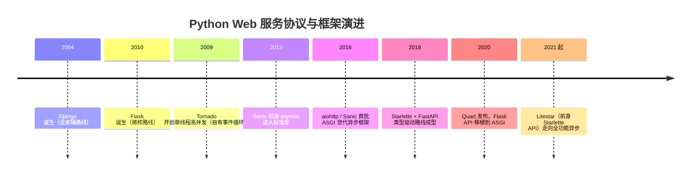
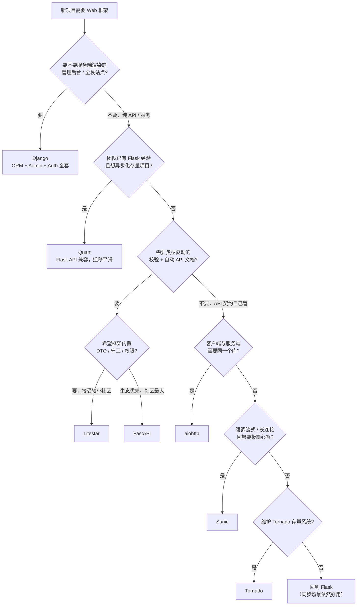

# Web 框架对比与选型

> **本篇做什么**：梳理 Python Web 框架生态的全景，把八个主流框架放在同一张表里对比，给出可操作的选型决策树与团队匹配建议。
> **产出**：一份能拿去技术评审会上讨论的选型依据，以及通往各框架专篇的阅读路线。
> **前置篇**：无（对比总览篇）。异步编程基础概念（事件循环、协程）不在本篇展开，参见 [asyncio 基础](/docs/python/09-进阶核心/02-异步编程/01-asyncio基础)。

## 概念说明

Python 的 Web 框架生态有一个其他语言少有的特点：**没有任何一个框架能通吃所有场景**。Django 的"全家桶"和 aiohttp 的"一个协议库两条腿"是两个极端，中间还有微核的 Flask、异步 API 专精的 FastAPI、全功能异步的 Litestar 等各种取舍。

框架之间的差异可以归结为对四个问题的不同回答：

1. **异步要不要**：WSGI 时代的同步模型简单可控，ASGI 时代的异步模型高并发下资源占用低，但异步代码的心智负担更高。
2. **功能放哪里**：ORM、认证、Admin 是框架自带（Django），还是交给扩展（Flask），还是内置现代化实现（Litestar）。
3. **类型系统多重要**：是否把类型注解当作一等公民，用它驱动参数校验和 API 文档（FastAPI/Litestar），还是类型注解只作为可选项。
4. **学习曲线为谁设计**：新手能快速做出完整产品（Django），还是进阶者能精确控制每一层（aiohttp/Sanic）。

::: tip 先问场景再选框架
选型的第一输入永远是**应用形态**：渲染页面的全栈网站、纯 JSON 的 API 服务、高并发长连接网关、还是内部小工具。脱离场景谈"哪个框架最好"没有答案——它们只是取舍不同。
:::

## 从 WSGI 到 ASGI：两代协议的背景

理解框架阵营分歧，要先看底下的两代协议标准：

- **WSGI**（PEP 3333）：同步调用模型，一个请求占住一个工作线程直到响应完成。简单、生态成熟，但高并发 I/O 下线程切换与内存开销大。
- **ASGI**：WSGI 的异步超集，请求由事件循环调度，单个进程可以挂起大量"等待中"的连接，还原生支持 WebSocket 与 HTTP/2 服务器推送。



事件循环与协程的底层机制（`asyncio` 如何调度这些框架的请求处理）不在本篇展开，统一见 [asyncio 基础](/docs/python/09-进阶核心/02-异步编程/01-asyncio基础)。选型时只需要记住结论：**选了 ASGI 框架，全链路 I/O 库都要异步化，否则异步的收益会被同步调用抵消**。

::: warning WSGI 框架不会消失
Flask 与 Django 的同步模型在今天依然是"默认正确"的选择：低并发内部系统、CPU 为主的应用、团队不熟异步的场景，同步代码更好写、更好测、更好排查。不必为了"技术新"而迁移。
:::

## 八大框架速览

| 框架 | 一句话定位 | 协议 | 异步程度 | 类型注解 | 内置生态 |
|---|---|---|---|---|---|
| **Django** | 全功能全家桶， batteries included | WSGI（ASGI 渐进支持） | 渐进 | 非核心（可选） | ORM/Admin/Auth/Form 全套 |
| **Flask** | 微核 + 扩展，自由组装 | WSGI | 有限（async 视图） | 非核心 | 极少，靠扩展 |
| **FastAPI** | 类型驱动的现代异步 API 框架 | ASGI | 原生 | **一等公民** | 校验（Pydantic）+ 文档 |
| **Litestar** | FastAPI 同代的全功能异步框架 | ASGI | 原生 | **一等公民** | DTO/守卫/权限/OpenAPI 内置 |
| **Sanic** | 类 Flask API 的轻量异步框架 | ASGI | 原生 | 非核心 | 极少，自带服务器 |
| **aiohttp** | 客户端 + 服务端一体的异步库 | ASGI（服务端） | 原生 | 非核心 | 极少，偏底层 |
| **Quart** | Flask API 兼容的异步版 Flask | ASGI | 原生 | 非核心 | 兼容多数 Flask 扩展 |
| **Tornado** | 老牌异步框架，存量维护为主 | 自有（WSGI 兼容有限） | 原生（自有模型） | 非核心 | 模板/认证等少量自带 |

两点说明：

- **Tornado 的历史地位**：在 asyncio 诞生之前，Tornado 用自有事件循环实现了单线程高并发，是 Python 异步 Web 的开创者。如今生态重心已转向 ASGI，Tornado 更多出现在存量系统和特定场景（如长轮询、Jupyter 相关组件）中。
- **异步程度"渐进"的含义**：Django 自 3.0 起逐步引入 ASGI 支持，核心视图与 ORM 的异步接口在持续补齐，但大量第三方扩展仍是同步实现，整体上是"同步为主、异步渐进"。

## 逐框架点评

### Django：全家桶，重项目首选

ORM + Admin 后台 + 认证系统 + 表单 + 迁移全套自带，配合庞大的第三方生态（DRF、Celery 集成等）。适合内容型网站、带大量 CRUD 和管理后台的业务系统。

- 强项：开发效率高、文档完备、社区成熟，"新手到上线"路径最短。
- 代价：框架自身约定多，架构被框定；纯 API 项目会带上用不到的组件。
- 站内教程：[Django 快速入门与 MVT 实战](/docs/python/01-Web与爬虫/01-Web开发/01-Django快速入门与MVT实战)、[Django 表单认证与生产部署](/docs/python/01-Web与爬虫/01-Web开发/02-Django表单认证与生产部署)。

### Flask：微核哲学，自由与责任并存

核心只有路由 + 请求响应对象 + 模板渲染，其余全靠扩展自由组合。中小项目、内部工具、教学场景的经典选择。

- 强项：上手快、代码即全部逻辑、扩展选型自由。
- 代价：大型项目需要团队自己建立"选哪些扩展、怎么分层"的约定；异步支持有限（`async` 视图可用，但整体仍是 WSGI 同步模型）。
- 站内教程：[Flask 入门指南](/docs/python/01-Web与爬虫/01-Web开发/03-Flask/01-flask入门指南)、[深入 Flask](/docs/python/01-Web与爬虫/01-Web开发/03-Flask/02-深入flask)。

### FastAPI：类型驱动的异步 API 标准

基于 Starlette + Pydantic，函数签名即接口契约：参数校验、序列化、OpenAPI 文档全部由类型标注自动生成。API 服务、微服务、AI 模型推理接口的当前主流选择。

- 强项：类型即校验、文档免费、异步原生、生态增长快。
- 代价：不内置 ORM 与完整后台能力，需要自己组装数据库层；校验与文档强绑定 Pydantic 的使用习惯。
- 站内教程：[04-FastAPI 系列七篇](/docs/python/01-Web与爬虫/01-Web开发/04-FastAPI/01-FastAPI入门与路由依赖)，从路由依赖到测试部署完整覆盖。

### Litestar：全功能异步框架的后起之秀

与 FastAPI 同为类型驱动的 ASGI 框架，差异化在于**内置更多工程能力**：DTO 层（与 Pydantic/attrs/msgspec 集成）、路由守卫、字段级权限、内置 OpenAPI 生成等，减少"FastAPI + 一堆自研胶水"的组合成本。

- 强项：全家桶式的异步 API 体验、性能口碑好、消息订阅（WebSocket/SSE）与生命周期管理完善。
- 代价：社区与生态规模小于 FastAPI，中文资料较少，招人时候选人熟悉度偏低。
- 站内教程：[06-Litestar 现代异步框架](/docs/python/01-Web与爬虫/01-Web开发/06-Litestar现代异步框架)。

### Sanic：轻量异步，自带服务器

API 风格刻意向 Flask 靠拢（装饰器路由、Blueprint），异步原生，且自带生产级 HTTP 服务器，部署链路短。

- 强项：心智负担低（会 Flask 就会 Sanic）、流式响应与长连接场景表现好。
- 代价：没有类型驱动的校验与文档体系，API 契约要自己维护；生态规模中等。
- 站内教程：[07-Sanic 轻量异步框架](/docs/python/01-Web与爬虫/01-Web开发/07-Sanic轻量异步框架)。

### aiohttp：客户端与服务端一体的异步底座

一个库同时提供异步 HTTP 客户端与服务端。客户端广泛用于爬虫（站内爬虫系列已覆盖），服务端定位偏底层：请求响应对象、中间件、WebSocket 全部手写组装。

- 强项：库边界清晰、控制力强、客户端/服务端同栈（回调、代理、压测脚本天然同构）。
- 代价：没有依赖注入与校验体系，业务代码样板多；作为 Web 框架的开发效率低于上列任何框架。
- 站内教程：[08-aiohttp 框架](/docs/python/01-Web与爬虫/01-Web开发/08-aiohttp框架)（服务端视角）；客户端用法见爬虫系列 [反爬对抗策略](/docs/python/01-Web与爬虫/02-爬虫/04-反爬对抗策略)。

### Quart：Flask 的异步孪生

API 与 Flask 高度兼容：同样的装饰器、上下文对象、Blueprint 概念，视图改为 `async def` 即获得异步能力，多数 Flask 扩展有对应替代。

- 强项：Flask 项目迁移路径最平滑，存量代码改动小。
- 代价：继承了 Flask 微核生态的同步遗产，异步扩展需要甄别；自身不提供校验与文档体系。
- 站内教程：[09-Quart 异步 Flask](/docs/python/01-Web与爬虫/01-Web开发/09-Quart异步Flask)。

### Tornado：开创者与存量担当

自有事件循环与协程模型，长连接、推送类场景的经典方案。新项目一般优先考虑 ASGI 生态，但维护历史系统、或与 Jupyter 等基于 Tornado 的组件集成时仍需了解。

::: warning 关于 Tornado 新项目
Tornado 社区目前以维护为主，创新节奏放缓（官方文档：https://www.tornadoweb.org/ ）。除非有明确的存量系统约束，新项目建议优先在 ASGI 生态（FastAPI/Litestar/Sanic/aiohttp/Quart）内选型，避免自建事件循环带来的运维与生态隔离成本。
:::

## 最小代码对比

选型的最直观材料：同一个"健康检查"端点在八个框架里的写法。注意各框架在"参数声明、校验、文档"上的投入差异。

::: code-group

```python [Django]
# urls.py + views.py，页面与 API 混合开发的传统入口
from django.http import JsonResponse
from django.urls import path


def health(request):
    return JsonResponse({"status": "ok"})


urlpatterns = [path("health", health)]
```

```python [Flask]
from flask import Flask, jsonify

app = Flask(__name__)


@app.get("/health")
def health():
    return jsonify({"status": "ok"})
```

```python [FastAPI]
from fastapi import FastAPI

app = FastAPI()


@app.get("/health")
async def health() -> dict:
    return {"status": "ok"}  # 签名驱动校验与 /docs 文档
```

```python [Litestar]
from litestar import Litestar, get


@get("/health")
async def health() -> dict:
    return {"status": "ok"}


app = Litestar([health])  # 路由函数独立声明，再注册进应用
```

```python [Sanic]
from sanic import Sanic
from sanic.response import json

app = Sanic("demo")


@app.get("/health")
async def health(request):
    return json({"status": "ok"})  # request 是唯一入口
```

```python [aiohttp]
from aiohttp import web


async def health(request):
    return web.json_response({"status": "ok"})


app = web.Application()
app.router.add_get("/health", health)  # 显式注册路由
```

```python [Quart]
from quart import Quart

app = Quart(__name__)


@app.get("/health")
async def health():
    return {"status": "ok"}  # 与 Flask 同构，仅 async 化
```

```python [Tornado]
import tornado.ioloop
import tornado.web


class HealthHandler(tornado.web.RequestHandler):
    async def get(self):
        self.write({"status": "ok"})


app = tornado.web.Application([(r"/health", HealthHandler)])
app.listen(8888)
tornado.ioloop.IOLoop.current().start()
```

:::

从这份对照可以直接读出三条选型线索：

1. **签名即契约**（FastAPI/Litestar）：返回值与参数的类型标注直接参与校验与文档，适合契约优先的团队协作。
2. **request 即入口**（Sanic/aiohttp/Tornado）：一切参数从请求对象手动取，控制力强、样板少，但契约靠自觉。
3. **全局 app 对象**（Flask/Quart/Django）：代码围绕应用实例组织，新手直觉，但路由函数与全局状态耦合（Quart 用上下文机制缓解）。

## 选型决策树



::: tip 决策树的正确用法
决策树给的是**默认答案**，不是标准答案。当团队在某个框架上有深厚的既有经验与代码资产时，"沿用熟悉的框架 + 接受一些限制"往往优于"换一个纸面更优的框架 + 全员重新踩坑"。
:::

## 团队与技术栈匹配建议

| 团队情况 | 推荐起点 | 理由 |
|---|---|---|
| 新手团队 / 要快速交付完整产品 | Django | 自带组件减少技术决策数量，错误实践有框架兜底 |
| 中小 API 团队 / 微服务 | FastAPI | 类型驱动降低联调成本，文档自动化收益随接口数放大 |
| 追求异步全家桶、愿意尝鲜 | Litestar | 内置能力多，少装扩展少写胶水，但要接受生态较小 |
| 有 Flask 资产要异步化 | Quart | 渐进迁移，视图函数逐个 `async` 化即可 |
| 极致轻量、流式推送、内部网关 | Sanic | 概念少、服务器自带、长连接场景顺手 |
| 爬虫/采集系统回写服务、代理服务 | aiohttp | 客户端服务端同栈，部署面小 |
| 存量 Tornado 系统维护 | Tornado | 沉没成本最低，不建议新项目主动进入 |

### 与周边技术栈的联动

选框架还要看它和周边生态的咬合度：

- **数据校验**：FastAPI 与 Litestar 都以 Pydantic 系生态为默认（Litestar 额外支持 msgspec/attrs），Pydantic 模型可直接复用于配置管理（见 [07-配置管理](/docs/python/03-工程化与运维/01-工程化/07-配置管理)）。
- **异步数据库**：ASGI 框架都要求异步驱动（asyncpg/aiomysql），SQLAlchemy 2.0 的异步会话模式在 FastAPI 上下文中已有完整示例，见 [异步数据库与 SQLAlchemy](/docs/python/01-Web与爬虫/01-Web开发/04-FastAPI/03-异步数据库与SQLAlchemy)，Litestar/Sanic/aiohttp 的接入方式同构。
- **部署**：ASGI 框架共享 Uvicorn/Granian/Gunicorn(worker_class) 生态，进程模型与优雅关闭的讨论统一见 [部署与运行](/docs/python/03-工程化与运维/02-运维/03-部署与运行)；Sanic 与 aiohttp 自带服务器是例外。
- **安全**：无论选哪个框架，注入、XSS、CSRF、认证安全的通识一致，见 [05-Web 安全系列](/docs/python/01-Web与爬虫/01-Web开发/05-Web安全/01-常见Web漏洞与防护)。

## 常见误区

| 误区 | 后果 | 更好的做法 |
|---|---|---|
| 按性能榜单选框架 | 微基准差异远小于业务代码差异，团队不熟反而拖慢交付 | 用团队熟悉度 + 场景匹配度做主判据 |
| "异步一定比同步快" | 在 `async def` 里混用同步库，性能反而劣化 | 先确认全链路 I/O 库都有异步版本，见 [asyncio 基础](/docs/python/09-进阶核心/02-异步编程/01-asyncio基础) |
| 拿 Django 写纯 API 却关闭 Admin/Auth | 带着全家桶的复杂度只用微核功能 | 纯 API 场景直接考虑 FastAPI/Litestar |
| 把 FastAPI 当 Flask 用 | 手动解析参数、放弃校验与文档，只留下异步 | 学习签名驱动的写法，从 [FastAPI 入门](/docs/python/01-Web与爬虫/01-Web开发/04-FastAPI/01-FastAPI入门与路由依赖)起步 |
| 新项目选 Tornado"因为老牌" | 生态隔离、招聘困难 | 除存量维护外优先 ASGI 生态 |
| 微服务拆分后各服务混用三四个框架 | 运维、监控、依赖管理成本翻倍 | 全公司收敛到 1-2 个框架，例外要有书面理由 |

## 小结

- Python Web 框架的分歧点在四个维度：异步、功能内置度、类型系统、学习曲线。
- Django 重全栈，Flask 重自由，FastAPI/Litestar 重类型驱动的异步 API，Sanic/aiohttp 重轻量与控制力，Quart 重 Flask 兼容，Tornado 属于存量时代。
- 选型主判据是**应用形态 + 团队经验 + 生态咬合度**，性能榜单只适合做最后一级的平票参考。
- 本系列其余篇目按框架展开：[04-FastAPI 七篇](/docs/python/01-Web与爬虫/01-Web开发/04-FastAPI/01-FastAPI入门与路由依赖)、[06-Litestar](/docs/python/01-Web与爬虫/01-Web开发/06-Litestar现代异步框架)、[07-Sanic](/docs/python/01-Web与爬虫/01-Web开发/07-Sanic轻量异步框架)、[08-aiohttp](/docs/python/01-Web与爬虫/01-Web开发/08-aiohttp框架)、[09-Quart](/docs/python/01-Web与爬虫/01-Web开发/09-Quart异步Flask)。

## 延伸阅读

- [FastAPI 入门与路由依赖](/docs/python/01-Web与爬虫/01-Web开发/04-FastAPI/01-FastAPI入门与路由依赖) —— 当前 API 场景最主流选择的系统教程
- [Litestar 现代异步框架](/docs/python/01-Web与爬虫/01-Web开发/06-Litestar现代异步框架) —— 全功能异步路线的代表
- [asyncio 基础](/docs/python/09-进阶核心/02-异步编程/01-asyncio基础) —— 理解 ASGI 框架底层的事件循环
- Django 官方文档：https://docs.djangoproject.com/zh-hans/
- Flask 官方文档：https://flask.palletsprojects.com/

> 🧭 本系列其余篇目与 Python 学习路线统一维护在 [导航总览](/docs/python/02-基础与入门/00-导航总览)。
