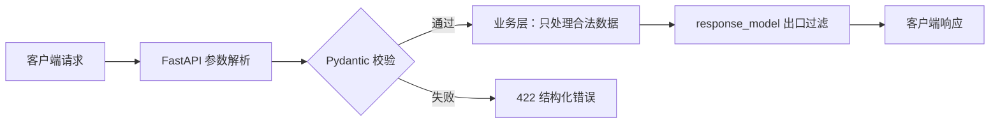
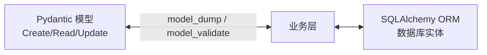

# Pydantic 数据校验

> **本篇做什么**：系统讲解 Pydantic v2 的数据校验体系——BaseModel 基础、Field 约束、嵌套模型、自定义校验器、`ConfigDict` 模型配置、请求/响应模型分离，以及 v1 迁移 v2 的对照要点。
> **产出**：一套可直接放进 FastAPI 项目的校验模型分层写法（Create/Read/Update），和一份 v1→v2 迁移速查表。
> **前置篇**：[01-FastAPI 入门与路由依赖](/docs/python/01-Web与爬虫/01-Web开发/04-FastAPI/01-FastAPI入门与路由依赖)（了解 `response_model` 与 `Depends` 即可）。

## 校验要发生在边界层

Web 服务最常见的 bug 来源是"脏数据进了业务层"。正确的做法是：**所有外部输入在进入业务代码之前必须通过校验**，业务层永远假设拿到的数据是合法的。



FastAPI 把"解析 + 校验 + 错误响应"全部托管给了 Pydantic，所以学透 Pydantic 就是学透 FastAPI 的输入输出。

## BaseModel 基础

```python
from pydantic import BaseModel, ValidationError


class User(BaseModel):
    id: int
    name: str
    email: str
    age: int | None = None   # 可选字段，默认 None
    is_active: bool = True   # 带默认值


# 1. 从字典解析（FastAPI 处理请求体时做的事）
user = User(id="1", name="alice", email="a@ex.com")
print(user.id)          # 1 —— 注意：字符串 "1" 被宽松转换为 int
print(user.model_dump())        # {'id': 1, 'name': 'alice', ...}
print(user.model_dump_json())   # {"id":1,"name":"alice",...}

# 2. 校验失败立刻报错，errors() 给出逐字段原因
try:
    User(id="abc", name="alice", email="a@ex.com")
except ValidationError as e:
    print(e.errors())
    # [{'type': 'int_parsing', 'loc': ('id',), 'msg': 'Input should be a valid integer ...'}]

# 3. 从任意对象按属性读取（ORM 对象转 Pydantic 的关键），见下文 from_attributes
```

Pydantic v2 默认运行在**宽松模式**：`"1"` 可以转成 `1`，`"true"` 可以转成 `True`。这个默认值对 Web 场景友好（查询参数、表单都是字符串），但需要精确控制时用严格模式，见后文 `ConfigDict`。

::: tip 三个最常用的序列化方法
`model_dump()` 转 dict、`model_dump_json()` 转 JSON 字符串、`model_validate(obj)` 从任意对象解析。v2 中所有解析入口统一叫 `model_validate`，不再有 `parse_obj`。
:::

## Field 约束

`Field` 为字段附加校验规则和文档元信息。v2 推荐用 `Annotated` 写法，类型与约束合为一体，可复用：

```python
from typing import Annotated

from pydantic import BaseModel, Field

# 可复用的约束类型：定义一次，到处使用
ProductName = Annotated[str, Field(min_length=1, max_length=100)]
Price = Annotated[float, Field(gt=0, le=1_000_000)]
Quantity = Annotated[int, Field(ge=1, default=1)]


class OrderItem(BaseModel):
    product: ProductName
    price: Price
    quantity: Quantity = 1


class OrderCreate(BaseModel):
    items: list[OrderItem] = Field(min_length=1, description="至少一个商品")
    coupon: str | None = Field(
        default=None,
        pattern=r"^[A-Z0-9]{4,20}$",   # 正则约束
        description="优惠券码，4-20 位大写字母或数字",
    )
    note: str | None = Field(default=None, max_length=500)
```

常用约束速查：

| 约束 | 适用类型 | 含义 |
|---|---|---|
| `gt` / `ge` / `lt` / `le` | 数值 | 大于/大于等于/小于/小于等于 |
| `multiple_of` | 数值 | 是某数的倍数 |
| `min_length` / `max_length` | str/list | 最小/最大长度 |
| `pattern` | str | 正则匹配 |
| `max_digits` / `decimal_places` | Decimal | 总位数/小数位（金额推荐用 Decimal） |
| `description` / `examples` | 全部 | 文档元信息，直接进入 Swagger |
| `frozen` | 全部 | 实例不可变 |

::: warning 金额不要用 float
浮点数有精度误差，涉及金额的字段用 `Decimal`：`price: Annotated[Decimal, Field(max_digits=10, decimal_places=2)]`，配合数据库的 NUMERIC 类型。
:::

## 嵌套模型

模型可以任意嵌套，校验会递归进行，错误信息带上完整路径（`loc: ("items", 0, "price")`）：

```python
from pydantic import BaseModel, Field


class Address(BaseModel):
    city: str
    street: str
    zipcode: str = Field(pattern=r"^\d{6}$")


class Profile(BaseModel):
    nickname: str
    address: Address          # 单个嵌套对象


class UserCreate(BaseModel):
    username: str
    profile: Profile
    tags: list[str] = []

# 深层传参，全链路校验
user = UserCreate.model_validate({
    "username": "alice",
    "profile": {"nickname": "Ali", "address": {"city": "上海", "street": "南京路", "zipcode": "200000"}},
})
print(user.profile.address.city)   # 上海
```

### 部分更新：exclude_unset

PATCH 接口只更新"客户端实际传了的字段"，用 `model_dump(exclude_unset=True)` 区分"没传"和"传了默认值"：

```python
class UserUpdate(BaseModel):
    """所有字段可选，用于部分更新"""
    email: str | None = None
    age: int | None = None
    is_active: bool | None = None


def apply_update(obj_in_db: dict, patch: UserUpdate) -> dict:
    # exclude_unset：只包含调用方显式传入的字段
    changes = patch.model_dump(exclude_unset=True, exclude_none=False)
    obj_in_db.update(changes)
    return obj_in_db
```

## 自定义校验器

内置约束不够用时，写校验器。v2 中有两类：

### field_validator：单字段校验

```python
from pydantic import BaseModel, field_validator


class SignupRequest(BaseModel):
    username: str
    password: str

    @field_validator("username")
    @classmethod
    def username_rules(cls, v: str) -> str:
        v = v.strip()
        if not v.isidentifier():
            raise ValueError("用户名只能是字母、数字、下划线且不以数字开头")
        return v

    @field_validator("password")
    @classmethod
    def password_strength(cls, v: str) -> str:
        if len(v) < 8:
            raise ValueError("密码至少 8 位")
        if v.isalpha() or v.isdigit():
            raise ValueError("密码必须同时包含字母和数字")
        return v


# mode="before"：在类型转换之前拿原始值，适合清洗数据
class QueryIn(BaseModel):
    keywords: list[str]

    @field_validator("keywords", mode="before")
    @classmethod
    def split_str(cls, v):
        if isinstance(v, str):
            return v.split(",")       # 允许 "a,b,c" 直接传入
        return v
```

### model_validator：跨字段校验

```python
from pydantic import BaseModel, model_validator
from datetime import date


class DateRange(BaseModel):
    start: date
    end: date

    @model_validator(mode="after")
    def check_order(self) -> "DateRange":
        if self.end < self.start:
            raise ValueError("结束日期不能早于开始日期")
        return self
```

::: tip 校验器里的错误
校验器内抛 `ValueError`（或 `AssertionError`）即可，Pydantic 会捕获并转换成带字段路径的校验错误，最终成为 API 的 422 响应。不要在校验器里抛 `HTTPException`——模型层不该知道 HTTP。
:::

## 模型配置：ConfigDict

v2 用 `model_config = ConfigDict(...)` 取代 v1 的 `class Config`：

```python
from pydantic import BaseModel, ConfigDict


class StrictLogin(BaseModel):
    model_config = ConfigDict(
        strict=True,             # 严格模式："1" 不再能转成 1，类型必须精确匹配
        extra="forbid",          # 多传未知字段直接报错，而不是忽略
        str_strip_whitespace=True,  # 自动去除字符串首尾空白
        frozen=True,             # 实例创建后不可修改
    )

    username: str
    password: str


StrictLogin(username="alice", password="secret")          # OK
StrictLogin(username="alice", password="secret", hack=1)  # 422: extra inputs are not permitted
```

常用的配置项：

| 配置 | 默认 | 说明 |
|---|---|---|
| `strict` | `False` | 严格模式，禁止隐式类型转换 |
| `extra` | `"ignore"` | 未知字段处理：`ignore`/`forbid`/`allow` |
| `from_attributes` | `False` | 允许从 ORM 对象按属性读取，`model_validate(orm_obj)` 的前提 |
| `str_strip_whitespace` | `False` | 字符串自动去首尾空白 |
| `frozen` | `False` | 实例不可变 |
| `populate_by_name` | `False` | 允许用字段名替代别名传值 |

::: warning 推荐给对外 API 模型开 extra="forbid"
默认的 `extra="ignore"` 会静默吞掉拼错的字段名（`uset_name` 拼错成新字段被丢弃，实际用了默认值），这类 bug 排查成本极高。对外接口模型开启 `forbid`，让拼写错误立刻暴露。
:::

## 请求/响应模型分离

一个资源通常需要三个模型：Create（入参）、Read（出参）、Update（部分更新）。**绝不共用一个模型**：

```python
from datetime import datetime
from pydantic import BaseModel, ConfigDict, EmailStr, Field


# ---- 入参：只含客户端该传的字段 ----
class UserCreate(BaseModel):
    model_config = ConfigDict(extra="forbid")

    username: str = Field(min_length=3, max_length=32)
    email: EmailStr
    password: str = Field(min_length=8)


# ---- 出参：绝不含 password / password_hash ----
class UserRead(BaseModel):
    model_config = ConfigDict(from_attributes=True)  # 允许从 ORM 对象解析

    id: int
    username: str
    email: EmailStr
    created_at: datetime


# ---- 更新：全可选 ----
class UserUpdate(BaseModel):
    email: EmailStr | None = None
    password: str | None = Field(default=None, min_length=8)
```

在 FastAPI 中组合使用：

```python
from fastapi import FastAPI

app = FastAPI()


@app.post("/users/", response_model=UserRead, status_code=201)
async def create_user(payload: UserCreate):
    # 业务层只管创建，password 在这里完成哈希后入库
    orm_user = save_user(payload)      # 返回 SQLAlchemy 模型实例
    return orm_user                    # from_attributes=True 使 ORM 对象可被 UserRead 解析


@app.patch("/users/{user_id}", response_model=UserRead)
async def update_user(user_id: int, patch: UserUpdate):
    db_user = load_user(user_id)
    changes = patch.model_dump(exclude_unset=True)
    for key, value in changes.items():
        setattr(db_user, key, value)
    return db_user
```

这样即便业务代码不小心把完整 ORM 对象返回了，`response_model=UserRead` 也会把 `password_hash` 等字段挡在响应之外。

## 与 ORM 的边界

Pydantic 模型是**传输层对象**，不要把它当 ORM 实体用。推荐分层：



- 入口：`model_validate(payload)` 得到干净数据，再构造 ORM 对象。
- 出口：ORM 对象经 `UserRead.model_validate(orm_obj, from_attributes=True)` 转换。
- SQLAlchemy 2.0 的模型定义与会话管理见[第 3 篇：异步数据库与 SQLAlchemy](/docs/python/01-Web与爬虫/01-Web开发/04-FastAPI/03-异步数据库与SQLAlchemy)。

## v1 到 v2 迁移要点

Pydantic v1 → v2 是破坏性升级，核心变化围绕"命名统一为 `model_*`"和"校验器重新设计"。官方提供了 `bump-pydantic` 自动迁移工具，多数机械改动可自动完成。

| v1 写法 | v2 写法 | 说明 |
|---|---|---|
| `@validator("field")` | `@field_validator("field")` | 必须加 `@classmethod` |
| `@root_validator` | `@model_validator` | `mode="before"` / `mode="after"` |
| `.dict()` | `.model_dump()` | |
| `.json()` | `.model_dump_json()` | |
| `.parse_obj(data)` | `.model_validate(data)` | |
| `.parse_raw(b)` | `.model_validate_json(b)` | |
| `.schema()` | `.model_json_schema()` | |
| `.copy(update=...)` | `.model_copy(update=...)` | |
| `class Config:` | `model_config = ConfigDict(...)` | 类体配置改为类属性 |
| `orm_mode = True` | `from_attributes = True` | |
| `allow_mutation = False` | `frozen = True` | |
| `conint(gt=0)` | `Annotated[int, Field(gt=0)]` | `con*` 类型改为 Annotated 写法 |
| `regex=` | `pattern=` | Field 参数改名 |
| `Optional[str]`（隐式可空） | `str \| None` | v2 中可空必须显式写 `\| None` |

::: danger 两个高危语义变化
1. v1 中 `@validator` 默认每个字段单独校验且可以互相读取"半成品"数据；v2 中字段校验器不再保证顺序，跨字段逻辑**必须**移到 `@model_validator(mode="after")`。
2. v2 严禁可变对象直接作默认值（`tags: list = []` 在严格检查下报错），应写 `tags: list[str] = Field(default_factory=list)` 或使用不可变默认。
:::

## 常见陷阱

| 陷阱 | 现象 | 正确做法 |
|---|---|---|
| 用 `float` 存金额 | 汇总时出现 0.30000000000000004 | `Decimal` + `max_digits/decimal_places` |
| 入参出参共用一个模型 | 响应泄漏 password_hash | Create/Read/Update 三模型分离 |
| 依赖 `extra="ignore"` | 拼错的字段被静默吞掉 | 对外模型 `extra="forbid"` |
| 在校验器里查数据库 | 模型层耦合 IO，单测困难 | 校验器只做纯数据校验，唯一性检查放服务层 |
| 校验器抛 `HTTPException` | 模型无法脱离 FastAPI 复用 | 抛 `ValueError`，由框架转 422 |
| 部分更新用 `model_dump()` | 未传字段被默认值覆盖 | `model_dump(exclude_unset=True)` |
| 忘记 `from_attributes` | `model_validate(orm_obj)` 报错 | 出参模型 `ConfigDict(from_attributes=True)` |

## 小结

- 校验发生在边界层：FastAPI 入口靠 Pydantic 拦脏数据，出口靠 `response_model` 挡敏感字段。
- `Annotated + Field` 是 v2 的约束正写，`field_validator` 管单字段，`model_validator` 管跨字段。
- `ConfigDict` 控制"多严"：对外接口建议 `extra="forbid"`，ORM 转换需要 `from_attributes=True`。
- Create/Read/Update 三模型分离，配合 `exclude_unset` 实现正确的部分更新。
- v1→v2 迁移有官方工具，但校验器语义变化（跨字段逻辑归属）必须人工复核。

## 延伸阅读

- [01-FastAPI 入门与路由依赖](/docs/python/01-Web与爬虫/01-Web开发/04-FastAPI/01-FastAPI入门与路由依赖) —— `response_model` 与参数声明的基础
- [03-异步数据库与 SQLAlchemy](/docs/python/01-Web与爬虫/01-Web开发/04-FastAPI/03-异步数据库与SQLAlchemy) —— Pydantic 与 ORM 模型的边界落地
- [04-认证与 JWT](/docs/python/01-Web与爬虫/01-Web开发/04-FastAPI/04-认证与JWT) —— 用 Pydantic 声明 Token 载荷模型
- Pydantic 官方文档：https://docs.pydantic.dev/latest/
- 官方迁移指南（v1 → v2）：https://docs.pydantic.dev/latest/migration/
