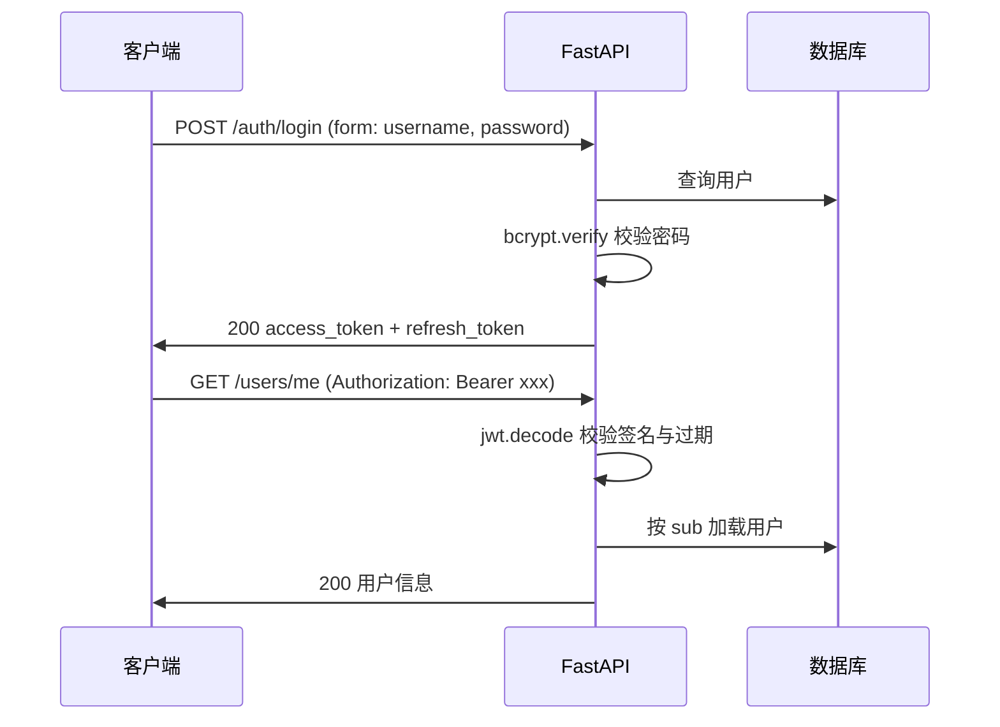

# 认证与 JWT

> **本篇做什么**：在 FastAPI 中落地一套基于 OAuth2 密码模式的认证体系——bcrypt 密码哈希、pyjwt 签发/校验 JWT、`current_user` 与 `admin` 权限依赖链，以及 Access/Refresh 双 Token 的刷新设计。
> **产出**：可复用的 `security.py`（哈希 + JWT 工具）与 `deps.py`（认证依赖），若干受保护路由。
> **前置篇**：[03-异步数据库与 SQLAlchemy](/docs/python/01-Web与爬虫/01-Web开发/04-FastAPI/03-异步数据库与SQLAlchemy)（会话依赖）。传输安全（HTTPS）、CSRF、注入等 Web 安全通识见 [05-Web 安全系列](/docs/python/01-Web与爬虫/01-Web开发/05-Web安全)。

## 认证流程总览

本篇实现的是 OpenAPI 规范中的 OAuth2 Password 流程（配合 Bearer Token），这是 FastAPI 官方文档采用的认证模型：



核心分工：**bcrypt 负责存储端安全，JWT 负责无状态的身份携带，依赖注入负责在每个请求上执行校验**。

## 安装

```bash
pip install "passlib[bcrypt]" pyjwt
```

## 密码哈希：passlib + bcrypt

密码**绝不明文存储**，也不能用 MD5/SHA 之类快哈希——它们是为"算得快"设计的，而密码哈希需要"算得慢"来对抗暴力破解。bcrypt 自带盐和可调成本因子，是当前的主流选择：

```python
# security.py
from passlib.context import CryptContext

pwd_context = CryptContext(
    schemes=["bcrypt"],
    deprecated="auto",   # 旧算法哈希在校验时自动标记，可无痛升级算法
)


def hash_password(plain: str) -> str:
    # 每次调用生成随机盐，同一密码两次哈希结果不同，这是特性不是 bug
    return pwd_context.hash(plain)


def verify_password(plain: str, hashed: str) -> bool:
    return pwd_context.verify(plain, hashed)
```

::: warning passlib 与新版 bcrypt 的兼容性
passlib 长期未发新版，在新版 bcrypt 库下初始化时会打印一条关于读取版本号的兼容告警。工程上有两种处理：把 bcrypt 固定在与 passlib 兼容的版本，或改用 `bcrypt` 包直接调用（`bcrypt.hashpw` / `bcrypt.checkpw`）。二者效果等价，选一种在团队内统一即可。
:::

配套的用户模型（承接第 3 篇的声明式风格）：

```python
# models.py（节选）
from sqlalchemy.orm import Mapped, mapped_column

class User(Base):
    __tablename__ = "users"

    id: Mapped[int] = mapped_column(primary_key=True)
    username: Mapped[str] = mapped_column(unique=True, index=True)
    password_hash: Mapped[str]        # 只存哈希，永远不存明文
    is_active: Mapped[bool] = mapped_column(default=True)
    is_admin: Mapped[bool] = mapped_column(default=False)
```

## JWT 签发与校验：pyjwt

JWT 是"带签名的 JSON"：服务端签名后发给客户端，客户端原样带回，服务端只需验签即可信任其中的声明（claims）——**无需查会话存储**，这就是"无状态认证"。

```python
# security.py（续）
import jwt
from datetime import datetime, timedelta, timezone

from pydantic import BaseModel

# 生产环境从环境变量注入，见本站《配置管理》
SECRET_KEY = "change-me-in-production"
ALGORITHM = "HS256"
ACCESS_TOKEN_EXPIRE_MINUTES = 30


class TokenPayload(BaseModel):
    """用 Pydantic 给 Token 声明加一层结构保障"""
    sub: str                 # subject：用户标识
    exp: datetime            # 过期时间
    iat: datetime            # 签发时间
    type: str = "access"


def create_access_token(user_id: int, expires_minutes: int = ACCESS_TOKEN_EXPIRE_MINUTES) -> str:
    now = datetime.now(timezone.utc)
    payload = {
        "sub": str(user_id),          # JWT 规范要求 sub 为字符串
        "iat": now,
        "exp": now + timedelta(minutes=expires_minutes),
        "type": "access",
    }
    return jwt.encode(payload, SECRET_KEY, algorithm=ALGORITHM)


def decode_token(token: str) -> TokenPayload:
    """校验失败会抛 jwt.InvalidTokenError（含过期）"""
    raw = jwt.decode(token, SECRET_KEY, algorithms=[ALGORITHM])
    return TokenPayload.model_validate(raw)
```

::: danger SECRET_KEY 的管理
签名密钥一旦泄漏，任何人都能伪造任意用户的 Token。要求：不进代码仓库、不进日志、按环境隔离、定期轮换。配置注入的标准做法见本站 [07-配置管理](/docs/python/03-工程化与运维/01-工程化/07-配置管理)。轮换密钥会让所有已签发 Token 失效，这既是风险也是"一键踢掉全部会话"的应急手段。
:::

## 登录端点与 OAuth2PasswordBearer

`OAuth2PasswordBearer` 本身不做校验，它只做两件事：告诉 Swagger 文档"这个接口用 Bearer Token"，并把 `Authorization: Bearer <token>` 头提取成依赖值：

```python
# deps.py
import jwt
from typing import Annotated

from fastapi import Depends, HTTPException, status
from fastapi.security import OAuth2PasswordBearer, OAuth2PasswordRequestForm
from sqlalchemy import select

from security import decode_token, verify_password, create_access_token

oauth2_scheme = OAuth2PasswordBearer(tokenUrl="auth/login")

CredentialsError = HTTPException(
    status_code=status.HTTP_401_UNAUTHORIZED,
    detail="无效的认证凭证",
    headers={"WWW-Authenticate": "Bearer"},   # 规范要求的标准响应头
)


# ---- 登录：验证用户名密码，签发 Token ----
@router.post("/auth/login")
async def login(
    form: Annotated[OAuth2PasswordRequestForm, Depends()],
    session: SessionDep,
):
    user = (
        await session.execute(select(User).where(User.username == form.username))
    ).scalar_one_or_none()

    # 用户不存在与密码错误返回同一句提示，不给攻击者枚举用户名的余地
    if user is None or not verify_password(form.password, user.password_hash):
        raise HTTPException(status_code=401, detail="用户名或密码错误")
    if not user.is_active:
        raise HTTPException(status_code=403, detail="账户已禁用")

    return {
        "access_token": create_access_token(user.id),
        "token_type": "bearer",
    }
```

注意登录用的是 `OAuth2PasswordRequestForm`（表单编码，不是 JSON），这是 OAuth2 规范的要求，也让 `/docs` 出现"Authorize"按钮。

## current_user 依赖链

把"解 Token → 查库 → 返回用户"封装成依赖，之后所有受保护路由只需声明这个依赖：

```python
# deps.py（续）
from sqlalchemy.ext.asyncio import AsyncSession


async def get_current_user(
    token: Annotated[str, Depends(oauth2_scheme)],
    session: Annotated[AsyncSession, Depends(get_session)],
) -> User:
    try:
        payload = decode_token(token)
    except jwt.InvalidTokenError:
        raise CredentialsError
    if payload.type != "access":
        raise CredentialsError

    user = await session.get(User, int(payload.sub))
    if user is None:
        raise CredentialsError          # Token 合法但用户已被删除
    if not user.is_active:
        raise HTTPException(status_code=403, detail="账户已禁用")
    return user


CurrentUser = Annotated[User, Depends(get_current_user)]


async def require_admin(current: CurrentUser) -> User:
    """权限依赖：建立在 current_user 之上，链式组合"""
    if not current.is_admin:
        raise HTTPException(status_code=403, detail="需要管理员权限")
    return current


AdminUser = Annotated[User, Depends(require_admin)]
```

在路由上使用，两种声明等价于两种意图：

```python
@router.get("/users/me")
async def read_me(current: CurrentUser):
    # 需要用户身份：参数注入，函数体直接用 current
    return {"id": current.id, "username": current.username}


@router.delete("/users/{user_id}", status_code=204)
async def delete_user(
    user_id: int,
    admin: AdminUser,                     # 需要管理员：权限依赖
    session: SessionDep,
):
    ...


# 也可以在 router 级别整批保护，路由函数无需感知认证
admin_router = APIRouter(
    prefix="/admin",
    dependencies=[Depends(require_admin)],   # 只做拦截，不注入返回值
)
```

::: tip Token 里该放什么
JWT 的载荷是**任何人都能 Base64 解码看到**的，只是不能篡改。所以：可以放用户 ID、角色、过期时间；不要放密码、手机号等敏感信息；角色快照会导致"降权不生效"（改了角色旧 Token 还带着旧角色），要求实时性的场景应查库而不是信 Token。
:::

## Token 刷新思路

Access Token 短命（30 分钟内），Refresh Token 长命（数天），是平衡安全与体验的标准设计：

- **Access Token**：短有效期，无状态校验，直接访问 API。
- **Refresh Token**：只用于换取新 Access Token，服务端保留记录，可主动吊销。

```python
# 签发：登录成功时同时发两个 Token
def issue_tokens(user: User) -> dict:
    now = datetime.now(timezone.utc)
    access = jwt.encode(
        {"sub": str(user.id), "type": "access", "exp": now + timedelta(minutes=30)},
        SECRET_KEY, algorithm=ALGORITHM,
    )
    refresh = jwt.encode(
        {"sub": str(user.id), "type": "refresh", "exp": now + timedelta(days=7), "jti": uuid4().hex},
        SECRET_KEY, algorithm=ALGORITHM,
    )
    return {"access_token": access, "refresh_token": refresh, "token_type": "bearer"}


# 刷新端点：验证 refresh Token，吊销旧的，签发新的
@router.post("/auth/refresh")
async def refresh(token: Annotated[str, Depends(oauth2_scheme)]):
    payload = decode_token(token)
    if payload.type != "refresh":
        raise CredentialsError
    if await is_revoked(payload.jti):        # jti 入 Redis 拒绝名单或存库比对
        raise CredentialsError
    ...
    return {"access_token": new_access, "token_type": "bearer"}
```

设计要点：

1. **双 Token 的价值来自状态边界**：Access 无状态所以快，但不可吊销，所以必须短命；Refresh 有状态所以可吊销，长命才有意义。把 Access 有效期设成一周等于放弃这套机制。
2. **旋转（rotation）**：每次刷新都签发新 Refresh 并吊销旧的，检测到旧 Refresh 被重复使用时应视为泄漏，吊销该用户全部会话。
3. **登出**：JWT 无状态，"登出"必然是服务端动作——把 jti 加入拒绝名单（Redis，TTL 设为该 Token 剩余寿命）或递增用户的 token_version 字段。

## 安全边界：本篇不覆盖的内容

认证不等于安全。以下主题属于 Web 安全通识，展开见站内 [05-Web 安全系列](/docs/python/01-Web与爬虫/01-Web开发/05-Web安全)：

- **传输安全**：全站 HTTPS，Token 绝不走明文 HTTP。
- **会话固定 / CSRF**：Token 放 `Authorization` 头（而非 Cookie）时天然免疫 CSRF；若用 Cookie 传递则需要 CSRF Token 或 SameSite 策略。
- **暴力破解防护**：登录接口限流、验证码、失败锁定。
- **注入类风险**：本篇的 SQLAlchemy 参数化查询已规避 SQL 注入，原理见 Web 安全系列的注入专题。

## 常见陷阱

| 陷阱 | 后果 | 正确做法 |
|---|---|---|
| 密码用 MD5/SHA256 存储彩虹表秒破 | 数据泄漏即密码泄漏 | bcrypt/argon2 慢哈希 |
| "用户不存在"与"密码错误"分开提示 | 账号可被枚举 | 统一提示"用户名或密码错误" |
| SECRET_KEY 提交进仓库 | 任何人可伪造 Token | 环境变量/密钥服务注入，见配置管理篇 |
| Access Token 有效期数天 | 泄漏后长时间可用 | 30 分钟级别 + Refresh Token |
| Token 里塞敏感信息 | 载荷可被解码 | 只放 ID/角色/过期时间 |
| 依赖 Token 中的角色做实时鉴权 | 改权限不生效 | 高敏操作查库校验 |
| 忘记捕获 `jwt.InvalidTokenError` | 伪造/过期 Token 变成 500 | 统一转 401 |

## 小结

- 职责分层：bcrypt 管存储安全，pyjwt 管身份携带，`Depends` 管每请求强制校验。
- `OAuth2PasswordBearer` 只是"提参数 + 描述文档"的声明，真正的校验在 `get_current_user`。
- 权限是依赖链：`require_admin` 建立在 `CurrentUser` 之上，可路由级整批套用。
- 双 Token 的本质是"无状态的效率 + 有状态的可控"：Access 短命，Refresh 可旋转可吊销。
- 认证只是安全的一环，HTTPS、CSRF、限流等通识内容归属 Web 安全系列。

## 延伸阅读

- [03-异步数据库与 SQLAlchemy](/docs/python/01-Web与爬虫/01-Web开发/04-FastAPI/03-异步数据库与SQLAlchemy) —— 用户表与会话依赖的实现
- [05-中间件与依赖注入进阶](/docs/python/01-Web与爬虫/01-Web开发/04-FastAPI/05-中间件与依赖注入进阶) —— 全局依赖、依赖缓存与异常处理
- [06-FastAPI 测试](/docs/python/01-Web与爬虫/01-Web开发/04-FastAPI/06-FastAPI测试) —— 用 `dependency_overrides` 测试受保护路由
- [05-Web 安全系列](/docs/python/01-Web与爬虫/01-Web开发/05-Web安全) —— HTTPS、CSRF、注入与加固通识
- FastAPI 安全文档（中文）：https://fastapi.tiangolo.com/zh/tutorial/security/
- PyJWT 官方文档：https://pyjwt.readthedocs.io/
