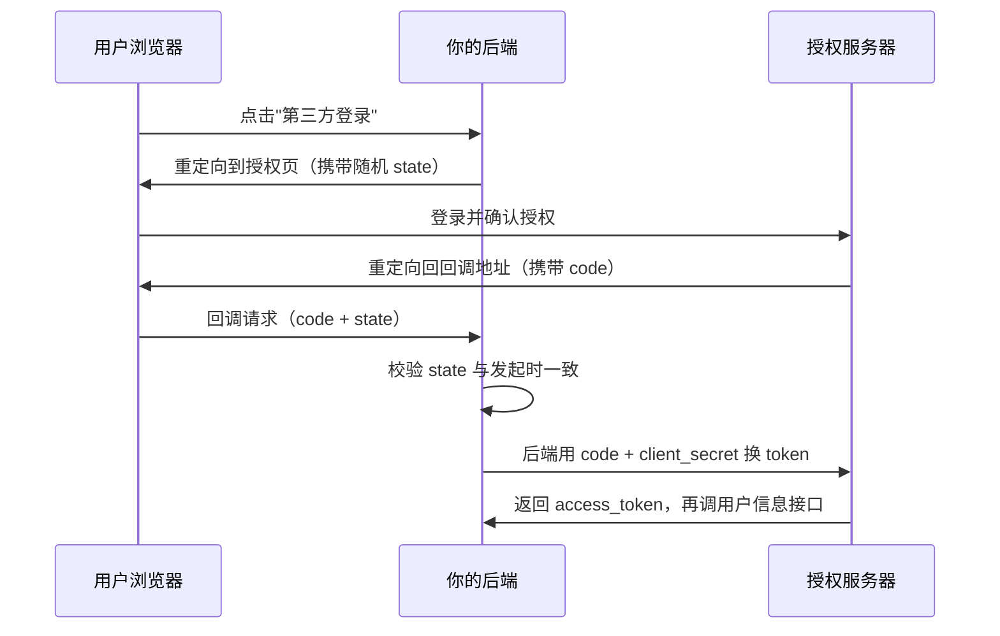

# 密码存储与认证安全

## 概念说明

认证安全的全部工作围绕两类资产展开：**凭证**（用户设置的密码）与**票据**（登录后随身携带的 Session ID 或 JWT）。前者的底线是"数据库被拖走也不能还原出明文"；后者的底线是"伪造不了、过期作废、可以撤销"。

本文沿这条主线展开：先把密码存对，再把比较做对，然后讨论票据的两种形态与 OAuth2 第三方登录，最后给登录接口加上防爆破的限流。

::: tip 威胁模型
本文假设最坏情况：攻击者最终能读到你的数据库（拖库）、能观测你的响应时序（侧信道）、能向登录接口无限次发请求（爆破）。所有防护设计都以这些假设为前提。
:::

## 核心要点

- 密码存储唯一正确的姿势：**慢哈希 + 每用户独立盐**（bcrypt 或 argon2id），框架里叫"密码 hasher"。
- 用 MD5 / SHA-1 / SHA-256 直接存密码是**架构级错误**，不是"强度弱一点"的问题——它们太快了。
- 一切"秘密值"（哈希、令牌、签名）的比较必须用**恒定时间比较**，普通 `==` 的耗时与匹配进度相关。
- JWT 三条铁律：算法白名单写死在服务端（防 alg 混淆）、校验 `exp`、短有效期 + 可撤销。
- Session 与 Token 没有绝对优劣，选择取决于**撤销需求与客户端形态**。
- OAuth2 集成的三个必查项：`state` 防 CSRF、`redirect_uri` 精确匹配、机密只放在后端。
- 登录接口必须限流，失败提示**不区分**"用户不存在"与"密码错误"。
- ⚠️ 常见误区：把"加密"当"哈希"。加密是可逆的，密码存储必须不可逆。
- ⚠️ 常见误区："加个盐的 SHA-256 就安全了"。盐解决彩虹表，解决不了"快"——离线爆破依然轻松。

## 密码哈希：为什么 MD5/SHA 不合格

**判定标准**：好的密码哈希必须"慢"，并且每个用户有独立盐。慢是为了让离线爆破的成本不可接受；盐是为了让相同密码的哈希值互不相同、攻击者无法共用预计算表。

| 方案 | 速度（对 GPU/专用硬件） | 盐 | 结论 |
|---|---|---|---|
| MD5 / SHA-1 | 极快 | 通常无盐 | ❌ 禁止用于密码 |
| SHA-256（单次） | 极快 | 需自己管理盐 | ❌ 禁止："快"本身就是错 |
| bcrypt | 可调慢（cost 因子） | 内置 | ✅ 成熟可用 |
| argon2id | 内存困难，抗 GPU | 内置 | ✅ 现代首选 |

::: danger 教学警示：以下为漏洞模式，禁止照搬
下面展示"用快速哈希直接存密码"这一**漏洞模式**。拖库场景下，快速哈希等于把密码以"需要一点计算就能得到"的形式公开。这里不提供任何爆破工具细节。
:::

```python
# ❌ 漏洞代码：单次 SHA-256 存密码（MD5/SHA-1 同理）
import hashlib

def register_vulnerable(username: str, password: str) -> None:
    stored = hashlib.sha256(password.encode()).hexdigest()
    db.execute("INSERT INTO users (name, pwd) VALUES (?, ?)", (username, stored))
```

**防护**：使用专门的密码哈希库。以 bcrypt 为例：

```python
# ✅ 防护代码：bcrypt（盐自动生成并写入哈希串，无需自己存盐列）
import bcrypt

def hash_password(plain: str) -> bytes:
    return bcrypt.hashpw(plain.encode(), bcrypt.gensalt(rounds=12))

def verify_password(plain: str, hashed: bytes) -> bool:
    return bcrypt.checkpw(plain.encode(), hashed)
```

或 argon2id（更现代的选择）：

```python
# ✅ 防护代码：argon2-cffi（参数用库默认值即可）
from argon2 import PasswordHasher
from argon2.exceptions import VerifyMismatchError

ph = PasswordHasher()

def hash_password(plain: str) -> str:
    return ph.hash(plain)

def verify_password(plain: str, hashed: str) -> bool:
    try:
        ph.verify(hashed, plain)
        return True
    except VerifyMismatchError:
        return False
```

::: tip 验证与升级
哈希不可逆，校验只能在**登录时**比对。日后调高哈希参数（bcrypt cost、argon2 内存）时，可在验证成功后用库提供的 `check_needs_rehash` 类接口判断旧哈希是否需要重哈希，让用户在下次登录时无感升级。
:::

Django 项目不必引入第三方库：`PASSWORD_HASHERS` 设置默认使用迭代式 PBKDF2，也可切换 Argon2，原理与本节一致。

## 恒定时间比较

**成因**：普通 `==` 比较字符串时在第一个不匹配的字节处提前返回，耗时与"匹配了多少"相关。当被比较的对象是哈希、令牌、签名这类**秘密值**时，这段微小时序差异就是可观测的信息泄漏。防护极其简单——秘密值的比较永远用恒定时间函数。

::: danger 教学警示：以下为漏洞模式，禁止照搬
下面展示"用 `==` 比较秘密值"这一**漏洞模式**。注意：普通业务数据（用户名、订单号）用 `==` 没有问题；问题只出现在**比较对象是秘密值**的场景。
:::

```python
# ❌ 漏洞代码：API Key 校验用 == 比较
def check_api_key_vulnerable(provided: str, expected: str) -> bool:
    return provided == expected   # 比较耗时与匹配进度相关
```

```python
# ✅ 防护代码：恒定时间比较（str/bytes 均可）
import hmac

def check_api_key_safe(provided: str, expected: str) -> bool:
    return hmac.compare_digest(provided, expected)

# secrets.compare_digest 是同一函数的别名，本文其他示例用的是它
```

## JWT 安全

**结构回顾**：JWT 由 `header.payload.signature` 三段组成——header 声明算法，payload 是声明集合（`exp` 过期、`iat` 签发、`jti` 唯一编号、`sub` 主题），signature 保证前两段未被篡改。**签名只防篡改、不加密**：payload 任何人可解码阅读，敏感数据不要放进去。

### alg 混淆与"未签名"陷阱

::: danger 教学警示：以下为漏洞模式，禁止照搬
下面展示"验证算法由 token 自己声明"这一**漏洞模式**。历史上多个 JWT 库因默认信任 header 中的 alg 而接受伪造 token，其中最著名的一类是诱导库走"不签名"验证分支。这里只讲防护，不展开利用细节。
:::

```python
# ❌ 漏洞模式：从 token 头部读取 alg，再按它验证
import jwt

def decode_vulnerable(token: str) -> dict:
    header = jwt.get_unverified_header(token)
    # 危险：header 可被改写，服务端可能按攻击者指定的方式"验证"
    return jwt.decode(token, SECRET_KEY, algorithms=[header["alg"]])
```

**防护**：算法白名单由**服务端写死**，与 token 头部声明无关；同时强制关键字段必须存在。

```python
# ✅ 防护代码：算法白名单 + 强制 exp/iat/sub（PyJWT 风格）
import jwt

def decode_token(token: str) -> dict:
    return jwt.decode(
        token,
        SECRET_KEY,
        algorithms=["HS256"],               # 写死白名单，永不信任 token 自报的 alg
        options={"require": ["exp", "iat", "sub"]},
        issuer="auth.example.com",          # 可选：同时校验签发方
    )
```

### 过期与撤销

`exp` 由 `jwt.decode` 自动校验，过期即拒绝。**但 JWT 签发后无法直接"作废"**——这正是它必须短命的根源。工程上的标准组合：

```python
# ✅ 短有效期 + jti 撤销名单（登出/改密时拉黑）
import uuid
from datetime import datetime, timedelta, timezone

def create_token(user_id: str) -> str:
    now = datetime.now(timezone.utc)
    payload = {
        "sub": user_id,
        "iat": now,
        "exp": now + timedelta(minutes=15),   # 访问令牌必须短命
        "jti": str(uuid.uuid4()),             # 全局唯一编号，撤销名单的键
    }
    return jwt.encode(payload, SECRET_KEY, algorithm="HS256")

def revoke(token: str) -> None:
    payload = decode_token(token)             # 先验证，再撤销
    remaining = payload["exp"] - datetime.now(timezone.utc).timestamp()
    redis.setex(f"jwt:denylist:{payload['jti']}", max(int(remaining), 1), "1")

def is_revoked(payload: dict) -> bool:
    return bool(redis.exists(f"jwt:denylist:{payload['jti']}"))
```

::: warning 撤销的现实方案
"完全不能撤销"只属于超短期的访问令牌。工程组合通常是：**短命访问令牌（15 分钟级）+ 可撤销的刷新令牌**；改密码或发现异常时，只需拉黑对应用户的刷新令牌与全部 `jti`。
:::

## Session vs Token

| 维度 | Session（服务端会话） | JWT（自包含令牌） |
|---|---|---|
| 状态存储 | 服务端（内存/Redis/数据库） | 令牌自身，服务端无状态 |
| 撤销 | 删除服务端记录，**天然可撤销** | 需要 jti 名单等补充机制 |
| 典型载体 | HttpOnly Cookie | Cookie 或 Authorization 头 |
| CSRF 风险 | 依赖 Cookie，需 CSRF 防护 | 放 Cookie 同样需要；放 Header 较低 |
| 多端/跨服务 | 需自行传递会话标识 | 天然适配 API 与服务间传递 |
| 扩展性 | 共享存储（Redis）即可横向扩展 | 无共享存储，扩展更轻 |
| 适用场景 | 传统网页应用、需要即时踢人 | API 服务、多端、微服务身份传递 |

::: tip 选择建议
不确定时就选 Session：撤销能力是安全上的"免费午餐"。选 JWT 的理由应当是具体的——多端 API、无状态水平扩展、服务间传递，而不是"看起来更现代"。
:::

## OAuth2 基本流程与常见错误

第三方登录使用授权码流程（Authorization Code Flow）。全流程中**机密（client_secret）只出现在你的后端与授权服务器之间**：



**常见错误**（按出现频率排序）：

| 错误 | 后果 | 正确做法 |
|---|---|---|
| 不校验 `state` | 回调可被伪造，账号绑定被劫持 | `state` 用随机值，存会话，回调时恒定时间比对 |
| `redirect_uri` 前缀匹配 | 子路径/参数变体劫持回调 | 授权平台**完整精确匹配** |
| `client_secret` 放进前端/移动端 | 机密泄漏，任何人可冒充应用 | 机密只在后端；公开客户端改用 PKCE |
| token 存 localStorage | XSS 一次即可读走令牌 | 后端持有；前端只拿 HttpOnly Cookie 会话 |
| 不校验 token 的 `iss`/`aud` | 接受别的系统/受众的令牌 | 每次校验签发方与受众 |
| 继续使用隐式（implicit）流程 | token 暴露在 URL 片段 | 统一授权码 + PKCE |

## 限流与登录防爆破

登录接口是公网上被尝试最多的端点。通用防线由三层组成：**双维度限流**（控制频率）、**计数窗口与升级处置**（提高攻击成本）、**统一错误提示**（不泄漏账号是否存在）。

```python
# ✅ 通用做法：按"账号 + IP"双维度计数，窗口限流
LOGIN_LIMIT = 5           # 窗口内允许的失败次数
WINDOW_SECONDS = 300      # 5 分钟窗口

def register_failure(key: str) -> int:
    """失败计数 +1，返回当前计数；首次计数时设置过期。"""
    name = f"login:fail:{key}"
    count = redis.incr(name)
    if count == 1:
        redis.expire(name, WINDOW_SECONDS)
    return count

def too_many_failures(key: str) -> bool:
    count = redis.get(f"login:fail:{key}")
    return count is not None and int(count) >= LOGIN_LIMIT

@app.route("/login", methods=["POST"])
def login():
    username = request.form.get("username", "")
    keys = (f"acct:{username}", f"ip:{request.remote_addr}")

    # 1) 任一维度超限直接拒绝，不执行密码校验
    if any(too_many_failures(k) for k in keys):
        return "尝试过于频繁，请稍后再试", 429

    user = verify_credentials(username, request.form.get("password", ""))
    if user is None:
        for key in keys:
            register_failure(key)
        # 2) 统一提示：不区分"用户不存在"与"密码错误"
        return "用户名或密码错误", 401

    # 3) 登录成功后清理失败计数
    for key in keys:
        redis.delete(f"login:fail:{key}")
    return establish_session(user)
```

::: warning 防爆破三条底线
1. **失败提示统一**："用户名或密码错误"——能枚举有效用户名的登录框等于送攻击者一份名单。
2. **限流维度至少两个**：按 IP 防单源轰炸，按账号防分布式慢速尝试；失败响应可加固定小延迟，抹平时序差异。
3. **升级处置要有阈值**：同一账号反复失败应触发验证码/临时锁定并告警，而不是无限重试。
:::

## 常见陷阱

| 陷阱 | 后果 | 正确做法 |
|---|---|---|
| MD5/SHA-256 直接存密码 | 拖库即近明文 | bcrypt / argon2id |
| 自研哈希或加密逻辑 | 参数错误难以发现 | 成熟库 + 默认参数 |
| `==` 比较哈希/令牌 | 时序侧信道泄漏匹配进度 | `hmac.compare_digest` |
| JWT 算法由 token 声明 | 未签名分支被走通 | 服务端写死算法白名单 |
| JWT 有效期数周且无撤销 | 泄漏后长期可用 | 短访问令牌 + 可撤销刷新令牌 |
| payload 放手机号等敏感信息 | JWT 不加密，人人可读 | 只放必要声明 |
| OAuth 回调不校验 `state` | 授权绑定被伪造 | 随机 state + 会话比对 |
| 登录失败提示区分两种错误 | 有效用户名被枚举 | 统一提示 |

## 最佳实践

1. **密码相关代码收敛到一个模块**（hash/verify 各一个函数），禁止其他文件直接用 `hashlib` 处理密码。
2. **哈希参数定期评估**：硬件在变快，cost/内存参数应跟着抬升，借用户登录完成无感重哈希。
3. **票据"出生即短命"**：先给最小必要有效期，再按业务放宽；撤销机制上线第一天就要有。
4. **把三份清单纳入评审**：JWT 三铁律、OAuth 三必查、防爆破三底线。
5. **框架内置能力优先**：Django 的 hasher 与会话框架、成熟框架的 CSRF 中间件，比自己拼装更不易出错。

## 版本说明

- **bcrypt / argon2-cffi / PyJWT** 均为第三方库，参数与 API 以各自官方文档为准；本文只锁定用法模式，不锁定具体小版本。
- **Django**：内置迭代式密码 hasher（可切换 Argon2）与会话框架，方向上与本节一致。
- **argon2id**：argon2 系列中推荐的变体（兼顾抗侧信道与抗 GPU）。
- OAuth 规范的演进方向已明确以"授权码 + PKCE"取代隐式流程。

## 延伸阅读

- → [常见 Web 漏洞与防护](01-常见Web漏洞与防护) —— 注入类漏洞与 CSRF 的漏洞/防护对照
- → [依赖与运行时安全](03-依赖与运行时安全) —— JWT 签名密钥等 secrets 的存放与轮转
- → [Django 表单认证与生产部署](../02-Django表单认证与生产部署) —— Django 内置认证、hasher 与会话体系
- OWASP Authentication Cheat Sheet：<https://cheatsheetseries.owasp.org/cheatsheets/Authentication_Cheat_Sheet.html>
- OWASP JWT Cheat Sheet：<https://cheatsheetseries.owasp.org/cheatsheets/JSON_Web_Token_for_Java_Security_Cheat_Sheet.html>

> 🧭 工程化工具链与 Python 版本演进速览统一维护在 [导航总览 · 工程化工具链演进速览](/docs/python/02-基础与入门/00-导航总览#六工程化工具链演进速览)。
