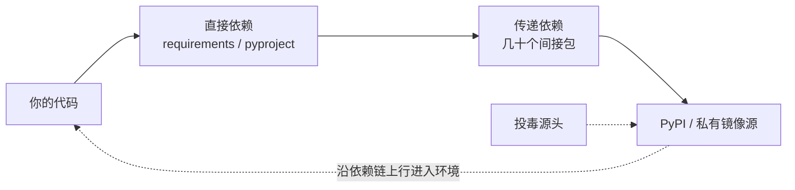

# 依赖与运行时安全

## 概念说明

一个 Web 应用的攻击面远不止自己写的代码。`pip install` 的每一个包（连同它带进来的几十个传递依赖）、每一份配置里的机密、每一行日志、以及进程本身的运行方式，都是攻击者可以下手的环节。代码写对只是安全的一半，另一半是：**依赖可审计、机密不落盘、日志不泄密、进程最小权限**。

本文承接前两篇（漏洞防护、认证安全），把防线延伸到"代码之外"。

::: tip 一句话威胁模型
你信任的每一个第三方包、每一份保存在代码仓库里的机密，都会在未来的某一天成为攻击面。安全的工作之一，就是把这个"未来"提前变成流程。
:::

## 核心要点

- 依赖是最大的隐性攻击面：**锁文件 + 定期审计**是底线，缺一不可。
- 安装的每一个包都要能回答三个问题：为什么需要它、来源是谁、谁批准的。
- 版本策略原则：**开发时可以宽，部署时必须钉死**——环境必须可复现。
- 机密管理原则：不进代码仓库、按环境隔离、可轮转、泄漏有预案。
- 日志是敏感数据泄漏的重灾区：脱敏必须在日志层**统一**做，不能指望每个开发记得。
- 生产环境以"最小权限"为默认：非 root、只读文件系统、最小网络暴露面。
- ⚠️ 常见误区："开源包是安全的"。开源等于可审查，不等于已审查。
- ⚠️ 常见误区："机密泄漏删掉代码就行"。Git 历史与镜像层里它还在。

## 依赖审计：发现已知漏洞

依赖审计的目标是回答一个问题：**当前环境里的包，有没有已公开披露的安全漏洞？**这个问题有现成工具回答，应当做成 CI 的固定步骤。

```bash
# 安装审计工具
pip install pip-audit

# 审计当前虚拟环境的全部包（发现漏洞时以非零退出码结束）
pip-audit

# 只审计依赖清单，不安装
pip-audit -r requirements.txt
```

```bash
# 另一个常用选择：safety
pip install safety
safety check -r requirements.txt
```

```yaml
# CI 中作为固定步骤（通用写法，退出码非零即失败）
- name: 依赖漏洞审计
  run: |
    pip install pip-audit
    pip-audit -r requirements.txt
```

::: tip 审计要"持续"，不要"一次"
漏洞披露是持续发生的：今天干净的依赖，明天可能被披露新漏洞。审计必须挂在 CI 上每次构建运行，并定期（如每周）对全部环境跑一次全量审计。
:::

## 锁定版本与供应链风险

### 为什么必须锁定

`requirements.txt` 里写 `>=` 看似灵活，代价是**构建不可复现**：今天和昨天装出来的依赖树可能不同，一次"顺手升级"就可能带入有漏洞的版本。部署环境必须回答"这次上线跑的到底是哪几个包的哪个版本"。

```bash
# ✅ 生成锁文件：钉死全部直接+传递依赖
pip freeze > requirements.lock

# 生产安装使用锁文件；能生成哈希时进一步开启哈希校验
pip install --require-hashes -r requirements.lock

# 使用现代工具时同理：锁文件由工具维护，安装按锁执行
uv lock
uv sync --locked
```



::: danger 教学警示：供应链投毒的常见入口
投毒并不需要攻击者攻破你的服务器——只需要你的 `pip install` 装到一个"看起来没问题"的包。常见入口包括：与知名库**名称高度近似**的新包（抢注）、维护者账号被盗后推送的恶意版本、以及长期无人维护的包被"好心人"接管。防护手段全部在流程层：认准官方包名、核对项目仓库链接、锁定版本、升级走评审。本文不展开任何具体投毒案例的操作细节。
:::

### 供应链风险与缓解对照

| 风险 | 典型形态 | 缓解手段 |
|---|---|---|
| 包名抢注 | 与知名库名称高度近似的新包 | 认准官方包名，安装前核对仓库链接与维护者 |
| 维护者账号被盗 | 流行包被推送恶意新版本 | 锁定版本；升级走 PR 评审，审计变更内容 |
| 传递依赖投毒 | 直接依赖干净，间接依赖被投毒 | 锁文件必须覆盖**全部**传递依赖 |
| 构建脚本执行 | 安装阶段运行任意代码 | 优先选择 wheel 发行物；使用可信镜像源 |
| 长期不升级 | 已知漏洞在环境里滞留数月 | CI 持续审计 + 固定升级窗口 |

::: warning 锁定 ≠ 永不升级
锁定版本的目的是**变更可控**，不是冻结。正确节奏是：锁文件钉死日常构建，定期（每两周至每月）开一次"依赖升级"分支，跑完测试与审计后合入。安全修复的升级应当走快速通道。
:::

## secrets 管理：环境变量与密钥轮转

**成因**：机密（数据库密码、JWT 签名密钥、第三方 API Key）一旦写进源码，就会进入 Git 历史、构建镜像、错误报告与备份——每一份拷贝都是一次泄漏机会。

::: danger 教学警示：以下为漏洞模式，禁止照搬
下面展示"机密硬编码进源码"这一**漏洞模式**。它的问题不在于"会不会被人看到屏幕"，而在于机密从此随代码仓库**永久扩散**。
:::

```python
# ❌ 漏洞代码：机密写死在源码里
SMTP_PASSWORD = "mail-prod-password"   # 进入 Git 历史、镜像层、CI 日志
JWT_SECRET = "dev-secret"              # 拿到它即可伪造任意 JWT
```

**防护**：机密一律从环境注入，配置缺失时**启动即失败**，并尽量使用脱敏类型。

```python
# ✅ 防护代码：环境变量注入 + SecretStr 脱敏 + 启动时校验
from pydantic import SecretStr
from pydantic_settings import BaseSettings

class Settings(BaseSettings):
    jwt_secret: SecretStr            # 必填：环境里没有就直接启动失败
    smtp_password: SecretStr = SecretStr("")

settings = Settings()                # 从环境变量 / .env 加载
```

环境策略与 `.env` 纪律（`.env` 不进 Git、提供 `.env.example` 模板、生产用密钥管理服务注入）在站内专文中有完整体系，不再重复：[配置管理 · 敏感信息管理](/docs/python/03-工程化与运维/01-工程化/07-配置管理#敏感信息管理)。

### 密钥轮转 runbook

轮转不是"想起来的事"，而是一套固定流程——泄漏处置与定期轮换都走同一个 runbook：

1. **确认范围**：哪些机密、泄漏到哪（仓库历史 / 镜像 / 日志 / 员工离职）。
2. **签发新密钥**：在密钥管理服务或部署平台生成新值。
3. **双密钥过渡**：服务同时接受新旧密钥（JWT 签名密钥可用 `kid` 头标识当前密钥），等待旧令牌/旧连接自然过期。
4. **撤销旧密钥**：过渡期结束，彻底吊销旧值；数据库密码、云平台 Key 在对应平台执行。
5. **审计与复盘**：检查访问日志确认泄漏窗口内有无异常访问；用 `git filter-repo` 等工具清理仓库历史。

::: danger 如果机密已经进了 Git
立刻轮换使其失效是**第一优先级**——删除文件不能让历史中的旧值失效。先轮转、后清史、再审计，顺序不能颠倒。
:::

## 日志脱敏

**成因**：日志是敏感数据泄漏的"合法通道"——密码、令牌、身份证号常常随调试语句、请求体打印、异常堆栈进入日志，再随日志收集系统扩散到更多存储与更多人。

::: danger 教学警示：以下为漏洞模式，禁止照搬
下面展示"敏感值直接进日志"这一**漏洞模式**。它平时看起来无害，直到日志系统被访问、被导出、被共享的那一天。
:::

```python
# ❌ 漏洞代码：敏感值直接写入日志
logger.info("用户登录成功: username=%s password=%s", username, password)
logger.info("调用上游接口: Authorization=%s", auth_header)
```

**防护**：脱敏在日志层**统一**实现，业务代码无感——正则掩码 + 键名黑名单双管齐下。

```python
# ✅ 防护代码：logging Filter 统一脱敏
import logging
import re

_SECRET_PATTERN = re.compile(
    r"(?i)(password|passwd|token|secret|api[_-]?key|authorization|cookie)\s*[=:]\s*(\S+)"
)

def mask_text(text: str) -> str:
    return _SECRET_PATTERN.sub(r"\1=***", text)

def mask_mapping(data: dict, sensitive_keys: set[str]) -> dict:
    """结构化日志用：命中敏感键名的值替换为 ***。"""
    return {k: ("***" if k.lower() in sensitive_keys else v) for k, v in data.items()}

class SensitiveMaskFilter(logging.Filter):
    def filter(self, record: logging.LogRecord) -> bool:
        if isinstance(record.msg, str):
            record.msg = mask_text(record.msg)
        return True

# 在 dictConfig 中为根 logger 挂载该 Filter，所有 handler 生效；
# 另一个减少泄漏面的习惯：用 SecretStr 等脱敏类型管理机密，
# 它们在被格式化进日志前就已显示为 **********
```

::: tip 脱敏的位置很重要
在**日志层**（Filter / formatter）脱敏是一次配置、处处生效；散落在业务代码里的 `logger.info(mask(password))` 则依赖每个人的自觉，总有一处遗漏。日志架构（dictConfig、结构化日志、上下文追踪）见站内专文：[日志系统](/docs/python/03-工程化与运维/02-运维/01-日志系统)。
:::

## 生产加固清单

最后一层防线是进程的运行方式。以下清单可直接作为上线前的核对表：

| 项目 | 要求 | 落地方式 |
|---|---|---|
| 运行用户 | 非 root | Dockerfile `USER` 指令 / systemd `User=` |
| 文件系统 | 最小可写 | 只读根文件系统 + 显式挂载可写卷 |
| 权限边界 | 最小权限 | 不挂载宿主机敏感目录与 socket |
| 网络暴露面 | 最小暴露 | 应用端口仅内网可达，对外只留反向代理的 443 |
| 传输加密 | 全链路 HTTPS | 反向代理终结 TLS，内网也走加密链路 |
| 调试开关 | 生产禁用 | `DEBUG=False` 作为默认值（见配置管理篇） |
| 错误外泄 | 不回传堆栈 | 全局异常处理器返回通用错误页，详情进日志 |
| 依赖 | 持续审计 | CI 中 `pip-audit` / `safety`（本文依赖审计节） |
| 日志 | 脱敏 + 集中收集 | 本文"日志脱敏"与站内日志系统篇 |
| 机密 | 平台注入 | 环境变量 / 密钥管理服务（本文 secrets 节） |

### 非 root 运行示例

```dockerfile
# ✅ 生产镜像：固定基础镜像 + 专用非 root 用户
FROM python:3.12-slim

RUN useradd --create-home appuser
COPY --chown=appuser requirements.lock /app/
RUN pip install --no-cache-dir -r /app/requirements.lock

COPY --chown=appuser src/ /app/src
WORKDIR /app
USER appuser            # 核心：应用进程不再持有 root 权限

# 容器内监听的端口仅在内网发布，对外由反向代理提供 HTTPS
CMD ["gunicorn", "--workers", "2", "--bind", "0.0.0.0:8000", "app:app"]
```

### HTTPS 部署要点

TLS 应当在**反向代理层**终结，应用进程只监听内网端口；应用侧配合做两件事：重定向到 HTTPS 交给代理，安全响应头自己补齐。

```python
# ✅ 应用侧：补充与传输安全相关的响应头
@app.after_request
def security_headers(response):
    response.headers["Strict-Transport-Security"] = (
        "max-age=31536000; includeSubDomains"   # HSTS：强制浏览器后续走 HTTPS
    )
    return response
```

## 常见陷阱

| 陷阱 | 后果 | 正确做法 |
|---|---|---|
| 依赖版本用 `>=` | 构建不可复现，升级不可控 | 锁文件钉死全部依赖 |
| 本地、CI、生产依赖不一致 | "我这里没问题"式事故 | 三处使用同一份锁文件 |
| 机密硬编码 | 随仓库历史永久扩散 | 环境变量 / 密钥服务注入 |
| 泄漏后只删代码 | 旧值仍然有效 | 先轮换、后清史、再审计 |
| 日志打印请求体/响应体 | 敏感数据大面积落盘 | 字段白名单 + 日志层统一脱敏 |
| 容器以 root 运行 | 进程被攻破即宿主机沦陷 | `USER` 指令 + 只读文件系统 |
| 调试开关未关上线 | 报错页泄漏源码与配置 | 默认 `DEBUG=False`，启动时校验 |
| 只在出事后才审计依赖 | 已知漏洞滞留数月 | CI 固定审计步骤 |

## 最佳实践

1. **把"锁文件 + CI 审计"当作基础设施**而不是可选优化，新项目第一天就配好。
2. **机密只出现在两个地方**：注入源（环境变量/密钥服务）与消费点（Settings 对象）；中间任何一层（代码、日志、报错）都不应出现明文。
3. **轮转当成常规演练**：每季度按 runbook 走一遍非泄漏轮换，真出事时才不会手忙脚乱。
4. **脱敏做在日志层**，并为结构化日志维护统一的敏感键名清单。
5. **上线前逐条过加固清单**，把清单放进发布流程模板，而不是依赖某位工程师的记忆。

## 版本说明

- **pip-audit / safety / uv** 均为第三方工具，命令行参数以各自官方文档为准；本文只锁定用法模式。
- **pydantic-settings**：`BaseSettings` 与 `SecretStr` 用法依赖 Pydantic v2 系列。
- **Python 3.12-slim**：示例 Dockerfile 以官方 slim 镜像为基线，实际选择与运行时版本保持一致即可。
- **uvicorn / gunicorn**：ASGI/WSGI 服务器均支持配合反向代理部署，代理传递协议头的方式见各自文档。

## 延伸阅读

- → [常见 Web 漏洞与防护](01-常见Web漏洞与防护) —— 代码层漏洞的漏洞/防护对照
- → [密码存储与认证安全](02-密码存储与认证安全) —— 认证侧防线与 JWT 密钥管理
- → [配置管理](/docs/python/03-工程化与运维/01-工程化/07-配置管理) —— 环境变量、SecretStr 与 `.env` 纪律的完整体系
- → [日志系统](/docs/python/03-工程化与运维/02-运维/01-日志系统) —— dictConfig、结构化日志与上下文追踪
- OWASP Dependency-Check 项目：<https://owasp.org/www-project-dependency-check/>

> 🧭 配置与密钥管理的完整体系见 [配置管理](/docs/python/03-工程化与运维/01-工程化/07-配置管理)；日志体系见 [日志系统](/docs/python/03-工程化与运维/02-运维/01-日志系统)。
