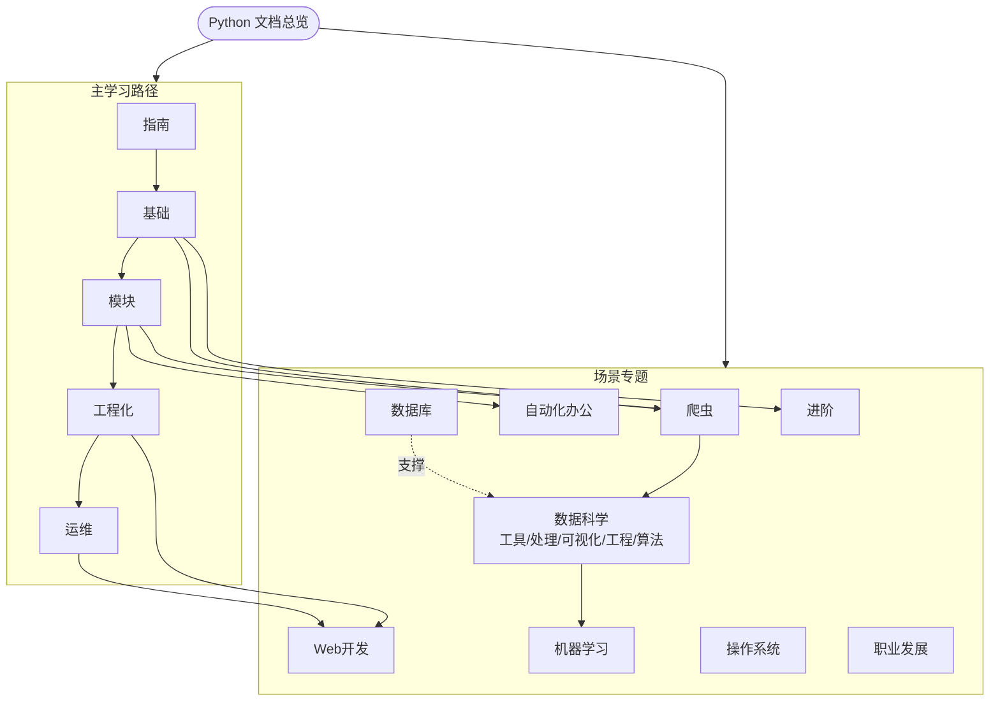

# Python 文档导航总览

> 本页是 `docs/Python` 的**唯一权威入口**。所有"基础知识索引 / 模块与库索引 / 工程化索引"等旧引用，均已统一指向本页与各分类目录。
> 主学习路径：指南 → 基础 → 模块 → 工程化 → 运维；场景专题横向展开。

## 一、主学习路径（循序渐进）

| 阶段 | 入口 | 内容 |
|------|------|------|
| 0 入门准备 | [入门指南与学习路线](/docs/python/02-基础与入门/01-入门指南与学习路线) · [开发环境与工具](/docs/python/02-基础与入门/02-开发环境与工具) | 环境搭建、路线规划、工具链 |
| 1 基础 | [基础](/docs/python/02-基础与入门/00-导航总览) | 语法、数据类型、流程控制、函数、面向对象 |
| 2 模块与库 | [模块](/docs/python/07-模块/01-Python模块)（[内置](/docs/python/07-模块/03-内置模块/01-os模块) · [第三方](/docs/python/07-模块/04-第三方模块/01-chardet)） | 标准库与常用第三方库 |
| 3 工程化 | [工程化](/docs/python/03-工程化与运维/01-工程化/01-代码规范)（配置 [07](/docs/python/03-工程化与运维/01-工程化/07-配置管理) · 性能 [08](/docs/python/03-工程化与运维/01-工程化/08-性能优化)） | 类型注解、测试、依赖管理、打包发布、CI/CD、项目结构、配置、性能 |
| 4 运维部署 | [运维](/docs/python/03-工程化与运维/02-运维/01-日志系统)（[监控与可观测性](/docs/python/03-工程化与运维/02-运维/02-监控与可观测性) · [部署与运行](/docs/python/03-工程化与运维/02-运维/03-部署与运行)） | 日志体系、可观测性、生产部署与发布 |

## 二、场景专题（按方向深入）

| 专题 | 入口 | 适合方向 |
|------|------|----------|
| 爬虫 | [爬虫](/docs/python/01-Web与爬虫/02-爬虫/01-爬虫概览与HTTP基础) | 数据采集、逆向、分布式 |
| 数据科学 | [数据科学](/docs/python/05-数据科学/index) | 工具基础、数据处理、可视化、数据工程、算法建模（含量化金融） |
| Web 开发 | [Web开发](/docs/python/05-数据科学/07-量化金融/05-RESTful与Socket交易执行) | 后端、API |
| 自动化办公 | [自动化办公](/docs/python/08-自动化办公/01-文本文件操作) | 文件/报表/OCR |
| 数据库 | [数据库](/docs/python/09-进阶核心/03-数据库/01-关系型数据库) | 存储、SQL/NoSQL |
| 机器学习 | [机器学习](/docs/python/05-数据科学/01-数据科学导论/02-AI与机器学习通识) | ML/DL |
| 进阶 | [进阶](/docs/python/09-进阶核心/04-进阶/01-迭代器与生成器) | 并发、元编程、性能、内存 |
| 操作系统 | [操作系统](/docs/操作系统/01-计算机组成与程序执行) | 系统编程 |

## 三、信息架构图

## 四、使用建议

1. 零基础：按「主学习路径」顺序通读，每个阶段完成至少一个实战项目。
2. 有基础找方向：直接进「场景专题」对应入口。
3. 查具体 API：用站点搜索，或从本页进入对应分类目录。

## 五、Python 版本差异速览

本目录各篇文章统一在此维护 Python 版本差异，正文中不再重复：

| 特性 | 3.8-3.12 时代 | Python 3.13/3.14 |
|------|-----------|-------------|
| 类型注解求值 | 运行时立即求值 | PEP 649/749 延迟求值：注解不再在定义时执行，解决前向引用，提升启动性能 |
| 字符串模板 | 普通 f-string / `str.format` | PEP 750 模板字符串 `t"..."`：可插值且能被安全处理（3.14 新特性） |
| 标准库多解释器 | 无官方支持 | PEP 734：`concurrent.interpreters` 模块支持在同一进程创建多个子解释器 |
| 调试 | 仅 Python 内建 pdb / IDE 调试 | PEP 768：安全的 CPython 外部调试器接口（custom debugger protocol） |
| 字节码与运行时 | 3.12 前无 JIT | 3.13 引入实验性 JIT（PEP 744）；3.14 进一步改进 free-threaded（无 GIL）构建 |
| `datetime` API | `utcnow()` 常用 | 3.12 起弃用，官方要求改用 `datetime.now(tz=datetime.UTC)`（aware 对象） |
| 压缩算法 | zlib / gzip / bz2 / lzma | 3.14 新增标准库 Zstandard 支持（PEP 784） |

> 本目录文章讲解的语法与数据结构原理在 3.14 中依然成立；新项目建议基于 Python 3.13/3.14，并优先使用 aware datetime、PEP 649 注解与最新类型语法。

## 六、工程化工具链演进速览

「工程化与运维」目录各篇统一在此维护工具链演进背景，正文中不再重复：

| 特性 | 3.8-3.12 时代 | 当前 |
|------|-----------|------|
| Python 基线 | 3.8-3.12 | 3.14（最新稳定版，3.9- 已全部 EOL） |
| 包管理 | pip/poetry | `uv` 成为新一代工具（极快）；`pyproject.toml` 为事实标准 |
| 类型检查 | mypy | Pyright/Pylance 为主流；mypy 持续更新 |
| 格式化 | Black/isort | `ruff format` 一体化（Rust 实现） |
| 配置文件 | setup.cfg / setup.py | `pyproject.toml`（PEP 518/621）集中管理 |
| 测试 | unittest 为主 | pytest 为主流；unittest 作兼容基线 |

> 各篇讲解的工程实践在 3.13/3.14 下依然成立；新项目建议基于 Python 3.13/3.14，并优先采用 uv + ruff + pyright + pytest 的现代工具链。
