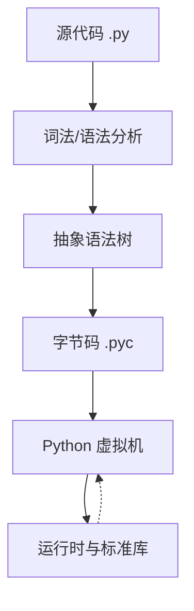

# Python 入门：简介与学习路线

> 本页是主学习路径的第一站：先快速认识 Python 是什么，然后搭建环境、写出第一个程序，并给出完整的四阶段学习路线。需要编辑器、虚拟环境等完整工具链配置，见 [开发环境与工具](02-开发环境与工具)。

## 一、Python 是什么

Python 是一种**解释型高级编程语言**，具备动态类型与自动内存管理能力。它支持多范式编程（过程式、面向对象、函数式），强调代码可读性与简洁语法，并以缩进作为代码块的结构标识。本文以 CPython 为主要参考实现。

从源码到执行的大致流程：



::: tip Python 的命名由来
Python 由 Guido van Rossum（吉多·范罗苏姆）在 1989 年开始设计，1991 年发布首个版本。命名与蟒蛇无关，而是来源于 Guido 喜欢的英国喜剧团体 Monty Python（巨蟒剧团）——这也是社区彩蛋文化中常见梗的来源。
:::

### 特点

- **简洁易读**：语法接近自然语言，通常可用更少的代码完成同样的任务。社区理念浓缩在文末的「Python 之禅」中
- **标准库与生态丰富**：完善的标准库覆盖网络、文件、数据库、文本等常用能力，第三方库（`requests`、`numpy`、`django` 等）通过 `pip` 即可安装
- **跨平台、开源**：同一份代码可运行在 Windows、Linux、macOS 上；语言本身开源免费，社区活跃

### 缺点

- **运行速度相对慢**：解释执行与动态类型带来运行时开销，通常比 C/C++ 慢。但对多数场景影响有限——例如下载 MP3 的程序，C 需要 0.001 秒、Python 需要 0.1 秒，而网络等待要 1 秒，用户感知不到差别。性能敏感部分可用高性能库（NumPy）、C 扩展或并行解决
- **源码难以加密**：发布的程序通常包含可读源码或字节码。生产环境应通过服务端部署、权限控制与依赖隔离来降低暴露风险，而非依赖"加密源码"；服务型商业模式下通常不需要向外部交付源码

::: danger
互联网上有无数非常优秀的开源代码，不要高估自己代码的"商业价值"。大公司不愿意开放代码，更重要的原因往往是代码写得太烂，一旦开源就没人敢用他们的产品。
:::

### 应用领域

| 领域 | 代表库/框架 | 说明 |
|------|------------|------|
| Web 开发 | Django、Flask | YouTube、Instagram、豆瓣等大型网站 |
| 数据科学与 AI | NumPy、Pandas、Matplotlib、TensorFlow | 数据分析与机器学习的首选语言 |
| 自动化脚本 | 标准库 + 第三方库 | 系统管理、自动化测试、运维脚本 |
| 网络爬虫 | Scrapy、BeautifulSoup、Requests | 数据采集简单高效 |
| 科学计算 | SciPy、SymPy | 科研领域的强力支撑 |
| 游戏与桌面 | Pygame、Tkinter、PyQt | 小游戏与中小型桌面应用 |

### 关于 GIL 与版本选择

CPython 的 **GIL（全局解释器锁）** 确保同一时刻只有一个线程执行字节码，CPU 密集型任务无法靠多线程并行；IO 密集型任务影响较小。深入原理见 [并发选择指南与 GIL](/docs/python/09-进阶核心/01-并发编程/04-并发选择指南与GIL)。

Python 2 已于 2020 年停止维护，**新项目一律使用 Python 3**（建议 3.13/3.14）。各版本关键特性差异见 [导航总览的版本差异速览](00-导航总览#五python-版本差异速览)。

### Python 之禅

Python 社区的理念浓缩在 Tim Peters 撰写的「Python 之禅」中，在解释器中执行 `import this` 即可看到：

```python
>>> import this
The Zen of Python, by Tim Peters

Beautiful is better than ugly. # 优美胜于丑陋（Python 以编写优美的代码为目标）
Explicit is better than implicit. # 明了胜于晦涩（命名规范，风格相似）
Simple is better than complex. # 简洁胜于复杂（不要有复杂的内部实现）
Complex is better than complicated. # 复杂不可避免时，也要保持接口简洁
Flat is better than nested. # 扁平胜于嵌套（不能有太多的嵌套）
Sparse is better than dense. # 间隔胜于紧凑（不要奢望一行代码解决问题）
Readability counts. # 可读性很重要
Special cases aren't special enough to break the rules. # 特例不足以违背这些规则
Although practicality beats purity. # 不过实用胜过纯粹
Errors should never pass silently. # 错误不应被悄悄忽略
Unless explicitly silenced. # 除非明确地静默（不写 except:pass 风格的代码）
In the face of ambiguity, refuse the temptation to guess. # 存在多种可能时，不要尝试去猜测
There should be one-- and preferably only one --obvious way to do it. # 应当有一种显而易见的解决方案
Now is better than never. # 做也许好过不做
If the implementation is hard to explain, it's a bad idea. # 难以向人描述的方案不是好方案
Namespaces are one honking great idea -- let's do more of those! # 命名空间是一种绝妙的理念
```

## 二、快速入门：搭建环境与第一个程序

### 安装 Python

| 平台 | 安装方式 |
|------|----------|
| Windows | [官网下载](https://www.python.org/downloads/windows/) 安装程序（3.13/3.14），**务必勾选 "Add Python to PATH"** |
| macOS | `brew install python3`，或 [官网安装程序](https://www.python.org/downloads/macos/) |
| Linux | 大多数发行版已预装；否则 `sudo apt install python3 python3-pip`（Ubuntu/Debian） |

安装完成后验证：

```bash
python3 --version   # 输出 3.x.x 即成功
```

> 💡 多版本共存、虚拟环境、编辑器配置等完整环境搭建，见 [开发环境与工具](02-开发环境与工具)。

### 第一个 Python 程序

创建 `hello.py`：

```python
# 这是一个简单的 Python 程序
name = input("请输入你的名字: ")
print(f"你好, {name}! 欢迎来到 Python 世界!")
```

```bash
python hello.py
```

想先在交互式环境里随手试语法？可以用自带的 REPL，或更强的 [IPython](02-开发环境与工具#ipython增强交互式解释器)。

### 常见问题

- **版本问题**：确认使用 Python 3.x（Python 2 已停止维护）
- **包管理**：用 `pip install 包名` 安装第三方包
- **环境隔离**：每个项目用虚拟环境，详见 [开发环境与工具](02-开发环境与工具)

## 三、学习路线

### 路线图总览

```
入门指南（你在这里）→ 基础知识 → 模块与标准库 → 工程化实践 → 应用专题
```

| 阶段 | 核心目标 | 关键知识点 | 建议项目 |
|------|----------|------------|----------|
| 第一阶段：基础入门 | 掌握编程基本概念，能用 Python 处理简单任务 | 基础语法、数据结构、流程控制、函数 | 简易计算器、猜数字游戏、文本处理脚本 |
| 第二阶段：进阶核心 | 理解面向对象，掌握核心库，能编写更复杂的程序 | 面向对象、文件处理、异常处理、常用标准库 | 简易图书管理系统、自动化文件整理脚本 |
| 第三阶段：方向专精 | 根据兴趣选择方向，学习专业领域的库和框架 | Web 框架、数据分析、人工智能 | 个人博客、数据可视化图表、电影推荐系统 |
| 第四阶段：工程化与提升 | 了解团队协作、代码质量、部署等高级主题 | 版本控制、虚拟环境、代码规范、打包部署 | 将之前的项目用 Git 管理，并部署到服务器 |

**学习路线图核心思想**：

- **目标导向**：先明确学 Python 的目的（Web 开发、数据分析、AI、自动化脚本？），这会影响技术栈的深度
- **二八原则**：花 20% 的时间掌握 80% 最常用的知识，复杂知识在项目中边做边学
- **项目驱动**：理论学习后必须动手做项目，这是巩固知识的唯一途径

### 第一阶段：基础入门（预计 1-2 个月）

**目标**：建立编程思维，能运行 Python，并解决一些简单的自动化问题。

**核心知识点**：

1. **搭建环境**：安装 Python，推荐 VS Code 或 PyCharm 作为编辑器
2. **基本语法**：变量、数据类型、注释、运算符
3. **数据结构**：列表、元组、字典、集合——创建、访问、增删改查
4. **流程控制**：`if`/`elif`/`else`；`for`、`while` 循环及 `break`、`continue`
5. **函数**：定义、参数（默认参数、关键字参数）、返回值、作用域
6. **模块和包**：使用 `import` 引入内置模块（如 `math`、`random`、`datetime`）

> 📚 本阶段对应本目录的 [基础文档](00-导航总览)（`03`~`16` 篇）。

**学习建议**：不要只看不练！每个知识点都在编辑器中敲一遍，并尝试修改代码观察结果变化。练习平台：牛客网、LeetCode（简单题）。

**实战小项目**：

- **猜数字游戏**：电脑随机生成一个数字，用户来猜
- **简易计算器**：实现加减乘除
- **文本词频统计**：读取文本文件，统计各单词出现次数

### 第二阶段：进阶核心（预计 1-2 个月）

**目标**：理解更复杂的编程范式，能够持久化存储数据，并处理程序中的错误。

**核心知识点**：

1. **面向对象编程**：类和对象；属性与方法；封装、继承、多态（理解概念即可）
2. **文件操作**：`with open` 语句读写文件
3. **异常处理**：`try...except...` 捕获并处理运行时错误
4. **常用标准库**：`os`/`pathlib`（路径）、`sys`（解释器）、`json`（JSON 数据）

**学习建议**：面向对象是难点，多思考"类是蓝图，对象是根据蓝图制造的产品"；尝试用面向对象方式重构第一阶段的示例项目。

**实战小项目**：

- **简易图书/学生管理系统**：用类定义 Book/Student，实现增删改查，数据存入 JSON 文件
- **自动化文件整理脚本**：扫描文件夹，按后缀名自动归类文件

### 第三阶段：方向专精（预计 3-6 个月或更长）

**目标**：选择一个感兴趣的应用方向，深入学习相关库和框架，做出有实际价值的项目。

#### 方向 A：Web 开发

**核心技能**：后端开发、API 设计、数据库。

1. **基础**：HTML/CSS（至少了解）、HTTP 协议
2. **Web 框架**：Flask（轻量灵活，适合初学者）或 Django（功能全面，开箱即用）
3. **数据库**：SQLite 入门 → MySQL/PostgreSQL + SQL 基础
4. **ORM**：SQLAlchemy 或 Django ORM
5. **RESTful API**：创建 API 接口

**实战项目**：个人博客系统（Flask）、完整电商网站（Django）。

#### 方向 B：数据分析与可视化

**核心技能**：数据处理、统计分析、可视化。

1. **数据分析三剑客**：NumPy（数组运算）、Pandas（数据清洗分析）、Matplotlib（基础绘图）
2. **其他可视化库**：Seaborn、Plotly
3. **数据获取**：requests 爬取网络数据，或公开数据集（如 Kaggle）

**实战项目**：分析电影网站数据找出最受欢迎的电影类型；分析二手房价格分布并可视化。

#### 方向 C：人工智能/机器学习

**核心技能**：数学基础（线性代数、微积分、概率论）、机器学习算法。

1. **基础库**：NumPy、Pandas、Matplotlib
2. **机器学习库**：Scikit-learn（分类、回归、聚类，入门首选）
3. **深度学习**：（进阶）TensorFlow 或 PyTorch

**学习建议**：这个方向对理论基础要求较高，不要只调包，要理解算法背后的思想。

**实战项目**：用 Scikit-learn 预测房价或鸢尾花分类；搭建电影推荐系统。

### 第四阶段：工程化与提升（持续进行）

**目标**：写出更专业、易于协作和维护的代码，并让项目真正运行起来。

1. **版本控制 Git**：必学！基本命令（clone、add、commit、push、pull）+ GitHub/Gitee 托管
2. **虚拟环境**：venv/conda 为每个项目创建独立环境
3. **代码规范**：PEP 8 + Pylint/Flake8 检查
4. **项目结构**：标准 Python 项目的目录组织
5. **打包和部署**：setuptools 打包，Web 项目部署

### 资源推荐

- **教程**：[官方文档](https://docs.python.org/zh-cn/3/)（永远是第一参考）、《Python编程：从入门到实践》、《流畅的Python》（进阶必备）
- **练习平台**：LeetCode（算法题）、Codewars（趣味挑战）
- **社区**：Stack Overflow（搜报错信息）、GitHub（阅读优秀开源代码）

## 四、下一步推荐

学完第一和第二阶段后，建议按以下顺序继续深入：

1. **[模块与标准库](/docs/python/07-模块/01-Python模块)** — 掌握常用标准模块，扩大工具箱
2. **[工程化实践](/docs/python/03-工程化与运维/01-工程化/01-代码规范)** — 了解类型注解、测试、依赖管理与打包
3. **[爬虫](/docs/python/01-Web与爬虫/02-爬虫/01-爬虫概览与HTTP基础)** / **[数据科学](/docs/python/05-数据科学/index)** / **[Web 开发](/docs/python/05-数据科学/07-量化金融/05-RESTful与Socket交易执行)** — 选择感兴趣的方向深入学习

## 最后的建议

保持耐心，动手实践，享受从零创造事物的乐趣！祝你学习顺利！
