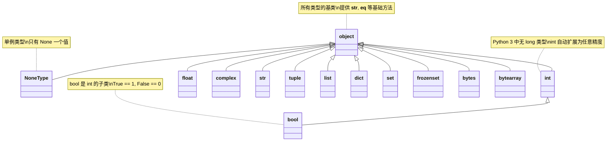
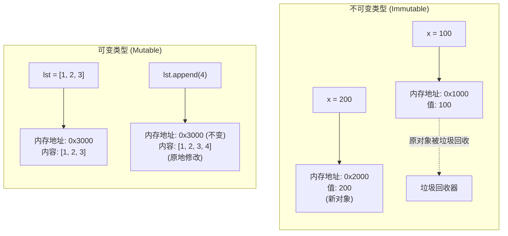

# 数据类型

Python 是动态类型语言，变量的数据类型在运行时自动推断，无需事先声明。本页是**类型体系总览**：帮你建立全局认知；每种类型的完整操作细节见对应专文（字符串/列表与元组/字典/集合）。

## Python 数据类型体系

Python 中所有数据类型都继承自 `object`，形成统一的类型体系：



::: tip 为什么这样设计？
Python 采用"一切皆对象"的哲学，所有类型继承自 `object`，带来：
1. **统一的方法接口**：所有对象都有 `__str__`、`__eq__`、`__hash__` 等方法
2. **多态支持**：函数可接受任意类型参数，通过鸭子类型实现灵活多态
3. **类型检查简化**：`isinstance(obj, object)` 对任意对象都返回 `True`
:::

常见类型按场景分类：

| 分类 | 类型 | 可变性 | 专文 |
|------|------|--------|------|
| 数字 | `int`、`float`、`complex` | 不可变 | 本文 |
| 文本 | `str` | 不可变 | [字符串](05-字符串) |
| 序列 | `list`、`tuple`、`range` | list 可变 / tuple、range 不可变 | [列表与元组](06-列表与元组) |
| 映射 | `dict` | 可变 | [字典](07-字典) |
| 集合 | `set`、`frozenset` | set 可变 / frozenset 不可变 | [集合](08-集合) |
| 布尔 | `bool` | 不可变 | 本文 |
| 二进制 | `bytes`、`bytearray`、`memoryview` | bytes 不可变 / bytearray 可变 | 本文 |
| 特殊 | `NoneType` | — | 本文 |

## 可变与不可变类型

这是 Python 类型系统最重要的分界线：



- **不可变**（`int`、`float`、`bool`、`str`、`tuple`、`frozenset`、`bytes`）：创建后不能原地修改，"修改"会创建新对象；可以作为字典键或集合元素
- **可变**（`list`、`dict`、`set`、`bytearray`）：支持原地修改，多个变量共享同一对象时，一处修改处处生效

::: danger 最常见的坑：可变默认参数
不要用可变类型做函数默认参数（`def f(a=[])`），默认值在定义时求值一次、所有调用共享。正确写法是 `def f(a=None)` 再在函数体内初始化。完整解析见 [变量和关键字 · 常见陷阱](03-变量和关键字#常见陷阱)。
:::

## 数字类型

Python 混合运算时会自动进行类型提升：`int` → `float` → `complex`（如 `3 + 2.5 = 5.5`，`5.0 + 2j` 得到复数）。

### 整数 int

无固定长度限制，只受内存约束，**永不溢出**：

```python
big_num = 2 ** 100
print(big_num)          # 1267650600228229401496703205376
huge_num = 10 ** 1000   # 千位数字也没问题
```

::: info 为什么 Python 3 没有 long？
Python 2 中 `int` 固定精度（32 位），超出自动转 `long`；Python 3 统一为任意精度 `int`，底层用"变长数组"存储，程序员无需关心溢出。
:::

书写很大的数可用下划线分组（仅提高可读性，Python 会忽略）：`universe_age = 14_000_000_000`。十六进制用 `0x` 前缀：`0xff00`。

### 浮点数 float

IEEE 754 双精度浮点数，存在精度误差：

```python
0.1 + 0.2   # 0.30000000000000004 —— 所有语言都有此问题
4 / 2       # 2.0 —— 除法结果总是 float
```

整数运算永远精确，浮点数运算可能四舍五入出错。多数场景直接忽略多余小数位即可；业务必须精确时用 `Decimal`：

```python
from decimal import Decimal

Decimal("0.1") + Decimal("0.2") == Decimal("0.3")  # True
# 注意：必须用字符串构造。Decimal(0.1) 会先经过 float，精度已丢失
```

::: info 为什么 int 和 float 分开，不像 JavaScript 只有一个 Number？
JavaScript 用双精度浮点统一表示所有数字，安全整数只有 ±2^53。Python 分离两者：`int` 任意精度、精确计算；`float` 硬件加速、适合科学计算——在精确性和性能间取得平衡。
:::

### 复数 complex

虚部用 `j`/`J` 表示：`e = 2 + 3j`。

### 数值类型选择

| 类型 | 精度 | 适用场景 | 性能 |
|------|------|----------|------|
| `int` | 任意精度 | 计数、索引、大数运算 | 快 |
| `float` | 53 位有效数字 | 科学计算、近似值 | 最快（硬件加速） |
| `Decimal` | 可配置（默认 28 位） | 金融、精确计算 | 慢 |
| `Fraction` | 任意精度 | 分数运算、精确有理数 | 慢 |

## 布尔类型

只有 `True`、`False` 两个值（注意大小写）。`bool` 是 `int` 的子类——历史兼容 + 实用便利（`True + True == 2` 可用于计数）：

```python
print(isinstance(True, int))   # True
print(True + True)             # 2
```

布尔运算的短路求值会**返回操作数本身**，这是 Python 惯用技巧的基础：

```python
print([] or "fallback")   # 'fallback'
print("x" and 123)        # 123
```

## 文本类型 str

由一系列字符组成，支持单/双/三引号、索引切片、格式化、编解码。

> 📚 完整教程见 [字符串](05-字符串) —— 索引切片、常用方法、f-string 格式化、str/bytes 编解码等。

```python
s = "Hello"
print(s[0], s[-1])    # H o
print(s[::-1])        # olleH（切片反转）
```

## 序列类型：list / tuple / range

```python
fruits = ["苹果", "香蕉"]
fruits.append("梨")                  # list：有序可变
coordinates = (10, 20)               # tuple：有序不可变，单元素要写 (1,)
numbers = list(range(0, 10, 2))      # range：惰性数字序列 [0, 2, 4, 6, 8]
squares = [i * i for i in range(5)]  # 列表推导式
```

> 📚 完整操作见 [列表与元组](06-列表与元组)。

## 映射类型 dict

键值对集合，键必须是不可变类型，查找 O(1)：

```python
person = {"name": "张三", "age": 25}
person.get("country", "中国")   # 安全访问，带默认值
square_map = {i: i * i for i in range(5)}   # 字典推导式
```

> 📚 完整操作见 [字典](07-字典)。

## 集合类型 set / frozenset

无序、元素不重复，支持并交差等数学运算，常用于去重；`frozenset` 是不可变版本，可作为字典键：

```python
A, B = {1, 2, 3}, {3, 4}
print(A | B)                      # {1, 2, 3, 4} 并集
print(list(set([1, 1, 2, 3])))    # [1, 2, 3] 去重
fixed = frozenset([1, 2, 3])
```

> 📚 完整操作见 [集合](08-集合)。

## 二进制类型 bytes / bytearray / memoryview

```python
data = b"Hello World"          # bytes：不可变字节序列，每个元素 0~255
text = "你好"
buf = text.encode("utf-8")     # str → bytes 需显式编码
print(buf.decode("utf-8"))     # bytes → str 需显式解码

mutable = bytearray(b"Hello")  # bytearray：可变字节序列
mutable.append(33)

view = memoryview(mutable)     # memoryview：零拷贝内存视图
view[0] = 104                  # 直接修改原数据
```

## None 类型

`None` 是 `NoneType` 的唯一值，表示"空值/缺失"，**不是 `0` 也不是 `False`**——`0` 和 `False` 是有意义的值，`None` 表示无结果。全局只有一个 `None` 单例，判断必须用 `is`：

```python
result = None
if result is None:      # ✓ 正确
    print("空值")
# if result == None:    # ✗ 不推荐，自定义 __eq__ 会干扰判断
```

无显式 `return` 的函数自动返回 `None`，便于判断。

## 自定义类型与其他

**类 class**：用户自定义类型，支持继承、封装、多态（详见 [面向对象](11-面向对象)）。简单数据类可用 `dataclasses`：

```python
from dataclasses import dataclass

@dataclass
class User:
    name: str
    age: int
```

**迭代器 iterator / 生成器 generator**：惰性求值，处理大数据集时节省内存：

```python
gen = (i * i for i in range(3))   # 生成器表达式
print(next(gen))                  # 0
```

> 📚 详见 [迭代器与生成器](/docs/python/进阶核心/进阶/01-迭代器与生成器)。

## 类型转换与类型检查

### 显式转换

| 目标类型 | 函数 | 典型输入 | 说明 |
| -------- | ---- | -------- | ---- |
| `int` | `int(x)` | `"123"`, `45.6`, `True` | 浮点数**截断**而非四舍五入；可传 `base` 指定进制 |
| `float` | `float(x)` | `"3.14"`, `1`, `"1e-3"` | 支持科学计数法 |
| `str` | `str(x)` | 任意对象 | 调用 `__str__` |
| `bool` | `bool(x)` | 任意对象 | 非零/非空为 `True` |
| 容器 | `list(x)` 等 | 可迭代对象 | `set` 去重，`dict` 需键值对序列 |

```python
print(int("123"), int(45.67), int("ff", base=16))  # 123 45 255
print(float("1e-3"), str([1, 2]), bool(""))        # 0.001 '[1, 2]' False

# 容器互转
nums = [1, 2, 2, 3]
print(set(nums), tuple(nums))                      # {1, 2, 3} (1, 2, 2, 3)
print(dict([("id", 1), ("name", "Alice")]))        # {'id': 1, 'name': 'Alice'}
```

::: warning 转换可能抛异常
非数字字符串转 `int`/`float` 会抛 `ValueError`，对用户输入转换时应配合 `try...except`。仅在可信环境用 `eval()`，一般用 `ast.literal_eval()` 安全解析。
:::

### 类型检查：type() vs isinstance()

| 方法 | 继承支持 | 推荐场景 |
|------|----------|----------|
| `isinstance(obj, Type)` | 是 | **日常类型检查首选**，支持类型元组 |
| `type(obj) is Type` | 否 | 精确匹配、排除子类 |
| `type(obj)` | — | 获取类型对象、元编程 |

```python
b = True
isinstance(b, int)     # True —— bool 继承自 int
type(b) is int         # False —— 精确类型是 bool
isinstance(x, (int, float))   # 多类型检查
```

## 内存占用速览

用 `sys.getsizeof()` 查看（64 位 CPython，只算对象本身、不含容器内元素）：

| 对象 | 大小 | 对象 | 大小 |
|------|------|------|------|
| `int(0)` | 28 字节 | `''` 空字符串 | 41 字节 |
| `float(1.0)` | 24 字节 | `'abc'` | 44 字节 |
| `None` | 16 字节 | `[]` 空列表 | 56 字节 |
| `()` 空元组 | 48 字节 | `[]` → `[1,2,3]` | 56 → 88 字节 |

> 更深入的对象内存模型与优化见 [Python内存管理](/docs/python/进阶核心/进阶/04-Python内存管理)。

## FAQ

**Q: 为什么 `0.1 + 0.2 != 0.3`？**
二进制无法精确表示某些十进制小数。比较浮点数用 `math.isclose(0.1 + 0.2, 0.3)`；精确计算用 `Decimal`（见「浮点数 float」）。

**Q: `round(2.5)` 结果是几？**
`2`——Python 采用银行家舍入（.5 向偶数取整），涉及金钱计算请用 `Decimal`。

**Q: 可变类型做字典键会怎样？**
会报 `TypeError`：字典键要求可哈希，可变类型的哈希值随内容变化，Python 直接禁止。不可变类型（或 `frozenset`、元组）才可作键。

## 延伸阅读

- → [变量和关键字](03-变量和关键字) - 变量绑定模型、可变/不可变的赋值行为与常见陷阱
- → [字符串](05-字符串) / [列表与元组](06-列表与元组) / [字典](07-字典) / [集合](08-集合) - 各类型专文
- → [面向对象](11-面向对象) - 自定义类型的设计
