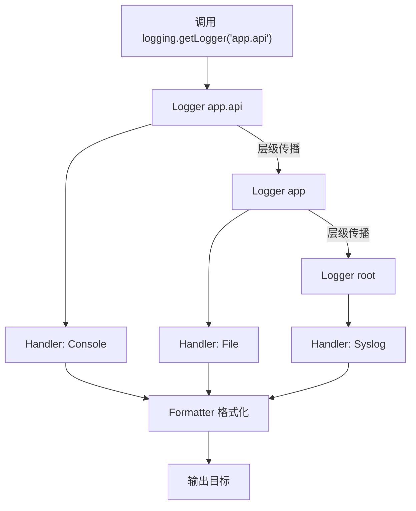

# 日志系统

日志是应用运维的第一现场：排查线上问题、还原请求链路、统计错误率，都依赖日志。本文聚焦 **Python 应用级日志**的架构与工程实践——基础设施层面的日志采集（ELK/Loki）见 [12-运维/04-监控告警](/docs/ops/04-监控告警/00-日志与监控)。

## logging 核心架构

标准库 `logging` 由四类组件构成，理解"Logger 树 + Handler 分发"是避免重复输出的关键：



- **Logger**：命名层级结构（`app.api` 是 `app` 的子节点），默认向祖先传播（`propagate=True`）
- **Handler**：决定输出到哪里（控制台/文件/网络），挂在某个 Logger 上
- **Formatter**：决定一行日志长什么样
- **Filter**：在 Logger 或 Handler 层做精细过滤

::: danger 最常见的坑：日志重复输出
子 Logger 默认 `propagate=True`，一条日志会沿 Logger 树向上传播，**沿途每个挂了 Handler 的 Logger 都会输出一次**。如果你在 root 和 `app` 上都加了 Handler，日志就出现两遍。正确做法：**只在 root（或应用入口 Logger）配置 Handler**，业务代码只 `getLogger(__name__)` 取 Logger。
:::

## 配置：dictConfig，而不是散落的 basicConfig

生产配置集中在一个字典（通常放 `logging_config.py` 或从 `pyproject`/JSON 加载），入口处一次性应用：

```python
# logging_config.py
LOGGING_CONFIG = {
    "version": 1,
    "disable_existing_loggers": False,   # 关键：不禁用已创建的第三方 Logger
    "formatters": {
        "standard": {
            "format": "%(asctime)s %(levelname)-8s %(name)s [%(request_id)s] %(message)s",
        },
        "json": {
            "()": "pythonjsonlogger.json.JsonFormatter",   # pip install python-json-logger
            "fields": {"request_id": "request_id", "service": "service"},
        },
    },
    "handlers": {
        "console": {
            "class": "logging.StreamHandler",
            "formatter": "standard",
            "stream": "ext://sys.stdout",
        },
    },
    "root": {"handlers": ["console"], "level": "INFO"},
    "loggers": {
        # 把第三方库的噪音调高阈值，而不是自己写 Handler
        "uvicorn.access": {"level": "WARNING"},
        "sqlalchemy.engine": {"level": "WARNING"},
    },
}

# 应用入口（main.py）
import logging.config
from logging_config import LOGGING_CONFIG
logging.config.dictConfig(LOGGING_CONFIG)
```

要点：

- **`disable_existing_loggers: False`**：默认值 `True` 会把 dictConfig 之前创建的 Logger 全部静音（包括很多第三方库），是经典事故源
- **第三方库只调级别**：`sqlalchemy.engine: WARNING` 让 SQLAlchemy 少说话；不要为第三方库建 Handler
- **Formatter 里引用自定义字段**（如 `%(request_id)s`）需配合上下文注入（见下文），字段缺失时旧版 Python 会直接抛错，建议用 `defaults` 参数（3.10+）或自定义 Formatter 兜底

### 级别使用约定

| 级别 | 语义 | 典型场景 |
|------|------|----------|
| `ERROR` | 需要人介入的故障 | 请求处理失败、外部依赖不可用 |
| `WARNING` | 自动恢复但值得注意 | 重试成功、降级触发、慢查询 |
| `INFO` | 业务关键事件 | 请求完成、任务开始/结束、配置加载 |
| `DEBUG` | 诊断细节 | 仅开发/排障时开启 |

## 结构化日志：从"给人看"到"给机器看"

传统行式日志靠正则解析，脆弱且昂贵。生产环境推荐 **JSON 行格式**，字段化之后日志平台（Loki/ELK）才能按 `request_id`、`user_id` 聚合查询：

```python
# 方案一：python-json-logger（轻量，配合标准 logging）
# 方案二：structlog（推荐，API 更友好）

import structlog

logger = structlog.get_logger()

logger.info("order_created",
            order_id="A1024",
            user_id=42,
            amount=199.00)
# 输出: {"event": "order_created", "order_id": "A1024", "user_id": 42, "amount": 199.0, ...}
```

structlog 与标准 logging 集成（同一套 Handler/级别体系）：

```python
structlog.configure(
    processors=[
        structlog.contextvars.merge_contextvars,   # 合并上下文（request_id 等）
        structlog.processors.add_log_level,
        structlog.processors.TimeStamper(fmt="iso"),
        structlog.processors.JSONRenderer(),        # 生产用 JSON；开发可换 ConsoleRenderer 彩色
    ],
    logger_factory=structlog.stdlib.LoggerFactory(),
)
```

::: tip 选型建议
新项目直接上 **structlog**；已有大量 `logging` 代码的项目用 python-json-logger 渐进改造。**loguru** 上手最快（单文件零配置），但自定义 Handler 生态与标准 logging 不同，团队项目需谨慎评估。
:::

## 上下文追踪：request id

没有 request id，跨服务/跨行日志无法串联。用 `contextvars` 在协程间安全传递上下文：

```python
# middleware.py（以 Starlette/FastAPI 为例）
import uuid
import contextvars
from starlette.middleware.base import BaseHTTPMiddleware

request_id_var = contextvars.ContextVar("request_id", default="-")

class RequestIDMiddleware(BaseHTTPMiddleware):
    async def dispatch(self, request, call_next):
        rid = request.headers.get("X-Request-ID", uuid.uuid4().hex[:12])
        token = request_id_var.set(rid)
        try:
            response = await call_next(request)
            response.headers["X-Request-ID"] = rid
            return response
        finally:
            request_id_var.reset(token)
```

配合 structlog 的 `merge_contextvars` processor，或自定义 logging Filter 把 `request_id_var.get()` 塞进每条记录——此后该请求生命周期内的所有日志自动携带同一个 id，异常栈也能关联。

## 容器环境的日志输出

容器/编排环境（Docker、K8s）的约定是：**应用只写 stdout/stderr，轮转与归档交给采集器**：

- **不要**在容器里写本地日志文件再轮转——容器文件系统是临时的，`RotatingFileHandler` 在多副本下各自为政
- Docker 默认 `json-file` driver 会做容器层轮转；生产建议换 `loki`、`fluentd` 等 driver 或 sidecar 采集
- 裸机/systemd 部署才使用 `TimedRotatingFileHandler`（按天切割、保留 N 份）

## 常见陷阱

| 陷阱 | 现象 | 正确做法 |
|------|------|----------|
| Handler 重复添加 | 日志输出两遍/两遍以上（模块被重复 import 或多次初始化） | Handler 只在入口配置一次；`getLogger` 前 `logger.handlers.clear()` 防御性检查 |
| 多进程日志互踩 | `RotatingFileHandler` 多进程切割时丢日志/错位 | 多进程写同一文件用 `QueueHandler` + `QueueListener` 汇聚到单进程写；或统一交采集器 |
| f-string 惰性格式化 | `logger.debug(f"{data}")` 在级别关闭时仍做字符串拼接 | 用 `logger.debug("%s", data)` 惰性求值 |
| 敏感信息入库 | 密码、token、身份证号被完整打印 | Formatter/Filter 做脱敏（正则替换）；框架层排除敏感字段 |
| `print` 残留 | 生产日志里混着调试输出 | CI 中用 ruff 的 `T20` 规则禁止 `print`（见 [代码规范](/docs/python/03-工程化与运维/01-工程化/01-代码规范)） |

## 延伸阅读

- → [监控与可观测性](02-监控与可观测性) — 日志之上的指标与追踪体系
- → [部署与运行](03-部署与运行) — 进程模型、容器化与优雅关闭
- → [12-运维/04-监控告警](/docs/ops/04-监控告警/00-日志与监控) — 基础设施层采集、ELK/Loki 平台与告警体系
- → [代码规范](/docs/python/03-工程化与运维/01-工程化/01-代码规范) — 用 ruff `T20` 规则约束日志/打印风格
