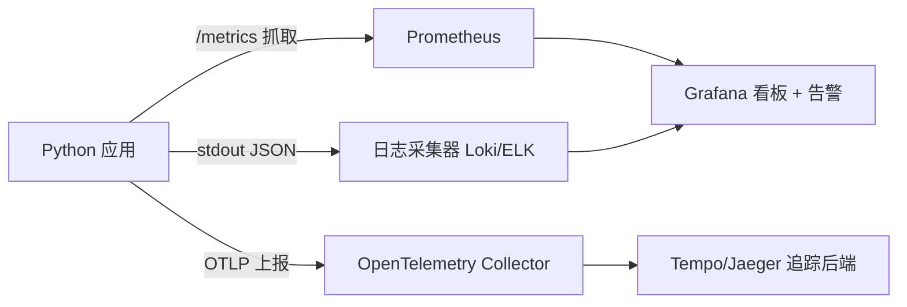

# 监控与可观测性

日志回答"发生了什么"，指标回答"系统现在健康吗"，追踪回答"这个请求慢在哪"。三者合称可观测性三支柱。本文聚焦 **Python 应用侧**如何暴露这三类信号；采集、存储与告警平台（Prometheus/Grafana/ELK）见 [12-运维/04-监控告警](/docs/ops/04-监控告警/08-容器监控实践：Prometheus、Grafana 方案介绍)。



## 指标：prometheus-client

用官方 client（`pip install prometheus-client`）在应用内埋点，Prometheus 定期抓取 `/metrics`。Web 服务优先落实 **RED 方法**：Rate（请求速率）、Errors（错误率）、Duration（耗时分布）。

```python
from prometheus_client import Counter, Histogram, Gauge, start_http_server

REQUEST_COUNT = Counter(
    "http_requests_total", "请求总数",
    ["method", "endpoint", "status"],        # label 维度设计要克制
)
REQUEST_LATENCY = Histogram(
    "http_request_duration_seconds", "请求耗时",
    ["endpoint"],
    buckets=(0.01, 0.05, 0.1, 0.25, 0.5, 1.0, 2.5, 5.0),   # 按 SLO 设定分桶
)
INFLIGHT = Gauge("http_inflight_requests", "进行中请求数")
```

```python
# 以 Starlette/FastAPI 中间件为例
import time

class MetricsMiddleware(BaseHTTPMiddleware):
    async def dispatch(self, request, call_next):
        INFLIGHT.inc()
        start = time.perf_counter()
        try:
            response = await call_next(request)
            REQUEST_COUNT.labels(request.method, request.url.path, response.status_code).inc()
            return response
        finally:
            elapsed = time.perf_counter() - start
            REQUEST_LATENCY.labels(request.url.path).observe(elapsed)
            INFLIGHT.dec()
```

::: tip label 维度克制
`endpoint` 用**路由模板**（`/orders/{id}`）而不是真实 URL，否则每个不同的订单 id 都会生成新的时间序列——label 组合爆炸是 Prometheus 最常见的事故源（基数爆炸）。
:::

**指标类型选择**：

| 类型 | 语义 | 典型用法 |
|------|------|----------|
| `Counter` | 只增不减的计数 | 请求总数、错误总数、任务完成数 |
| `Histogram` | 观测值分桶分布 | 耗时、响应大小（可算 p95/p99） |
| `Gauge` | 可升可降的瞬时值 | 内存占用、队列长度、连接数 |
| `Summary` | 客户端分位数 | 少用——多实例聚合困难，首选 Histogram |

### 健康检查端点

编排系统（K8s/负载均衡）依赖探针区分"活着"与"就绪"：

```python
from fastapi import FastAPI
from fastapi.responses import JSONResponse

app = FastAPI()
db_ready = False

@app.get("/healthz")          # liveness：进程活着即可，不检查依赖
def healthz():
    return {"status": "ok"}

@app.get("/readyz")           # readiness：依赖就绪才接流量
def readyz():
    if not db_ready:
        return JSONResponse({"status": "db not ready"}, status_code=503)
    return {"status": "ready"}
```

原则：`/healthz` 绝不查数据库（避免依赖抖动把实例误杀）；`/readyz` 检查关键依赖且必须带超时。

## 追踪：OpenTelemetry

单个服务的日志能定位异常，但跨服务调用链（网关 → 订单服务 → 支付服务 → 数据库）要靠分布式追踪。OpenTelemetry（OTel）是行业标准，Python 侧自动插桩覆盖主流框架：

```bash
pip install opentelemetry-sdk opentelemetry-api \
    opentelemetry-instrumentation-fastapi opentelemetry-instrumentation-httpx \
    opentelemetry-exporter-otlp
```

```python
from opentelemetry import trace
from opentelemetry.sdk.resources import Resource
from opentelemetry.sdk.trace import TracerProvider
from opentelemetry.sdk.trace.export import BatchSpanProcessor
from opentelemetry.exporter.otlp.proto.grpc.trace_exporter import OTLPSpanExporter
from opentelemetry.instrumentation.fastapi import FastAPIInstrumentor

provider = TracerProvider(resource=Resource.create({"service.name": "order-service"}))
provider.add_span_processor(BatchSpanProcessor(OTLPSpanExporter(endpoint="http://otel-collector:4317")))
trace.set_tracer_provider(provider)

FastAPIInstrumentor.instrument_app(app)   # 自动为每个请求创建 span、透传 traceparent
```

关键点：

- **context 透传**：OTel 通过 W3C `traceparent` header 自动跨服务传播，HTTP 客户端（httpx/requests）也装上对应 instrumentation 即可打通全链路
- **自定义 span**：业务关键段（如风控计算）用 `tracer.start_as_current_span("risk_check")` 包裹，并塞入属性 `span.set_attribute("order.id", oid)`
- **与日志关联**：把当前 `trace_id` 注入日志（structlog processor 读取 `trace.get_current_span()`），即可"从慢请求一条日志跳到完整调用链"

## 生产剖析：py-spy 与 cProfile

指标发现"CPU 高了"之后，需要剖析工具回答"高在哪"：

```bash
# py-spy：无需改代码、可附加到生产进程（只读 /proc，低风险）
py-spy top --pid 12345            # 实时火焰图式函数排行
py-spy dump --pid 12345           # 打印所有线程当前栈（定位卡死/hang）
py-spy record -o profile.svg --pid 12345 --duration 60   # 火焰图

# cProfile：离线/测试环境精确剖析
python -m cProfile -s cumtime script.py
```

`py-spy dump` 对"进程还活着但请求全部超时"的场景尤其有效——直接看到卡在哪个调用上。内存问题则用 `tracemalloc`（标准库）或 `memray` 做快照对比；更系统的内存模型见 [Python内存管理](/docs/python/09-进阶核心/04-进阶/04-Python内存管理)。

## 告警信号设计

指标收集后，告警要回答"何时叫人"。推荐基于 **SLO** 的多窗口燃烧率告警，起步阶段至少配置：

| 信号 | 阈值示例 | 说明 |
|------|----------|------|
| 错误率 | 5xx 比例 > 1% 持续 5 分钟 | RED 之 Errors |
| 延迟 | p99 > 1s 持续 10 分钟 | RED 之 Duration，看 Histogram 分位 |
| 饱和度 | 进程内存 > 80%、队列长度持续增长 | 资源水位 |
| 可用性 | `/readyz` 失败实例占比 > 30% | 容量/依赖故障 |

告警分级与值班路由（P0 电话呼叫 / P1 IM 通知）属于平台层实践，见 [12-运维/04-监控告警/03-告警与值班机制](/docs/ops/04-监控告警/03-告警与值班机制)。

## 常见陷阱

| 陷阱 | 现象 | 正确做法 |
|------|------|----------|
| label 基数爆炸 | Prometheus 内存暴涨、查询变慢 | 限用低基数维度（路由模板、状态码），id 类一律不进 label |
| 在请求路径同步上报 OTLP | 每个请求都被导出阻塞 | 用 `BatchSpanProcessor` 异步批量导出 |
| 健康检查查数据库 | 依赖抖动 → liveness 失败 → 全部实例被重启循环 | liveness 只查进程自身；依赖检查放 readiness |
| 只看平均值 | 平均延迟正常，p99 已超时（长尾被平均掩盖） | 用 Histogram 分位数（p95/p99）做 SLO |
| 剖析驱动"猜测式优化" | 没有测量就重构热点 | 先 `py-spy`/`cProfile` 取证，遵循 [性能优化](/docs/python/03-工程化与运维/01-工程化/08-性能优化) 的测量优先原则 |

## 延伸阅读

- → [日志系统](01-日志系统) — 三支柱之日志，与追踪 id 关联
- → [部署与运行](03-部署与运行) — 让指标端点与探针在生产进程模型下正确暴露
- → [性能优化](/docs/python/03-工程化与运维/01-工程化/08-性能优化) — 测量驱动的优化方法论
- → [12-运维/04-监控告警](/docs/ops/04-监控告警/08-容器监控实践：Prometheus、Grafana 方案介绍) — Prometheus/Grafana 平台搭建与告警实战
