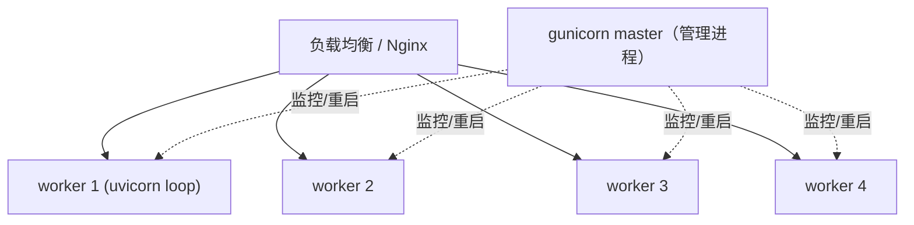

# 部署与运行

开发环境跑通只是开始，生产环境要回答：用几个进程？怎么吃满多核？发新版本如何不断流？挂了怎么自愈？本文覆盖 **Python 应用从进程模型到发布策略**的运行时决策；基础设施与容灾平台实践见 [12-运维/08-部署与容灾](/docs/ops/08-部署与容灾/01-回滚与运行手册)。

## 进程模型：WSGI 与 ASGI

先分清两类应用协议，进程/线程模型的选型由此决定：

| | WSGI（同步） | ASGI（异步） |
|---|---|---|
| 代表框架 | Flask、Django | FastAPI、Starlette、Django(3.0+) |
| 服务器 | gunicorn、uwsgi | uvicorn、hypercorn、daphne |
| 并发单元 | 进程/线程 | 事件循环 + 协程（可再叠进程） |
| 适用 | 传统同步 IO 应用 | 高并发 IO、WebSocket、长连接 |

```bash
# ASGI 应用（FastAPI）：gunicorn 管理 worker 进程，每个 worker 内跑 uvicorn 事件循环
gunicorn app.main:app \
    --worker-class uvicorn.workers.UvicornWorker \
    --workers 4 \
    --bind 0.0.0.0:8000

# WSGI 应用（Flask/Django）
gunicorn app.wsgi:application --workers 4 --threads 2
```

**worker 数量经验公式**（CPU 密集场景）：`workers = 2 × CPU核数 + 1`。IO 密集的 ASGI 应用单进程事件循环即可扛大量并发，worker 数主要用于利用多核与隔离故障；内存受限时少开 worker、用 `--threads` 或异步补并发。



::: tip master 的价值
gunicorn 的 master 进程不处理请求，只负责管理 worker：崩溃自动拉起、`SIGTERM` 时优雅回收。**永远不要跳过 master 直接裸跑 uvicorn 于生产**（除非用 K8s 直接管理进程）。
:::

## Docker 化最佳实践

Python 镜像的四个关键点：小基础镜像、多阶段构建、层缓存友好、非 root 运行：

```dockerfile
# ---- 构建阶段：安装依赖 ----
FROM python:3.14-slim AS builder
WORKDIR /app
COPY pyproject.toml uv.lock ./
RUN pip install uv && uv sync --frozen --no-dev --no-install-project

# ---- 运行阶段：只带运行产物 ----
FROM python:3.14-slim
WORKDIR /app

# 非 root 用户
RUN useradd -m appuser
COPY --from=builder /app/.venv /app/.venv
COPY --chown=appuser:appuser . .
ENV PATH="/app/.venv/bin:$PATH" \
    PYTHONUNBUFFERED=1 \        # 日志实时输出到 stdout，禁用缓冲
    PYTHONDONTWRITEBYTECODE=1

USER appuser
EXPOSE 8000
CMD ["gunicorn", "app.main:app", "-k", "uvicorn.workers.UvicornWorker", "-w", "4", "-b", "0.0.0.0:8000"]
```

清单式要点：

- **`PYTHONUNBUFFERED=1`**：不加的话 stdout 日志被缓冲，容器里 `docker logs` 看不到实时输出（排障第一坑）
- **`.dockerignore`**：排除 `.venv/`、`__pycache__/`、`.git`——上下文小、构建快、不泄密
- **锁文件先行 COPY**：`pyproject.toml` + lock 文件先拷贝再装依赖，源码改动不触发依赖重装（层缓存）
- **多阶段构建**：构建工具（编译器、uv 本身）不进最终镜像，体积与攻击面双降
- 基础镜像选 `slim` 足够；需要编译 C 扩展时在 builder 阶段装 `gcc`，运行阶段不需要
- 完整的容器运维（镜像仓库、K8s 编排）见 [12-运维/11-Docker](/docs/ops/11-Docker/06-Docker实战-Python)

## 裸机部署：systemd 服务单元

不用容器时，systemd 是 Linux 上管理 Python 进程的标准答案（自动重启、开机自启、日志进 journald）：

```ini
# /etc/systemd/system/myapp.service
[Unit]
Description=MyApp FastAPI Service
After=network.target

[Service]
Type=notify
User=appuser
WorkingDirectory=/srv/myapp
EnvironmentFile=/srv/myapp/.env          # 秘密走环境文件，权限 600
ExecStart=/srv/myapp/.venv/bin/gunicorn app.main:app -k uvicorn.workers.UvicornWorker -w 4 -b 0.0.0.0:8000
Restart=on-failure
RestartSec=3
# 优雅关闭：给 30s 处理存量请求
KillSignal=SIGTERM
TimeoutStopSec=30

[Install]
WantedBy=multi-user.target
```

```bash
sudo systemctl daemon-reload && sudo systemctl enable --now myapp
journalctl -u myapp -f        # 查看日志
```

## 优雅关闭与零停机发布

**优雅关闭**的完整链路：编排器发 `SIGTERM` → 应用停止接收新请求 → 处理完存量请求 → 关闭连接池/ flush 日志 → 退出。ASGI 框架的 lifespan 钩子负责资源清理：

```python
from contextlib import asynccontextmanager

@asynccontextmanager
async def lifespan(app: FastAPI):
    app.state.db = await create_pool(...)          # 启动时建连接池
    yield                                          # 运行中
    await app.state.db.close()                     # 关闭时清理
app = FastAPI(lifespan=lifespan)
```

**零停机发布**（滚动更新）的配合要点：

1. `readiness` 探针在收到 SIGTERM 后立即返回 503（`shutting_down` 标志），负载均衡摘除该实例
2. 新实例 `readiness` 通过后才接流量，逐批替换
3. 回滚预案：镜像标签回退 + 数据库迁移**向后兼容**（新代码兼容旧表结构，先加列后删列），手册模板见 [12-运维/08-部署与容灾/01-回滚与运行手册](/docs/ops/08-部署与容灾/01-回滚与运行手册)

## 常见陷阱

| 陷阱 | 现象 | 正确做法 |
|------|------|----------|
| 镜像里 `python app.py` 前台阻塞但无日志 | `docker logs` 长时间为空 | `PYTHONUNBUFFERED=1` 或 `python -u` |
| worker 数照抄教程开 16 个 | 4 核机器上下文切换开销吃掉性能 | 按 CPU 数与 IO 特性定 worker 数，压测验证 |
| SIGTERM 直接被杀 | K8s 强杀前应用没处理完请求 | 正确处理 SIGTERM + `terminationGracePeriodSeconds` 留足时间 |
| `.env` 打进镜像 | 秘密随镜像泄漏到仓库 | 秘密走 EnvironmentFile / K8s Secret / Vault，见 [配置管理](/docs/python/工程化与运维/工程化/07-配置管理) |
| 数据库迁移与发布不兼容 | 新代码 + 旧库（或反之）启动崩溃 | 迁移向后兼容、先部署库结构再发布代码、保留回滚版本 |
| 全局依赖直接跑生产 | 依赖漂移，"我本地能跑" | 镜像内锁文件安装（`uv sync --frozen`），见 [依赖管理](/docs/python/工程化与运维/工程化/04-依赖管理) |

## 延伸阅读

- → [日志系统](01-日志系统) — 部署前先保证日志可采集（stdout + 上下文）
- → [监控与可观测性](02-监控与可观测性) — readiness/metrics 端点与探针的正确姿势
- → [配置管理](/docs/python/工程化与运维/工程化/07-配置管理) — 多环境配置与秘密注入
- → [12-运维/01-持续交付与CI-CD](/docs/ops/01-持续交付与CI-CD/00-索引) — 流水线自动构建与发布
