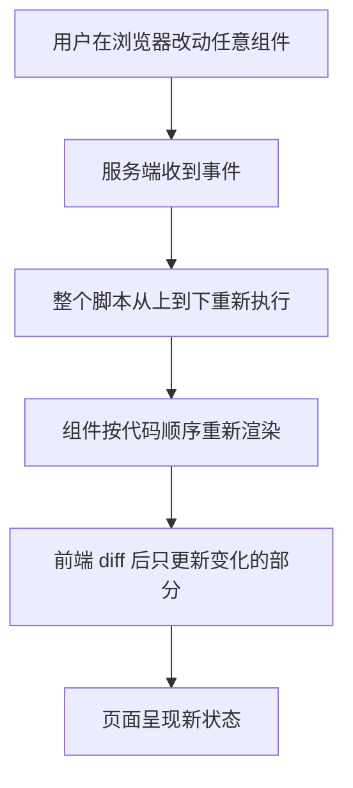

# Streamlit 数据应用

在 [数据分析全流程](/docs/python/05-数据科学/02-数据处理与分析/01-数据分析全流程) 中，我们的产出是 Notebook 里的 DataFrame、图表和结论——想看到它们，必须会运行 Python。而业务中大多数人是"想看数据"而不是"会跑代码"。Streamlit 解决的正是这最后一公里：**把一个纯 Python 脚本变成可交互的 Web 应用**，不写 HTML/CSS/JavaScript，不做前后端分离，一个 `.py` 文件就是完整应用。

## 概念说明

Streamlit 的定位是"从数据分析到数据应用"的桥。它把整页 UI 抽象成两件事：

- **组件**：`st.slider()`、`st.dataframe()` 这类函数调用，调用一次就在页面上渲染一个控件；
- **重跑**：用户与任意组件交互时，整个脚本从上到下重新执行一遍，页面随之刷新。

这意味着写 Streamlit 应用和写普通 Python 脚本几乎没有区别：读数据、清洗、聚合、画图，只是把 `print` 换成 `st.write`，把 Matplotlib 换成 `st.line_chart`。数据分析流程中的每一步都可以原样搬进应用，这正是它"快速把分析变成应用"的核心竞争力。

::: tip 适用边界
Streamlit 适合**内部数据工具、分析看板、报告原型**。如果你需要高度定制的 UI、复杂权限体系或高并发服务，它不是合适的工具——那是 Django/FastAPI + 前端框架的领域。
:::

## 核心要点

- Streamlit 应用的本质是**一个从上到下执行的 Python 脚本**，组件按代码顺序渲染，没有额外的模板语法。
- 每次交互都会**全量重跑**整个脚本，这是理解一切行为（变量丢失、性能问题）的根源。
- 需要跨交互保留的值放进 `st.session_state`；需要复用的重计算放进 `@st.cache_data`。
- 组件函数的返回值就是用户输入，例如 `city = st.selectbox(...)`，拿到变量即可参与后续计算。
- `st.sidebar` 是一个容器，把组件写在它下面就会渲染到左侧栏。
- ⚠️ 常见误区：把重计算（读大 CSV、训练模型）写在模块顶层。每次点击按钮都会重算一遍，页面越用越卡。
- ⚠️ 常见误区：用全局变量保存"点击次数""登录状态"。脚本重跑后全局变量归零，必须用 `st.session_state`。
- ⚠️ 常见误区：用 `python app.py` 启动。脚本跑完就退出，Streamlit 必须用 `streamlit run app.py` 启动常驻服务。

## 运行机制：全量重跑模型

Streamlit 的执行模型可以概括为一句话：**用户每动一下，脚本从头到尾重新跑一遍**。



这段代码直观展示了重跑模型：

```python
import streamlit as st

st.write("这段代码在每次交互时都会重新执行")
x = st.slider("取值", 0, 100, 50)
st.write("2x =", x * 2)      # 拖动滑块：整段脚本重跑，这一行立即更新
```

拖动滑块时，第一行的 `st.write` 也会重新执行——只是输出的内容没变，前端 diff 后看起来"没动"。理解这个模型后，三个推论自然成立：

1. **普通变量不跨交互保留**。脚本重跑等于函数重新调用，上一轮定义的变量全部重建，除非把值放进 `st.session_state`。
2. **组件状态由框架维护**。滑块的当前位置、文本框内容在重跑之间不会丢失，重跑时组件函数返回的就是用户当前输入。
3. **代码里没有"回调函数"的概念**。不像传统 Web 框架注册事件处理器，你只需要在脚本里顺着写"拿到输入 → 计算 → 输出"。

::: warning 重跑不等于刷新页面
重跑只重新执行服务端脚本，浏览器不会整页刷新，组件焦点、滚动位置等前端状态都会保留。所以"全量重跑"听起来粗暴，实际体验是流畅的。
:::

## 核心组件速览

Streamlit 的 API 全部挂在 `st` 命名空间下，常用的不过二十来个。

```python
import streamlit as st
import pandas as pd
import numpy as np

st.title("组件速览")                          # 页面大标题

# ---- 文本类 ----
st.text("纯文本，等宽显示")
st.markdown("**Markdown** 支持 `行内代码`、列表与链接")
st.write("万能输出：字符串、DataFrame、图表、字典都能自动渲染")

# ---- 数据表 ----
df = pd.DataFrame({"城市": ["北京", "上海"], "销售额": [9200, 8600]})
st.table(df)                # 静态表：完整展示全部行，适合小表
st.dataframe(df)            # 交互表：可排序搜索，大数据量虚拟滚动

# ---- 指标卡 ----
col1, col2, col3 = st.columns(3)              # 三等分一行
col1.metric("总销售额", "17,800 元", delta="+3.2%")
col2.metric("订单数", "215", delta="-12")
col3.metric("转化率", "4.6%")

# ---- 图表 ----
chart = pd.DataFrame(
    np.random.default_rng(0).normal(size=(30, 2)),
    columns=["北京", "上海"],
)
st.line_chart(chart)        # 折线；同类还有 st.bar_chart / st.area_chart
```

`st.write` 是最常用的"万能出口"：传入什么就渲染什么（字符串按 Markdown、DataFrame 按交互表、Matplotlib figure 按图片）。写原型时用它，成型后再替换为更精确的组件。

### 侧边栏

把组件写在 `st.sidebar` 下，它们就会出现在左侧栏，而不是主区域——筛选器、导航、设置项的标准位置。

```python
import streamlit as st

st.sidebar.title("筛选面板")
city = st.sidebar.selectbox("城市", ["北京", "上海", "广州"])
threshold = st.sidebar.slider("最低销售额", 0, 10000, 3000)

st.write(f"筛选条件：{city}，销售额不低于 {threshold}")
```

启动方式：命令行执行 `streamlit run app.py`，浏览器会自动打开 `http://localhost:8501`。保存文件后页面右上角出现"Rerun / Always rerun"提示，改代码即时生效。

## 会话状态：st.session_state

全量重跑模型下，"记住上一次发生了什么"是刚需：计数器、多步表单、登录态、已选择的标签页。`st.session_state` 是一个跨重跑存在的字典，**每个浏览器会话独享一份**，不同用户之间互不可见。

```python
import streamlit as st

if "count" not in st.session_state:    # 首次访问时初始化，之后不再重置
    st.session_state.count = 0

if st.button("点赞"):
    st.session_state.count += 1

st.write(f"当前点赞数：{st.session_state.count}")
```

按钮没有被点击时，脚本重跑走的是"读状态"路径；点击后本轮重跑先 `+1`，下一轮重跑从状态里读回新值。这个"先判断是否存在再初始化"的写法是 `session_state` 的标准用法。

另一个高频场景是通过 `key` 参数把组件与状态绑定：

```python
name = st.text_input("姓名", key="user_name")
st.write(st.session_state.user_name)   # 与 key 同名，可以随时读取或改写
```

::: tip 什么时候需要 session_state
判断标准很简单：这个值**是否需要在用户交互之后仍然存在**。每次重跑都能从组件重新拿到的输入不需要存；点击按钮产生的副作用、跨页面的选择、初始化一次的对象，才需要存。
:::

## 缓存：st.cache_data 与 st.cache_resource

全量重跑 + 缓存是 Streamlit 性能的两大支柱。缓存把"输入相同就重复利用上一次的返回值"，让重跑只执行轻量的渲染逻辑。API 有两个，分工明确：

| | `@st.cache_data` | `@st.cache_resource` |
|---|---|---|
| 缓存内容 | 函数返回的**数据** | 全局共享的**资源对象** |
| 返回方式 | 每次调用返回一份新**副本** | 所有用户共享**同一个对象** |
| 典型场景 | `pd.read_csv`、DataFrame 加工 | 数据库连接、ML 模型、Spark 会话 |
| 隔离性 | 用户拿到副本，改了不影响别人 | 共享对象被改动会影响所有人 |

```python
import streamlit as st
import pandas as pd

@st.cache_data                      # 读数据的缓存键是参数 path
def load_orders(path: str) -> pd.DataFrame:
    return pd.read_csv(path)

@st.cache_resource                  # 整个应用生命周期只创建一次
def get_model():
    from sklearn.ensemble import RandomForestClassifier
    from sklearn.datasets import load_iris
    X, y = load_iris(return_X_y=True)
    return RandomForestClassifier(n_estimators=100, random_state=42).fit(X, y)

df = load_orders("orders.csv")      # 第一次真正读文件，之后直接复用结果
model = get_model()
```

两个装饰器都支持 `ttl`（缓存有效期）与 `max_entries`（最大条目数）参数，例如 `@st.cache_data(ttl=3600)` 表示缓存一小时后过期重新计算。

::: warning 两个缓存怎么选
判断标准看**返回的东西要不要被修改**：DataFrame、列表这类数据用 `cache_data`，用户改副本互不干扰；模型、数据库连接这类创建成本高且应当共享的对象用 `cache_resource`。把模型放进 `cache_data` 会导致每个用户复制一份模型，内存迅速膨胀。
:::

## 多页应用

单文件脚本放不下时，Streamlit 支持多页。早期依赖 `pages/` 目录约定——目录下每个 `.py` 文件自动成为一个页面，文件名前的数字决定顺序：

```text
my_app/
├── app.py           # 入口页（首页）
└── pages/
    ├── 1_总览.py
    └── 2_明细.py
```

每个页面文件就是一个独立的 Streamlit 脚本，照常使用 `st.*` 组件。新版本提供了编程式 API `st.Page` + `st.navigation`，可以自定义分组、顺序和导航栏：

```python
import streamlit as st

overview = st.Page("views/overview.py", title="销售总览", default=True)
detail   = st.Page("views/detail.py",   title="订单明细")
settings = st.Page("views/settings.py", title="系统设置")

pg = st.navigation({"报表": [overview, detail], "系统": [settings]})
st.sidebar.title("销售数据看板")
pg.run()                             # 渲染当前选中的页面
```

编程式 API 适合页面多、需要按角色分组的场景；原型阶段用 `pages/` 目录约定更省事。两者可以平滑迁移。

## 与 Pandas 数据流的衔接

Streamlit 与 Pandas 是"天生一对"：组件的输入输出大量使用 DataFrame，图表函数直接接受 DataFrame，交互表组件本身就建立在 Pandas 之上。推荐的迁移思路是把 Notebook 逐步改造成"函数管道"：

```python
import streamlit as st
import pandas as pd

@st.cache_data
def load_raw() -> pd.DataFrame:
    """对应 Notebook 的第 1 个单元格：读取"""
    return pd.read_csv("orders.csv", parse_dates=["日期"])

@st.cache_data
def clean(df: pd.DataFrame) -> pd.DataFrame:
    """对应 Notebook 的第 2 个单元格：清洗"""
    df = df.dropna(subset=["销售额"])
    return df[df["销售额"] > 0]

@st.cache_data
def by_city(df: pd.DataFrame) -> pd.DataFrame:
    """对应 Notebook 的第 3 个单元格：聚合"""
    return df.groupby("城市")["销售额"].sum().sort_values(ascending=False)

df = clean(load_raw())
st.dataframe(by_city(df))            # print(df.head()) 的替代品
```

::: tip 从 Notebook 到应用的改写口诀
读取、清洗这类"输入不变、输出不变"的步骤搬进 `@st.cache_data` 函数；依赖用户输入的筛选、切片保留在主流程里，由组件参数驱动。完整的分析方法论（读取 → 清洗 → 聚合 → 可视化）见 [数据分析全流程](/docs/python/05-数据科学/02-数据处理与分析/01-数据分析全流程)，逐格搬进函数即可。
:::

## 完整最小应用

下面是一个自包含、可直接运行的销售数据看板，覆盖筛选、指标卡、图表与明细表四个最常用的板块。保存为 `sales_app.py`，执行 `streamlit run sales_app.py`。

```python
"""
sales_app.py —— 销售数据速览
运行：streamlit run sales_app.py
"""
import streamlit as st
import pandas as pd
import numpy as np

st.set_page_config(page_title="销售数据看板", layout="wide")


@st.cache_data
def load_data() -> pd.DataFrame:
    """演示用数据；实际项目中替换为 pd.read_csv("sales.csv")"""
    rng = np.random.default_rng(42)
    dates = pd.date_range("2026-01-01", periods=180, freq="D")
    return pd.DataFrame({
        "日期": rng.choice(dates, 500),
        "城市": rng.choice(["北京", "上海", "广州", "深圳"], 500),
        "品类": rng.choice(["食品", "数码", "服饰"], 500),
        "销售额": rng.normal(300, 80, 500).round(2).clip(10),
    })


df = load_data()

# ---- 侧边栏筛选 ----
st.sidebar.header("筛选条件")
city = st.sidebar.multiselect("城市", sorted(df["城市"].unique().tolist()))
category = st.sidebar.radio("品类", ["全部"] + sorted(df["品类"].unique().tolist()))

filtered = df
if city:
    filtered = filtered[filtered["城市"].isin(city)]
if category != "全部":
    filtered = filtered[filtered["品类"] == category]

# ---- 空数据保护 ----
if filtered.empty:
    st.warning("当前筛选条件下没有数据，请调整侧边栏筛选")
    st.stop()

# ---- 指标卡 ----
col1, col2, col3 = st.columns(3)
col1.metric("总销售额", f"{filtered['销售额'].sum():,.0f} 元")
col2.metric("订单数", f"{len(filtered):,}")
col3.metric("平均客单价", f"{filtered['销售额'].mean():,.1f} 元")

# ---- 图表 ----
daily = filtered.set_index("日期")["销售额"].resample("D").sum()
st.line_chart(daily, height=240)
st.bar_chart(filtered.groupby("品类")["销售额"].sum(), height=240)

# ---- 明细表 ----
st.subheader("订单明细")
st.dataframe(filtered.sort_values("日期", ascending=False), use_container_width=True)
```

代码里四个板块与正文一一对应：`multiselect`/`radio` 演示侧边栏筛选，三个 `metric` 组成指标卡，`line_chart`/`bar_chart` 接 Pandas 聚合结果，`st.stop()` 演示空数据的提前退出。

## 常见陷阱

| 陷阱 | 现象 | 正确做法 |
|---|---|---|
| 重计算写在模块顶层 | 每次交互都重算，页面卡顿 | 移入 `@st.cache_data` 函数 |
| 用全局变量保存状态 | 重跑后变量归零 | 改用 `st.session_state` |
| 大文件读取没有缓存 | 每次筛选都重新读 CSV | 读取函数加 `@st.cache_data` |
| 模型放进 `cache_data` | 每个用户复制一份模型，内存膨胀 | 模型用 `@st.cache_resource` |
| `python app.py` 启动 | 脚本瞬间跑完，没有 Web 服务 | 必须用 `streamlit run app.py` |
| 页面文件名随意命名 | 多页顺序混乱、标题难看 | 用 `1_总览.py` 这类编号前缀 |

## 版本说明

- Streamlit 长期处于 **1.x 系列**迭代，核心 API（`st.*` 组件、`session_state`、`cache_data`/`cache_resource`）保持稳定。
- 旧的 `st.cache`、`st.experimental_memo` 等实验性缓存 API 已废弃，统一使用 `st.cache_data` 与 `st.cache_resource`。
- 多页应用从 `pages/` 目录约定演进到 `st.Page`/`st.navigation` 编程式 API，两种方式并存可用。
- 部署形态是常驻进程，官方 Streamlit Community Cloud 提供一键托管，也可用 Docker 自部署。

## 延伸阅读

- Streamlit 官方文档（含核心概念与 API 参考）：https://docs.streamlit.io/
- Streamlit 官方速查表：https://docs.streamlit.io/develop/quick-reference/cheat-sheet
- Streamlit Community Cloud 部署指南：https://docs.streamlit.io/deploy/streamlit-community-cloud
- 本站：[数据分析全流程](/docs/python/05-数据科学/02-数据处理与分析/01-数据分析全流程) — 应用背后的数据处理方法论
- 本站：[PyEcharts 交互式图表](/docs/python/05-数据科学/09-数据分析工具库/07-PyEcharts交互式图表) — 与本篇第 3 篇对照的静态看板方案
