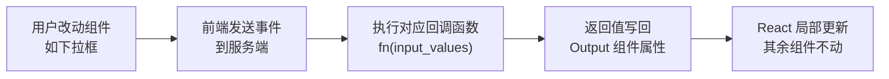

# Dash 分析仪表盘

在 [PyEcharts 交互式图表](/docs/python/05-数据科学/09-数据分析工具库/07-PyEcharts交互式图表) 中，我们生成的产物是一个**静态 HTML 文件**：图表自带缩放、悬浮、图例筛选，但数据是生成那一刻就固定的——想换个城市、换个时间段看，就得回代码里改参数重新 `render()`。当需求升级为"用户在页面上选条件、整页数据实时联动"的**在线分析应用**时，就需要 Dash：Plotly 团队出品的回调式仪表盘框架，用纯 Python 写出"数据随交互变化"的 Web 应用。

## 概念说明

Dash 是构建在 Flask（服务端）与 React（前端）之上的纯 Python 框架。一个 Dash 应用只由两部分组成：

- **布局（Layout）**：一棵声明式的组件树，由 HTML 标签（`dash.html`）与核心组件（`dash.dcc`）拼装，描述"页面上有什么"；
- **回调（Callback）**：声明"哪个输入变化时，由哪个函数计算并写回哪个输出"，描述"数据怎么流动"。

它不重跑整个应用，而是让前端把事件精确转发给服务端对应的回调函数，计算结果只写回指定的组件属性——这是它与 Streamlit 全量重跑模型最本质的区别，也因此更适合页面复杂、交互精细的仪表盘。



::: tip 适用边界
Dash 适合**多用户、多页、精细联动的在线分析应用**。一次性报告、邮件附件仍然首选 PyEcharts 直接出 HTML；五分钟给同事看的原型则用 Streamlit 更快。
:::

## 核心要点

- 应用 = **布局 + 回调**：布局是静态骨架，回调是唯一的数据流通道。
- 回调用装饰器声明：`Output` 写什么、`Input` 看什么，函数体拿到输入值、返回输出值。
- `Input` 的变化**触发**回调，`State` 只在触发时**读取**当前值——"点按钮才查询"的写法就靠它。
- 组件靠 `id` 互相识别：回调声明里的 `id` 必须与布局中的组件一一对应。
- 部署形态是**常驻 Flask 服务**（`app.run()`），不是生成文件；多用户共享同一服务进程。
- ⚠️ 常见误区：用全局可变变量在回调之间传状态。多用户会互相覆盖，状态应放进 `dcc.Store` 组件。
- ⚠️ 常见误区：把 `Input` 和 `State` 用混，导致文本框每敲一个字就触发一次昂贵的查询。
- ⚠️ 常见误区：回调有的分支忘了 `return`，页面出现"回调未返回"警告、组件停在旧值。

## 布局与组件

布局由两层组件体系构成：

- `dash.html`：对 HTML 标签的直接封装（`html.Div`、`html.H2`、`html.Button`…），负责页面结构与样式容器；
- `dash.dcc`（Dash Core Components）：交互控件（`dcc.Dropdown`、`dcc.Slider`、`dcc.Graph`、`dcc.DatePickerRange`）与状态容器（`dcc.Store`）。
- 表格组件由 `dash.dash_table` 提供（`DataTable`），支持排序、筛选、单元格编辑。

```python
from dash import Dash, html, dcc

app = Dash(__name__)

app.layout = html.Div(
    [
        html.H2("销售分析仪表盘"),
        dcc.Dropdown(
            id="city",                                   # id 是回调的锚点
            options=["北京", "上海", "广州", "深圳"],
            value="北京",
            clearable=False,
        ),
        dcc.DatePickerRange(id="period", start_date="2026-01-01"),
        dcc.Graph(id="trend"),                           # 图表占位，数据由回调填
        dcc.Store(id="raw-data"),                        # 浏览器端状态容器
    ],
    style={"maxWidth": "1100px", "margin": "0 auto"},
)
```

要点：`dcc.Graph` 初始可以只占位、不给 `figure`；`options` 接受简单列表或 `[{"label": ..., "value": ...}]` 字典列表；组件普遍支持 `style` 内联样式。布局在服务启动后是**静态的**——想让布局随数据变化，也要通过回调写回（例如动态生成的下拉选项）。

## 回调函数：Input/Output/State

回调是 Dash 的灵魂。用 `@app.callback` 装饰器声明"输入 → 函数 → 输出"的映射：

```python
from dash import Dash, html, dcc, Input, Output

app = Dash(__name__)
app.layout = html.Div([
    dcc.Dropdown(id="city", options=["北京", "上海", "广州"], value="北京"),
    html.Div(id="caption"),
])

@app.callback(Output("caption", "children"),        # 写回 caption 的内容
              Input("city", "value"))               # 监听 city 的取值
def update_caption(city):
    return f"当前查看的城市：{city}"

if __name__ == "__main__":
    app.run(debug=True)
```

理解回调记住三句话：

1. **函数参数 = Input 的当前值**，按声明顺序传入；
2. **函数返回值 = Output 的新属性**，类型由目标属性决定（`children` 收任意内容，`figure` 收 Plotly 图对象）；
3. **应用启动时回调会先跑一遍**（用初始值），所以页面打开即有内容。

一个回调可以写回多个 Output，也可以监听多个 Input：

```python
@app.callback(
    Output("trend", "figure"),
    Output("bar", "figure"),
    Input("city", "value"),
    Input("category", "value"),
)
def update_charts(city, category):
    trend = build_trend(city, category)
    bar = build_bar(city, category)
    return trend, bar                    # 返回顺序与 Output 声明顺序一致
```

### Input 与 State 的区别

`Input` 声明的属性一旦变化就触发回调；`State` 声明的属性只在"别的 Input 触发时"才读当前值。典型场景是搜索框：点按钮才查询，而不是每敲一个字查一次。

```python
@app.callback(
    Output("result", "children"),
    Input("btn", "n_clicks"),            # 触发器：按钮点击
    State("name", "value"),              # 只读值：文本框当前内容
)
def on_search(n_clicks, name):
    if not n_clicks:                     # 页面刚打开、还没点过按钮
        return "尚未搜索"
    return f"查询结果：{name}"
```

::: tip 回调之间的状态共享
回调函数之间没有共享内存，普通全局变量在多用户下会互相污染。需要跨回调传递的数据（如上传文件的结果、联动选项）放进 `dcc.Store(id=...)` 组件，回调既可以把数据写进 Store，也可以从 Store 读。数据量大时再考虑服务端缓存（如 `flask_caching`）。
:::

## 多页 Dash

页面多了以后，Dash 提供 `pages/` 目录约定：把每个页面写成独立模块，用 `register_page` 声明路由，框架自动完成注册与导航。

```text
my_dash/
├── app.py
└── pages/
    ├── overview.py
    └── detail.py
```

```python
# app.py —— 入口：只放导航壳与页面容器
from dash import Dash, html, dcc, page_container

app = Dash(__name__)
app.layout = html.Div([
    html.Nav([
        dcc.Link("总览", href="/"),
        dcc.Link("明细", href="/detail"),
    ]),
    page_container,                      # 当前页面的挂载点
])

# pages/overview.py —— 每个页面一个模块
from dash import html, register_page, dcc

register_page(__name__, path="/", name="总览")   # path="/" 即首页

layout = html.Div([
    html.H2("销售总览"),
    dcc.Graph(id="overview-chart"),
])
```

约定要点：`pages/` 下每个模块必须提供 `layout` 变量；`register_page(__name__, path=..., name=...)` 声明 URL 与导航名；URL 参数（如 `/detail?id=3`）可通过 `dcc.Location` 组件配合回调解析，实现"页面之间带参跳转"。复杂仪表盘按"总览 / 明细 / 设置"拆页，比把所有图塞进一页清爽得多。

## 完整最小应用

下面是一个自包含、可直接运行的销售仪表盘：下拉框选城市，两张图（每日趋势、品类构成）联动刷新。保存为 `sales_dash.py`，`python sales_dash.py` 后浏览器访问 `http://127.0.0.1:8050`（依赖：`pip install dash plotly pandas numpy`）。

```python
"""
sales_dash.py —— 销售分析仪表盘
运行：python sales_dash.py
"""
from dash import Dash, dcc, html, Input, Output
import plotly.express as px
import pandas as pd
import numpy as np


def make_data() -> pd.DataFrame:
    """演示用数据；实际项目中替换为 pd.read_csv("sales.csv")"""
    rng = np.random.default_rng(42)
    return pd.DataFrame({
        "日期": pd.date_range("2026-01-01", periods=180, freq="D"),
        "城市": rng.choice(["北京", "上海", "广州", "深圳"], 180),
        "品类": rng.choice(["食品", "数码", "服饰"], 180),
        "销售额": rng.normal(3000, 800, 180).round(0),
    })


df = make_data()

app = Dash(__name__)
app.title = "销售分析仪表盘"

app.layout = html.Div(
    [
        html.H2("销售分析仪表盘"),
        dcc.Dropdown(
            id="city",
            options=sorted(df["城市"].unique().tolist()),
            value="北京",
            clearable=False,
        ),
        dcc.Graph(id="trend"),
        dcc.Graph(id="category"),
    ],
    style={"maxWidth": "1000px", "margin": "0 auto"},
)


@app.callback(
    Output("trend", "figure"),
    Output("category", "figure"),
    Input("city", "value"),
)
def update_charts(city: str):
    sub = df[df["城市"] == city]

    trend = px.line(
        sub, x="日期", y="销售额",
        title=f"{city} · 每日销售额",
    )
    cat = px.bar(
        sub.groupby("品类", as_index=False)["销售额"].sum(),
        x="品类", y="销售额", color="品类",
        title=f"{city} · 品类销售额",
    )
    return trend, cat


if __name__ == "__main__":
    app.run(debug=True)      # debug=True 提供热重载与错误浮层
```

代码结构与正文对应：`app.layout` 是布局骨架（一个下拉框 + 两个图表占位），`update_charts` 是唯一的回调——输入变化时用 Pandas 过滤、用 Plotly Express 画图、返回两个 `figure`。若把数据换成 `pd.read_csv` 读入的真实数据，这个骨架无需改动。

## 与 PyEcharts 方案对比

PyEcharts 与 Dash 都能产出"交互式图表页面"，但产物形态和交互模型完全不同，是互补而非替代关系：

| 维度 | PyEcharts | Dash |
|---|---|---|
| 产物 | 独立 HTML 文件 | 常驻 Web 服务（Flask） |
| 交互范围 | 图表内建交互（缩放、悬浮、图例筛选） | 任意组件联动，回调驱动整页数据 |
| 数据更新 | 生成时固定，改数据需重新 `render()` | 回调实时返回新数据 |
| 服务端逻辑 | 无（Python 生成后即退出） | 有（回调函数即服务端代码） |
| 部署成本 | 发文件、挂静态目录即可 | 需要进程托管，与部署 Web 服务相同 |
| 图表体系 | ECharts，中文文档与案例生态好 | Plotly，与 Pandas 无缝衔接 |
| 典型用途 | 周报、静态看板、离线报告 | 面向多用户的在线分析工具 |

选型判断只有一句话：**数据是"死的"用 PyEcharts，数据要"随人变"用 Dash**。发邮件的月度报告、挂在内网的静态周报，PyEcharts 一次生成、零运维；而"每个城市负责人登录后看自己的数据、拖动时间轴实时刷新"这类需求，只有 Dash（或同类回调框架）能承载。两者的图表能力本身都很强，PyEcharts 的配置项体系见 [PyEcharts 交互式图表](/docs/python/05-数据科学/09-数据分析工具库/07-PyEcharts交互式图表)。

## 框架选型建议

把本专题三个框架放进同一张表，按需求对号入座：

| 框架 | 一句话定位 | 心智模型 | 适合场景 | 不太适合 |
|---|---|---|---|---|
| **Streamlit** | 快速原型：脚本即应用 | 整页脚本全量重跑 | 内部分析工具、看板雏形、个人项目 | 精细 UI 控制、高并发服务 |
| **Gradio** | 模型演示：函数即界面 | 函数 + 输入输出组件 | ML Demo、教学演示、Spaces 分享 | 多页业务系统、数据看板 |
| **Dash** | 精细仪表盘：回调即数据流 | 布局 + 显式回调 | 生产级分析应用、复杂联动、多用户 | 五分钟出活的临时需求 |
| PyEcharts | 静态报告：代码即图表文件 | 配置项 + `render()` | 周报、邮件附件、无需服务的看板 | 需要实时联动的在线应用 |

经验法则：**先用 Streamlit 验证想法是否成立，模型类需求交给 Gradio 分享，想法被验证、需求变复杂后重写为 Dash**。从 Streamlit 迁移到 Dash 的成本可控——数据分析层（Pandas 管道）完全复用，重写的只是交互层。

## 常见陷阱

| 陷阱 | 现象 | 正确做法 |
|---|---|---|
| 全局变量当回调状态 | 多用户互相覆盖数据 | 状态放 `dcc.Store` 或服务端缓存 |
| `Input`/`State` 用混 | 每敲一个字触发一次查询 | 触发用 `Input`，取值用 `State` |
| 某分支没有 `return` | "回调未返回"警告，组件停在旧值 | 每条分支都返回 Output 需要的值 |
| 回调 `id` 与布局对不上 | 回调不触发或启动即报错 | `id` 全局唯一，声明与布局一致 |
| 用 `run_server()` 启动 | 新版本已移除该方法，直接报错 | 统一使用 `app.run()` |
| 重计算写在布局生成处 | 服务启动慢，且无法联动刷新 | 布局只放骨架，数据计算进回调 |

## 版本说明

- Dash 在长期 2.x 系列后进入 **3.x**：启动入口统一为 `app.run()`，旧写法 `run_server()` 已移除。
- 多页能力（`dash.pages`、`register_page`）自 2.x 后期内建，`pages/` 目录约定延续到 3.x。
- 组件体系稳定地分为 `dash.html`（HTML 封装）、`dash.dcc`（核心交互组件）与 `dash.dash_table`（表格）三块。
- 部署形态是常驻 Flask 应用，可与 uvicorn/gunicorn 等标准托管方式配合，也能挂载进更大的 Web 服务。

## 延伸阅读

- Dash 官方文档（安装、布局、回调、多页）：https://dash.plotly.com/
- Dash 回调基础指南：https://dash.plotly.com/basic-callbacks
- Plotly Express 图表速查：https://plotly.com/python/plotly-express/
- 本站：[PyEcharts 交互式图表](/docs/python/05-数据科学/09-数据分析工具库/07-PyEcharts交互式图表) — 静态 HTML 看板方案，与本篇互补
- 本站：[Streamlit 数据应用](/docs/python/05-数据科学/10-数据应用框架/01-Streamlit数据应用) — 同专题的快速原型方案
