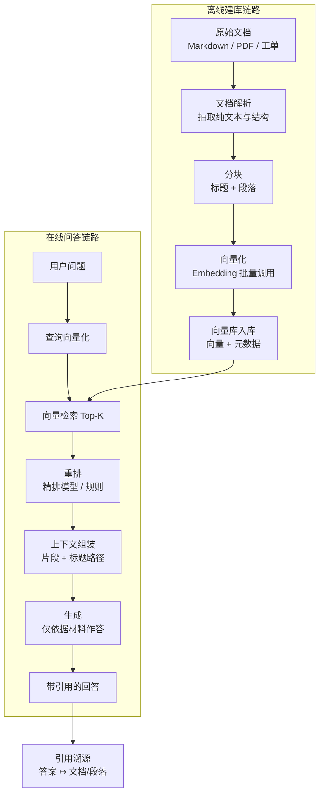

# RAG 检索增强实战

## 概念说明

RAG（Retrieval-Augmented Generation，检索增强生成）解决 LLM 的两个先天缺陷：**知识过时**（训练数据有截止日期）与**幻觉**（对不知道的事编造答案）。
思路是把"答什么"交给检索：先从私有知识库中找出相关片段，再让模型**只依据这些片段**组织回答。

RAG 不是单个组件，而是一条流水线。离线侧负责"把文档变成可检索的向量"，在线侧负责"从问题到带出处的答案"。工程难点通常不在模型，而在流水线的每一环质量：解析丢内容、分块切碎语义、检索召回偏、模型不理会上下文，任何一环掉链子，最终答案就不可信。

本篇的组件选型沿用前两篇：分块与向量检索见 [Embedding 与向量检索](03-Embedding与向量检索)，提示写法见 [提示工程](02-提示工程)。

::: tip RAG 的第一性问题
模型回答的质量上限由**检索质量**决定。检索没把对的片段送进来，提示写得再好模型也只能靠幻觉补。优化 RAG 优先排查检索环节，而不是急着改提示或换模型。
:::

## 核心要点

- RAG 流水线分两条链路：**离线建库**（解析→分块→向量化→入库）与**在线问答**（查询→检索→重排→生成）。
- 生成提示必须明确"仅依据提供的材料回答，材料不足时明确说不知道"——这是压制幻觉的关键约束。
- 引用溯源是 RAG 的信任基础：答案中的每个论断应能回指到具体文档与片段。
- 重排（rerank）用更精的模型对召回结果二次排序，是"廉价召回 + 精排"的经典分层。
- 失败模式要分类治理：检索不到、检索到了但没进 Top-K、进了 Top-K 但模型不理会，对策各不相同。
- 上下文组装有预算：Top-K 片段总长要控制在上下文窗口与成本预算内，按分数截断。
- ⚠️ 常见误区：把 RAG 当成"接上向量库就行"。解析质量差（表格丢失、乱码）时，后面全链路白做。
- ⚠️ 常见误区：只看最终答案好不好。没有分环节日志（召回了什么、重排后顺序、给了模型什么），问题无法归因。
- ⚠️ 常见误区：知识库更新没有流程。文档改了向量库没更新，答案停留在旧版本。

## RAG 整体架构



::: warning 两条链路要分开评测
建库质量用"给定问题能否召回目标片段"评测；生成质量用"给定片段能否答对"评测。混在一起只能得到"整体不行"，无法定位该修哪一环。
:::

## 流水线一：文档解析与分块（离线）

### 解析：先把文档变成干净的文本

不同来源的处理深度不同：

| 来源 | 处理要点 |
|---|---|
| Markdown / 纯文本 | 直接使用；保留标题层级作为分块结构 |
| HTML | 去脚本样式，抽取正文与标题树 |
| PDF | 版面还原是难点：表格、双栏、扫描件需专门解析，先抽样人工核对解析结果 |
| 办公文档 | 转中间格式统一处理，避免逐格式写解析逻辑 |

解析阶段的验收标准：**内容零丢失、结构可还原**。宁可多花时间核对解析质量，也不要让垃圾文本流入建库。

### 分块与入库：一条完整流水线

```python
import os

from openai import OpenAI

client = OpenAI(base_url=os.environ["LLM_BASE_URL"], api_key=os.environ["LLM_API_KEY"])
EMBED_MODEL = os.getenv("EMBED_MODEL", "your-embedding-model")
BATCH_SIZE = 64  # 批量大小：兼顾接口限制与失败重试粒度


def build_index(docs: list[dict], store) -> None:
    """docs: [{"doc_name": ..., "content": ...}]，store 为向量库（内存/pgvector）"""
    # 1. 分块（结构感知分块实现见 Embedding 与向量检索篇）
    chunks: list[dict] = []
    for doc in docs:
        chunks.extend(split_markdown(doc["content"], doc["doc_name"]))

    # 2. 批量向量化 + 入库；块文本并入标题路径，提供话题语义
    for i in range(0, len(chunks), BATCH_SIZE):
        batch = chunks[i:i + BATCH_SIZE]
        texts = [f'{c["title_path"]}\n{c["content"]}' for c in batch]
        vectors = embed_texts(texts)
        store.add(
            texts=texts,
            metadatas=[{"doc_name": c["doc_name"], "title_path": c["title_path"]}
                       for c in batch],
        )
```

::: tip 建库幂等
建库脚本必须可重跑：同文档重复导入先删除旧块（按 doc_name 过滤删除），否则向量库越积越重、旧版本内容与新版本并存，检索结果自相矛盾。
:::

## 流水线二：在线检索与重排

### 检索：Top-K 召回

```python
def retrieve(query: str, store, top_k: int = 8, score_floor: float = 0.55) -> list[dict]:
    hits = store.search(query, top_k=top_k)
    # 阈值过滤：分数过低说明知识库里没有相关内容，交给"拒答"而不是硬答
    return [h for h in hits if h["score"] >= score_floor]
```

### 重排：精排压榨召回质量

向量检索是"快而糙"的近似召回。重排用更精细的打分对候选二次排序，典型做法三类：

1. **交叉编码器 / 精排模型**：把"问题 + 候选片段"成对输入重排模型打分，精度最高，成本高于向量检索，所以只对 Top-K 候选做。
2. **规则加权**：标题路径命中问题关键词加分、来源文档权威度加权，作为无精排模型时的兜底。
3. **多路召回融合**：关键词检索 + 向量检索双路结果按分数归一融合（RRF 类算法），兼顾字面与语义。

```python
def rerank(query: str, hits: list[dict], client, top_k: int = 4) -> list[dict]:
    """精排模型重排：服务无重排接口时，可用规则加权替代"""
    if not hits:
        return []
    resp = client.rerank.create(          # 兼容服务提供的重排接口（示意）
        model=os.getenv("RERANK_MODEL", "your-rerank-model"),
        query=query,
        documents=[h["text"] for h in hits],
        top_n=top_k,
    )
    ordered = sorted(resp.results, key=lambda r: r.relevance_score, reverse=True)
    return [{**hits[r.index], "rerank_score": r.relevance_score} for r in ordered]
```

::: tip 没有精排模型的降级路径
自部署或服务不支持重排接口时，退化为"标题路径与问题重叠度 + 原向量分数"加权排序。精排带来的提升通常值得引入，但它应是可裁剪的可选层，而不是架构依赖。
:::

## 流水线三：生成与引用溯源

### 上下文组装与生成提示

```python
RAG_SYSTEM_PROMPT = """\
你是内部知识库问答助手。

# 规则
1. 仅依据 <context> 中提供的片段回答，不得使用材料之外的知识。
2. 材料不足以回答时，明确回复"知识库中未找到相关内容"，不要推测。
3. 每个论断标注来源编号，如 [1]，编号对应片段标号。
4. 回答简洁，先给结论再给依据。
"""


def generate_answer(question: str, passages: list[dict]) -> dict:
    # 组装上下文：编号 + 标题路径 + 片段文本
    blocks = "\n\n".join(
        f'[{i + 1}] 来源: {p["metadata"]["doc_name"]} / {p["metadata"]["title_path"]}\n{p["text"]}'
        for i, p in enumerate(passages)
    )
    user_content = f"<question>{question}</question>\n\n<context>\n{blocks}\n</context>"

    resp = client.chat.completions.create(
        model=os.getenv("LLM_MODEL", "your-model-name"),
        messages=[
            {"role": "system", "content": RAG_SYSTEM_PROMPT},
            {"role": "user", "content": user_content},
        ],
        temperature=0.1,  # 事实型问答用低温
    )
    answer = resp.choices[0].message.content or ""
    return {"answer": answer, "sources": sources_for(answer, passages)}
```

### 引用溯源

溯源闭环 = 答案内标注 `[1]` + 接口返回来源映射，前端据此渲染"点击引用查看原文"：

```python
import re


def sources_for(answer: str, passages: list[dict]) -> list[dict]:
    """从答案中提取被引用的编号，返回对应来源清单"""
    cited = sorted({int(n) for n in re.findall(r"\[(\d+)\]", answer)})
    out = []
    for n in cited:
        if 1 <= n <= len(passages):
            p = passages[n - 1]
            out.append({
                "index": n,
                "doc": p["metadata"]["doc_name"],
                "title_path": p["metadata"]["title_path"],
                "snippet": p["text"][:120],
            })
    return out
```

::: warning 引用编号也会漂移
模型可能输出不存在的编号（如 `[9]` 而上下文只有 4 个片段）。`sources_for` 只映射合法编号；要求"无引用即不可信"的场景，可在校验层对无引用答案降权或拒答。
:::

## 失败模式与对策

### 模式一：检索不到

表现：知识库里明明有答案，回答却是"未找到相关内容"或模型自由发挥。

| 根因 | 对策 |
|---|---|
| 解析丢内容（表格、附录丢失） | 解析抽样核对，补专门的表格解析 |
| 分块切碎语义，块内无完整答案 | 调大块 / 标题入块 / 相邻块拼接检索 |
| 查询与文档表述差异大 | few-shot 生成改写查询；多路召回（关键词 + 向量） |
| Top-K 太小或阈值太严 | 分环节日志定位召回排序，调 K 与阈值 |
| 知识库未更新 | 建库走变更流程：文档变更触发重建索引 |

### 模式二：答案漂移（不理会材料）

表现：片段检索到了，模型却绕开材料，用通用知识作答、超出材料范围推断、或自由扩写。

| 根因 | 对策 |
|---|---|
| 提示未强制"仅依据材料" | 系统提示显式约束 + 低温生成 |
| 上下文中噪声片段多，模型被带偏 | 重排收紧 Top-K，去掉低分片段 |
| 用户问题隐含倾向，诱导模型发挥 | 提示强调"材料没有就说没有"，评测集加诱导样例 |
| 上下文超长，中间片段被忽视 | 控制片段总数与总长，关键片段放上下文首尾 |

### 其他高频失败

| 失败模式 | 表现 | 对策 |
|---|---|---|
| 检索到旧版本内容 | 新旧答案混杂 | 建库幂等，按文档删除重建 |
| 引用编号与内容对不上 | 溯源失去信任 | 编号合法性与一致性校验 |
| 阈值一刀切 | 不同场景漏召回或误召回 | 分场景标定阈值，评测集驱动 |
| 答案正确但格式崩坏 | 下游解析失败 | 结构化输出约束（见 [结构化输出与评估](06-结构化输出与评估)） |

## 常见陷阱

| 陷阱 | 后果 | 正确做法 |
|---|---|---|
| 只评最终答案，不评检索环节 | 问题无法归因到建库或生成 | 分环节评测：召回命中率与答案正确率分开算 |
| 建库脚本不可重跑 | 旧内容残留，新旧混杂 | 按 doc_name 幂等删除重建 |
| Top-K 与阈值拍脑袋 | 要么噪声多要么漏召回 | 黄金问题集标定，写进配置 |
| 上下文塞满窗口 | 成本高、中间内容被忽视 | 按分数截断，总长预算控制 |
| 检索与生成共用一个评测集 | 无法定位环节问题 | 建库评测与生成评测分离 |
| 无分环节日志 | 线上坏 case 无法复盘 | 记录召回片段、重排分数、最终上下文 |

## 最佳实践

### 1. 先建评测集，再调流水线

20~50 个黄金问题（问题 + 期望来源 + 期望答案要点）先行。每次调分块大小、Top-K、阈值、提示，跑回归对比。评测集搭建见 [结构化输出与评估](06-结构化输出与评估)。

### 2. 分环节埋日志

一次问答记录四件事：召回的片段与分数、重排后的顺序、送给模型的上下文、最终答案与引用。线上坏 case 靠这些定位，不靠猜。

### 3. 拒答是一等功能

"知识库中未找到相关内容"是正确答案。产品与提示都要把拒答当一等公民设计，而不是失败兜底。

### 4. 建库进 CI

文档变更触发解析、分块、向量化、入库的流水作业，产出"本次新增/更新/删除的块数"报告，让知识库更新可观测、可回滚。

## 版本说明

- **重排接口**：示例使用兼容服务的 `rerank` 接口写法示意；不同服务签名不同，无该能力时可用规则加权替代。
- **pgvector / 内存方案**：存储层实现见 [Embedding 与向量检索](03-Embedding与向量检索)，本篇不重复。
- **mermaid 架构图**：VitePress 原生渲染，与文档站其余篇目一致。
- **Python 3.10+**：示例使用内建泛型与 `X | None` 语法。

## 延伸阅读

- 本站相关篇目：[Embedding 与向量检索](03-Embedding与向量检索) — 分块与检索层实现
- 兄弟篇：[Agent 与工具调用](05-Agent与工具调用) — 检索作为工具接入 Agent
- 兄弟篇：[提示工程](02-提示工程) — 生成提示的分隔符与约束写法
- 兄弟篇：[生产实践](07-生产实践) — RAG 服务的缓存与观测
- LangChain — RAG 概念文档（流水线组件参考）：https://python.langchain.com/docs/concepts/rag/

> 🧭 工程化工具链与 Python 版本演进速览统一维护在 [导航总览 · 工程化工具链演进速览](/docs/python/02-基础与入门/00-导航总览#六工程化工具链演进速览)。
