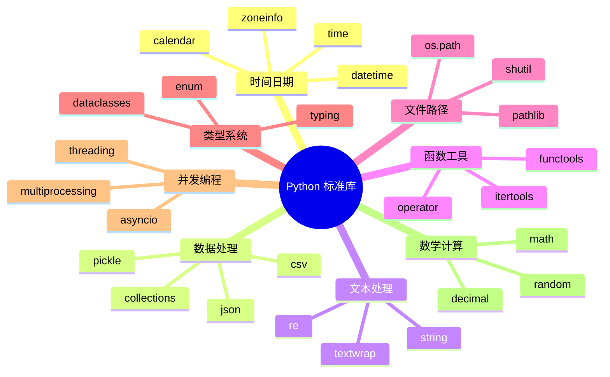
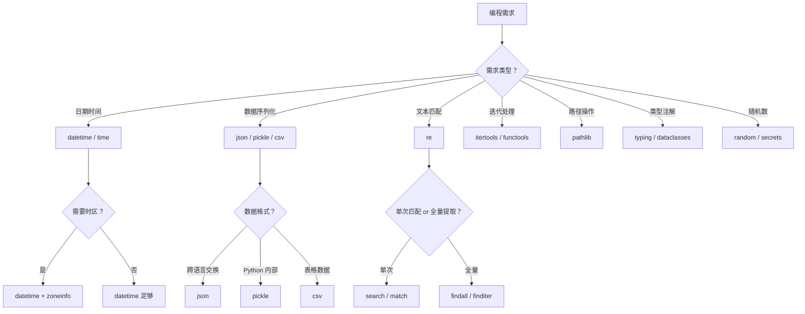
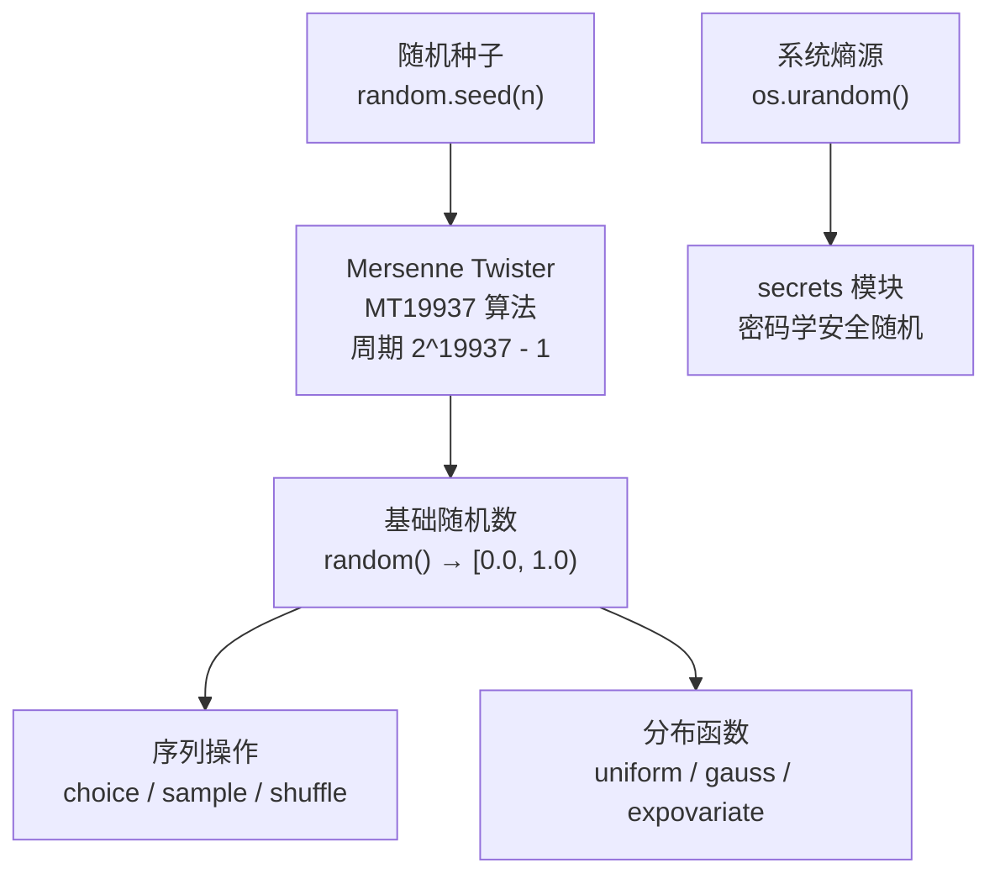
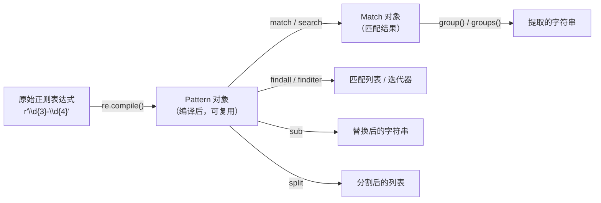
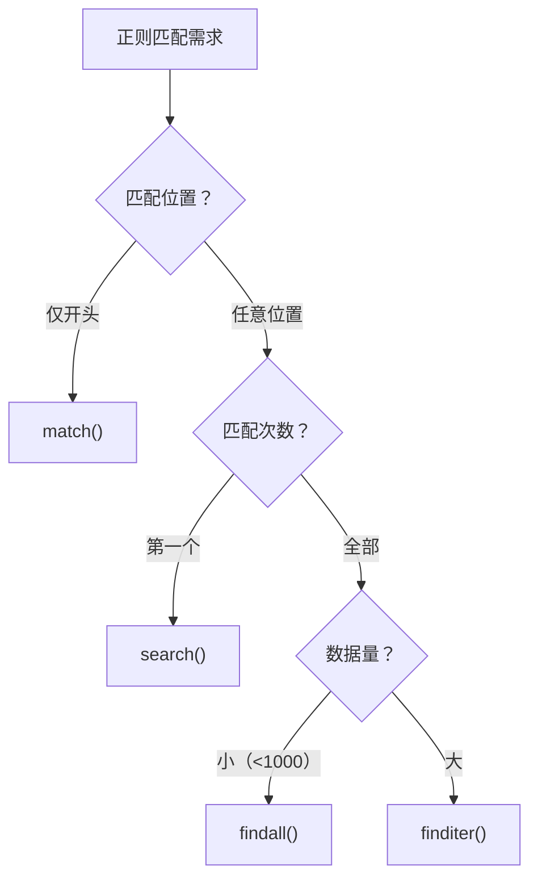
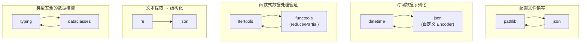
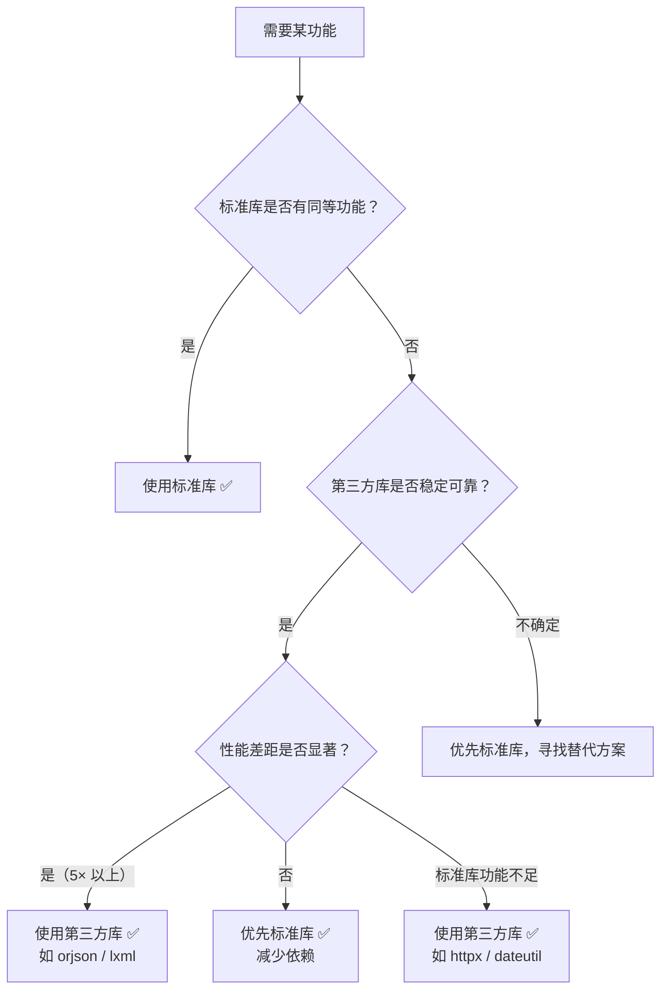

# 标准模块速查与实战

> 本页是 Python 常用标准模块的**一站式速查与实战指南**，覆盖 datetime、time、random、json、re、itertools、functools、pathlib、typing 九大核心模块。每个模块均包含架构图、核心 API 表、最佳实践与常见陷阱。如需更深入的专业讲解，请跳转至各模块的独立文档。

## 前置阅读

- [Python 模块](01-Python模块) — 模块导入机制与包管理
- [标准库索引](03-内置模块/01-os模块) — 内置模块完整导航

---

## 一、标准库全景导航

### 1.1 标准库分类体系



### 1.2 模块选型决策



### 1.3 模块分类速查表

| 分类 | 模块 | 核心功能 | 典型场景 | 专业文档 |
|:-----|:-----|:---------|:---------|:---------|
| **时间日期** | `datetime` | 日期时间对象与运算 | 日志记录、定时任务、时区转换 | [时间模块](03-内置模块/07-时间模块) |
| | `time` | 时间戳、性能计时、休眠 | 性能测试、定时操作 | [时间模块](03-内置模块/07-时间模块) |
| **数学计算** | `random` | 伪随机数生成与采样 | 抽奖、测试数据、蒙特卡洛 | [数学与数值计算](03-内置模块/08-数学与数值计算) |
| **数据处理** | `json` | JSON 编解码 | 配置文件、API 通信 | [存储模块](03-内置模块/06-存储模块) |
| **文本处理** | `re` | 正则表达式匹配 | 数据验证、文本提取 | [数据解析](/docs/python/01-Web与爬虫/02-爬虫/02-数据解析全攻略) |
| **函数工具** | `itertools` | 迭代器构造与组合 | 数据流处理、排列组合 | [itertools](03-内置模块/12-itertools) |
| | `functools` | 高阶函数与装饰器工具 | 缓存、偏函数、类型分派 | [functools](03-内置模块/17-functools) |
| **文件路径** | `pathlib` | 面向对象路径操作 | 跨平台路径处理 | [pathlib 与文件处理](03-内置模块/04-文件处理) |
| **类型系统** | `typing` | 类型提示与静态检查 | 代码文档化、IDE 支持 | [typing](03-内置模块/19-typing模块) |

---


## 二、random 模块

### 4.1 随机数生成架构



::: info Mersenne Twister 算法
Python 的 `random` 模块使用 MT19937 算法，周期长度为 2^19937 - 1，通过所有常用统计测试。但它是**伪随机数生成器（PRNG）**，不适合密码学场景。
:::

### 4.2 API 分类速查

| 分类 | 函数 | 说明 | 示例 |
|:-----|:-----|:-----|:-----|
| **基础随机** | `random()` | [0.0, 1.0) 浮点数 | `0.8947...` |
| | `uniform(a, b)` | [a, b] 范围浮点数 | `7.32` |
| | `randint(a, b)` | [a, b] 范围整数 | `5` |
| | `randrange(start, stop, step)` | 指定步长范围整数 | `10, 13, 16...` |
| **序列操作** | `choice(seq)` | 随机选一个元素 | `'b'` |
| | `choices(seq, k=n, weights=...)` | 有放回随机选 n 个 | `['a', 'a', 'b']` |
| | `sample(seq, k)` | 无放回随机选 k 个 | `['a', 'c']` |
| | `shuffle(seq)` | 原地打乱序列 | — |
| **分布函数** | `gauss(mu, sigma)` | 正态分布 | — |
| | `expovariate(lambd)` | 指数分布 | — |
| | `triangular(low, high, mode)` | 三角分布 | — |

### 4.3 随机种子与线程安全

```python
import random

# ── 随机种子：确保可复现 ────────────────────────────
random.seed(42)
print(random.random())   # 0.6394267984578837（每次运行相同）
print(random.randint(1, 10))  # 2

random.seed(42)          # 重置种子后序列重新开始
print(random.random())   # 0.6394267984578837（相同）

# ── 线程安全问题 ──────────────────────────────────
# random 模块的全局状态不是线程安全的！
# 多线程环境应使用独立的 Random 实例：
import threading

def worker(seed_val):
    local_rng = random.Random(seed_val)  # 每个线程独立实例
    print(local_rng.random())

threads = [threading.Thread(target=worker, args=(i,)) for i in range(4)]
for t in threads:
    t.start()
```

### 4.4 安全随机 vs 伪随机

```python
import random
import secrets

# ❌ 伪随机——不适合密码学
token = ''.join(random.choices('abcdefghijklmnopqrstuvwxyz0123456789', k=16))
# 可预测！知道种子就能重现

# ✅ 安全随机——密码学安全
token = secrets.token_urlsafe(16)      # 'xZ7vQk2mPn4bRt9w'
password = secrets.token_hex(16)        # 'a1b2c3d4e5f6...'（32个十六进制字符）
rand_int = secrets.randbelow(100)       # [0, 100) 安全随机整数
```

| 场景 | 使用 `random` | 使用 `secrets` |
|:-----|:-------------|:---------------|
| 测试数据生成 | ✅ | ❌ 杀鸡用牛刀 |
| 游戏随机事件 | ✅ | ❌ |
| 抽奖/模拟 | ✅ | ❌ |
| 密码/token 生成 | ❌ 可预测 | ✅ |
| CSRF nonce | ❌ | ✅ |
| 密钥派生 | ❌ | ✅ |

### 4.5 实战案例

```python
import random
from collections import Counter

# ── 加权随机（如抽奖概率）─────────────────────────────
prizes = ['一等奖', '二等奖', '三等奖', '谢谢参与']
weights = [1, 5, 20, 74]    # 概率权重（1% / 5% / 20% / 74%）

results = random.choices(prizes, weights=weights, k=10000)
print(Counter(results))
# Counter({'谢谢参与': 7400, '三等奖': 2000, '二等奖': 500, '一等奖': 100})

# ── 蒙特卡洛模拟：估算 π ──────────────────────────
def estimate_pi(n: int) -> float:
    """在单位正方形内随机投点，落在内切圆内的比例 ≈ π/4"""
    inside = 0
    for _ in range(n):
        x, y = random.random(), random.random()
        if x**2 + y**2 <= 1:
            inside += 1
    return 4 * inside / n

print(f"π ≈ {estimate_pi(1_000_000):.4f}")  # π ≈ 3.1416
```

::: danger 常见陷阱
1. **`random` 不是密码学安全的**：生成 token/密码/密钥必须用 `secrets` 模块
2. **多线程竞争**：`random` 的全局状态非线程安全，多线程应用使用独立 `Random()` 实例
3. **`shuffle()` 只支持可变序列**：对 tuple/str 需先转 list
4. **`sample()` 不修改原序列**：与 `shuffle()` 的原地修改行为不同
5. **种子设置时机**：在生产代码中不要固定种子，仅在测试/复现时使用
:::

→ **深入阅读**：[数学与数值计算](03-内置模块/08-数学与数值计算)

---


## 三、re 模块

### 6.1 正则引擎架构



### 6.2 核心函数对比

| 函数 | 匹配范围 | 返回值 | 适用场景 |
|:-----|:---------|:-------|:---------|
| `re.match(pattern, string)` | 仅字符串**开头** | Match 或 None | 验证格式（如校验手机号） |
| `re.search(pattern, string)` | 字符串**任意位置**（第一个） | Match 或 None | 查找单个匹配 |
| `re.findall(pattern, string)` | 字符串**全部** | 列表（字符串或元组） | 提取所有匹配项 |
| `re.finditer(pattern, string)` | 字符串**全部** | Match 迭代器 | 大量匹配时节省内存 |
| `re.sub(pattern, repl, string)` | 字符串**全部** | 新字符串 | 替换/脱敏 |
| `re.split(pattern, string)` | 字符串**全部** | 列表 | 复杂分割 |



### 6.3 元字符完整参考

| 元字符 | 含义 | 示例 | 匹配 |
|:-------|:-----|:-----|:-----|
| `.` | 任意字符（除换行） | `a.c` | abc, a1c, a c |
| `^` | 字符串开头 | `^Hello` | Hello world |
| `$` | 字符串结尾 | `world$` | Hello world |
| `*` | 前一个 0 次或多次 | `ab*c` | ac, abc, abbc |
| `+` | 前一个 1 次或多次 | `ab+c` | abc, abbc |
| `?` | 前一个 0 次或 1 次 | `ab?c` | ac, abc |
| `{n}` | 恰好 n 次 | `a{3}` | aaa |
| `{n,m}` | n 到 m 次 | `a{2,4}` | aa, aaa, aaaa |
| `[]` | 字符集 | `[aeiou]` | a, e, i, o, u |
| `[^]` | 排除字符集 | `[^0-9]` | 非数字 |
| `|` | 或 | `cat|dog` | cat 或 dog |
| `()` | 捕获分组 | `(ab)+` | ab, abab |
| `\d` | 数字 `[0-9]` | `\d{3}` | 123 |
| `\w` | 单词字符 `[a-zA-Z0-9_]` | `\w+` | hello_1 |
| `\s` | 空白字符 | `\s+` | 空格/制表/换行 |
| `\b` | 单词边界 | `\bcat\b` | 独立的 cat |
| `(?P<name>...)` | 命名分组 | `(?P<year>\d{4})` | 按名称引用 |
| `(?:...)` | 非捕获分组 | `(?:ab)+` | 分组但不捕获 |
| `(?=...)` | 正向前瞻 | `\d+(?=元)` | 后面跟"元"的数字 |
| `(?!...)` | 负向前瞻 | `\d+(?!元)` | 后面不跟"元"的数字 |

### 6.4 常用标志

```python
import re

# re.IGNORECASE (re.I) - 忽略大小写
re.search(r'hello', 'HELLO', re.I)        # 匹配成功

# re.MULTILINE (re.M) - ^ 和 $ 匹配每行的开头和结尾
text = "第一行\n第二行\n第三行"
re.findall(r'^第\w+行', text, re.M)        # ['第一行', '第二行', '第三行']

# re.DOTALL (re.S) - . 也匹配换行符
re.search(r'a.*b', 'a\nb', re.S)          # 匹配成功

# re.VERBOSE (re.X) - 允许注释和空白，提高可读性
pattern = re.compile(r'''
    \d{3}      # 区号
    -?         # 可选的连字符
    \d{4}      # 前四位
    -?         # 可选的连字符
    \d{4}      # 后四位
''', re.X)
```

### 6.5 分组与命名分组

```python
import re

# ── 普通分组 ──────────────────────────────────────
date_pattern = r'(\d{4})-(\d{2})-(\d{2})'
match = re.match(date_pattern, '2024-01-15')
match.group(0)    # '2024-01-15'（完整匹配）
match.group(1)    # '2024'（年）
match.group(2)    # '01'（月）
match.groups()    # ('2024', '01', '15')

# ── 命名分组（推荐）──────────────────────────────
named_pattern = r'(?P<year>\d{4})-(?P<month>\d{2})-(?P<day>\d{2})'
match = re.match(named_pattern, '2024-01-15')
match.group('year')      # '2024'
match.groupdict()        # {'year': '2024', 'month': '01', 'day': '15'}

# ── 替换中引用分组 ─────────────────────────────────
# 隐藏手机号中间四位
phone = '13812345678'
hidden = re.sub(r'(\d{3})\d{4}(\d{4})', r'\1****\2', phone)
print(hidden)             # '138****5678'
```

### 6.6 编译与性能

```python
import re

# 频繁使用的正则表达式应编译为 Pattern 对象
# 内部缓存机制：re 模块会缓存最近 _MAXCACHE (64) 个编译结果
# 但显式编译更清晰，且避免缓存失效

# ✅ 编译一次，多次使用
phone_re = re.compile(r'1[3-9]\d{9}')
texts = ['手机: 13812345678', '电话: 18987654321']
for text in texts:
    match = phone_re.search(text)
    if match:
        print(match.group())

# ✅ 使用回调函数进行高级替换
def double_num(match):
    return str(int(match.group()) * 2)

result = re.sub(r'\d+', double_num, 'Hello 123 World 456')
print(result)  # 'Hello 246 World 912'
```

::: danger 常见陷阱
1. **贪婪 vs 非贪婪**：`.*` 是贪婪的（匹配尽可能多），`.*?` 是非贪婪的——抓取 HTML 内容时必须用非贪婪
2. **`re.DOTALL` 误用**：默认 `.` 不匹配 `\n`，用 `re.S` 会让 `.*` 匹配整个文件
3. **性能灾难**：嵌套量词如 `(a+)+` 会导致回溯爆炸，对长字符串可能卡死——使用原子分组或重写正则
4. **`match()` 只匹配开头**：很多人误以为 `match()` 会搜索任意位置，实际它等同于 `^pattern`
5. **Unicode 处理**：`\w` 在 Python 3 中匹配 Unicode 字母（含中文），如需仅 ASCII 可用 `[a-zA-Z0-9_]`
:::

→ **深入阅读**：[数据解析全攻略](/docs/python/01-Web与爬虫/02-爬虫/02-数据解析全攻略)

---


## 四、跨模块协作模式

实际开发中，标准库模块往往需要组合使用。以下是常见的协作模式：



### 实战：pathlib + json 读写配置文件

```python
import json
from pathlib import Path
from datetime import datetime

class AppConfig:
    """类型安全的配置管理器"""

    CONFIG_PATH = Path('config.json')

    def __init__(self) -> None:
        self.config: dict = self._load()

    def _load(self) -> dict:
        """加载配置文件"""
        if not self.CONFIG_PATH.exists():
            return self._default_config()
        return json.loads(self.CONFIG_PATH.read_text(encoding='utf-8'))

    def _save(self) -> None:
        """保存配置文件"""
        self.CONFIG_PATH.write_text(
            json.dumps(self.config, ensure_ascii=False, indent=2),
            encoding='utf-8',
        )

    @staticmethod
    def _default_config() -> dict:
        return {
            'app_name': 'MyApp',
            'version': '1.0.0',
            'created_at': datetime.now().isoformat(),
            'debug': False,
        }

    def get(self, key: str, default=None):
        return self.config.get(key, default)

    def set(self, key: str, value) -> None:
        self.config[key] = value
        self._save()

# 使用
config = AppConfig()
print(config.get('app_name'))     # 'MyApp'
config.set('debug', True)          # 自动持久化
```

### 实战：itertools + functools 数据处理管道

```python
import itertools
import functools
import operator
from collections import Counter

# 统计文本中每个单词的词频，取前 N 个高频词
def top_words(text: str, n: int = 10) -> list[tuple[str, int]]:
    words = text.lower().split()
    word_counts = Counter(words)
    return word_counts.most_common(n)

# 使用 itertools 管道处理多文件
def process_files(directory: str, pattern: str = '*.txt') -> dict:
    from pathlib import Path

    # 管道：遍历文件 → 读取文本 → 统计词频 → 合并结果
    files = Path(directory).glob(pattern)
    all_words: list[str] = []

    for file_path in files:
        text = file_path.read_text(encoding='utf-8')
        words = text.lower().split()
        all_words.extend(words)

    # 使用 itertools + functools 进行高级统计
    total = len(all_words)
    unique = len(set(all_words))
    top = Counter(all_words).most_common(10)

    return {'total': total, 'unique': unique, 'top': top}
```

---

## 五、最佳实践与常见陷阱汇总

### 12.1 导入顺序与分组规范

```python
# ═══════════════════════════════════════════════════
# PEP 8 推荐的导入分组（组间空一行）
# ═══════════════════════════════════════════════════

# 第1组：标准库
import json
import re
from datetime import datetime, timedelta
from pathlib import Path

# 第2组：第三方库
import requests
from bs4 import BeautifulSoup

# 第3组：本地模块
from myapp.config import settings
from myapp.utils import helper
```

### 12.2 标准库 vs 第三方库选型决策



### 12.3 性能优化建议

| 模块 | 优化策略 | 效果 |
|:-----|:---------|:-----|
| `json` | 大文件用 `orjson` 或流式解析 `ijson` | 5-10× 提速 |
| `re` | 频繁使用的正则先 `compile` | 避免重复编译 |
| `functools` | 递归函数用 `@lru_cache` | 指数级 → 线性 |
| `itertools` | 大数据流用迭代器而非列表 | 内存降至 O(1) |
| `pathlib` | 小文件用 `read_text()`，大文件用 `open()` 逐行 | 避免大文件 OOM |
| `datetime` | 批量时间操作用 `pandas.Timestamp` | 向量化运算 |

### 12.4 常见陷阱 Top 10

| 排名 | 陷阱 | 模块 | 后果 | 解决方案 |
|:-----|:-----|:-----|:-----|:---------|
| 1 | `datetime.utcnow()` 返回 naive 对象 | datetime | 时区缺失导致 bug | `datetime.now(timezone.utc)` |
| 2 | `random` 用于生成密码/token | random | 可预测，安全风险 | 使用 `secrets` 模块 |
| 3 | `json.dumps` 中文转义 | json | `"张三"` 不可读 | `ensure_ascii=False` |
| 4 | `re.match()` 误认为全局搜索 | re | 只匹配开头，漏掉目标 | 用 `re.search()` |
| 5 | `groupby` 不排序直接分组 | itertools | 同键数据被拆成多组 | 先 `sort()` 再 `groupby()` |
| 6 | `lru_cache` 参数不可哈希 | functools | `TypeError` | 用 `tuple` 替代 `list` |
| 7 | 迭代器耗尽后继续使用 | itertools | 返回空结果 | 用 `list()` 缓存或 `tee()` 复制 |
| 8 | `time.time()` 受 NTP 跳变 | time | 超时检测失效 | 用 `time.monotonic()` |
| 9 | `Path.write_text()` 覆盖写入 | pathlib | 追加内容被清空 | 用 `open('a')` 模式 |
| 10 | 混用 naive/aware datetime | datetime | `TypeError` | 统一使用带时区的 datetime |

---

## 术语表

| 术语 | 英文 | 定义 |
|:-----|:-----|:-----|
| 时间戳 | Timestamp | 自 1970-01-01 00:00:00 UTC 以来的秒数（float） |
| Naive datetime | Naive datetime | 没有时区信息的 datetime 对象 |
| Aware datetime | Aware datetime | 带有时区信息的 datetime 对象 |
| 序列化 | Serialization | 将对象转换为可存储/传输的格式 |
| 反序列化 | Deserialization | 将存储/传输的格式还原为对象 |
| 正则表达式 | Regular Expression | 描述字符串匹配模式的形式语言 |
| 迭代器 | Iterator | 实现 `__iter__` 和 `__next__` 协议的惰性序列 |
| 惰性求值 | Lazy Evaluation | 仅在需要时才计算值的策略 |
| 偏函数 | Partial Function | 固定原函数部分参数后生成的新函数 |
| 类型注解 | Type Annotation | 为变量/函数添加类型信息的语法 |
| 类型变量 | TypeVar | 泛型编程中的类型占位符 |
| 协议 | Protocol | 基于结构的子类型（鸭子类型的静态版本） |
| LRU 缓存 | LRU Cache | 最近最少使用策略的缓存 |
| Mersenne Twister | Mersenne Twister | Python 默认的伪随机数生成算法 |

## 延伸阅读

### 站内链接

- [Python 模块详解](01-Python模块) — 模块导入机制与包管理
- [标准库索引](03-内置模块/01-os模块) — 内置模块完整导航
- [时间模块详解](03-内置模块/07-时间模块) — datetime/time/zoneinfo 深度讲解
- [存储模块详解](03-内置模块/06-存储模块) — json/pickle/csv 完整教程
- [itertools 模块](03-内置模块/12-itertools) — 迭代器工具箱
- [functools 模块](03-内置模块/17-functools) — 高阶函数工具
- [文件处理（pathlib 与 shutil）](03-内置模块/04-文件处理) — 现代路径操作与文件树操作
- [typing 模块](03-内置模块/19-typing模块) — 类型注解支持
- [数学与数值计算](03-内置模块/08-数学与数值计算) — math/random/statistics

### 外部资源

- [Python 官方标准库文档](https://docs.python.org/zh-cn/3/library/index.html) — 最权威参考
- [Python Module of the Week](https://pymotw.com/3/) — 标准库深度教程
- [Real Python - Standard Library](https://realpython.com/python-standard-library/) — 实战教程

