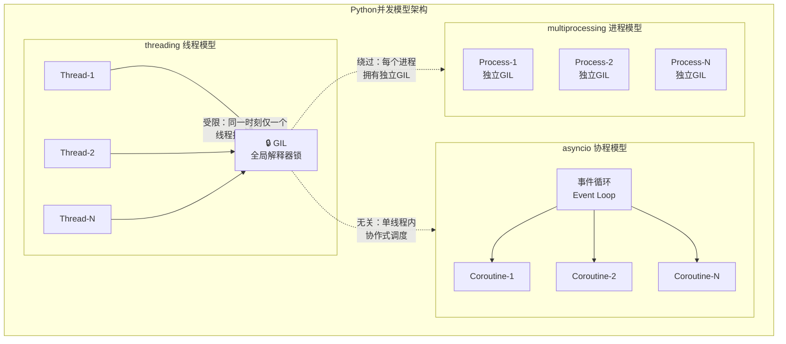
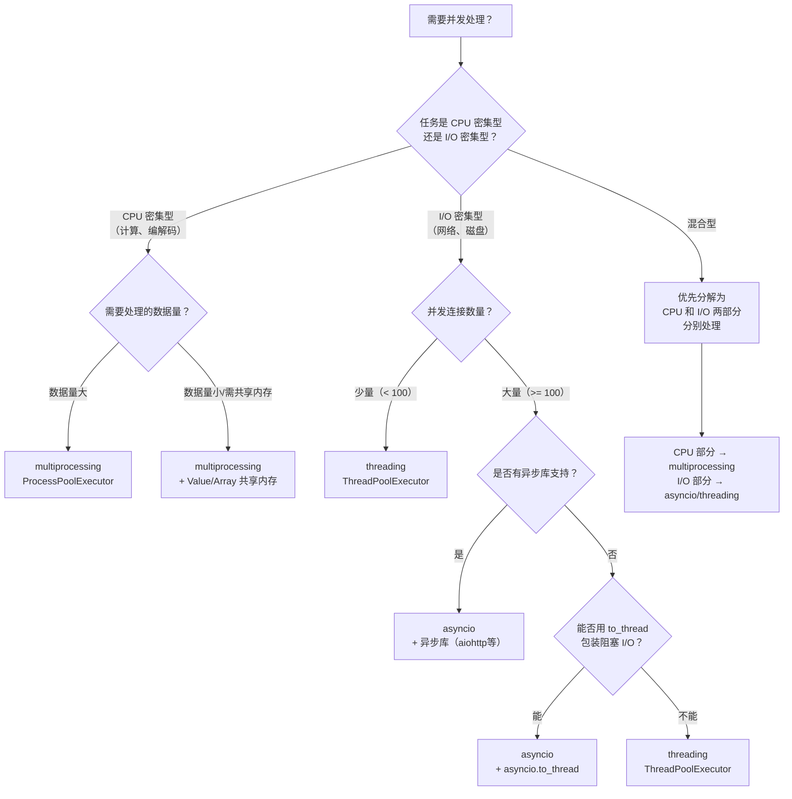

# 并发与并行编程总览

> 本页是并发系列的**导航与决策页**：建立并发/并行的概念框架，给出方案选型决策树，并串联四篇专题。各方案的语法与完整实战在对应专篇，本页不再预讲。

## 1. 核心概念：并发与并行

### 1.1 是什么

| 概念 | 定义 | 一句话 |
|:---|:---|:---|
| **并发** | 在一段时间内交错处理多个任务 | 一个厨师交替做两道菜 |
| **并行** | 在同一时刻真正同时执行多个任务 | 两个厨师各做一道菜 |

### 1.2 为什么需要区分

- **并发**追求的是 **最小化等待时间**：当任务 A 等待 I/O 时，CPU 切换到任务 B，提高资源利用率。
- **并行**追求的是 **最大化计算速度**：将计算任务分配到多个 CPU 核心，缩短总执行时间。

### 1.3 怎么做：Python 并发模型架构



| 特性 | 并发 (Concurrency) | 并行 (Parallelism) |
|:---|:---|:---|
| **定义** | 任务交错执行，看起来像同时运行 | 任务在同一时刻同时执行 |
| **目标** | 最小化等待时间，提高资源利用率 | 最大化计算速度，缩短总执行时间 |
| **实现方式** | 单核或多核 CPU 上的任务切换 | 必须在多核 CPU 上 |
| **典型场景** | I/O 密集型任务（网络、磁盘） | CPU 密集型任务（计算、分析） |

---


## 2. GIL：一句话与专文

CPython 的 GIL（全局解释器锁）保证同一时刻只有一个线程执行字节码——因此**多线程无法并行执行 CPU 密集任务**，但 IO 等待期间会释放 GIL，IO 密集场景多线程依然有效。工作原理、free-threaded（PEP 703）现状与绕行方案见专文 [并发选择指南与 GIL](04-并发选择指南与GIL)。

## 系列导航

| 篇目 | 内容 | 何时读 |
|------|------|--------|
| [threading 实战](01-threading实战) | 线程、锁、条件变量、线程安全 | 需要共享状态的中等并发 IO |
| [multiprocessing 进程](02-multiprocessing进程) | 进程、进程间通信、共享内存 | CPU 密集型并行 |
| [concurrent.futures](03-concurrent.futures) | 线程/进程池统一接口、future 编排 | **日常首选 API** |
| [并发选择指南与 GIL](04-并发选择指南与GIL) | GIL 原理、free-threaded、选型决策 | 选型纠结时 |
| [02-异步编程 系列](../02-异步编程/01-asyncio基础) | asyncio 基础 → 事件循环 → 实战 → Web 应用 | 高并发 IO、长连接 |


## 3. 并发方案选择决策

## 7. 并发方案选择决策

### 7.1 决策树



### 7.2 三大模型全面对比

| 维度 | threading | multiprocessing | asyncio |
|:---|:---|:---|:---|
| **GIL 影响** | 受限：同一时刻仅一个线程执行字节码 | 不受限：每个进程有独立 GIL | 无关：单线程协作式调度 |
| **适用场景** | I/O 密集型（少量并发） | CPU 密集型 | I/O 密集型（大量并发） |
| **内存开销** | 中等（每线程约 8 MB） | 高（每进程约 20-100 MB） | 极低（每协程约几 KB） |
| **通信方式** | 共享变量（需锁保护） | Queue / Pipe / Value / Array | 不需要通信（单线程） |
| **调试难度** | 中等（竞态条件难复现） | 中等（进程状态独立） | 较低（无竞态，但调用栈复杂） |
| **启动开销** | 低 | 高（需复制解释器） | 极低 |
| **切换开销** | 中（OS 级上下文切换） | 高（进程上下文切换） | 极低（用户态协程切换） |
| **生态兼容性** | 所有同步库可用 | 所有同步库可用 | 需异步库（aiohttp 等） |
| **推荐并发数** | 数十到数百 | 等于 CPU 核心数 | 数千到数万 |

### 7.3 最佳实践对比表

| 最佳实践 | threading | multiprocessing | asyncio |
|:---|:---|:---|:---|
| **首选 API** | `ThreadPoolExecutor` | `ProcessPoolExecutor` | `asyncio.gather` |
| **资源管理** | 用 `with` 管理池生命周期 | 用 `with` 管理池生命周期 | 用 `async with` 管理连接 |
| **异常处理** | `future.result()` 获取异常 | `future.result()` 获取异常 | `try/except` 包裹 `await` |
| **超时控制** | `future.result(timeout=N)` | `future.result(timeout=N)` | `asyncio.wait_for(coro, timeout=N)` |
| **取消任务** | 不支持直接取消 | 不支持直接取消 | `task.cancel()` |
| **进度监控** | `as_completed` | `as_completed` | `asyncio.as_completed` |
| **日志建议** | 含 `threadName` | 含 `processName` | 含 `task_name` |

---


## 4. 常见陷阱与 FAQ

## 9. 常见陷阱与 FAQ

### FAQ 1：GIL 限制下多线程还有用吗？

**有用**。GIL 仅限制 Python 字节码的并行执行，但以下场景多线程仍有效：

| 场景 | GIL 行为 | 多线程效果 |
|:---|:---|:---|
| I/O 操作（网络、文件） | 自动释放 GIL | 有效并发 |
| C 扩展计算（NumPy、OpenCV） | 在 C 层可释放 GIL | 有效并发 |
| `time.sleep()` | 释放 GIL | 有效并发 |
| 纯 Python 计算 | 不释放 GIL | 无效，甚至更慢 |

### FAQ 2：如何避免死锁？

**死锁的四个必要条件**：互斥、持有并等待、不可抢占、循环等待。打破任一条件即可预防：

```python
import threading
import time

# ✗ 错误示范：以不同顺序获取锁，可能死锁
lock_a = threading.Lock()
lock_b = threading.Lock()

def deadlock_task1():
    with lock_a:                                   # 1. 先获取 lock_a
        time.sleep(0.1)
        with lock_b:                               # 2. 再获取 lock_b（可能被 task2 持有）
            print("task1 完成")

def deadlock_task2():
    with lock_b:                                   # 3. 先获取 lock_b
        time.sleep(0.1)
        with lock_a:                               # 4. 再获取 lock_a（可能被 task1 持有）
            print("task2 完成")

# ✓ 正确做法：始终以相同顺序获取锁
def safe_task1():
    with lock_a:                                   # 5. 两个任务都以 lock_a → lock_b 的顺序获取
        time.sleep(0.1)
        with lock_b:
            print("safe_task1 完成")

def safe_task2():
    with lock_a:                                   # 6. 同样先获取 lock_a
        time.sleep(0.1)
        with lock_b:
            print("safe_task2 完成")
```

**更多防死锁策略**：
- 使用 `RLock` 避免同线程重复加锁导致的自锁
- 使用 `lock.acquire(timeout=5)` 设置超时
- 尽量减少锁的持有时间
- 使用 `threading.local` 避免不必要的共享状态

### FAQ 3：进程开销太大怎么办？

| 策略 | 说明 |
|:---|:---|
| 使用进程池 | 预创建进程，避免频繁创建/销毁 |
| 增大任务粒度 | 每个进程处理更多数据，摊薄启动开销 |
| 共享内存替代序列化 | 用 `Value`/`Array` 避免 pickle 开销 |
| 考虑 C 扩展 | NumPy 等库在 C 层释放 GIL，线程即可并行 |

### FAQ 4：asyncio 和 threading 能混用吗？

**可以**，Python 3.9+ 提供了 `asyncio.to_thread()` 正式支持混用：

```python
import asyncio
import time

def blocking_io(name: str) -> str:
    """阻塞式 I/O 操作（无法改为 async 的旧代码）"""
    time.sleep(2)                                  # 1. 阻塞操作
    return f"{name} 完成"

async def main() -> None:
    # 2. asyncio.to_thread 将阻塞函数放入线程池执行
    #    不会阻塞事件循环
    result = await asyncio.to_thread(blocking_io, "阻塞任务")
    print(result)                                  # 3. 获取结果

    # 4. 也可以并发执行多个阻塞任务
    results = await asyncio.gather(
        asyncio.to_thread(blocking_io, "任务A"),
        asyncio.to_thread(blocking_io, "任务B"),
        asyncio.sleep(1),                          # 5. 同时执行异步任务
    )

asyncio.run(main())
```

### FAQ 5：multiprocessing 在 Jupyter/交互式环境中报错？

Jupyter Notebook 的 `__name__` 不是 `"__main__"`，且 `spawn` 方式会重新导入模块。解决方案：

```python
# 方案一：将 worker 函数放到单独的 .py 文件中 import
# 方案二：使用 fork 启动方式（仅 Linux/macOS；3.14 起 Linux 默认已改为 forkserver，
#         且在线程环境中 fork 自 3.12 起有弃用警告，建议优先尝试 forkserver 或方案三）
import multiprocessing as mp
mp.set_start_method('fork')                        # 1. 使用 fork 而非 spawn

# 方案三：使用 concurrent.futures.ProcessPoolExecutor
#         它在 Jupyter 中通常可以正常工作
import concurrent.futures
with concurrent.futures.ProcessPoolExecutor() as executor:
    result = executor.submit(lambda x: x * x, 10).result()
```

### FAQ 6：如何调试并发代码？

```python
import logging
import threading

# 1. 使用 logging 替代 print（logging 是线程安全的）
logging.basicConfig(
    level=logging.INFO,
    format='%(asctime)s [%(threadName)s] %(message)s'   # 2. 包含线程名
)

# 3. 对于 multiprocessing，包含进程名
import multiprocessing
logging.basicConfig(
    level=logging.INFO,
    format='%(asctime)s [%(processName)s/%(threadName)s] %(message)s'
)

# 4. 对于 asyncio，使用 asyncio 的调试模式
import asyncio
asyncio.run(main(), debug=True)                    # 5. 开启调试：检测未 await 的协程等
```

---


## 版本差异（并发 → Python 3.13/3.14）

| 特性 | 本文编写时 | Python 3.13/3.14 |
|------|-----------|------------------|
| GIL | 全局锁 | 3.13 提供实验性 free-threaded 构建（PEP 703，`python3.13t`）；3.14 起正式支持（PEP 779），但仍非默认构建 |
| 线程池 | `ThreadPoolExecutor` | 不变；3.9+ 默认 max_workers 为 min(32, CPU+4) |
| 进程间通信 | `multiprocessing` | 3.14 起 Linux 等平台默认启动方式由 `fork` 改为 `forkserver`（Windows/macOS 仍为 `spawn`）；`queue`/`Pipe` 稳定 |
| 协程与线程混用 | `run_in_executor` | 3.9+ 推荐 `asyncio.to_thread()` |

> 本文讲解的 threading/multiprocessing 原理在 3.14 中完全成立；free-threaded 构建为 CPU 密集型多线程提供了新选项（3.14 起正式支持）。

> 系列各篇的并发 API 在 Python 3.13/3.14 下均成立；free-threaded/JIT 等运行时演进见上表与 [导航总览 · 工程化工具链演进速览](/docs/python/02-基础与入门/00-导航总览#六工程化工具链演进速览)。
