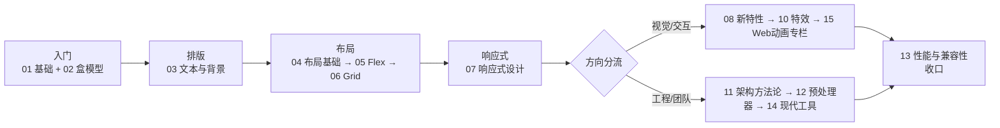

# CSS概览

本模块系统整理 CSS 从语言基础到工程实践的全部内容：**15 个子目录、6 大主题分组、121 篇文档**，覆盖选择器与盒模型、Flex/Grid 布局、响应式设计、动画特效、Sass/Less 预处理器、BEM 等架构方法论，以及 CSS Modules、Tailwind 等现代工具。

> **文档状态**：121 篇全部可路由访问。视觉与动效内容占比最高（48 篇，其中《15-Web动画》为完整专栏 37 篇），基础与布局为核心主线，工程化内容集中在架构方法论与性能兼容两个子目录。

## 分组索引总表

| 分组 | 子目录 | 篇数 | 主线 |
|---|---|---|---|
| 基础 | 01-CSS基础 / 02-盒模型 / 03-文本与背景 / 09-CSS变量与函数 | 25 | 语言机制与样式的最小完备集 |
| 布局 | 04-布局基础 / 05-Flex布局 / 06-Grid布局 | 19 | 从 display 到现代二维布局 |
| 响应式 | 07-响应式设计 | 9 | 媒体查询、容器查询与移动端适配 |
| 视觉效果 | 08-CSS3新特性 / 10-特效与动画 / 15-Web动画 | 48 | 过渡、变换、动画体系与 Web Animations |
| 预处理器 | 12-CSS预处理器 | 6 | Sass / Less 与后处理 |
| 架构方法论 | 11-CSS架构方法论 / 13-性能与兼容性 / 14-现代CSS工具 | 14 | 组织方式、性能与工程方案 |

## 一、基础（25 篇）

### 01-CSS基础（6 篇）

- [01-概述](/docs/css/01-CSS基础/01-概述) — CSS 是什么、如何加载与层叠思想
- [02-选择器](/docs/css/01-CSS基础/02-选择器) — 类型/类/ID/属性/组合选择器
- [03-优先级与继承](/docs/css/01-CSS基础/03-优先级与继承) — 特异性计算、层叠规则、继承链
- [04-属性与值](/docs/css/01-CSS基础/04-属性与值) — 属性语法、关键字、全局值
- [05-长度单位](/docs/css/01-CSS基础/05-长度单位) — px/em/rem/vw/vh 等单位换算
- [06-现代选择器](/docs/css/01-CSS基础/06-现代选择器) — `:is()`、`:has()`、`:where()` 等

### 02-盒模型（4 篇）

- [01-盒模型](/docs/css/02-盒模型/01-盒模型) — content/padding/border/margin 结构
- [02-margin与padding](/docs/css/02-盒模型/02-margin与padding) — 间距语义、外边距合并
- [03-border边框](/docs/css/02-盒模型/03-border边框) — 边框样式、圆角、轮廓
- [04-尺寸与溢出](/docs/css/02-盒模型/04-尺寸与溢出) — box-sizing、overflow、min/max

### 03-文本与背景（10 篇）

- [01-字体属性](/docs/css/03-文本与背景/01-字体属性) — font-family/size/weight、Web Fonts
- [02-文本属性](/docs/css/03-文本与背景/02-文本属性) — 行高、对齐、装饰、溢出省略
- [03-背景属性（导读至原理）](/docs/css/03-文本与背景/03-背景属性/01-导读与背景与动机至深入原理) / [代码示例](/docs/css/03-文本与背景/03-背景属性/02-代码示例) / [最佳实践至参考](/docs/css/03-文本与背景/03-背景属性/03-最佳实践至参考资源)
- [04-渐变](/docs/css/03-文本与背景/04-渐变) — linear/radial/conic-gradient
- [05-遮罩mask](/docs/css/03-文本与背景/05-遮罩mask) — mask-image、蒙层合成
- [06-现代色彩](/docs/css/03-文本与背景/06-现代色彩) — Display-P3、oklch、color-mix()
- [08-现代排版](/docs/css/03-文本与背景/08-现代排版) — 可变字体、text-wrap、hyphens
- [09-图像处理](/docs/css/03-文本与背景/09-图像处理) — object-fit、image-set
- [10-CSS Shapes](/docs/css/03-文本与背景/10-CSS%20Shapes) — shape-outside 文本环绕

### 09-CSS变量与函数（5 篇）

- [01-CSS变量](/docs/css/09-CSS变量与函数/01-CSS变量) — 自定义属性、作用域与主题化
- [02-calc函数](/docs/css/09-CSS变量与函数/02-calc函数) — 数值计算、与变量配合
- [03-其他函数（上）](/docs/css/09-CSS变量与函数/03-其他函数-上) / [（下）](/docs/css/09-CSS变量与函数/03-其他函数-下) — min/max/clamp、attr、计数等
- [04-自定义属性实践](/docs/css/09-CSS变量与函数/04-自定义属性实践) — 设计令牌、动态主题
- [05-三角函数](/docs/css/09-CSS变量与函数/05-三角函数) — sin/cos/atan2 在布局中的应用

## 二、布局（19 篇）

### 04-布局基础（9 篇）

- [01-display属性](/docs/css/04-布局基础/01-display属性) — 内/外显示类型、双值语法
- [02-position定位](/docs/css/04-布局基础/02-position定位) — static/fixed/sticky 全解
- [03-float浮动](/docs/css/04-布局基础/03-float浮动) — 浮动原理与清除（历史篇）
- [04-CSS逻辑属性详解](/docs/css/04-布局基础/04-CSS逻辑属性详解) — margin-inline 等逻辑方向
- [05-锚点定位](/docs/css/04-布局基础/05-锚点定位) — Anchor Positioning 弹出层
- [06-Web布局演进](/docs/css/04-布局基础/06-Web布局演进) — 表格/浮动/定位到 Flex/Grid
- [07-布局术语体系](/docs/css/04-布局基础/07-布局术语体系) — 格式化上下文等概念地图
- [11-表格布局](/docs/css/04-布局基础/11-表格布局) — display: table 场景
- [12-CSS布局精髓](/docs/css/04-布局基础/12-CSS布局精髓) — 布局决策框架总结

### 05-Flex布局（3 篇）

- [01-Flex布局](/docs/css/05-Flex布局/01-Flex布局) — 容器/项目属性入门
- [02-flex计算原理](/docs/css/05-Flex布局/02-flex计算原理) — flex-basis 收缩/扩展算法
- [03-Flex经典布局](/docs/css/05-Flex布局/03-Flex经典布局) — 圣杯、 sticky footer 等

### 06-Grid布局（7 篇）

- [01-Grid概述](/docs/css/06-Grid布局/01-Grid概述) — 二维网格心智模型
- [02-容器属性](/docs/css/06-Grid布局/02-容器属性) — template/area/gap
- [03-项目属性](/docs/css/06-Grid布局/03-项目属性) — placement 与对齐
- [04-Grid实战案例](/docs/css/06-Grid布局/04-Grid实战案例) — 页面骨架与卡片网格
- [05-Masonry布局](/docs/css/06-Grid布局/05-Masonry布局) — 原生瀑布流
- [06-子网格subgrid](/docs/css/06-Grid布局/06-子网格subgrid) — 嵌套网格对齐
- [07-Grid创意布局](/docs/css/06-Grid布局/07-Grid创意布局) — 重叠/非常规版式

## 三、响应式（9 篇）

### 07-响应式设计（9 篇）

- [01-媒体查询](/docs/css/07-响应式设计/01-媒体查询) — 断点策略、range 语法
- [02-移动端适配](/docs/css/07-响应式设计/02-移动端适配) — viewport、rem 方案、安全区
- [03-响应式布局方案](/docs/css/07-响应式设计/03-响应式布局方案) — 多栏切换、组件级响应
- [04-容器查询](/docs/css/07-响应式设计/04-容器查询) — container queries 组件响应式
- [05-移动端实践](/docs/css/07-响应式设计/05-移动端实践) — 触控目标、键盘适配
- [06-特性检测与渐进增强](/docs/css/07-响应式设计/06-特性检测与渐进增强) — @supports 策略
- [07-内在Web设计](/docs/css/07-响应式设计/07-内在Web设计) — 流式与内在设计思想
- [09-滚动捕捉与平滑滚动](/docs/css/07-响应式设计/09-滚动捕捉与平滑滚动) — scroll-snap
- [11-禁止用户缩放页面](/docs/css/07-响应式设计/11-禁止用户缩放页面) — 缩放禁令与可访问性权衡

## 四、视觉效果（48 篇）

### 08-CSS3新特性（8 篇）

- [01-圆角与阴影](/docs/css/08-CSS3新特性/01-圆角与阴影)、[02-过渡](/docs/css/08-CSS3新特性/02-过渡)、[03-变换](/docs/css/08-CSS3新特性/03-变换)、[04-动画](/docs/css/08-CSS3新特性/04-动画) — 视觉动效四件套
- [05-滤镜](/docs/css/08-CSS3新特性/05-滤镜) — filter、backdrop-filter
- [06-现代CSS特性](/docs/css/08-CSS3新特性/06-现代CSS特性) — 新近特性总览
- [07-表单控件样式](/docs/css/08-CSS3新特性/07-表单控件样式)、[08-用户界面属性](/docs/css/08-CSS3新特性/08-用户界面属性) — 交互控件外观

### 10-特效与动画（3 篇）

- [00-变形转换速查](/docs/css/10-特效与动画/00-变形转换速查) — transform 速查表
- [04-动画库介绍](/docs/css/10-特效与动画/04-动画库介绍) — 主流动效库对比
- [08-纯CSS实现的Loading效果](/docs/css/10-特效与动画/08-纯CSS实现的Loading效果) — 实用案例集

### 15-Web动画（37 篇，完整专栏）

- 入门主线：[01-基础](/docs/css/15-Web动画/01-Web%20动画基础) → [02-基本原理](/docs/css/15-Web动画/02-Web%20动画基本原理) → [03-设计原则](/docs/css/15-Web动画/03-流畅之美：掌握%20Web%20动画设计原则) → [04-CSS 动画基础](/docs/css/15-Web动画/04-CSS%20动画基础：如何让网页更生动)
- 关键机制：[05-帧动画与过渡](/docs/css/15-Web动画/05-帧动画与过渡动画：谁更适合你的业务场景)、[07-@keyframes 解析](/docs/css/15-Web动画/07-你所不知道的%20@keyframes：剖析%20CSS%20帧动画)、[08~11-缓动函数系列](/docs/css/15-Web动画/08-CSS%20缓动函数基础：为%20Web%20动画注入灵魂)（含 cubic-bezier/steps/linear）
- 进阶控制：[12~16-时长/播放/填充/方向/合成](/docs/css/15-Web动画/12-深入了解%20CSS%20动画的持续时间和延迟时间)、[17~18-数学与路径动画](/docs/css/15-Web动画/17-数学的魔法：探索数学在动画中的应用)
- 现代能力：[19-视图过渡](/docs/css/15-Web动画/19-使用%20CSS%20视图过渡创造流畅的界面动效)、[20-滚动驱动动效](/docs/css/15-Web动画/20-CSS%20滚动驱动动效的艺术)、[27~30-Web Animations API 系列](/docs/css/15-Web动画/27-初探%20Web%20Animations%20API)
- SVG 动画：[31~35-从入门到综合案例](/docs/css/15-Web动画/31-SVG%20动画基础入门)
- 收尾：[36-开发流程](/docs/css/15-Web动画/36-无缝创造：深入探讨%20Web%20动画的开发流程)、[37-最佳动画库](/docs/css/15-Web动画/37-精通%20Web%20动画：探索最佳%20Web%20动画库)；调试与可访问性见 [22](/docs/css/15-Web动画/22-探索动画中的JavaScript事件)、[23](/docs/css/15-Web动画/23-提升可访问性动画的关键技巧)、[24](/docs/css/15-Web动画/24-深度解析动画调试的精髓)

## 五、预处理器（6 篇）

### 12-CSS预处理器（6 篇）

- [01-预处理器概述](/docs/css/12-CSS预处理器/01-预处理器概述) — 解决什么问题、编译流程
- [02-Sass基础](/docs/css/12-CSS预处理器/02-Sass基础) — 嵌套、变量、mixin
- [03-Sass进阶](/docs/css/12-CSS预处理器/03-Sass进阶) — @use 模块化、函数、控制指令
- [04-Less基础](/docs/css/12-CSS预处理器/04-Less基础) — Less 语法与差异
- [05-预处理器对比](/docs/css/12-CSS预处理器/05-预处理器对比) — Sass vs Less vs Stylus
- [06-手写CSS预处理器](/docs/css/12-CSS预处理器/06-手写CSS预处理器) — 编译原理实践

## 六、架构方法论与工程实践（14 篇）

### 11-CSS架构方法论（6 篇）

- [01-BEM命名](/docs/css/11-CSS架构方法论/01-BEM命名) — block-element-modifier 规范
- [02-SMACSS](/docs/css/11-CSS架构方法论/02-SMACSS) — 五类样式分层
- [03-OOCSS](/docs/css/11-CSS架构方法论/03-OOCSS) — 结构与皮肤分离
- [04-CSS最佳实践](/docs/css/11-CSS架构方法论/04-CSS最佳实践) — 团队级写作规范
- [05-级联层](/docs/css/11-CSS架构方法论/05-级联层) — @layer 管理优先级
- [06-管理CSS代码](/docs/css/11-CSS架构方法论/06-管理CSS代码) — 大型项目组织策略

### 13-性能与兼容性（4 篇）

- [01-CSS性能优化](/docs/css/13-性能与兼容性/01-CSS性能优化) — 关键 CSS、重排重绘、contain
- [02-浏览器兼容性](/docs/css/13-性能与兼容性/02-浏览器兼容性) — 兼容策略与基线
- [03-CSS Hack](/docs/css/13-性能与兼容性/03-CSS%20Hack) — 历史手法与边界
- [04-渐进增强与优雅降级](/docs/css/13-性能与兼容性/04-渐进增强与优雅降级) — 双向兼容思想

### 14-现代CSS工具（4 篇）

- [01-CSS Modules](/docs/css/14-现代CSS工具/01-CSS%20Modules) — 局部作用域方案
- [02-CSS-in-JS](/docs/css/14-现代CSS工具/02-CSS-in-JS) — styled-components 等
- [03-Tailwind CSS](/docs/css/14-现代CSS工具/03-Tailwind%20CSS) — 原子化方案
- [04-CSS框架对比](/docs/css/14-现代CSS工具/04-CSS框架对比) — 方案选型矩阵

## 学习路径建议

- **零基础（2~3 周）**：01 → 02 → 03 → 04 → 05，完成一个静态页面即可验证掌握；05 后直接学 06 会更顺畅。
- **进阶布局（1~2 周）**：06 Grid 全部 + 07 响应式设计，重点吃透 `04-容器查询` 与 `12-CSS布局精髓` 的决策框架。
- **动效方向**：15-Web动画 是完整专栏，建议按 01→05→07→08→19→27 顺序走主线，缓动函数（08~11）是区分"会动"与"动得好"的分水岭。
- **工程方向**：11 架构方法论 + 12 预处理器先于 14 现代工具——理解了 BEM/@layer 与 Sass，才能判断 Tailwind 与 CSS-in-JS 适合哪个团队。
- **查漏补缺**：09 变量与函数适合随时穿插阅读，`04-自定义属性实践` 是现代主题系统的地基。

## 选型速查

| 场景 | 推荐 | 理由 | 参考篇目 |
|---|---|---|---|
| 一维排列（导航/列表/表单行） | Flex | 单向分布与对齐最自然 | 05-Flex布局 |
| 二维骨架（页面/仪表盘） | Grid | 行列同时定义，模板化清晰 | 06-Grid布局 |
| 组件内部随容器变化 | 容器查询 | 断点属于组件而非视口 | 07/04-容器查询 |
| 微交互（hover/焦点） | transition | 简单状态切换，声明式 | 08/02-过渡 |
| 多关键帧序列 | @keyframes + animation | 循环、暂停、方向可控 | 15/07-@keyframes 解析 |
| 需要 JS 联动/精确控制 | Web Animations API | 时序编排、播放控制、合成 | 15/27~30 WAAPI 系列 |
| 页面级转场 | View Transitions | 跨视图状态过渡标准化 | 15/19-视图过渡 |
| 变量/主题/嵌套 | Sass + PostCSS | 模块化与生态后处理成熟 | 12/02、12/03 |
| 局部作用域 | CSS Modules / Vue scoped | 零运行时、构建期隔离 | 14/01 |
| 快速原型/设计系统 | Tailwind CSS | 约束统一的原子类 | 14/03 |
| 大型团队规范 | BEM + @layer 分层 | 命名可预测 + 优先级可控 | 11/01、11/05 |

## 跨目录延伸

- HTML 结构与语义是布局的地基：[/docs/html5](/docs/html5)
- JS 驱动的动画与事件：[/docs/javascript](/docs/javascript)
- 组件库与样式的工程化落点（设计令牌、主题系统）：[/docs/frontend-toolchain](/docs/frontend-toolchain)
- 组件样式源码实例：[/docs/xiaoye-ui-column](/docs/xiaoye-ui-column) 与 [/docs/component-column](/docs/component-column)
