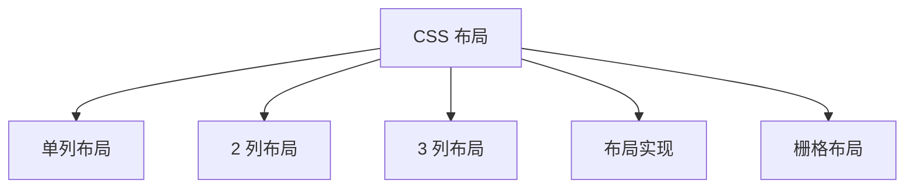

# 掌握 CSS 精髓：布局

## 概念说明

CSS 虽然初衷是用来美化 HTML 文档的,但随着 float、position 等属性的出现,它已经可以起到调整文档渲染结构的作用;而随着弹性盒子以及网格布局的推出,CSS 承担着越来越重要的布局功能。渐渐地,HTML 标签决定了页面的逻辑结构,而 CSS 决定了页面的视觉结构。

通常提到的布局有两个共同点:

- 大多数用于 PC 端,因为 PC 端屏幕像素宽度够大,可布局的空间也大;
- 布局是有限空间内的元素排列方式,因为页面设计横向不滚动、纵向无限延伸,所以大多数时候讨论的布局都是对水平方向进行分割。

讨论布局时,通常会把网页上特定的区域进行分列操作。按照分列数目,可以大致分为 3 类:单列布局、2 列布局、3 列布局。

## 核心要点

- 单列布局:一个元素作为布局容器,通常设置较小的(最大)宽度保证不同屏幕下显示一致;优点是适配性强,缺点是宽屏下两侧空白冗余。
- 2 列布局:页面分割成左右宽度不等的两列,窄列固定宽度、宽列撑满剩余空间;适用于内容有明显主次关系的网页(文档站、后台管理)。
- 3 列布局:按左中右顺序排列,通常中间列最宽;主次关系层次比 2 列布局多一层。
- 2 列/3 列布局的通用实现步骤可归纳为 5 步:主容器写在前面 → 水平排列 → 设置宽度(次要固定、主要撑满) → 消除副作用(如浮动高度塌陷) → 媒体查询优化窄屏。
- 使用浮动实现 3 列布局即经典的"圣杯布局",标准圣杯布局没有媒体查询。
- 垂直方向典型布局是 sticky footer:上、下部分固定高度,中间部分高度不定;首选 flex 或 grid 实现,兼容旧浏览器可用负 margin 方案。
- 栅格系统 12 列的依据是 12 的约数多(1、2、3、4、6、12),可实现多种等分与比例;24 列是为了满足宽屏下更多等分需求(如 8 等分),同时兼容 12 列的等分比例。

## 常见布局分类

### 单列布局

单列布局是最常用的一种布局,实现效果是将一个元素作为布局容器,通常设置一个较小的(最大)宽度来保证不同像素宽度屏幕下显示一致。

**示例网站**

某招聘网站首页,蓝色区域为布局容器,水平居中对齐,宽度 1260px:


谷歌搜索,蓝色区域为布局容器,水平左对齐,宽度 652px:


一些网站会将单列布局与其他布局方式混合使用,比如某招聘网站首页的海报和左侧标签就使用了 2 列布局,这样既能向下兼容窄屏幕,又能按照主次关系显示页面内容。

这种布局的优势在于基本可以适配超过布局容器宽度的各种显示屏幕。例如上面示例网站的布局容器宽度为 1260px,超过 1260px 宽度的显示屏幕上浏览网站看到的效果是一致的。

但它最大的缺点也源于此:过度的冗余设计必然带来浪费。在上述例子中,屏幕宽度足够显示更多内容,页面两侧却出现大量空白区域;在 4K 甚至更宽的屏幕下,空白区域大小会超过页面内容区域大小。

### 2 列布局

2 列布局使用频率也非常高,实现效果是将页面分割成左右宽度不等的两列:宽度较小的列设置为固定宽度,剩余宽度由另一列撑满。为描述方便,宽度较小的列的父元素称为次要布局容器,宽度较大的列的父元素称为主要布局容器。

**示例网站**

Ant Design 文档,蓝色区域为主要内容布局容器,侧边栏为次要内容布局容器。


这种布局适用于内容上具有明显主次关系的网页,比如 API 文档页面中左侧显示内容导航、右侧显示文档描述;又比如后台管理系统中左侧显示菜单栏、右侧显示配置页面。相对于单列布局,它在屏幕宽度适配方面处理得更好:屏幕宽度不够时,主要内容布局容器优先显示,次要内容布局容器改为垂直方向显示或隐藏。有时它也会和单列布局搭配使用,作为单列布局中的子布局。

### 3 列布局

3 列布局按照左中右的顺序进行排列,通常中间列最宽,左右两列次之。

**示例网站**

登录 GitHub 后,蓝色区域为宽度最大的中间列:


CSDN 首页,这是 3 列布局的第二种实现方式,蓝色部分就是 2 列布局的主要布局容器,而它的子元素又使用了 2 列布局:


3 列布局和 2 列布局类似,也有明确的主次关系,只是关系层次增加了一层。

## 布局实现的通用步骤

单列布局没有太多技术难点:将布局容器设置(最大)宽度、左右边距为 `auto` 即可。重点讨论 2 列和 3 列布局。网上可以找到很多实现方式,但不需要逐一记忆——通过归纳法找到这些方式的共同实现步骤,记住步骤就能举一反三。

实现 2 列布局或 3 列布局,可以按照下面的步骤操作:

1. 为了保证主要布局容器优先级,应将主要布局容器写在次要布局容器之前;
2. 将布局容器进行水平排列;
3. 设置宽度,即次要容器宽度固定,主要容器撑满;
4. 消除布局方式的副作用,如浮动造成的高度塌陷;
5. 为了在窄屏下也能正常显示,可以通过媒体查询进行优化。

### 2 列布局实现(flex)

**第 1 步**,写好 HTML 结构。为查看方便,给布局容器设置背景颜色和高度:

```html
<style>
  /* 为了方便查看，给布局容器设置高度和颜色 */
  main,aside {
    height: 100px;
  }
  main {
    background-color: #f09e5a;
  }
  aside {
    background-color: #c295cf;
  }
</style>
<div>
  <main>主要布局容器</main>
  <aside>次要布局容器</aside>
</div>
```


**第 2 步**,将布局容器水平排列:

```html
<style>
  .wrap {
    display: flex;
    flex-direction: row-reverse;
  }
  .main {
    flex: 1;
  }
  .aside {
    flex: 1;
  }
</style>
<div class="wrap">
  <main class="main">主要布局容器</main>
  <aside class="aside">次要布局容器</aside>
</div>
```


**第 3 步**,调整布局容器宽度:

```html
<style>
  .wrap {
    display: flex;
    flex-direction: row-reverse;
  }
  .main {
    flex: 1;
  }
  .aside {
    width: 200px;
  }
</style>
<div class="wrap">
  <main class="main">主要布局容器</main>
  <aside class="aside">次要布局容器</aside>
</div>
```


**第 4 步**,消除副作用,比如浮动造成的高度塌陷。由于使用 flex 布局没有副作用,所以不需要修改,代码和效果图同第 3 步:


**第 5 步**,增加媒体查询:

```html
<style>
  .wrap {
    display: flex;
    flex-direction: row-reverse;
    flex-wrap: wrap;
  }
  .main {
    flex: 1;
  }
  .aside {
    width: 200px;
  }
  @media only screen and (max-width: 1000px) {
    .wrap {
      flex-direction: row;
    }
    .main {
      flex: 100%;
    }
  }
</style>
<div class="wrap">
  <main class="main">主要布局容器</main>
  <aside class="aside">次要布局容器</aside>
</div>
```


### 3 列布局实现(圣杯布局)

下面是一个更复杂的 3 列布局例子。

**第 1 步**,写好 HTML 结构,为辨认方便,给布局容器设置背景色和高度:

```html
<style>
  /* 为了方便查看，给布局容器设置高度和颜色 */
  .main, .left, .right {
    height: 100px;
  }
  .main {
    background-color: red;
  }
  .left {
    background-color: green;
  }
  .right {
    background-color: blue;
  }
</style>
<div class="wrap">
  <main class="main">main</main>
  <aside class="left">left</aside>
  <aside class="right">right</aside>
</div>
```


**第 2 步**,让布局容器水平排列:

```html
<style>
  .main, .left, .right {
    float: left;
  }
</style>
<div class="wrap">
  <main class="main">main</main>
  <aside class="left">left</aside>
  <aside class="right">right</aside>
</div>
```


**第 3 步**,调整宽度:将主要布局容器 main 撑满,次要布局容器 left 固定 300px,次要布局容器 right 固定 200px。

如果直接设置,布局容器 left 和 right 都会换行,所以需要通过设置父元素 wrap 的内边距压缩主要布局 main,给次要布局容器留出空间;同时通过设置次要布局容器边距以及相对定位,将次要布局容器调整至两侧:

```html
<style>
  .main, .left, .right {
    float: left;
  }
  .wrap {
    padding: 0 200px 0 300px;
  }
  .main {
    width: 100%;
  }
  .left {
    width: 300px;
    position: relative;
    left: -300px;
    margin-left: -100%;
  }
  .right {
    position: relative;
    width: 200px;
    margin-left: -200px;
    right: -200px;
  }
</style>
<div class="wrap">
  <main class="main">main</main>
  <aside class="left">left</aside>
  <aside class="right">right</aside>
</div>
```


**第 4 步**,消除副作用。使用浮动会造成高度塌陷:如果在父元素后面添加新的元素就会产生这个问题。所以可以通过伪类来清除浮动;同时减小页面宽度,还会发现次要布局容器 left 和 right 都换行了,这个副作用可以在第 5 步消除:

```html
<style>
  .main, .left, .right {
    float: left;
  }
  .wrap {
    padding: 0 200px 0 300px;
  }
  .wrap::after {
    content: '';
    display: block;
    clear: both;
  }
  .main {
    width: 100%;
  }
  .left {
    width: 300px;
    position: relative;
    left: -300px;
    margin-left: -100%;
  }
  .right {
    position: relative;
    width: 200px;
    margin-left: -200px;
    right: -200px;
  }
</style>
<div class="wrap">
  <main class="main">main</main>
  <aside class="left">left</aside>
  <aside class="right">right</aside>
</div>
```


**第 5 步**,利用媒体查询调整页面宽度较小情况下的显示优先级。这里仍然希望优先显示主要布局容器 main,其次是次要布局容器 left,最后是布局容器 right:

```html
<style>
  .main, .left, .right {
    float: left;
  }
  .wrap {
    padding: 0 200px 0 300px;
  }
  .wrap::after {
    content: '';
    display: block;
    clear: both;
  }
  .main {
    width: 100%;
  }
  .left {
    width: 300px;
    position: relative;
    left: -300px;
    margin-left: -100%;
  }
  .right {
    position: relative;
    width: 200px;
    margin-left: -200px;
    right: -200px;
  }
  @media only screen and (max-width: 1000px) {
    .wrap {
      padding: 0;
    }
    .left {
      left: 0;
      margin-left: 0;
    }
    .right {
      margin-left: 0;
      right: 0;
    }
  }
</style>
<div class="wrap">
  <main class="main">main</main>
  <aside class="left">left</aside>
  <aside class="right">right</aside>
</div>
```


这种 3 列布局的实现,就是流传已久的"圣杯布局",但标准的圣杯布局没有添加媒体查询。

## 延伸 1:垂直方向的布局

垂直方向有一种布局虽然使用频率不如水平方向布局高,但在面试中很容易被问到。这种布局将页面分成上、中、下三个部分:上、下部分都为固定高度,中间部分高度不定。当页面高度小于浏览器高度时,下部分应固定在屏幕底部;当页面高度超出浏览器高度时,下部分应该随中间部分被撑开,显示在页面最底部。

这种布局也称之为 sticky footer,意思是下部分粘黏在屏幕底部。实现这个功能最简单的方式是使用 flex 或 grid 进行布局。下面是使用 flex 的主要代码:

```html
<style>
  .container {
    display: flex;
    height: 100%;
    flex-direction: column;
  }
  header, footer {
    min-height: 100px;
  }
  main {
    flex: 1;
  }
</style>
<div class="container">
  <header></header>
  <main>
      <div>...</div>
  </main>
  <footer></footer>
</div>
```

代码实现思路比较简单:将布局容器的父元素 `display` 属性设置成 `flex`,伸缩方向改为垂直方向,高度撑满页面,再将中间布局容器的 `flex` 属性设置为 `1`,让其自适应即可。

如果要考虑兼容性,实现起来要复杂些,下面是主要代码:

```html
<style>
  .container {
    box-sizing: border-box;
    min-height: 100vh;
    padding-bottom: 100px;
  }
  header, footer {
    height: 100px;
  }
  footer {
    margin-top: -100px;
  }
</style>
<div class="container">
  <header></header>
  <main></main>
</div>
<footer></footer>
```

将上部分布局容器与中间布局容器放入一个共同的父元素中,并让父元素高度撑满;然后设置内下边距给下部分布局容器预留空间;下部分布局容器设置上外边距"嵌入"父元素中,从而实现随着中间布局容器高度而被撑开的效果。

## 延伸 2:框架中栅格布局的列数

很多 UI 框架都提供了栅格系统来帮助页面实现等分或等比布局,比如 Bootstrap 提供了 12 列栅格,Element UI 和 Ant Design 提供了 24 列栅格。

栅格系统设定这些列数背后是有原因的。

先从 12 列说起。12 这个数字,从数学上来说它具有很多约数 1、2、3、4、6、12,也就是说可以轻松实现 1 等分、2 等分、3 等分、4 等分、6 等分、12 等分;比例方面可以实现 1:11、1:5、1:3、1:2、1:1、1:10:1、1:4:1 等。如果换成 10 或 8,可实现的等分比例就会少很多;更大的 16 似乎是个不错的选择,但对常用的 3 等分就难以实现。

至于使用 24 列而不是 12 列,可能是考虑宽屏幕(PC 端屏幕宽度不断增加)下 12 列难以满足等分比例需求,比如 8 等分;同时又能够保证兼容 12 列情况下的等分比例(方便项目迁移和替换)。

## 小结

以上内容覆盖了几种常见布局,包括单列、2 列、3 列及垂直三栏布局,同时分析了每种布局的优缺点和使用场景,并将 2 列布局和 3 列布局的实现方法归纳成 5 个步骤,可以举一反三应用到实际工作中。

[示例代码下载](https://github.com/yalishizhude/course/tree/master/04)。

除此之外,实现 2 列或 3 列布局还有其他可行方案,感兴趣的读者可以自行探索。

---


