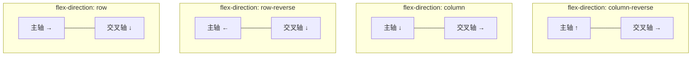
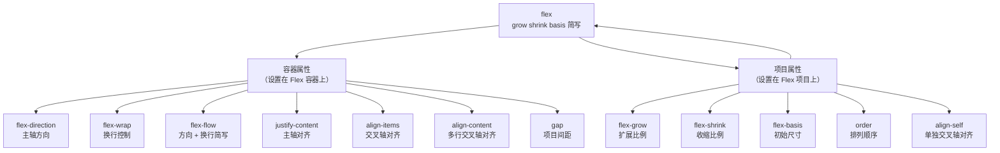

# Flex 布局总览

> Flexbox 是 CSS 的一维弹性布局模型，通过容器与项目的双轴协作，让空间分配与对齐从"手动计算"变为"声明式驱动"。

## 核心概念

### Flex 容器与项目

Flex 布局的核心模型是 **容器-项目** 二层结构。当一个元素的 `display` 设为 `flex` 或 `inline-flex` 时，它成为 **Flex 容器**，其所有直接子元素自动成为 **Flex 项目**。

```css
/* 块级 Flex 容器：独占一行 */
.container {
  display: flex;
}

/* 行内 Flex 容器：宽度由内容撑开，可与其他行内元素并排 */
.inline-container {
  display: inline-flex;
}
```

理解容器与项目的关系需要牢记以下规则：

| 规则 | 说明 |
|------|------|
| 仅限直接子元素 | 只有容器的**直接子元素**才是 Flex 项目，孙级元素不受影响 |
| 匿名 Flex 项目 | 容器内的裸文本节点会被自动包装为匿名 Flex 项目 |
| 绝对定位例外 | 设置了 `position: absolute` 或 `fixed` 的子元素**脱离** Flex 布局，不参与伸缩与对齐 |
| 嵌套容器 | Flex 项目本身也可以是 Flex 容器，形成嵌套布局 |
| float 失效 | Flex 项目上的 `float` 和 `clear` 无效 |
| vertical-align 失效 | Flex 项目上的 `vertical-align` 无效 |
| 外边距不折叠 | Flex 项目之间的垂直外边距**不会折叠**（不同于普通流中的块级元素） |

### 主轴与交叉轴

Flex 布局基于 **双轴模型** 运作：主轴（Main Axis）决定项目的排列方向，交叉轴（Cross Axis）与主轴垂直，决定项目的对齐方式。所有对齐属性都围绕这两条轴定义，理解轴向是掌握 Flex 布局的前提。

**轴向术语**：

| 术语 | 含义 | 相关属性 |
|------|------|----------|
| main start / main end | 主轴起点 / 终点 | `justify-content`、`flex-grow` |
| cross start / cross end | 交叉轴起点 / 终点 | `align-items`、`align-content` |
| main size | 主轴方向尺寸 | `flex-basis`、`width`（row 时） |
| cross size | 交叉轴方向尺寸 | `height`（row 时） |

主轴方向由 `flex-direction` 决定，交叉轴始终与主轴垂直。不同 `flex-direction` 值下两轴的方向关系如下：



**关键认知**：`justify-content` 永远作用于主轴，`align-items` 永远作用于交叉轴——它们不关心轴是水平还是垂直。当 `flex-direction: column` 时，`justify-content` 控制的是垂直方向对齐，`align-items` 控制的是水平方向对齐。

## 容器属性详解

Flex 容器属性控制项目的排列方向、换行行为、对齐方式和间距。以下属性均设置在 Flex 容器上。

### flex-direction

`flex-direction` 决定主轴方向，即项目的排列方向。它是 Flex 布局中最基础的属性，直接影响所有对齐属性的作用方向。

| 值 | 主轴方向 | 交叉轴方向 | 说明 |
|----|---------|-----------|------|
| `row` | 水平 → | 垂直 ↓ | **默认值**，从左到右 |
| `row-reverse` | 水平 ← | 垂直 ↓ | 从右到左 |
| `column` | 垂直 ↓ | 水平 → | 从上到下 |
| `column-reverse` | 垂直 ↑ | 水平 → | 从下到上 |

```html
<div class="container row">A B C</div>
<div class="container col">A B C</div>
```

```css
.container {
  display: flex;
  gap: 10px;
  padding: 10px;
  border: 2px solid #1976d2;
  margin-bottom: 10px;
}

/* 水平排列（默认） */
.row {
  flex-direction: row;
}

/* 垂直排列 */
.col {
  flex-direction: column;
}
```

> **注意**：`row-reverse` 和 `column-reverse` 仅改变视觉排列方向，不改变 DOM 顺序。屏幕阅读器等辅助技术仍按 DOM 顺序读取内容。

### flex-wrap

`flex-wrap` 控制项目是否换行。默认情况下，Flex 项目会尽量挤在一行中，即使被压缩到小于内容宽度。

| 值 | 行为 |
|----|------|
| `nowrap` | **默认值**，不换行，项目被压缩以适应单行 |
| `wrap` | 换行，第一行在上方 |
| `wrap-reverse` | 换行，第一行在下方 |

```html
<div class="container">
  <div class="item">1</div>
  <div class="item">2</div>
  <div class="item">3</div>
  <div class="item">4</div>
  <div class="item">5</div>
</div>
```

```css
.container {
  display: flex;
  flex-wrap: wrap; /* 允许换行 */
  gap: 10px;
}

.item {
  /* 每个项目最小 200px，空间不足时自动换行 */
  flex: 1 1 200px;
  min-width: 0;
  height: 80px;
  background: #e3f2fd;
  border: 1px solid #1976d2;
}
```

> **要点**：`nowrap` 下项目会被压缩（受 `flex-shrink` 控制）；`wrap` 下项目不会被压缩，空间不足时自动折到下一行。需要响应式布局时，`flex-wrap: wrap` 配合 `flex-basis` 是常用模式。


#### flex-wrap 交互演示（MDN）

设置 flex 项目是否换行（nowrap/wrap/wrap-reverse）。

```html
<!-- 交互演示核心片段：把 snippets 中的声明逐条应用到 #example-element，观察效果差异 -->
<style>
  #example-element { border: 1px solid #c5c5c5; width: 80%; display: flex; }
  #example-element > div { background-color: rgba(0, 0, 255, 0.2); border: 3px solid blue; width: 60px; margin: 10px; }
</style>

<div class="transition-all" id="example-element">
  <div>Item One</div>
  <div>Item Two</div>
  <div>Item Three</div>
  <div>Item Four</div>
  <div>Item Five</div>
  <div>Item Six</div>
</div>

<script>
  const snippets = [
    `#example-element { flex-wrap: nowrap; }`,
    `#example-element { flex-wrap: wrap; }`,
    `#example-element { flex-wrap: wrap-reverse; }`,
  ];
  // 点击对应按钮 => styleEl.textContent = snippets[i]，并切换按钮高亮
</script>
```
### flex-flow

`flex-flow` 是 `flex-direction` 和 `flex-wrap` 的简写属性，默认值为 `row nowrap`。

```css
.container {
  display: flex;

  /* 完整写法：方向 + 换行 */
  flex-flow: row wrap;

  /* 等同于分开写 */
  /* flex-direction: row; */
  /* flex-wrap: wrap; */
}
```

`flex-flow` 的两个值可以互换顺序，浏览器会自动识别。实际开发中，如果方向为默认的 `row`，通常只写 `flex-wrap` 即可。

### justify-content

`justify-content` 控制项目在**主轴**上的对齐方式，决定剩余空间如何分配。这是使用频率最高的 Flex 属性之一。

| 值 | 对齐方式 | 首项目前间距 | 项目间间距 | 尾项目后间距 |
|----|---------|-------------|-----------|-------------|
| `flex-start` | 起点对齐 | 0 | 0 | 全部剩余 |
| `flex-end` | 终点对齐 | 全部剩余 | 0 | 0 |
| `center` | 居中对齐 | 剩余/2 | 0 | 剩余/2 |
| `space-between` | 两端对齐 | 0 | 剩余/(n-1) | 0 |
| `space-around` | 等距环绕 | 剩余/2n | 剩余/n | 剩余/2n |
| `space-evenly` | 均匀分布 | 剩余/(n+1) | 剩余/(n+1) | 剩余/(n+1) |

> n 为项目数量。当只有一个项目时，`space-between` 等同于 `flex-start`。

```html
<div class="container">
  <div class="item">A</div>
  <div class="item">B</div>
  <div class="item">C</div>
</div>
```

```css
.container {
  display: flex;
  justify-content: space-between; /* 两端对齐，项目间间距相等 */
  padding: 10px;
  border: 2px solid #1976d2;
}

.item {
  width: 80px;
  height: 40px;
  background: #e3f2fd;
  border: 1px solid #1976d2;
  display: flex;
  justify-content: center;
  align-items: center;
}
```

> **注意**：`justify-content` 仅在有剩余空间时生效。如果项目设置了 `flex-grow` 占满了主轴，或项目总宽度已超出容器，则对齐效果不可见。


#### justify-content 交互演示（MDN）

设置 flex/grid 容器主轴方向项目的对齐与分布方式。

```html
<!-- 交互演示核心片段：把 snippets 中的声明逐条应用到 #example-element，观察效果差异 -->
<style>
  #example-element { border: 1px solid #c5c5c5; width: 220px; display: grid; grid-template-columns: 60px 60px; grid-auto-rows: 40px; row-gap: 10px; }
  #example-element > div { background-color: rgba(0, 0, 255, 0.2); border: 3px solid blue; }
</style>

<div class="example-container">
  <div class="transition-all" id="example-element">
    <div>One</div>
    <div>Two</div>
    <div>Three</div>
  </div>
</div>

<script>
  const snippets = [
    `#example-element { justify-content: start; }`,
    `#example-element { justify-content: center; }`,
    `#example-element { justify-content: space-between; }`,
    `#example-element { justify-content: space-around; }`,
    `#example-element { justify-content: space-evenly; }`,
  ];
  // 点击对应按钮 => styleEl.textContent = snippets[i]，并切换按钮高亮
</script>
```
### align-items

`align-items` 控制项目在**交叉轴**上的对齐方式。当 `flex-direction: row` 时，它控制垂直对齐；当 `flex-direction: column` 时，它控制水平对齐。

| 值 | 行为 |
|----|------|
| `stretch` | **默认值**，拉伸填满容器交叉轴方向（需项目未设置交叉轴尺寸） |
| `flex-start` | 交叉轴起点对齐 |
| `flex-end` | 交叉轴终点对齐 |
| `center` | 交叉轴居中对齐 |
| `baseline` | 项目的文本基线对齐 |

```html
<div class="container">
  <div class="item tall">A</div>
  <div class="item">B</div>
  <div class="item small">C</div>
</div>
```

```css
.container {
  display: flex;
  align-items: center; /* 交叉轴居中 */
  height: 200px;
  border: 2px solid #1976d2;
}

.item {
  width: 80px;
  background: #e3f2fd;
  border: 1px solid #1976d2;
  display: flex;
  justify-content: center;
  align-items: center;
}

.tall { height: 120px; }
.small { height: 40px; }
```

> **`stretch` 的陷阱**：如果项目显式设置了交叉轴方向的尺寸（如 `height`），`stretch` 不会拉伸它。只有未设置尺寸时才会生效。这是初学者常遇到的"为什么 stretch 不生效"的原因。


#### align-items 交互演示（MDN）

设置 flex/grid 容器交叉轴方向项目的对齐方式。

```html
<!-- 交互演示核心片段：把 snippets 中的声明逐条应用到 #example-element，观察效果差异 -->
<style>
  #example-element { border: 1px solid #c5c5c5; display: grid; width: 200px; grid-template-columns: 1fr 1fr; grid-auto-rows: 80px; grid-gap: 10px; }
  #example-element > div { background-color: rgba(0, 0, 255, 0.2); border: 3px solid blue; }
</style>

<div class="example-container">
  <div class="transition-all" id="example-element">
    <div>One</div>
    <div>Two</div>
    <div>Three</div>
  </div>
</div>

<script>
  const snippets = [
    `#example-element { align-items: stretch; }`,
    `#example-element { align-items: center; }`,
    `#example-element { align-items: start; }`,
    `#example-element { align-items: end; }`,
  ];
  // 点击对应按钮 => styleEl.textContent = snippets[i]，并切换按钮高亮
</script>
```
### align-content

`align-content` 控制多行项目在交叉轴方向的整体对齐方式。**仅在 `flex-wrap: wrap` 且有多行时生效**，单行情况下无效。

| 值 | 行为 |
|----|------|
| `stretch` | **默认值**，各行拉伸填满交叉轴剩余空间 |
| `flex-start` | 所有行紧贴交叉轴起点 |
| `flex-end` | 所有行紧贴交叉轴终点 |
| `center` | 所有行在交叉轴居中 |
| `space-between` | 行间间距相等，首尾行紧贴容器边缘 |
| `space-around` | 每行两侧间距相等 |

```html
<div class="container">
  <div class="item">1</div>
  <div class="item">2</div>
  <div class="item">3</div>
  <div class="item">4</div>
  <div class="item">5</div>
  <div class="item">6</div>
</div>
```

```css
.container {
  display: flex;
  flex-wrap: wrap;           /* 必须允许换行 */
  align-content: space-between; /* 多行在交叉轴两端对齐 */
  height: 300px;             /* 容器必须有足够高度 */
  gap: 10px;
  border: 2px solid #1976d2;
}

.item {
  width: 120px;
  height: 60px;
  background: #e3f2fd;
  border: 1px solid #1976d2;
}
```

> **`align-content` 与 `align-items` 的区别**：`align-items` 控制单行内项目在交叉轴上的对齐；`align-content` 控制多行作为整体在交叉轴上的分布。两者可以同时使用，`align-content` 先决定行的位置，`align-items` 再决定行内项目的对齐。


#### align-content 交互演示（MDN）

设置多行 flex/grid 项目在交叉轴上的分布方式。

```html
<!-- 交互演示核心片段：把 snippets 中的声明逐条应用到 #example-element，观察效果差异 -->
<style>
  #example-element { border: 1px solid #c5c5c5; display: grid; grid-template-columns: 60px 60px; grid-auto-rows: 40px; column-gap: 10px; height: 180px; }
  #example-element > div { background-color: rgba(0, 0, 255, 0.2); border: 3px solid blue; }
</style>

<div class="example-container">
  <div class="transition-all" id="example-element">
    <div>One</div>
    <div>Two</div>
    <div>Three</div>
  </div>
</div>

<script>
  const snippets = [
    `#example-element { align-content: start; }`,
    `#example-element { align-content: center; }`,
    `#example-element { align-content: space-between; }`,
    `#example-element { align-content: space-around; }`,
  ];
  // 点击对应按钮 => styleEl.textContent = snippets[i]，并切换按钮高亮
</script>
```
### gap

`gap` 属性控制 Flex 项目之间的间距，是替代传统 margin 方案的现代方式。它只作用于项目之间，不会在容器边缘产生间距。

| 属性 | 说明 |
|------|------|
| `gap` | 行间距和列间距的简写 |
| `row-gap` | 仅控制行间距（多行时生效） |
| `column-gap` | 仅控制列间距 |

```css
.container {
  display: flex;
  flex-wrap: wrap;

  /* 单值：行间距 = 列间距 */
  gap: 20px;

  /* 双值：行间距 列间距 */
  gap: 20px 30px;

  /* 也可以分别设置 */
  row-gap: 20px;
  column-gap: 30px;
}
```

```html
<div class="container">
  <div class="item">A</div>
  <div class="item">B</div>
  <div class="item">C</div>
  <div class="item">D</div>
</div>
```

```css
.container {
  display: flex;
  flex-wrap: wrap;
  gap: 16px; /* 项目间距 16px，不会在容器边缘产生间距 */
  padding: 16px;
  border: 2px solid #1976d2;
}

.item {
  flex: 1 1 150px;
  height: 80px;
  background: #e3f2fd;
  border: 1px solid #1976d2;
}
```

> **`gap` 与 `margin` 的核心区别**：`gap` 只在项目之间生效，首尾项目不会产生多余间距；`margin` 需要手动处理首尾元素的间距问题（如 `:last-child { margin-right: 0 }`）。优先使用 `gap`。


#### gap 交互演示（MDN）

设置 flex/grid 容器中项目之间的间距，可分别指定行距与列距。

```html
<!-- 交互演示核心片段：把 snippets 中的声明逐条应用到 #example-element，观察效果差异 -->
<div class="example-container">
  <div class="transition-all" id="example-element">
    <div>One</div>
    <div>Two</div>
    <div>Three</div>
    <div>Four</div>
    <div>Five</div>
  </div>
</div>

<script>
  const snippets = [
    `#example-element { gap: 0; }`,
    `#example-element { gap: 10%; }`,
    `#example-element { gap: 1em; }`,
    `#example-element { gap: 10px 20px; }`,
    `#example-element { gap: calc(20px + 10%); }`,
  ];
  // 点击对应按钮 => styleEl.textContent = snippets[i]，并切换按钮高亮
</script>
```

#### row-gap 交互演示（MDN）

设置多行布局中行与行之间的间距。

```html
<!-- 交互演示核心片段：把 snippets 中的声明逐条应用到 #example-element，观察效果差异 -->
<style>
  #example-element { border: 1px solid #c5c5c5; display: grid; grid-template-columns: 1fr 1fr; width: 200px; }
  #example-element > div { background-color: rgba(0, 0, 255, 0.2); border: 3px solid blue; }
</style>

<div class="example-container">
  <div class="transition-all" id="example-element">
    <div>One</div>
    <div>Two</div>
    <div>Three</div>
    <div>Four</div>
    <div>Five</div>
  </div>
</div>

<script>
  const snippets = [
    `#example-element { row-gap: 0; }`,
    `#example-element { row-gap: 1ch; }`,
    `#example-element { row-gap: 1em; }`,
    `#example-element { row-gap: 20px; }`,
  ];
  // 点击对应按钮 => styleEl.textContent = snippets[i]，并切换按钮高亮
</script>
```
## 项目属性详解

Flex 项目属性控制单个项目的伸缩行为、排列顺序和对齐覆盖。以下属性均设置在 Flex 项目上。

### flex-grow

`flex-grow` 定义项目的**扩展比例**，决定当容器有剩余空间时，项目如何瓜分多余的空间。默认值为 `0`，即不扩展。

- 值为 `0`：不扩展，保持原始尺寸
- 值为正整数：按比例瓜分剩余空间
- 值不支持负数

```html
<div class="container">
  <div class="item grow-1">A</div>
  <div class="item grow-2">B</div>
  <div class="item">C</div>
</div>
```

```css
.container {
  display: flex;
  border: 2px solid #1976d2;
}

.item {
  width: 80px;
  height: 40px;
  background: #e3f2fd;
  border: 1px solid #1976d2;
}

/* A 扩展比例 1，B 扩展比例 2，C 不扩展 */
/* 剩余空间按 1:2 分配给 A 和 B */
.grow-1 { flex-grow: 1; }
.grow-2 { flex-grow: 2; }
```

**计算方式**：假设容器剩余空间为 S，三个项目的 `flex-grow` 分别为 1、2、0，则 A 获得 S × 1/3 的额外空间，B 获得 S × 2/3 的额外空间，C 不获得。

> **注意**：`flex-grow` 分配的是**剩余空间**，不是容器的全部空间。剩余空间 = 容器主轴尺寸 - 所有项目的 `flex-basis` 之和。如果项目已经占满容器，`flex-grow` 不会生效。


#### flex-grow 交互演示（MDN）

设置 flex 项目在有剩余空间时的放大比例。

```html
<!-- 交互演示核心片段：把 snippets 中的声明逐条应用到 #example-element，观察效果差异 -->
<style>
  .default-example { border: 1px solid #c5c5c5; width: auto; max-height: 300px; display: flex; }
  .default-example > div { background-color: rgba(0, 0, 255, 0.2); border: 3px solid blue; margin: 10px; flex-grow: 1; flex-shrink: 1; flex-basis: 0; }
</style>

<div class="transition-all" id="example-element">I grow</div>
<div>Item Two</div>
<div>Item Three</div>

<script>
  const snippets = [
    `#example-element { flex-grow: 1; }`,
    `#example-element { flex-grow: 2; }`,
    `#example-element { flex-grow: 3; }`,
  ];
  // 点击对应按钮 => styleEl.textContent = snippets[i]，并切换按钮高亮
</script>
```
### flex-shrink

`flex-shrink` 定义项目的**收缩比例**，决定当项目总宽度超出容器时，各项目如何缩减尺寸。默认值为 `1`，即等比收缩。

- 值为 `0`：不收缩，保持原始尺寸
- 值为正整数：按比例收缩
- 值不支持负数

```html
<div class="container">
  <div class="item shrink-0">A</div>
  <div class="item">B</div>
  <div class="item">C</div>
</div>
```

```css
.container {
  display: flex;
  width: 300px; /* 容器宽度有限 */
  border: 2px solid #1976d2;
}

.item {
  width: 150px; /* 三个项目总宽 450px，超出容器 */
  height: 40px;
  background: #e3f2fd;
  border: 1px solid #1976d2;
}

/* A 不收缩，B 和 C 等比收缩 */
.shrink-0 { flex-shrink: 0; }
```

**计算方式**：收缩量的分配不仅看 `flex-shrink` 值，还要考虑项目的 `flex-basis`。具体公式为：项目收缩量 = 溢出空间 × (该项目的 shrink × basis) / (所有项目的 shrink × basis 之和)。这意味着尺寸较大的项目会收缩更多。

> **常见问题**：当项目内容（如长文本）撑开宽度导致溢出时，设置 `flex-shrink: 0` 可以阻止项目被压缩，但需要配合 `overflow: hidden` 或 `min-width: 0` 来处理溢出内容。

### flex-basis

`flex-basis` 定义项目在主轴上的**初始尺寸**，即浏览器在分配剩余空间之前所认定的项目大小。默认值为 `auto`。

| 值 | 行为 |
|----|------|
| `auto` | 使用项目的 `width`（或 `height`），若也未设置则由内容撑开 |
| `0` | 初始尺寸为 0，所有空间都作为剩余空间按 `flex-grow` 分配 |
| 具体长度 | 如 `200px`、`30%`，使用指定值 |

```html
<div class="container">
  <div class="item basis-200">A</div>
  <div class="item basis-auto">B</div>
  <div class="item basis-0">C</div>
</div>
```

```css
.container {
  display: flex;
  border: 2px solid #1976d2;
}

.item {
  height: 40px;
  flex-grow: 1; /* 都参与扩展 */
  background: #e3f2fd;
  border: 1px solid #1976d2;
}

/* 初始尺寸 200px，再参与扩展 */
.basis-200 { flex-basis: 200px; }

/* 初始尺寸由内容决定 */
.basis-auto { flex-basis: auto; }

/* 初始尺寸为 0，完全按 flex-grow 比例分配空间 */
.basis-0 { flex-basis: 0; }
```

> **`flex-basis` 与 `width` 的优先级**：在 Flex 布局中，`flex-basis` 的优先级高于 `width`（主轴为水平时）。当 `flex-basis` 为 `auto` 时，才会回退使用 `width`。但 `min-width` 和 `max-width` 始终有效，会约束 `flex-basis` 的计算结果。


#### flex-basis 交互演示（MDN）

设置 flex 项目在主轴上的初始尺寸。

```html
<!-- 交互演示核心片段：把 snippets 中的声明逐条应用到 #example-element，观察效果差异 -->
<style>
  .default-example { border: 1px solid #c5c5c5; width: auto; max-height: 300px; display: flex; }
  .default-example > div { background-color: rgba(0, 0, 255, 0.2); border: 3px solid blue; margin: 10px; flex-grow: 1; flex-shrink: 1; flex-basis: auto; }
</style>

<div class="transition-all" id="example-element">Item One</div>
<div>Item Two</div>
<div>Item Three</div>

<script>
  const snippets = [
    `#example-element { flex-basis: auto; }`,
    `#example-element { flex-basis: 0; }`,
    `#example-element { flex-basis: 200px; }`,
  ];
  // 点击对应按钮 => styleEl.textContent = snippets[i]，并切换按钮高亮
</script>
```
### flex 简写

`flex` 是 `flex-grow`、`flex-shrink` 和 `flex-basis` 的简写属性，**推荐优先使用简写**而非单独设置三个属性。默认值为 `0 1 auto`。

```css
.item {
  /* 完整语法 */
  flex: <flex-grow> <flex-shrink>? <flex-basis>?;

  /* 常见值 */
  flex: 0 1 auto;   /* 默认值：不扩展，可收缩，尺寸由内容决定 */
  flex: 1;          /* 等同于 flex: 1 1 0% —— 等分空间 */
  flex: auto;       /* 等同于 flex: 1 1 auto —— 弹性填充 */
  flex: none;       /* 等同于 flex: 0 0 auto —— 固定大小，不伸缩 */
}
```

**常见值对照表**：

| 值 | 等同于 | 效果 | 典型用途 |
|----|--------|------|---------|
| `flex: initial` | `0 1 auto` | 不扩展，可收缩 | 默认行为，内容自适应 |
| `flex: auto` | `1 1 auto` | 可扩展可收缩 | 弹性填充，保留内容最小宽度 |
| `flex: none` | `0 0 auto` | 固定大小，不伸缩 | 固定宽度侧边栏、图标 |
| `flex: 1` | `1 1 0%` | 等分空间 | 等宽列布局 |
| `flex: 2` | `2 1 0%` | 占 2 份空间 | 按比例分配 |
| `flex: 1 0 200px` | — | 最小 200px，可扩展 | 弹性最小宽度 |

```html
<div class="container">
  <div class="sidebar">侧边栏</div>
  <div class="main">主内容</div>
</div>
```

```css
.container {
  display: flex;
  height: 100vh;
}

/* 侧边栏固定 250px，不伸缩 */
.sidebar {
  flex: none;
  width: 250px;
  background: #e3f2fd;
}

/* 主内容区占据剩余空间 */
.main {
  flex: 1; /* 等同于 flex: 1 1 0% */
  background: #fff3e0;
}
```

> **`flex: 1` 与 `flex: auto` 的关键区别**：`flex: 1` 的 `flex-basis` 为 `0%`，所有空间都按 `flex-grow` 比例分配，实现严格等分；`flex: auto` 的 `flex-basis` 为 `auto`，先保留内容固有尺寸，再分配剩余空间，适合内容宽度差异较大的场景。


#### flex 交互演示（MDN）

flex-grow/flex-shrink/flex-basis 的简写属性。

```html
<!-- 交互演示核心片段：把 snippets 中的声明逐条应用到 #example-element，观察效果差异 -->
<style>
  .default-example { border: 1px solid #c5c5c5; width: auto; max-height: 300px; display: flex; }
  .default-example > div { background-color: rgba(0, 0, 255, 0.2); border: 3px solid blue; margin: 10px; flex-grow: 1; flex-shrink: 1; flex-basis: 0; }
  #example-element { background-color: rgba(255, 0, 200, 0.2); border: 3px solid rebeccapurple; }
</style>

<div class="transition-all" id="example-element">Change me</div>
<div>flex: 1</div>
<div>flex: 1</div>

<script>
  const snippets = [
    `#example-element { flex: 1; }`,
    `#example-element { flex: 2; }`,
    `#example-element { flex: 1 30px; }`,
    `#example-element { flex: 1 1 100px; }`,
  ];
  // 点击对应按钮 => styleEl.textContent = snippets[i]，并切换按钮高亮
</script>
```
### order

`order` 控制项目的排列顺序，默认值为 `0`。值越小越靠前，可以为负数。`order` 仅改变视觉顺序，不改变 DOM 顺序。

```html
<div class="container">
  <div class="item" style="order: 3">A（视觉排第三）</div>
  <div class="item" style="order: 1">B（视觉排第一）</div>
  <div class="item" style="order: 2">C（视觉排第二）</div>
</div>
```

```css
.container {
  display: flex;
}

.item {
  padding: 10px 20px;
  background: #e3f2fd;
  border: 1px solid #1976d2;
}
```

**响应式排序示例**：

```css
/* 移动端：侧边栏在下方 */
.sidebar { order: 2; }
.main { order: 1; }

/* 桌面端：侧边栏在左侧 */
@media (min-width: 768px) {
  .sidebar { order: 1; }
  .main { order: 2; }
}
```

> **可访问性警告**：`order` 仅改变视觉呈现顺序，屏幕阅读器仍按 DOM 顺序读取。如果视觉顺序与语义顺序不一致，可能对使用辅助技术的用户造成困惑。应优先通过调整 DOM 结构来控制顺序，仅在必要时使用 `order`。


#### order 交互演示（MDN）

设置 flex/grid 项目的排列顺序（数值越小越靠前）。

```html
<!-- 交互演示核心片段：把 snippets 中的声明逐条应用到 #example-element，观察效果差异 -->
<style>
  .default-example { max-height: 300px; display: flex; flex-flow: column; }
  .default-example > div { background-color: rgb(0 0 255 / 0.2); border: 3px solid blue; margin: 0.5rem; padding: 0.5rem; flex: 1; }
  #example-element { background-color: rgb(255 0 200 / 0.2); border: 3px solid rebeccapurple; }
  #example-element::after { content: attr(style); outline: 2px dashed; font-family: monospace; }
</style>

<div class="transition-all" id="example-element">盒子 1：</div>
<div style="order: 1">盒子 2：<code>order: 1;</code></div>
<div style="order: 2">盒子 3：<code>order: 2;</code></div>
<div style="order: 2">盒子 4：<code>order: 2;</code></div>
<div style="order: 3">盒子 5：<code>order: 3;</code></div>

<script>
  const snippets = [
    `#example-element { order: 0; }`,
    `#example-element { order: 3; }`,
    `#example-element { order: -1; }`,
    `#example-element { order: 2; }`,
  ];
  // 点击对应按钮 => styleEl.textContent = snippets[i]，并切换按钮高亮
</script>
```
### align-self

`align-self` 允许单个项目覆盖容器的 `align-items`，实现独立的交叉轴对齐。默认值为 `auto`，即继承容器的 `align-items`。

| 值 | 行为 |
|----|------|
| `auto` | **默认值**，继承 `align-items` |
| `flex-start` | 交叉轴起点对齐 |
| `flex-end` | 交叉轴终点对齐 |
| `center` | 交叉轴居中 |
| `stretch` | 拉伸填满 |
| `baseline` | 基线对齐 |

```html
<div class="container">
  <div class="item">A</div>
  <div class="item self-end">B</div>
  <div class="item">C</div>
</div>
```

```css
.container {
  display: flex;
  align-items: flex-start; /* 容器默认：顶部对齐 */
  height: 200px;
  border: 2px solid #1976d2;
}

.item {
  width: 80px;
  height: 40px;
  background: #e3f2fd;
  border: 1px solid #1976d2;
}

/* B 单独覆盖为底部对齐 */
.self-end {
  align-self: flex-end;
}
```


#### align-self 交互演示（MDN）

覆盖单个项目在交叉轴方向的对齐方式。

```html
<!-- 交互演示核心片段：把 snippets 中的声明逐条应用到 #example-element，观察效果差异 -->
<style>
  .example-container { border: 1px solid #c5c5c5; display: grid; width: 200px; grid-template-columns: 1fr 1fr; grid-auto-rows: 80px; grid-gap: 10px; }
  .example-container > div { background-color: rgba(0, 0, 255, 0.2); border: 3px solid blue; }
</style>

<div class="example-container">
  <div class="transition-all" id="example-element">One</div>
  <div>Two</div>
  <div>Three</div>
</div>

<script>
  const snippets = [
    `#example-element { align-self: stretch; }`,
    `#example-element { align-self: center; }`,
    `#example-element { align-self: start; }`,
    `#example-element { align-self: end; }`,
  ];
  // 点击对应按钮 => styleEl.textContent = snippets[i]，并切换按钮高亮
</script>
```
## Flex 格式化上下文

当元素的 `display` 设为 `flex` 或 `inline-flex` 时，会创建一个 **Flex 格式化上下文**（Flex Formatting Context，FFC）。FFC 是一种独立的布局环境，其内部元素的布局行为与普通流（Block Formatting Context / Inline Formatting Context）截然不同。

**FFC 的核心特征**：

1. **脱离普通流**：Flex 项目不再参与块级格式化或行内格式化，而是按照 Flex 算法排列
2. **float 失效**：Flex 项目上的 `float` 和 `clear` 无效，不会产生浮动效果
3. **vertical-align 失效**：Flex 项目上的 `vertical-align` 无效，对齐由 `align-items` / `align-self` 控制
4. **外边距不折叠**：Flex 项目之间的垂直外边距不会折叠，这与 BFC 中相邻块级元素的行为不同
5. **匿名项目**：容器内直接出现的文本节点会被自动包装为匿名 Flex 项目，参与布局计算
6. **绝对定位子元素**：设置 `position: absolute` 的 Flex 项目脱离 FFC，不参与伸缩与对齐，但仍以最近的定位祖先为参考

**FFC 与 BFC 的关系**：Flex 容器建立独立格式化上下文的行为与 BFC 类似，这意味着它包含内部浮动、阻止外边距折叠、不被浮动元素覆盖。但容器**内部**的布局由 FFC 规则主导，而非 BFC 规则。

## 自动边距

在 Flex 布局中，项目上设置 `margin: auto`（或 `margin-left: auto`、`margin-top: auto` 等）会产生特殊行为：**自动边距会吸收该方向上的所有剩余空间**。这是 Flex 布局独有的特性，在普通流中不存在。

**自动边距的优先级高于对齐属性**：当项目在某个轴方向上设置了 `auto` 边距时，容器上对应的 `justify-content` 或 `align-items` 将对该项目失效，因为剩余空间已被自动边距吸收。

```html
<div class="container">
  <div class="item logo">Logo</div>
  <div class="item nav">导航</div>
  <div class="item user">用户</div>
</div>
```

```css
.container {
  display: flex;
  align-items: center;
  height: 60px;
  padding: 0 20px;
  border: 2px solid #1976d2;
}

.item {
  padding: 8px 16px;
  background: #e3f2fd;
  border: 1px solid #1976d2;
}

/* 导航区域推到右侧 */
.nav {
  margin-left: auto;
}
```

**自动边距的常见用法**：

| 场景 | 实现 | 效果 |
|------|------|------|
| 最后一项靠右 | `margin-left: auto` | 右侧项目被推到终点 |
| 水平垂直居中 | `margin: auto` | 项目在两轴方向都居中 |
| 分隔两组项目 | 第一组末尾设 `margin-right: auto` | 两组分别靠左和靠右 |

```css
/* 水平垂直居中：利用自动边距 */
.center-container {
  display: flex;
  /* 不需要 justify-content 和 align-items */
  width: 300px;
  height: 200px;
  border: 2px solid #1976d2;
}

.center-container .item {
  margin: auto; /* 四个方向自动边距，吸收所有剩余空间 */
}
```

> **自动边距与 `gap` 的交互**：`gap` 定义的间距是固定的，不会被自动边距覆盖。自动边距吸收的是扣除 `gap` 之后的剩余空间。

## 代码示例

以下综合示例展示 Flex 布局常见模式的实现方式，更多实战案例参见 [3-Flex经典布局](03-Flex经典布局.md)。

### 水平垂直居中

```html
<div class="center-box">
  <div class="content">居中内容</div>
</div>
```

```css
.center-box {
  display: flex;
  justify-content: center; /* 主轴居中 */
  align-items: center;     /* 交叉轴居中 */
  width: 100%;
  height: 300px;
  border: 2px solid #1976d2;
}

.content {
  padding: 20px 40px;
  background: #e3f2fd;
}
```

### 粘性页脚

```html
<div class="page">
  <header>头部</header>
  <main>主内容区</main>
  <footer>页脚</footer>
</div>
```

```css
.page {
  display: flex;
  flex-direction: column; /* 垂直排列 */
  min-height: 100vh;
  margin: 0;
}

header, footer {
  flex: none; /* 固定高度，不伸缩 */
}

main {
  flex: 1; /* 占据剩余空间，将页脚推到底部 */
}
```

### 导航栏布局

```html
<nav class="navbar">
  <div class="logo">Logo</div>
  <ul class="nav-links">
    <li><a href="#">首页</a></li>
    <li><a href="#">产品</a></li>
  </ul>
  <button class="login-btn">登录</button>
</nav>
```

```css
.navbar {
  display: flex;
  align-items: center;
  padding: 0 20px;
  height: 60px;
  background: #333;
  color: white;
}

.logo {
  flex: none;
  font-size: 20px;
  font-weight: bold;
}

/* 导航链接推到右侧 */
.nav-links {
  display: flex;
  gap: 20px;
  margin-left: auto; /* 自动边距：吸收剩余空间，将后续元素推到右边 */
  list-style: none;
  padding: 0;
}

.login-btn {
  flex: none;
  margin-left: 20px;
}
```

## Flex 布局属性体系总览



## 浏览器兼容性

Flexbox 已获得所有现代浏览器的全面支持，无需添加前缀即可安全使用。

| 特性 | Chrome | Firefox | Safari | Edge | 移动端 |
|------|--------|---------|--------|------|--------|
| `display: flex` | 29+ | 28+ | 9+ | 12+ | iOS 9+ |
| `flex-wrap` | 29+ | 28+ | 9+ | 12+ | iOS 9+ |
| `gap` | 84+ | 63+ | 14.1+ | 84+ | iOS 14.5+ |
| `flex` 简写 | 29+ | 28+ | 9+ | 12+ | iOS 9+ |

> **关于 `gap`**：`gap` 在 Flex 布局中的支持时间较晚（2020 年后），如果需要兼容旧版浏览器，仍需使用 `margin` 方案。`gap` 在 Grid 布局中的支持更早。

> **关于 IE**：IE 11 对 Flexbox 有部分支持，但存在多个已知 Bug（如 `flex: 1` 的 `flex-basis` 计算错误、`min-height` 失效等）。如需支持 IE 11，建议查阅 [Flexbugs](https://github.com/philipwalton/flexbugs) 了解已知问题及规避方案。

## 最佳实践

1. **优先使用 `flex` 简写**：单独设置 `flex-grow`、`flex-shrink`、`flex-basis` 容易遗漏，简写更简洁且不易出错
2. **优先使用 `gap` 替代 `margin`**：`gap` 不会在容器边缘产生多余间距，代码更简洁
3. **固定宽度使用 `flex: none`**：侧边栏、图标等固定尺寸元素应设 `flex: none`，避免被意外伸缩
4. **等分空间使用 `flex: 1`**：`flex: 1` 的 `flex-basis: 0%` 确保严格等分，不受内容宽度影响
5. **处理文本溢出时加 `min-width: 0`**：Flex 项目默认 `min-width: auto`，不会缩小到内容宽度以下，需手动解除
6. **避免过度嵌套**：每层 Flex 容器都执行完整的布局算法，嵌套越深性能开销越大
7. **`order` 仅用于视觉调整**：不要用 `order` 改变语义顺序，应优先调整 DOM 结构
8. **自动边距优先于对齐属性**：利用 `margin-left: auto` 可以优雅地实现"推到右侧"等效果

## 常见问题

### flex: 1 和 flex: auto 有什么区别？

核心区别在于 `flex-basis`：`flex: 1` 展开为 `1 1 0%`，`flex: auto` 展开为 `1 1 auto`。`0%` 意味着初始尺寸为 0，所有空间按 `flex-grow` 比例分配，实现严格等分；`auto` 意味着先保留内容固有尺寸，再分配剩余空间。需要严格等分时用 `flex: 1`，需要保留内容最小宽度时用 `flex: auto`。

### 为什么设置了 flex: 1 但项目没有等宽？

最常见的原因是 `min-width: auto`。Flex 项目默认不会缩小到内容宽度以下，长文本或不可换行内容会撑开项目。解决方案是添加 `min-width: 0`，并配合 `overflow: hidden` 和 `text-overflow: ellipsis` 处理溢出内容。

### 为什么 justify-content 不生效？

`justify-content` 仅在有剩余空间时生效。如果项目设置了 `flex-grow` 占满了主轴，或项目总宽度已超出容器，则没有剩余空间可供分配，对齐效果不可见。确保项目不会占满主轴，或使用 `flex: none` 保持项目原始尺寸。

### align-content 为什么不生效？

`align-content` 需要同时满足两个条件：① `flex-wrap: wrap`（允许换行）；② 实际存在多行。如果只有一行，`align-content` 无效。此外，容器需要有足够的高度才能看到效果。

### gap 和 margin 有什么区别？

`gap` 只作用于项目之间，不会在容器边缘产生间距，无需处理首尾元素的特殊情况；`margin` 会在所有方向生效，需要用 `:last-child` 等选择器手动清除末尾间距。`gap` 由容器设置，`margin` 由项目设置。优先使用 `gap`。


## 布局实战案例

> 以下案例来自 Flex 速查笔记，演示 Flex 的各类布局应用。

## 骰子的布局

骰子的一面，最多可以放置 9 个点。


如果不加说明，本节的 HTML 模板一律如下：

```html
<div class="box">
  <span class="item"></span>
</div>
```

上面代码中，div元素（代表骰子的一个面）是Flex容器，span元素（代表一个点）是Flex项目。如果有多个项目，就要添加多个span元素，以此类推。

### 单项目


```html
<!-- 骰子单项目：9 个面分别用 justify-content / align-items 定位单个点 -->
<style>
  [class$="face"] { display: flex; width: 104px; height: 104px; padding: 4px; margin: 16px; }
  .pip { width: 24px; height: 24px; }
  .first1-face { display: flex; }
  .first2-face { justify-content: center; }
  .first3-face { justify-content: flex-end; }
  .first4-face { align-items: center; }
  .first5-face { justify-content: center; align-items: center; }
  .first6-face { justify-content: flex-end; align-items: center; }
  .first7-face { justify-content: flex-start; align-items: flex-end; }
  .first8-face { justify-content: center; align-items: flex-end; }
  .first9-face { justify-content: flex-end; align-items: flex-end; }
</style>
<div class="first1-face"><span class="pip">1</span></div>
<!-- 其余 8 个面结构相同：<div class="firstN-face"><span class="pip">N</span></div> -->
```

### 双项目


```html
<!-- 骰子双项目：两个点的分布，核心是主轴 justify-content 分布与 align-self -->
<style>
  [class$="face"] { display: flex; width: 104px; height: 104px; padding: 4px; margin: 16px; }
  .pip { width: 24px; height: 24px; }
  .second1-face { justify-content: space-between; }
  .second2-face { flex-direction: column; justify-content: space-between; }
  .second3-face { flex-direction: column; justify-content: space-between; align-items: center; }
  .second4-face { flex-direction: column; justify-content: space-between; align-items: flex-end; }
  .second5-face .pip:nth-of-type(2) { align-self: center; }
  .second6-face { justify-content: space-between; }
  .second6-face .pip:nth-of-type(2) { align-self: flex-end; }
</style>
<div class="second1-face">
  <span class="pip">1</span>
  <span class="pip">2</span>
</div>
<!-- 其余 5 个面结构相同，仅类名不同 -->
```

### 三项目


```css
.box {
  display: flex;
}

.item:nth-child(2) {
  align-self: center;
}

.item:nth-child(3) {
  align-self: flex-end;
}
```

### 四项目


```css
.box {
  display: flex;
  flex-wrap: wrap;
  justify-content: flex-end;
  align-content: space-between;
}
```


HTML代码如下

```css
<div class="box">
  <div class="column">
    <span class="item"></span>
    <span class="item"></span>
  </div>
  <div class="column">
    <span class="item"></span>
    <span class="item"></span>
  </div>
</div>

.box {
	display: flex;
	flex-wrap: wrap;
	align-content: space-between;
}

.column {
	flex-basis: 100%;
	display: flex;
	justify-content: space-between;
}
```

### 六项目


```css
.box {
  display: flex;
  flex-wrap: wrap;
  align-content: space-between;
}
```


```css
.box {
  display: flex;
  flex-direction: column;
  flex-wrap: wrap;
  align-content: space-between;
}
```


```html
<div class="box">
  <div class="row">
    <span class="item"></span>
    <span class="item"></span>
    <span class="item"></span>
  </div>
  <div class="row">
    <span class="item"></span>
  </div>
  <div class="row">
    <span class="item"></span>
    <span class="item"></span>
  </div>
</div>

.box {
	display: flex;
	flex-wrap: wrap;
}

.row{
	flex-basis: 100%;
	display:flex;
}

.row:nth-child(2){
	justify-content: center;
}

.row:nth-child(3){
	justify-content: space-between;
}
```

### 九项目


```css
.box {
  display: flex;
  flex-wrap: wrap;
}
```

## 网格布局

### 基本网格布局

最简单的网格布局，就是平均分布。在容器里面平均分配空间，跟上面的骰子布局很像，但是需要设置项目的自动缩放。


```html
<style>
  .Grid { display: flex; }
  .Grid-cell { flex: 1; height: 30px; border: 1px solid red; }
</style>
<div class="Grid">
  <div class="Grid-cell">...</div>
  <div class="Grid-cell">...</div>
  <div class="Grid-cell">...</div>
</div>
```

### 百分比布局

某个网格的宽度为固定的百分比，其余网格平均分配剩余的空间。


```html
<style>
  .Grid { display: flex; }
  .Grid-cell { flex: 1; border: 1px solid red; }
  .Grid-cell.u-full { flex: 0 0 100%; }
  .Grid-cell.u-1of2 { flex: 0 0 50%; }
  .Grid-cell.u-1of3 { flex: 0 0 33.3333%; }
  .Grid-cell.u-1of4 { flex: 0 0 25%; }
</style>
<div class="Grid">
  <div class="Grid-cell u-1of4">...</div>
  <div class="Grid-cell">...</div>
  <div class="Grid-cell u-1of3">...</div>
</div>
```

## 圣杯布局

[圣杯布局](https://en.wikipedia.org/wiki/Holy_Grail_(web_design))（Holy Grail Layout）指的是一种最常见的网站布局。页面从上到下，分成三个部分：头部（header），躯干（body），尾部（footer）。其中躯干又水平分成三栏，从左到右为：导航、主栏、副栏。


```html
<style>
  .HolyGrail { display: flex; min-height: 100vh; flex-direction: column; }
  header, footer { border: 1px solid red; height: 100px !important; }
  .HolyGrail-body { display: flex; flex: 1; }
  .HolyGrail-content { flex: 1; }
  /* 两个边栏的宽度设为 12em */
  .HolyGrail-nav, .HolyGrail-ads { flex: 0 0 12em; border: 1px solid blue; }
  /* 小屏幕时躯干三栏自动变为垂直叠加 */
  @media (max-width: 768px) {
    .HolyGrail-body { flex-direction: column; flex: 1; }
    .HolyGrail-nav, .HolyGrail-ads, .HolyGrail-content { flex: auto; }
  }
</style>
<body class="HolyGrail">
  <header>#header</header>
  <div class="HolyGrail-body">
    <nav class="HolyGrail-nav">nav</nav>
    <main class="HolyGrail-content">#content</main>
    <aside class="HolyGrail-ads">ads</aside>
  </div>
  <footer>#footer</footer>
</body>
```

## 输入框的布局

我们常常需要在输入框的前方添加提示，后方添加按钮。


```html
<style>
  .InputAddOn { display: flex; }
  .InputAddOn-field { flex: 1; }
</style>
<div class="InputAddOn">
  <span class="InputAddOn-item">...</span>
  <input class="InputAddOn-field">
  <button class="InputAddOn-item">...</button>
</div>
```

## 悬挂式布局

有时，主栏的左侧或右侧，需要添加一个图片栏。


```html
<div class="Media">
  
  <p class="Media-body">...</p>
</div>
.Media {
  display: flex;
  align-items: flex-start;
}

.Media-figure {
  margin-right: 1em;
}

.Media-body {
  flex: 1;
}
```

### 固定的底栏

有时，页面内容太少，无法占满一屏的高度，底栏就会抬高到页面的中间。这时可以采用Flex布局，让底栏总是出现在页面的底部。


```html
<body class="Site">
  <header>...</header>
  <main class="Site-content">...</main>
  <footer>...</footer>
</body>
.Site {
  display: flex;
  min-height: 100vh;
  flex-direction: column;
}

.Site-content {
  flex: 1;
}
```

### 流式布局

每行的项目数固定，会自动分行。


```css
.parent {
  width: 200px;
  height: 150px;
  background-color: black;
  display: flex;
  flex-flow: row wrap;
  align-content: flex-start;
}

.child {
  box-sizing: border-box;
  background-color: white;
  flex: 0 0 25%;
  height: 50px;
  border: 1px solid red;
}
```
## 总结

Flex 布局是 CSS 一维布局的核心方案，其设计哲学是 **声明式空间分配**——开发者只需描述期望的布局行为（扩展、收缩、对齐），浏览器自动完成计算。掌握 Flex 布局的关键在于理解以下核心模型：

- **容器-项目二层结构**：容器属性控制排列和对齐，项目属性控制伸缩和覆盖
- **双轴模型**：`justify-content` 作用于主轴，`align-items` 作用于交叉轴，方向随 `flex-direction` 变化
- **伸缩三属性**：`flex-grow`（扩展）、`flex-shrink`（收缩）、`flex-basis`（初始尺寸），推荐使用 `flex` 简写
- **FFC 格式化上下文**：Flex 容器创建独立的布局环境，float 和 vertical-align 失效，外边距不折叠
- **自动边距**：`margin: auto` 吸收剩余空间，优先级高于对齐属性

关于 Flex 布局的计算原理和深度机制，参见 [2-flex计算原理](02-flex计算原理.md)；关于经典布局模式的实战案例，参见 [3-Flex经典布局](03-Flex经典布局.md)。

## 参考资料

- [W3C CSS Flexible Box Layout Module Level 1](https://www.w3.org/TR/css-flexbox-1/) — Flexbox 规范原文
- [MDN CSS Flexbox 指南](https://developer.mozilla.org/zh-CN/docs/Web/CSS/CSS_Flexible_Box_Layout) — Mozilla 官方文档
- [CSS-Tricks: A Complete Guide to Flexbox](https://css-tricks.com/snippets/css/a-guide-to-flexbox/) — 最流行的 Flex 速查手册
- [Flexbugs](https://github.com/philipwalton/flexbugs) — 浏览器 Flex 实现的已知 Bug 列表
- [Flexbox Froggy](https://flexboxfroggy.com/) — 交互式 Flex 学习游戏

