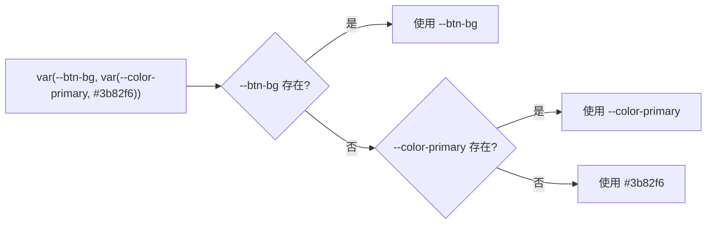
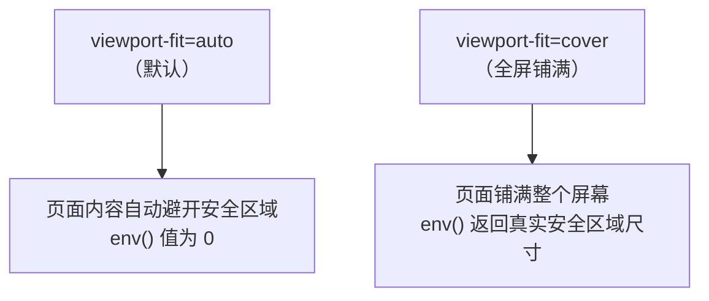

# 其他 CSS 函数（下）：工具函数、选择器函数与综合示例

## 核心概念

### 工具函数

#### attr() 深入

`attr()` 函数获取 HTML 元素的属性值，可用于在 CSS 中使用 HTML 数据。

> 💡 **兼容性提示**：`attr()` 直接用于 `content` 是老特性，全浏览器支持；而指定类型/单位（如 `attr(data-width px, 100px)`）或在其他属性中使用属于较新能力（Chrome 133+ 已支持），Firefox/Safari 支持情况请以 MDN 兼容性表为准。

```css
/* 基础用法：获取 data 属性 */
.tooltip::after {
  content: attr(data-tooltip);
}

/* 带单位的属性值 */
.button {
  width: attr(data-width px, 100px);
}

/* 进度条 */
.progress-bar {
  width: attr(value %, 0%);
}

/* 显示链接 URL */
.link::after {
  content: " (" attr(href) ")";
}

/* 自定义属性 */
.product {
  --price: attr(data-price, 0);
}

/* 结合其他函数 */
.element {
  width: calc(attr(data-width, 100) * 1px);
  height: calc(attr(data-height, 100) * 1px);
}
```

**HTML 配合**：

```html
<div class="tooltip" data-tooltip="这是提示信息">悬停查看</div>
<button data-width="200">自定义宽度按钮</button>
<div class="progress-bar" value="75"></div>
<a href="https://example.com" class="link">访问链接</a>
<div class="product" data-price="99.99">产品</div>
<div class="element" data-width="300" data-height="200">元素</div>
```

**attr() 的应用场景拓展**：

```css
/* 1. 动态内容生成 */
.counter::before {
  content: "第 " attr(data-index) " 项";
}

/* 2. 打印样式 */
@media print {
  a::after {
    content: " [" attr(href) "]";
    font-size: 0.8em;
    color: #666;
  }
}

/* 3. 无障碍增强 */
.icon[aria-label]::after {
  content: attr(aria-label);
  /* 为图标添加文本标签 */
}

/* 4. 数据可视化 */
.bar-chart-item {
  width: attr(data-value px, 0px);
  background: linear-gradient(to right, #4a90d9, #67b7dc);
}

/* 5. 配置驱动样式 */
.theme-box {
  --bg-color: attr(data-bg, #ffffff);
  --text-color: attr(data-color, #333333);
  background: var(--bg-color);
  color: var(--text-color);
}
```

#### var()

`var()` 函数引用 CSS 自定义属性（变量）。

```css
:root {
  --primary-color: #3498db;
  --spacing: 16px;
  --font-size-base: 16px;
  --border-radius: 4px;
}

.element {
  /* 基础用法 */
  color: var(--primary-color);
  padding: var(--spacing);
  border-radius: var(--border-radius);
  
  /* 带回退值 */
  color: var(--primary-color, #333);
  background: var(--bg-color, white);
  
  /* 嵌套变量 */
  padding: calc(var(--spacing) * 2);
  font-size: calc(var(--font-size-base) * 1.2);
  
  /* 作用域变量 */
  --local-color: green;
  color: var(--local-color);
}

/* 主题切换 */
.dark-theme {
  --primary-color: #2980b9;
  --bg-color: #1a1a1a;
  --text-color: #ffffff;
}

.light-theme {
  --primary-color: #3498db;
  --bg-color: #ffffff;
  --text-color: #333333;
}
```

**var() 进阶用法**

`var()` 函数虽然语法简单，但在实际工程中有许多高级用法值得深入理解。

**1. 回退值链**

`var()` 的第二个参数是回退值，当变量未定义或无效时使用。回退值本身也可以包含 `var()`，形成回退链：

```css
.element {
  /* 单层回退：--color 不存在时使用 #333 */
  color: var(--color, #333);

  /* 回退值链：依次尝试 --brand-color → --primary-color → #3b82f6 */
  color: var(--brand-color, var(--primary-color, #3b82f6));

  /* 实际场景：组件变量 → 语义变量 → 固定值 */
  background: var(--btn-bg, var(--color-primary, #3b82f6));
  padding: var(--btn-padding, var(--spacing-md, 1rem));
  border-radius: var(--btn-radius, var(--radius-default, 4px));
}
```



**2. 嵌套 var()**

`var()` 可以嵌套使用，变量值本身可以引用其他变量。这在设计令牌系统中非常常见：

```css
:root {
  /* 原语层 */
  --blue-500: #3b82f6;

  /* 语义层：引用原语层 */
  --color-primary: var(--blue-500);

  /* 组件层：引用语义层 */
  --btn-bg: var(--color-primary);
}

/* 嵌套解析过程：
   var(--btn-bg)
   → var(--color-primary)
   → var(--blue-500)
   → #3b82f6
*/

/* 注意：var() 不能递归引用自身 */
:root {
  --x: var(--x);  /* ❌ 无效！会导致循环引用 */
}
```

**3. 无效值处理（Guaranteed-Invalid Value）**

当 `var()` 引用的变量值为空或语法无效时，属性会使用**初始值**或**继承值**，而非回退值。这是 `var()` 最容易踩的坑：

```css
:root {
  --color: ;  /* 空格不是有效颜色值 */
}

.element {
  /* ❌ 不会使用回退值！因为 --color 已定义（只是值无效） */
  /* 当 --color 无效时，color 属性回退到继承值（通常是黑色），
     而非 var() 的第二个参数 */
  color: var(--color, red);  /* 结果：继承的颜色，不是 red */

  /* ✅ 正确做法：使用空格技巧强制触发回退 */
  --color-fallback: var(--color, ) var(--fallback, red);
  /* 或使用 @property 注册类型约束 */
}
```

```css
/* 使用 @property 确保类型安全 */
@property --theme-color {
  syntax: '<color>';
  inherits: true;
  initial-value: #3b82f6;  /* 无效值时使用此初始值 */
}

.element {
  color: var(--theme-color);  /* 即使赋了无效值，也会回退到 #3b82f6 */
}
```

**无效值处理的完整行为**：

| 场景 | 变量状态 | `var(--x, fallback)` 结果 |
|------|---------|--------------------------|
| 变量未定义 | 不存在 | 使用 fallback |
| 变量值为空 | `--x: ;` | 属性回退到初始值/继承值 |
| 变量值类型不匹配 | `--x: 20px;` 用于 `color` | 属性回退到初始值/继承值 |
| 变量值有效 | `--x: red;` | 使用变量值 `red` |

**完整示例：var() 进阶用法**

```html
<style>
  /* 注册类型安全的变量 */
  @property --accent-color {
    syntax: '<color>';
    inherits: true;
    initial-value: #3b82f6;
  }
  :root {
    /* 原语层 */
    --blue-500: #3b82f6; --space-4: 1rem;
    /* 语义层 */
    --color-primary: var(--blue-500);
    --spacing-md: var(--space-4);
  }
  /* 回退值链：组件变量 → 语义变量 → 固定值 */
  .card {
    background: var(--card-bg, var(--bg-surface, #ffffff));
    color: var(--card-text, var(--text-body, #333333));
    padding: var(--card-padding, var(--spacing-md, 1rem));
  }
  .accent { color: var(--accent-color); font-weight: 600; }
</style>
<div class="controls">
  <button onclick="setAccent('#3b82f6')">蓝色主题</button>
  <button onclick="setAccent('#22c55e')">绿色主题</button>
</div>
<div class="card">
  <h2 class="accent">回退值链</h2>
  <p>此卡片使用了三层回退：组件变量 → 语义变量 → 固定值</p>
</div>
<script>
  // 运行时修改类型安全变量
  function setAccent(color) {
    document.documentElement.style.setProperty('--accent-color', color);
  }
</script>
```

#### env()

`env()` 函数访问浏览器环境变量，常用于安全区域适配。

```css
/* 安全区域变量 */
.footer {
  /* 底部安全区域适配（iPhone 刘海屏） */
  padding-bottom: env(safe-area-inset-bottom, 0px);
}

.fullscreen {
  /* 全屏布局适配 */
  padding-top: env(safe-area-inset-top);
  padding-bottom: env(safe-area-inset-bottom);
  padding-left: env(safe-area-inset-left);
  padding-right: env(safe-area-inset-right);
}

/* 固定底部栏 */
.bottom-bar {
  position: fixed;
  bottom: 0;
  left: 0;
  right: 0;
  padding-bottom: calc(10px + env(safe-area-inset-bottom));
  background: white;
  box-shadow: 0 -2px 10px rgba(0, 0, 0, 0.1);
}

/* 结合 viewport 单位 */
.full-height {
  height: 100vh;
  /* 动态视口高度，处理移动端地址栏 */
  height: 100dvh;
}

/* 注意：作者无法自定义 env() 能读取的环境变量 */
/* env() 只暴露浏览器/系统级变量（如 safe-area-inset-*、titlebar-area-*） */
/* 需要自定义"可全局切换的值"时，应使用 CSS 自定义属性 + var() */
```

**安全区域变量说明**：

| 变量 | 说明 | 典型值 |
|------|------|--------|
| `safe-area-inset-top` | 顶部安全区域 | 44px（iPhone 刘海） |
| `safe-area-inset-bottom` | 底部安全区域 | 34px（iPhone Home 指示器） |
| `safe-area-inset-left` | 左侧安全区域 | 0px |
| `safe-area-inset-right` | 右侧安全区域 | 0px |

**env() 与 viewport-fit 的配合**

`env()` 的安全区域变量需要配合 `<meta>` 标签中的 `viewport-fit=cover` 才能生效。默认情况下，`viewport-fit=auto` 会使页面内容避开安全区域，此时 `env()` 值为 0。只有设置 `viewport-fit=cover` 让页面铺满整个屏幕后，`env()` 才会返回真实的安全区域尺寸：

```html
<!-- 必须设置 viewport-fit=cover，env(safe-area-inset-*) 才会返回非零值 -->
<meta name="viewport" content="width=device-width, initial-scale=1.0, viewport-fit=cover">
```



```css
/* 完整的安全区域适配方案 */

/* 步骤1：HTML 中设置 viewport-fit=cover */
/* <meta name="viewport" content="width=device-width, initial-scale=1.0, viewport-fit=cover"> */

/* 步骤2：使用 env() 适配各方向安全区域 */
.fullscreen-layout {
  /* 四个方向都适配安全区域 */
  padding-top: env(safe-area-inset-top, 0px);
  padding-bottom: env(safe-area-inset-bottom, 0px);
  padding-left: env(safe-area-inset-left, 0px);
  padding-right: env(safe-area-inset-right, 0px);
}

/* 固定底栏：确保 Home 指示器不遮挡内容 */
.bottom-bar {
  position: fixed;
  bottom: 0;
  left: 0;
  right: 0;
  /* 基础内边距 + 安全区域内边距 */
  padding: 12px env(safe-area-inset-right, 16px)
           calc(12px + env(safe-area-inset-bottom, 0px))
           env(safe-area-inset-left, 16px);
  background: white;
}

/* 横屏模式：左右安全区域（iPhone 横屏时刘海在左侧或右侧） */
@media (orientation: landscape) {
  .sidebar {
    padding-left: env(safe-area-inset-left, 0px);
    padding-right: env(safe-area-inset-right, 0px);
  }
}
```

**完整示例：安全区域适配**

```html
<!-- 关键：viewport 需设置 viewport-fit=cover，env(safe-area-inset-*) 才返回非零值 -->
<meta name="viewport" content="width=device-width, initial-scale=1.0, viewport-fit=cover">
<style>
  body {
    /* 顶部适配刘海屏，底部适配 Home 指示器 */
    padding-top: env(safe-area-inset-top, 0px);
    padding-bottom: calc(60px + env(safe-area-inset-bottom, 0px));
    padding-left: env(safe-area-inset-left, 0px);
    padding-right: env(safe-area-inset-right, 0px);
  }
  /* 固定顶部导航栏：顶部安全区域 + 自身内边距 */
  .top-bar {
    position: fixed; top: 0; left: 0; right: 0;
    padding: calc(12px + env(safe-area-inset-top, 0px)) env(safe-area-inset-right, 16px)
             12px env(safe-area-inset-left, 16px);
    background: #3b82f6; color: white; text-align: center;
  }
  /* 固定底栏：底部安全区域 + 自身内边距 */
  .bottom-bar {
    position: fixed; bottom: 0; left: 0; right: 0;
    padding: 12px env(safe-area-inset-right, 16px)
             calc(12px + env(safe-area-inset-bottom, 0px)) env(safe-area-inset-left, 16px);
    background: white; border-top: 1px solid #e5e7eb;
  }
</style>
<div class="top-bar">顶部导航栏</div>
<div class="content">
  <h2>env() 安全区域适配</h2>
  <p>在 iPhone X 及以上机型上，顶栏自动避开刘海，底栏自动避开 Home 指示器。</p>
</div>
<div class="bottom-bar"><span>首页</span><span>搜索</span><span>我的</span></div>
```

#### repeat()

`repeat()` 用于 Grid 布局中重复创建轨道。

```css
/* 固定重复 */
.grid {
  grid-template-columns: repeat(3, 1fr);    /* 三等分 */
  grid-template-columns: repeat(4, 100px);  /* 四个 100px 列 */
  grid-template-rows: repeat(2, 200px);     /* 两行 200px */
}

/* 自适应布局 */
.grid-responsive {
  /* auto-fit：折叠空轨道 */
  grid-template-columns: repeat(auto-fit, minmax(200px, 1fr));
}

/* auto-fit vs auto-fill */
.grid-auto-fill {
  /* auto-fill：保留空轨道，即使没有内容 */
  grid-template-columns: repeat(auto-fill, minmax(150px, 1fr));
}

.grid-auto-fit {
  /* auto-fit：折叠空轨道，让现有项目扩展 */
  grid-template-columns: repeat(auto-fit, minmax(150px, 1fr));
}

/* 响应式卡片布局 */
.card-grid {
  display: grid;
  gap: 20px;
  grid-template-columns: repeat(auto-fit, minmax(280px, 1fr));
}

/* 复杂重复模式 */
.complex-grid {
  grid-template-columns: repeat(3, 1fr 2fr);
  /* 等同于：1fr 2fr 1fr 2fr 1fr 2fr */
}
```

#### counter() / counters()

CSS 计数器用于自动编号。

```css
/* 简单计数 */
.list {
  counter-reset: item;
}

.list-item::before {
  content: counter(item) ". ";
  counter-increment: item;
}

/* 自定义计数器样式 */
.roman-list::before {
  content: counter(item, upper-roman) ". ";
}

/* 嵌套计数 */
.nested-list {
  counter-reset: section;
}

.nested-list > li {
  counter-increment: section;
}

.nested-list > li::before {
  content: counter(section) ". ";
}

.nested-list ul {
  counter-reset: subsection;
}

.nested-list ul li::before {
  counter-increment: subsection;
  content: counter(section) "." counter(subsection) " ";
}

/* counters() 创建层级编号 */
.toc {
  counter-reset: chapter;
}

.toc li {
  counter-increment: chapter;
}

.toc li::before {
  /* counters() 自动连接所有层级的计数器 */
  content: counters(chapter, ".") " ";
}
```

**计数器样式类型**：

| 类型 | 说明 | 示例 |
|------|------|------|
| `decimal` | 十进制数字 | 1, 2, 3... |
| `lower-roman` | 小写罗马数字 | i, ii, iii... |
| `upper-roman` | 大写罗马数字 | I, II, III... |
| `lower-alpha` | 小写字母 | a, b, c... |
| `upper-alpha` | 大写字母 | A, B, C... |
| `lower-greek` | 小写希腊字母 | α, β, γ... |


##### counter-increment 交互演示（MDN）

增加 CSS 计数器的计数，与 content: counter() 配合使用。

```html
<!-- 交互演示核心片段：把 snippets 中的声明逐条应用到 #example-element，观察效果差异 -->
<style>
  #default-example { text-align: left; counter-reset: example-counter; }
  #example-element::after { content: counter(example-counter); }
</style>

<div class="transition-all" id="example-element">计数值：</div>

<script>
  const snippets = [
    `#example-element { counter-increment: example-counter; }`,
    `#example-element { counter-increment: example-counter 0; }`,
    `#example-element { counter-increment: example-counter 5; }`,
    `#example-element { counter-increment: example-counter -5; }`,
  ];
  // 点击对应按钮 => styleEl.textContent = snippets[i]，并切换按钮高亮
</script>
```

##### counter-reset 交互演示（MDN）

重置 CSS 计数器的值。

```html
<!-- 交互演示核心片段：把 snippets 中的声明逐条应用到 #example-element，观察效果差异 -->
<style>
  #default-example { text-align: left; counter-reset: chapter-count; }
  #example-element { background-color: lightblue; color: black; }
  h2 { counter-increment: chapter-count; font-size: 1em; }
  h2::before { content: "Chapter " counters(chapter-count, ".") ": "; }
</style>

<div class="transition-all" id="chapters">
  <h1>Alice's Adventures in Wonderland</h1>
  <h2>Down the Rabbit-Hole</h2>
  <h2 id="example-element">The Pool of Tears</h2>
  <h2>A Caucus-Race and a Long Tale</h2>
  <h2>The Rabbit Sends in a Little Bill</h2>
</div>

<script>
  const snippets = [
    `#example-element { counter-reset: none; }`,
    `#example-element { counter-reset: chapter-count 0; }`,
    `#example-element { counter-reset: chapter-count; }`,
    `#example-element { counter-reset: chapter-count 5; }`,
    `#example-element { counter-reset: chapter-count -5; }`,
  ];
  // 点击对应按钮 => styleEl.textContent = snippets[i]，并切换按钮高亮
</script>
```

##### counter-set 交互演示（MDN）

直接将 CSS 计数器设置为指定值。

```html
<!-- 交互演示核心片段：把 snippets 中的声明逐条应用到 #example-element，观察效果差异 -->
<style>
  #default-example { text-align: left; counter-set: chapter-count; }
  #example-element { background-color: #37077c; color: white; }
  h2 { counter-increment: chapter-count; font-size: 1em; }
  h2::before { content: "Chapter " counter(chapter-count) ": "; }
</style>

<div class="transition-all" id="chapters">
  <h1>Alice's Adventures in Wonderland</h1>
  <h2>Down the Rabbit-Hole</h2>
  <h2 id="example-element">The Pool of Tears</h2>
  <h2>A Caucus-Race and a Long Tale</h2>
  <h2>The Rabbit Sends in a Little Bill</h2>
</div>

<script>
  const snippets = [
    `#example-element { counter-set: none; }`,
    `#example-element { counter-set: chapter-count 0; }`,
    `#example-element { counter-set: chapter-count; }`,
    `#example-element { counter-set: chapter-count 5; }`,
    `#example-element { counter-set: chapter-count -5; }`,
  ];
  // 点击对应按钮 => styleEl.textContent = snippets[i]，并切换按钮高亮
</script>
```
#### symbols()

`symbols()` 定义列表标记符号。

```css
/* 循环符号 */
.list-cyclic {
  list-style: symbols(cyclic "*" "†" "‡" "§");
}

/* 数字计数 */
.list-numeric {
  list-style: symbols(numeric "0" "1" "2" "3" "4" "5" "6" "7" "8" "9");
}

/* 字母计数 */
.list-alpha {
  list-style: symbols(alphabetic "a" "b" "c" "d" "e" "f" "g" "h" "i" "j" "k" "l" "m" "n" "o" "p" "q" "r" "s" "t" "u" "v" "w" "x" "y" "z");
}

/* 自定义符号 */
.list-custom {
  list-style: symbols(fixed "→" "⇒" "↠" "⤑");
}
```

### 选择器函数

#### :is()

`:is()` 匹配选择器列表中的任意一个选择器，优先级取列表中最高的。

```css
/* 简化选择器 */
:is(h1, h2, h3) {
  font-weight: bold;
}

/* 等同于 */
h1, h2, h3 {
  font-weight: bold;
}

/* 复杂选择器简化 */
:is(article, section, aside) :is(h2, h3, h4) {
  margin-top: 1em;
}

/* 嵌套使用 */
:is(ol, ul) :is(ol, ul) {
  margin-left: 2em;
}

/* 与伪类组合 */
:is(a, button):hover {
  opacity: 0.8;
}

/* 注意：失败的选择器会被忽略 */
:is(:valid, :unsupported) {
  /* 如果 :unsupported 不支持，:valid 仍然生效 */
  color: green;
}
```

#### :where()

`:where()` 与 `:is()` 功能相同，但优先级始终为 0。

```css
/* 优先级为 0 */
:where(article, section) h2 {
  color: blue;
}

/* 可以被轻松覆盖 */
h2 {
  color: red;  /* 这个规则优先级更高 */
}

/* 重置样式 */
:where(ul, ol) {
  list-style: none;
  padding: 0;
  margin: 0;
}

/* 统一表单样式 */
:where(input, textarea, select) {
  font: inherit;
  color: inherit;
  border: 1px solid #ccc;
}

/* 配合 :not() 使用 */
:where(:not(article)) p {
  margin: 0;
}
```

**:is() vs :where() 对比**：

| 特性 | `:is()` | `:where()` |
|------|---------|------------|
| 功能 | 匹配选择器列表 | 匹配选择器列表 |
| 优先级 | 取列表中最高 | 始终为 0 |
| 用途 | 需要保持优先级 | 需要易于覆盖 |
| 典型场景 | 组件样式 | 重置/基础样式 |

#### :not()

`:not()` 排除匹配指定选择器的元素。

```css
/* 排除最后一个元素 */
.item:not(:last-child) {
  margin-bottom: 10px;
}

/* 排除特定类 */
.button:not(.disabled) {
  cursor: pointer;
}

/* 排除多个选择器 */
a:not(:hover, :focus) {
  text-decoration: none;
}

/* 排除特定类型 */
input:not([type="checkbox"]):not([type="radio"]) {
  width: 100%;
}

/* 响应式设计 */
.item:not(:nth-child(-n+3)) {
  opacity: 0.5;
}
```

#### :has()

`:has()` 父选择器，根据子元素状态选择父元素。这是 CSS 中长期期待的"父选择器"。

```css
/* 包含图片的卡片 */
.card:has(img) {
  padding-top: 0;
}

/* 包含必填字段的表单组 */
.form-group:has(input:required) label::after {
  content: "*";
  color: red;
}

/* 子元素悬停状态 */
nav:has(a:hover) {
  background: #f5f5f5;
}

/* 空状态 */
.container:has(.empty-state) {
  justify-content: center;
  align-items: center;
}

/* 选择后面有特定元素的情况 */
h2:has(+ p) {
  margin-bottom: 0.5em;
}

/* 表格行悬停 */
tr:has(td:hover) {
  background-color: #f0f0f0;
}

/* 图片加载失败处理 */
figure:has(img[alt=""]) {
  border: 1px dashed red;
}

/* 表单验证状态 */
.form:has(input:invalid) {
  border-color: red;
}

/* 动态内容检测 */
.article:has(> h1) {
  font-size: 1.2em;
}
```

## 代码示例

### 示例 1：响应式流体排版系统

```html
<style>
  :root {
    --font-min: 16px; --font-max: 24px; --font-preferred: 2vw;
    /* 流体间距 */
    --space-sm: clamp(0.5rem, 1vw, 0.75rem);
    --space-md: clamp(1rem, 2vw, 1.5rem);
    --space-lg: clamp(1.5rem, 3vw, 3rem);
  }
  body { line-height: 1.6; padding: var(--space-md); max-width: min(100%, 800px); margin: 0 auto; }
  /* 流体标题 */
  h1 { font-size: clamp(2rem, 5vw, 3.5rem); line-height: 1.2; }
  h2 { font-size: clamp(1.5rem, 3vw, 2.5rem); margin-top: var(--space-lg); }
  h3 { font-size: clamp(1.25rem, 2.5vw, 1.75rem); margin-top: var(--space-md); }
  p  { font-size: clamp(1rem, 1.5vw, 1.125rem); margin-bottom: var(--space-md); }
  .section { padding: var(--space-lg) 0; }
  .card { padding: var(--space-md); border-radius: clamp(8px, 1vw, 16px); background: #f5f5f5; }
</style>
<h1>流体排版系统</h1>
<div class="section">
  <h2>二级标题</h2>
  <p>字体大小使用 clamp() 限制在最小值和最大值之间，中间值随视口宽度线性变化。</p>
</div>
<div class="card">
  <h3>卡片组件</h3>
  <p>卡片的内边距和圆角也使用流体值。</p>
</div>
```

### 示例 2：主题色系统（color-mix）

```html
<style>
  :root {
    /* 基础主题色 */
    --primary: #3498db; --secondary: #2ecc71; --danger: #e74c3c;
    /* 用 color-mix() 自动生成状态变体 */
    --primary-hover: color-mix(in srgb, var(--primary), white 15%);
    --primary-active: color-mix(in srgb, var(--primary), black 15%);
    --primary-disabled: color-mix(in srgb, var(--primary), gray 40%);
    /* 背景色变体 */
    --primary-bg: color-mix(in srgb, var(--primary), white 90%);
  }
  .btn { padding: 12px 24px; border: none; border-radius: 6px; cursor: pointer; }
  .btn-primary { background: var(--primary); color: white; }
  .btn-primary:hover { background: var(--primary-hover); }
  .btn-primary:active { background: var(--primary-active); }
  .btn-primary:disabled { background: var(--primary-disabled); cursor: not-allowed; }
  /* .btn-secondary / .btn-danger 同理，替换为各自的 --secondary-* / --danger-* 变量 */
</style>
<div class="button-group">
  <button class="btn btn-primary">主要按钮</button>
  <button class="btn btn-secondary">次要按钮</button>
  <button class="btn btn-danger">危险按钮</button>
  <button class="btn btn-primary" disabled>禁用按钮</button>
</div>
```

### 示例 3：attr() 数据驱动样式

```html
<style>
  /* 1. 工具提示 */
  .tooltip::after {
    content: attr(data-tooltip);
    position: absolute; bottom: 100%; left: 50%; transform: translateX(-50%);
    padding: 8px 12px; background: #333; color: white; border-radius: 4px;
    opacity: 0; visibility: hidden; white-space: nowrap;
  }
  .tooltip:hover::after { opacity: 1; visibility: visible; }
  /* 2. 进度条 */
  .progress-fill { width: attr(value %, 0%); }
  .progress-fill::after { content: attr(value) "%"; }
  /* 3. 数据列表 */
  .data-item::before { content: "第 " attr(data-index) " 项"; font-weight: 500; }
  .data-item::after { content: attr(data-description); color: #666; }
  /* 4. 打印链接 */
  @media print {
    a.print-link::after { content: " [" attr(href) "]"; font-size: 0.8em; color: #666; }
  }
</style>
<div class="tooltip" data-tooltip="这是提示信息，悬停时显示">悬停查看提示</div>
<div class="progress-bar"><div class="progress-fill" value="75"></div></div>
<ul class="data-list">
  <li class="data-item" data-index="1" data-description="这是第一项的描述"></li>
</ul>
<p>访问 <a href="https://example.com" class="print-link">示例网站</a>（打印时显示 URL）</p>
```

### 示例 4：选择器函数简化代码

```html
<style>
  /* :is() 简化标题样式 */
  :is(h2, h3, h4) { margin-bottom: 16px; color: #333; }
  /* :where() 设置基础样式（优先级为 0，易于覆盖） */
  :where(ul, ol) { list-style: none; padding: 0; }
  :where(li) { padding: 12px 16px; background: #f5f5f5; border-radius: 6px; }
  /* :not() 排除特定元素 */
  .item:not(:last-child) { border-bottom: 1px solid #e0e0e0; padding-bottom: 12px; }
  .button:not(.disabled):hover { opacity: 0.9; }
  /* :has() 根据子元素状态选择父元素 */
  .card { padding: 20px; border-radius: 8px; background: white; }
  .card:has(img) { display: grid; grid-template-columns: 120px 1fr; gap: 16px; }
  /* :has() 表单验证状态 */
  .form-group:has(input:invalid) { border-left: 3px solid #e74c3c; padding-left: 12px; }
  .form-group:has(input:valid) { border-left: 3px solid #2ecc71; padding-left: 12px; }
</style>
<div class="card"><p>没有图片的卡片，普通布局。</p></div>
<div class="card">
  
  <div><h3>带图片的卡片</h3><p>:has(img) 触发了网格布局。</p></div>
</div>
<form>
  <div class="form-group"><label>邮箱（必填）</label><input type="email" required></div>
</form>
```

## 最佳实践

### 1. 响应式设计优先使用 clamp()、min()、max()

```css
/* ✅ 推荐：使用 clamp() 实现流体排版 */
.text {
  font-size: clamp(1rem, 2vw + 0.5rem, 1.5rem);
}

/* ❌ 不推荐：使用多个媒体查询 */
.text {
  font-size: 1rem;
}
@media (min-width: 768px) {
  .text { font-size: 1.25rem; }
}
@media (min-width: 1200px) {
  .text { font-size: 1.5rem; }
}
```

### 2. 使用 CSS 变量配合函数提高可维护性

```css
:root {
  --spacing-unit: 8px;
  --max-width: 1200px;
  --primary: #3498db;
  
  /* 使用 color-mix() 生成变体 */
  --primary-hover: color-mix(in srgb, var(--primary), white 15%);
  --primary-active: color-mix(in srgb, var(--primary), black 15%);
}

.container {
  width: min(100% - var(--spacing-unit) * 2, var(--max-width));
  margin: 0 auto;
  padding: var(--spacing-unit);
}

.button {
  background: var(--primary);
}

.button:hover {
  background: var(--primary-hover);
}
```

### 3. 颜色管理使用现代颜色函数

```css
:root {
  /* 使用 HSL 便于调整 */
  --brand-hue: 200;
  --brand-sat: 70%;
  --brand-lightness: 50%;
  
  --brand-primary: hsl(var(--brand-hue), var(--brand-sat), var(--brand-lightness));
  --brand-light: hsl(var(--brand-hue), var(--brand-sat), 80%);
  --brand-dark: hsl(var(--brand-hue), var(--brand-sat), 30%);
  
  /* 或使用 color-mix() */
  --brand: #3498db;
  --brand-hover: color-mix(in srgb, var(--brand), white 15%);
  --brand-active: color-mix(in srgb, var(--brand), black 15%);
}
```

### 4. 选择器函数简化代码

```css
/* ✅ 推荐：使用 :is() 简化 */
:is(header, main, footer) a {
  color: inherit;
}

:is(h1, h2, h3, h4, h5, h6) {
  font-weight: 600;
}

/* ❌ 不推荐：重复选择器 */
header a,
main a,
footer a {
  color: inherit;
}

h1, h2, h3, h4, h5, h6 {
  font-weight: 600;
}
```

### 5. 注意性能优化

```css
/* ❌ 避免：复杂的 :has() 选择器影响性能 */
.container:has(.deeply .nested .element) { ... }

/* ✅ 推荐：限制选择器深度 */
.container:has(> .element) { ... }
.container:has(.element) { ... }

/* ✅ 使用 :where() 设置基础样式 */
:where(ul, ol) {
  list-style: none;
  padding: 0;
  margin: 0;
}
```

### 6. 提供合理的回退值

```css
.element {
  /* 回退值 */
  width: 50%;
  max-width: 600px;
  min-width: 300px;
  
  /* 现代浏览器使用 clamp */
  width: clamp(300px, 50%, 600px);
}

/* 或使用 @supports */
@supports (width: clamp(0px, 1vw, 10px)) {
  .element {
    width: clamp(300px, 50%, 600px);
    max-width: revert;
    min-width: revert;
  }
}
```

### 7. 数学函数组合使用

```css
/* 复杂计算 */
.sidebar {
  --sidebar-width: 250px;
  --gap: 20px;
  
  width: max(
    var(--sidebar-width),
    min(
      20vw,
      calc(100vw - var(--gap) * 2)
    )
  );
}

/* 圆形布局 */
.circle-item {
  --count: 8;
  --radius: 100px;
  --i: 0;
  --angle: calc(var(--i) / var(--count) * 360deg);
  
  left: calc(50% + var(--radius) * cos(var(--angle)));
  top: calc(50% + var(--radius) * sin(var(--angle)));
}
```

### 8. 安全区域适配

```css
/* 移动端安全区域适配 */
.bottom-bar {
  position: fixed;
  bottom: 0;
  left: 0;
  right: 0;
  padding-bottom: calc(10px + env(safe-area-inset-bottom, 0px));
  background: white;
  box-shadow: 0 -2px 10px rgba(0, 0, 0, 0.1);
}

/* 全屏布局 */
.fullscreen {
  padding-top: env(safe-area-inset-top, 0px);
  padding-bottom: env(safe-area-inset-bottom, 0px);
  padding-left: env(safe-area-inset-left, 0px);
  padding-right: env(safe-area-inset-right, 0px);
}
```

## 常见问题

### Q1: calc() 中的运算符必须有空格吗？

**A**: 是的，`+` 和 `-` 运算符前后**必须有空格**，`*` 和 `/` 可以没有但建议统一添加空格。

```css
/* ✅ 正确 */
width: calc(100% - 20px);
width: calc(100% + 20px);

/* ❌ 错误 */
width: calc(100%-20px);  /* 无效 */
width: calc(100%+20px);  /* 无效 */
```

### Q2: clamp() 的三个参数顺序可以改变吗？

**A**: 不可以，必须是 `clamp(最小值, 理想值, 最大值)` 的顺序。如果顺序错误，会导致意外结果。

```css
/* ✅ 正确 */
font-size: clamp(16px, 2vw, 24px);

/* ❌ 错误 - 顺序颠倒，MIN > MAX 时 MIN 胜出，永远返回 24px */
font-size: clamp(24px, 2vw, 16px);
```

### Q3: :is() 和 :where() 有什么区别？

**A**: 主要区别在于**优先级**：

| 特性 | `:is()` | `:where()` |
|------|---------|------------|
| 优先级 | 取选择器列表中**最高的** | **始终为 0** |
| 用途 | 需要保持优先级 | 需要易于覆盖 |
| 典型场景 | 组件样式 | 重置/基础样式 |

```css
/* :is() 优先级取列表中最高的 #header（1,0,0），整条选择器优先级为 (1,0,1) */
:is(#header, .nav) a {
  color: blue;
}

/* :where() 本身优先级始终为 0，整条选择器优先级只由后面的 a（0,0,1）构成 */
:where(#header, .nav) a {
  color: blue;
}

/* 后者更容易被覆盖 */
a { color: red; }  /* 可以覆盖 :where() 但不能覆盖 :is() */
```

### Q4: 如何检测浏览器是否支持某个 CSS 函数？

**A**: 可以使用 `@supports` 规则：

```css
@supports (width: clamp(0px, 1vw, 10px)) {
  .element {
    width: clamp(300px, 50%, 600px);
  }
}

@supports not (width: clamp(0px, 1vw, 10px)) {
  .element {
    width: 50%;
    max-width: 600px;
    min-width: 300px;
  }
}

/* 检测选择器支持 */
@supports selector(:has(*)) {
  .card:has(img) {
    padding-top: 0;
  }
}
```

### Q5: color-mix() 有什么实际用途？

**A**: `color-mix()` 非常适合创建颜色变体，无需手动计算：

```css
:root {
  --primary: #3498db;
  
  /* 自动创建深浅变体 */
  --primary-light: color-mix(in srgb, var(--primary), white 20%);
  --primary-dark: color-mix(in srgb, var(--primary), black 20%);
  --primary-hover: color-mix(in srgb, var(--primary), white 10%);
  --primary-active: color-mix(in srgb, var(--primary), black 10%);
}

.button {
  background: var(--primary);
}
.button:hover {
  background: var(--primary-hover);
}
.button:active {
  background: var(--primary-active);
}
```

### Q6: 如何处理 :has() 的浏览器兼容性？

**A**: 使用**渐进增强**策略：

```css
/* 基础样式 */
.card {
  padding: 20px;
}

/* 支持 :has() 的浏览器增强 */
@supports selector(:has(*)) {
  .card:has(img) {
    padding-top: 0;
  }
}
```

### Q7: attr() 函数支持哪些数据类型？

**A**: `attr()` 函数可以指定数据类型和单位：

```css
/* 默认返回字符串 */
content: attr(data-tooltip);

/* 指定单位 */
width: attr(data-width px, 100px);
font-size: attr(data-size em, 1em);

/* 支持的单位类型 */
/* length: px, em, rem, cm, mm, in, pt, pc */
/* angle: deg, rad, grad, turn */
/* time: s, ms */
/* frequency: Hz, kHz */
/* number, integer, percentage */
```

### Q8: min()、max()、clamp() 可以嵌套使用吗？

**A**: 可以，它们可以相互嵌套或与其他 CSS 函数组合：

```css
/* 嵌套使用 */
.element {
  width: max(200px, min(50%, 500px));
  /* 等价于 */
  width: clamp(200px, 50%, 500px);
}

/* 与 calc() 组合 */
.element {
  font-size: clamp(16px, calc(16px + 1vw), 24px);
}

/* 与 CSS 变量组合 */
:root {
  --min-width: 300px;
  --max-width: 600px;
}

.element {
  width: clamp(var(--min-width), 50%, var(--max-width));
}
```

### Q9: color() 函数和 rgb() 有什么区别？

**A**: `color()` 支持**多种色彩空间**，包括广色域：

| 特性 | `rgb()` | `color()` |
|------|---------|-----------|
| 色彩空间 | 仅 sRGB | sRGB、Display P3、Adobe RGB 等 |
| 广色域支持 | 否 | 是 |
| 语法 | `rgb(r, g, b)` | `color(space r g b)` |
| 适用场景 | 通用 Web | 高质量显示、印刷 |

```css
/* sRGB 颜色 */
color: rgb(255, 0, 0);
color: color(srgb 1 0 0);  /* 等同于 rgb() */

/* Display P3 广色域（更鲜艳） */
color: color(display-p3 1 0 0);
```

### Q10: 如何选择合适的颜色函数？

**A**: 根据使用场景选择：

| 场景 | 推荐函数 | 原因 |
|------|---------|------|
| 通用 Web 开发 | `rgb()` / `hsl()` | 广泛支持，直观 |
| 主题色变化 | `hsl()` | 易于调整色相和亮度 |
| 颜色变体生成 | `color-mix()` | 自动计算混合比例 |
| 平滑渐变 | `lab()` / `lch()` | 感知均匀，无灰度区域 |
| 高质量显示 | `color(display-p3)` | 支持广色域 |
| 快速颜色调整 | `hwb()` | 语法简洁 |

## 参考资源

- [MDN CSS 函数参考](https://developer.mozilla.org/zh-CN/docs/Web/CSS/CSS_Functions)
- [CSS Values and Units Module Level 4](https://www.w3.org/TR/css-values-4/)
- [CSS Color Module Level 4](https://www.w3.org/TR/css-color-4/)
- [CSS Color Module Level 5](https://www.w3.org/TR/css-color-5/)
- [CSS Selectors Level 4](https://www.w3.org/TR/selectors-4/)
- [Can I Use - CSS 函数兼容性](https://caniuse.com/)
- [CSS-Tricks - Guide to CSS Functions](https://css-tricks.com/)
- [Smashing Magazine - Modern CSS](https://www.smashingmagazine.com/)
