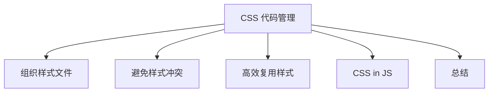

# 如何管理你的 CSS 代码？

## 概念说明

CSS 的规则是全局生效的：任何一个样式规则都对整个页面有效，语言本身没有模块化和作用域机制。随着项目规模增长，样式代码通常会出现三类典型问题：文件组织混乱、选择器命名冲突、样式重复定义。

CSS 代码管理正是针对这三个问题的一套工程实践，核心内容包括：如何组织样式文件、如何避免样式冲突、如何高效复用样式。

需要说明的是，CSS 原生的 import 命令虽然支持文件引用，但由于存在一些问题（比如影响浏览器并行下载、加载顺序错乱等），使用率极低。更常见的做法是通过预处理器或编译工具插件来引入样式文件，因此这里的讨论不局限于以 .css 为后缀的样式文件。

::: tip 核心目标
管理样式文件的目的就是让开发人员更方便地维护代码：将样式文件分类，把相关的文件放在一起，使开发者在修改样式时更容易找到对应的样式文件，在创建样式文件时更容易找到对应的目录。
:::

## 如何组织样式文件

### 开源项目中的样式文件组织

以 [Bootstrap 4.4](https://github.com/twbs/bootstrap) 为例，下图是项目样式代码结构，可以看出项目使用的是 Sass 预处理器。


该目录包括了 5 个目录、组件样式文件和一些全局样式。目录及内容如下：

- forms/，表单组件相关样式；

- helpers/，公共样式，包括定位、清除等；

- mixins/，可以理解为生成最终样式的函数；

- utilities/，媒体查询相关样式；

- vendor/，依赖的外部第三方样式。

根目录存放了组件样式文件和目录，其他样式文件放在不同的目录中。目录中的文件分类清晰，但目录结构相对于大多数实际项目而言过于简单（只有样式文件）。

再看一个更符合大多数情况的案例 [ant-design 4.2](https://github.com/ant-design/ant-design/)，该项目采用 Less 预处理器，主要源码放在 /components 目录下：


从目录名称上不难推测，各个组件代码通过文件夹区分。以其中的 alert 文件夹为例，组件相关的代码、测试代码、demo 示例、样式文件、描述文档都放在同一个文件夹内。


至于全局样式和公共样式，则在 /components/style 目录下：


其中包括 4 个目录：

- color/，颜色相关的变量与函数；

- core/，全局样式，根标签样式、字体样式等；

- mixins/，样式生成函数；

- themes/，主题相关的样式变量。

将组件代码及相关样式放在一起，开发的时候修改会很方便。但在组件目录 /components 下设置 style 目录存放全局和公共样式，在逻辑上有些说不通——这些"样式"文件并不是一个单独的"组件"。再看 style 目录内部结构，相对于设置单独的 color 目录来管理样式中的颜色，更推荐像 Bootstrap 一样设立专门的目录或文件来管理变量。

依赖 Vue.js 的热门 UI 库 [element 2.13.1](https://github.com/ElemeFE/element) 则采用了另一种组织方式。项目根路径下的 packages 目录按组件划分目录来存放源码，但组件样式文件并没有和组件代码放在一起。下图是 /packages 目录下的部分内容。


element 将样式文件统一放入了 /packages/theme-chalk 目录下，目录部分内容如下图所示：


其中包含 4 个目录：

- common/，一些全局样式和公共变量；

- date-picker/，日期组件相关样式；

- fonts/，字体文件；

- mixins/，样式生成函数及相关变量。

element 与 antd 存在类似的问题：把样式当成"组件"看待，在组件同级目录设立了 theme-chalk 目录存放样式文件，而 theme-chalk 目录下的全局样式 reset.scss 与组件样式同级，同样欠妥。此外，为了将样式打包成模块而在独立项目中直接嵌入另一个独立项目（可以简单理解为一个项目不要有多个 package.json 文件）并不推荐，更符合 Git 使用规范的做法是以[子模块](https://git-scm.com/book/zh/v2/Git-%E5%B7%A5%E5%85%B7-%E5%AD%90%E6%A8%A1%E5%9D%97)的方式引用进项目。而且将组件样式和源码分离，开发时经常需要跨多层目录查找和修改样式，并不方便。

### 样式文件管理模式：7-1 模式

除了开源项目之外，[Sass Guidelines](https://sass-guidelin.es/#architecture) 也提出过一个划分样式文件目录结构的 7-1 模式。这种模式建议将目录结构划分为 7 个目录和 1 个文件：这 1 个文件是样式的入口文件，负责将项目所用到的所有样式都引入进来，一般命名为 main.scss。

剩下的 7 个目录及作用如下：

- base/，模板代码，比如默认标签样式重置；

- components/，组件相关样式；

- layout/，布局相关，包括头部、尾部、导航栏、侧边栏等；

- pages/，页面相关样式；

- themes/，主题样式，即使有的项目没有多个主题，也可以进行预留；

- abstracts/，其他样式文件生成的依赖函数及 mixin，不能直接生成 css 样式；

- vendors/，第三方样式文件。

[示例项目地址](https://github.com/HugoGiraudel/sass-boilerplate)的截图如下图所示：


### 面向单页应用的目录结构优化

7-1 模式是专门针对使用 Sass 的项目提出的，从样式文件名称可以看出还留有 jQuery 时代的影子。为了更加符合单页应用的项目结构，可以做如下优化：

- main.scss 文件的存在意义不大：页面样式、组件样式、布局样式都可以在页面和组件中引用，全局样式也可以在根组件中引用；而且每次添加、修改样式文件都需要在 main.scss 文件中同步，这种过度中心化的配置方式并不方便。

- layout 目录可以去除：footer、header 这些布局相关的样式，放入对应的组件中来引用会更好；至于不能被组件化的"_grid"样式存在性也不大，页面布局既可以通过拆分成全局样式来实现，也可以依赖第三方 UI 库来实现。

- themes/ 目录可以去除：大部分前端项目不需要设置主题，即使有主题也可以新建一个样式文件来管理样式变量。

- vendors/ 目录可以根据需求添加：将外部样式复制到项目中的情况比较少，更多的是通过 npm 安装引入 UI 库，或者通过 webpack 插件写入对应的 cdn 地址。

优化后的目录结构如下所示：

```text
src/
|
|– abstracts/
|   |– _variables.scss    
|   |– _functions.scss    
|   |– _mixins.scss       
|   |– _placeholders.scss 
|
|– base/
|   |– _reset.scss        
|   |– _typography.scss   
|   …                     
|
|– components/
|   |– _buttons.scss      
|   |– _carousel.scss     
|   |– _cover.scss        
|   |– _dropdown.scss     
|   |- header/
|      |- header.tsx
|      |- header.sass
|   |- footer/
|      |- footer.tsx
|      |- footer.sass
|   …                     
|
|– pages/
|   |– _home.scss         
|   |– _contact.scss      
|   …                     
|
```

这只是推荐的一种目录结构，具体使用可以根据实际情况进行调整。例如有项目在 src 目录下创建模块目录，按照模块来拆分路由以及页面、组件，此时每个模块目录下都会有 pages/ 目录和 components/ 目录。

## 如何避免样式冲突

由于 CSS 的规则是全局的，任何一个样式规则都对整个页面有效，如果不对选择器的命名加以管控，很容易产生冲突。避免冲突有两条路线：通过命名规范手动管控，以及通过工具自动化命名。

### 手动命名：BEM

最简单有效的命名管理方式是制定命名规则，比如 [OOCSS](http://oocss.org/)、[BEM](http://getbem.com/)、[AMCSS](https://amcss.github.io/)，其中使用最广泛的是 BEM。

BEM 是 Block、Element、Modifier 三个单词的缩写：Block 代表独立的功能组件，Element 代表功能组件的一个组成部分，Modifier 对应状态信息。

下图是官方给出的示例代码：


从命名可以看到 Element 和 Modifier 是可选的：块名与元素名之间用双下划线（__）连接，元素与修饰符之间用双横线（--）连接（双横线虽然能和单词内的连字符区分开，但确实有些冗余，可以考虑直接用下划线代替）。BEM 的命名方式具有语义，容易理解，非常适用于组件样式类。

### 工具命名：CSS Modules

命名规范虽然有效，但不能绝对保证样式名的唯一性，也没有有效的校验工具来保证命名正确无冲突。因此另一种思路是：通过插件将原命名转化成不重复的随机命名，从根本上避免命名冲突。比较著名的解决方案就是 CSS Modules。

下面是一段 css 样式代码：

```
/* style.css */
.className {
  color: green;
}
```

借助 CSS Modules 插件，可以将 css 以 JSON 对象的形式引用和使用。

```javascript
import styles from "./style.css";
// import { className } from "./style.css";
element.innerHTML = '<div class="' + styles.className + '">';
```

编译之后的代码，样式类名被转化成了随机名称：

```xml
<div class="_3zyde4l1yATCOkgn-DBWEL"></div>
<style>
._3zyde4l1yATCOkgn-DBWEL {
  color: green;
}
</style>
```

但这种命名方式也带来了一个问题：想在引用组件的同时覆盖它的样式会变得困难，因为编译后的样式名是随机的。例如在上面的示例中，如果想覆盖 className 样式就很困难；而在手动命名的情况下，则可以直接重新定义 className 样式进行覆盖。

## 如何高效复用样式

项目开发中，某些样式会被经常重复使用，比如：

- display:inline-block

- clear:both

- position:relative

- ......

这违背了 DRY（Don't Repeat Yourself）原则，完全可以通过设置为全局公共样式来减少重复定义。

哪些样式规则可以设置为全局公共样式？

- 首先是具有枚举值的属性，除了上面提到的，还包括 cursor:pointer、float:left 等。

- 其次是那些特定数值的样式属性值，比如 margin: 0、left: 0、height: 100%。

- 最后是设计规范所使用的属性，比如设计稿中规定的几种颜色。

样式按照小粒度拆分之后，命名规范同样重要，合理的命名规范可以避免公共样式重复定义，开发时方便快速引用。

前面提到的语义化命名方式 BEM 显然不太适合全局公共样式：一方面全局样式是基于样式属性和值的，是无语义的；另一方面对于复用率很高的样式，应该尽量保证命名简短方便记忆。因此推荐使用更简短、更容易记忆的命名规则，比如"属性名首字母 + 横线 + 属性值首字母"的命名方式。

举例来说，display:inline-block 的属性 display 缩写为 d，值 inline-block 缩写为 ib，通过短横线连接就可以命名成 d-ib；同理，float:left 也很容易想到使用 f-l 作为样式名。

会不会出现重复定义？这个问题可以按照字母序升序定义样式类来解决。

## 延伸：值得关注的 CSS in JavaScript

Web 标准提倡结构、样式、行为分离（分别对应 HTML、CSS、JavaScript 三种语言），而 React.js 的出现开始打破了这个原则：先是通过 JSX 将 HTML 代码嵌入进 JavaScript 组件，随后又通过 CSS in JavaScript 的方式将 CSS 代码也嵌入进 JavaScript 组件。这种"all in JavaScript"的方式与 Web 标准相悖，但与组件化概念高度契合，具有"高内聚"的特性，因此未来标准有所改变也未尝不可能，这也是值得关注 CSS in JavaScript 技术的原因。

相对于使用预处理语言编写样式，CSS in JavaScript 具有两个优势：

- 可以通过随机命名解决作用域问题，但命名规则和 CSS Modules 都可以解决这个问题；

- 样式可以使用 JavaScript 语言特性，比如函数、循环，实现元素不同的样式效果可以通过新建不同样式类、修改元素样式类来实现。

以 [styled-components](https://styled-components.com/) 为例进行说明，下面是示例代码，第一段是源代码：

```javascript
// 源代码
const Button = styled.button`
  background: transparent;
  border-radius: 3px;
  border: 2px solid palevioletred;
  color: palevioletred;
  margin: 0.5em 1em;
  padding: 0.25em 1em;
  ${props => props.primary && css`
    background: palevioletred;
    color: white;
  `}
`;
const Container = styled.div`
  text-align: center;
`
render(
  <Container>
    <Button>Normal Button</Button>
    <Button primary>Primary Button</Button>
  </Container>
);
```

第二段是编译后生成的：

```xml
<!--HTML 代码-->
<div class="sc-fzXfNJ ciXJHl">
  <button class="sc-fzXfNl hvaMnE">Normal Button</button>
  <button class="sc-fzXfNl kiyAbM">Primary Button</button>
</div>
/*CSS 代码*/
.ciXJHl {
  text-align: center;
}
.hvaMnE {
  color: palevioletred;
  background: transparent;
  border-radius: 3px;
  border-width: 2px;
  border-style: solid;
  border-color: palevioletred;
  border-image: initial;
  margin: 0.5em 1em;
  padding: 0.25em 1em;
}
.kiyAbM {
  color: white;
  border-radius: 3px;
  border-width: 2px;
  border-style: solid;
  border-color: palevioletred;
  border-image: initial;
  margin: 0.5em 1em;
  padding: 0.25em 1em;
  background: palevioletred;
}
```

对比以上两段代码可以发现，编译后的样式代码中存在很多重复的样式规则。这并不友好，不仅增加了编写样式的复杂度和代码量，编译后也产生了冗余代码。

styled-components 只是 CSS in JavaScript 的一种解决方案，其他解决方案还有很多，[GitHub 上收录了现有的 CSS in JavaScript 解决方案](https://github.com/MicheleBertoli/css-in-js)，可供进一步查阅。

## 小结

对于样式文件的管理，推荐使用 7-1 模式简化后的目录结构，包括 pages/、components/、abstracts/、base/ 4 个目录。对于样式命名，可以采用 BEM 命名组件、面向属性的方式命名公共样式；在需要强作用域隔离的场景下，可以引入 CSS Modules 或 CSS in JavaScript。

---


