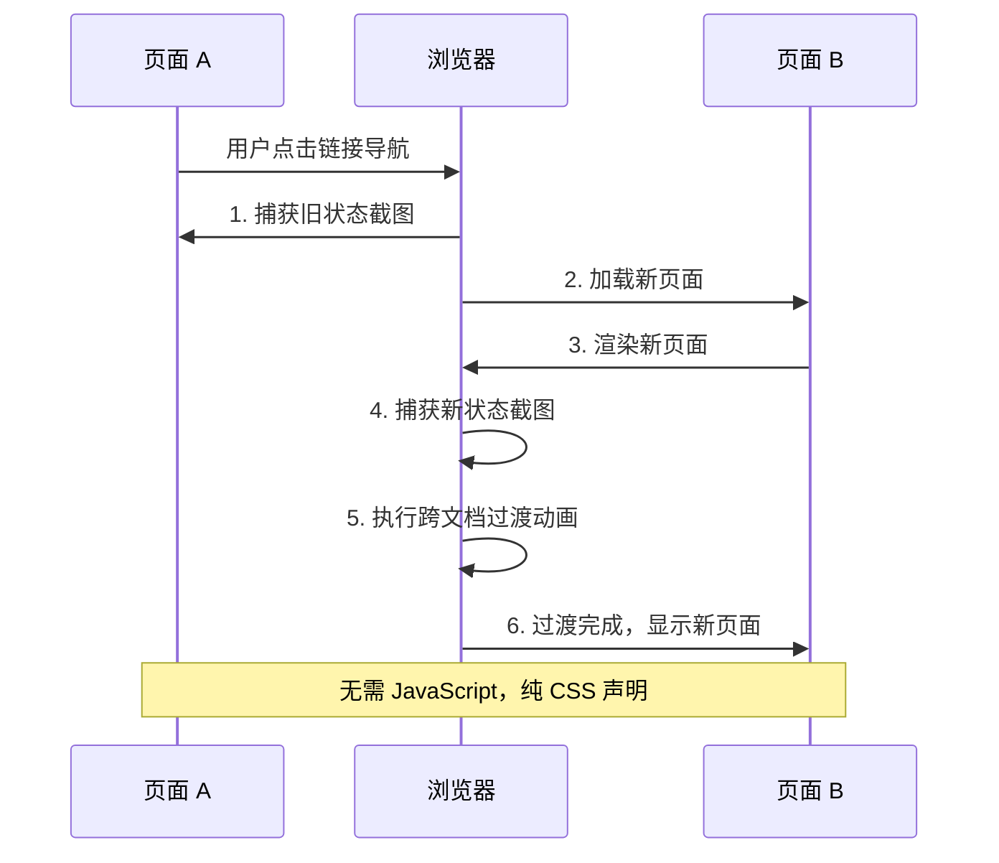

# 使用 CSS 视图过渡创造流畅的界面动效

原生应用程序（Native App）与 Web 应用程序之间的主要区别之一是，原生应用程序通常在屏幕之间拥有各种花哨的过渡效果：

  


  


在 Web 应用程序或网站上实现相同的效果一直是一个挑战，通常需要复杂和独特的方法。这个过程不仅非常困难，而且还容易出错。

  


可是，在现代 Web 开发中，为用户提供令人印象深刻的用户界面和交互效果变得越来越重要。任何一个人都会对笨拙的过渡效果和错综复杂的页面状态切换感到厌倦。CSS View Transition API 允许开发者将原生应用程序的过渡效果引入到 Web 应用或网站中，不仅适用于单页应用程序，还适用于多页应用程序。简单地说，如果要为 Web 应用程序创建优雅、丝滑般动画效果，那么 CSS View Transition API 将是得力助手，使开发者不再被重叠的状态所困惑，Web 应用或网站的用户体验将迎来一次重大升级。

  


CSS View Transition API 是一个令人兴奋的新技术，它为 Web 开发者提供了一个强大的工具，可用于创建流畅、生动的页面过渡和动画效果，比如页面滚动时的淡入淡出、元素的平滑移动以及各种各样的过渡效果，而无需繁琐的 JavaScript 代码。通过简单的 CSS 和一些 HTML 标记，就可以在 Web 网站或应用程序中实现引人注目的动画和过渡，提升用户体验。

  


本文深入介绍 CSS View Transition API 的工作原理，并提供实用的示例和技巧，帮助开发者在自己的项目中利用这一强大的技术。

  


## View Transitions API 是什么？

  


[CSS View Transitions API ](https://www.w3.org/TR/css-view-transitions-1/)（CSS 视图过渡 API）是一项 Web 技术，旨在简化在 Web 应用程序中创建动画过渡的过程，以实现在不同状态或视图之间的平滑切换。这个 API 允许 Web 开发人员在不需要复杂的 JavaScript 代码情况下，通过 CSS 来定义和管理页面之间的过渡效果，包括页面加载、视图切换和状态变化等。

  


在引入 CSS View Transitions API 之前，实现 Web 页面的视图过渡通常需要编写大量的 CSS 和 JavaScript 代码来处理以下任务：

  


-   加载和定位旧内容和新内容
-   创建动画效果以平滑过渡内容的变化
-   防止用户意外与旧内容进行交互
-   过渡完成后，删除旧内容
-   处理可访问性问题，如焦点管理、屏幕阅读器支持等

  


CSS View Transitions API 简化了这些任务，使 Web 开发人员能够以更少的代码和更少的可访问性问题来创建流畅的视图过渡。简单地说，在 CSS View Transitions API 中，Web 开发人员只需要更新 DOM 即可创建过渡效果更加流畅的动画效果。它主要通过以下方式工作：

  


-   快速切换 DOM 状态：CSS View Transitions API 可以瞬间切换 DOM 的两个状态，无需中间状态
-   创建可自定义的过渡效果：默认情况下，CSS View Transitions API 创建一个页面级别的交叉淡入淡出效果，但 Web 开发人员可以使用 CSS 属性进行自定义，以独立控制哪些元素被捕获和独立动画处理
-   使用伪元素：过渡状态由伪元素表示，开发人员可以使用熟悉的 CSS 动画来自定义每个过渡效果

  


CSS View Transitions API 允许 Web 开发者在视觉 DOM 更改状态之间添加动画过渡。这些更改可以是小的更改，比如，下面 Demo 所展示的内容切换，点击加号按钮新增标签（向 DOM 中新增新元素），点击关闭按钮删除标签（从 DOM 中删除元素）:

  


  


> Demo 地址：https://codepen.io/argyleink/details/GRPRJyM

  


这些更改也可以是较大的更改，例如从一个页面导航到另一个页面。以下是在单页应用程序（SPA）中使用视图过渡API 的演示：

  


  


> Demo 地址：https://astro-movies.pages.dev/

  


总之，CSS View Transitions API 是一项强大的工具，可以使 Web 应用程序的过渡效果更加流畅和交互性，而无需大量的 JavaScript 和 CSS 代码。它提供了一种更简单和更有效的方法来实现这些效果，提高了开发人员的生产效率，同时改善了用户体验。

  


## CSS 视图过渡案例

  


在开始深入了解 CSS View Transitions API 之前，先来看一些相关的案例，这些案例展示了该 API 的重要性和可能性。

  


为了确保能正常浏览这些案例，需要使用支持 View Transitions API 的浏览器（如 Chrome 111+ 或 Edge 111+，API 默认已启用）。在早期版本中，需要手动开启相关实验标志：

  


```
chrome://flags#view-transition
chrome://flags#view-transition-on-navigation
```

  


提示：以上两个实验标志已在 Chrome 111 中被移除，View Transitions API 无需任何配置即可使用。以下案例需要支持跨文档视图过渡的浏览器（Chrome 126+）才能完整体验：

  


  


先从页面切换过渡的案例开始，这些案例展示了 CSS View Transitions API 最初的设计意图：该 API 最初设计用于单页面应用程序（SPA），通过使用 CSS View Transitions API，在单页面应用程序中不同页面之间实现平滑的过渡效果，可以包括从一个页面到另一个页面的导航，而无需刷新整个页面。

  


  


> Demo 地址：https://live-transitions.pages.dev/ （可[点击这里下载源代码](https://github.com/Charca/view-transitions-live)）

  


  


> Demo 地址：https://astro-records.netlify.app/ （可[点击这里下载源代码](https://github.com/Charca/astro-records)）

  


  


> Demo 地址：https://astro-movies.pages.dev/ （可[点击这里下载源代码](https://github.com/Charca/astro-movies)）

  


上面这三个案例是 [@Maxi Ferreira 使用 Astro View Transitions 构建的](https://www.maxiferreira.com/blog/astro-page-transitions/)。

  


Astro 是最早接受并尝试使用 CSS View Transitions API 的，该 API 已内置到 Astro 3.0 中。[Astro View Transitions API](https://docs.astro.build/en/guides/view-transitions/) 只需要几行代码即可为每个页面启用视图过渡。视图过渡可以在不触发浏览器正常的全页面刷新的情况下更新页面内容，并在页面之间提供无缝的动画效果。它也向更广泛的社区展示了 CSS View Transitions API 的可能性。

  


现在，不使用任何 Web 框架也可以实现类似的效果。比如 [@Jake Archibald](https://twitter.com/jaffathecake) 制作的案例就展示了这一点：

  


  


> Demo 地址：https://http203-playlist.netlify.app/

  


上面这个 Demo 是一个 HTML 和 CSS 构建的简单多页面网站，仅添加了几行 JavaScript 代码，以增强过渡效果并使它们更加精致。

  


虽然 CSS View Transitions API 最初设计是用于单页面应用程序（SPA），但现在它也适用于多页面应用程序（MPA），甚至还可以用于静态网站。比如 [@Dave Rupert 的个人网站](https://daverupert.com/)，就是在[静态的 Jekyll 网站上使用了 CSS View Transitions API](https://daverupert.com/2023/05/getting-started-view-transitions/)，从首页切换到文章页有一个智能、完美和流畅的过渡效果，而且无需任何 JavaScript 代码：

  


  


正如示例中所展示的，CSS View Transitions API 在路由级别的情况下表现得非常出色。此外，还可以在更细粒度的层面上利用这个 API，甚至可以到达原子级别，以创建更令人兴奋的交互。

  


换句话说，上面所展示的都是页面切换过渡效果，其实在 Web 内容元素的动态加载上也可以很好地利用这个 API。当在 Web 页面上添加或删除元素时，元素的显示和隐藏过程中可以使用 CSS View Transition API 添加过渡动画效果。比如下面这两个效果：

  


  


> Demo 地址：https://codepen.io/argyleink/details/GRPRJyM

  


  


> Demo 地址：https://codepen.io/argyleink/details/rNQZbLr

  


上面这两个效果是由 [@Adam Argyle](https://codepen.io/argyleink) 制作的，可以在 CodePen 上查看示例的源代码。在第一个示例中，点击加号按钮时添加新标签（即添加元素）和点击标签项上的关闭按钮时删除标签（即删除元素）都具有平滑的过渡效果。另一个示例演示了使用 CSS View Transitions API 为一个拖放组件添加过渡效果。

  


[@Adam Argyle](https://codepen.io/argyleink) 还有几个很棒的示例，比如拖动滑块（`range`），计数器改变时有一个过渡效果：

  


  


  


> Demo 地址：https://codepen.io/argyleink/full/jOQKdeW

  


下面这个是文本替换时有一个完美的过渡效果：

  


  


> Demo 地址：https://codepen.io/argyleink/details/KKBWwMr

  


这些出色的案例展示了 CSS View Transitions API 如何为 Web 应用程序提供平滑、可定制的过渡效果，以增强用户体验。更为重要的是，这些出色的案例都是基于 HTML 和 CSS 以及几行简单的 JavaScript 完成的，这其中离不开 CSS View Transitions API 的功劳。

  


看到这些出色案例之后，接下来了解 CSS View Transition API 的工作原理以及如何使用它，就可以着手制作属于自己的视图过渡案例。

  


## 快速认识 CSS View Transitions API

  


先从简单的示例着手，这样更有利于理解 CSS View Transitions API。

  


假设页面上有一个按钮，点击这个按钮时会往 Web 页面上塞入一张图片。通常情况下，当图片被塞入到页面时，不会有任何花哨的动画效果。下面看看如何使用 CSS View Transitions API 给图片添加平滑的过渡效果。

  


首先，在 HTML 文档中，需要一个 `<button>` 和放置图片的容器：

  


```HTML
<div class="figure"></div>
<button class="add">添加图片</button>
```

  


需要写几行 JavaScript 代码，使得用户点击“添加图片”按钮后，可以往 `.figure` 容器中塞入 `` （即图片）：

  


```JavaScript
const button = document.querySelector('.add');
const figure = document.querySelector('.figure');

button.addEventListener("click", () => {
    const newImage = document.createElement("img");
    newImage.src=`https://picsum.photos/800/600?random=${getRandomInteger(1, 101)}`;
    figure.appendChild(newImage);
});

// 生成一个介于min（包括）和max（不包括）之间的随机整数
function getRandomInteger(min, max) {
    return Math.floor(Math.random() * (max - min)) + min;
}
```

  


  


> Demo 地址：https://codepen.io/airen/full/KKJYKXq

  


正如上面所展示的，用户点击按钮可以正常地往 `.figure` 容器中新增图片（`img`），但这个过程没有任何动画效果，显得有点生硬。

  


接下来要做的，是使用 CSS View Transitions API 给图片添加过渡效果。只需要在想要将图片（`img`）塞入到 `.figure` 容器时调用 `document.startViewTransition()`方法，如下所示：

  


```JavaScript
const button = document.querySelector(".add");
const figure = document.querySelector(".figure");

button.addEventListener("click", () => {
    const newImage = document.createElement("img");
    newImage.src = `https://picsum.photos/800/600?random=${getRandomInteger(
        1,
        101
    )}`;
    
    // 这将启动 View Transitions
    document.startViewTransition(() => {
        figure.appendChild(newImage);
    });
});
```

  


并且在 CSS 中增加下面这段代码：

  


```CSS
::view-transition-old(root),
::view-transition-new(root) {
    animation-duration: 1s;
}
```

  


  


> Demo 地址：https://codepen.io/airen/full/zYyjzZq

  


正如上面所展示的，点击按钮时可以观察到平滑的淡入过渡。

  


再来看一个图片墙（Photo Gallery）的案例：

  


  


> Demo 地址：https://codepen.io/airen/full/MWLRWOO

  


这是 Web 上一个经典的组件，以往要实现这样的效果是需要依赖复杂的 JavaScript 脚本的。现在使用 CSS View Transitions API 构建的话，只需要几行 CSS 代码和一点 JavaScript 代码即可。

  


实现上面这个示例，需要类似下面这样的 HTML 结构：

  


```HTML
<figure>
    
    <figcaption>Decorate tree</figcaption>
</figure>
<ul class="thumbnails">
    <li>
        
    </li>
    <!-- 省略其他列表项 -->
</ul>
```

  


和上面那个案例相似，在 `document.startViewTransition()` 方法中使 `figure` 重新显示图片 `displayNewImage()` ：

  


```JavaScript
const thumbnails = document.querySelector(".thumbnails");
const mainImage = document.querySelector("figure img");
const imageHeading = document.querySelector("figcaption");

const thumbnailHandler = (event) => {
    const clickTarget = event.target;
  
    const displayNewImage = () => {
        mainImage.src = clickTarget.src;
        imageHeading.textContent = clickTarget.alt;
        document.documentElement.style.setProperty(
            "--originPosUnit",
            `${getComputedStyle(clickTarget).getPropertyValue("--index") * 25 + 12.5}%`
        );
    };

    if (clickTarget.classList.contains("thumbnail")) {
        if (!document.startViewTransition) {
            displayNewImage();
            return;
        }
     
        const transition = document.startViewTransition(() => displayNewImage());
    }
};

thumbnails.addEventListener("click", thumbnailHandler, false);
```

  


可以使用 `view-transition-name` 属性给视图过渡提供一个独特的标识名称，并且将其当作 `::view-transition-old()` 和 `::view-transition-new()` 伪元素来匹配 `view-transition-name` 指定的视图转换组。

  


```CSS
@layer transitions {
    :root {
        --originPosUnit: 25%;
    }

    @keyframes grow {
        from {
            scale: 0;
        }
        to {
            scale: 1;
        }
    }

    figure {
        view-transition-name: figure;
    }
  
    figcaption {
        view-transition-name: figureCaption;
    }

    ::view-transition-old(figure),
    ::view-transition-new(figure) {
        transform-origin: 100% var(--originPosUnit);
    }

    ::view-transition-new(figure) {
        animation: 400ms ease-out both grow;
    }
}
```

  


与 CSS View Transitions API 一起工作非常简单。然而，在创建更多示例之前，有必要花点时间了解 CSS View Transitions API 幕后的工作机制。

  


## 探究 View Transitions API 的基础知识

  


大多数 Web 开发者最初都可能会觉得 CSS View Transitions API 很神秘，用起来很复杂，学起来较困难。事实上并非如此，一旦了解它是如何工作的，并创建一些示例，就能对它有很好的掌握。现在一起来探究它的基础知识，看看 View Transitions API 幕后发生了什么。

  


先从最简单的示例开始来深入了解 CSS View Transitions API 的世界：每次单击页面时，都会随机出现一个表情符：

  


  


> Demo 地址：https://codepen.io/airen/full/LYqvYOq

  


可以注意到，在离开的表情符号和新出现的表情符号之间有一个微妙的淡入淡出的过渡效果。这实际上是浏览器在处理视图过渡时的默认行为：它会无缝地处理旧状态和新状态之间的过渡效果，采用一个交叉淡入的效果。

  


这个效果是通过在 DOM 更新之前使用 `document.startViewTransition()` 方法实现的，它是 [CSS View Transitions 中的一个 API](https://www.w3.org/TR/css-view-transitions-1/#ViewTransition-prepare)。当调用 `document.startViewTransition()` 时，它会提示浏览器捕获当前 DOM 状态的快照。可以将其视为当前屏幕上显示内容的快速照片。

  


然后，魔法就开始了。在 `document.startViewTransition()` 中提供的回调函数被调用，这是更改 Web 页面上内容的地方。也就是说，浏览器在捕获当前 DOM 状态的快照之后，就触发了 `document.startViewTransition()` 提供的回调函数。一旦回调函数完成了它的任务，浏览器会再次获取快照，但这一次是新的页面状态，即刚刚更新的状态。同时，浏览器在此回调期间巧妙地暂停了渲染，以防止任何闪烁，并且执行得非常迅速。

  


在这个示例中，还使用 `document.startViewTransition` 来检测浏览器是否支持 CSS View Transitions API。如果检测到支持，就会调用带有指定回调函数的 `document.startViewTransition()` ；如果不支持，回调函数会立即被调用。这种方法可以让 CSS View Transitions API 的使用以渐进增强的方式进行。

  


```JavaScript
function viewTransition(fn, params) {
    // 检测浏览器是否支持 CSS View Transitions API
    if (document.startViewTransition) {
        document.startViewTransition(() => fn(params));
    } else {
        fn(params);
    }
}

// 创建起始表情符
viewTransition(() => renderEmoji(getRandomEmoji()));

// 当页面被点击时，随机渲染一个表情符
document.body.addEventListener("click", () =>
    viewTransition(() => renderEmoji(getRandomEmoji()))
);
```

  


简单地说，整个 JavaScript 部分只有一行核心代码，即：

  


```JavaScript
document.startViewTransition(() => {
    // 变化操作
})
```

  


它会告诉浏览器，开始视图变换。这个时候整个过程包括三个部分：

  


-   调用 `document.startViewTransition()` ，浏览器会捕获 DOM 当前状态的快照
-   执行 `document.startViewTransition()` 提供的回调函数，浏览器会捕获 DOM 更新后状态的快照
-   触发两者（新旧快照）的过渡动画，包括透明度、位移等变化，也可以自定义 CSS 动画。但浏览器默认的过渡效果是一种交叉淡入的效果

  


`document.startViewTransition()` 的整个执行过程如下：

  


  


一旦浏览器捕获了 DOM 的“之前”和“之后”的快照，浏览器就会继续使用这些快照来创建一个特殊的结构，类似于覆盖在页面上的叠加层，而且这个叠加层位于页面上的所有其他内容之上。这个结构包括旧快照和新快照，它们叠放在一起，并且有着不同的层级，就像一个伪元素树一样：

  


  


对每个伪元素做一个简要解释：

  


-   `::view-transition` ：新旧快照的容器
-   `::view-transition-group` ：是一个具有名称的视图过渡伪元素，表示匹配的具有名称的视图过渡快照。也是在两种状态之间动画化大小和位置
-   `::view-transition-image-pair` ：是一个具有名称的视图过渡伪元素，表示一对相应的旧、新视图过渡快照。存在的目的是提供隔离，以便两个快照可以正确交叉淡入淡出
-   `::view-transition-old` ： 旧状态的视觉快照，作为一个替代元素存在，用于交叉淡入淡出的视觉状态
-   `::view-transition-new` ： 新状态的视觉快照，作为一个替代元素存在，用于交叉淡入淡出的视觉状态

  


在这个伪 DOM 结构树中，最顶层有 `::view-transition` ，充当所有视图过渡的总容器。在下面，`::view-transition-group(root)` 成为核心，充当 DOM 当前状态的快照（旧快照）`::view-transition-old(root)` 以及 DOM 更新状态的快照（新快照）`::view-transition-new(root)` 的总容器。

  


根据这个结构安排，浏览器使用 CSS 动画来优雅的从 `::view-transition-old(root)` 淡出到 `::view-transition-new(root)` 。即旧快照（`::view-transition-old(root)`）会淡出，就像将不透明度从 `1` 降低到 `0` （有点类似于下面的代码中 `-ua-view-transition-fade-out` 的动画效果），新快照（`::view-transition-new(root)`）会淡入，就像将不透明度从 `0` 增加到 `1` （有点类似于下面代码中 `-ua-view-transition-fade-in` 的动画效果 ）。这样一来，浏览器就为视图过渡创建了常见的交叉淡入淡出的效果。

  


```CSS
@keyframes -ua-view-transition-fade-in {
    0% {
        opacity: 0;
    }
    
    100% {
        opacity: 1;
    }
}

@keyframes -ua-view-transition-fade-out {
    0% {
        opacity: 1;
    }
    
    100% {
        opacity: 0;
    }
}

html::view-transition-old() {
    animation-name: -ua-view-transition-fade-out;
    animation-duration: inherit;
    animation-fill-mode: inherit;
}

html::view-transition-new() {
    animation-name: -ua-view-transition-fade-in;
    animation-duration: inherit;
    animation-fill-mode: inherit;
}
```

  


注意，这个默认动画是在用户代理的样式表中定义的。

  


对于这些伪 DOM 结构树（覆盖层），它们会随这个动画完成而消失。即一旦这个动画完成，覆盖层就会被移除，显示出底下的最终页面状态。这个过程经过巧妙设计，以确保旧内容和新内容不会同时存在，从而助于避免辅助功能、可用性和布局方面的问题。

  


现在来看一下真正有趣的部分。这些伪 DOM 结构层都可以被 CSS 选择器选中，因此可以添加任何有效的 CSS 属性来自定义动画和行为。例如，可以通过以下方式延长淡入淡出的持续时间（`animation-duration`）：

  


```CSS
::view-transition-group(root) {
    animation-duration: 2s;
}
```

  


  


> Demo 地址：https://codepen.io/airen/full/KKJYKZq

  


将 `animation-duration` 设置为 `2s` 后，默认的交叉淡入淡出效果被延长，以获得更加戏剧化的效果。

  


还可以通过 `::view-transition-old()` 和 `::view-transition-new()` 伪元素，分别给新旧两种状态设置不同的延迟时间。比如：

  


```CSS
::view-transition-old(root) {
    animation-duration: 1.5s;
}

::view-transition-new(root) {
    animation-duration: 3s;
}
```

  


  


> Demo 地址：https://codepen.io/airen/full/QWYPWQv

  


不难发现，旧视图的快照（旧状态）淡出要比新视图的快照（新状态）淡入要快一半。

  


这两个示例所展示的，仅是调整新旧视图对应动画持续时间，事实上，`animation-*` 相关属性的值都可以通过 `::view-transition-old()` 和 `::view-transition-new()` 选择器来调整。例如：

  


```CSS
::view-transition-old(root) {
    animation-duration: .2s;
    animation-timing-function: ease-in;
}

::view-transition-new(root) {
    animation-duration: 2s;
    animation-timing-function: ease-out;
}
```

  


  


> Demo 地址：https://codepen.io/airen/full/NWomWYd

  


当然，还可以重置浏览器给视图过渡的默认动画效果，比如：

  


```CSS
@keyframes fade-and-scale-in {
    from {
        opacity: 0;
        scale:0;
    }
    to {
        opacity: 1;
        scale:1;
    }
}
@keyframes fade-and-scale-out {
    from {
        opacity: 1;
        scale:1;
    }
    to {
        opacity: 0;
        scale:0;
    }
}

::view-transition-old(root) {
    animation: fade-and-scale-out 0.2s ease-in-out 1 forwards;
}
::view-transition-new(root) {
    animation: fade-and-scale-in 1s ease-in-out 1 forwards;
}
```

  


  


> Demo 地址：https://codepen.io/airen/full/jOdROzw

  


上面所看到的就是调整后的动画效果。这个示例说明，完全可以使用 CSS 动画来自定义视图过渡的动画效果。

这就是 CSS View Transitions API 的基础原理：它捕捉快照，应用更改，使用交叉淡入淡出进行动画处理，并平稳呈现最终结果。

  


## 深入探究 View Transitions API

  


通过上面的学习，对 CSS View Transitions API 应该有了一定的认知，也可以使用它制作出一些视图过渡的效果。但 CSS View Transitions API 的能力不仅限于此，接下来进一步探究它的功能。

  


接着从上面示例开始聊起。正如上面所看到的，上面示例使用自定义动画效果覆盖了浏览器默认给视图过渡设置的动画效果。这个效果作用于整个文档，因此看到的效果是整个文档在变化，而不是页面某个部分或某个元素在变化：

  


  


事实上，期望的仅是表情符更换时有相应的过渡效果，也就是说，视图过渡动效只希望用在 `.stage` 元素（`<h1>`）上。要实现这个效果，将要使用到 CSS View Transitions API 中的 `view-transition-name` 功能。`view-transition-name` 是一个 CSS 属性，允许为选中的元素（例如 `.stage`）提供一个特殊的名称，即给视图过渡命名，它能很好地与根视图过渡区分开。

  


例如，上面大部分示例中只使用了 `::view-transition-group(root)` 、`::view-transition-old(root)` 和 `::view-transition-new(root)` ，它们其实相当于：

  


```CSS
:root::view-transition-group(root) {}
:root::view-transition-old(root) {}
:root::view-transition-new(root) {}

/* 或者 */
html::view-transition-group(root) {}
html::view-transition-old(root) {}
html::view-transition-new(root) {}
```

  


如果把 `view-transition-name` 引入进来的话，那么可以这么来理解：客户端默认使用 `view-transition-name` 定义了一个名为 `root` 的视图过渡：

  


```CSS
:root {
    view-transition-name: root;
}
```

  


即 `::view-transition` 的最顶层拥有一个 `::view-transition-group(root)` 。

  


也就是说，其他元素也可以像根元素 `:root` 这样，使用 `view-transition-name` 命名一个新的视图过渡。例如，给 `.stage` 元素命名一个名为 `stage` 的视图过渡：

  


```CSS
.stage {
    view-transition-name: stage;
}
```

  


然后，`::view-transition-old()` 和 `::view-transition-new()` 引用 `view-transition-name` 指定的视图过渡名 `stage` ：

  


```CSS
.stage {
    view-transition-name: stage;
}

::view-transition-old(stage) {
    animation: fade-and-scale-out 0.2s ease-in-out 1 forwards;
}

::view-transition-new(stage) {
    animation: fade-and-scale-in 1s ease-in-out 1 forwards;
}
```

  


现在，视图过渡服务于 `.stage` 元素，看到的效果也是所期望的：

  


  


> Demo 地址：https://codepen.io/airen/full/zYeXYWL

  


现在回过头来看[ @Adam Argyle 的文本替换的过渡动画效果就一目了然了](https://codepen.io/argyleink/full/KKBWwMr)。甚至可以在它的基础上将整个效果变得更为灵活一些：

  


  


> Demo 地址：https://codepen.io/airen/full/gOqyOza

  


这个案例的 HTML 结构很简单，就一个 `<h1>` 标签：

  


```HTML
<h1 class="stage"></h1>
```

  


JavaScript 主要做的就是将预置的文本和输入框输入的文本进行分词，然后将分出来的每个字母当作 `<h1>` 元素的内容。当然，每次更新都有视图过渡的效果：

  


```JavaScript
const stage = document.querySelector(".stage");
const input = document.querySelector("#word");
let word = input.placeholder.split("");
const rate = 1000;

let index = 0;

input.addEventListener('change', (etv) => {
    word = etv.target.value.split("");
})

function viewTransition(fn, params) {
    if (document.startViewTransition) {
        document.startViewTransition(() => fn(params));
    } else {
        fn(params);
    }
}

setInterval(() => {
    viewTransition(() => {
        stage.textContent = word[index++];
    
        if (index >= word.length) {
            index = 0;
        }
    });
}, rate);
```

  


CSS 的关键部分如下所示：

  


```CSS
@layer transitions {
    @keyframes fade-out {
        to {
            opacity: 0;
        }
    }

    @keyframes scale-down {
        to {
            scale:0.75;
        }
    }

    @keyframes slide-in-up {
        0% {
            translate:0 100%;
        }
    }

    :root {
        view-transition-name: none;
        --animation-fade-out: fade-out 0.5s cubic-bezier(0.25, 0, 0.3, 1);
        --animation-scale-down: scale-down 0.5s cubic-bezier(0.25, 0, 0.3, 1);
        --animation-slide-in-up: slide-in-up 0.5s cubic-bezier(0.25, 0, 0.3, 1);
    }

    .stage {
        view-transition-name: stage;
    }

    ::view-transition-old(stage) {
        animation: var(--animation-fade-out), var(--animation-scale-down);
    }

    ::view-transition-new(stage) {
        z-index: 1;
        animation: var(--animation-fade-out) reverse, var(--animation-slide-in-up);
    }
}
```

  


也可以将示例中的文本换成表情符：

  


  


> Demo 地址：https://codepen.io/airen/full/yLZrLjP

  


注意，在这个示例中，在 `:root` 元素中将 `view-transition-name` 属性的值显式设置为 `none` ：

  


```CSS
:root {
    view-transition-name: none;
}
```

  


这是因为，示例中 `stage` 视图过渡组是唯一要进行过渡的，根过渡无需捕捉其快照，所以可以将其禁用。在 CSS 中要禁用一个视图过渡组很简单，就像上面示例所示那样，将 `view-transition-name` 属性值设置为 `none` 即可。

  


换句话说，使用 `view-transition-name` 给视图过渡组命名时，可以使用任何喜欢的名称，只要不是 `none` 。从实践经验来看，给视图过渡组命名时尽量不要使用 CSS 值关键词，比如 `auto` 、`inherit` 等，这样可以尽可能地避免带来不必要的麻烦。

  


还有一点需要知道，在给视图过渡组命名时，应该确保在每个页面上保持这个名称的唯一性。如果同一个页面上的两个元素在同一时间共享相同的 `view-transition-name` 属性值，那么过渡就不会发生。

  


前面讨论过视图过渡的伪 DOM 树。当使用 `view-transition-name` 添加另一个视图过渡时，会创建一个新的分支。例如：

  


```CSS
.stage {
    view-transition-name: stage;
}
```

  


此时，伪 DOM 树变成下面这样子的：

  


  


[@Bramus 在 CodePen 上提供了一个可视化工具](https://codepen.io/seyedi/full/bGOpyrX)，可以更好地帮助理解视图过渡中的伪 DOM 结构：

  


  


> 视图过渡伪 DOM 结构层可视化工具：https://codepen.io/seyedi/full/bGOpyrX

  


CSS 的 `view-transition-name` 属性对特定过渡组的这种细粒度控制进一步增强了 Web 开发者对其先前（旧状态）和新状态的精确定位能力。针对其中的任一状态的这种能力为应用不同的动画效果打开了途径：

  


```CSS
::view-transition-old(stage) {
    /* 为视图过渡中的旧状态提供动画效果 */
}

::view-transition-new(stage) {
    /* 为视图过渡中的新状态提供动画效果 */
}
```

  


这意味着可以使用新的伪元素来自定义新的视图过渡。例如：

  


```CSS
::view-transition-old(stage) {
    animation: var(--animation-fade-out), var(--animation-scale-down);
}

::view-transition-new(stage) {
    animation: var(--animation-fade-out) reverse, var(--animation-slide-in-up);
}
```

  


虽然使用 CSS View Transitions API 实现了期望的视图过渡效果，但它也带来一个小问题：在过渡到新状态期间，浏览器会生成伪 DOM 结构，这个结构的最顶层 `::view-transition` 元素会无意中阻止整个视图过渡期间的点击交互。为了避免这个现象，可以通过将其 `pointer-events` 属性设置为 `none` ：

  


```CSS
::view-transition {
    pointer-events: none;
}
```

  


通过上面的学习，应该已经知道如何使用 CSS View Transitions API 了：

  


-   可以通过伪元素 `::view-transition-group()` 、`::view-transition-old()` 和 `::view-transition-new()` 选择视图过渡中所需要的伪 DOM 元素。即获取到视图过渡中的新旧状态
-   可以通过 `view-transition-name` 为视图过渡命名
-   可以通过 CSS 的 `@keyframes` 来自定义视图过渡的动画效果
-   最为关键的是，要使用 `document.startViewTransition()` 方法来启动过渡效果

  


换句话说，要给一个元素添加视图过渡效果，可以通过以下几个步骤来完成。

  


首先**为目标元素添加** **`view-transition-name`** **属性**，这个属性的值将用于标识要过渡的元素：

  


```CSS
.target--element {
    view-transition-name: my-transition;
}
```

  


接着**自定义 CSS 动画**，以描述元素在过渡期间应该如何变化。可以使用 `@keyframes` 规则来创建动画，也可以使用现代的 CSS 动画库，比如 `animate.css` 。在定义动画时，最好让它们成对出现，其中一个用于旧状态（离开 `exit`），另一个则用于新状态（进入 `entrances`）。例如：

  


```CSS
/* Exit */
@keyframes slideOutRight {
    from {
        translate:0 0 0;
    }

    to {
        visibility: hidden;
        translate:100% 0 0;
    }
}

/* Entrances */
@keyframes slideInLeft {
    from {
        translate: -100% 0 0;
        visibility: visible;
    }

    to {
        translate:0 0 0;
    }
}
```

  


定义好的 CSS 动画，可以用于 `::view-transition-old()` （使用离开 `exit` 对应的动画）和 `::view-transition-new()` （使用进入 `entrances` 对应的动画）：

  


```CSS
::view-transition-old(my-transition) {
    animation: slideOutRight 1s ease-in both;
}

::view-transition-new(my-transition) {
    animation: slideInLeft 2s ease-out both;
}
```

  


万事俱备，只欠东风。最后，在 JavaScript 中使用 `document.startViewTransition()` 方法来启动视图过渡效果，传递一个回调函数，该函数用于在过渡期间更新元素的状态：

  


```JavaScript
function viewTransition(fn, params) {
    if (document.startViewTransition) {
        document.startViewTransition(() => fn(params));
    } else {
        fn(params);
    }
}

viewTransition(() => {
    // 要做的事情放在这里
}});
```

  


把它们结合在一起，就可以使用 CSS View Transitions API 制作出很多有创意的视图过渡效果。

  


来看一个综合案例：根据一定的条件对内容进行过滤，这在 Web 上是一个很常见的效果：

  


  


> Demo 地址：https://codepen.io/airen/full/JjxVjvx

  


在这个案例中，使用位于顶部的控件（条件选项），可以切换内容可见性（根据条件过滤内容）、改变顺序，以及两者结合。此外，单击任何一张图片都会触发效果：它会扩展，占据网格中的额外行和列。

  


实现这个效果，需要像下面这样的 HTML 结构：

  


```HTML
<ul class="nav">
    <li class="active" id="all">All Images</li>
    <li  id="newYork" class="js-newyourk">New York City</li>
    <li id="flowers" class="js-">Flowers</li>
    <li  id="others">Others</li>
</ul>

<div class="gallery">
    <figure class="gallery--item flowers" style="--index: 1;">
        
    </figure>
    <!-- 省略其他 figure -->
</div>
```

  


在每个 `figure` 元素上使用自定义属性 `--index` 设置了它的索引号，该索引号从 `1` 开始，因为后面在定义每个视图过渡组时，需要用到 `--index` 自定义属性。

  


这个示例最大的特点是，每个 `figure` 元素都具有视图过渡效果。因此，首要做的就是确保每个 `figure` 元素都有自己独特的视图过渡名称。

  


```JavaScript
const galleryItems = document.querySelectorAll(".gallery--item");

galleryItems.forEach((item) => {
    // 获取每个元素上定义的 --index 属性的值
    const index = getComputedStyle(item).getPropertyValue("--index");
    
    // 设置 view-transition-name 属性的值
    const groupName = `item-${index}`;
    item.style.viewTransitionName = groupName;
}
```

  


上面的代码对所有 `figure` 进行了遍历，并且以字符串 `item-` 为前缀，结合自定义属性 `--index` 的值组合成 `view-transition-name` 属性的值。这样一来，每个 `figure` 元素都具有独特的视图过渡名称。即：

  


```CSS
figure {
    &:nth-child(1) {
        view-transition-name: item-1;
    }
    &:nth-child(2) {
        view-transition-name: item-2;
    }
    
    /* 以此类推 */
}
```

  


使用简短的几行 JavaScript 代码，可以帮助省去编写很多重复性的 CSS 代码。当然，也可以使用 CSS 自定义属性的方式来设置 `view-transition-name` 的值。例如：

  


```JavaScript
galleryItems.forEach((item) => {
    const transitionStyle = document.createElement("style");
    const index = getComputedStyle(item).getPropertyValue("--index");
    const groupName = `item-${index}`;
    item.style.setProperty(`--view-transition-name`, groupName);
}
```

  


然后在 CSS 中引用定义的自定义属性 `--view-transition-name` ：

  


```CSS
figure {
    view-transition-name: var(--view-transition-name);
}
```

  


为每个元素命名好视图过渡名称之后，就可以使用 CSS 的 `@keyframes` 来定义视图过渡所需的动画效果了：

  


```CSS
@keyframes scale-out {
    to {
        scale: 0;
    }
}

@keyframes fade-in {
    to {
        opacity: 1;
    }
}
```

  


在这个示例中，定义了两个动画：

  


-   `scale-out` 动画会将元素从正常状态缩小到不可见
-   `fade-in` 动画会将元素的透明度从 `0` 过渡到 `1`

  


它们分别用于 `::view-transition-old()` 和 `::view-transition-new()` 伪元素上。只不过，在这个示例中同样使用 JavaScript 编写，有利于减少重复性的代码编写：

  


```JavaScript
galleryItems.forEach((item) => {
    // 创建 <style> 标签元素
    const transitionStyle = document.createElement("style");
    
    // 获取 --index 自定义属性的值
    const index = getComputedStyle(item).getPropertyValue("--index");
    
    // 在每个元素上创建 --view-transition-name 自定义属性，并且值为 groupName
    const groupName = `item-${index}`;
    item.style.setProperty(`--view-transition-name`, groupName);
  
    // 在每个 figure 元素中插入 style 元素
    item.appendChild(transitionStyle);
  
    // 每个 style 元素插入相应的 CSS 代码  
    transitionStyle.innerHTML = `
        @media (prefers-reduced-motion: no-preference) {
            ::view-transition-old(${groupName}) {
                animation: scale-out 200ms ease-out forwards;
            }
        
            ::view-transition-new(${groupName}) {
                animation: 
                    fade-in 100ms ease-in normal forwards , 
                    scale-out 400ms ease-in reverse none;
            }
        }

        ::view-transition-group(${groupName}) {
            animation-delay: ${index * 20}ms;
        }
    `;
}
```

  


它相当于在 CSS 中编写类似下面这样的代码：

  


```CSS
/* 过渡视图 item-1 */
::view-transition-old(item-1) {
    animation: scale-out 200ms ease-out forwards;
}

::view-transition-new(item-1) {
    animation:
        fade-in 100ms ease-in normal forwards , 
        scale-out 400ms ease-in reverse none;
}

::view-transition-group(item-1) {
    animation-delay: calc(var(--index) * 20ms);
}

/* 过渡视图 item-2 */
::view-transition-old(item-2) {
    animation: scale-out 200ms ease-out forwards;
}

::view-transition-new(item-2) {
    animation:
        fade-in 100ms ease-in normal forwards , 
        scale-out 400ms ease-in reverse none;
}

::view-transition-group(item-2) {
    animation-delay: calc(var(--index) * 20ms);
}

/* 以此类推 */
```

  


如果代码中有 `N` 个 `figure` 元素，就会有 `N` 个 `::view-transition-old(item-N)` 、`::view-transition-new(item-N)` 和 `::view-transition-group(item-N)` 。这样机械性地编写 CSS 代码，对于 Web 开发者来说是极其痛苦又毫无意义的。

  


最后要做的是，使用 `document.startViewTransition()` 方法触发视图过渡，并且在触发之后调用相应的回调函数。在这个示例中，用户点击每个过滤选项时，会调用这个方法，并根据相应的条件，将对应的内容隐藏起来：

  


```JavaScript
const galleryItems = document.querySelectorAll(".gallery--item");
const tablis = document.querySelectorAll(".nav > li");

const imgNy = document.querySelectorAll(".newYork");
const imgFlowers = document.querySelectorAll(".flowers");
const imgOthers = document.querySelectorAll(".others");

tablis.forEach((li) => {
    li.addEventListener("click", (event) => {
        // 删除所有导航项的 active 类名
        tablis.forEach((item) => {
            item.classList.remove("active");
        });
        
        // 给当前导航项添加 active 类名，用户当时点击的导航项
        event.target.classList.toggle("active");
        
        // 如果导航项的 id 名为 all，所有 figure 都显示
        if (event.target.id == "all") {
            // 启用 startViewTransition
            viewTransition(() => {
                for (let i = 0; i < galleryItems.length; i++) {
                    galleryItems[i].style.display = "block";
                }
            });
        }
        
        // 如果导航项的 id 名为 newYork，则只显示带有类名为 newYork 的 figure 元素
        if (event.target.id == "newYork") {
            viewTransition(() => showImages(imgNy, imgFlowers, imgOthers));
        }
        
        // 如果导航项的 id 名为 flowers，则只显示带有类名为 flowers 的 figure 元素
        if (event.target.id == "flowers") {
            viewTransition(() => showImages(imgFlowers, imgNy, imgOthers));
        }
    
        // 如果导航项的 id 名为 others，则只显示带有类名为 others 的 figure 元素
        if (event.target.id == "others") {
            viewTransition(() => showImages(imgOthers, imgFlowers, imgNy));
        }
    });
});
```

  


示例中将 `document.startViewTransition()` 方法要做的事情封装在一个名为 `viewTransition()` 函数中：

  


```JavaScript
function viewTransition(fn, params) {
    if (document.startViewTransition) {
        document.startViewTransition(() => fn(params));
    } else {
        fn(params);
    }
}
```

  


另外，封装好的 `showImages()` 函数主要用于控制哪种类型图片显示与隐藏，即 `document.startViewTransition()` 中的回调函数：

  


```JavaScript
function showImages(showImg, hideImg1, hideImg2) {
    for (let i = 0; i < showImg.length; i++) {
        showImg[i].style.display = "block";
    }
    
    for (let i = 0; i < hideImg1.length; i++) {
        hideImg1[i].style.display = "none";
    }
    
    for (let i = 0; i < hideImg2.length; i++) {
        hideImg2[i].style.display = "none";
    }
}
```

  


现在就差最后一步，给每个 `figure` 元素添加单击事件，该事件就只做一件事情，给点击元素添加或删除 `active` 类名：

  


```JavaScript
galleryItems.forEach((item) => {
    // 省去其他代码
    item.addEventListener('click', () => {
        viewTransition(() => item.classList.toggle("active"));
    })
});
```

  


注意，该事件所做的事情也被当作 `viewTransition()` 函数中的回调函数。有了这个类名之后，就可以在 CSS 中调整其布局了，使用 `grid-area` 属性，使其在网格中同时占两行和两列：

  


```CSS
figure.active {
    grid-area: span 2 / span 2;
}
```

  


到此就完成了 Demo 所有编码。[最终代码请查看 Demo 的源码](https://codepen.io/airen/full/GRPGgPK)。

  


使用同样的方法可以给列表增加和删除列表项时添加视图过渡的动画效果，使其更直观。

  


  


> Demo 地址：https://codepen.io/airen/full/BaMEaVL

  


构建上面这个示例，需要一个像下面这样的 HTML 结构：

  


```HTML
<ul id="list" class="list">
    <li style="--view-transition-name: item-0;">Apple</li>
    <li style="--view-transition-name: item-1;">Banana</li>
    <li style="--view-transition-name: item-2;">Guanabana</li>
    <li style="--view-transition-name: item-3;">Star Fruit</li>
    <li style="--view-transition-name: item-4;">Dragonfruit</li>
</ul>
```

  


注意，上面代码中的 `--view-transition-name` 很重要，因为每个列表项需要唯一的 `view-transition-name` ：

  


```CSS
.list li {
    view-transition-name: var(--view-transition-name);
}
```

  


这样做的原因是，列表项都需要独立移动，它们可能会根据列表位置移动或不移动。

  


和其他示例一样，使用 `::view-transition-old()` 和 `::view-transition-new()` 伪元素为列表项指定视图过渡的动画效果。

  


```CSS
@layer transitions {
    @keyframes outgoing {
        0% {
            translate: 0 0;
            scale: 1;
            opacity: 1;
        }
        100% {
            translate: 100px -50px;
            scale: 1.2;
            opacity: 0;
        }
    }
    
    @keyframes incoming {
        0% {
            scale: 1.6;
            opacity: 0;
            translate: -100px 0;
        }
        100% {
            scale: 1;
            opacity: 1;
            translate: 0 0;
        }
    }
    
    .list li {
        view-transition-name: var(--view-transition-name);
    }
    
    .incoming {
        animation: 0.6s incoming both;
    }
    
    ::view-transition-old(outgoing) {
        animation: 1s outgoing both;
    }
}
```

  


在这个示例中，仅为新增和删除列表项时设置了视图过渡的动画效果。同样的，列表项的新增和删除都是在 `viewTransition()` 中完成：

  


```JavaScript
addButton.addEventListener("click", () => {
    viewTransition(() => {
        addItem();
    });
});

deleteButton.addEventListener("click", () => {
    const randomListItem = getRandomItem();

    randomListItem.classList.remove("incoming");
    randomListItem.style.viewTransitionName = "outgoing";

    viewTransition(() => {
        randomListItem.remove();
    });
});
```

  


注意，`viewTransition()` 是一个封装的函数，即`document.startViewTransition()` 方法要做的一些事情！

  


## CSS View Transitions API 应用场景

  


CSS 视图过渡（CSS View Transitions API）可以在许多 Web 开发场景中使用。例如，可以使用视图过渡来为特定元素的状态变化添加动画效果（如前面示例所示），还可以在单页应用（SPA）或多页应用（MPA）中创建平滑的页面切换效果。

  


### 元素动画

  


可以使用视图过渡来为特定元素的状态变化添加平滑的动画效果。正如前面所演示的示例，在用户与特定元素交互时，可以使用视图过渡来实现平滑的状态变化，而无需编写大量 JavaScript 代码。

  


简单地说，如果正在进行 DOM 更改，例如向 DOM 添加和移除元素，使用 CSS 视图过渡可以让元素进入和退出的动画效果更平滑。以下是使用 CSS 视图过渡构建的示例。

  


点击卡片上的删除按钮，将会从卡片列表中删除卡片，卡片在删除的过程中会有一个过渡的动画效果：

  


  


> Demo 地址：https://codepen.io/airen/full/zYeXYaJ

  


首先，为每张卡片分配一个独特的 `view-transition-name` ：

  


```HTML
<div class="cards">
    <div class="card" style="--view-transition-name: card-1"></div>
    <!-- 省略其他 card -->
    <div class="card" style="--view-transition-name: card-17"></div>
</div>
```

  


```CSS
.card {
    view-transition-name: var(--view-transition-name);
}
```

  


然后，在 JavaScript 中，将 DOM 变化（在本例中，移除卡片）包装在一个视图过渡中：

  


```JavaScript
buttons.forEach((button, i) => {
    button._name = i;
    const card = button.parentNode;
    card.addEventListener("click", (event) => {
        event.stopPropagation();
    });
    
    button.addEventListener("click", (event) => {
        card.style.viewTransitionName = "outgoing";
        const cardLength = document.querySelectorAll(".card").length;
        const degTotal = 90 / cardLength;
        cardlist.forEach((card, index) => {
            card.style.setProperty(`--rotate`, `${startDeg + Math.round(index * degTotal)}deg`);
            card.style.setProperty(`--index`, `${index + 1}`);
        });
        viewTransition(() => {
          cards.removeChild(card);
        });
    });
});
```

  


> 注意，更详细的代码，请在 CodePen 上查看 Demo 源码！

  


这个技术还可以用在 `ToDoList` 组件中。例如 [@Ryan Trimble 在 CodePen 提供的一个案例](https://codepen.io/mrtrimble/full/dyKYXbp)：

  


  


这里将原 Demo 的 SCSS 改成了 CSS，并且对 CSS 做了一些优化：在 HTML 元素上使用 CSS 自定义属性 `--view-transition-name` ，为每个 `li` （即元素）定义不同的视图名称，然后将它用于 `view-transition-name` 属性。另外，调整后的案例使用 `::view-transition-group` 替代了原案例中的 `::page-transition-container` ：

  


```CSS
@layer transitions {
    [role="list"] li {
        view-transition-name: var(--view-transition-name);
    }

    ::view-transtion-group(*) {
        animation-duration: 0.5s;
        animation-timing-function: cubic-bezier(0.31, 0.39, 0.43, 1.25);
    }
}
```

  


> Demo 地址：https://codepen.io/airen/full/xxMexzm

  


还可以把它与 CSS 的路径动画、动画合成、`dialog` 以及 [Popover API](https://developer.mozilla.org/en-US/docs/Web/API/Popover_API) 等技术结合起来为 `Modal` 和 `Popover` 等组件添加过渡动效。例如下面这个 `Modal` 的过渡动效：

  


  


> Demo 地址：https://codepen.io/airen/full/vYbMYaY

  


下面这个 `Popover` 组件的过渡动效是由 @jhey 提供的：

  


  


> Demo 地址：https://codepen.io/airen/full/gOqyOjP

  


还可以使用它为主题切换添加过渡动效，例如下面这个示例：

  


  


> Demo 地址：https://codepen.io/airen/full/KKJYKBX

  


关键代码如下：

  


```CSS
@layer transitions {
    @keyframes clip {
        from {
            clip-path: circle(0% at var(--x) var(--y));
        }
        to {
            clip-path: circle(100% at var(--x) var(--y));
        }
    }
    
    html {
        background-color: #fff;
        color: #333;
        color-scheme: light;
    
        & img {
            border: 2px solid #333;
            transition: all 0.2s linear;
        }
    
        &.darker {
            background-color: #000;
            color: #fff;
            color-scheme: dark;
    
            & img {
                border-color: #fefefe;
                filter: brightness(0.5) saturate(0.5);
            }
        }
    }

    ::view-transition-old(root) {
        animation: none;
    }
    
    ::view-transition-new(root) {
        mix-blend-mode: normal;
        animation: clip 0.5s ease-in;
    }
}
```

  


```JavaScript
const root = document.documentElement;
const toggleButton = document.getElementById('toggle');

toggleButton.addEventListener('click', (etv)=>{
    root.style.setProperty(`--x`, `${etv.clientX}px`);
    root.style.setProperty(`--y`, `${etv.clientY}px`);
  
    viewTransition(()=>{
        root.classList.toggle('darker');
    })
})
```

  


这里通过给 `html` 切换类名 `.darker` 来实现主题色的切换，并且在示例中使用了 `color-scheme` 属性。当然，也可以使用 CSS 媒体查询中的 prefers-color-scheme 来实现暗黑模式的切换，甚至还可以将 `color-scheme` 和 `prefers-color-scheme` 结合起来使用。

  


最为关键的是，要重置客户端默认的视图过渡效果，需要将 `mix-blend-mode` 属性的值重置为 `normal` 。

  


现在很多 Web 应用程序上都会有“信息滚动”的动画效果，如手机淘宝的搜索框中的信息滚动效果：

  


  


现如今可以使用视图过渡来实现上面这样的动画效果：

  


```CSS
@layer animation {
    :root {
        --easing: cubic-bezier(0.31, 1.28, 0.32, 1.275);
        --timing: 1s;
    }
    
    @keyframes slideOutUp {
        100% {
            opacity: 0;
            translate: 0 -100% 0;
        }
    }

    @keyframes slideInUp {
        0% {
            opacity: 0;
            translate: 0 100% 0;
        }
    }

    .word {
        view-transition-name: word-swap;
    }

    ::view-transition-new(word-swap),
    ::view-transition-old(word-swap) {
        height: 100%;
        object-fit: cover;
        object-position: center;
        animation-timing-function: var(--easing);
        animation-duration: var(--timing);
    }

    ::view-transition-old(word-swap) {
        animation-name: slideOutUp;
    }

    ::view-transition-new(word-swap) {
        animation-name: slideInUp;
    }
}
```

  


```JavaScript
const words = ["沙发垫秋冬款防滑", "金丝绒加厚打底衫女", "床边晚上放衣服神器", "2023新款鸳鸯火锅"];

let counter = 1;

let interal = setInterval(() => {
    if (counter >= words.length) {
        counter = 0;
    }

    const nextWord = words[counter];
    
    viewTransition(() => {
        document.querySelector(".word").innerText = nextWord;
    });

    counter++;
}, 1500);

function viewTransition(fn, params) {
    if (document.startViewTransition) {
        document.startViewTransition(() => fn(params));
    } else {
        fn(params);
    }
}
```

  


看到的效果如下：

  


  


> Demo 地址：https://codepen.io/airen/full/MWLRWxG

  


视图过渡除了运用于动画场景上之外，也可以应用于布局中。[@Chris Coyier 提供了一个网格项目扩展的案例](https://codepen.io/chriscoyier/full/GRYKObj)：点击任意一个卡片（网格项目），它会向上展开并且占满整个网格，其余的卡片会重新排列在它的下面。与任何 Web 布局一样，有很多方法可以实现这个布局效果。而 @Chris Coyier 使用了视图过渡 API 以 FLIP 的方式实现了这个效果：

  


  


> Demo 地址：https://codepen.io/airen/full/GRzLJGP

  


```HTML
<div class="grid">
    <div class="card"></div>
    <!-- 省略其他 card -->
</div>
```

  


```CSS
.grid {
    display: grid;
    grid-template-columns: repeat(
        auto-fit,
        minmax(min(100%, max(10rem, 100%/4)), 1fr)
    );
    gap: 2.5rem;
}

.card {
    transition: scale 0.1s;
    &:not(.featured):hover {
        scale: 1.033;
    }
    &.featured {
        order: -1;
        grid-column: 1 / -1;
   }
}
```

  


```JavaScript
const cards = document.querySelectorAll(".card");
const closeButtons = document.querySelectorAll("button");

cards.forEach((card, i) => {
    card.style.viewTransitionName = `card-${i}`;
    card.addEventListener("click", () => {
        if (!document.startViewTransition) {
            activateCard(card);
        }
        document.startViewTransition(() => {
            activateCard(card);
        });
    });
});

closeButtons.forEach((button) => {
    button.addEventListener("click", (e) => {
        e.stopPropagation();
        if (!document.startViewTransition) {
            cards.forEach((card) => {
                card.classList.remove("featured");
            });
        }
        document.startViewTransition(() => {
            cards.forEach((card) => {
                card.classList.remove("featured");
            });
        });
    });
});

function activateCard(card) {
    cards.forEach((card) => {
        card.classList.remove("featured");
    });
    card.classList.add("featured");
}
```

  


最后再来看一个信息列表的动画。该动画由 [@Bramus 提供](https://codepen.io/bramus/full/MWLZoRd)：

  


  


> Demo 地址：https://codepen.io/bramus/full/MWLZoRd

  


示例源码不在这里展示了，感兴趣的读者请查看源代码。

  


可以发现，在 Web 中很多动画和交互效果都可以基于 CSS View Transitions API 来实现。可以预见，在未来不久，CSS View Transitions API 在 Web 上的应用会越来越频繁。

  


### 单页应用（SPA）

  


在单页应用程序（SPA）中使用 CSS 视图过渡（CSS View Transitions API）与在常规网页中使用它类似，但有一些区别。SPA 通常使用 JavaScript 来动态更改 DOM 以实现页面切换，因此需要将 CSS View Transitions API 与这些 DOM 更改集成在一起。

  


例如：

  


```JavaScript
document.addEventListener('click', async (e) => {
    if (e.target.tagName.toLowerCase() !== 'a') return;
    e.preventDefault();
        
    if (!document.startViewTransition) {
        loadTemplate(e.target.getAttribute('href'));
        return;
    }
        
    const transition = document.startViewTransition(() => {
        document.documentElement.classList.add(e.target.getAttribute('data-direction'));
        loadTemplate(e.target.getAttribute('href'));
    });
        
    await transition.finished;
    document.documentElement.classList.remove(e.target.getAttribute('data-direction'));
});

const loadTemplate = (id) => {
    const content = document.querySelector(id)?.content;
        
    if (!content) return;

    var targetContainer = document.querySelector('#container');
    targetContainer.innerText = '';
    targetContainer.appendChild(document.importNode(content, true));
}

loadTemplate('#content_1');
```

  


```CSS
:root {
    view-transition-name: none;
}

#container {
    view-transition-name: container;
}

@keyframes slide-out-to-left {
    to {
        translate: -100% 0;
    }
}

@keyframes slide-in-from-right {
    from {
        translate: 100% 0;
    }
}

@keyframes slide-in-from-left {
    from {
        translate: -100% 0;
    }
}

@keyframes slide-out-to-right {
    to {
        translate: 100% 0;
    }
}

::view-transition-group(*) {
    overflow: hidden;
}

::view-transition-old(*) {
    animation-name: slide-out-to-left;
}

::view-transition-new(*) {
    animation-name: slide-in-from-right;
}

.backwards::view-transition-old(*) {
    animation-name: slide-out-to-right;
}
.backwards::view-transition-new(*) {
    animation-name: slide-in-from-left;
}
```

  


特别声明，上面的代码来源于 [@Bramus 在 CodePen 上提供的案例](https://codepen.io/bramus/full/PoxorbW)：

  


  


> Demo 地址：https://codepen.io/bramus/full/PoxorbW

  


也[可以基于一些 JavaScript 框架给 SPA 添加视图过渡的动画效果，比如 Astro、SvelteKit、Nuxt 和 Angular 等](https://developer.chrome.com/docs/web-platform/view-transitions/#working-with-frameworks)。不过，有关于 CSS View Transitions API 在 JavaScript 框架中的使用已超出本文的范畴，在这里不做相关阐述。如果对这方面知识感兴趣的话，可以移步阅读下面这些教程：

  


-   《[View Transitions for Astro](https://docs.astro.build/en/guides/view-transitions/)》，Astro 官方文档
-   《[Native Page Transitions With SvelteKit Using The View Transitions API](https://joyofcode.xyz/sveltekit-view-transitions)》
-   《[View Transitions with Angular (SPA)](https://konstantin-denerz.com/view-transitions-with-angular-spa/)》
-   《[How to create beautiful view transitions in Nuxt using the new View Transitions API](https://michalkuncio.com/how-to-create-beautiful-page-transitons-in-nuxt-with-view-transitions-api/)》
-   《[Unlocking view transitions in SvelteKit 1.24](https://svelte.dev/blog/view-transitions)》

  


### 多页应用（MPA）

  


到目前为止，上面看到的案例演示都是在同一个文档内的过渡，这可能是因为视图过渡这个概念是最初在浏览器中提出和实现的。然而，CSS View Transitions API 有一个扩展，称为“[跨文档视图过渡](https://github.com/WICG/view-transitions/blob/main/cross-doc-explainer.md)”，允许在不同文档之间导航时添加过渡效果。换句话说，这意味着也可以为多页面应用程序添加过渡效果。

  


比如，[@Seyedi 提供的这个案例](https://bejamas-view-transition-demo.netlify.app/)，就是一个由多个页面组成的网站，它完全不依赖任何框架，只是普通的 HTML 和 CSS：

  


  


> Demo 地址：https://github.com/seyedi/view-transition-demo/tree/main

  


要在这些页面之间启用视图过渡，可以使用以下步骤来实现。

  


首先在 HTML 的 `<head>` 中添加以下 `<meta>` 标签：

  


```HTML
<!-- Home Page: index.html -->
<!DOCTYPE html>
<html lang="en">
    <head>
        <meta name="view-transition" content="same-origin" />
    </head>
    <body>
        <div class="card bgHome">
            <h1>Welcome To Home</h1>
            <a href="about.html" class="link">About Page</a>
        </div>
    </body>
</html>
```

  


```HTML
<!-- About Page: about.html -->
<!DOCTYPE html>
<html lang="en">
    <head>
        <meta name="view-transition" content="same-origin" />
    </head>
    <body>
        <div class="card bgAbout">
            <h1>Welcome To About</h1>
            <a href="index.html" class="link link--cancel">Home Page</a>
        </div>
    </body>
</html>
```

  


现在页面就拥有了页面过渡效果：这一行代码为整个网站应用了一个淡入淡出效果，网站现在就像一个幻灯片演示一样。

  


  


所看到的淡入淡出效果是浏览器默认的视图过渡效果。可以使用 CSS 的 `view-transition-name` 给视图命名：给想要从中进行过渡的元素（在 `index.html` 上）和想要过渡到的元素（在 `about.html` 上）分配相同的唯一的视图过渡名称：

  


```HTML
<!-- Home Page: index.html -->
<!DOCTYPE html>
<html lang="en">
    <head>
        <meta name="view-transition" content="same-origin" />
        <title>View Transition API | Home</title>
    </head>
    <body>
        <div class="card bgHome" style="view-transition-name: card">
            <h1>Welcome To Home</h1>
            <a href="about.html" class="link">About Page</a>
        </div>
    </body>
</html>
```

  


```HTML
<!-- About Page: about.html -->
<!DOCTYPE html>
<html lang="en">
    <head>
        <meta name="view-transition" content="same-origin" />
    </head>
    <body>
        <div class="card bgAbout" style="view-transition-name: card">
            <h1>Welcome To About</h1>
            <a href="index.html" class="link link--cancel">Home Page</a>
        </div>
    </body>
</html>
```

  


如果不喜欢使用行内样式，也可以在样式文件中（例如 `style.css`）定义视图名称：

  


```CSS
/* style.css */
.card {
    view-transition-name: card;
}
```

  


然后，可以像前面所展示的示例那样，重新定义视图过渡的动画效果：

  


```CSS
/* style.css */
.card {
    view-transition-name: card;
}

@keyframes fade-and-scale-in {
    from {
        opacity: 0;
        scale:0;
    }
    to {
        opacity: 1;
        scale:1;
    }
}
@keyframes fade-and-scale-out {
    from {
        opacity: 1;
        scale:1;
    }
    to {
        opacity: 0;
        scale:0;
    }
}

::view-transition-old(card) {
    animation: fade-and-scale-out 1s ease-in-out forwards;
}
::view-transition-new(card) {
    animation: fade-and-scale-in 2s ease-in-out forwards;
}
```

  


  


当然，也可以运用前面的知识，给多页面添加更优雅的视图过渡效果。

  


---

> 以下「视图过渡工程实践」部分由原 `04-前端/01-CSS/10-特效与动画` 目录同主题篇目合并而来（2026-11-14 目录去重治理）。其中 View Transitions API 概述、view-transition-name 与 ::view-transition-* 伪元素基础与本文正文重复，已去重；animation-composition 动画合成模式详见《16-多个 CSS 动画与动画合成》。

## document.startViewTransition()

`document.startViewTransition()` 是 View Transitions API 的 JavaScript 入口，用于在单页应用中触发视图过渡。

### 基本语法

```javascript
const transition = document.startViewTransition(updateCallback);
```

**参数：**

| 参数 | 类型 | 说明 |
|------|------|------|
| `updateCallback` | Function | 更新 DOM 的回调函数，返回 Promise 时等待其 resolve |

**返回值：** `ViewTransition` 对象

### ViewTransition 对象

| 属性/方法 | 说明 |
|-----------|------|
| `finished` | Promise，过渡完成后 resolve |
| `ready` | Promise，过渡动画准备就绪时 resolve |
| `updateCallbackDone` | Promise，updateCallback 完成时 resolve |
| `skipTransition()` | 跳过过渡动画 |

### 基础示例：页面切换

```html
<!DOCTYPE html>
<html lang="zh-CN">
<head>
  <style>
    body {
      margin: 0;
      font-family: system-ui, sans-serif;
      background: #0f172a;
      color: white;
    }

    .app {
      max-width: 600px;
      margin: 0 auto;
      padding: 40px 20px;
    }

    /* 导航 */
    .nav {
      display: flex;
      gap: 12px;
      margin-bottom: 30px;
    }

    .nav button {
      padding: 10px 20px;
      background: #1e293b;
      border: 1px solid #334155;
      border-radius: 8px;
      color: white;
      cursor: pointer;
      transition: background 0.2s;
    }

    .nav button.active {
      background: #6366f1;
      border-color: #6366f1;
    }

    .nav button:hover {
      background: #334155;
    }

    /* 页面内容 */
    .page {
      display: none;
    }

    .page.active {
      display: block;
    }

    .page-title {
      view-transition-name: page-title;
      font-size: 2rem;
      margin-bottom: 16px;
    }

    .page-content {
      view-transition-name: page-content;
      line-height: 1.8;
      color: #94a3b8;
    }

    /* 自定义过渡动画 */
    ::view-transition-old(page-title) {
      animation: 0.3s ease-out both fade-slide-out;
    }

    ::view-transition-new(page-title) {
      animation: 0.3s ease-in 0.1s both fade-slide-in;
    }

    ::view-transition-old(page-content) {
      animation: 0.25s ease-out both fade-out;
    }

    ::view-transition-new(page-content) {
      animation: 0.25s ease-in 0.15s both fade-in;
    }

    @keyframes fade-slide-out {
      to { opacity: 0; transform: translateY(-20px); }
    }

    @keyframes fade-slide-in {
      from { opacity: 0; transform: translateY(20px); }
    }

    @keyframes fade-out {
      to { opacity: 0; }
    }

    @keyframes fade-in {
      from { opacity: 0; }
    }
  </style>
</head>
<body>
  <div class="app">
    <nav class="nav">
      <button class="active" onclick="switchPage('home')">首页</button>
      <button onclick="switchPage('about')">关于</button>
      <button onclick="switchPage('contact')">联系</button>
    </nav>

    <div class="page active" id="page-home">
      <h1 class="page-title">欢迎回来</h1>
      <div class="page-content">
        <p>这是首页内容。点击导航按钮切换页面，观察视图过渡效果。</p>
      </div>
    </div>

    <div class="page" id="page-about">
      <h1 class="page-title">关于我们</h1>
      <div class="page-content">
        <p>这是关于页面。View Transitions API 让页面切换更加流畅。</p>
      </div>
    </div>

    <div class="page" id="page-contact">
      <h1 class="page-title">联系方式</h1>
      <div class="page-content">
        <p>这是联系页面。无需复杂的动画库即可实现原生过渡。</p>
      </div>
    </div>
  </div>

  <script>
    function switchPage(pageName) {
      // 检测浏览器是否支持 View Transitions API
      if (!document.startViewTransition) {
        // 降级处理：直接切换
        document.querySelectorAll('.page').forEach(p => p.classList.remove('active'));
        document.getElementById(`page-${pageName}`).classList.add('active');
        document.querySelectorAll('.nav button').forEach(b => b.classList.remove('active'));
        event.target.classList.add('active');
        return;
      }

      // 使用 View Transitions API
      const transition = document.startViewTransition(() => {
        document.querySelectorAll('.page').forEach(p => p.classList.remove('active'));
        document.getElementById(`page-${pageName}`).classList.add('active');
        document.querySelectorAll('.nav button').forEach(b => b.classList.remove('active'));
        event.target.classList.add('active');
      });
    }
  </script>
</body>
</html>
```

### 异步更新

```javascript
// 等待数据加载完成后再执行过渡
async function switchWithData(id) {
  const transition = document.startViewTransition(async () => {
    // 异步加载数据
    const data = await fetchData(id);
    // 更新 DOM
    updateContent(data);
  });

  // 过渡完成后执行清理
  await transition.finished;
  cleanup();
}
```

### skipTransition

```javascript
// 减少运动偏好时跳过过渡
const transition = document.startViewTransition(() => {
  updateDOM();
});

if (prefersReducedMotion) {
  transition.skipTransition();
}
```

## 跨文档视图过渡

跨文档视图过渡（Cross-Document View Transitions）允许在多页应用（MPA）的不同页面导航之间创建过渡动画，无需 JavaScript 调用 `startViewTransition()`。

### 启用方式

```css
/* 在参与过渡的页面中添加 */
@view-transition {
  navigation: auto;
}
```

### 工作原理



### 自定义跨文档过渡

```css
/* 启用跨文档视图过渡（需同源，且当前页与目标页都要声明） */
@view-transition {
  navigation: auto;
}

/* 自定义过渡动画 */
::view-transition-old(root) {
  animation: 0.4s ease-out both slide-out;
}

::view-transition-new(root) {
  animation: 0.4s ease-in both slide-in;
}

@keyframes slide-out {
  to { transform: translateX(-30%); opacity: 0; }
}

@keyframes slide-in {
  from { transform: translateX(30%); opacity: 0; }
}
```

### 限制与注意

| 事项 | 说明 |
|------|------|
| 同源限制 | 仅限同源页面之间的导航 |
| 浏览器支持 | Chrome/Edge 126+、Safari 18.2+ 支持；Firefox 尚未支持 |
| 性能考虑 | 大型页面过渡可能影响性能 |
| 降级方案 | 不支持时自动跳过，无视觉影响 |

## 实战模式

### 列表重排序

列表项重排时，使用 View Transitions API 创建平滑的位置移动动画。

```html
<!DOCTYPE html>
<html lang="zh-CN">
<head>
  <style>
    body {
      margin: 0;
      font-family: system-ui, sans-serif;
      background: #0f172a;
      color: white;
      padding: 40px;
    }

    .sortable-list {
      max-width: 500px;
      margin: 0 auto;
    }

    .list-item {
      display: flex;
      align-items: center;
      justify-content: space-between;
      padding: 16px 20px;
      background: #1e293b;
      border-radius: 12px;
      margin-bottom: 8px;
      cursor: grab;
      user-select: none;
    }

    .list-item:active {
      cursor: grabbing;
    }

    .list-item-name {
      font-size: 1rem;
    }

    .list-item-actions {
      display: flex;
      gap: 8px;
    }

    .list-item-actions button {
      padding: 4px 12px;
      background: #334155;
      border: none;
      border-radius: 6px;
      color: #94a3b8;
      cursor: pointer;
      font-size: 0.8rem;
    }

    .list-item-actions button:hover {
      background: #6366f1;
      color: white;
    }

    /* 为每个列表项分配唯一的过渡名称 */
    .list-item:nth-child(1) { view-transition-name: list-item-1; }
    .list-item:nth-child(2) { view-transition-name: list-item-2; }
    .list-item:nth-child(3) { view-transition-name: list-item-3; }
    .list-item:nth-child(4) { view-transition-name: list-item-4; }
    .list-item:nth-child(5) { view-transition-name: list-item-5; }

    /* 自定义过渡：平滑移动 */
    ::view-transition-group(list-item-1),
    ::view-transition-group(list-item-2),
    ::view-transition-group(list-item-3),
    ::view-transition-group(list-item-4),
    ::view-transition-group(list-item-5) {
      animation-duration: 0.4s;
      animation-timing-function: cubic-bezier(0.4, 0, 0.2, 1);
    }

    /* 禁用默认的淡入淡出，只保留位置移动 */
    ::view-transition-old(list-item-1),
    ::view-transition-old(list-item-2),
    ::view-transition-old(list-item-3),
    ::view-transition-old(list-item-4),
    ::view-transition-old(list-item-5) {
      animation: none;
    }

    ::view-transition-new(list-item-1),
    ::view-transition-new(list-item-2),
    ::view-transition-new(list-item-3),
    ::view-transition-new(list-item-4),
    ::view-transition-new(list-item-5) {
      animation: none;
    }
  </style>
</head>
<body>
  <div class="sortable-list" id="list">
    <div class="list-item">
      <span class="list-item-name">项目 Alpha</span>
      <div class="list-item-actions">
        <button onclick="moveUp(this)">上移</button>
        <button onclick="moveDown(this)">下移</button>
      </div>
    </div>
    <div class="list-item">
      <span class="list-item-name">项目 Beta</span>
      <div class="list-item-actions">
        <button onclick="moveUp(this)">上移</button>
        <button onclick="moveDown(this)">下移</button>
      </div>
    </div>
    <div class="list-item">
      <span class="list-item-name">项目 Gamma</span>
      <div class="list-item-actions">
        <button onclick="moveUp(this)">上移</button>
        <button onclick="moveDown(this)">下移</button>
      </div>
    </div>
    <div class="list-item">
      <span class="list-item-name">项目 Delta</span>
      <div class="list-item-actions">
        <button onclick="moveUp(this)">上移</button>
        <button onclick="moveDown(this)">下移</button>
      </div>
    </div>
    <div class="list-item">
      <span class="list-item-name">项目 Epsilon</span>
      <div class="list-item-actions">
        <button onclick="moveUp(this)">上移</button>
        <button onclick="moveDown(this)">下移</button>
      </div>
    </div>
  </div>

  <script>
    function moveUp(btn) {
      const item = btn.closest('.list-item');
      const prev = item.previousElementSibling;
      if (!prev) return;

      if (document.startViewTransition) {
        document.startViewTransition(() => {
          item.parentNode.insertBefore(item, prev);
        });
      } else {
        item.parentNode.insertBefore(item, prev);
      }
    }

    function moveDown(btn) {
      const item = btn.closest('.list-item');
      const next = item.nextElementSibling;
      if (!next) return;

      if (document.startViewTransition) {
        document.startViewTransition(() => {
          item.parentNode.insertBefore(next, item);
        });
      } else {
        item.parentNode.insertBefore(next, item);
      }
    }
  </script>
</body>
</html>
```

### 页面导航过渡

```html
<!DOCTYPE html>
<html lang="zh-CN">
<head>
  <style>
    body {
      margin: 0;
      font-family: system-ui, sans-serif;
      background: #0f172a;
      color: white;
    }

    .router {
      max-width: 800px;
      margin: 0 auto;
      padding: 40px 20px;
    }

    .router-nav {
      display: flex;
      gap: 16px;
      margin-bottom: 40px;
      padding-bottom: 20px;
      border-bottom: 1px solid #1e293b;
    }

    .router-nav a {
      color: #94a3b8;
      text-decoration: none;
      padding: 8px 16px;
      border-radius: 8px;
      transition: color 0.2s, background 0.2s;
    }

    .router-nav a:hover {
      color: white;
      background: #1e293b;
    }

    .router-nav a.active {
      color: white;
      background: #6366f1;
    }

    /* 页面区域 */
    .router-page {
      view-transition-name: router-page;
    }

    /* 页面过渡动画 */
    ::view-transition-old(router-page) {
      animation: 0.3s ease-in both page-exit;
    }

    ::view-transition-new(router-page) {
      animation: 0.3s ease-out 0.1s both page-enter;
    }

    @keyframes page-exit {
      to {
        opacity: 0;
        transform: scale(0.95) translateY(10px);
      }
    }

    @keyframes page-enter {
      from {
        opacity: 0;
        transform: scale(1.05) translateY(-10px);
      }
    }

    /* 页面内容样式 */
    .page-hero {
      text-align: center;
      padding: 60px 0;
    }

    .page-hero h1 {
      font-size: 2.5rem;
      margin-bottom: 16px;
    }

    .page-hero p {
      color: #94a3b8;
      font-size: 1.1rem;
      max-width: 500px;
      margin: 0 auto;
    }
  </style>
</head>
<body>
  <div class="router">
    <nav class="router-nav">
      <a href="#" class="active" onclick="navigate('home', event)">首页</a>
      <a href="#" onclick="navigate('features', event)">功能</a>
      <a href="#" onclick="navigate('pricing', event)">定价</a>
    </nav>

    <div class="router-page" id="page-content">
      <div class="page-hero">
        <h1>欢迎</h1>
        <p>使用 View Transitions API 实现流畅的页面导航过渡。</p>
      </div>
    </div>
  </div>

  <script>
    const pages = {
      home: '<div class="page-hero"><h1>欢迎</h1><p>使用 View Transitions API 实现流畅的页面导航过渡。</p></div>',
      features: '<div class="page-hero"><h1>功能特性</h1><p>原生浏览器支持、零依赖、声明式过渡动画。</p></div>',
      pricing: '<div class="page-hero"><h1>定价方案</h1><p>免费使用，无需任何动画库或第三方依赖。</p></div>'
    };

    function navigate(page, e) {
      e.preventDefault();

      // 更新导航状态
      document.querySelectorAll('.router-nav a').forEach(a => a.classList.remove('active'));
      e.target.classList.add('active');

      const updateDOM = () => {
        document.getElementById('page-content').innerHTML = pages[page];
      };

      if (document.startViewTransition) {
        document.startViewTransition(updateDOM);
      } else {
        updateDOM();
      }
    }
  </script>
</body>
</html>
```

### 图片画廊过渡

点击缩略图时，图片从缩略图位置平滑过渡到全屏展示。

```html
<!DOCTYPE html>
<html lang="zh-CN">
<head>
  <style>
    body {
      margin: 0;
      font-family: system-ui, sans-serif;
      background: #0f172a;
      color: white;
      padding: 40px;
    }

    .gallery {
      display: grid;
      grid-template-columns: repeat(3, 1fr);
      gap: 16px;
      max-width: 800px;
      margin: 0 auto;
    }

    .gallery-thumb {
      aspect-ratio: 4/3;
      border-radius: 12px;
      overflow: hidden;
      cursor: pointer;
      transition: transform 0.2s;
    }

    .gallery-thumb:hover {
      transform: scale(1.03);
    }

    .gallery-thumb img {
      width: 100%;
      height: 100%;
      object-fit: cover;
      display: block;
    }

    /* 为每张缩略图分配过渡名称 */
    .gallery-thumb:nth-child(1) img { view-transition-name: gallery-img-1; }
    .gallery-thumb:nth-child(2) img { view-transition-name: gallery-img-2; }
    .gallery-thumb:nth-child(3) img { view-transition-name: gallery-img-3; }
    .gallery-thumb:nth-child(4) img { view-transition-name: gallery-img-4; }
    .gallery-thumb:nth-child(5) img { view-transition-name: gallery-img-5; }
    .gallery-thumb:nth-child(6) img { view-transition-name: gallery-img-6; }

    /* 全屏查看器 */
    .viewer {
      display: none;
      position: fixed;
      inset: 0;
      background: rgba(0, 0, 0, 0.9);
      z-index: 100;
      align-items: center;
      justify-content: center;
    }

    .viewer.active {
      display: flex;
    }

    .viewer img {
      max-width: 90vw;
      max-height: 90vh;
      border-radius: 12px;
      object-fit: contain;
      view-transition-name: gallery-img-1;
    }

    .viewer-close {
      position: absolute;
      top: 20px;
      right: 20px;
      width: 40px;
      height: 40px;
      background: rgba(255, 255, 255, 0.1);
      border: none;
      border-radius: 50%;
      color: white;
      font-size: 1.2rem;
      cursor: pointer;
    }

    /* 过渡动画 */
    ::view-transition-group(gallery-img-1),
    ::view-transition-group(gallery-img-2),
    ::view-transition-group(gallery-img-3),
    ::view-transition-group(gallery-img-4),
    ::view-transition-group(gallery-img-5),
    ::view-transition-group(gallery-img-6) {
      animation-duration: 0.5s;
      animation-timing-function: cubic-bezier(0.2, 0, 0, 1);
    }
  </style>
</head>
<body>
  <div class="gallery">
    <div class="gallery-thumb" onclick="openViewer(1)">
      
    </div>
    <div class="gallery-thumb" onclick="openViewer(2)">
      
    </div>
    <div class="gallery-thumb" onclick="openViewer(3)">
      
    </div>
    <div class="gallery-thumb" onclick="openViewer(4)">
      
    </div>
    <div class="gallery-thumb" onclick="openViewer(5)">
      
    </div>
    <div class="gallery-thumb" onclick="openViewer(6)">
      
    </div>
  </div>

  <div class="viewer" id="viewer">
    <button class="viewer-close" onclick="closeViewer()">&times;</button>
    
  </div>

  <script>
    const seeds = ['gal1', 'gal2', 'gal3', 'gal4', 'gal5', 'gal6'];

    function openViewer(index) {
      const viewer = document.getElementById('viewer');
      const img = document.getElementById('viewer-img');

      // 动态设置过渡名称匹配
      img.style.viewTransitionName = `gallery-img-${index}`;
      img.src = `https://picsum.photos/seed/${seeds[index - 1]}/1200/900`;

      const show = () => {
        viewer.classList.add('active');
      };

      if (document.startViewTransition) {
        document.startViewTransition(show);
      } else {
        show();
      }
    }

    function closeViewer() {
      const viewer = document.getElementById('viewer');
      const img = document.getElementById('viewer-img');

      const hide = () => {
        viewer.classList.remove('active');
      };

      if (document.startViewTransition) {
        document.startViewTransition(hide);
      } else {
        hide();
      }
    }
  </script>
</body>
</html>
```

### 主题切换 — 圆形揭示

点击按钮时，从按钮位置以圆形扩展的方式切换暗色/亮色主题。

```html
<!DOCTYPE html>
<html lang="zh-CN">
<head>
  <style>
    :root {
      --bg: #0f172a;
      --surface: #1e293b;
      --text: #f1f5f9;
      --text-muted: #94a3b8;
      --accent: #6366f1;
      --border: #334155;
    }

    :root.light {
      --bg: #f8fafc;
      --surface: #ffffff;
      --text: #0f172a;
      --text-muted: #64748b;
      --accent: #6366f1;
      --border: #e2e8f0;
    }

    * {
      transition: background-color 0s, color 0s, border-color 0s;
    }

    body {
      margin: 0;
      font-family: system-ui, sans-serif;
      background: var(--bg);
      color: var(--text);
      min-height: 100vh;
    }

    .header {
      display: flex;
      justify-content: space-between;
      align-items: center;
      padding: 20px 40px;
      border-bottom: 1px solid var(--border);
    }

    .header h1 {
      font-size: 1.5rem;
    }

    .theme-toggle {
      position: relative;
      width: 48px;
      height: 48px;
      background: var(--surface);
      border: 2px solid var(--border);
      border-radius: 50%;
      color: var(--text);
      font-size: 1.3rem;
      cursor: pointer;
      display: flex;
      align-items: center;
      justify-content: center;
      view-transition-name: theme-toggle;
    }

    .content {
      max-width: 700px;
      margin: 60px auto;
      padding: 0 20px;
    }

    .content h2 {
      font-size: 2rem;
      margin-bottom: 16px;
    }

    .content p {
      color: var(--text-muted);
      line-height: 1.8;
      margin-bottom: 24px;
    }

    .card-grid {
      display: grid;
      grid-template-columns: repeat(2, 1fr);
      gap: 16px;
      margin-top: 30px;
    }

    .card {
      background: var(--surface);
      border: 1px solid var(--border);
      border-radius: 12px;
      padding: 24px;
    }

    .card h3 {
      margin: 0 0 8px;
    }

    .card p {
      margin: 0;
      font-size: 0.9rem;
    }

    /* 圆形揭示过渡 */
    ::view-transition-old(root) {
      animation: none;
    }

    ::view-transition-new(root) {
      animation: circle-reveal 0.5s ease-in-out;
    }

    /* 反向过渡 */
    :root.light::view-transition-old(root) {
      animation: none;
    }

    :root.light::view-transition-new(root) {
      animation: circle-reveal 0.5s ease-in-out;
    }

    @keyframes circle-reveal {
      from {
        clip-path: circle(0% at var(--reveal-x, 50%) var(--reveal-y, 50%));
      }
      to {
        clip-path: circle(100% at var(--reveal-x, 50%) var(--reveal-y, 50%));
      }
    }
  </style>
</head>
<body>
  <header class="header">
    <h1>主题切换</h1>
    <button class="theme-toggle" id="themeBtn" onclick="toggleTheme(event)">&#9790;</button>
  </header>

  <div class="content">
    <h2>圆形揭示过渡</h2>
    <p>点击右上角的按钮切换主题，观察从按钮位置展开的圆形揭示效果。这是 View Transitions API 与 CSS clip-path 结合的典型应用。</p>

    <div class="card-grid">
      <div class="card">
        <h3>View Transitions</h3>
        <p>原生浏览器 API，无需第三方库。</p>
      </div>
      <div class="card">
        <h3>clip-path</h3>
        <p>结合 clip-path 实现自定义揭示形状。</p>
      </div>
      <div class="card">
        <h3>自定义属性</h3>
        <p>通过 CSS 变量传递点击位置。</p>
      </div>
      <div class="card">
        <h3>渐进增强</h3>
        <p>不支持时自动降级为普通切换。</p>
      </div>
    </div>
  </div>

  <script>
    function toggleTheme(e) {
      const x = e.clientX;
      const y = e.clientY;

      // 将点击位置传递给 CSS 变量
      document.documentElement.style.setProperty('--reveal-x', `${x}px`);
      document.documentElement.style.setProperty('--reveal-y', `${y}px`);

      const switchTheme = () => {
        const isLight = document.documentElement.classList.toggle('light');
        document.getElementById('themeBtn').innerHTML = isLight ? '&#9788;' : '&#9790;';
      };

      if (document.startViewTransition) {
        document.startViewTransition(switchTheme);
      } else {
        switchTheme();
      }
    }
  </script>
</body>
</html>
```

## 浏览器兼容性

### animation-composition

| 特性 | Chrome | Firefox | Safari | Edge |
|------|--------|---------|--------|------|
| `animation-composition` | 112+ | 112+ | 16+ | 112+ |

### View Transitions API

| 特性 | Chrome | Firefox | Safari | Edge |
|------|--------|---------|--------|------|
| `document.startViewTransition()` | 111+ | 139+ | 18+ | 111+ |
| `view-transition-name` | 111+ | 139+ | 18+ | 111+ |
| `::view-transition-*` 伪元素 | 111+ | 139+ | 18+ | 111+ |
| 跨文档视图过渡 | 126+ | 不支持 | 18.2+ | 126+ |

### 渐进增强策略

```css
/* animation-composition 渐进增强 */
.multi-animation {
  /* 基础：使用单一动画避免冲突 */
  animation: combined-transform 2s ease-in-out infinite alternate;
}

@supports (animation-composition: add) {
  .multi-animation {
    animation:
      float-y 3s ease-in-out infinite alternate,
      float-x 4s ease-in-out infinite alternate;
    animation-composition: add;
  }
}

/* View Transitions 渐进增强 */
.theme-switch {
  /* 基础：直接切换 */
  transition: background-color 0.3s, color 0.3s;
}
```

```javascript
// View Transitions 渐进增强
function updateView(callback) {
  if (document.startViewTransition) {
    document.startViewTransition(callback);
  } else {
    callback();
  }
}

// 减少运动偏好
const prefersReducedMotion = window.matchMedia(
  '(prefers-reduced-motion: reduce)'
).matches;

function safeViewTransition(callback) {
  if (prefersReducedMotion || !document.startViewTransition) {
    callback();
    return;
  }
  document.startViewTransition(callback);
}
```

## 高级技巧与最佳实践

### 动画时序控制

使用 `animation-delay` 和 `animation-direction` 精确控制多个动画的时序。

```css
/* 交错动画效果 */
.stagger-animation {
  animation: 
    fadeIn 0.5s ease-out forwards,
    slideUp 0.5s ease-out forwards,
    scaleIn 0.3s ease-out forwards;
  animation-composition: add;
}

.stagger-animation:nth-child(1) { animation-delay: 0s, 0.1s, 0.2s; }
.stagger-animation:nth-child(2) { animation-delay: 0.1s, 0.2s, 0.3s; }
.stagger-animation:nth-child(3) { animation-delay: 0.2s, 0.3s, 0.4s; }

@keyframes fadeIn {
  from { opacity: 0; }
  to { opacity: 1; }
}

@keyframes slideUp {
  from { transform: translateY(20px); }
  to { transform: translateY(0); }
}

@keyframes scaleIn {
  from { transform: scale(0.9); }
  to { transform: scale(1); }
}
```

### View Transitions 与路由集成

在单页应用中，将 View Transitions 与路由系统深度集成。

```javascript
// Vue Router 集成示例
router.beforeEach((to, from, next) => {
  if (document.startViewTransition) {
    document.startViewTransition(() => {
      next();
    });
  } else {
    next();
  }
});

// React Router 集成示例
function ViewTransitionWrapper({ children }) {
  const location = useLocation();
  
  useEffect(() => {
    if (document.startViewTransition) {
      document.startViewTransition(() => {
        // React 会在 effect 中更新 DOM
      });
    }
  }, [location]);
  
  return children;
}
```

### 动态 view-transition-name

使用 JavaScript 动态生成唯一的过渡名称，处理列表动态增删。

```javascript
class ViewTransitionManager {
  constructor() {
    this.counter = 0;
    this.elements = new Map();
  }
  
  register(element) {
    const id = `vt-${++this.counter}`;
    element.style.viewTransitionName = id;
    this.elements.set(element, id);
    return id;
  }
  
  unregister(element) {
    const id = this.elements.get(element);
    if (id) {
      element.style.viewTransitionName = '';
      this.elements.delete(element);
    }
  }
  
  async transition(callback) {
    if (!document.startViewTransition) {
      callback();
      return;
    }
    
    const transition = document.startViewTransition(callback);
    await transition.finished;
  }
}

// 使用示例
const vtManager = new ViewTransitionManager();

function addItem() {
  const item = document.createElement('div');
  item.className = 'list-item';
  item.textContent = 'New Item';
  
  vtManager.register(item);
  
  vtManager.transition(() => {
    document.querySelector('.list').appendChild(item);
  });
}

function removeItem(element) {
  vtManager.transition(() => {
    element.remove();
    vtManager.unregister(element);
  });
}
```

### 性能优化策略

#### 1. 限制过渡元素数量

过多的 `view-transition-name` 会降低性能，只为关键元素设置过渡名称。

```css
/* ❌ 不推荐：为所有元素设置过渡名称 */
.list-item {
  view-transition-name: list-item; /* 错误：所有元素同名 */
}

/* ✅ 推荐：只为可见的关键元素设置 */
.list-item.visible {
  view-transition-name: list-item-visible;
}

/* ✅ 推荐：使用动态名称 */
.list-item:nth-child(1) { view-transition-name: item-1; }
.list-item:nth-child(2) { view-transition-name: item-2; }
.list-item:nth-child(3) { view-transition-name: item-3; }
```

#### 2. 使用 contain 限制重绘范围

```css
.transition-container {
  contain: layout style paint;
  view-transition-name: container;
}

.transition-content {
  view-transition-name: content;
}
```

#### 3. 避免在过渡中触发布局重排

```css
/* ❌ 错误：过渡中改变尺寸 */
::view-transition-group(element) {
  animation: resize 0.3s ease;
}

@keyframes resize {
  from { width: 100px; }
  to { width: 200px; }
}

/* ✅ 正确：使用 transform 缩放 */
::view-transition-group(element) {
  animation: scale 0.3s ease;
}

@keyframes scale {
  from { transform: scale(1); }
  to { transform: scale(2); }
}
```

#### 4. 使用 will-change 提升性能

```css
.view-transition-element {
  view-transition-name: element;
  will-change: transform, opacity;
}

/* 过渡完成后移除 will-change */
::view-transition-old(element),
::view-transition-new(element) {
  animation: fade 0.3s ease forwards;
}

@keyframes fade {
  to { 
    opacity: 0;
    will-change: auto;
  }
}
```

### 常见问题与解决方案

#### 问题 1：View Transition 不生效

**现象**：调用 `document.startViewTransition()` 后没有动画效果。

**原因**：
1. 浏览器不支持 View Transitions API
2. 没有为元素设置 `view-transition-name`
3. DOM 更新是同步的，浏览器无法捕获新旧状态

**解决方案**：

```javascript
// 检查浏览器支持
if (!document.startViewTransition) {
  console.warn('View Transitions API not supported');
  // 降级处理
  updateDOM();
  return;
}

// 确保 DOM 更新在回调中执行
document.startViewTransition(() => {
  // 同步更新 DOM
  element.textContent = 'New content';
  
  // 或者返回 Promise 异步更新
  return fetchNewData().then(data => {
    updateContent(data);
  });
});
```

#### 问题 2：多个动画冲突

**现象**：多个动画同时作用于 `transform` 属性，效果不符合预期。

**原因**：默认使用 `replace` 模式，后一个动画会覆盖前一个。

**解决方案**：

```css
/* 使用 add 模式叠加动画 */
.multi-transform {
  animation: 
    rotate 2s linear infinite,
    scale 1s ease-in-out infinite alternate;
  animation-composition: add;
}

@keyframes rotate {
  to { transform: rotate(360deg); }
}

@keyframes scale {
  to { transform: scale(1.5); }
}
```

#### 问题 3：跨文档过渡失败

**现象**：多页应用中的跨文档视图过渡不工作。

**原因**：
1. 页面不在同一源（origin）
2. 没有在页面中声明 `@view-transition`
3. 浏览器不支持跨文档过渡

**解决方案**：

```css
/* 在每个页面中添加 */
@view-transition {
  navigation: auto;
}

/* 确保页面同源 */
/* 例如：https://example.com/page1 和 https://example.com/page2 */
```

#### 问题 4：减少动画偏好未处理

**现象**：用户设置了"减少动画"系统偏好，但过渡动画仍然播放。

**原因**：没有检查 `prefers-reduced-motion` 媒体查询。

**解决方案**：

```css
/* CSS 中处理 */
@media (prefers-reduced-motion: reduce) {
  ::view-transition-group(*),
  ::view-transition-old(*),
  ::view-transition-new(*) {
    animation: none !important;
  }
}
```

```javascript
// JavaScript 中处理
const prefersReducedMotion = window.matchMedia(
  '(prefers-reduced-motion: reduce)'
);

function safeTransition(callback) {
  if (prefersReducedMotion.matches) {
    callback(); // 直接执行，不播放动画
    return;
  }
  
  if (document.startViewTransition) {
    document.startViewTransition(callback);
  } else {
    callback();
  }
}
```

### 调试技巧

#### 1. 查看过渡伪元素

在 Chrome DevTools 中启用"Show view transition pseudo-elements"：

1. 打开 DevTools → Settings → Preferences
2. 启用"Show view transition pseudo-elements"
3. 触发 View Transition
4. 在 Elements 面板中查看 `::view-transition` 伪元素树

#### 2. 减慢动画速度

```css
/* 临时减慢所有过渡动画以便调试 */
@media (prefers-reduced-motion: no-preference) {
  ::view-transition-group(*),
  ::view-transition-old(*),
  ::view-transition-new(*) {
    animation-duration: 2s !important;
  }
}
```

#### 3. 高亮过渡元素

```css
/* 为所有过渡组添加边框以便可视化 */
::view-transition-group(*) {
  outline: 2px solid red !important;
}
```

### 浏览器兼容性处理

#### 特性检测

```javascript
// 检测 View Transitions API 支持
const supportsViewTransitions = 'startViewTransition' in document;

// 检测 animation-composition 支持
const supportsAnimationComposition = CSS.supports('animation-composition', 'add');

// 注意：跨文档过渡依赖 @view-transition at 规则，无法通过 CSS.supports 直接检测；
// 好在其设计为渐进增强——不支持的浏览器会自动跳过过渡，无副作用

if (supportsViewTransitions) {
  // 使用 View Transitions API
  document.startViewTransition(() => {
    updateDOM();
  });
} else {
  // 降级处理
  updateDOM();
}
```

#### Polyfill 方案

目前还没有完整的 View Transitions API polyfill，但可以使用以下库提供部分功能：

```javascript
// 使用 @remix-run/view-transitions-polyfill
import { polyfillViewTransitions } from '@remix-run/view-transitions-polyfill';

polyfillViewTransitions();

// 现在可以使用 document.startViewTransition
document.startViewTransition(() => {
  updateDOM();
});
```

## 参考资源

- [MDN - animation-composition](https://developer.mozilla.org/en-US/docs/Web/CSS/animation-composition)
- [MDN - View Transitions API](https://developer.mozilla.org/en-US/docs/Web/API/View_Transitions_API)
- [Chrome Developers - View Transitions](https://developer.chrome.com/docs/web-platform/view-transitions/)
- [W3C CSS View Transitions Module Level 1](https://www.w3.org/TR/css-view-transitions-1/)
- [W3C CSS Animations Level 2 - animation-composition](https://www.w3.org/TR/css-animations-2/#animation-composition)
- [View Transitions for Multi-Page Apps](https://developer.chrome.com/docs/web-platform/view-transitions/cross-document)

## 小结

  


在 Web 开发的世界中，过渡通常显得笨拙且状态切换复杂。 CSS View Transitions API 作为一种优雅的解决方案出现，使 DOM 转换变得无缝。除了视觉吸引力，这些过渡还充当引导，以精致的方式引导用户浏览数字内容。虽然 CSS 动画提供了基础，但 CSS View Transitions API 简化了管理不同状态之间变化的复杂任务。

  


CSS View Transitions API 的精致之处在于它管理了新旧 DOM 状态之间流畅过渡，简化了本可以复杂的任务。总之，CSS View Transitions API 是一个有望改善网页动画和过渡效果的重要特性，它的简单性和强大性使其成为现代 Web 开发的重要特性之一。它允许 Web 开发人员为 Web 应用或网站添加吸引人的动画效果。

  


如果想更深入了解 CSS View Transitions API，建议花些时间[阅读 @Jake Archibald 关于该主题的文章](https://developer.chrome.com/docs/web-platform/view-transitions/)，他是这个 API 背后的主要人物之一。本文用简明的语言解释了 CSS View Transitions API 是什么，并且通过大量的实际案例展示了该 API 可以用来做些什么。

  


最后，希望大家能通过本文的学习，将掌握到的新技术灵活地应用于实际项目当中，从而改进自己的 Web 应用或网站。
