# CSS 动画实战

在当今数字时代，Web 应用程序和网站的用户体验至关重要。CSS 是前端开发中不可或缺的技术之一，而 CSS 动画是提升用户体验、增添 Web 页面生动感的重要工具。通过巧妙运用 CSS 动画，我们能够为用户呈现更具吸引力、交互性和创意性的界面。

  


我们围绕着动画的理论基础、设计原则、CSS 基础到高级等方面展开了详细的阐述。通过这些课程的时间，我想你已经掌握了 CSS 动画的实际应用，从基础到高级。也可以运用 CSS 特性和技术来创建引人注目的动画效果。

  


今天，在本文中我们不再讲述 CSS 动画的理论知识。我们来看看如何运用前面所掌握的知识和技术，创建高效的 CSS 动画，为用户创造出色的视觉体验。让我们一同踏上这段充满创意和学习乐趣的CSS动画实战之旅。

  


## 创意的源泉

  


一直以来，我个人认为，对于 Web 动画而言，从不缺少创作动画的技术。在当下，我们可以使用 CSS、SVG、JavaScript 和各种工具来制作动画。对于 Web 开发者来说，缺的是创作动画的创意。

  


在这方面我深有感触。自从我加入手淘前端团队，大部分的工作内容都是围绕着 Web 动画。而且，我很庆幸，手淘 App 上第一个用 CSS 实现的动画就是我写的：

  


  


而且多年以来，我和团队小伙伴都在致力于这方面的开发。甚至可以说，我们是 APP 应用（最起码电商类 APP）互动动效的先驱，不管是大促（例如，618、双11、双12、造物节和年货节）还是一些品牌运营活动，都可以看到 CSS 创作的互动动效：

  


  


这为我在动画研究方面积累了足够多的经验，也基于这个原因，我才写了《Web 动画之旅》！我希望通过本系列，让更多 Web 开发者能掌握动画的开发和制作！

  


其实，创作动画的技术并不复杂，复杂的还是动画的创意。早期，我非常依赖于 Web 设计师或动画设计师，所有动画创意的来源我都是依赖于他们。但随着时间的推移和自我的成长，我有一些其他的创意来源。我会从 [Dribble](https://dribbble.com/) （设计师平台）、[CodePen](https://codepen.io/) （案例演示平台）和 [r/MotionDesign](https://reddit.com/r/MotionDesign) （Reddit 频道）获取动画相关的资源：

  


  


除此之外，我还会关注各种 APP 上的交互动画：

  


  


> App Motion：https://appmotion.design/

  


在这些网站上可以找到灵感，可以帮助我更好的创建 CSS 动画，也能更明确 CSS 技术用于创作动画的范围。更多的时候，我会将我的 CSS 想法变为现实，并在 [Codepen](https://codepen.io/airen) 上呈现。

  


接下来，在本文中，我将会以真实的案例，带领大家如何使用 CSS 技术来创建 Web 动画。

  


## 案例一：产品展示

  


  


> Demo 地址：https://codepen.io/cobra_winfrey/full/OJXJeod

  


这是一个有关于自行车产品展示的动画效果，[该效果由 @Adam Kuhn 提供](https://codepen.io/cobra_winfrey/full/OJXJeod)。在这个示例中，没有使用任何一行 JavaScript 代码，以动画的形式向大家介绍自行车。我们一起来看看，应该如何应用所学的 CSS 技术来实现它。

  


### 分拆动画效果

  


虽然这个交互动画效果看上去很复杂，甚至令人止步不前；但它并没有想象中的那么恐怖。为什么这么说呢？请听我详细道来。

  


不管任何一个动画作品，欲要实现它，就必须先分析它，拆解它。只有这样，我们才能知道接下来要做些什么，以及如何做？通常情况下，我们可以按下面的方式来分析和拆解动画。

  


如果你面对的是一个全新作品，那么你可以和设计师一起交流，或者通过设计师提供的相当文档获得动画所有信息。获得相关信息之后，你可以在草稿纸上绘制一个时序图，将所有动画编排进去，并在相应的地方填充上动画相关的参数。有了这些信息之后，你就可以着手编码了，最后通过调试，逐步完成目标作品。

  


如果你是想依照一个作品，比如我们接下来要详细展开的案例（@Adam Kuhn 提供的自行车产品展示），那么你可以阅读源码。除此之外，你还可以借助浏览器开发者工具来分析整个作品。我们可以在开发者工具中的“动画”面板中获得动画相关的信息：

  


  


正如你所看到的，在这个案例中有很多过渡动画（`transition`）和关键帧动画（`animation`）。但仔细分析下来，也没有大家想象中的那么复杂。整个交互动画主要有三个场景，每个场景都有动画元素：

  


  


场景一相对而言比较简单，左上角的切换按钮有一个过渡动画：

  


  


当你点击这个切换按钮时，将会从场景一切换到场景二，切换按钮中的“自行车折叠”按钮会动画化移出，同时折叠的自行车会动画化展开：

  


  


进入到场景二之后，“自行车轮胎”的切换按钮变得高亮显示，它们在悬浮状态有一些过渡动画效果。当你点击“自行车轮胎”切换按钮之后，自动车将以动画方式切换轮胎，即动画化切换产品：

  


  


在场景二中点击“Check Out”按钮，将会动画化进入场景三，卡片背景将会动画化切换（蓝色互换位置），并且自行车会向右移动：

  


  


当然，在些过程中还会涉及到其他元素的动画，例如按钮和标题的移动动画。

  


在场景三中，点击“Back”按钮，卡片上元素将动画化回到场景二：

  


  


  


经过这么一拆分，你是不是也会觉得，该动画并没有最初想象的那么复杂。

  


事实上，在整个交互动画效果中，相对较难的是三个部分：

  


-   纯 CSS 实现的交互，例如，场景切换，产品图更换等
-   动画化展示自行车
-   动画化切换场景

  


其中，我个人认为“动画化切换场景”相对麻烦些，但你要是掌握前面内容中所阐述的动画编排（动画持续时间和延迟时间）和动画调度工具相关的知识，那也不会太难。

  


### 动手编码

  


> 特别声明，接下来的内容将会涉及到复杂的 CSS 选择器以及现代 CSS 相关的特性，需要在这方面有一定的基础或了解！

  


实现该效果，你可能需要像下面这样的 HTML 结构：

  


```HTML
<div id='wrap' class="wrap">
    <input class='initial' type='checkbox'>

    <!--  轮胎切换  -->
    <h3>Wheels</h3>
    <input type="radio" name="wheel" id="wheel1" class="wheel1">
    <label for="wheel1" class="wheeltoggle"></label>
    <input type="radio" name="wheel" id="wheel2" class="wheel2">
    <label for="wheel2" class="wheeltoggle"></label>
    <input type="radio" name="wheel" id="wheel3" class="wheel3">
    <label for="wheel3" class="wheeltoggle"></label>
    <input type="radio" name="wheel" id="wheel4" class="wheel4">
    <label for="wheel4" class="wheeltoggle"></label>

    <h1>Configure the Bike</h1>
    <h2>Added to Cart</h2>

    <!--  购买按钮  -->
    <input class='buy' type='checkbox'>
    <div class='buy'></div>

    <!-- 自行车展示切换：折叠与展开   -->
    <div class='toggle expand'>
        <i class='fas fa-bicycle'></i> <!-- iconfont 你可以使用 svg 替代 -->
    </div>
    <div class='toggle'>
        <i class='fas fa-bicycle'></i> <!-- iconfont 你可以使用 svg 替代 -->
    </div>

    <!-- 卡片背景   -->
    <div class='background'></div>

    <!-- 自行车   -->
    <div class='frame'>
        <div class='rear'></div>
        <div class='stem'></div>
        <div class='shaft'></div>
        <div class='seat'></div>
        <div class='wheel one front'>
            <div class='inner'></div>
        </div>
        <div class='wheel one back'>
            <div class='inner'></div>
        </div>
    </div>
</div>
```

  


你会发现，整个 HTML 结构非常的扁平，没有太多的嵌套结构。其主要原因是便于 CSS 的通用兄弟选择器（`a ~ b`）选择需要的元素，还有一点就是因为 CSS 网格的布局技术，使得我们使用扁平的 HTML 结构就可以构建出案例所需要的布局效果。

  


这个 HTML 结构主要分为三大块。第一块是 `.initial` 和 `.buy` 两个复选框的应用：

  


```HTML
<input class='initial' type='checkbox'>
<input class='buy' type='checkbox'>
```

  


它们主要用于场景切换。初始状态在场景一中，在该场景中，自行车外形处于折叠状态，并且自行车轮胎切换选项是处于禁用状态，不可选择。

  


  


  


  


不难发现，`.buy` 复选框在场景一是被隐藏状态，它位于卡片容器 `.wrap` 之外，只有 `.initial` 复选框被选中，进入场景二之后，它才显现。

  


`input.buy` 和 `div.buy` 是相互关联的：

  


```HTML
<input class='buy' type='checkbox' id="buy" />

<!--  购买按钮  -->
<div class='buy'></div>
```

  


其实更好的方式是，通过 `label` 标签的 `for` 属性与 `input.buy` 的 `id` 绑定在一起，这样交互起来会更方便一些：

  


```HTML
<input class='buy' type='checkbox' id="buy" />

<!--  购买按钮  -->
<label class='buy' for="buy"></label>
```

  


在我们这个示例，是通过布局的方式将 `input.buy` 定位在 `div.buy` 上面，才完成了交互功能，即点击按钮就类似于点击了复选框。

  


`input.buy` 所起功能与 `input.initial` 是相似的，当我们选中它的时候，会从场景二进入场景三，当它未选中时，又会从场景三切回到场景二中：

  


  


第二个部分是，多个单选按钮（`input[type="radio"]`）与 `label` 标签的组合，它们是同一个组（`name` 都是 `wheel`），主要用于自行车轮胎的切换：

  


```HTML
<!--  轮胎切换  -->
<h3>Wheels</h3>
<input type="radio" name="wheel" id="wheel1" class="wheel1">
<label for="wheel1" class="wheeltoggle"></label>

<input type="radio" name="wheel" id="wheel2" class="wheel2">
<label for="wheel2" class="wheeltoggle"></label>

<input type="radio" name="wheel" id="wheel3" class="wheel3">
<label for="wheel3" class="wheeltoggle"></label>

<input type="radio" name="wheel" id="wheel4" class="wheel4">
<label for="wheel4" class="wheeltoggle"></label>
```

注意，原案例中采用的是 `input` （单选按钮）与 `div` 的组合，和 `input.initial` 以及 `input.buy` 相似，通过将单选按钮定位到 `div` 上，完成单击交互。我在示例中将它与 `label` 标签绑定，这样做的好处是，无需关注 `input` （单选按钮）的位置也可以完成单击选中的交互操作：

  


  


第三个部分就是自行车：

  


```HTML
<!-- 自行车   -->
<div class='frame'>
    <div class='rear'><!-- 齿轮 --></div>
    <div class='stem'><!-- 手柄 --></div>
    <div class='shaft'><!-- 轴 --></div>
    <div class='seat'><!-- 坐垫 --></div>
    <div class='wheel one front'><!-- 前轮 -->
        <div class='inner'></div>
    </div>
    <div class='wheel one back'><!-- 后轮 -->
        <div class='inner'></div>
    </div>
</div>
```

  


将整辆自行车拆分为几个部分，主要目的是，自行车要动画化处理：

  


-   从折叠状态到展开状态
-   切换轮胎

  


接下来，我们来看看 CSS 部分的代码。在开始之前，先简单的向大家阐述一下，示例中的 `input` 是怎么实现交互与场景切换的。拿 Web 上最常见的 `switch` 组件为例，通常情况之下，都是通过 `input` 的 `:checked` 状态选择器来区分 `input` 选中和未选中两种状态，并结合 CSS 相邻兄弟选择器（`a + b`）或通用兄弟选择器（`a ~ b`）设置其他元素的样式。例如下面这个示例：

  


  


> Demo 地址：https://codepen.io/airen/full/dyqeEZx

  


基于该原理，可以制作一些复杂的交互效果：

  


  


> Demo 地址：https://codepen.io/airen/details/GmzgQL

  


纯 CSS 实现的 `switch` 组件原理同样适用于我们这个案例。不过，它最为核心的是，`input` 元素需要置前，因为我们要使用相邻兄弟选择器或通用兄弟选择器来选中元素：

  


```CSS
/* 未选中样式 */
.buy {
    background: #fff;
}

/* 选中样式 */
input[type="checkbox"]:checked + .buy {
    background: #09f;
}

input[type="checkbox"]:checked ~ .buy {
    background: #09f;
}
```

  


请注意 `a + b` 选择器与 `a ~ b` 选择器的差异，这里不展开阐述。

  


有了这个基础之后，我们开始进入样式的编写。首先，整个卡片布局是通过 CSS 网格技术来实现的。我在 `.wrap` 容器上创建了一个 `15 x 15` 的网格，并通过 `grid-area` 将元素放置到网格中的指定区域：

  


  


```CSS
@layer layout {
    body {
        display: grid;
        place-items: center;
    }

    .wrap {
        display: grid;
        grid-template-columns: repeat(15, minmax(0, 1fr));
        grid-template-rows: repeat(15, minmax(0, 1fr));
        gap: 0px;
        overflow: hidden;
    
        :is(h1, h2) {
            grid-area: 4/10/5/15;
            z-index: 9;
        }
    
        h2 {
            grid-area: 4/2/5/7;
        }
    
        h3 {
            z-index: 9;
            grid-area: 10/11/11/12;
        }
    }

    .toggle {
        grid-area: 4/2/5/3;
    }

    .buy {
        grid-area: 14/3/15/5;
    }

    .wheeltoggle {
        &:nth-of-type(1) {
            grid-area: 11/14/12/15;
        }
        &:nth-of-type(2) {
            grid-area: 11/13/12/14;
        }
    
        &:nth-of-type(3) {
            grid-area: 11/12/12/13;
        }
    
        &:nth-of-type(4) {
            grid-area: 11/11/12/12;
        }
    }

    .initial {
        grid-area: 4/2/5/3;
    }
}
```

  


> 如果你对 CSS 网格布局技术不是太了解的话，建议你移步阅读《现代 Web 布局》相关的课程！

  


接着我们来看案例中的过渡动画，在整个案例中，很多元素上都应用了 `transition` ：

  


```CSS
@layer transition {
    :root {
        --easing: cubic-bezier(0.75, 0.885, 0.32, 1);
    }
    
    .wrap {
        *,
        *::before,
        *::after {
            transition: all 0.3s var(--easing);
        }
    
        :is(h1, h2, h3) {
            transition: 0.4s var(--easing);
        }
    }

    .frame {
        transition: 
            translate 0.6s var(--easing), 
            rotate 0.6s var(--easing),
            scale 0.6s var(--easing), margin-left 0.4s var(--easing);
            transition-delay: 0.2s, 0.2s, 0.2s, 0.4s;

      .wheel {
          &.front {
              transition-delay: 0.5s, 0.8s;
          }
    
          .inner::before {
              transition: rotate 1.25s var(--easing), background-image 0s ease-in-out;
              transition-delay: 0.1s, 0.5s;
          }
    
          .stem {
              transition-delay: 0.5s, 0.8s;
          }
    
          .shaft {
              transition-delay: 0.8s;
          }
          .seat {
              transition: 0.4s ease-in-out;
              transition-delay: 0.65s;
          }
        }
    }

    .toggle {
        transition: 0.2s ease-in-out;
    }

    .background {
        &::after {
            transition: 1s ease-in-out;
        }
    }

    .wheeltoggle {
        transition: 0.3s ease-in-out;

        &::before {
            transition: 0.4s ease-in-out;
        }
    }

    .buy {
        transition: 0.2s ease-in-out;

        &:not(input)::after {
            transition: 0.6s ease-in-out;
        }
    }

    .initial ~ *:not(.two):not(i):not(.buy):not(h1):not(h2):not(h3):not(.toggle).background::before {
        transition: 0.5s cubic-bezier(0.75, 0.885, 0.32, 1);
    }

    .initial:checked {
        ~ .buy {
            transition-delay: 1s;
    
            &:not(div) {
                &:hover ~ .buy {
                  transition-delay: 0s;
                }
            }
    
            &:checked {
                ~ h2 {
                    transition-delay: 0.4s;
                }
        
                ~ h3 {
                    transition-delay: 0.1s;
                }
        
                ~ .buy::after {
                    transition-delay: 0.3s;
                }
        
                ~ .background {
                    &::before {
                        transition: rotate 0.4s var(--easing), left 0.4s var(--easing) !important;
                        transition-delay: 0.4s, 0.8s !important;
                    }
                    &::after {
                        transition-delay: 0.3s;
                    }
                }
        
                ~ .frame:not(.two):not(i):not(.buy) {
                    transition: 0.75s var(--easing);
                    transition-delay: 0.25s;
                }
                
                ~ .wheeltoggle {
                    &:nth-of-type(1) {
                        transition-delay: 0.05s;
                    }
                    &:nth-of-type(2) {
                        transition-delay: 0.1s;
                    }
                    &:nth-of-type(3) {
                        transition-delay: 0.15s;
                    }
                    &:nth-of-type(4) {
                        transition-delay: 0.2s;
                    }
                }
            }
        }
    }
}
```

  


看到这一坨 CSS 代码是不是有点晕。请不用急，我们一步一步来看。

  


在场景一中，过渡效果还是很简单的，只是在卡片左上角的切换按钮 `.toggle` 有一个背景颜色的过渡效果：

  


```CSS
@layer transition {
    .toggle {
        transition: 0.2s ease-in-out;
    }
}

@layer demo {
    .toggle {
        background: rgb(255 255 255 / 0.05);
    }

    .initial:hover ~ .toggle.expand {
        background: #ff6a5e;
    }
}
```

  


你可能会好奇，为什么不直接在 `.toggle` 的悬浮状态（`:hover`）改变背景颜色，而是在 `input.initial` 的悬浮状态再对 `.toggle` 样式化处理。这是因为 `input.initial` 覆盖在 `.toggle` 之上。

  


  


而且在 `input.initial` 被选中之后，`.toggle` （不带 `.expand`）将会平滑移出卡片容器：

  


```CSS
@layer demo {
    .initial:checked {
        ~ .toggle {
            box-shadow: -5px 0 0 #ff6a5e;
            
            &:not(.expand) {
                box-shadow: -5px 0 0 rgb(255 255 255 / 0.15);
                translate: -100px 0;
            }
        }
    }
}
```

  


注意，这里运用了一个 `:not()` 选择器，排除了带有 `.expand` 类名的 `.toggle` 。

  


但当 `input.initial` 复选框被选中之后，触发的过渡动画就多了：

  


  


以自行车从折叠到展开状态为例，自行车的每个部位将在“位移”、“旋转”和“缩放”等进行平滑过渡：

  


```CSS
@layer demo {
    .frame {
        transform-origin: 190px 210px;
        scale: 0.8;
        rotate: -62.5deg;
    
        .wheel {
            :is(&.two.front, &.three.front, &.four.front) {
                translate: 700px 0;
                margin-left: 0px;
            }
          
            :is(&.two.back, &.three.back, &.four.back) {
                translate: -700px 0;
            }
    
            &.front {
                transform-origin: 273px 190px;
                margin-left: -75px;
                rotate: 115deg;
            }
    
            &.back {
                z-index: -1;
        
                .inner {
                    left: -40px;
                }
            }
    
            .inner {
                &::before {
                    background-image: var(--wheel1);
                    background-size: contain;
                    rotate: 360deg;        
                }
            }
        }
    
        .rear {
            background-image: var(--rear);
        }
        .stem {
            background-image: var(--stem);
            transform-origin: 273px 190px;
            margin-left: -105px;
            rotate: 115deg;
        }
        .shaft {
            background-image: var(--shaft);
            transform-origin: 220px 200px;
            translate: -70px 40px;
        }
        .seat {
            background-image: var(--seat);
            translate: 40px 100px;
            z-index: -1;
        }
    }
}

@layer transition {
    .frame {
        transition: 
            translate 0.6s var(--easing), 
            rotate 0.6s var(--easing),
            scale 0.6s var(--easing), margin-left 0.4s var(--easing);
        transition-delay: 0.2s, 0.2s, 0.2s, 0.4s;
    
        .wheel {
            &.front {
                transition-delay: 0.5s, 0.8s;
            }
    
            .inner::before {
                transition: rotate 1.25s var(--easing), background-image 0s ease-in-out;
                transition-delay: 0.1s, 0.5s;
            }
    
            .stem {
                transition-delay: 0.5s, 0.8s;
            }
    
            .shaft {
                transition-delay: 0.8s;
            }
            .seat {
                transition: 0.4s ease-in-out;
                transition-delay: 0.65s;
            }
        }
    }
}
```

  


其他元素所应用的过渡动画就不一一展示了。

  


再来说一下关键帧动画（`.animation`）。在这个示例中，关键帧动画主要用于自行车的展示上。我们每切换一次自行车的轮胎，自行车就会动画化播放一次：

  


  


这里分两个功能，第一个功能就是点击“Wheels”切换按钮，更换自行车轮胎：

  


```CSS
.wheel1:checked {
    ~ .wheeltoggle:nth-of-type(1) {
        box-shadow: 0 0 0 1px #ff6a5e, 0 10px 20px -30px #4e567d;
    }
    ~ .frame .inner::before {
        background-image: var(--wheel1);
    }
}

.wheel2:checked {
    ~ .wheeltoggle:nth-of-type(2) {
        box-shadow: 0 0 0 1px #ff6a5e, 0 10px 20px -30px #4e567d;
    }
    ~ .frame .inner::before {
        background-image: var(--wheel2);
    }
}

.wheel3:checked {
    ~ .wheeltoggle:nth-of-type(3) {
        box-shadow: 0 0 0 1px #ff6a5e, 0 10px 20px -30px #4e567d;
    }
    ~ .frame .inner::before {
        background-image: var(--wheel3);
    }
}

.wheel4:checked {
    ~ .wheeltoggle:nth-of-type(4) {
        box-shadow: 0 0 0 1px #ff6a5e, 0 10px 20px -30px #4e567d;
    }
    ~ .frame .inner::before {
        background-image: var(--wheel4);
    }
}
```

  


在这个过程中，自行车前后轮胎会做一个旋转加移动的动画，轮胎之外会有一个跳动动画：

  


```CSS
@layer keyframes {
    @keyframes wheelroll1 {
        to {
            rotate: 720deg;
        }
    }
    @keyframes wheelroll2 {
        to {
            rotate: 720deg;
        }
    }
    @keyframes wheelroll3 {
        to {
            rotate: 720deg;
        }
    }
    @keyframes wheelroll4 {
        to {
            rotate: 720deg;
        }
    }
    
    @keyframes wheelroll6 {
        to {
            rotate: 360deg;
        }
    }

    @keyframes wheelback1 {
        50% {
            translate: -700px 0;
        }
    }
    @keyframes wheelback2 {
        50% {
            translate: -700px 0;
        }
    }
    @keyframes wheelback3 {
        50% {
            translate: -700px 0;
        }
    }
    @keyframes wheelback4 {
        50% {
            translate: -700px 0;
        }
    }

    @keyframes wheelout1 {
        50% {
            translate: 700px 0;
        }
    }
    @keyframes wheelout2 {
        50% {
            translate: 700px 0;
        }
    }
    @keyframes wheelout3 {
        50% {
            translate: 700px 0;
        }
    }
    @keyframes wheelout4 {
        50% {
            translate: 700px 0;
        }
    }

    @keyframes jump1 {
        50% {
            translate: 0 -75px;
            roate: -2.2deg;
        }
    }
    @keyframes jump2 {
        50% {
            translate: 0 -75px;
            roate: -2.2deg;
        }
    }
    @keyframes jump3 {
        50% {
            translate: 0 -75px;
            roate: -2.2deg;
        }
    }
    @keyframes jump4 {
        50% {
            translate: 0 -75px;
            roate: -2.2deg;
        }
    }
}

@layer animation {
    input[type="radio"]:checked {
        ~ .frame {
            > div:not(.wheel) {
                animation: var(--animn, none) 1s ease-in-out 1 forwards;
            }
            .wheel {
                animation: var(--animn, none) 0.75s ease-in-out 1 forwards 0.25s;
    
                .inner::before {
                    animation: var(--animn, none) 1s ease-in-out 1 forwards 0s;
                }
    
                &.back {
                    animation: var(--animn, none) 0.75s var(--easing) 1 forwards 0.25s;
                }
            }
        }
    }

    .wheel1:checked {
        ~ .frame {
            > div:not(.wheel) {
                --animn: jump1;
            }
            .wheel {
                --animn: wheelout1;
    
                .inner::before {
                    --animn: wheelroll1;
                }
    
                &.back {
                    --animn: wheelback1;
                }
            }
        }
    }

    .wheel2:checked {
        ~ .frame {
            > div:not(.wheel) {
                --animn: jump2;
            }
            .wheel {
                --animn: wheelout2;
        
                .inner::before {
                    --animn: wheelroll2;
                }
        
                &.back {
                    --animn: wheelback2;
                }
            }
        }
    }

    .wheel3:checked {
        ~ .frame {
            > div:not(.wheel) {
                --animn: jump3;
            }
    
            .wheel {
                --animn: wheelout3;
        
                .inner::before {
                    --animn: wheelroll3;
                }
        
                &.back {
                    --animn: wheelback3;
                }
            }
        }
    }

    .wheel4:checked {
        ~ .frame {
            > div:not(.wheel) {
                --animn: jump4;
            }
            .wheel {
                --animn: wheelout4;
        
                .inner::before {
                    --animn: wheelroll4;
                }
        
                &.back {
                    --animn: wheelback4;
                }
            }
        }
    }
}
```

  


你可能已经发现了，代码中好几个 `@keyframes` ，除了名称不一样，里面的规则是相同的。这是 CSS 关键帧动画的一个缺陷。我在《CSS 动画的播放方式：暂停、恢复和重播》中介绍过，CSS 关键帧动画可以使用 `animation-play-state` 控制动画暂停，但无法控制动画重播。在这个示例中，用户点击轮胎标签时，就会触发一次动画播放，比如 `jump` 、`wheelout` 、`wheelroll` 和 `wheelback` 。要是将这些动画设置一个动画名称，点击其中一个标签，动画就播放了，那么再点击第二个标签时，就无法触发这些动画重播，因此我们需要为每一个标签设置独立的动画名，即使这些动画的动作是相同的。

  


除了这个关键技巧之外，你是否留意到，为什么“轮胎切换标签”在场景一是不可点击，在场景二就可以点击。前面没有向大家阐述这个关键之处。这里简单和大家说一下。在初始状态（也就是 `input.initial` 未选中状态），轮胎切换标签 `.wheeltoggle` 的 `pointer-events` 设置为 `none` ，即禁用了点击事件；当 `input.initial` 被选中（`.initial:checked`）之后，再将 `pointer-events` 重置为 `all` ，即可点击：

  


```CSS
@layer demo {
    .wheeltoggle {
        pointer-events: none;
    }
    
    .initial {
        &:checked ~ .wheeltoggle {
            pointer-events: all;
        }
    }
}
```

  


最后再说一点，那就是自行车从折叠到展开状态的变化。其实很简单，那就是在 `input.initial` 选中状态，将自行车每个部位的 `translate` 、`rotate` 和 `scale` 重置为最初状态：

  


```CSS
.initial:checked {
    ~ *:not(.two):not(i):not(.buy):not(h1):not(h2):not(h3):not(.toggle) {
        rotate: 0deg;
        translate: 0;
        margin-left: 0px;

        &::before,
        &::after {
            rotate: 0deg;
        }
       
        &.background {
            &::before {
                transition: 0.5s cubic-bezier(0.75, 0.885, 0.32, 1);
            }
            &::after {
                translate: 30px 0;
                scale: 1 1.25;
            }
        }
        &.frame {
            translate: 0 50px;
            rotate: 0deg;
            scale: 0.7;
            margin-left: -25px;
        }
     }
     
     ~ *:not(.two):not(i):not(.buy):not(h1):not(h2):not(h3):not(.toggle) *:not(.two):not(i):not(.buy):not(h1):not(h2):not(h3):not(.toggle) {
         rotate: 0deg;
         translate: 0;
         margin-left: 0px;
        
         &::before,
         &::after {
             rotate: 0deg;
         }
     }
}
```

  


上面向大家阐述了该案例最为核心之处的代码。更详细的代码请查看代码源码，你最终看到的效果如下：

  


  


> Demo 地址：https://codepen.io/airen/full/WNmxMwJ

  


## 案例二：模仿 B 站电磁力页面交互效果

  


我要向大家介绍的第二个案例是模仿 B 站电磁力页面的交互效果：

  


  


当我在浏览 B 站电磁力页面时，看到其交互效果，我就想起了[ @Jhey 写的轮播图指示器的动画效果](https://codepen.io/jh3y/full/GReZEwK)：

  


  


> Demo 地址：https://codepen.io/jh3y/full/GReZEwK

  


滚动换肤的效果让我想起了[ @Adam Argyle 在 Codepen 使用滚动驱动实现的卡片换肤的动画效果](https://codepen.io/argyleink/full/vYQQEmo)：

  


  


> Demo 地址：https://codepen.io/argyleink/full/vYQQEmo

  


这些效果都有一个共同的特性，都使用了滚动驱动动效特性。

  


我想你可能已经猜到了。是的，我尝试着使用 CSS 的滚动捕捉和滚动驱动动画等特性模仿了 B 站电磁力页面换肤的交互效果：

  


  


> Demo 地址：https://codepen.io/airen/full/ZEPOKwY

  


虽然效果不是一模一样，但我个人觉得还是蛮有意思。如果你想一探其中的奥秘，那就接着往下阅读。

  


构建上面这个效果，我们需要一个像下面这样的 HTML 结构：

  


```HTML
<body>
    <!-- 卡片 -->
    <section id="section-1">
        <div class="card"></div>
    </section>
    <!-- 省略其他卡片 -->
    <section id="section-8">
        <div class="card"></div>
    </section>
    
    <!-- 轮播图指示器 -->
    <div class="pagination">
        <a href="#section-1"></a>
        <!-- 省略其他的 a -->
        <a href="#section-8"></a>
    </div>
</body>
```

  


这里应用了锚点链接功能，指示器中的 `<a>` 元素的 `href` 属性的值与卡片 `section` 中的 `id` 值是相互绑定的。每当用户点击 `a` 链接时，就会锚定到相应的卡片上。

  


我们需要的效果是，每次滚动之后，卡片都会居中停止，相应的指示器也会变更，还有就是页面背景颜色会动画化调整。前面也提到过，实现这些效果将会应用到 CSS 的滚动捕捉和滚动驱动动画等特性。

  


首先，使用 CSS 滚动捕捉来实现类似 Swiper 轮播图滑动的效果，这个很简单，我们只需要在滚动容器上指定 `scroll-snap-type` 的值为 `x mandatory` ，并且指定每张卡片在滚动容器中停止方式和对齐方式：

  


```CSS
html {
    scroll-snap-type: x mandatory;
}

section {
    scroll-snap-align: center;
    scroll-snap-stop: always;
}
```

  


接下来的核心是滚动驱动动画，你需要对滚动驱动动画有一定的了解，尤其是它的动画时间轴范围的概念。只有了解了这些基础知识之后，才知道在滚动的时候，如何控制指示器和背景颜色的替换：

  


```CSS
@layer effect.scroll-driven-animation {
    html {
        scroll-snap-type: x mandatory;
        overscroll-behavior: contain;
        animation: hue-cycle linear both;
        animation-timeline: scroll(inline root);
        scroll-padding-inline: 50vw;
    }

    section {
        scroll-snap-align: center;
        scroll-snap-stop: always;
    }

    @keyframes pagination {
        50% {
            translate: 0;
            opacity: 0.85;
        }
    }

    body {
        timeline-scope: 
            --section-1, 
            --section-2, 
            --section-3, 
            --section-4,
            --section-5, 
            --section-6, 
            --section-7, 
            --section-8;
    }

    section {
        view-timeline-axis: inline;
        perspective: 80vw;
    }

    #section-1 {
        view-timeline-name: --section-1;
    }
    
    #section-2 {
        view-timeline-name: --section-2;
    }
  
    #section-3 {
        view-timeline-name: --section-3;
    }
    
    #section-4 {
        view-timeline-name: --section-4;
    }
  
    #section-5 {
        view-timeline-name: --section-5;
    }
    
    #section-6 {
        view-timeline-name: --section-6;
    }
    
    #section-7 {
        view-timeline-name: --section-7;
    }
    
    #section-8 {
        view-timeline-name: --section-8;
    }

    .pagination > a {
        animation: pagination linear both;
    
        &:nth-child(1) {
            animation-timeline: --section-1;
        }
        &:nth-child(2) {
            animation-timeline: --section-2;
        }
        &:nth-child(3) {
            animation-timeline: --section-3;
        }
        &:nth-child(4) {
            animation-timeline: --section-4;
        }
        &:nth-child(5) {
            animation-timeline: --section-5;
        }
        &:nth-child(6) {
            animation-timeline: --section-6;
        }
        &:nth-child(7) {
            animation-timeline: --section-7;
        }
        &:nth-child(8) {
            animation-timeline: --section-8;
        }
    }

    @keyframes fancy-in {
        0% {
            transform: rotateY(0.5turn) translateX(15px) rotateX(0.035turn) scale(0.95)  ;
        }
        20%,
        80% {
            transform: none;
        }
        100% {
            transform: rotateY(-0.5turn) translateX(-15px) rotateX(-0.035turn) scale(0.95) ;
        }
    }

    .card {
        view-timeline-axis: inline;
        view-timeline-name: --card;
        animation-timeline: --card;
        animation-range: cover;
        animation: hue-cycle linear both;
        figure {
            animation: fancy-in linear both;
            animation-timeline: --card;
            animation-range: cover;
        }
    }
}
```

  


如果你觉得阅读上面代码比较吃力，请回过头阅读《CSS 滚动驱动动效的艺术》。

  


对于背景换肤，我们是通过动画化改变自定义属性 `--hue` 的值，从而改变了背景的渐变颜色，而 `--hue` 是通过滚动驱动来改变的：

  


```CSS
@layer effect.color {
    @property --hue {
        syntax: "<angle>";
        initial-value: 0.5turn;
        inherits: false;
    }

    :root {
        --hue: 0.6turn;
        --surface-1: oklch(0.76 0.18 var(--hue));
        --surface-2: oklch(0.72 0.1 var(--hue));
        --surface-3: oklch(0.94 0.06 var(--hue));
        --surface-4: oklch(0.87 0.12 var(--hue));
        --color: oklch(0.47 0.13 var(--hue));
    }

    @keyframes hue-cycle {
        to {
            --hue: 1.85turn;
        }
    }

    html {
        animation: hue-cycle linear both;
        animation-timeline: scroll(inline root);
        background: linear-gradient(to bottom, var(--surface-1), var(--surface-2));
    }

    .card {
        color: var(--color);
        background: repeating-linear-gradient(
              -35deg,
              transparent 0 4px,
              rgb(255 255 255 / 0.065) 4px 8px
            )
            no-repeat right bottom / 40% 100%,
          linear-gradient(45deg, var(--surface-3), var(--surface-4));
        animation: hue-cycle linear both;
    }
}
```

  


另外，在这个效果中我还给卡片添加了视差效果，你是否有发现，卡片滑动之后，卡片的人物会有一个翻转效果：

  


  


其核心代码如下：

  


```CSS
section {
    perspective: 80vw;
}

@keyframes fancy-in {
    0% {
        transform: rotateY(0.5turn) translateX(15px) rotateX(0.035turn) scale(0.95)  ;
    }
    20%,
    80% {
        transform: none;
    }
    100% {
        transform: rotateY(-0.5turn) translateX(-15px) rotateX(-0.035turn) scale(0.95) ;
    }
}

.card {
    view-timeline-axis: inline;
    view-timeline-name: --card;
    animation-timeline: --card;
    animation-range: cover;
    animation: hue-cycle linear both;
    
    figure {
        animation: fancy-in linear both;
        animation-timeline: --card;
        animation-range: cover;
    }
}
```

  


使用同样的原理，你还可以实现更复杂的视差滚动动效：

  


  


> Demo 地址：https://codepen.io/airen/full/YzBMgQB

  


现在在 Web 上，类似的交互效果是越来越多。如果你想验证一下自己是否已掌握了相关技术，可以尝试动手完成一个类似的交互效果。

  


  


---

> 以下「动画性能优化」「常见动效实现」两大部分由原 `10-特效与动画` 目录同名/同主题篇目合并而来（2026-11-14 目录去重治理），内容完整保留。

动画性能优化是现代 Web 开发的核心技能。本文档深入讲解浏览器渲染原理、合成层机制、性能瓶颈分析、优化策略以及最佳实践，帮助开发者创建流畅、高效的动画效果。

## 背景与动机

### 为什么需要动画性能优化？

在现代 Web 应用中，动画已经成为用户体验的重要组成部分。然而，低性能的动画会导致一系列严重问题：

- **用户体验下降**：卡顿的动画让用户感到烦躁，直接影响用户留存率
- **设备耗电增加**：CPU/GPU 高负载运行消耗更多电量，对移动设备尤为致命
- **移动端性能问题**：低端设备上表现尤为明显，可能导致应用完全不可用
- **SEO 排名下降**：Core Web Vitals 指标（如 CLS、INP）直接影响搜索排名
- **可访问性障碍**：不当的动画可能影响前庭功能障碍用户的正常使用

### 性能目标

| 指标 | 目标值 | 说明 |
|------|--------|------|
| **FPS** | ≥ 60 | 每帧 ≤ 16.67ms，保证流畅动画 |
| **INP** | < 200ms | 交互到下一次绘制的延迟，影响交互响应 |
| **CLS** | < 0.1 | 累积布局偏移，避免视觉跳动 |
| **GPU 内存** | 合理控制 | 避免过度消耗设备资源 |
| **TBT** | < 200ms | 总阻塞时间，影响页面可交互性 |

### 渲染管线全局视图

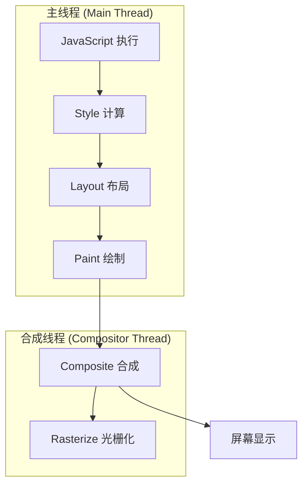

> **关键洞察**：理解渲染管线是性能优化的基础。我们的目标是尽可能跳过 Layout 和 Paint 阶段，让动画只在 Composite 阶段完成。

---

## 核心概念：渲染管线

### 浏览器渲染流程

浏览器将 HTML、CSS 转换为屏幕像素的过程称为**渲染管线**（Rendering Pipeline），包含五个主要阶段：

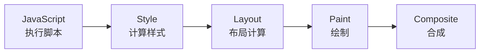

### 渲染阶段详解

| 阶段 | 说明 | 触发条件 | 性能影响 | 耗时占比 |
|------|------|----------|----------|----------|
| **JavaScript** | 执行 JS 代码，可能改变 DOM 或样式 | 脚本执行、事件处理 | 中 | ~10% |
| **Style** | 计算元素的最终样式值（Style Calculation） | DOM/样式变化 | 低 | ~5% |
| **Layout** | 计算元素的位置和尺寸（也叫 Reflow） | 几何属性变化 | **高** | ~30% |
| **Paint** | 将元素绘制到位图（Rasterize） | 视觉属性变化 | 中-高 | ~25% |
| **Composite** | 将图层合并到屏幕 | 图层变化 | 低 | ~5% |

### 三种渲染路径

当 CSS 属性变化时，浏览器会选择不同的渲染路径。理解这三条路径是性能优化的核心：

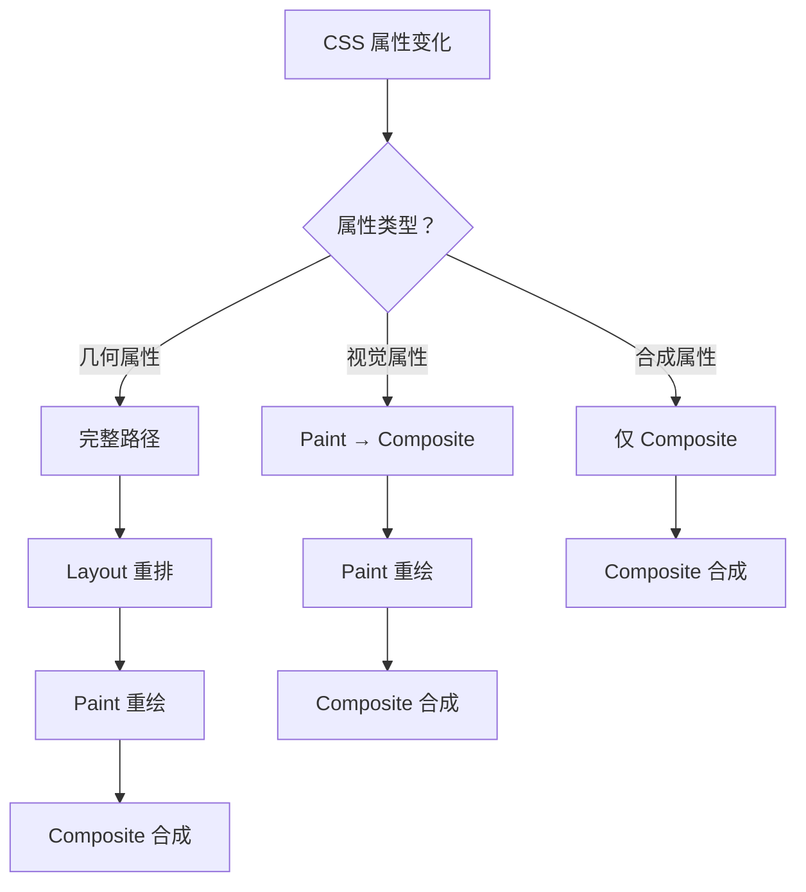

| 路径 | 涉及阶段 | 性能 | 典型属性 |
|------|---------|------|---------|
| **完整路径** | Layout → Paint → Composite | 最差 | `width`, `height`, `top`, `left`, `margin` |
| **跳过 Layout** | Paint → Composite | 中等 | `color`, `background`, `box-shadow` |
| **仅 Composite** | Composite | 最优 | `transform`, `opacity`, `filter` |

### 关键概念：重排与重绘

#### 重排（Reflow/Layout）

重排是浏览器重新计算元素几何属性的过程，是**性能开销最大**的操作。当元素的尺寸、位置发生变化时，浏览器需要重新计算整个渲染树中受影响的部分。

**触发重排的属性**：

| 属性类别 | 具体属性 |
|---------|---------|
| 尺寸 | `width`, `height`, `min-width`, `max-height`, `padding`, `margin`, `border-width` |
| 位置 | `top`, `left`, `right`, `bottom`, `position`, `float`, `clear` |
| 布局 | `display`, `flex`, `grid`, `columns`, `table-layout` |
| 字体 | `font-size`, `font-family`, `font-weight`, `line-height` |
| 其他 | `overflow`, `overflow-y`, `text-align`, `vertical-align` |

**重排示例**：

```css
/* ❌ 触发重排：改变元素尺寸 */
.element {
  width: 200px;        /* 触发 Layout */
  height: 100px;       /* 触发 Layout */
  padding: 20px;       /* 触发 Layout */
}

/* ❌ 触发重排：改变元素位置 */
.element {
  top: 50px;           /* 触发 Layout */
  left: 100px;         /* 触发 Layout */
  margin: 10px;        /* 触发 Layout */
}
```

#### 重绘（Repaint）

重绘是浏览器重新绘制元素视觉外观的过程，比重排开销小但仍需优化。重绘发生在元素外观变化但不影响布局时。

**触发重绘的属性**：

| 属性类别 | 具体属性 |
|---------|---------|
| 颜色 | `color`, `background-color`, `border-color` |
| 背景 | `background-image`, `background-position`, `background-size` |
| 边框 | `border-style`, `border-radius`, `box-shadow` |
| 文本 | `text-decoration`, `text-shadow`, `line-height` |
| 可见性 | `visibility`, `outline` |

#### 合成（Composite）

合成是浏览器将多个图层合并到屏幕的过程，**性能开销最小**。合成操作完全在 GPU 上完成，不需要 CPU 参与。

**只触发合成的属性**：

| 属性 | 说明 |
|------|------|
| `transform` | 变换（移动、缩放、旋转、倾斜） |
| `opacity` | 透明度 |
| `filter` | 滤镜（部分，如 `blur`、`brightness`） |

### 属性性能对比表

| 属性 | Layout | Paint | Composite | 性能评级 | 推荐用于动画 |
|------|:------:|:-----:|:---------:|:--------:|:----------:|
| `width/height` | ✓ | ✓ | | ⚠️ 差 | ❌ |
| `margin/padding` | ✓ | ✓ | | ⚠️ 差 | ❌ |
| `top/left` | ✓ | ✓ | | ⚠️ 差 | ❌ |
| `border-width` | ✓ | ✓ | | ⚠️ 差 | ❌ |
| `color` | | ✓ | | ⚡ 中 | ⚠️ 谨慎 |
| `background` | | ✓ | | ⚡ 中 | ⚠️ 谨慎 |
| `box-shadow` | | ✓ | | ⚡ 中 | ⚠️ 谨慎 |
| `opacity` | | | ✓ | ✅ 优 | ✅ |
| `transform` | | | ✓ | ✅ 优 | ✅ |
| `filter` | | | ✓ | ✅ 优 | ✅ |

---

## 深入原理：合成层机制

### 什么是合成层（Compositing Layer）？

合成层是浏览器渲染引擎中的一个核心概念。浏览器会将页面拆分成多个独立的图层（Layer），每个图层可以独立进行合成操作，而不影响其他图层。这种机制是实现高性能动画的基础。

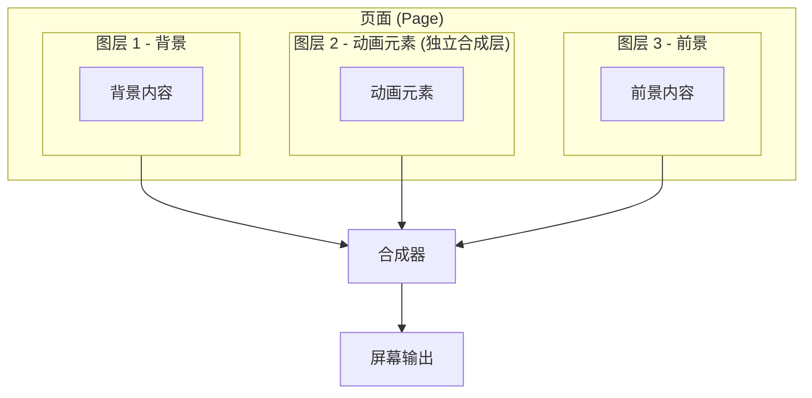

### 合成层的创建条件

浏览器会在以下情况自动创建独立的合成层：

| 条件 | 说明 | 示例 |
|------|------|------|
| **3D 变换** | 使用 `transform: translateZ()` 或 `translate3d()` | `transform: translateZ(0)` |
| **`will-change`** | 明确声明将要变化的属性 | `will-change: transform` |
| **视频元素** | `<video>` 元素自动提升 | `<video src="...">` |
| **`<canvas>`** | Canvas 元素自动提升 | `<canvas></canvas>` |
| **CSS 滤镜** | 应用 `filter` 属性 | `filter: blur(5px)` |
| **`position: fixed`** | 固定定位元素 | `position: fixed` |
| **`backface-visibility`** | 设置 3D 背面可见性 | `backface-visibility: hidden` |
| **滚动优化** | 某些浏览器对滚动容器优化 | `overflow: auto/scroll` |
| **`contain` 属性** | 包含特定值时 | `contain: paint` |

### 合成层工作原理

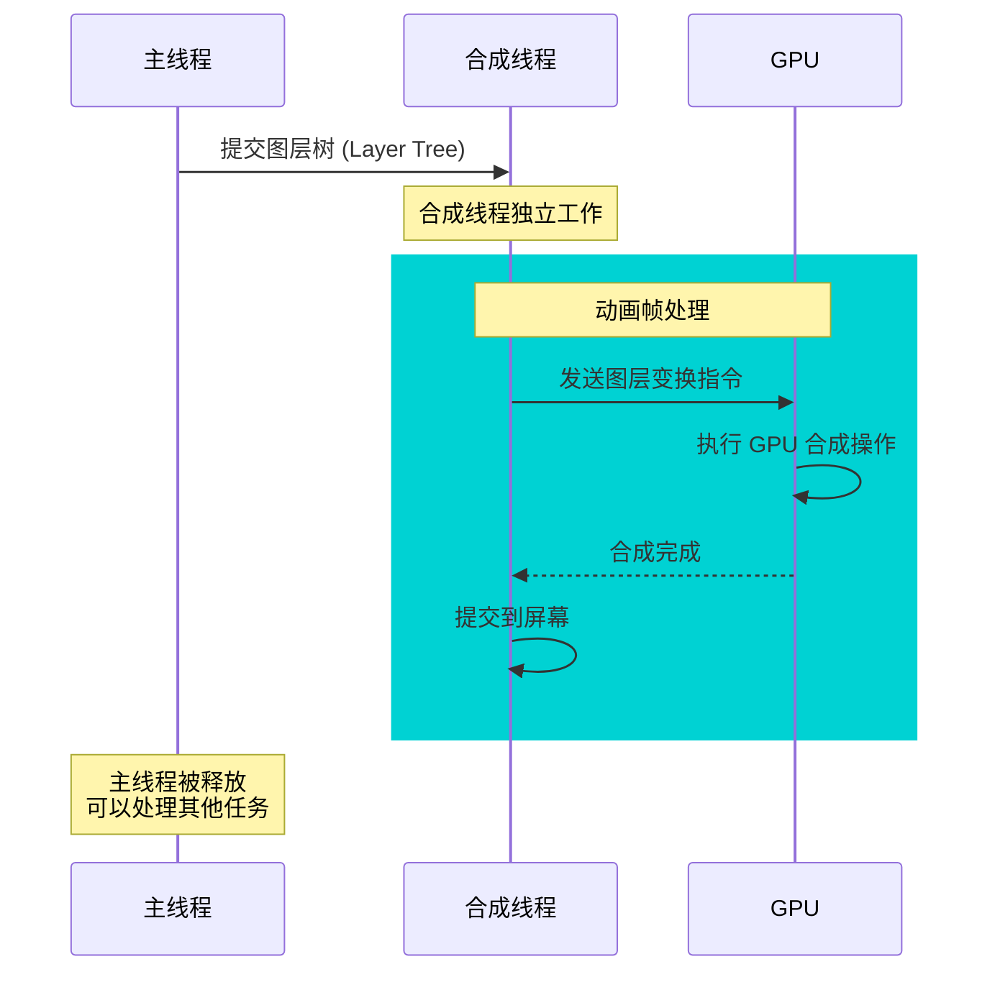

**关键优势**：
1. **独立更新**：合成层的变化不需要重绘其他图层
2. **GPU 加速**：合成操作在 GPU 上执行，效率更高
3. **主线程释放**：合成线程独立于主线程，动画运行时主线程可以处理其他任务
4. **避免重排**：合成层内的变换不触发布局计算

### 合成层的代价

合成层并非免费午餐，每个合成层都有内存和管理的开销：

| 代价类型 | 说明 | 影响 |
|---------|------|------|
| **内存占用** | 每个图层需要在内存中存储位图数据 | 图层尺寸 × 4 字节（RGBA） |
| **纹理上传** | 图层需要上传到 GPU 纹理内存 | 首次创建时有一次性开销 |
| **管理开销** | 浏览器需要维护图层树 | 过多图层增加管理复杂度 |
| **文字模糊** | 某些情况下文字可能变模糊 | 需要合理设置图层尺寸 |

**内存计算公式**：

```
图层内存 ≈ 宽度 × 高度 × 4 字节（RGBA）× 设备像素比²

示例：
- 1000px × 1000px 图层在 2x 屏幕上
- 内存 = 2000 × 2000 × 4 = 16MB
```

### 合成层优化策略

```css
/* ✅ 正确：仅为动画元素创建合成层 */
.animated-card {
  will-change: transform;  /* 动画前创建 */
  animation: slideIn 0.5s ease-out;
}

.animated-card.animation-done {
  will-change: auto;  /* 动画后释放 */
}

/* ✅ 正确：使用 contain 限制影响范围 */
.card-container {
  contain: layout paint;  /* 内部变化不影响外部 */
}

/* ❌ 错误：全局创建合成层 */
* {
  transform: translateZ(0);  /* 创建过多图层，浪费内存 */
}

/* ❌ 错误：永久保留 will-change */
.sidebar {
  will-change: transform;  /* 永远不释放，浪费内存 */
}
```

### 使用 Chrome DevTools 查看合成层

1. 打开 DevTools → More tools → **Layers**
2. 查看页面中所有合成图层的分布
3. 关注：
   - 图层数量是否过多
   - 单个图层的尺寸是否合理
   - 是否有不必要的合成层

---

## 主线程 vs 合成线程

### 浏览器线程模型

现代浏览器使用多线程架构来处理页面渲染。理解主线程和合成线程的区别，是优化动画性能的关键。

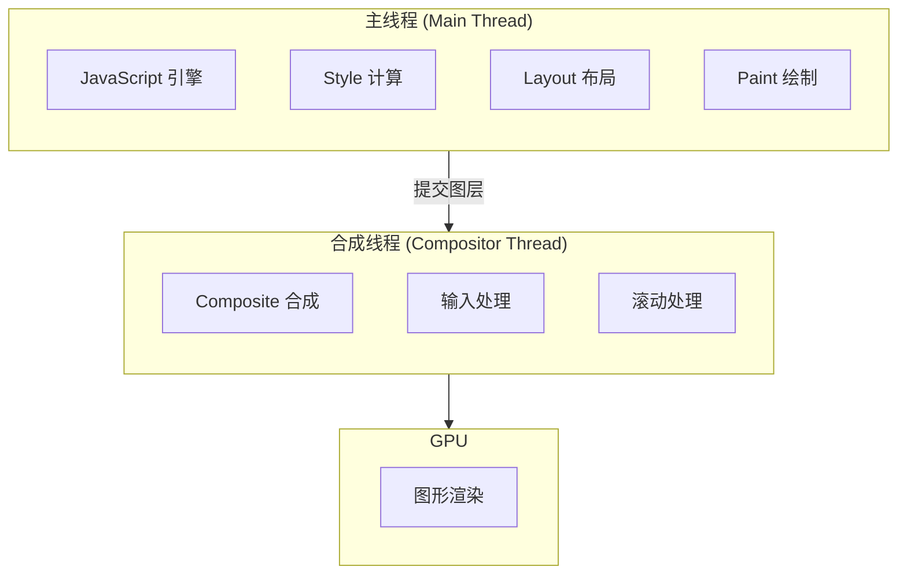

### 主线程的工作

主线程是浏览器中最繁忙的线程，负责处理大量任务：

| 任务 | 说明 | 对动画的影响 |
|------|------|------------|
| **JavaScript 执行** | 运行 JS 代码、事件处理 | 长任务会阻塞动画帧 |
| **Style 计算** | 计算元素样式 | DOM 变化时触发 |
| **Layout 布局** | 计算元素几何信息 | 几何属性变化时触发 |
| **Paint 绘制** | 生成绘制指令 | 视觉属性变化时触发 |
| **事件处理** | 处理用户交互事件 | 事件处理函数可能阻塞 |
| **垃圾回收** | 内存清理 | 可能导致短暂卡顿 |

### 合成线程的工作

合成线程独立于主线程，专门处理与显示相关的任务：

| 任务 | 说明 | 优势 |
|------|------|------|
| **图层合成** | 将多个图层合并到屏幕 | 不占用主线程资源 |
| **滚动处理** | 处理页面滚动 | 即使主线程繁忙也能流畅滚动 |
| **输入处理** | 处理触摸、鼠标等输入 | 提供即时反馈 |
| **CSS 动画** | 执行 `transform`、`opacity` 动画 | 在合成线程上运行 |

### 关键区别：动画在哪里运行？

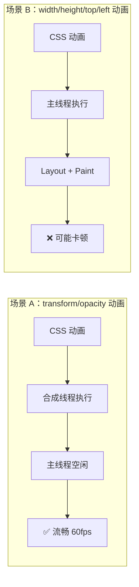

**核心原则**：
- `transform` 和 `opacity` 动画在**合成线程**上运行，即使主线程繁忙也能保持流畅
- `width`、`height`、`top`、`left` 等属性动画在**主线程**上运行，主线程繁忙时动画会卡顿
- JavaScript 长任务会阻塞主线程，导致主线程动画卡顿，但不影响合成线程动画

### 实际影响演示

```css
/* ✅ 场景 A：合成线程动画 - 即使主线程繁忙也流畅 */
.smooth-animation {
  animation: slide 2s ease-in-out infinite alternate;
  /* transform 动画在合成线程运行 */
}

@keyframes slide {
  from { transform: translateX(0); }
  to { transform: translateX(200px); }
}

/* ❌ 场景 B：主线程动画 - 主线程繁忙时会卡顿 */
.janky-animation {
  animation: move 2s ease-in-out infinite alternate;
  /* left 动画在主线程运行 */
}

@keyframes move {
  from { left: 0; }
  to { left: 200px; }
}
```

```javascript
// 模拟主线程繁忙
function heavyComputation() {
  const start = performance.now();
  while (performance.now() - start < 100) {
    // 阻塞主线程 100ms
    Math.random();
  }
}

// 每 200ms 执行一次重计算
setInterval(heavyComputation, 200);

// 此时 .smooth-animation 仍然流畅（合成线程）
// 但 .janky-animation 会明显卡顿（主线程被阻塞）
```

### 如何确保动画在合成线程运行？

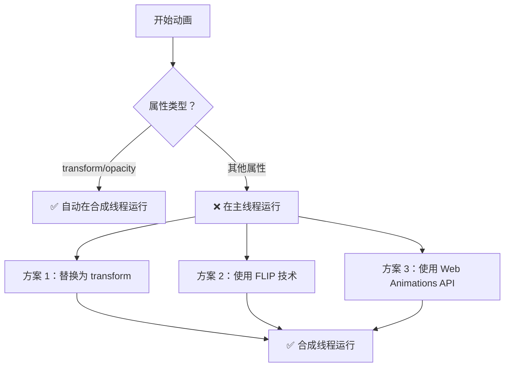

```css
/* FLIP 技术示例：用 transform 替代布局属性动画 */
.card {
  /* 初始位置 */
  transform: translateX(0) scale(1);
  transition: transform 0.3s ease-out;
}

.card.expanded {
  /* 用 transform 模拟 width/height 变化 */
  transform: scale(1.5);
}

/* 使用 contain 创建独立的合成上下文 */
.animation-container {
  contain: layout style paint;
  /* 内部动画不会影响外部布局 */
}
```

---

## will-change 使用策略

### will-change 的作用机制

`will-change` 属性是浏览器优化动画性能的重要工具。它提前通知浏览器某个元素即将发生变化，让浏览器有足够的时间进行优化准备。

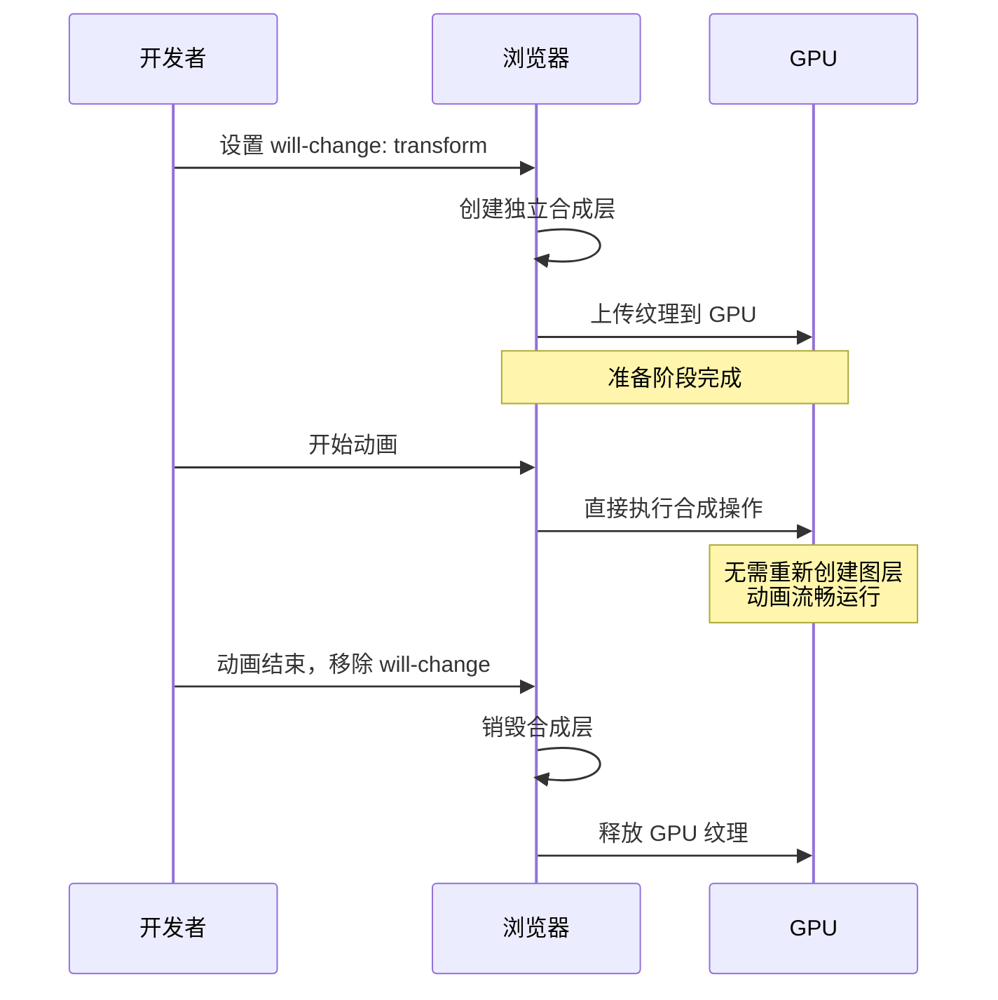

### will-change 的正确用法

```css
/* ✅ 策略 1：在交互前设置，交互后移除 */
.card {
  transition: transform 0.3s ease;
}

.card:hover {
  will-change: transform;  /* 悬停时提示 */
  transform: translateY(-5px);
}

.card:not(:hover) {
  will-change: auto;  /* 非悬停时释放 */
}

/* ✅ 策略 2：动画元素在动画期间使用 */
@keyframes slideIn {
  from { transform: translateX(-100%); opacity: 0; }
  to { transform: translateX(0); opacity: 1; }
}

.slide-in {
  will-change: transform, opacity;
  animation: slideIn 0.5s ease-out;
}

/* 动画结束后通过 JS 移除 will-change */
```

```javascript
// ✅ 策略 3：JavaScript 精确控制
class AnimationOptimizer {
  constructor(element) {
    this.element = element;
  }
  
  prepare() {
    // 动画开始前：提前一帧设置 will-change
    requestAnimationFrame(() => {
      this.element.style.willChange = 'transform, opacity';
    });
  }
  
  cleanup() {
    // 动画结束后：延迟移除 will-change
    requestAnimationFrame(() => {
      this.element.style.willChange = 'auto';
    });
  }
  
  animate(keyframes, options) {
    this.prepare();
    const animation = this.element.animate(keyframes, options);
    animation.onfinish = () => this.cleanup();
    animation.oncancel = () => this.cleanup();
    return animation;
  }
}

// 使用示例
const card = document.querySelector('.card');
const optimizer = new AnimationOptimizer(card);

card.addEventListener('click', () => {
  optimizer.animate([
    { transform: 'scale(1)', opacity: 1 },
    { transform: 'scale(1.1)', opacity: 0.8 },
    { transform: 'scale(1)', opacity: 1 }
  ], { duration: 300, easing: 'ease-in-out' });
});
```

### will-change 的常见错误

```css
/* ❌ 错误 1：全局设置 will-change */
* {
  will-change: transform;  /* 为所有元素创建合成层，内存爆炸 */
}

/* ❌ 错误 2：永久保留 will-change */
.sidebar {
  will-change: transform;  /* 永远不释放，持续占用内存 */
}

/* ❌ 错误 3：设置过多属性 */
.element {
  will-change: transform, opacity, top, left, width, height;
  /* 提示过多属性变化，浏览器无法有效优化 */
}

/* ❌ 错误 4：在不需要动画的元素上使用 */
.static-text {
  will-change: transform;  /* 永远不会动画的元素 */
}
```

### will-change 使用规则总结

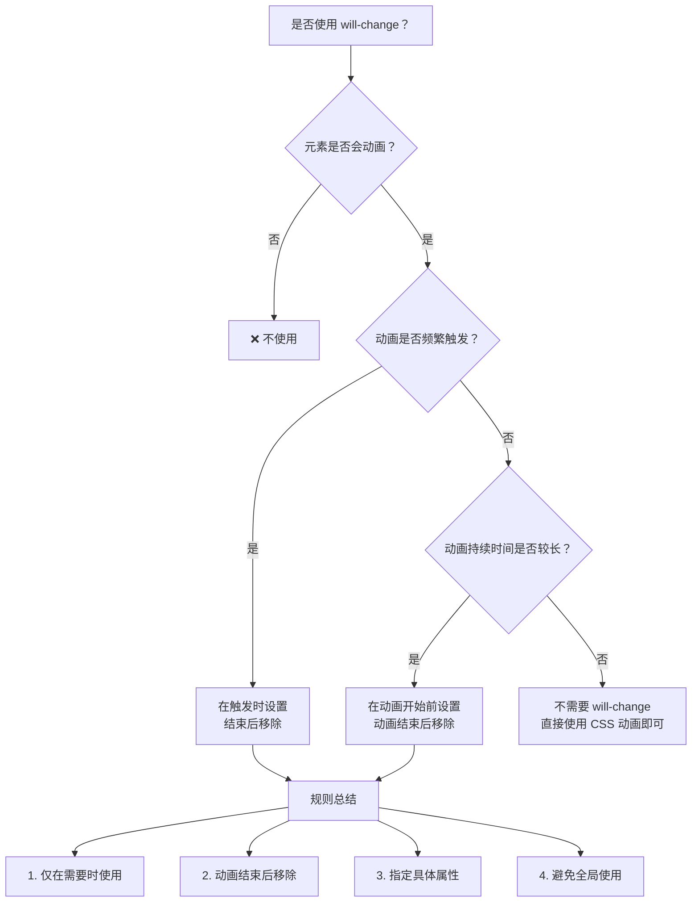

---

## 高性能动画属性

### transform 变换

`transform` 是动画优化的**首选属性**，只触发合成阶段，在 GPU 上执行。

**支持的变换函数**：

| 函数 | 语法 | 说明 | 性能 |
|------|------|------|------|
| `translate` | `translate(tx, ty)` | 2D 平移 | ✅ 仅合成 |
| `translateX/Y` | `translateX(100px)` | 单轴平移 | ✅ 仅合成 |
| `translate3d` | `translate3d(x, y, z)` | 3D 平移 | ✅ 仅合成 |
| `scale` | `scale(sx, sy)` | 缩放 | ✅ 仅合成 |
| `scaleX/Y` | `scaleX(1.5)` | 单轴缩放 | ✅ 仅合成 |
| `rotate` | `rotate(45deg)` | 旋转 | ✅ 仅合成 |
| `rotateX/Y/Z` | `rotateX(45deg)` | 3D 旋转 | ✅ 仅合成 |
| `skew` | `skew(ax, ay)` | 倾斜 | ✅ 仅合成 |

**使用示例**：

```css
/* 移动元素 - 替代 top/left */
.movable {
  position: absolute;
  /* ❌ 避免 */
  /* left: 100px; */
  /* top: 50px; */
  
  /* ✅ 推荐 */
  transform: translate(100px, 50px);
}

/* 缩放元素 - 替代 width/height */
.scalable {
  width: 100px;
  height: 100px;
  
  /* ❌ 避免 */
  /* width: 150px; */
  /* height: 150px; */
  
  /* ✅ 推荐 */
  transform: scale(1.5);
  transform-origin: center center;
}

/* 旋转动画 */
@keyframes rotate {
  from { transform: rotate(0deg); }
  to { transform: rotate(360deg); }
}

.spinner {
  animation: rotate 1s linear infinite;
}

/* 组合变换 - 注意顺序（从右向左执行） */
.combined {
  /* 先缩放，再旋转，最后平移 */
  transform: translate(100px) rotate(45deg) scale(2);
}
```

### opacity 透明度

`opacity` 同样只触发合成阶段，适合淡入淡出效果。

```css
/* 淡入淡出动画 */
@keyframes fadeIn {
  from { opacity: 0; }
  to { opacity: 1; }
}

.fade-element {
  animation: fadeIn 0.5s ease-out;
}

/* 结合 transform 创建复合动画 */
@keyframes slideIn {
  from {
    opacity: 0;
    transform: translateY(20px);
  }
  to {
    opacity: 1;
    transform: translateY(0);
  }
}

.slide-in {
  animation: slideIn 0.5s ease-out;
}
```

### 属性替换策略

| 传统属性 | 推荐替代 | 转换方法 | 性能提升 |
|----------|----------|----------|----------|
| `left/top` | `transform: translate()` | `left: 100px` → `transform: translateX(100px)` | 跳过 Layout + Paint |
| `width/height` | `transform: scale()` | `width: 200px` → `transform: scaleX(2)` | 跳过 Layout + Paint |
| `margin` | `transform: translate()` | `margin-left: 20px` → `transform: translateX(20px)` | 跳过 Layout + Paint |
| `visibility` | `opacity` | `visibility: hidden` → `opacity: 0` | 跳过 Paint |
| `display: none` | `opacity: 0` + `pointer-events: none` | 保留布局但隐藏 | 避免重排 |

### FLIP 技术

FLIP（First, Last, Invert, Play）是一种用 `transform` 替代布局属性动画的技术：

```javascript
// FLIP 动画示例
function flipAnimation(element, newStyles) {
  // 1. First - 记录初始位置
  const first = element.getBoundingClientRect();
  
  // 2. 应用新样式
  Object.assign(element.style, newStyles);
  
  // 3. Last - 记录最终位置
  const last = element.getBoundingClientRect();
  
  // 4. Invert - 计算差异并用 transform 反转
  const deltaX = first.left - last.left;
  const deltaY = first.top - last.top;
  const deltaW = first.width / last.width;
  const deltaH = first.height / last.height;
  
  // 先设置到初始位置（用 transform）
  element.style.transform = `translate(${deltaX}px, ${deltaY}px) scale(${deltaW}, ${deltaH})`;
  element.style.transformOrigin = 'top left';
  
  // 5. Play - 动画到最终位置
  requestAnimationFrame(() => {
    element.style.transition = 'transform 0.3s ease-out';
    element.style.transform = '';
    
    element.addEventListener('transitionend', () => {
      element.style.transition = '';
      element.style.transformOrigin = '';
    }, { once: true });
  });
}
```

---

## 硬件加速

### GPU 加速原理

GPU 加速利用显卡进行图形渲染，将 CPU 从繁重的图形计算中解放出来。

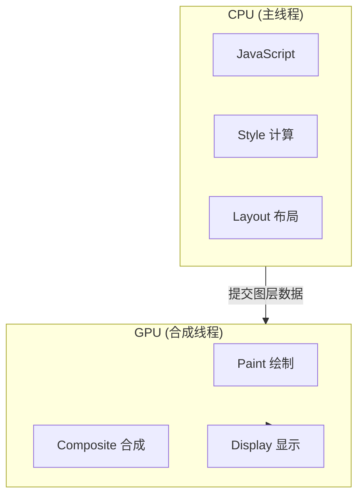

### 触发 GPU 加速的方法

```css
/* 方法一：3D 变换（最常用） */
.gpu-accelerated {
  transform: translateZ(0);
  /* 或 */
  transform: translate3d(0, 0, 0);
}

/* 方法二：will-change 属性（推荐） */
.will-change-element {
  will-change: transform;
}

/* 方法三：特定 CSS 属性（自动触发） */
.layer-element {
  /* 以下属性会自动创建新图层 */
  transform: translateZ(0);
  filter: blur(0);
  position: fixed;
  backface-visibility: hidden;
}
```

### 硬件加速注意事项

```css
/* ❌ 错误：过度使用 will-change */
* {
  will-change: transform;  /* 消耗大量内存 */
}

/* ❌ 错误：全局应用 GPU 加速 */
* {
  transform: translateZ(0);  /* 创建过多图层 */
}

/* ✅ 正确：仅在需要时使用 */
.animate-on-hover:hover {
  will-change: transform;
}

/* ✅ 正确：动画元素 */
@keyframes slide {
  from { transform: translateX(-100%); }
  to { transform: translateX(0); }
}

.slider {
  will-change: transform;
  animation: slide 0.5s ease-out;
}
```

**内存管理**：

```css
/* GPU 图层会占用内存 */
.layer {
  /* 每个图层约占用：宽度 × 高度 × 4 字节 × 设备像素比² */
  /* 1000px × 1000px 图层在 2x 屏幕 ≈ 16MB 内存 */
  transform: translateZ(0);
}

/* 限制图层数量 */
.container {
  contain: strict;  /* 限制渲染范围 */
}

/* 移除不需要的图层 */
.inactive {
  will-change: auto;
  transform: none;
}
```

---

## 渲染隔离与懒加载

### contain 属性

`contain` 属性告诉浏览器元素的内容如何影响页面布局，允许浏览器优化渲染。

**语法**：`contain: none | strict | content | [ size || layout || paint || style ]`

**包含类型**：

| 值 | 说明 | 效果 | 使用场景 |
|------|------|------|---------|
| `size` | 尺寸隔离 | 元素尺寸不影响外部 | 已知尺寸的组件 |
| `layout` | 布局隔离 | 内部布局不影响外部 | 独立布局的组件 |
| `paint` | 绘制隔离 | 内容不溢出边界 | 有溢出内容的组件 |
| `style` | 样式隔离 | 计数器等不影响外部 | 包含计数器的组件 |
| `strict` | 完全隔离 | 等同于 `size layout paint` | 完全独立的组件 |
| `content` | 内容隔离 | 等同于 `layout paint` | 内容区域 |

**使用示例**：

```css
/* 完全隔离 */
.isolated {
  contain: strict;  /* 等同于 contain: size layout paint */
}

/* 内容隔离 */
.content-card {
  contain: content;  /* 等同于 contain: layout paint */
}

/* 布局隔离 */
.widget {
  contain: layout;
}

/* 绘制隔离 - 内容不会溢出 */
.overflow-hidden {
  contain: paint;
  overflow: hidden;
}

/* 实际应用：复杂组件 */
.data-grid {
  contain: strict;
  width: 100%;
  height: 500px;
  overflow: auto;
}

/* 实际应用：文章卡片 */
.article-card {
  contain: layout paint;
  /* 内部变化不会影响其他卡片的重排 */
}
```

### content-visibility 属性

`content-visibility` 控制元素是否渲染其内容，是实现懒加载的强大工具。

**语法**：`content-visibility: visible | hidden | auto`

**值说明**：

| 值 | 说明 | 使用场景 |
|------|------|---------|
| `visible` | 正常渲染（默认） | 默认状态 |
| `hidden` | 跳过渲染，内容不可访问 | 折叠面板、标签页 |
| `auto` | 屏幕外时跳过渲染 | 长列表、无限滚动 |

**使用示例**：

```css
/* 长列表优化 */
.list-item {
  /* 屏幕外元素不渲染 */
  content-visibility: auto;
  /* 必须指定高度，避免布局偏移 */
  contain-intrinsic-size: 0 200px;
}

/* 手动隐藏 */
.hidden-content {
  content-visibility: hidden;
  /* 占位但内容不渲染 */
}

/* 折叠面板 */
.collapsible-panel {
  content-visibility: hidden;
  contain-intrinsic-size: 0 50px;  /* 折叠时高度 */
}

.collapsible-panel.expanded {
  content-visibility: visible;
}

/* 分页内容 */
.page {
  content-visibility: auto;
  contain-intrinsic-size: 100vh;
}

.page.active {
  content-visibility: visible;
}
```

**性能对比**（以下为示意量级，实际数值因设备、内容复杂度与浏览器而异）：

| 场景 | 未优化渲染时间 | 优化后渲染时间 | 提升 |
|------|-------------|-------------|------|
| 1000 项列表 | ~800ms | ~80ms | 10x |
| 长文章页面 | ~400ms | ~60ms | 6.7x |
| 复杂仪表盘 | ~1200ms | ~200ms | 6x |

### contain 与 content-visibility 配合使用

```css
/* 最佳实践：组合使用 */
.card {
  contain: layout paint;
  content-visibility: auto;
  contain-intrinsic-size: 0 200px;
}

/* 动画容器使用 contain 隔离 */
.animation-container {
  contain: layout;
  position: relative;
}

.animation-container .animated-element {
  position: absolute;
  animation: slide 1s ease;
}

@keyframes slide {
  from { transform: translateX(-100%); }
  to { transform: translateX(0); }
}
```

---

## JavaScript 动画优化

### requestAnimationFrame

`requestAnimationFrame` 是执行 JavaScript 动画的正确方式，与显示器刷新率同步（通常 60Hz）。

```javascript
// 基础用法
function animate(timestamp) {
  // 更新动画状态
  element.style.transform = `translateX(${progress}px)`;
  
  // 请求下一帧
  requestAnimationFrame(animate);
}

requestAnimationFrame(animate);

// 时间控制动画
let startTime = null;
const duration = 1000;  // 1秒

function animate(timestamp) {
  if (!startTime) startTime = timestamp;
  const elapsed = timestamp - startTime;
  const progress = Math.min(elapsed / duration, 1);
  
  // 使用缓动函数
  const easedProgress = easeOutCubic(progress);
  element.style.transform = `translateX(${easedProgress * 500}px)`;
  
  if (progress < 1) {
    requestAnimationFrame(animate);
  }
}

requestAnimationFrame(animate);

// 常用缓动函数
function easeOutCubic(t) {
  return 1 - Math.pow(1 - t, 3);
}

function easeInOutQuad(t) {
  return t < 0.5 ? 2 * t * t : 1 - Math.pow(-2 * t + 2, 2) / 2;
}

function easeOutElastic(t) {
  const c4 = (2 * Math.PI) / 3;
  return t === 0 ? 0 : t === 1 ? 1 :
    Math.pow(2, -10 * t) * Math.sin((t * 10 - 0.75) * c4) + 1;
}
```

### 避免强制同步布局

强制同步布局（Layout Thrashing）是在一帧内多次交替读取和修改布局属性导致的性能问题。

```javascript
// ❌ 错误：强制同步布局（读写交替）
for (let i = 0; i < elements.length; i++) {
  const height = elements[i].offsetHeight;  // 读 - 触发重排
  elements[i].style.height = height * 2 + 'px';  // 写 - 使布局失效
  // 下一次循环的读取又触发重排...
}

// ✅ 正确：批量读取，批量写入
// 先读取所有值
const heights = elements.map(el => el.offsetHeight);

// 再写入所有值
elements.forEach((el, i) => {
  el.style.height = heights[i] * 2 + 'px';
});

// ✅ 更好：使用 FastDOM 模式
class FastDOM {
  constructor() {
    this.reads = [];
    this.writes = [];
    this.scheduled = false;
  }
  
  measure(fn) {
    this.reads.push(fn);
    this.scheduleFlush();
  }
  
  mutate(fn) {
    this.writes.push(fn);
    this.scheduleFlush();
  }
  
  scheduleFlush() {
    if (!this.scheduled) {
      this.scheduled = true;
      requestAnimationFrame(() => this.flush());
    }
  }
  
  flush() {
    // 先执行所有读取
    const reads = this.reads;
    this.reads = [];
    reads.forEach(fn => fn());
    
    // 再执行所有写入
    const writes = this.writes;
    this.writes = [];
    writes.forEach(fn => fn());
    
    this.scheduled = false;
    
    // 如果还有任务，继续调度
    if (this.reads.length || this.writes.length) {
      this.scheduleFlush();
    }
  }
}

const fastdom = new FastDOM();

// 使用
fastdom.measure(() => {
  return element.offsetHeight;
});
fastdom.mutate(() => {
  element.style.height = '200px';
});
```

### Web Animations API

使用原生 Web Animations API 可以获得更好的性能，动画在合成线程运行。

```javascript
// 基础动画
const animation = element.animate([
  { transform: 'translateX(0)', opacity: 1 },
  { transform: 'translateX(100px)', opacity: 0.5 }
], {
  duration: 1000,
  easing: 'ease-out',
  fill: 'forwards'
});

// 控制动画
animation.pause();
animation.play();
animation.reverse();
animation.finish();
animation.cancel();

// 动画事件
animation.onfinish = () => {
  console.log('动画完成');
};

animation.oncancel = () => {
  console.log('动画取消');
};

// 关键帧动画
element.animate([
  { offset: 0, transform: 'scale(1)' },
  { offset: 0.25, transform: 'scale(1.1)' },
  { offset: 0.5, transform: 'scale(0.9)' },
  { offset: 0.75, transform: 'scale(1.05)' },
  { offset: 1, transform: 'scale(1)' }
], {
  duration: 600,
  easing: 'ease-in-out'
});

// 链式动画
const animation1 = element.animate(
  [{ transform: 'translateY(0)' }, { transform: 'translateY(-50px)' }],
  { duration: 300, fill: 'forwards' }
);

animation1.finished.then(() => {
  return element.animate(
    [{ transform: 'translateY(-50px)' }, { transform: 'translateY(0)' }],
    { duration: 300, fill: 'forwards' }
  );
});
```

### 性能监控

```javascript
// FPS 监控
class FPSMonitor {
  constructor() {
    this.fps = 0;
    this.frames = 0;
    this.lastTime = performance.now();
  }
  
  tick() {
    this.frames++;
    const now = performance.now();
    
    if (now >= this.lastTime + 1000) {
      this.fps = this.frames;
      this.frames = 0;
      this.lastTime = now;
      console.log(`FPS: ${this.fps}`);
    }
    
    requestAnimationFrame(() => this.tick());
  }
  
  start() {
    requestAnimationFrame(() => this.tick());
  }
}

// 长任务检测
const observer = new PerformanceObserver((list) => {
  for (const entry of list.getEntries()) {
    console.log('长任务:', entry.duration + 'ms');
  }
});

observer.observe({ entryTypes: ['longtask'] });

// 帧时间检测
function measureFrameTime() {
  const start = performance.now();
  
  requestAnimationFrame(() => {
    const frameTime = performance.now() - start;
    if (frameTime > 16.67) {  // 超过 60fps
      console.warn(`帧时间过长: ${frameTime.toFixed(2)}ms`);
    }
    measureFrameTime();
  });
}

measureFrameTime();
```

---

## 性能检测工具

### Chrome DevTools

#### Performance 面板

1. **录制性能**：点击录制按钮，执行操作后停止
2. **分析帧率**：查看 FPS 图表，绿色表示良好
3. **火焰图**：定位性能瓶颈
4. **Main 线程**：查看 JavaScript 执行时间

#### Rendering 面板

打开方式：DevTools → More tools → Rendering

| 功能 | 说明 |
|------|------|
| FPS meter | 实时帧率显示 |
| Paint flashing | 高亮重绘区域（绿色） |
| Layer borders | 显示图层边框 |
| Layout shift regions | 显示布局偏移区域 |

#### Layers 面板

打开方式：DevTools → More tools → Layers

- 查看所有合成图层
- 分析图层内存占用
- 检查是否创建了过多图层

### 代码检测

```javascript
// 检测重排
const element = document.querySelector('.test');
console.time('layout');
const height = element.offsetHeight;  // 触发重排
console.timeEnd('layout');

// Performance API
performance.mark('animation-start');

// 执行动画代码...

performance.mark('animation-end');
performance.measure('animation', 'animation-start', 'animation-end');

const measure = performance.getEntriesByName('animation')[0];
console.log(`动画耗时: ${measure.duration}ms`);

// 检测内存
if (performance.memory) {
  console.log(`
    已用堆大小: ${(performance.memory.usedJSHeapSize / 1048576).toFixed(2)}MB
    总堆大小: ${(performance.memory.totalJSHeapSize / 1048576).toFixed(2)}MB
    堆限制: ${(performance.memory.jsHeapSizeLimit / 1048576).toFixed(2)}MB
  `);
}
```

### CSS 性能检测

```css
/* 使用 @supports 检测属性支持 */
@supports (will-change: transform) {
  .optimized {
    will-change: transform;
  }
}

@supports (content-visibility: auto) {
  .lazy-content {
    content-visibility: auto;
    contain-intrinsic-size: 200px;
  }
}

/* 媒体查询检测性能模式 */
@media (prefers-reduced-data: reduce) {
  /* 减少数据使用 */
  .image-background {
    background-image: none;
  }
}
```

---

## 常见问题与解决方案

### 问题 1：动画卡顿

**症状**：动画不流畅，帧率低于 60fps

**原因分析**：
- 触发了重排或重绘
- JavaScript 执行时间过长
- GPU 内存不足

**解决方案**：

```css
/* 方案一：使用高性能属性 */
.element {
  transform: translateX(100px);  /* 替代 left */
  opacity: 0.5;                  /* 替代 visibility */
}

/* 方案二：启用 GPU 加速 */
.element {
  transform: translateZ(0);
  will-change: transform;
}

/* 方案三：减少动画复杂度 */
@keyframes simple-animation {
  from { transform: translateX(0); }
  to { transform: translateX(100px); }
}
```

### 问题 2：动画闪烁

**症状**：动画过程中出现闪烁或闪烁

**原因分析**：
- 图层创建/销毁
- Z-index 变化
- 合成层问题

**解决方案**：

```css
/* 强制创建独立图层 */
.element {
  backface-visibility: hidden;
  perspective: 1000px;
  transform: translateZ(0);
}

/* 固定 3D 上下文 */
.container {
  transform-style: preserve-3d;
}

/* 避免闪烁 */
.element {
  -webkit-font-smoothing: antialiased;
  -webkit-backface-visibility: hidden;
}
```

### 问题 3：移动端性能差

**症状**：移动设备上动画卡顿严重

**解决方案**：

```css
/* 减少移动端动画复杂度 */
@media (max-width: 768px) {
  .complex-animation {
    animation: none;
    transition: none;
  }
  
  /* 简化动画 */
  .simplified {
    animation-duration: 0.1s;
    animation-iteration-count: 1;
  }
}

/* 使用触摸优化 */
.touch-element {
  touch-action: manipulation;
  -webkit-tap-highlight-color: transparent;
}

/* 减少重绘区域 */
.mobile-optimized {
  contain: strict;
  content-visibility: auto;
  contain-intrinsic-size: 300px;
}
```

### 问题 4：页面滚动卡顿

**症状**：滚动时页面不流畅

**解决方案**：

```css
/* 优化滚动容器 */
.scroll-container {
  overflow-y: auto;
  contain: strict;
}

/* 固定元素优化 */
.fixed-header {
  position: fixed;
  top: 0;
  will-change: transform;
}

/* 懒加载内容 */
.lazy-section {
  content-visibility: auto;
  contain-intrinsic-size: 500px;
}
```

```javascript
// 滚动事件节流
let ticking = false;

window.addEventListener('scroll', () => {
  if (!ticking) {
    requestAnimationFrame(() => {
      // 处理滚动逻辑
      ticking = false;
    });
    ticking = true;
  }
});

// Intersection Observer 替代滚动检测
const observer = new IntersectionObserver((entries) => {
  entries.forEach(entry => {
    if (entry.isIntersecting) {
      entry.target.classList.add('visible');
    }
  });
}, {
  rootMargin: '50px'
});

document.querySelectorAll('.lazy-element').forEach(el => {
  observer.observe(el);
});
```

### 问题 5：动画启动延迟

**症状**：动画开始时有明显延迟

**解决方案**：

```css
/* 预热 GPU */
.preload {
  transform: translateZ(0);
}

/* 预设 will-change */
.animated-element {
  will-change: transform, opacity;
}

/* 减少首帧计算 */
@keyframes optimized-animation {
  0% {
    transform: translateX(0);
  }
  100% {
    transform: translateX(100px);
  }
}
```

---

## 最佳实践

### 1. 动画属性选择优先级

```
transform, opacity > filter > color, background > width, height, margin
     (仅合成)        (部分合成)      (重绘)              (重排)
```

### 2. 优化检查清单

- [ ] 使用 `transform` 替代 `top/left`
- [ ] 使用 `opacity` 替代 `visibility`
- [ ] 仅在需要时使用 `will-change`
- [ ] 动画结束后移除 `will-change`
- [ ] 避免在动画中修改布局属性
- [ ] 使用 `contain` 隔离复杂组件
- [ ] 使用 `content-visibility` 懒加载
- [ ] 尊重 `prefers-reduced-motion`
- [ ] 使用 `requestAnimationFrame` 执行 JS 动画
- [ ] 批量读取和写入 DOM 属性
- [ ] 使用 Web Animations API 替代 JS 动画
- [ ] 控制合成层数量，避免内存浪费

### 3. 性能目标

| 指标 | 目标值 |
|------|--------|
| FPS | ≥ 60 (每帧 ≤ 16.67ms) |
| 交互到下次绘制 (INP) | < 200ms |
| 累积布局偏移 (CLS) | < 0.1 |
| GPU 内存 | 控制在合理范围 |

### 4. 可访问性考虑

```css
/* 尊重用户偏好 */
@media (prefers-reduced-motion: reduce) {
  *,
  *::before,
  *::after {
    animation-duration: 0.01ms !important;
    animation-iteration-count: 1 !important;
    transition-duration: 0.01ms !important;
    scroll-behavior: auto !important;
  }
}

/* 渐进增强 */
.animated-element {
  animation: fadeIn 0.5s ease-out;
}

@media (prefers-reduced-motion: reduce) {
  .animated-element {
    animation: none;
    opacity: 1;
  }
}
```

```javascript
// JavaScript 检测用户偏好
const prefersReducedMotion = window.matchMedia(
  '(prefers-reduced-motion: reduce)'
);

if (prefersReducedMotion.matches) {
  document.documentElement.classList.add('reduce-motion');
}

prefersReducedMotion.addEventListener('change', (e) => {
  document.documentElement.classList.toggle('reduce-motion', e.matches);
});
```

### 5. 浏览器兼容性

| 属性 | Chrome | Firefox | Safari | Edge |
|------|--------|---------|--------|------|
| `transform` | 36+ | 16+ | 9+ | 12+ |
| `will-change` | 36+ | 36+ | 9.1+ | 79+ |
| `contain` | 52+ | 69+ | 15.4+ | 79+ |
| `content-visibility` | 85+ | 125+ | 18+ | 85+ |
| `backface-visibility` | 36+ | 16+ | 9+ | 12+ |

### 6. 代码模板

```css
/* 优化的动画元素模板 */
.animated-element {
  /* 基础样式 */
  position: relative;
  
  /* 性能优化 */
  will-change: transform, opacity;
  transform: translateZ(0);
  
  /* 过渡效果 */
  transition: transform 0.3s cubic-bezier(0.4, 0, 0.2, 1),
              opacity 0.3s cubic-bezier(0.4, 0, 0.2, 1);
}

.animated-element:hover {
  transform: translateY(-5px);
  opacity: 0.9;
}

/* 动画结束后清理 */
.animated-element.animation-complete {
  will-change: auto;
}

/* 可访问性 */
@media (prefers-reduced-motion: reduce) {
  .animated-element {
    transition: none;
    transform: none;
  }
}
```

---

## 参考资源

- [Google Web Fundamentals - Rendering Performance](https://developers.google.com/web/fundamentals/performance/rendering)
- [MDN - CSS transform](https://developer.mozilla.org/zh-CN/docs/Web/CSS/transform)
- [MDN - will-change](https://developer.mozilla.org/zh-CN/docs/Web/CSS/will-change)
- [CSS Contain Module](https://www.w3.org/TR/css-contain-2/)
- [Web Animations API](https://developer.mozilla.org/zh-CN/docs/Web/API/Web_Animations_API)
- [CSS Triggers - 属性性能查询](https://csstriggers.com/)
- [High Performance Animations](https://www.html5rocks.com/en/tutorials/speed/high-performance-animations/)
- [Layer Borders - Chrome DevTools](https://developer.chrome.com/docs/devtools/rendering/layers/)

---

汇集 Web 开发中常用的 CSS 动画效果实现方案，涵盖页面过渡、加载动画、交互动效、文字效果等多个场景。每个动效都包含完整的 HTML 和 CSS 代码，并附带详细的参数说明和使用场景。

## 背景与动机

### 为什么需要动效？

动画在 Web 开发中扮演着至关重要的角色，它不仅是视觉装饰，更是用户体验的核心组成部分：

- **提供视觉反馈**：让用户了解操作结果和系统状态
- **引导注意力**：通过运动引导用户关注重要信息
- **建立空间关系**：帮助用户理解页面元素之间的层级和导航关系
- **改善感知性能**：加载动画减少用户等待焦虑，提升感知速度
- **增强品牌感**：统一的动画风格建立品牌识别度

### 动效设计的核心原则

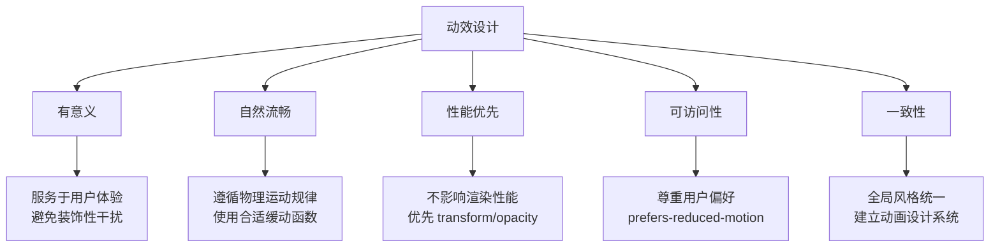

### 动画时长与缓动函数速查

| 场景 | 推荐时长 | 缓动函数 | CSS 值 |
|------|---------|---------|--------|
| 微交互（按钮点击） | 100-200ms | ease | `ease` |
| 过渡效果（悬浮、展开） | 200-300ms | ease-out | `cubic-bezier(0.16, 1, 0.3, 1)` |
| 入场动画（淡入、滑入） | 300-500ms | ease-out | `cubic-bezier(0.0, 0.0, 0.2, 1)` |
| 退场动画（淡出、滑出） | 200-300ms | ease-in | `cubic-bezier(0.4, 0.0, 1, 1)` |
| 弹跳/弹性效果 | 400-600ms | spring | `cubic-bezier(0.34, 1.56, 0.64, 1)` |
| 加载动画（循环） | 800-1500ms | linear | `linear` |

---

## 动画分类与设计原则

```
CSS 动画应用场景
├── 页面过渡
│   ├── 淡入淡出
│   ├── 滑动效果
│   └── 缩放进入
├── 加载状态
│   ├── 旋转加载
│   ├── 进度条
│   └── 骨架屏
├── 用户交互
│   ├── 悬浮效果
│   ├── 点击反馈
│   └── 拖拽动画
└── 视觉增强
    ├── 文字动画
    ├── 背景动效
    └── 粒子效果
```

### 动画设计原则

| 原则 | 说明 | 实践建议 |
|------|------|----------|
| **有意义** | 动画应服务于用户体验 | 避免装饰性动画干扰用户 |
| **自然流畅** | 遵循物理运动规律 | 使用合适的缓动函数 |
| **性能优先** | 不影响页面渲染性能 | 优先使用 transform 和 opacity |
| **可访问性** | 尊重用户偏好设置 | 使用 prefers-reduced-motion |
| **一致性** | 保持全局动画风格统一 | 建立动画设计系统 |

---

## 页面过渡动画

页面过渡动画用于页面元素的入场和出场效果，提升视觉层次感和用户体验。

### 淡入效果

适用于模态框、提示信息、页面切换等场景。

```html
<div class="fade-element">淡入元素</div>
```

```css
/* 基础淡入 */
@keyframes fadeIn {
  from { 
    opacity: 0; 
  }
  to { 
    opacity: 1; 
  }
}

.fade-element {
  animation: fadeIn 0.5s ease-out forwards;
}
```

**参数说明：**

| 参数 | 值 | 说明 |
|------|------|------|
| `duration` | 0.5s | 动画持续时长，建议 0.3s-0.8s |
| `timing-function` | ease-out | 开始快结束慢，符合自然运动规律 |
| `fill-mode` | forwards | 动画结束后保持最终状态 |

**变体效果：**

```css
/* 从上方淡入 */
@keyframes fadeInDown {
  from {
    opacity: 0;
    transform: translateY(-20px);
  }
  to {
    opacity: 1;
    transform: translateY(0);
  }
}

/* 从下方淡入 */
@keyframes fadeInUp {
  from {
    opacity: 0;
    transform: translateY(20px);
  }
  to {
    opacity: 1;
    transform: translateY(0);
  }
}

/* 使用示例 */
.modal {
  animation: fadeInDown 0.4s ease-out;
}

.toast {
  animation: fadeInUp 0.3s ease-out;
}
```

### 滑入效果

适用于侧边栏、抽屉菜单、通知面板等场景。

```html
<div class="slide-panel">滑入面板</div>
```

```css
/* 从左侧滑入 */
@keyframes slideInLeft {
  from {
    opacity: 0;
    transform: translateX(-100%);
  }
  to {
    opacity: 1;
    transform: translateX(0);
  }
}

/* 从右侧滑入 */
@keyframes slideInRight {
  from {
    opacity: 0;
    transform: translateX(100%);
  }
  to {
    opacity: 1;
    transform: translateX(0);
  }
}

/* 从顶部滑入 */
@keyframes slideInTop {
  from {
    opacity: 0;
    transform: translateY(-100%);
  }
  to {
    opacity: 1;
    transform: translateY(0);
  }
}

/* 从底部滑入 */
@keyframes slideInBottom {
  from {
    opacity: 0;
    transform: translateY(100%);
  }
  to {
    opacity: 1;
    transform: translateY(0);
  }
}

.slide-panel {
  animation: slideInLeft 0.3s ease-out;
}

.drawer {
  animation: slideInRight 0.3s ease-out;
}

.notification {
  animation: slideInTop 0.3s ease-out;
}
```

**性能提示：** 使用 `translateX/Y` 而非 `left/top` 属性，避免触发重排。

### 缩放进入

适用于弹窗、卡片展开、图片预览等场景。

```html
<div class="zoom-modal">
  <div class="modal-content">缩放弹窗内容</div>
</div>
```

```css
/* 从中心放大 */
@keyframes zoomIn {
  from {
    opacity: 0;
    transform: scale(0.5);
  }
  to {
    opacity: 1;
    transform: scale(1);
  }
}

/* 从小到大弹跳 */
@keyframes bounceIn {
  0% {
    opacity: 0;
    transform: scale(0.3);
  }
  50% {
    transform: scale(1.05);
  }
  70% {
    transform: scale(0.9);
  }
  100% {
    opacity: 1;
    transform: scale(1);
  }
}

.modal-content {
  animation: zoomIn 0.3s ease-out;
}

/* 带弹跳效果的卡片 */
.card-popup {
  animation: bounceIn 0.5s ease-out;
}
```

**应用场景对照表：**

| 动画类型 | 适用场景 | 推荐时长 | 缓动函数 |
|---------|---------|---------|---------|
| fadeIn | 通用入场、提示框 | 0.3-0.5s | ease-out |
| fadeInDown | 下拉菜单、模态框 | 0.3-0.4s | ease-out |
| fadeInUp | Toast 提示、底部面板 | 0.3s | ease-out |
| slideInLeft | 侧边导航 | 0.3s | ease-out |
| slideInRight | 抽屉菜单 | 0.3s | ease-out |
| zoomIn | 弹窗、图片预览 | 0.2-0.3s | ease-out |
| bounceIn | 重要通知、引导 | 0.5s | ease-out |

---

## 加载动画

加载动画用于指示数据加载状态，提供视觉反馈，减少用户等待焦虑。

### 旋转加载器

最常见的加载指示器，适用于按钮加载、数据请求等场景。

```html
<div class="spinner"></div>
```

```css
/* 基础旋转加载 */
@keyframes spin {
  to { 
    transform: rotate(360deg); 
  }
}

.spinner {
  width: 40px;
  height: 40px;
  border: 3px solid #f3f3f3;
  border-top-color: #007bff;
  border-radius: 50%;
  animation: spin 1s linear infinite;
}
```

**样式变体：**

```css
/* 双色旋转器 */
.spinner-dual {
  width: 40px;
  height: 40px;
  border: 3px solid transparent;
  border-top-color: #007bff;
  border-bottom-color: #007bff;
  border-radius: 50%;
  animation: spin 1s linear infinite;
}

/* 渐变旋转器 */
.spinner-gradient {
  width: 40px;
  height: 40px;
  border-radius: 50%;
  background: conic-gradient(transparent, #007bff);
  mask: radial-gradient(farthest-side, transparent calc(100% - 3px), #fff calc(100% - 3px));
  -webkit-mask: radial-gradient(farthest-side, transparent calc(100% - 3px), #fff calc(100% - 3px));
  animation: spin 1s linear infinite;
}

/* 按钮内加载 */
.btn-loading {
  position: relative;
  color: transparent !important;
}

.btn-loading::after {
  content: '';
  position: absolute;
  width: 16px;
  height: 16px;
  border: 2px solid rgba(255, 255, 255, 0.3);
  border-top-color: #fff;
  border-radius: 50%;
  animation: spin 0.8s linear infinite;
}
```

### 脉冲加载

适用于需要强调加载状态或作为装饰性加载指示。

```html
<div class="pulse-loader">
  <span></span>
  <span></span>
  <span></span>
</div>
```

```css
/* 脉冲圆点 */
@keyframes pulse {
  0%, 100% { 
    transform: scale(0);
    opacity: 1; 
  }
  50% { 
    transform: scale(1);
    opacity: 0; 
  }
}

.pulse-loader {
  display: flex;
  gap: 8px;
  align-items: center;
}

.pulse-loader span {
  width: 12px;
  height: 12px;
  background: #007bff;
  border-radius: 50%;
  animation: pulse 1.5s ease-in-out infinite;
}

.pulse-loader span:nth-child(2) {
  animation-delay: 0.2s;
}

.pulse-loader span:nth-child(3) {
  animation-delay: 0.4s;
}
```

**扩散脉冲：**

```css
/* 单点扩散脉冲 */
@keyframes ripplePulse {
  0% {
    transform: scale(0);
    opacity: 1;
  }
  100% {
    transform: scale(2);
    opacity: 0;
  }
}

.ripple-loader {
  position: relative;
  width: 40px;
  height: 40px;
}

.ripple-loader::before,
.ripple-loader::after {
  content: '';
  position: absolute;
  inset: 0;
  border-radius: 50%;
  background: #007bff;
  animation: ripplePulse 1.5s ease-out infinite;
}

.ripple-loader::after {
  animation-delay: 0.5s;
}
```

### 点状加载

适用于轻量级的加载指示，常见于移动端和卡片加载。

```html
<div class="dots-loader">
  <span></span>
  <span></span>
  <span></span>
</div>
```

```css
/* 弹跳点 */
@keyframes dotBounce {
  0%, 80%, 100% { 
    transform: scale(0);
  }
  40% { 
    transform: scale(1);
  }
}

.dots-loader {
  display: flex;
  gap: 8px;
}

.dots-loader span {
  width: 12px;
  height: 12px;
  background: #007bff;
  border-radius: 50%;
  animation: dotBounce 1.4s ease-in-out infinite;
}

.dots-loader span:nth-child(1) { animation-delay: 0s; }
.dots-loader span:nth-child(2) { animation-delay: 0.16s; }
.dots-loader span:nth-child(3) { animation-delay: 0.32s; }
```

**波浪点：**

```css
/* 波浪跳动 */
@keyframes dotWave {
  0%, 100% { 
    transform: translateY(0);
  }
  50% { 
    transform: translateY(-10px);
  }
}

.wave-loader {
  display: flex;
  gap: 4px;
  align-items: center;
  height: 20px;
}

.wave-loader span {
  width: 8px;
  height: 8px;
  background: #007bff;
  border-radius: 50%;
  animation: dotWave 1s ease-in-out infinite;
}

.wave-loader span:nth-child(1) { animation-delay: 0s; }
.wave-loader span:nth-child(2) { animation-delay: 0.1s; }
.wave-loader span:nth-child(3) { animation-delay: 0.2s; }
.wave-loader span:nth-child(4) { animation-delay: 0.3s; }
```

### 进度条加载

适用于文件上传、页面加载等需要显示进度的场景。

```html
<div class="progress-container">
  <div class="progress-bar" style="--progress: 75%"></div>
</div>
```

```css
/* 确定进度条 */
.progress-container {
  width: 100%;
  height: 4px;
  background: #e9ecef;
  border-radius: 2px;
  overflow: hidden;
}

.progress-bar {
  height: 100%;
  width: var(--progress);
  background: linear-gradient(90deg, #007bff, #00d4ff);
  border-radius: 2px;
  transition: width 0.3s ease;
}

/* 不确定进度条 */
@keyframes indeterminate {
  0% {
    transform: translateX(-100%);
  }
  100% {
    transform: translateX(100%);
  }
}

.progress-indeterminate {
  width: 100%;
  height: 4px;
  background: #e9ecef;
  border-radius: 2px;
  overflow: hidden;
}

.progress-indeterminate::after {
  content: '';
  display: block;
  width: 50%;
  height: 100%;
  background: linear-gradient(90deg, transparent, #007bff, transparent);
  animation: indeterminate 1.5s ease infinite;
}

/* 条纹进度条 */
.progress-striped {
  background-image: linear-gradient(
    45deg,
    rgba(255, 255, 255, 0.15) 25%,
    transparent 25%,
    transparent 50%,
    rgba(255, 255, 255, 0.15) 50%,
    rgba(255, 255, 255, 0.15) 75%,
    transparent 75%,
    transparent
  );
  background-size: 1rem 1rem;
}

.progress-animated {
  animation: progress-stripe 1s linear infinite;
}

@keyframes progress-stripe {
  from {
    background-position: 1rem 0;
  }
  to {
    background-position: 0 0;
  }
}
```

**加载动画选择指南：**

| 加载类型 | 适用场景 | 视觉强度 | 推荐时长 |
|---------|---------|---------|---------|
| 旋转器 | 通用加载、按钮状态 | 中 | 0.8-1.2s |
| 脉冲 | 状态指示、装饰性 | 低 | 1.2-2s |
| 点状 | 轻量加载、聊天状态 | 低 | 1-1.5s |
| 波浪 | 数据同步、实时处理 | 低 | 0.8-1.2s |
| 进度条 | 文件操作、明确进度 | 高 | 依进度而定 |

---

## 交互动效

交互动效用于响应用户操作，提供即时的视觉反馈，提升交互体验。

### 按钮点击效果

```html
<button class="btn btn-press">点击按钮</button>
<button class="btn btn-ripple">波纹按钮</button>
```

```css
/* 按下缩小效果 */
.btn-press {
  transition: transform 0.1s ease, box-shadow 0.1s ease;
}

.btn-press:active {
  transform: scale(0.95);
  box-shadow: 0 2px 4px rgba(0, 0, 0, 0.2);
}

/* 波纹效果 */
.btn-ripple {
  position: relative;
  overflow: hidden;
}

.btn-ripple::after {
  content: '';
  position: absolute;
  width: 100%;
  height: 100%;
  top: 0;
  left: 0;
  background: radial-gradient(circle, rgba(255, 255, 255, 0.3) 0%, transparent 70%);
  transform: scale(0);
  opacity: 0;
}

.btn-ripple:active::after {
  animation: ripple 0.6s ease-out;
}

@keyframes ripple {
  to {
    transform: scale(4);
    opacity: 0;
  }
}
```

### 卡片悬浮效果

```html
<div class="card card-hover">
  <h3>卡片标题</h3>
  <p>卡片内容描述</p>
</div>
```

```css
/* 基础悬浮 */
.card-hover {
  transition: transform 0.3s ease, box-shadow 0.3s ease;
}

.card-hover:hover {
  transform: translateY(-8px);
  box-shadow: 0 12px 24px rgba(0, 0, 0, 0.15);
}

/* 3D 倾斜效果 */
.card-3d {
  transition: transform 0.3s ease;
  transform-style: preserve-3d;
}

.card-3d:hover {
  transform: perspective(1000px) rotateX(5deg) rotateY(-5deg);
}

/* 边框流光效果 */
.card-glow {
  position: relative;
  overflow: hidden;
}

.card-glow::before {
  content: '';
  position: absolute;
  top: -50%;
  left: -50%;
  width: 200%;
  height: 200%;
  background: linear-gradient(
    45deg,
    transparent,
    transparent 40%,
    rgba(0, 123, 255, 0.3) 50%,
    transparent 60%,
    transparent
  );
  transform: rotate(45deg);
  transition: opacity 0.3s;
  opacity: 0;
}

.card-glow:hover::before {
  animation: borderGlow 1.5s linear infinite;
  opacity: 1;
}

@keyframes borderGlow {
  from {
    transform: rotate(45deg) translateY(-100%);
  }
  to {
    transform: rotate(45deg) translateY(100%);
  }
}
```

### 图标动画

```html
<div class="icon-container">
  <span class="icon icon-refresh">⟳</span>
  <span class="icon icon-heart">♥</span>
  <span class="icon icon-bell">🔔</span>
</div>
```

```css
/* 刷新图标旋转 */
.icon-refresh {
  transition: transform 0.3s ease;
  display: inline-block;
}

.icon-refresh:hover {
  animation: rotate360 0.5s ease;
}

@keyframes rotate360 {
  from { transform: rotate(0deg); }
  to { transform: rotate(360deg); }
}

/* 心形放大 */
.icon-heart {
  transition: transform 0.2s ease, color 0.2s ease;
  cursor: pointer;
}

.icon-heart:hover {
  transform: scale(1.3);
  color: #ff4757;
}

.icon-heart:active {
  transform: scale(1.1);
}

/* 铃铛摇晃 */
.icon-bell {
  transition: transform 0.3s ease;
  transform-origin: top center;
}

.icon-bell:hover {
  animation: shake 0.5s ease;
}

@keyframes shake {
  0%, 100% { transform: rotate(0); }
  20% { transform: rotate(15deg); }
  40% { transform: rotate(-15deg); }
  60% { transform: rotate(10deg); }
  80% { transform: rotate(-10deg); }
}
```

**交互动效参数对照：**

| 交互类型 | transform 变换 | 推荐时长 | 缓动函数 |
|---------|---------------|---------|---------|
| 点击反馈 | scale(0.95) | 0.1s | ease |
| 悬浮抬起 | translateY(-8px) | 0.3s | ease-out |
| 图标旋转 | rotate(360deg) | 0.5s | ease |
| 图标放大 | scale(1.2) | 0.2s | ease-out |
| 摇晃效果 | rotate(±15deg) | 0.5s | ease |

---

## 文字效果

文字动画用于增强标题、提示文字、数据展示等元素的视觉吸引力。

### 打字机效果

```html
<div class="typewriter">这是打字机效果演示文本</div>
```

```css
@keyframes typing {
  from { width: 0; }
  to { width: 100%; }
}

@keyframes blink {
  50% { border-color: transparent; }
}

.typewriter {
  overflow: hidden;
  border-right: 2px solid #333;
  white-space: nowrap;
  font-family: monospace;
  animation: 
    typing 3s steps(20) forwards,
    blink 0.5s step-end infinite;
}
```

**逐字符显示（需 JS 配合）：**

```html
<span class="typed-text" data-text="Hello World!"></span>
```

```css
.typed-text::after {
  content: '|';
  animation: blink 0.7s step-end infinite;
}
```

```javascript
// 简单实现
const element = document.querySelector('.typed-text');
const text = element.dataset.text;
let index = 0;

function type() {
  if (index < text.length) {
    element.textContent += text.charAt(index);
    index++;
    setTimeout(type, 100);
  }
}

type();
```

### 文字渐变动画

```html
<h1 class="gradient-text">渐变流动文字</h1>
```

```css
.gradient-text {
  background: linear-gradient(
    90deg,
    #007bff,
    #28a745,
    #ffc107,
    #dc3545,
    #007bff
  );
  background-size: 200% auto;
  -webkit-background-clip: text;
  background-clip: text;
  -webkit-text-fill-color: transparent;
  animation: gradientFlow 3s linear infinite;
}

@keyframes gradientFlow {
  from { background-position: 0% center; }
  to { background-position: 200% center; }
}
```

### 文字抖动效果

```html
<span class="shake-text">抖动文字</span>
```

```css
@keyframes textShake {
  0%, 100% { transform: translateX(0); }
  10%, 30%, 50%, 70%, 90% { transform: translateX(-2px); }
  20%, 40%, 60%, 80% { transform: translateX(2px); }
}

.shake-text:hover {
  animation: textShake 0.5s ease;
}

/* 错误提示抖动 */
@keyframes errorShake {
  0%, 100% { transform: translateX(0); }
  10%, 30%, 50%, 70%, 90% { transform: translateX(-5px); }
  20%, 40%, 60%, 80% { transform: translateX(5px); }
}

.input-error {
  animation: errorShake 0.4s ease;
  border-color: #dc3545;
}
```

### 数字跳动效果

```html
<div class="counter" data-target="1000">0</div>
```

```css
.counter {
  font-size: 48px;
  font-weight: bold;
  font-variant-numeric: tabular-nums;
  transition: transform 0.1s ease;
}

.counter.bump {
  transform: scale(1.05);
}
```

```javascript
// 数字递增动画
function animateCounter(element, target, duration = 2000) {
  const start = 0;
  const startTime = performance.now();
  
  function update(currentTime) {
    const elapsed = currentTime - startTime;
    const progress = Math.min(elapsed / duration, 1);
    
    // easeOutQuart 缓动函数
    const eased = 1 - Math.pow(1 - progress, 4);
    const current = Math.floor(start + (target - start) * eased);
    
    element.textContent = current;
    
    if (progress < 1) {
      requestAnimationFrame(update);
    }
  }
  
  requestAnimationFrame(update);
}

// 使用示例
const counter = document.querySelector('.counter');
animateCounter(counter, 1000);
```

---

## 图形动画

图形动画用于创建视觉吸引力和信息传达效果。

### 进度环

```html
<div class="progress-ring">
  <svg viewBox="0 0 100 100">
    <circle class="progress-ring-bg" cx="50" cy="50" r="45"/>
    <circle class="progress-ring-value" cx="50" cy="50" r="45"/>
  </svg>
  <span class="progress-text">75%</span>
</div>
```

```css
.progress-ring {
  position: relative;
  width: 100px;
  height: 100px;
}

.progress-ring svg {
  transform: rotate(-90deg);
}

.progress-ring-bg {
  fill: none;
  stroke: #e9ecef;
  stroke-width: 8;
}

.progress-ring-value {
  fill: none;
  stroke: #007bff;
  stroke-width: 8;
  stroke-linecap: round;
  stroke-dasharray: 283; /* 2 * π * 45 */
  stroke-dashoffset: 70.75; /* 283 * (1 - 0.75) */
  transition: stroke-dashoffset 0.5s ease;
}

.progress-text {
  position: absolute;
  top: 50%;
  left: 50%;
  transform: translate(-50%, -50%);
  font-size: 18px;
  font-weight: bold;
}
```

### 波纹扩散

```html
<div class="ripple-container">
  <div class="ripple-effect"></div>
</div>
```

```css
@keyframes rippleExpand {
  0% {
    transform: scale(0);
    opacity: 1;
  }
  100% {
    transform: scale(4);
    opacity: 0;
  }
}

.ripple-effect {
  position: relative;
  width: 50px;
  height: 50px;
}

.ripple-effect::before,
.ripple-effect::after {
  content: '';
  position: absolute;
  inset: 0;
  border: 2px solid #007bff;
  border-radius: 50%;
  animation: rippleExpand 2s ease-out infinite;
}

.ripple-effect::after {
  animation-delay: 1s;
}
```

### 呼吸效果

```html
<div class="breathe-circle"></div>
```

```css
@keyframes breathe {
  0%, 100% { 
    transform: scale(1);
    opacity: 1;
  }
  50% { 
    transform: scale(1.1);
    opacity: 0.7;
  }
}

.breathe-circle {
  width: 100px;
  height: 100px;
  background: radial-gradient(circle, #007bff, #0056b3);
  border-radius: 50%;
  animation: breathe 3s ease-in-out infinite;
}
```

### 粒子动画

```html
<div class="particles">
  <span></span>
  <span></span>
  <span></span>
  <span></span>
  <span></span>
</div>
```

```css
@keyframes float {
  0%, 100% {
    transform: translateY(0) rotate(0deg);
    opacity: 1;
  }
  50% {
    transform: translateY(-20px) rotate(180deg);
    opacity: 0.5;
  }
}

.particles span {
  position: absolute;
  width: 8px;
  height: 8px;
  background: #007bff;
  border-radius: 50%;
  animation: float 3s ease-in-out infinite;
}

.particles span:nth-child(1) { left: 10%; animation-delay: 0s; }
.particles span:nth-child(2) { left: 30%; animation-delay: 0.5s; }
.particles span:nth-child(3) { left: 50%; animation-delay: 1s; }
.particles span:nth-child(4) { left: 70%; animation-delay: 1.5s; }
.particles span:nth-child(5) { left: 90%; animation-delay: 2s; }
```

---

## 骨架屏加载

骨架屏用于内容加载时的占位显示，提升感知性能。

```html
<div class="skeleton-card">
  <div class="skeleton skeleton-avatar"></div>
  <div class="skeleton-content">
    <div class="skeleton skeleton-title"></div>
    <div class="skeleton skeleton-text"></div>
    <div class="skeleton skeleton-text short"></div>
  </div>
</div>
```

```css
@keyframes shimmer {
  0% { background-position: -200% 0; }
  100% { background-position: 200% 0; }
}

.skeleton {
  background: linear-gradient(
    90deg,
    #f0f0f0 25%,
    #e8e8e8 37%,
    #f0f0f0 63%
  );
  background-size: 200% 100%;
  animation: shimmer 1.5s ease-in-out infinite;
}

.skeleton-avatar {
  width: 48px;
  height: 48px;
  border-radius: 50%;
}

.skeleton-title {
  height: 20px;
  width: 60%;
  border-radius: 4px;
  margin-bottom: 12px;
}

.skeleton-text {
  height: 14px;
  border-radius: 4px;
  margin-bottom: 8px;
}

.skeleton-text.short {
  width: 40%;
}

.skeleton-card {
  display: flex;
  gap: 16px;
  padding: 16px;
  background: #fff;
  border-radius: 8px;
}

.skeleton-content {
  flex: 1;
}
```

**不同场景的骨架屏：**

```css
/* 列表项骨架 */
.skeleton-list-item {
  display: flex;
  gap: 12px;
  padding: 12px 0;
  border-bottom: 1px solid #eee;
}

/* 卡片骨架 */
.skeleton-card-lg .skeleton-image {
  height: 120px;
  border-radius: 8px 8px 0 0;
}

/* 文章骨架 */
.skeleton-article .skeleton-paragraph {
  height: 14px;
  margin-bottom: 10px;
}

.skeleton-article .skeleton-paragraph:nth-child(odd) {
  width: 100%;
}

.skeleton-article .skeleton-paragraph:nth-child(even) {
  width: 75%;
}
```

---

## 高级动效

### 页面切换动画

```html
<div class="page page-enter">页面内容</div>
```

```css
/* 页面入场 */
.page-enter {
  animation: pageEnter 0.5s ease-out;
}

@keyframes pageEnter {
  from {
    opacity: 0;
    transform: translateX(30px);
  }
  to {
    opacity: 1;
    transform: translateX(0);
  }
}

/* 页面退场 */
.page-leave {
  animation: pageLeave 0.3s ease-in forwards;
}

@keyframes pageLeave {
  from {
    opacity: 1;
    transform: translateX(0);
  }
  to {
    opacity: 0;
    transform: translateX(-30px);
  }
}
```

### 视差滚动

```css
.parallax-container {
  height: 100vh;
  overflow-x: hidden;
  overflow-y: auto;
  perspective: 1px;
}

.parallax-layer {
  position: absolute;
  top: 0;
  left: 0;
  right: 0;
  bottom: 0;
}

.parallax-back {
  transform: translateZ(-1px) scale(2);
}

.parallax-front {
  transform: translateZ(0);
}
```

```html
<div class="parallax-container">
  <div class="parallax-layer parallax-back">
    
  </div>
  <div class="parallax-layer parallax-front">
    <h1>前景内容</h1>
  </div>
</div>
```

### 滚动触发动画

```html
<div class="scroll-reveal">滚动时显示</div>
```

```css
.scroll-reveal {
  opacity: 0;
  transform: translateY(30px);
  transition: opacity 0.6s ease, transform 0.6s ease;
}

.scroll-reveal.visible {
  opacity: 1;
  transform: translateY(0);
}
```

```javascript
// Intersection Observer 实现
const observer = new IntersectionObserver((entries) => {
  entries.forEach(entry => {
    if (entry.isIntersecting) {
      entry.target.classList.add('visible');
    }
  });
}, { threshold: 0.1 });

document.querySelectorAll('.scroll-reveal').forEach(el => {
  observer.observe(el);
});
```

### 3D 卡片翻转

```html
<div class="flip-card">
  <div class="flip-card-inner">
    <div class="flip-card-front">正面</div>
    <div class="flip-card-back">背面</div>
  </div>
</div>
```

```css
.flip-card {
  width: 200px;
  height: 200px;
  perspective: 1000px;
}

.flip-card-inner {
  position: relative;
  width: 100%;
  height: 100%;
  transition: transform 0.6s;
  transform-style: preserve-3d;
}

.flip-card:hover .flip-card-inner {
  transform: rotateY(180deg);
}

.flip-card-front,
.flip-card-back {
  position: absolute;
  width: 100%;
  height: 100%;
  backface-visibility: hidden;
  display: flex;
  align-items: center;
  justify-content: center;
  font-size: 20px;
  font-weight: bold;
  border-radius: 8px;
}

.flip-card-front {
  background: #007bff;
  color: white;
}

.flip-card-back {
  background: #28a745;
  color: white;
  transform: rotateY(180deg);
}
```

---

## 响应式动效

根据不同设备和用户偏好调整动画效果。

### 媒体查询适配

```css
/* 移动端：简化动画 */
@media (max-width: 768px) {
  .animation {
    animation-duration: 0.2s; /* 缩短时长 */
  }
  
  .complex-animation {
    animation: none; /* 禁用复杂动画 */
  }
}

/* 暗色模式适配 */
@media (prefers-color-scheme: dark) {
  .skeleton {
    background: linear-gradient(
      90deg,
      #2a2a2a 25%,
      #3a3a3a 37%,
      #2a2a2a 63%
    );
  }
}
```

### 尊重用户偏好

```css
/* 尊重减少动画偏好 */
@media (prefers-reduced-motion: reduce) {
  *,
  *::before,
  *::after {
    animation-duration: 0.01ms !important;
    animation-iteration-count: 1 !important;
    transition-duration: 0.01ms !important;
  }
  
  .scroll-reveal {
    opacity: 1;
    transform: none;
  }
}
```

---

## 浏览器兼容性

### 前缀处理

现代浏览器均已支持无前缀的 `animation` 与 `@keyframes`，直接使用标准写法即可：

```css
.animation-element {
  animation: myAnimation 1s ease;
}

@keyframes myAnimation {
  /* ... */
}
```

仅当确需兼容极老版本的 WebKit 内核浏览器时才补充前缀，建议交给 Autoprefixer 自动处理，不要手写维护。

### 兼容性检测

使用 Autoprefixer 或 PostCSS 自动处理前缀：

```json
// package.json
{
  "browserslist": [
    "> 1%",
    "last 2 versions",
    "not dead"
  ]
}
```

### 特性检测与回退

```css
/* @supports 检测 */
@supports (animation: name 1s) {
  .modern-browser {
    animation: fadeIn 0.5s;
  }
}

@supports not (animation: name 1s) {
  .legacy-browser {
    opacity: 1; /* 直接显示，无动画 */
  }
}
```

---

## 常见问题

### Q1: 动画结束后样式重置？

**问题：** 动画执行完毕后元素恢复初始状态。

**解决方案：** 使用 `animation-fill-mode: forwards`。

```css
.element {
  animation: fadeIn 0.5s ease forwards;
}
```

### Q2: 动画卡顿不流畅？

**原因：**
1. 触发了重排（Layout）
2. 动画元素过大
3. 同时执行过多动画

**解决方案：**

```css
/* 1. 使用 transform 替代布局属性 */
.smooth-animation {
  /* ❌ 避免 */
  transition: left 0.3s, top 0.3s;
  
  /* ✅ 推荐 */
  transition: transform 0.3s;
}

/* 2. 启用硬件加速 */
.gpu-animation {
  transform: translateZ(0);
  will-change: transform;
}

/* 3. 使用 transform: translate3d() 强制 GPU */
.force-gpu {
  transform: translate3d(0, 0, 0);
}
```

### Q3: 移动端动画性能差？

**解决方案：**

```css
/* 1. 简化移动端动画 */
@media (max-width: 768px) {
  .animation {
    animation-duration: 0.2s;
  }
}

/* 2. 避免使用 box-shadow */
@media (max-width: 768px) {
  .card {
    box-shadow: none;
    border: 1px solid #ddd;
  }
}

/* 3. 减少动画复杂度 */
@media (max-width: 768px) {
  .complex-animation {
    animation: simpleFade 0.3s;
  }
}
```

### Q4: 如何实现动画的暂停和继续？

```css
.paused-animation {
  animation-play-state: paused;
}

.running-animation {
  animation-play-state: running;
}
```

```javascript
// JavaScript 控制
element.style.animationPlayState = 'paused';
element.style.animationPlayState = 'running';
```

### Q5: 如何实现动画序列？

```css
/* 方法1：animation-delay */
.sequential-item:nth-child(1) { animation-delay: 0s; }
.sequential-item:nth-child(2) { animation-delay: 0.1s; }
.sequential-item:nth-child(3) { animation-delay: 0.2s; }

/* 方法2：关键帧时间分配 */
@keyframes sequence {
  0%, 33% { /* 第一阶段 */ }
  33.01%, 66% { /* 第二阶段 */ }
  66.01%, 100% { /* 第三阶段 */ }
}
```

---

## 最佳实践

### 1. 建立动画设计系统

```css
/* 动画变量 */
:root {
  /* 时长 */
  --duration-fast: 0.15s;
  --duration-normal: 0.3s;
  --duration-slow: 0.5s;
  
  /* 缓动函数 */
  --ease-out: cubic-bezier(0.16, 1, 0.3, 1);
  --ease-in-out: cubic-bezier(0.65, 0, 0.35, 1);
  --spring: cubic-bezier(0.34, 1.56, 0.64, 1);
  
  /* 动画预设 */
  --transition-base: var(--duration-normal) var(--ease-out);
  --transition-transform: transform var(--transition-base);
  --transition-opacity: opacity var(--transition-base);
}

/* 使用变量 */
.button {
  transition: var(--transition-transform), var(--transition-opacity);
}
```

### 2. 可访问性优先

```css
/* 始终提供减少动画的选项 */
@media (prefers-reduced-motion: reduce) {
  * {
    animation-duration: 0.01ms !important;
    animation-iteration-count: 1 !important;
    transition-duration: 0.01ms !important;
  }
}

/* 提供手动控制 */
.disable-animations * {
  animation: none !important;
  transition: none !important;
}
```

### 3. 性能监控

```javascript
// 监控动画性能
const observer = new PerformanceObserver((list) => {
  for (const entry of list.getEntries()) {
    if (entry.entryType === 'longtask') {
      console.warn('长任务检测:', entry.duration + 'ms');
    }
  }
});

observer.observe({ entryTypes: ['longtask'] });
```

### 4. 动画开发清单

- [ ] 使用高性能属性（transform、opacity）
- [ ] 设置合理的动画时长（0.2s-0.5s）
- [ ] 选择自然的缓动函数（ease-out）
- [ ] 处理 prefers-reduced-motion
- [ ] 测试移动端性能
- [ ] 检查浏览器兼容性
- [ ] 提供无动画降级方案
- [ ] 测试动画流畅度（60fps）

### 5. 动画调试技巧

```css
/* 开启动画调试 */
.debug-animation {
  animation-duration: 5s !important; /* 慢速观察 */
  animation-delay: 1s !important; /* 延迟启动 */
  animation-iteration-count: 1 !important; /* 单次播放 */
}

/* 可视化动画边界 */
.debug-animation::after {
  content: '';
  position: absolute;
  inset: -2px;
  border: 2px dashed red;
  pointer-events: none;
}
```

---

## 总结

CSS 动画是提升用户体验的重要手段，合理运用可以：

1. **提供视觉反馈**：让用户了解操作结果
2. **引导注意力**：突出重要信息
3. **增强品牌感**：统一的动画风格建立品牌识别
4. **改善感知性能**：加载动画减少等待焦虑

记住：动画应该服务于功能和用户体验，而非单纯追求炫酷效果。始终保持性能优先、可访问性优先的原则。

## 小结

  


在本文中，以两个不同的案例向大家展示了如何通过 CSS 技术来创建 Web 动画。那么到这里为止，有关于 CSS 制作 Web 动画的相关内容就结束了。接下来，我们将开启 Web Animations API 动画！
