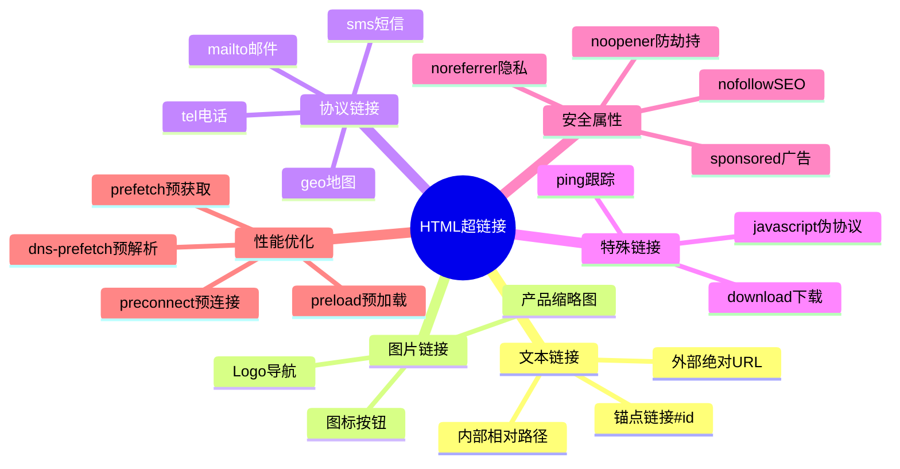
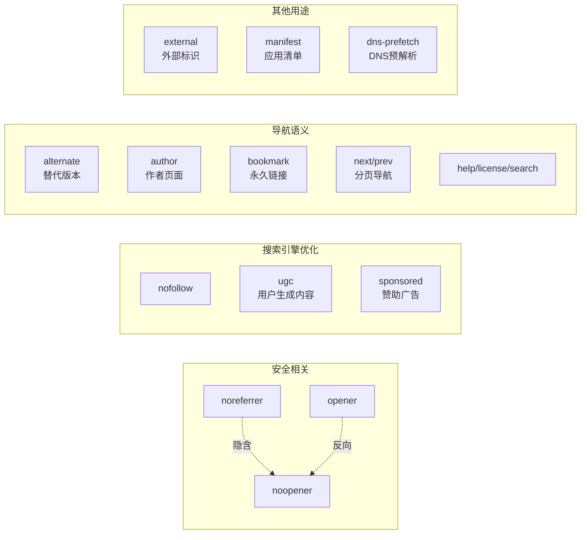

# 链接基础与属性

超链接（Hyperlink）是万维网的基石，通过 `<a>` 标签在页面元素与目标位置之间建立连接，实现站点内外的导航与资源引用。目标是 URL（统一资源定位符），可以指向页面、页面片段、媒体资源、联系方式或可下载文件等。`<a>` 标签是 HTML 中最重要的交互元素之一，是构建网站导航系统和内容互联的核心

本节将系统介绍 `<a>` 标签的基本语法、常用属性、不同类型链接的创建方法，以及样式、安全性、性能与可访问性等最佳实践，帮助你在实际项目中正确、稳定地使用超链接。

## 基本语法

```html
<a href="URL">链接文本或元素</a>
```

**核心要素：**
- `href`：必需属性，定义链接目标地址
- 链接内容：可以是文本、图片、行内元素等（不能包含其他 `<a>` 或交互元素如 `<button>`）
- 可选属性：`target`、`rel`、`download`、`referrerpolicy`、`title`、`ping` 等

### 属性速查表

| 属性             | 作用                 | 常见取值                                                      | 说明                                                       |
| ---------------- | -------------------- | ------------------------------------------------------------- | ---------------------------------------------------------- |
| `href`           | 目标地址             | 绝对/相对 URL、`#fragment`、`mailto:`、`tel:`、`sms:`         | 省略时元素变为占位符，仍可聚焦但无法导航                   |
| `target`         | 打开位置             | `_self`、`_blank`、`_parent`、`_top`、框架名称                | `_blank` 必须配合 `rel="noopener"` 使用                    |
| `rel`            | 当前页面与目标的关系 | `noopener`、`noreferrer`、`nofollow`、`ugc`、`sponsored` 等   | 多值以空格分隔                                             |
| `download`       | 作为下载处理         | 可选文件名                                                    | 同源资源有效，跨源需服务器配合                             |
| `referrerpolicy` | 引荐来源策略         | `no-referrer`、`origin`、`strict-origin-when-cross-origin` 等 | 控制请求时的 Referer 头信息                                |
| `ping`           | 跳转上报地址         | 一个或多个 URL（空格分隔）                                    | 浏览器发送 POST 请求进行统计跟踪                           |
| `hreflang`       | 目标资源语言         | BCP 47 语言标签（如 `zh-CN`、`en-US`）                        | 指示目标页面的语言，用于多语言网站                         |
| `type`           | 目标资源 MIME 类型   | `text/html`、`application/pdf`、`image/png` 等                | 提示浏览器资源类型，仅供参考                               |
| `title`          | 链接提示信息         | 任意文本                                                      | 鼠标悬停时显示，应避免与链接文本重复                       |
| `aria-label`     | 无障碍标签           | 描述性文本                                                    | 为屏幕阅读器提供说明，优先于链接内容                       |

::: warning
不建议把 `javascript:` / `data:` 放进 `href` 里：它们更容易引入 XSS 与可访问性问题。仅触发动作（不导航）的场景，优先用 `<button>`
:::

### 属性选择决策树

下面的流程图帮助开发者根据不同场景选择合适的属性组合：

```mermaid
flowchart TD
    A[开始: 创建 &#60;a&#62; 链接] --> B{确定链接目标}
    
    B -->|同源内部页面| C[使用相对路径 href]
    B -->|外部站点| D[必须添加安全属性]
    B -->|锚点跳转| E[href=#id]
    B -->|下载文件| F[添加 download 属性]
    B -->|协议链接| G[mailto:/tel:/sms:]
    B -->|占位/未实现| H[使用 button 替代]
    
    D --> I{是否新窗口打开?}
    I -->|是 _blank| J[✅ rel=noopener noreferrer]
    I -->|否 _self| K[可省略 target]
    
    F --> L{是否同源?}
    L -->|是| M[download 直接生效]
    L -->|否| N[需服务器 CORS 配置<br/>或 JS Fetch+Blob 方案]
    
    G --> O{参数含中文?}
    O -->|是| P[encodeURIComponent 编码]
    O -->|否| Q[直接拼接参数]
    
    J --> R{SEO 需求?}
    R -->|用户生成内容| S[+ rel=ugc nofollow]
    R -->|赞助广告| T[+ rel=sponsored]
    R -->|普通外链| U[仅安全属性即可]
    
```



## 链接还是按钮

在 UI 中，"长得像链接的东西"不一定是链接。关键看它的**语义与默认行为**：链接用于导航，按钮用于触发动作。

| 需求/行为                           | 推荐元素    | 理由                                                     |
| ----------------------------------- | ----------- | -------------------------------------------------------- |
| 跳转到另一个页面/路由/锚点          | `<a>`       | 浏览器原生支持复制链接、在新标签打开、历史记录、可访问性 |
| 下载文件或跳转到资源                | `<a>`       | 目标仍是"资源导航"                                       |
| 打开弹窗、提交表单、切换展开/收起等 | `<button>`  | 这是"动作"，不是导航                                     |
| 看起来像按钮但本质是导航            | `<a>` + CSS | 保留语义，样式交给 CSS                                   |

### 链接类型全景图



### `rel` 属性详解

`rel`（relationship）属性定义了当前页面与目标资源之间的关系，可以设置多个值（用空格分隔）。它在**安全性、SEO 和导航语义**方面都发挥着重要作用。

#### `rel` 属性分类体系



#### 安全相关

- **`noopener`**：阻止目标页面通过 `window.opener` 访问来源页面，防止标签劫持攻击
  - **必须与 `target="_blank"` 一起使用**
  - 现代浏览器已默认为新标签页启用 noopener 行为，但显式声明仍是最佳实践

- **`noreferrer`**：不发送 Referer 头，提升隐私保护
  - 隐含 `noopener` 行为
  - 目标网站无法知道用户从哪个页面访问过来

#### SEO 相关

- **`nofollow`**：告诉搜索引擎不要跟踪该链接，不传递页面权重
  - 适用于不可信的外部链接
  - 用于控制页面之间的权重流动

- **`ugc`**（User Generated Content）：标记用户生成内容中的链接
  - 用于评论区、论坛帖子等用户创建的内容
  - 帮助搜索引擎识别链接性质

- **`sponsored`**：标记赞助或广告性质的链接
  - 用于付费链接、广告、赞助内容
  - 符合搜索引擎的广告链接规范

#### 导航相关

- **`alternate`**：替代版本（如不同语言、不同格式）
- **`author`**：指向作者页面
- **`bookmark`**：永久链接（permalink）
- **`canonical`**：规范链接（通常在 `<link>` 中使用）
- **`help`**：帮助文档链接
- **`license`**：许可证信息链接
- **`next`**：下一页（用于分页，与 `<link>` 配合使用）
- **`prev`**：上一页（用于分页，与 `<link>` 配合使用）
- **`search`**：搜索页面链接

#### 其他

- **`external`**：标准 link type，表示目标不属于当前站点；常配合 CSS 用于外链样式区分（如图标）

**使用示例：**

```html
<!-- 安全的外部链接 -->
<a href="https://example.com" target="_blank" rel="noopener noreferrer">外部链接</a>

<!-- SEO 优化的用户内容链接 -->
<a href="https://user-site.com" rel="ugc nofollow">用户博客</a>

<!-- 分页导航 -->
<a href="/page2.html" rel="next">下一页</a>
<a href="/page1.html" rel="prev">上一页</a>

<!-- 多语言版本 -->
<a href="/en/about.html" rel="alternate" hreflang="en">English</a>
<a href="/zh/about.html" rel="alternate" hreflang="zh-CN">中文</a>
```

### 目标窗口 `target`

`target` 属性指定在何处打开链接文档，默认值为 `_self`。

#### 取值说明

| 值         | 说明                                             | 使用场景                     |
| ---------- | ------------------------------------------------ | ---------------------------- |
| `_self`    | 默认值，在当前窗口或框架中打开                   | 大部分内部链接               |
| `_blank`   | 在新窗口或标签页中打开                           | 外部网站、PDF 文档           |
| `_parent`  | 在父框架中打开（如果存在）                       | 框架嵌套场景                 |
| `_top`     | 在最顶层窗口中打开，跳出所有框架                 | 框架嵌套场景                 |
| 框架名称   | 在指定名称的框架或窗口中打开                     | 特定 iframe 场景             |

**注意事项：**
- 使用 `_blank` 时**必须**同时设置 `rel="noopener"` 或 `rel="noopener noreferrer"` 以保证安全
- 外部链接在新窗口打开可保持用户当前浏览上下文
- 过度使用 `_blank` 会影响用户体验（大量标签页）

#### 使用示例

```html
<!-- 在当前窗口打开（默认） -->
<a href="/about.html">关于我们</a>

<!-- 在新窗口安全打开外部链接 -->
<a href="https://example.com" target="_blank" rel="noopener noreferrer">外部网站</a>

<!-- 框架场景 -->
<iframe name="content-frame"></iframe>
<a href="/page.html" target="content-frame">在框架中打开</a>

<!-- 跳出框架 -->
<a href="https://example.com" target="_top">跳出框架访问</a>
```

注意：

- 使用 `_blank` 时建议同时设置 `rel="noopener noreferrer"`
- 外部链接在新窗口打开可防止用户丢失当前阅读上下文，但需要合理提示
- 使用框架时根据目标选择合适值，确保按预期打开

### `referrerpolicy` 属性

`referrerpolicy` 控制导航请求时携带的 Referer 头信息，用于精细控制隐私和引荐来源策略。

#### 取值说明

| 值                                | 同源请求         | 跨源请求             | HTTPS→HTTP 降级  | 说明                   |
| --------------------------------- | ---------------- | -------------------- | ---------------- | ---------------------- |
| `no-referrer`                     | 不发送           | 不发送               | 不发送           | 完全隐私保护           |
| `origin`                          | 发送源           | 发送源               | 发送源           | 只传递域名信息         |
| `same-origin`                     | 发送完整 Referer | 不发送               | 不发送           | 仅同源传递完整信息     |
| `origin-when-cross-origin`        | 发送完整 Referer | 发送源               | 发送源           | 跨源时只传域名         |
| `strict-origin`                   | 发送源           | 发送源               | **不发送**       | 防止降级泄露           |
| `strict-origin-when-cross-origin` | 发送完整 Referer | 发送源               | **不发送**       | **浏览器默认值**       |
| `unsafe-url`                      | 发送完整 Referer | 发送完整 Referer     | 发送完整 Referer | 最不安全，谨慎使用     |

#### 使用场景

```html
<!-- 完全隐私保护（不泄露任何来源信息） -->
<a href="https://example.com" referrerpolicy="no-referrer">隐私链接</a>

<!-- 只传递域名（隐藏具体页面路径） -->
<a href="https://example.com" referrerpolicy="origin">来源链接</a>

<!-- 默认行为（推荐，无需显式设置） -->
<a href="https://example.com">标准链接</a>

<!-- 需要完整引荐信息（谨慎使用，仅特定业务场景） -->
<a href="https://partner.com" referrerpolicy="unsafe-url">完整引荐</a>
```

**最佳实践：**
- 现代浏览器默认使用 `strict-origin-when-cross-origin`，大多数情况下无需显式设置
- 对于敏感页面或第三方服务，考虑使用 `no-referrer` 或 `origin`
- 永远不要为了"方便"使用 `unsafe-url`，它可能泄露敏感信息（如URL 中的token）

### `download` 属性

`download` 属性指示浏览器下载资源而不是导航到它。可以指定下载文件名。

#### 基本用法

```html
<!-- 使用服务器提供的文件名 -->
<a href="/files/guide.pdf" download>下载指南</a>

<!-- 指定下载文件名 -->
<a href="/files/guide.pdf" download="入门指南.pdf">下载入门指南</a>

<!-- 下载图片 -->
<a href="/images/photo.jpg" download="我的照片.jpg">
  
</a>
```

#### 关键限制

1. **同源限制**：仅对同源资源有效，跨源资源需服务器设置 CORS 头
2. **服务器优先**：服务器的 `Content-Disposition` 头优先级高于 `download` 属性
3. **浏览器兼容性**：所有现代浏览器支持，IE 不支持

#### 跨源下载解决方案

**方案 1：服务器配置（推荐）**

```http
# 服务器响应头示例
Content-Disposition: attachment; filename="guide.pdf"
Access-Control-Allow-Origin: https://yourdomain.com
```

**方案 2：JavaScript Fetch + Blob**

```html
<button onclick="downloadFile('https://example.com/file.pdf', 'document.pdf')">
  下载文档
</button>

<script>
async function downloadFile(url, filename) {
  try {
    const response = await fetch(url)
    if (!response.ok) throw new Error('下载失败')
    
    const blob = await response.blob()
    const blobUrl = URL.createObjectURL(blob)
    
    const link = document.createElement('a')
    link.href = blobUrl
    link.download = filename
    link.click()
    
    // 清理内存
    URL.revokeObjectURL(blobUrl)
  } catch (error) {
    console.error('下载错误:', error)
    alert('下载失败，请稍后重试')
  }
}
</script>
```

#### 文件名处理

```html
<!-- 文件名需要编码非 ASCII 字符 -->
<a href="/文件.pdf" download="用户手册.pdf">下载</a>

<!-- JavaScript 动态生成文件名（纯 HTML 无法写表达式，需脚本设置） -->
<a href="/report.pdf" id="report-link" download>下载报告</a>
<script>
  const filename = `报告_${new Date().toISOString().split('T')[0]}.pdf`
  document.getElementById('report-link').download = filename
</script>
```

### `ping` 属性

`ping` 属性用于跟踪用户点击，浏览器会在导航时向指定 URL 发送 POST 请求（内容为 `PING`）。

```html
<a href="https://example.com" ping="https://analytics.example.com/track">
  外部链接
</a>

<!-- 多个上报地址（空格分隔） -->
<a href="https://example.com" 
   ping="https://analytics.com/ping https://stats.com/track">
  多点上报
</a>
```

#### 工作原理

```
用户点击链接
    ↓
浏览器发送 POST 请求到 ping URL
    ↓
请求体：PING
请求头：Ping-From, Ping-To
    ↓
浏览器导航到 href 目标
```

#### 注意事项

- **隐私问题**：用户可能禁用此功能或使用隐私保护插件
- **不保证送达**：网络问题或浏览器设置可能导致请求失败
- **不能替代主数据源**：应与常规分析工具配合使用，不作为唯一统计手段
- **CORS 要求**：ping URL 必须允许跨域请求

#### 适用场景

- 不侵入用户体验的轻量级统计
- 第三方内容跳转跟踪
- 需要统计但无法修改目标页面的场景

## 链接类型详解

### 文本超链接

文本超链接是最基础的链接形式，为文本内容添加导航能力。

```html
<!-- 内部链接（相对路径） -->
<a href="/about.html">关于我们</a>
<a href="./contact.html">联系我们</a>
<a href="../docs/readme.html">文档</a>

<!-- 外部链接（绝对路径） -->
<a href="https://example.com" target="_blank" rel="noopener noreferrer">外部网站</a>
```

**路径选择建议：**
- **站内链接**：使用相对路径（便于环境迁移）
- **站外链接**：使用绝对路径（必须包含协议 `https://`）
- **协议相对 URL**（`//example.com`）在现代开发中不推荐使用，可能导致混合内容问题

### 图片超链接

将图片作为可点击元素，常用于 Logo 导航、产品缩略图、广告横幅等场景。

**基本语法：**

```html
<a href="目标URL">
  
</a>
```

**实际应用示例：**

```html
<!-- Logo 返回首页 -->
<a href="/" aria-label="返回首页">
  
</a>

<!-- 产品缩略图链接 -->
<a href="/products/123" class="product-link">
  
  <span class="link-text">查看详情</span>
</a>

<!-- 图标按钮链接 -->
<a href="/settings" class="icon-link" title="设置">
  <svg aria-hidden="true"><!-- 设置图标 --></svg>
  <span class="sr-only">设置</span>
</a>
```

**最佳实践：**

1. **必须提供 `alt` 属性**：描述图片内容或链接目的
2. **装饰性图片**：使用 `alt=""` 和 `aria-hidden="true"`
3. **可访问性**：确保键盘可访问（Tab + Enter）
4. **视觉反馈**：添加悬停效果提示可点击

```html
<!-- 纯装饰性图标 -->
<a href="/home" aria-label="返回首页">
  
</a>

<!-- 图标 + 文本组合 -->
<a href="/settings">
  <svg aria-hidden="true"><!-- 图标 --></svg>
  <span>设置</span>
</a>
```

### 内部链接

内部链接是指向同一网站内其他页面或同一页面特定位置的链接，是网站导航系统的核心组成部分。

#### 页面间内部链接

指向同一网站内其他页面，使用相对路径：

```html
<!-- 相对于当前页面 -->
<a href="about.html">关于我们</a>

<!-- 相对于网站根目录 -->
<a href="/products/laptop">笔记本电脑</a>

<!-- 向上一级目录 -->
<a href="../contact.html">联系我们</a>
```

**相对路径规则：**
- `page.html` - 同目录下的文件
- `/page.html` - 网站根目录下的文件
- `./page.html` - 同目录下的文件（显式声明）
- `../page.html` - 上级目录的文件

#### 页面内锚点链接

跳转到同一页面的特定位置，使用 `#` 加元素 `id`：

```html
<!-- 目标元素 -->
<h2 id="features">产品特色</h2>
<h2 id="specs">技术规格</h2>

<!-- 锚点链接 -->
<a href="#features">查看产品特色</a>
<a href="#specs">查看技术规格</a>

<!-- 返回顶部 -->
<a href="#top">返回顶部</a>
<h1 id="top">页面标题</h1>
```

**高级用法：**

```html
<!-- 跳转到其他页面的锚点 -->
<a href="/about.html#team">关于我们 - 团队介绍</a>

<!-- 平滑滚动（CSS） -->
<style>
  html {
    scroll-behavior: smooth;
  }
  
  /* 或针对特定链接 */
  .smooth-scroll {
    scroll-behavior: smooth;
  }
</style>

<!-- JavaScript 控制滚动 -->
<script>
document.querySelector('a[href="#section"]').addEventListener('click', (e) => {
  e.preventDefault()
  document.querySelector('#section').scrollIntoView({ 
    behavior: 'smooth',
    block: 'start'
  })
})
</script>
```

**完整示例：**

```html
<!DOCTYPE html>
<html>
  <head>
    <title>内部链接示例</title>
    <style>
      section {
        margin-bottom: 1000px;
        padding: 20px;
        border-bottom: 1px solid #eee;
      }
      nav {
        background: #f5f5f5;
        padding: 10px;
        margin-bottom: 20px;
      }
      nav a {
        margin-right: 15px;
      }
    </style>
  </head>
  <body>
    <nav>
      <a href="#section1">产品特色</a>
      <a href="#section2">技术规格</a>
      <a href="#section3">客户评价</a>
      <a href="#top">返回顶部</a>
    </nav>

    <section id="section1">
      <h2>产品特色</h2>
      <p>我们的产品具有以下特色...</p>
    </section>

    <section id="section2">
      <h2>技术规格</h2>
      <p>详细技术参数如下...</p>
    </section>

    <section id="section3">
      <h2>客户评价</h2>
      <p>看看客户怎么说...</p>
    </section>

    <p><a href="#top">回到页面顶部</a></p>
  </body>
</html>
```

## 外部链接

外部链接指向其他网站或资源，是互联网互联互通的基础。

<h4>021-external-links-security.html</h4>

```html
<!-- 来源：4-超链接.md - 外部链接安全属性 -->
<!DOCTYPE html>
<html lang="zh-CN">
<head>
  <meta charset="UTF-8">
  <meta name="viewport" content="width=device-width, initial-scale=1.0">
  <title>外部链接安全属性示例</title>
  <style>
    * {
      margin: 0;
      padding: 0;
      box-sizing: border-box;
    }

    body {
      font-family: -apple-system, BlinkMacSystemFont, "Segoe UI", sans-serif;
      line-height: 1.6;
      color: #333;
      background: #f5f7fa;
      padding: 40px 20px;
    }

    .container {
      max-width: 800px;
      margin: 0 auto;
    }

    h1 {
      text-align: center;
      color: #222;
      margin-bottom: 10px;
      font-size: 32px;
    }

    .subtitle {
      text-align: center;
      color: #666;
      margin-bottom: 40px;
      font-size: 16px;
    }

    .link-card {
      background: white;
      border-radius: 12px;
      padding: 24px;
      margin-bottom: 20px;
      box-shadow: 0 2px 8px rgba(0,0,0,0.08);
      transition: transform 0.2s, box-shadow 0.2s;
    }

    .link-card:hover {
      transform: translateY(-2px);
      box-shadow: 0 4px 16px rgba(0,0,0,0.12);
    }

    .link-card h3 {
      color: #0066cc;
      margin-bottom: 12px;
      font-size: 18px;
      display: flex;
      align-items: center;
      gap: 8px;
    }

    .badge {
      display: inline-block;
      padding: 3px 8px;
      border-radius: 4px;
      font-size: 11px;
      font-weight: 600;
      text-transform: uppercase;
    }

    .badge-safe { background: #d4edda; color: #155724; }
    .badge-warning { background: #fff3cd; color: #856404; }
    .badge-danger { background: #f8d7da; color: #721c24; }

    .link-description {
      color: #666;
      font-size: 14px;
      line-height: 1.7;
      margin-bottom: 16px;
    }

    .code-block {
      background: #f8f9fa;
      border-left: 3px solid #0066cc;
      padding: 12px 16px;
      font-family: 'Monaco', 'Menlo', monospace;
      font-size: 13px;
      overflow-x: auto;
      border-radius: 4px;
      color: #333;
    }

    /* 外部链接自动添加图标 */
    a[href^="http"]:not([href*="example.com"])::after {
      content: " ↗";
      font-size: 0.85em;
      opacity: 0.7;
      margin-left: 4px;
    }

    .external-link {
      display: inline-flex;
      align-items: center;
      gap: 6px;
      padding: 10px 20px;
      background: linear-gradient(135deg, #667eea 0%, #764ba2 100%);
      color: white !important;
      text-decoration: none;
      border-radius: 6px;
      font-weight: 500;
      transition: all 0.3s;
      margin-top: 10px;
    }

    .external-link:hover {
      transform: translateY(-1px);
      box-shadow: 0 4px 12px rgba(102,126,234,0.4);
    }

    .info-box {
      background: #e3f2fd;
      border-left: 4px solid #0066cc;
      padding: 16px 20px;
      margin-top: 30px;
      border-radius: 4px;
    }

    .info-box h4 {
      color: #0066cc;
      margin-bottom: 8px;
    }

    .info-box ul {
      list-style: none;
      font-size: 14px;
      color: #555;
    }

    .info-box li {
      padding: 4px 0;
      padding-left: 16px;
      position: relative;
    }

    .info-box li::before {
      content: "•";
      position: absolute;
      left: 0;
      color: #0066cc;
      font-weight: bold;
    }
  </style>
</head>
<body>

  <div class="container">
    <h1>🔗 外部链接安全属性</h1>
    <p class="subtitle">正确使用 rel、target 等属性保护用户安全</p>

    <!-- 示例 1：标准安全外部链接 -->
    <div class="link-card">
      <h3>
        ✅ 标准安全外部链接
        <span class="badge badge-safe">推荐</span>
      </h3>
      <div class="link-description">
        使用 <strong>target="_blank"</strong> 在新窗口打开，同时添加
        <strong>rel="noopener noreferrer"</strong> 防止安全漏洞。
        <ul style="margin-top: 8px; padding-left: 20px;">
          <li><strong>noopener</strong>：阻止目标页面通过 window.opener 访问来源页面（防止标签劫持）</li>
          <li><strong>noreferrer</strong>：不发送 Referer 头信息（隐私保护），隐含 noopener 行为</li>
        </ul>
      </div>
      <div class="code-block">
        &lt;a href="https://developer.mozilla.org"<br>
        &nbsp;&nbsp;&nbsp;&nbsp;target="_blank" rel="noopener noreferrer"&gt;<br>
        &nbsp;&nbsp;MDN Web 文档<br>
        &lt;/a&gt;
      </div>
      <a href="https://developer.mozilla.org/zh-CN/"
         target="_blank"
         rel="noopener noreferrer"
         class="external-link">
        打开 MDN 文档 ↗
      </a>
    </div>

    <!-- 示例 2：SEO 优化的用户内容链接 -->
    <div class="link-card">
      <h3>
        🔍 SEO 优化的用户生成内容链接
        <span class="badge badge-safe">推荐</span>
      </h3>
      <div class="link-description">
        对于评论区、论坛等用户生成的内容中的链接，使用
        <strong>rel="ugc nofollow"</strong> 告诉搜索引擎不要传递权重。
        <ul style="margin-top: 8px; padding-left: 20px;">
          <li><strong>ugc</strong>（User Generated Content）：标记用户生成内容的链接</li>
          <li><strong>nofollow</strong>：告诉搜索引擎不跟踪该链接，不传递页面权重</li>
        </ul>
      </div>
      <div class="code-block">
        &lt;a href="https://user-blog.com" rel="ugc nofollow"&gt;<br>
        &nbsp;&nbsp;用户分享的博客链接<br>
        &lt;/a&gt;
      </div>
      <a href="https://github.com"
         target="_blank"
         rel="ugc noopener noreferrer"
         class="external-link">
        用户分享的 GitHub 链接 (ugc) ↗
      </a>
    </div>

    <!-- 示例 3：赞助广告链接 -->
    <div class="link-card">
      <h3>
        💰 赞助/广告性质链接
        <span class="badge badge-safe">合规</span>
      </h3>
      <div class="link-description">
        对于付费链接、广告、赞助内容，使用 <strong>rel="sponsored"</strong>
        符合搜索引擎的广告链接规范要求。
      </div>
      <div class="code-block">
        &lt;a href="https://sponsor.com" rel="sponsored" target="_blank"&gt;<br>
        &nbsp;&nbsp;赞助商链接<br>
        &lt;/a&gt;
      </div>
      <a href="https://www.w3schools.com/"
         target="_blank"
         rel="sponsored noopener noreferrer"
         class="external-link">
        赞助商链接示例 (sponsored) ↗
      </a>
    </div>

    <!-- 示例 4：危险的不安全链接 -->
    <div class="link-card">
      <h3>
        ❌ 不安全的写法
        <span class="badge badge-danger">禁止</span>
      </h3>
      <div class="link-description">
        以下写法存在安全隐患，<strong>绝对避免在生产环境使用</strong>：
      </div>
      <div class="code-block" style="border-left-color: #dc3545;">
        &lt;!-- 危险：缺少安全属性 --&gt;<br>
        &lt;a href="https://example.com" target="_blank"&gt;<br>
        &nbsp;&nbsp;不安全的外部链接<br>
        &lt;/a&gt;<br><br>
        &lt;!-- 问题说明 --&gt;<br>
        • 目标页面可通过 window.opener 操作原页面<br>
        • 可被用于钓鱼攻击和恶意重定向<br>
        • 可能泄露用户的敏感信息（如 cookie）
      </div>
    </div>

    <!-- 信息提示框 -->
    <div class="info-box">
      <h4>📌 最佳实践要点</h4>
      <ul>
        <li>所有 <strong>target="_blank"</strong> 的外部链接必须包含 <strong>rel="noopener noreferrer"</strong></li>
        <li>现代浏览器已默认为新标签页启用 noopener，但显式声明仍是最佳实践</li>
        <li>用户生成内容使用 <strong>ugc nofollow</strong></li>
        <li>付费/赞助链接使用 <strong>sponsored</strong></li>
        <li>可使用 CSS 选择器 <code>a[href^="http"]::after</code> 自动为外部链接添加图标标识</li>
      </ul>
    </div>
  </div>

</body>
</html>
```


<h4>024-download-with-js.html</h4>

```html
<!-- 来源：4-超链接.md - JavaScript Fetch + Blob 跨源下载 -->
<!DOCTYPE html>
<html lang="zh-CN">
<head>
  <meta charset="UTF-8">
  <meta name="viewport" content="width=device-width, initial-scale=1.0">
  <title>跨源文件下载解决方案</title>
  <style>
    * {
      margin: 0;
      padding: 0;
      box-sizing: border-box;
    }

    body {
      font-family: -apple-system, BlinkMacSystemFont, "Segoe UI", sans-serif;
      line-height: 1.6;
      color: #333;
      background: #f5f7fa;
      min-height: 100vh;
      display: flex;
      align-items: center;
      justify-content: center;
      padding: 20px;
    }

    .container {
      background: white;
      border-radius: 16px;
      padding: 40px;
      max-width: 700px;
      width: 100%;
      box-shadow: 0 10px 40px rgba(0,0,0,0.1);
    }

    h1 {
      text-align: center;
      color: #222;
      margin-bottom: 8px;
      font-size: 28px;
    }

    .subtitle {
      text-align: center;
      color: #666;
      margin-bottom: 32px;
      font-size: 15px;
    }

    .download-section {
      margin-bottom: 28px;
      padding: 24px;
      border-radius: 12px;
      background: #f8f9fa;
    }

    .download-section h3 {
      color: #333;
      margin-bottom: 6px;
      font-size: 17px;
      display: flex;
      align-items: center;
      gap: 8px;
    }

    .download-section p {
      color: #666;
      font-size: 14px;
      margin-bottom: 16px;
      line-height: 1.7;
    }

    /* 方案 1：原生 download 属性（同源有效） */
    .btn-download-native {
      display: inline-flex;
      align-items: center;
      gap: 8px;
      padding: 14px 28px;
      background: linear-gradient(135deg, #28a745, #20883d);
      color: white;
      text-decoration: none;
      border-radius: 8px;
      font-weight: 600;
      font-size: 15px;
      transition: all 0.3s;
      box-shadow: 0 4px 12px rgba(40,167,69,0.3);
    }

    .btn-download-native:hover {
      transform: translateY(-2px);
      box-shadow: 0 6px 20px rgba(40,167,69,0.4);
    }

    .badge {
      display: inline-block;
      padding: 2px 8px;
      border-radius: 4px;
      font-size: 11px;
      font-weight: 600;
      text-transform: uppercase;
      margin-left: auto;
    }

    .badge-success { background: #d4edda; color: #155724; }
    .badge-warning { background: #fff3cd; color: #856404; }
    .badge-info { background: #cce5ff; color: #004085; }

    /* 方案 2：JS Fetch + Blob（跨源下载） */
    .btn-download-js {
      display: inline-flex;
      align-items: center;
      gap: 8px;
      padding: 14px 28px;
      background: linear-gradient(135deg, #0066cc, #0052a3);
      color: white;
      border: none;
      border-radius: 8px;
      font-weight: 600;
      font-size: 15px;
      cursor: pointer;
      transition: all 0.3s;
      box-shadow: 0 4px 12px rgba(0,102,204,0.3);
    }

    .btn-download-js:hover:not(:disabled) {
      transform: translateY(-2px);
      box-shadow: 0 6px 20px rgba(0,102,204,0.4);
    }

    .btn-download-js:disabled {
      opacity: 0.6;
      cursor: not-allowed;
    }

    /* 下载进度条 */
    .progress-container {
      margin-top: 16px;
      display: none;
    }

    .progress-bar-bg {
      height: 8px;
      background: #e9ecef;
      border-radius: 4px;
      overflow: hidden;
    }

    .progress-bar-fill {
      height: 100%;
      background: linear-gradient(90deg, #0066cc, #28a745);
      border-radius: 4px;
      width: 0%;
      transition: width 0.3s ease;
    }

    .progress-text {
      font-size: 13px;
      color: #666;
      margin-top: 6px;
      text-align: right;
    }

    /* 状态提示 */
    .status-message {
      margin-top: 12px;
      padding: 10px 16px;
      border-radius: 6px;
      font-size: 14px;
      display: none;
    }

    .status-success {
      display: block;
      background: #d4edda;
      color: #155724;
      border-left: 4px solid #28a745;
    }

    .status-error {
      display: block;
      background: #f8d7da;
      color: #721c24;
      border-left: 4px solid #dc3545;
    }

    /* 对比表格 */
    .comparison-table {
      width: 100%;
      border-collapse: collapse;
      margin-top: 30px;
      font-size: 14px;
    }

    .comparison-table th,
    .comparison-table td {
      padding: 12px 16px;
      text-align: left;
      border-bottom: 1px solid #eee;
    }

    .comparison-table th {
      background: #f8f9fa;
      font-weight: 600;
      color: #555;
      font-size: 13px;
      text-transform: uppercase;
      letter-spacing: 0.5px;
    }

    .check { color: #28a745; font-weight: bold; }
    .cross { color: #dc3545; font-weight: bold; }

    /* 代码展示 */
    .code-preview {
      background: #1e1e1e;
      color: #d4d4d4;
      padding: 18px;
      border-radius: 8px;
      font-family: 'Monaco', 'Menlo', monospace;
      font-size: 13px;
      line-height: 1.6;
      overflow-x: auto;
      margin-top: 16px;
    }

    .code-keyword { color: #569cd6; }
    .code-string { color: #ce9178; }
    .code-comment { color: #6a9955; }
    .code-function { color: #dcdcaa; }
  </style>
</head>
<body>

  <div class="container">
    <h1>📥 文件下载解决方案</h1>
    <p class="subtitle">对比原生 download 属性与 JS Fetch + Blob 跨源下载方案</p>

    <!-- 方案 1：原生 download 属性 -->
    <div class="download-section">
      <h3>
        ✅ 方案一：原生 download 属性
        <span class="badge badge-success">同源有效</span>
      </h3>
      <p>
        使用 HTML 原生的 <strong>download</strong> 属性，简单直接。
        但仅对<strong>同源资源</strong>有效，跨源时浏览器会忽略该属性而直接导航。
      </p>
      <a href="#" download="产品使用手册.pdf" class="btn-download-native">
        ⬇️ 下载 PDF 文档
      </a>
    </div>


    <!-- 方案 2：JS Fetch + Blob -->
    <div class="download-section">
      <h3>
        🔧 方案二：Fetch + Blob（跨源兼容）
        <span class="badge badge-info">推荐</span>
      </h3>
      <p>
        使用 JavaScript 的 <strong>Fetch API</strong> 获取文件内容，
        通过 <strong>Blob</strong> 对象创建临时 URL 实现下载。
        支持跨域资源、自定义文件名、下载进度显示等功能。
      </p>

      <!-- 模拟下载按钮 -->
      <button id="downloadBtn" class="btn-download-js" onclick="downloadFile()">
        ⬇️ 开始下载（模拟）
      </button>

      <!-- 进度条 -->
      <div class="progress-container" id="progressContainer">
        <div class="progress-bar-bg">
          <div class="progress-bar-fill" id="progressBar"></div>
        </div>
        <div class="progress-text" id="progressText">准备中...</div>
      </div>

      <!-- 状态消息 -->
      <div class="status-message" id="statusMessage"></div>

      <!-- 核心代码预览 -->
      <div class="code-preview">
<span class="code-comment">// 核心：Fetch + Blob 跨源下载函数</span>
<span class="code-keyword">async function</span> <span class="code-function">downloadFile</span>(url, filename) {
  <span class="code-keyword">try</span> {
    <span class="code-keyword">const</span> response = <span class="code-keyword">await</span> fetch(url)
    <span class="code-keyword">if</span> (!response.ok) <span class="code-keyword">throw new</span> Error(<span class="code-string">'下载失败'</span>)

    <span class="code-keyword">const</span> blob = <span class="code-keyword">await</span> response.blob()
    <span class="code-keyword">const</span> blobUrl = URL.createObjectURL(blob)

    <span class="code-keyword">const</span> link = document.createElement(<span class="code-string">'a'</span>)
    link.href = blobUrl
    link.download = filename
    link.click()

    URL.revokeObjectURL(blobUrl)  <span class="code-comment">// 清理内存</span>
  } <span class="code-keyword">catch</span> (error) {
    console.error(<span class="code-string">'下载错误:'</span>, error)
  }
}
      </div>
    </div>


    <!-- 对比表格 -->
    <table class="comparison-table">
      <thead>
        <tr>
          <th>特性</th>
          <th>原生 download 属性</th>
          <th>Fetch + Blob 方案</th>
        </tr>
      </thead>
      <tbody>
        <tr>
          <td>同源下载</td>
          <td><span class="check">✓ 支持</span></td>
          <td><span class="check">✓ 支持</span></td>
        </tr>
        <tr>
          <td>跨源下载</td>
          <td><span class="cross">✗ 不支持</span></td>
          <td><span class="check">✓ 支持（需 CORS）</span></td>
        </tr>
        <tr>
          <td>自定义文件名</td>
          <td><span class="check">✓ 支持</span></td>
          <td><span class="check">✓ 支持</span></td>
        </tr>
        <tr>
          <td>下载进度显示</td>
          <td><span class="cross">✗ 不支持</span></td>
          <td><span class="check">✓ 可实现</span></td>
        </tr>
        <tr>
          <td>实现复杂度</td>
          <td><span class="check">✓ 极简</span></td>
          <td><span class="cross">中等</span></td>
        </tr>
        <tr>
          <td>浏览器兼容性</td>
          <td><span class="check">✓ 全部支持</span></td>
          <td><span class="check">✓ 现代浏览器</span></td>
        </tr>
      </tbody>
    </table>

  </div>

  <script>
    /**
     * 使用 Fetch + Blob 实现跨源文件下载
     * @param {string} url - 文件地址
     * @param {string} filename - 下载后的文件名
     */
    async function downloadFile(url, filename) {
      const btn = document.getElementById('downloadBtn')
      const progressContainer = document.getElementById('progressContainer')
      const progressBar = document.getElementById('progressBar')
      const progressText = document.getElementById('progressText')
      const statusMessage = document.getElementById('statusMessage')

      // 重置状态
      btn.disabled = true
      btn.textContent = '⏳ 下载中...'
      progressContainer.style.display = 'block'
      statusMessage.className = 'status-message'
      statusMessage.style.display = 'none'

      try {
        // 模拟下载过程（实际项目中替换为真实 fetch 请求）
        // const response = await fetch(url)
        // if (!response.ok) throw new Error('HTTP ' + response.status)

        // 模拟进度更新
        for (let progress = 0; progress <= 100; progress += 10) {
          await new Promise(resolve => setTimeout(resolve, 150))
          progressBar.style.width = progress + '%'
          progressText.textContent = `下载进度：${progress}%`
        }

        // 模拟 Blob 创建
        // const blob = await response.blob()

        // 创建临时链接并触发下载
        const blob = new Blob(['这是一个模拟的文件内容'], { type: 'application/pdf' })
        const blobUrl = URL.createObjectURL(blob)

        const link = document.createElement('a')
        link.href = url || blobUrl
        link.download = filename || '产品使用手册.pdf'
        document.body.appendChild(link)
        link.click()
        document.body.removeChild(link)

        // 清理内存
        setTimeout(() => URL.revokeObjectURL(blobUrl), 1000)

        // 显示成功状态
        showStatus('success', '✅ 文件下载成功！已保存为「' + (filename || '产品使用手册.pdf') + '」')

      } catch (error) {
        console.error('下载错误:', error)
        showStatus('error', '❌ 下载失败：' + error.message)
      } finally {
        btn.disabled = false
        btn.textContent = '⬇️ 重新下载'
      }
    }

    /**
     * 显示状态消息
     */
    function showStatus(type, message) {
      const statusEl = document.getElementById('statusMessage')
      statusEl.textContent = message
      statusEl.className = 'status-message status-' + type
      statusEl.style.display = 'block'
    }
  </script>

</body>
</html>
```

### 基本语法

```html
<a href="https://example.com" 
   target="_blank" 
   rel="noopener noreferrer">
  外部链接
</a>
```

### 必要的安全属性

外部链接**必须**包含安全属性：

```html
<!-- ✅ 正确：包含安全属性 -->
<a href="https://example.com" target="_blank" rel="noopener noreferrer">
  安全的外部链接
</a>

<!-- ❌ 错误：缺少安全属性 -->
<a href="https://example.com" target="_blank">
  不安全的外部链接
</a>
```

**属性说明：**
- `target="_blank"`：在新标签页打开
- `rel="noopener"`：防止新页面访问 `window.opener`（安全必需）
- `rel="noreferrer"`：不发送 Referer 头（隐私保护）

### 外部链接最佳实践

```html
<!-- 1. 明确标识外部链接 -->
<a href="https://developer.mozilla.org" 
   target="_blank" 
   rel="noopener noreferrer">
  MDN 文档 <span aria-label="在新窗口打开">↗</span>
</a>

<!-- 2. SEO 优化：用户生成内容 -->
<a href="https://user-blog.com" rel="ugc nofollow">用户博客</a>

<!-- 3. 赞助/广告链接 -->
<a href="https://sponsor.com" target="_blank" rel="sponsored noopener">赞助商链接</a>

<!-- 4. CSS 自动添加外部链接图标 -->
<style>
a[href^="http"]:not([href*="yourdomain.com"])::after {
  content: " ↗";
  font-size: 0.8em;
  opacity: 0.7;
}
</style>
```

### 完整示例

```html
<!DOCTYPE html>
<html lang="zh-CN">
<head>
  <meta charset="UTF-8" />
  <title>外部链接示例</title>
  <style>
    .external-links {
      list-style: none;
      padding: 0;
    }
    .external-links a {
      color: #0066cc;
      text-decoration: none;
    }
    .external-links a:hover {
      text-decoration: underline;
    }
  </style>
</head>
<body>
  <h1>推荐资源</h1>
  
  <ul class="external-links">
    <li>
      <a href="https://developer.mozilla.org/zh-CN/" 
         target="_blank" 
         rel="noopener noreferrer">
        MDN Web 文档 <span aria-label="外部链接">↗</span>
      </a>
    </li>
    <li>
      <a href="https://www.w3schools.com/" 
         target="_blank" 
         rel="noopener noreferrer">
        W3Schools 教程 <span aria-label="外部链接">↗</span>
      </a>
    </li>
  </ul>
</body>
</html>
```

### 文件下载

文件下载链接使用 `download` 属性，详见[download 属性](#download-属性)章节。

```html
<!-- 简单下载 -->
<a href="/files/guide.pdf" download>下载指南</a>

<!-- 指定文件名 -->
<a href="/files/report.pdf" download="年度报告.pdf">下载报告</a>
```

## 协议链接（Protocol Links）

协议链接使用特定协议（如 `mailto:`、`tel:`）直接触发设备上的应用程序。

<h4>022-contact-protocol-links.html</h4>

```html
<!-- 来源：4-超链接.md - 协议链接（联系方式卡片） -->
<!DOCTYPE html>
<html lang="zh-CN">
<head>
  <meta charset="UTF-8">
  <meta name="viewport" content="width=device-width, initial-scale=1.0">
  <title>协议链接 - 联系方式卡片</title>
  <style>
    * {
      margin: 0;
      padding: 0;
      box-sizing: border-box;
    }

    body {
      font-family: -apple-system, BlinkMacSystemFont, "Segoe UI", sans-serif;
      line-height: 1.6;
      color: #333;
      background: linear-gradient(135deg, #667eea 0%, #764ba2 100%);
      min-height: 100vh;
      display: flex;
      align-items: center;
      justify-content: center;
      padding: 20px;
    }

    .contact-card {
      background: white;
      border-radius: 20px;
      padding: 40px;
      width: 100%;
      max-width: 450px;
      box-shadow: 0 20px 60px rgba(0,0,0,0.3);
    }

    .contact-card h1 {
      text-align: center;
      color: #222;
      margin-bottom: 8px;
      font-size: 28px;
    }

    .contact-card .subtitle {
      text-align: center;
      color: #888;
      margin-bottom: 30px;
      font-size: 14px;
    }

    .contact-item {
      display: flex;
      align-items: center;
      gap: 16px;
      padding: 16px 20px;
      background: #f8f9fa;
      border-radius: 12px;
      text-decoration: none;
      color: #333;
      transition: all 0.3s ease;
      margin-bottom: 12px;
      border: 2px solid transparent;
    }

    .contact-item:hover {
      transform: translateX(6px);
      background: white;
      box-shadow: 0 4px 16px rgba(0,0,0,0.1);
      border-color: #0066cc;
    }

    .contact-icon {
      width: 48px;
      height: 48px;
      border-radius: 12px;
      display: flex;
      align-items: center;
      justify-content: center;
      font-size: 24px;
      flex-shrink: 0;
    }

    .icon-email { background: linear-gradient(135deg, #ff6b6b, #ee5a5a); }
    .icon-phone { background: linear-gradient(135deg, #51cf66, #40c057); }
    .icon-sms { background: linear-gradient(135deg, #339af0, #228be6); }
    .icon-whatsapp { background: linear-gradient(135deg, #25d366, #128c7e); }
    .icon-skype { background: linear-gradient(135deg, #00aff0, #0078d4); }
    .icon-map { background: linear-gradient(135deg, #ff922b, #fd7e14); }

    .contact-info {
      flex: 1;
    }

    .contact-label {
      font-size: 12px;
      color: #888;
      text-transform: uppercase;
      letter-spacing: 0.5px;
      margin-bottom: 2px;
    }

    .contact-value {
      font-size: 16px;
      color: #222;
      font-weight: 500;
    }

    .contact-arrow {
      color: #ccc;
      font-size: 20px;
      transition: all 0.3s;
    }

    .contact-item:hover .contact-arrow {
      color: #0066cc;
      transform: translateX(4px);
    }

    /* 协议说明区域 */
    .protocol-info {
      margin-top: 30px;
      padding-top: 24px;
      border-top: 1px solid #eee;
    }

    .protocol-info h3 {
      font-size: 14px;
      color: #888;
      margin-bottom: 12px;
      text-transform: uppercase;
      letter-spacing: 0.5px;
    }

    .protocol-list {
      list-style: none;
      font-size: 13px;
      color: #666;
    }

    .protocol-list li {
      padding: 6px 0;
      display: flex;
      gap: 8px;
    }

    .protocol-tag {
      display: inline-block;
      padding: 2px 8px;
      background: #e3f2fd;
      color: #0066cc;
      border-radius: 4px;
      font-family: 'Monaco', monospace;
      font-size: 12px;
      min-width: 70px;
      text-align: center;
    }

    /* 点击反馈动画 */
    .contact-item:active {
      transform: translateX(6px) scale(0.98);
    }

    @media (max-width: 480px) {
      .contact-card {
        padding: 24px;
      }

      .contact-icon {
        width: 40px;
        height: 40px;
        font-size: 20px;
      }

      .contact-value {
        font-size: 14px;
      }
    }
  </style>
</head>
<body>

  <div class="contact-card">
    <h1>📞 联系我们</h1>
    <p class="subtitle">点击即可直接调用设备应用</p>

    <!-- 邮件链接 (mailto:) -->
    <a href="mailto:support@example.com?subject=产品咨询&body=您好，我想了解更多产品信息..."
       class="contact-item"
       title="发送邮件到 support@example.com">
      <div class="contact-icon icon-email">📧</div>
      <div class="contact-info">
        <div class="contact-label">电子邮件</div>
        <div class="contact-value">support@example.com</div>
      </div>
      <span class="contact-arrow">→</span>
    </a>

    <!-- 电话链接 (tel:) -->
    <a href="tel:+861012345678" class="contact-item" title="拨打电话 +86 10 1234 5678">
      <div class="contact-icon icon-phone">📱</div>
      <div class="contact-info">
        <div class="contact-label">客服热线</div>
        <div class="contact-value">+86 10 1234 5678</div>
      </div>
      <span class="contact-arrow">→</span>
    </a>

    <!-- 短信链接 (sms:) -->
    <a href="sms:+861012345678?body=我想预约咨询服务" class="contact-item" title="发送短信">
      <div class="contact-icon icon-sms">💬</div>
      <div class="contact-info">
        <div class="contact-label">短信联系</div>
        <div class="contact-value">发送短信咨询</div>
      </div>
      <span class="contact-arrow">→</span>
    </a>

    <!-- WhatsApp 链接 -->
    <a href="https://wa.me/861012345678?text=你好，我想了解产品详情"
       target="_blank"
       rel="noopener noreferrer"
       class="contact-item"
       title="通过 WhatsApp 联系">
      <div class="contact-icon icon-whatsapp">💚</div>
      <div class="contact-info">
        <div class="contact-label">WhatsApp</div>
        <div class="contact-value">在线即时聊天</div>
      </div>
      <span class="contact-arrow">→</span>
    </a>

    <!-- Skype 链接 -->
    <a href="skype:live:.cid.xxxxxx?chat" class="contact-item" title="打开 Skype 聊天">
      <div class="contact-icon icon-skype">📹</div>
      <div class="contact-info">
        <div class="contact-label">Skype</div>
        <div class="contact-value">视频通话 / 聊天</div>
      </div>
      <span class="contact-arrow">→</span>
    </a>

    <!-- 地图定位 (geo:) -->
    <a href="geo:39.9042,116.4074?q=北京市朝阳区建国门外大街1号"
       class="contact-item"
       title="在地图中查看位置">
      <div class="contact-icon icon-map">📍</div>
      <div class="contact-info">
        <div class="contact-label">公司地址</div>
        <div class="contact-value">北京市朝阳区建国门外大街1号</div>
      </div>
      <span class="contact-arrow">→</span>
    </a>

    <!-- 协议说明 -->
    <div class="protocol-info">
      <h3>支持的协议类型</h3>
      <ul class="protocol-list">
        <li><span class="protocol-tag">mailto:</span> 触发邮件客户端，支持 subject、body、cc、bcc 参数</li>
        <li><span class="protocol-tag">tel:</span> 打开拨号器，国际格式 (+国家区号) 推荐使用</li>
        <li><span class="protocol-tag">sms:</span> 发送短信，支持 body 参数预设内容</li>
        <li><span class="protocol-tag">https://wa.me/</span> WhatsApp 官方链接方案</li>
        <li><span class="protocol-tag">skype:</span> Skype 通话或聊天（需安装应用）</li>
        <li><span class="protocol-tag">geo:</span> 地图定位，格式：纬度,经度?q=地点名称</li>
      </ul>
    </div>
  </div>

</body>
</html>
```

### 邮件链接（mailto:）

```html
<!-- 基本用法 -->
<a href="mailto:support@example.com">发送邮件</a>

<!-- 带主题和正文 -->
<a href="mailto:support@example.com?subject=反馈&body=你好，我想咨询...">反馈邮件</a>

<!-- 多个收件人 -->
<a href="mailto:team@example.com,admin@example.com?subject=团队通知">群发邮件</a>

<!-- 抄送和密送 -->
<a href="mailto:main@example.com?cc=cc@example.com&bcc=bcc@example.com&subject=会议">
  发送邀请
</a>
```

**URL 参数：**

| 参数      | 说明                 | 示例                     |
| --------- | -------------------- | ------------------------ |
| `subject` | 邮件主题             | `subject=咨询反馈`       |
| `body`    | 邮件正文             | `body=您好，我想咨询...` |
| `cc`      | 抄送地址             | `cc=admin@example.com`   |
| `bcc`     | 密送地址             | `bcc=secret@example.com` |
| `to`      | 收件人（可省略）     | `to=other@example.com`   |

**重要提示：**
- 所有参数值都需要 URL 编码（使用 `encodeURIComponent()`）
- 空格编码为 `%20` 或 `+`
- 参数之间用 `&` 连接

```javascript
// JavaScript 生成邮件链接
const email = 'support@example.com'
const subject = encodeURIComponent('产品咨询')
const body = encodeURIComponent('您好，我想咨询产品信息...')
const mailtoLink = `mailto:${email}?subject=${subject}&body=${body}`
```

### 电话链接（tel:）

```html
<!-- 国际格式（推荐，全球通用） -->
<a href="tel:+861012345678">+86 10 1234 5678</a>

<!-- 带分机号 -->
<a href="tel:+861012345678,1234">+86 10 1234 5678 转 1234</a>

<!-- 带暂停符（p）和等待符（w） -->
<a href="tel:+861012345678p1234">拨号后暂停再输入分机</a>
```

**最佳实践：**
- 始终使用国际格式（`+` 开头）
- 链接文本显示格式化的电话号码
- 移动端会直接打开拨号器
- 桌面端可能打开 Skype 等应用

### 短信链接（sms:）

```html
<!-- 基本用法 -->
<a href="sms:+861012345678">发送短信</a>

<!-- 带预设内容 -->
<a href="sms:+861012345678?body=验证码是123456">发送验证码</a>

<!-- iOS 格式（使用 &amp;） -->
<a href="sms:+861012345678&amp;body=你好">iOS 短信</a>

<!-- 多个收件人 -->
<a href="sms:+861012345678,+861098765432">群发短信</a>
```

**兼容性说明：**
- `body` 参数在不同设备上表现不同
- iOS 使用 `&amp;` 连接参数
- Android 使用 `?` 连接参数

### 其他协议

```html
<!-- WhatsApp（广泛支持） -->
<a href="https://wa.me/861012345678?text=你好">WhatsApp 联系</a>

<!-- Skype -->
<a href="skype:username?call">Skype 通话</a>
<a href="skype:username?chat">Skype 聊天</a>

<!-- 地图定位 -->
<a href="geo:39.9042,116.4074?q=北京天安门">打开地图</a>
```

### 完整联系示例

```html
<!DOCTYPE html>
<html lang="zh-CN">
<head>
  <meta charset="UTF-8" />
  <meta name="viewport" content="width=device-width, initial-scale=1.0" />
  <title>联系方式</title>
  <style>
    .contact-card {
      display: flex;
      flex-direction: column;
      gap: 15px;
      max-width: 400px;
      padding: 20px;
      background: #f8f9fa;
      border-radius: 8px;
    }
    .contact-item {
      display: flex;
      align-items: center;
      gap: 12px;
      padding: 10px;
      background: white;
      border-radius: 6px;
      text-decoration: none;
      color: #333;
      transition: transform 0.2s, box-shadow 0.2s;
    }
    .contact-item:hover {
      transform: translateX(5px);
      box-shadow: 0 2px 8px rgba(0,0,0,0.1);
    }
  </style>
</head>
<body>
  <h1>联系我们</h1>
  
  <div class="contact-card">
    <a href="mailto:support@example.com?subject=产品咨询" class="contact-item">
      <span>📧</span>
      <span>support@example.com</span>
    </a>
    
    <a href="tel:+861012345678" class="contact-item">
      <span>📞</span>
      <span>+86 10 1234 5678</span>
    </a>
    
    <a href="sms:+861012345678" class="contact-item">
      <span>💬</span>
      <span>发送短信</span>
    </a>
    
    <a href="https://wa.me/861012345678" class="contact-item">
      <span>📱</span>
      <span>WhatsApp</span>
    </a>
  </div>
</body>
</html>
```

## 其他特殊链接

在 HTML 中使用超链接时，除了常见的内部链接、书签链接、外部链接等，还有一些其他链接，如脚本链接、空链接。

### 空链接与占位符

空链接用于占位或未实现的功能，但应谨慎使用。

```html
<!-- 空锚点（页面会滚动到顶部） -->
<a href="#">返回顶部</a>

<!-- JavaScript 空操作（不推荐） -->
<a href="javascript:void(0)">占位链接</a>
```

**问题：**
- `href="#"` 会导致页面滚动到顶部
- `javascript:void(0)` 存在安全和可访问性问题
- 屏幕阅读器会将其识别为链接但无法导航

**最佳实践：**

```html
<!-- ✅ 推荐：使用按钮处理动作 -->
<button type="button" onclick="handleClick()">执行操作</button>

<!-- ✅ 如果必须是链接，阻止默认行为 -->
<a href="#" onclick="event.preventDefault(); handleClick()">执行操作</a>

<!-- ✅ 开发中的占位链接 -->
<a href="#" aria-disabled="true" style="pointer-events: none">即将上线</a>

<!-- ✅ 无 href 的链接占位符 -->
<a>暂无链接</a> <!-- 可聚焦但不可导航 -->
```

### 脚本链接

**强烈不推荐**在 `href` 中使用 `javascript:` 协议。

```html
<!-- ❌ 危险：XSS 风险和可访问性问题 -->
<a href="javascript:alert('XSS')">危险链接</a>
<a href="javascript:void(0)" onclick="doSomething()">触发动作</a>

<!-- ✅ 正确：使用按钮 -->
<button type="button" onclick="doSomething()">执行操作</button>
```

**为什么避免 `javascript:` 协议：**
1. **安全隐患**：容易受到 XSS 攻击
2. **可访问性差**：屏幕阅读器无法正确识别
3. **SEO 问题**：搜索引擎无法理解
4. **用户体验差**：无法在新标签打开、复制链接

**注意**：大多数浏览器只允许脚本关闭"由脚本打开的窗口/标签"，普通页面无法直接关闭当前标签页。

## URL 编码与处理

URL 中只能使用 ASCII 字符，其他字符必须进行编码。

### URL 解析与编码流程

```mermaid
flowchart TD
    A[原始字符串] --> B{包含非ASCII字符?}
    B -->|是| C[调用 encodeURIComponent]
    B -->|否| D{是否完整URL?}
    
    C --> E[输出编码后的字符串<br/>例: 中文 → %E4%B8%AD%E6%96%87]
    
    D -->|是(含协议域名)| F[调用 encodeURI<br/>保留 : / ? # & = 等分隔符]
    D -->|否(仅查询参数)| G[调用 encodeURIComponent<br/>编码所有特殊字符]
    
    E --> H[拼接到URL中]
    F --> H
    G --> H
    
    H --> I[最终完整URL]
    
    J[解码过程] --> K[decodeURIComponent]
    K --> L[还原原始字符串]
    
```

### 编码规则

```javascript
// URL 编码函数
const url = 'https://example.com/search?q=' + encodeURIComponent('前端开发')
// 结果: https://example.com/search?q=%E5%89%8D%E7%AB%AF%E5%BC%80%E5%8F%91

// 编码整个 URL
const fullUrl = encodeURI('https://example.com/path?name=张三&age=25')
// 结果: https://example.com/path?name=%E5%BC%A0%E4%B8%89&age=25

// 解码
const decoded = decodeURIComponent('%E5%89%8D%E7%AB%AF')
// 结果: 前端
```

### 常见场景

```javascript
// 1. 邮件主题和正文
const subject = encodeURIComponent('产品反馈')
const body = encodeURIComponent('您好，我对产品有以下建议...')
const mailto = `mailto:support@example.com?subject=${subject}&body=${body}`

// 2. 搜索参数
const query = encodeURIComponent('JavaScript 高级编程')
const searchUrl = `/search?q=${query}`

// 3. 动态生成链接
function createSearchLink(keyword) {
  return `/search?q=${encodeURIComponent(keyword)}`
}
```

### 编码对照表

| 字符 | 编码  | 说明       |
| ---- | ----- | ---------- |
| 空格 | `%20` | 空格       |
| `&`  | `%26` | 和号       |
| `=`  | `%3D` | 等号       |
| `?`  | `%3F` | 问号       |
| `/`  | `%2F` | 斜杠       |
| `#`  | `%23` | 井号       |
| `中` | `%E4%B8%AD` | 中文字符 |
