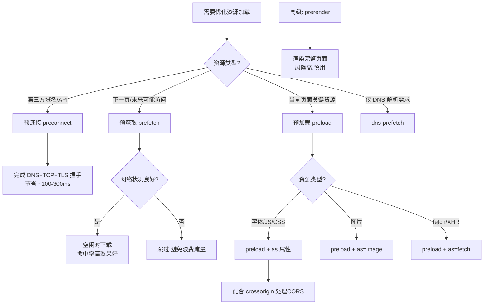
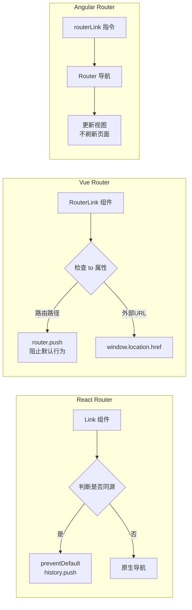
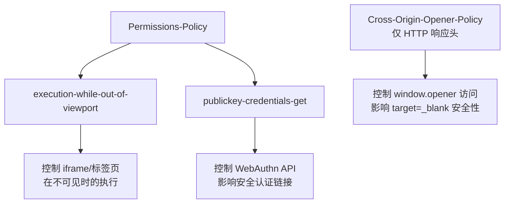

# 链接样式交互与进阶优化

> 本文为《04-超链接》专题拆分系列第 2/3 篇（共 3 篇）。上一篇：[链接基础与属性](/docs/html5/01-基础知识/04-超链接-1-链接基础与属性) ｜ 下一篇：[链接安全、可访问性与最佳实践](/docs/html5/01-基础知识/04-超链接-3-安全可访问与最佳实践)。

## 样式与状态

链接样式是用户体验的重要组成部分，清晰的状态反馈能帮助用户理解交互行为。

<h4>023-link-lvha-states.html</h4>

```html
<!-- 来源：4-超链接.md - 链接 LVHA 伪类状态样式 -->
<!DOCTYPE html>
<html lang="zh-CN">
<head>
  <meta charset="UTF-8">
  <meta name="viewport" content="width=device-width, initial-scale=1.0">
  <title>链接状态伪类 - LVHA 样式演示</title>
  <style>
    * {
      margin: 0;
      padding: 0;
      box-sizing: border-box;
    }

    body {
      font-family: -apple-system, BlinkMacSystemFont, "Segoe UI", sans-serif;
      line-height: 1.6;
      color: #333;
      background: #f5f7fa;
      padding: 40px 20px;
    }

    .container {
      max-width: 1000px;
      margin: 0 auto;
    }

    h1 {
      text-align: center;
      color: #222;
      margin-bottom: 10px;
      font-size: 32px;
    }

    .subtitle {
      text-align: center;
      color: #666;
      margin-bottom: 40px;
    }

    .section-title {
      font-size: 18px;
      color: #555;
      margin: 30px 0 16px;
      padding-left: 12px;
      border-left: 4px solid #0066cc;
    }

    /* ========== 基础链接样式（LVHA 顺序）========== */

    .demo-basic a {
      display: inline-block;
      padding: 12px 24px;
      text-decoration: none;
      border-radius: 8px;
      font-weight: 500;
      transition: all 0.3s ease;
      margin: 8px;

      /* :link - 未访问的链接 */
      color: #0066cc;
      background: white;
      border: 2px solid #0066cc;
    }

    /* LoVe - 已访问 */
    .demo-basic a:visited {
      color: #551a8b;
      border-color: #551a8b;
    }

    /* LovE - 悬停 */
    .demo-basic a:hover {
      color: white;
      background: #0066cc;
      transform: translateY(-2px);
      box-shadow: 0 4px 12px rgba(0,102,204,0.3);
    }

    /* LovE HAted - 激活状态（点击时）*/
    .demo-basic a:active {
      color: white;
      background: #003d7a;
      transform: translateY(0);
      box-shadow: none;
    }

    /* 聚焦状态（键盘导航） */
    .demo-basic a:focus {
      outline: 3px solid #0066cc;
      outline-offset: 3px;
    }

    /* 仅键盘聚焦显示轮廓（鼠标点击不显示） */
    .demo-basic a:focus:not(:focus-visible) {
      outline: none;
    }

    .demo-basic a:focus-visible {
      outline: 3px solid #0066cc;
      outline-offset: 3px;
    }


    /* ========== 高级样式技巧演示 ========== */

    .demo-advanced {
      display: grid;
      grid-template-columns: repeat(auto-fit, minmax(280px, 1fr));
      gap: 20px;
      margin-top: 20px;
    }

    .style-card {
      background: white;
      border-radius: 12px;
      padding: 24px;
      box-shadow: 0 2px 8px rgba(0,0,0,0.08);
    }

    .style-card h4 {
      color: #333;
      margin-bottom: 16px;
      font-size: 16px;
    }

    /* 技巧 1：外部链接自动添加图标 */
    .external-icon-link {
      position: relative;
      color: #0066cc;
      text-decoration: none;
      font-weight: 500;
      display: inline-block;
      padding: 4px 0;
    }

    .external-icon-link::after {
      content: " ↗";
      font-size: 0.85em;
      opacity: 0.7;
      margin-left: 4px;
      transition: all 0.2s;
    }

    .external-icon-link:hover::after {
      opacity: 1;
      transform: translateX(2px);
    }

    /* 技巧 2：下载链接图标 */
    .download-link {
      color: #28a745;
      text-decoration: none;
      font-weight: 500;
      display: inline-flex;
      align-items: center;
      gap: 6px;
      padding: 8px 16px;
      background: #d4edda;
      border-radius: 6px;
      transition: all 0.3s;
    }

    .download-link::before {
      content: "⬇";
      font-size: 18px;
    }

    .download-link:hover {
      background: #28a745;
      color: white;
      transform: translateY(-1px);
    }

    /* 技巧 3：邮件链接图标 */
    .email-link {
      color: #dc3545;
      text-decoration: none;
      font-weight: 500;
      display: inline-flex;
      align-items: center;
      gap: 6px;
      padding: 8px 16px;
      background: #f8d7da;
      border-radius: 6px;
      transition: all 0.3s;
    }

    .email-link::before {
      content: "✉";
      font-size: 18px;
    }

    .email-link:hover {
      background: #dc3545;
      color: white;
    }

    /* 技巧 4：链接按钮样式 */
    .btn-link {
      display: inline-block;
      padding: 12px 28px;
      background: linear-gradient(135deg, #667eea 0%, #764ba2 100%);
      color: white !important;
      text-decoration: none;
      border-radius: 8px;
      font-weight: 600;
      font-size: 15px;
      transition: all 0.3s;
      box-shadow: 0 4px 12px rgba(102,126,234,0.3);
    }

    .btn-link:hover {
      transform: translateY(-2px);
      box-shadow: 0 6px 20px rgba(102,126,234,0.4);
    }

    .btn-link:active {
      transform: translateY(0);
    }

    /* 技巧 5：禁用状态 */
    .disabled-link {
      pointer-events: none;
      opacity: 0.5;
      cursor: not-allowed;
      text-decoration: none;
      color: #999 !important;
      background: #f0f0f0;
      padding: 12px 28px;
      border-radius: 8px;
      display: inline-block;
    }

    /* 技巧 6：下划线动画 */
    .animated-underline {
      position: relative;
      text-decoration: none;
      color: #0066cc;
      font-weight: 500;
      display: inline-block;
      padding: 4px 0;
    }

    .animated-underline::after {
      content: '';
      position: absolute;
      bottom: 0;
      left: 0;
      width: 0;
      height: 2px;
      background: linear-gradient(90deg, #0066cc, #764ba2);
      transition: width 0.3s ease;
    }

    .animated-underline:hover::after {
      width: 100%;
    }


    /* ========== 状态说明表格 ========== */

    .state-table {
      width: 100%;
      border-collapse: collapse;
      margin-top: 30px;
      background: white;
      border-radius: 12px;
      overflow: hidden;
      box-shadow: 0 2px 8px rgba(0,0,0,0.08);
    }

    .state-table th,
    .state-table td {
      padding: 14px 18px;
      text-align: left;
      border-bottom: 1px solid #eee;
    }

    .state-table th {
      background: #f8f9fa;
      font-weight: 600;
      color: #333;
      font-size: 14px;
      text-transform: uppercase;
      letter-spacing: 0.5px;
    }

    .state-table tr:last-child td {
      border-bottom: none;
    }

    .state-badge {
      display: inline-block;
      padding: 4px 10px;
      border-radius: 4px;
      font-family: 'Monaco', monospace;
      font-size: 13px;
      font-weight: 600;
    }

    .badge-link { background: #e3f2fd; color: #0066cc; }
    .badge-visited { background: #f3e5f5; color: #7b1fa2; }
    .badge-hover { background: #fff3e0; color: #e65100; }
    .badge-active { background: #fce4ec; color: #c62828; }
    .badge-focus { background: #e8f5e9; color: #2e7d32; }

    /* 记忆口诀提示框 */
    .mnemonic-box {
      background: linear-gradient(135deg, #667eea 0%, #764ba2 100%);
      color: white;
      padding: 24px 32px;
      border-radius: 12px;
      margin-top: 40px;
      text-align: center;
    }

    .mnemonic-box h3 {
      font-size: 22px;
      margin-bottom: 8px;
    }

    .mnemonic-box p {
      font-size: 18px;
      letter-spacing: 2px;
      font-weight: 600;
    }

    .mnemonic-box code {
      background: rgba(255,255,255,0.2);
      padding: 2px 8px;
      border-radius: 4px;
    }
  </style>
</head>
<body>

  <div class="container">
    <h1>🎨 链接状态伪类样式</h1>
    <p class="subtitle">LVHA 顺序规则与高级样式技巧</p>

    <!-- 基础 LVHA 演示 -->
    <h2 class="section-title">基础状态演示（点击/悬停查看效果）</h2>

    <div class="demo-basic" style="text-align: center; padding: 30px;">
      <a href="#link1">基础链接 1</a>
      <a href="#link2">基础链接 2</a>
      <a href="#link3">基础链接 3</a>
      <p style="margin-top: 20px; color: #888; font-size: 14px;">
        💡 提示：尝试用鼠标悬停、点击，或使用 Tab 键切换焦点
      </p>
    </div>


    <!-- 高级样式技巧 -->
    <h2 class="section-title">高级样式技巧</h2>

    <div class="demo-advanced">

      <!-- 外部链接图标 -->
      <div class="style-card">
        <h4>🔗 外部链接自动添加图标</h4>
        <p style="color: #666; font-size: 14px; margin-bottom: 12px;">
          使用 CSS 选择器 <code>a[href^="http"]::after</code> 自动标识
        </p>
        <a href="https://developer.mozilla.org"
           target="_blank"
           rel="noopener noreferrer"
           class="external-icon-link">
          MDN Web 文档
        </a>
      </div>

      <!-- 下载链接 -->
      <div class="style-card">
        <h4>⬇️ 下载链接样式</h4>
        <p style="color: #666; font-size: 14px; margin-bottom: 12px;">
          使用 <code>a[download]::before</code> 添加下载图标
        </p>
        <a href="#" download class="download-link">下载产品手册.pdf</a>
      </div>

      <!-- 邮件链接 -->
      <div class="style-card">
        <h4>✉️ 邮件链接样式</h4>
        <p style="color: #666; font-size: 14px; margin-bottom: 12px;">
          使用 <code>a[href^="mailto:"]::before</code> 标识邮件链接
        </p>
        <a href="mailto:support@example.com" class="email-link">发送邮件给我们</a>
      </div>

      <!-- 按钮样式 -->
      <div class="style-card">
        <h4>🎯 链接按钮样式</h4>
        <p style="color: #666; font-size: 14px; margin-bottom: 12px;">
          将链接设计为 CTA 按钮，提升转化率
        </p>
        <a href="#" class="btn-link">立即开始使用 →</a>
      </div>

      <!-- 禁用状态 -->
      <div class="style-card">
        <h4>🚫 禁用状态</h4>
        <p style="color: #666; font-size: 14px; margin-bottom: 12px;">
          使用 <code>pointer-events: none</code> 禁用交互
        </p>
        <span class="disabled-link">即将上线功能</span>
      </div>

      <!-- 下划线动画 -->
      <div class="style-card">
        <h4>✨ 下划线动画效果</h4>
        <p style="color: #666; font-size: 14px; margin-bottom: 12px;">
          使用 <code>::after</code> 伪元素实现动态下划线
        </p>
        <a href="#" class="animated-underline">悬停查看动画效果</a>
      </div>

    </div>


    <!-- 状态说明表格 -->
    <h2 class="section-title">LVHA 伪类说明</h2>

    <table class="state-table">
      <thead>
        <tr>
          <th>顺序</th>
          <th>伪类选择器</th>
          <th>触发条件</th>
          <th>说明</th>
        </tr>
      </thead>
      <tbody>
        <tr>
          <td><span class="state-badge badge-link">1st</span></td>
          <td><code>:link</code></td>
          <td>未访问的链接</td>
          <td>仅对有 <code>href</code> 的 &lt;a&gt; 生效</td>
        </tr>
        <tr>
          <td><span class="state-badge badge-visited">2nd</span></td>
          <td><code>:visited</code></td>
          <td>已访问过的链接</td>
          <td>样式能力受限（隐私保护），仅能修改颜色相关属性</td>
        </tr>
        <tr>
          <td><span class="state-badge badge-hover">3rd</span></td>
          <td><code>:hover</code></td>
          <td>鼠标悬停时</td>
          <td>所有元素都可用，不仅限于链接</td>
        </tr>
        <tr>
          <td><span class="state-badge badge-active">4th</span></td>
          <td><code>:active</code></td>
          <td>激活状态（按下瞬间）</td>
          <td>短暂状态，持续时间约等于鼠标按住时间</td>
        </tr>
        <tr>
          <td><span class="state-badge badge-focus">*</span></td>
          <td><code>:focus</code></td>
          <td>获得键盘焦点</td>
          <td>Tab 导航或鼠标点击触发，用于可访问性</td>
        </tr>
      </tbody>
    </table>


    <!-- 记忆口诀 -->
    <div class="mnemonic-box">
      <h3>🧠 记忆口诀</h3>
      <p>
        <code>L</code>o<code>V</code>e <code>H</code>A<code>t</code>e
        <br>
        (<code>:link</code> → <code>:visited</code> → <code>:hover</code> → <code>:active</code>)
      </p>
    </div>

  </div>

</body>
</html>
```

### 链接状态伪类

CSS 提供多个伪类来定义链接的不同状态：

| 伪类       | 触发条件               | 说明                         |
| ---------- | ---------------------- | ---------------------------- |
| `:link`    | 未访问的链接           | 仅对有 `href` 的 `<a>` 生效  |
| `:visited` | 已访问的链接           | 样式能力受限（隐私保护）     |
| `:hover`   | 鼠标悬停               | 所有元素可用                 |
| `:active`  | 激活状态（点击时）     | 短暂状态                     |
| `:focus`   | 获得焦点               | 键盘导航或鼠标点击           |

**LVHA 顺序（重要）：**

```css
/* ✅ 正确顺序：:link → :visited → :hover → :active */
a:link { color: blue; }
a:visited { color: purple; }
a:hover { color: red; }
a:active { color: orange; }
a:focus { outline: 2px solid blue; }

/* 记忆口诀：LoVe HAte (Link Visited Hover Active) */
```

**为什么顺序重要：**
- CSS 后声明的规则会覆盖先声明的规则
- 错误的顺序会导致某些状态无法生效

### 基础样式示例

```css
/* 默认链接样式 */
a {
  color: #0066cc;
  text-decoration: none;
  transition: color 0.2s;
}

/* 未访问 */
a:link {
  color: #0066cc;
}

/* 已访问（仅能修改颜色相关属性） */
a:visited {
  color: #551a8b;
}

/* 悬停 */
a:hover {
  color: #004499;
  text-decoration: underline;
}

/* 激活 */
a:active {
  color: #cc0000;
}

/* 聚焦 */
a:focus {
  outline: 2px solid #0066cc;
  outline-offset: 2px;
}

/* 仅键盘聚焦显示轮廓 */
a:focus:not(:focus-visible) {
  outline: none;
}

a:focus-visible {
  outline: 2px solid #0066cc;
  outline-offset: 2px;
}
```

### 高级样式技巧

```css
/* 1. 外部链接自动添加图标 */
a[href^="http"]:not([href*="yourdomain.com"])::after {
  content: " ↗";
  font-size: 0.8em;
  margin-left: 2px;
  color: #666;
}

/* 2. 下载链接图标 */
a[download]::before {
  content: "⬇ ";
}

/* 3. 邮件链接图标 */
a[href^="mailto:"]::before {
  content: "✉ ";
}

/* 4. 链接按钮样式 */
a.btn {
  display: inline-block;
  padding: 10px 20px;
  background: #0066cc;
  color: white !important;
  text-decoration: none;
  border-radius: 4px;
  transition: all 0.2s;
}

a.btn:hover {
  background: #004499;
  transform: translateY(-1px);
}

a.btn:active {
  transform: translateY(0);
}

/* 5. 禁用状态 */
a.disabled {
  pointer-events: none;
  opacity: 0.5;
  cursor: not-allowed;
  text-decoration: none;
}

/* 6. 下划线动画 */
a.animated {
  position: relative;
  text-decoration: none;
}

a.animated::after {
  content: '';
  position: absolute;
  bottom: 0;
  left: 0;
  width: 0;
  height: 2px;
  background: currentColor;
  transition: width 0.3s;
}

a.animated:hover::after {
  width: 100%;
}
```

### 响应式与移动端

```css
/* 移动端优化点击区域 */
@media (pointer: coarse) {
  a {
    min-height: 44px;  /* iOS 推荐最小触摸区域 */
    min-width: 44px;
    padding: 10px;
  }
}

/* 高对比度模式 */
@media (prefers-contrast: high) {
  a {
    text-decoration: underline;
    color: #0000EE;
  }
  
  a:focus {
    outline: 3px solid #000;
  }
}

/* 减少动画 */
@media (prefers-reduced-motion: reduce) {
  a {
    transition: none;
  }
}
```

## JavaScript 交互

### 常用事件

链接元素支持完整的鼠标和键盘事件：

```html
<a href="/page.html" 
   onclick="handleClick(event)"
   onmouseover="handleHover()"
   onkeydown="handleKey(event)">
   链接
</a>

<script>
// 点击事件
function handleClick(e) {
  e.preventDefault() // 阻止默认跳转
  console.log('链接被点击')
}

// 悬停事件
function handleHover() {
  console.log('鼠标悬停')
}

// 键盘事件
function handleKey(e) {
  if (e.key === 'Enter') {
    console.log('Enter 键按下')
  }
}
</script>
```

### 阻止默认行为

```javascript
// 方法 1：事件监听器
document.querySelector('a').addEventListener('click', (e) => {
  e.preventDefault()
  // 执行自定义逻辑
})
```

```html
<!-- 方法 2：onclick 返回 false -->
<a href="/page.html" onclick="handleClick(); return false;">链接</a>

<!-- 方法 3：confirm 确认 -->
<a href="/delete" onclick="return confirm('确定删除吗？')">删除</a>
```

### 动态链接操作

```javascript
// 1. 动态修改链接
const link = document.querySelector('a')
link.href = '/new-page.html'
link.textContent = '新链接文本'
link.target = '_blank'
link.rel = 'noopener noreferrer'

// 2. 创建新链接
const newLink = document.createElement('a')
newLink.href = 'https://example.com'
newLink.textContent = '外部链接'
newLink.target = '_blank'
newLink.rel = 'noopener noreferrer'
document.body.appendChild(newLink)

// 3. 批量处理外部链接
document.querySelectorAll('a[href^="http"]').forEach(link => {
  if (!link.href.includes(window.location.hostname)) {
    link.target = '_blank'
    link.rel = 'noopener noreferrer'
  }
})

// 4. 复制链接到剪贴板
function copyLink(url) {
  navigator.clipboard.writeText(url).then(() => {
    alert('链接已复制')
  })
}
```

### 异步加载与导航

```javascript
// 异步加载内容
async function loadContent(url) {
  try {
    const response = await fetch(url)
    const html = await response.text()
    document.getElementById('content').innerHTML = html
    // 更新浏览器历史
    history.pushState({}, '', url)
  } catch (error) {
    console.error('加载失败:', error)
  }
}

// SPA 路由拦截
document.addEventListener('click', (e) => {
  const link = e.target.closest('a')
  if (link && link.href.startsWith(window.location.origin)) {
    e.preventDefault()
    loadContent(link.href)
  }
})
```

### 链接验证

```javascript
// 验证 URL 格式
function isValidUrl(string) {
  try {
    const url = new URL(string)
    return ['http:', 'https:'].includes(url.protocol)
  } catch {
    return false
  }
}

// 检查链接是否可访问（同源）
async function checkLinkAccessible(url) {
  const parsed = new URL(url, window.location.href)
  
  // 仅同源可检查
  if (parsed.origin !== window.location.origin) {
    return null // 无法检查跨源链接
  }
  
  try {
    const response = await fetch(url, { method: 'HEAD' })
    return response.ok
  } catch {
    return false
  }
}

// 使用示例
if (isValidUrl('https://example.com')) {
  console.log('URL 格式有效')
}
```

### 埋点与统计

```javascript
// 链接点击跟踪
document.querySelectorAll('a').forEach(link => {
  link.addEventListener('click', function() {
    // Google Analytics
    if (typeof gtag !== 'undefined') {
      gtag('event', 'click', {
        'event_category': 'link',
        'event_label': this.href,
        'transport_type': 'beacon'
      })
    }
    
    // 自定义埋点
    trackEvent({
      type: 'link_click',
      url: this.href,
      text: this.textContent,
      timestamp: Date.now()
    })
  })
})

// 链接可见性追踪（Intersection Observer）
const observer = new IntersectionObserver((entries) => {
  entries.forEach(entry => {
    if (entry.isIntersecting) {
      console.log('链接可见:', entry.target.href)
    }
  })
})

document.querySelectorAll('a').forEach(link => observer.observe(link))
```

## 性能优化

### 资源提示（Resource Hints）策略矩阵

资源提示是一组用于优化资源加载的机制，通过声明式的 `<link>` 元素告诉浏览器提前准备关键资源。理解它们的差异对于构建高性能网站至关重要。

#### 资源提示对比表

| 特性 | `dns-prefetch` | `preconnect` | `prefetch` | `preload` | `prerender` |
|------|---------------|-------------|-----------|-----------|------------|
| **作用阶段** | DNS 查询 | DNS + TCP + TLS | 请求文档/资源 | 请求关键资源 | 渲染整个页面 |
| **优先级** | 最低 | 低 | 网络空闲时 | 高（立即） | 最高 |
| **适用场景** | 第三方域名 | API/CDN 域名 | 下一页/可能访问的资源 | 当前页面关键资源 | 确定会访问的页面 |
| **浏览器支持** | 广泛 | 广泛 | Chrome/Firefox（Safari 不支持） | 现代 | 仅 Chrome |
| **风险等级** | 极低 | 低 | 中（浪费带宽） | 中高（抢占带宽） | 高（浪费资源） |
| **`as` 属性** | ❌ | ❌ | 可选 | ✅ 必填 | ❌ |

#### 资源提示决策流程



#### 典型配置示例

```html
<head>
  <!-- 1. DNS 预解析：第三方域名 -->
  <link rel="dns-prefetch" href="//cdn.jsdelivr.net" />
  <link rel="dns-prefetch" href="//fonts.googleapis.com" />
  
  <!-- 2. 预连接：API 和字体服务（包含 TLS 握手） -->
  <link rel="preconnect" href="https://api.example.com" crossorigin />
  <link rel="preconnect" href="https://fonts.googleapis.com" />
  <link rel="preconnect" href="https://fonts.gstatic.com" crossorigin />
  
  <!-- 3. 预获取：用户可能访问的下一页 -->
  <link rel="prefetch" href="/next-page.html" as="document" />
  
  <!-- 4. 预加载：当前页面关键资源 -->
  <link rel="preload" href="/styles/critical.css" as="style" />
  <link rel="preload" href="/js/main.js" as="script" />
  <link rel="preload" href="/fonts/main.woff2" as="font" type="font/woff2" crossorigin />
  <link rel="preload" href="/images/hero.webp" as="image" />
  
  <!-- 5. 预渲染：确定会跳转的页面（慎用） -->
  <!-- <link rel="prerender" href="/checkout-success" /> -->
</head>
```

::: tip 最佳实践原则
1. **按需使用**：不要一次性添加所有资源提示，根据实际场景选择
2. **监控效果**：使用 DevTools Network 面板观察资源加载时间变化
3. **考虑成本**：prefetch/prerender 可能浪费用户带宽，移动端要谨慎
4. **preload 配合 as**：必须正确设置 `as` 属性，否则浏览器可能重复加载
:::

### 资源预加载

预加载可以提前获取用户可能访问的资源，提升用户体验。

```html
<!-- 预获取下一页（低优先级，空闲时加载） -->
<link rel="prefetch" href="/next-page.html" as="document" />

<!-- 预加载关键资源（高优先级） -->
<link rel="preload" href="/critical.css" as="style" />
<link rel="preload" href="/hero-image.jpg" as="image" />
<link rel="preload" href="/font.woff2" as="font" type="font/woff2" crossorigin />

<!-- 预渲染页面（Chrome 支持） -->
<link rel="prerender" href="/next-page.html" />
```

### DNS 预解析与预连接

减少外部资源加载的连接时间：

```html
<!-- DNS 预解析（仅解析域名） -->
<link rel="dns-prefetch" href="https://cdn.example.com" />

<!-- 预连接（DNS + TCP + TLS 握手） -->
<link rel="preconnect" href="https://api.example.com" />
<link rel="preconnect" href="https://fonts.googleapis.com" crossorigin />

<!-- 实际应用 -->
<head>
  <!-- 关键第三方域名预连接 -->
  <link rel="preconnect" href="https://fonts.googleapis.com" />
  <link rel="preconnect" href="https://fonts.gstatic.com" crossorigin />
  
  <!-- CDN 域名预解析 -->
  <link rel="dns-prefetch" href="https://cdn.yoursite.com" />
</head>
```

### 预加载最佳实践

```html
<!-- ✅ 预加载用户可能点击的链接 -->
<nav>
  <a href="/products" onmouseover="preloadPage('/products')">产品</a>
  <a href="/about" onmouseover="preloadPage('/about')">关于</a>
</nav>

<script>
function preloadPage(url) {
  const link = document.createElement('link')
  link.rel = 'prefetch'
  link.href = url
  document.head.appendChild(link)
}

// 或使用 Intersection Observer 预加载视口内的链接
const observer = new IntersectionObserver((entries) => {
  entries.forEach(entry => {
    if (entry.isIntersecting) {
      const link = document.createElement('link')
      link.rel = 'prefetch'
      link.href = entry.target.href
      document.head.appendChild(link)
      observer.unobserve(entry.target)
    }
  })
}, { rootMargin: '50px' })

document.querySelectorAll('a[href]').forEach(a => observer.observe(a))
</script>
```

### 避免性能陷阱

```html
<!-- ❌ 避免预加载过多资源 -->
<!-- 不要一次性预加载所有可能的页面 -->

<!-- ❌ 避免在移动网络预加载大文件 -->
<script>
if (navigator.connection && 
    navigator.connection.effectiveType !== '4g') {
  // 移动网络不预加载
  console.log('移动网络，跳过预加载')
}
</script>

<!-- ✅ 智能预加载 -->
<script>
// 根据网络状况决定是否预加载
if ('connection' in navigator) {
  const connection = navigator.connection
  if (connection.saveData || connection.effectiveType === 'slow-2g') {
    // 用户启用省流模式或慢速网络，不预加载
  } else {
    // 预加载下一页
    const link = document.createElement('link')
    link.rel = 'prefetch'
    link.href = '/next-page'
    document.head.appendChild(link)
  }
}
</script>
```

## SPA 路由中的链接管理

单页应用（Single Page Application, SPA）中，链接的行为与传统多页应用有本质区别。理解框架路由组件的工作原理，有助于写出更健壮的 SPA 链接。

### 框架路由组件原理

现代前端框架都提供了路由组件来处理客户端导航，它们本质上是对原生 `<a>` 标签的封装：



### Vue Router 链接处理

```vue
<template>
  <!-- ✅ 推荐：使用 RouterLink 组件 -->
  <router-link to="/about" custom v-slot="{ navigate, href, isExactActive }">
    <a :href="href" @click="navigate" :class="{ active: isExactActive }">
      关于我们
    </a>
  </router-link>
  
  <!-- ✅ 简写形式 -->
  <router-link to="/products">产品列表</router-link>
  
  <!-- ✅ 动态路由 -->
  <router-link :to="`/user/${userId}`">用户详情</router-link>
  
  <!-- ✅ 外部链接仍用原生 a 标签 -->
  <a href="https://example.com" target="_blank" rel="noopener noreferrer">
    外部链接
  </a>
</template>

<script setup>
import { useRouter, useRoute } from 'vue-router'

const router = useRouter()
const route = useRoute()

// 编程式导航
function navigateToProfile() {
  router.push({ name: 'profile', params: { id: 123 } })
}

// 替换当前记录（不可后退）
function replaceCurrent() {
  router.replace('/settings')
}
</script>
```

### React Router 链接处理

```jsx
import { Link, useNavigate, useParams } from 'react-router-dom'

function Navigation() {
  const navigate = useNavigate()
  
  return (
    <nav>
      {/* ✅ 内部路由使用 Link */}
      <Link to="/about">关于我们</Link>
      
      {/* ✅ 动态路由 */}
      <Link to={`/product/${productId}`}>查看产品</Link>
      
      {/* ✅ 带状态的路由跳转 */}
      <Link 
        to="/search" 
        state={{ from: 'homepage' }}
      >
        搜索
      </Link>
      
      {/* ✅ 外部链接使用原生 a 标签 */}
      <a 
        href="https://example.com"
        target="_blank"
        rel="noopener noreferrer"
      >
        外部网站
      </a>
      
      {/* ✅ 编程式导航 */}
      <button onClick={() => navigate('/dashboard')}>
        进入后台
      </button>
    </nav>
  )
}
```

### SPA 链接常见陷阱与解决方案

#### 陷阱 1：丢失原生能力

```jsx
// ❌ 问题：用户无法右键复制链接地址
<Link to="/page">页面</Link>

// ✅ 解决方案：确保 href 属性正确渲染
// React Router 的 Link 组件会自动生成正确的 href
// Vue Router 的 RouterLink 也同样处理
```

#### 陷阱 2：SEO 与 SSR

```vue
<!-- 服务端渲染时确保链接可被爬虫发现 -->
<template>
  <!-- Nuxt.js / Next.js 自动处理 SSR 链接 -->
  <nuxt-link to="/about">关于</nuxt-link>
  <!-- 或 Next.js（v13+ 中 Link 组件自动渲染 <a>，无需手动包裹） -->
  <Link href="/about">关于</Link>
</template>
```

#### 陷阱 3：滚动行为恢复

```javascript
// Vue Router 配置滚动行为
const router = createRouter({
  history: createWebHistory(),
  scrollBehavior(to, from, savedPosition) {
    if (savedPosition) {
      return savedPosition
    } else if (to.hash) {
      return { el: to.hash, behavior: 'smooth' }
    } else {
      return { top: 0 }
    }
  },
  routes
})
```

### 混合模式：SPA 内嵌传统链接

```vue
<template>
  <div>
    <!-- SPA 内部导航 -->
    <router-link to="/internal">内部页面</router-link>
    
    <!-- 传统多页应用部分 -->
    <a href="/legacy-page.html">旧版页面</a>
    
    <!-- 条件渲染：SPA 还是 MPA -->
    <component 
      :is="isSpaRoute ? 'router-link' : 'a'"
      v-bind="linkProps"
    >
      {{ linkText }}
    </component>
  </div>
</template>

<script setup>
import { computed } from 'vue'

const props = defineProps({
  to: [String, Object],
  href: String
})

const isSpaRoute = computed(() => {
  // 判断是否为 SPA 路由
  return props.to && !props.to.startsWith('http')
})

const linkProps = computed(() => {
  return isSpaRoute.value 
    ? { to: props.to } 
    : { href: props.href, target: '_blank', rel: 'noopener noreferrer' }
})
</script>
```

## 链接审计与监控

在生产环境中，维护健康的链接生态需要系统化的审计和监控策略。

### 死链检测方案

```javascript
/**
 * 链接健康检查器
 * 用于检测站内死链和异常链接
 */
class LinkAuditor {
  constructor(options = {}) {
    this.options = {
      timeout: 5000,           // 请求超时时间
      retryCount: 1,           // 重试次数
      concurrentLimit: 5,      // 并发限制
      ...options
    }
    this.results = []
  }

  /**
   * 审计页面所有链接
   * @param {Document} doc - 要审计的文档对象
   * @returns {Promise<Array>} 审计结果数组
   */
  async auditPage(doc = document) {
    const links = Array.from(doc.querySelectorAll('a[href]'))
    const internalLinks = links.filter(this.isInternalLink.bind(this))
    
    console.log(`开始审计: 共 ${links.length} 个链接, ${internalLinks.length} 个内部链接`)
    
    // 分批并发检测
    const batches = this.chunkArray(internalLinks, this.options.concurrentLimit)
    
    for (const batch of batches) {
      await Promise.allSettled(
        batch.map(link => this.checkLink(link))
      )
    }
    
    return this.generateReport()
  }

  /**
   * 检查单个链接的可访问性
   */
  async checkLink(link) {
    const url = link.href
    const startTime = performance.now()
    
    try {
      const response = await fetch(url, { 
        method: 'HEAD',
        signal: AbortSignal.timeout(this.options.timeout)
      })
      
      const duration = Math.round(performance.now() - startTime)
      
      this.results.push({
        url,
        status: response.status,
        ok: response.ok,
        duration,
        element: link,
        timestamp: new Date().toISOString()
      })
      
      // 标记问题链接
      if (!response.ok) {
        link.dataset.linkStatus = 'broken'
        link.setAttribute('aria-invalid', 'true')
      }
    } catch (error) {
      this.results.push({
        url,
        status: 0,
        ok: false,
        error: error.message,
        element: link,
        timestamp: new Date().toISOString()
      })
      
      link.dataset.linkStatus = 'error'
    }
  }

  /** 判断是否为内部链接 */
  isInternalLink(link) {
    try {
      const url = new URL(link.href)
      return url.origin === window.location.origin
    } catch {
      return false
    }
  }

  /** 数组分块 */
  chunkArray(array, size) {
    const chunks = []
    for (let i = 0; i < array.length; i += size) {
      chunks.push(array.slice(i, i + size))
    }
    return chunks
  }

  /** 生成审计报告 */
  generateReport() {
    const total = this.results.length
    const broken = this.results.filter(r => !r.ok).length
    const healthy = total - broken
    const avgDuration = total > 0 
      ? Math.round(this.results.reduce((sum, r) => sum + (r.duration || 0), 0) / total)
      : 0
    
    return {
      summary: {
        total,
        healthy,
        broken,
        healthRate: ((healthy / total) * 100).toFixed(1) + '%',
        avgResponseTime: avgDuration + 'ms'
      },
      details: this.results,
      brokenLinks: this.results.filter(r => !r.ok)
    }
  }
}

// 使用示例
// const auditor = new LinkAuditor({ timeout: 3000 })
// const report = await auditor.auditPage()
// console.table(report.brokenLinks)
```

### 重定向链检测

```javascript
/**
 * 重定向链分析器
 * 检测链接是否存在过多的重定向跳转
 */
async function analyzeRedirectChain(url, maxRedirects = 5) {
  const chain = []
  let currentUrl = url
  
  for (let i = 0; i <= maxRedirects; i++) {
    try {
      const response = await fetch(currentUrl, { 
        method: 'GET',
        redirect: 'manual',  // 手动处理重定向
        signal: AbortSignal.timeout(5000)
      })
      
      if (response.status >= 300 && response.status < 400) {
        const redirectUrl = response.headers.get('location')
        chain.push({
          from: currentUrl,
          to: redirectUrl,
          status: response.status
        })
        
        // 处理相对 URL
        currentUrl = new URL(redirectUrl, currentUrl).href
      } else {
        chain.push({
          from: currentUrl,
          to: null,
          status: response.status,
          final: true
        })
        break
      }
    } catch (error) {
      chain.push({ from: currentUrl, error: error.message })
      break
    }
  }
  
  return {
    url,
    chainLength: chain.length,
    hasExcessiveRedirects: chain.length > 3,
    chain,
    recommendation: chain.length > 3 
      ? '警告: 重定向链过长，建议优化为目标URL' 
      : '正常'
  }
}
```

### 链接变更监控

```javascript
/**
 * 链接监控器
 * 监控页面链接的变化，用于调试动态生成的链接
 */
class LinkMonitor {
  constructor() {
    this.observer = null
    this.snapshot = new Map()
  }

  start() {
    // 记录初始状态
    this.takeSnapshot()
    
    // 监控 DOM 变化
    this.observer = new MutationObserver((mutations) => {
      mutations.forEach(mutation => {
        mutation.addedNodes.forEach(node => {
          if (node.nodeType === Node.ELEMENT_NODE) {
            const links = node.querySelectorAll?.('a[href]') || []
            links.forEach(link => this.logChange('added', link))
            
            if (node.tagName === 'A' && node.hasAttribute('href')) {
              this.logChange('added', node)
            }
          }
        })
        
        mutation.removedNodes.forEach(node => {
          if (node.nodeType === Node.ELEMENT_NODE && node.tagName === 'A') {
            this.logChange('removed', node)
          }
        })
      })
    })
    
    this.observer.observe(document.body, {
      childList: true,
      subtree: true
    })
  }

  takeSnapshot() {
    document.querySelectorAll('a[href]').forEach((link, index) => {
      this.snapshot.set(index, {
        href: link.href,
        text: link.textContent.trim(),
        rel: link.rel,
        target: link.target
      })
    })
  }

  logChange(type, element) {
    const info = {
      type,
      timestamp: Date.now(),
      href: element.href,
      text: element.textContent.trim().slice(0, 50)
    }
    
    console.group(`🔗 链接${type === 'added' ? '新增' : '移除'}`)
    console.table(info)
    console.groupEnd()
  }

  stop() {
    this.observer?.disconnect()
  }

  getReport() {
    return {
      totalLinks: this.snapshot.size,
      snapshot: Object.fromEntries(this.snapshot)
    }
  }
}
```

### 自动化审计工具集成

```javascript
/**
 * CI/CD 集成的链接审计脚本
 * 可在构建阶段运行，检测文档站点死链
 */
async function runLinkAudit(config) {
  const { baseUrl, paths, excludePatterns } = config
  
  const results = {
    audited: [],
    errors: [],
    warnings: []
  }
  
  for (const path of paths) {
    const fullUrl = `${baseUrl}${path}`
    
    // 获取页面内容
    const response = await fetch(fullUrl)
    if (!response.ok) {
      results.errors.push({ path, error: `HTTP ${response.status}` })
      continue
    }
    
    const html = await response.text()
    const parser = new DOMParser()
    const doc = parser.parseFromString(html, 'text/html')
    
    // 提取并检查所有链接
    const links = doc.querySelectorAll('a[href]')
    
    for (const link of links) {
      let href = link.getAttribute('href')
      
      // 跳过排除模式
      if (excludePatterns.some(p => new RegExp(p).test(href))) {
        continue
      }
      
      // 转换为绝对 URL
      try {
        href = new URL(href, fullUrl).href
      } catch {
        results.warnings.push({ path, href, issue: '无效URL格式' })
        continue
      }
      
      // 检查可访问性（仅同源）
      if (href.startsWith(baseUrl)) {
        try {
          const checkResponse = await fetch(href, { method: 'HEAD' })
          if (!checkResponse.ok) {
            results.errors.push({ 
              path, 
              href, 
              sourcePath: path,
              error: `目标返回 ${checkResponse.status}` 
            })
          }
        } catch {
          results.warnings.push({ path, href, issue: '无法连接' })
        }
      }
      
      results.audited.push({ path, href })
    }
  }
  
  // 输出报告
  console.log('=== 链接审计报告 ===')
  console.log(`审计页面数: ${paths.length}`)
  console.log(`检查链接数: ${results.audited.length}`)
  console.log(`错误数量: ${results.errors.length}`)
  console.log(`警告数量: ${results.warnings.length}`)
  
  if (results.errors.length > 0) {
    console.error('\n❌ 错误详情:')
    console.table(results.errors)
  }
  
  return {
    success: results.errors.length === 0,
    ...results
  }
}
```

## 国际化链接（Internationalization, i18n）

多语言网站的链接管理涉及语言切换、SEO 优化和用户体验等多个维度。

<h4>028-i18n-language-switcher.html</h4>

```html
<!-- 来源：4-超链接.md - 多语言切换导航栏（hreflang/rel=alternate） -->
<!DOCTYPE html>
<html lang="zh-CN">
<head>
  <meta charset="UTF-8">
  <meta name="viewport" content="width=device-width, initial-scale=1.0">

  <!-- SEO：多语言 hreflang 声明 -->
  <link rel="alternate" hreflang="zh-CN" href="https://example.com/zh/about" />
  <link rel="alternate" hreflang="en" href="https://example.com/en/about" />
  <link rel="alternate" hreflang="ja" href="https://example.com/ja/about" />
  <link rel="alternate" hreflang="ko" href="https://example.com/ko/about" />
  <link rel="alternate" hreflang="x-default" href="https://example.com/about" />

  <!-- 规范链接（防止重复内容问题） -->
  <link rel="canonical" href="https://example.com/zh/about" />


  <title>多语言网站导航 - i18n 最佳实践</title>
  <style>
    * {
      margin: 0;
      padding: 0;
      box-sizing: border-box;
    }

    body {
      font-family: -apple-system, BlinkMacSystemFont, "Segoe UI", sans-serif;
      line-height: 1.6;
      color: #333;
      background: #f5f7fa;
    }

    /* 顶部语言导航 */
    .i18n-nav {
      background: white;
      padding: 12px 30px;
      display: flex;
      align-items: center;
      justify-content: space-between;
      box-shadow: 0 2px 8px rgba(0,0,0,0.06);
    }

    .site-brand {
      font-size: 18px;
      font-weight: 700;
      color: #0066cc;
      text-decoration: none;
    }

    .lang-switcher {
      display: flex;
      align-items: center;
      gap: 4px;
      list-style: none;
    }

    .lang-item a {
      display: flex;
      align-items: center;
      gap: 6px;
      padding: 8px 14px;
      text-decoration: none;
      color: #666;
      border-radius: 6px;
      font-size: 13px;
      transition: all 0.2s;
    }

    .lang-item a:hover {
      background: #f0f0f0;
      color: #333;
    }

    .lang-item.active a {
      background: #0066cc;
      color: white;
      font-weight: 600;
    }

    .flag {
      font-size: 18px;
      line-height: 1;
    }

    .current-indicator {
      font-size: 11px;
      color: #999;
      margin-left: 16px;
      padding-left: 16px;
      border-left: 1px solid #ddd;
    }


    /* 主内容区 */
    main {
      max-width: 900px;
      margin: 40px auto;
      padding: 0 20px;
    }

    h1 {
      font-size: 32px;
      color: #222;
      margin-bottom: 10px;
    }

    .subtitle {
      color: #666;
      margin-bottom: 28px;
      font-size: 15px;
    }

    /* 信息卡片网格 */
    .info-grid {
      display: grid;
      grid-template-columns: repeat(auto-fit, minmax(280px, 1fr));
      gap: 20px;
      margin-top: 24px;
    }

    .info-card {
      background: white;
      border-radius: 12px;
      padding: 24px;
      box-shadow: 0 2px 12px rgba(0,0,0,0.06);
    }

    .info-card h3 {
      font-size: 17px;
      color: #333;
      margin-bottom: 12px;
      display: flex;
      align-items: center;
      gap: 8px;
    }

    .info-card p {
      color: #666;
      font-size: 14px;
      line-height: 1.7;
    }

    /* 代码展示 */
    .code-block {
      background: #1e1e1e;
      color: #d4d4d4;
      padding: 14px 18px;
      border-radius: 8px;
      font-family: 'Monaco', 'Menlo', monospace;
      font-size: 12px;
      line-height: 1.7;
      overflow-x: auto;
      margin-top: 12px;
    }

    .tag { color: #569cd6; }
    .attr { color: #9cdcfe; }
    .value { color: #ce9178; }
    .comment { color: #6a9955; }

    /* URL 架构模式表格 */
    .url-pattern-table {
      width: 100%;
      border-collapse: collapse;
      background: white;
      border-radius: 12px;
      overflow: hidden;
      box-shadow: 0 2px 12px rgba(0,0,0,0.06);
      margin-top: 24px;
    }

    .url-pattern-table th,
    .url-pattern-table td {
      padding: 14px 18px;
      text-align: left;
      border-bottom: 1px solid #eee;
      font-size: 14px;
    }

    .url-pattern-table th {
      background: #f8f9fa;
      font-weight: 600;
      color: #555;
      font-size: 13px;
    }

    .pattern-tag {
      display: inline-block;
      padding: 3px 8px;
      background: #e3f2fd;
      color: #0066cc;
      border-radius: 4px;
      font-family: 'Monaco', monospace;
      font-size: 12px;
    }

    .badge-recommended { background: #d4edda; color: #155724; padding: 2px 8px; border-radius: 4px; font-size: 11px; }
    .badge-simple { background: #fff3cd; color: #856404; padding: 2px 8px; border-radius: 4px; font-size: 11px; }

    /* SEO 检查清单 */
    .seo-checklist {
      background: linear-gradient(135deg, #d4edda 0%, #c3e6cb 100%);
      border-left: 4px solid #28a745;
      padding: 24px;
      border-radius: 8px;
      margin-top: 30px;
    }

    .seo-checklist h3 {
      color: #155724;
      margin-bottom: 16px;
      font-size: 18px;
    }

    .checklist-items {
      list-style: none;
      font-size: 14px;
      color: #155724;
    }

    .checklist-items li {
      padding: 8px 0;
      padding-left: 28px;
      position: relative;
      line-height: 1.6;
    }

    .checklist-items li::before {
      content: "✅";
      position: absolute;
      left: 0;
      font-size: 16px;
    }

    @media (max-width: 768px) {
      .i18n-nav {
        flex-direction: column;
        gap: 12px;
        padding: 16px 20px;
      }

      .current-indicator {
        border-left: none;
        border-top: 1px solid #ddd;
        padding-left: 0;
        margin-left: 0;
        margin-top: 8px;
      }
    }
  </style>
</head>
<body>

  <!-- 多语言切换导航栏 -->
  <nav class="i18n-nav" aria-label="语言切换">
    <a href="#" class="site-brand">🌍 GlobalSite</a>

    <ul class="lang-switcher">
      <li class="lang-item active">
        <a href="/zh/about"
           hreflang="zh-CN"
           lang="zh-CN"
           rel="alternate"
           aria-current="page">
          <span class="flag">🇨🇳</span>
          <span>简体中文</span>
        </a>
      </li>

      <li class="lang-item">
        <a href="/en/about"
           hreflang="en"
           lang="en"
           rel="alternate">
          <span class="flag">🇺🇸</span>
          <span>English</span>
        </a>
      </li>

      <li class="lang-item">
        <a href="/ja/about"
           hreflang="ja"
           lang="ja"
           rel="alternate">
          <span class="flag">🇯🇵</span>
          <span>日本語</span>
        </a>
      </li>

      <li class="lang-item">
        <a href="/ko/about"
           hreflang="ko"
           lang="ko"
           rel="alternate">
          <span class="flag">🇰🇷</span>
          <span>한국어</span>
        </a>
      </li>

      <li class="lang-item">
        <a href="/about"
           hreflang="x-default"
           rel="alternate">
          <span>🌐</span>
          <span>Default</span>
        </a>
      </li>
    </ul>

    <div class="current-indicator" role="status" aria-live="polite">
      当前语言: 简体中文 (zh-CN)
    </div>
  </nav>


  <main>
    <h1>🌐 多语言网站导航 (i18n)</h1>
    <p class="subtitle">hreflang + rel=alternate + aria-current 完整 SEO 友好实现</p>


    <!-- 核心概念说明 -->
    <div class="info-grid">

      <div class="info-card">
        <h3>🏷️ hreflang 属性</h3>
        <p>
          告诉搜索引擎当前链接目标的语言版本，帮助为用户提供正确的语言变体。
          使用 <strong>BCP 47 语言标签</strong>（如 zh-CN、en-US）。
        </p>
        <div class="code-block">
<span class="tag">&lt;a</span> <span class="attr">href</span>=<span class="value">"/en/page"</span>
   <span class="attr">hreflang</span>=<span class="value">"en"</span>&gt;<br>
  English<br>
<span class="tag">&lt;/a&gt;</span><br><br>
<span class="comment">&lt;!-- 区域化更精确 --&gt;</span>
<span class="tag">&lt;a</span> <span class="attr">hreflang</span>=<span class="value">"en-US"</span>&gt;US English&lt;/a&gt;<br>
<span class="tag">&lt;a</span> <span class="attr">hreflang</span>=<span class="value">"en-GB"</span>&gt;British English&lt;/a&gt;<br>
<span class="tag">&lt;a</span> <span class="attr">hreflang</span>=<span class="value">"zh-CN"</span>&gt;简体中文&lt;/a&gt;<br>
<span class="tag">&lt;a</span> <span class="attr">hreflang</span>=<span class="value">"zh-TW"</span>&gt;繁體中文&lt;/a&gt;
        </div>
      </div>

      <div class="info-card">
        <h3>🔗 rel="alternate"</h3>
        <p>
          标识该链接是当前页面的<strong>替代版本</strong>（不同语言或格式），
          配合 hreflang 使用可让搜索引擎正确建立多语言索引。
        </p>
        <div class="code-block">
<span class="comment">&lt;!-- 页面 &lt;head&gt; 中声明 --&gt;</span>
<span class="tag">&lt;link</span> <span class="attr">rel</span>=<span class="value">"alternate"</span>
      <span class="attr">hreflang</span>=<span class="value">"zh-CN"</span>
      <span class="attr">href</span>=<span class="value">"/zh/about"</span> /&gt;

<span class="tag">&lt;link</span> <span class="attr">rel</span>=<span class="value">"alternate"</span>
      <span class="attr">hreflang</span>=<span class="value">"en"</span>
      <span class="attr">href</span>=<span class="value">"/en/about"</span> /&gt;

<span class="tag">&lt;link</span> <span class="attr">rel</span>=<span class="value">"alternate"</span>
      <span class="attr">hreflang</span>=<span class="value">"x-default"</span>
      <span class="attr">href</span>=<span class="value">"/about"</span> /&gt;
        </div>
      </div>

      <div class="info-card">
        <h3>📍 aria-current="page"</h3>
        <p>
          无障碍属性，告诉屏幕阅读器当前激活的页面/语言选项，
          提升键盘导航和辅助技术的使用体验。
        </p>
        <div class="code-block">
<span class="comment">&lt;!-- 当前激活的语言 --&gt;</span>
<span class="tag">&lt;a</span> <span class="attr">href</span>=<span class="value">"/zh/about"</span>
   <span class="attr">aria-current</span>=<span class="value">"page"</span>&gt;<br>
  🇨🇳 简体中文<br>
<span class="tag">&lt;/a&gt;</span><br><br>
<span class="comment">&lt;!-- 其他非活跃语言 --&gt;</span>
<span class="tag">&lt;a</span> <span class="attr">href</span>=<span class="value">"/en/about"</span>&gt;🇺🇸 English&lt;/a&gt;
        </div>
      </div>

      <div class="info-card">
        <h3>🔄 canonical 规范链接</h3>
        <p>
          指向该页面的<strong>规范（首选）版本 URL</strong>，
          防止多语言/多参数导致的重复内容问题影响 SEO 排名。
        </p>
        <div class="code-block">
<span class="comment">&lt;!-- 在每个语言版本的 &lt;head&gt; 中 --&gt;</span>
<span class="comment">&lt;!-- 中文版指向中文版 --&gt;</span>
<span class="tag">&lt;link</span> <span class="attr">rel</span>=<span class="value">"canonical"</span>
      <span class="attr">href</span>=<span class="value">"https://example.com/zh/about"</span> /&gt;<br><br>
<span class="comment">&lt;!-- 英文版指向英文版 --&gt;</span>
<span class="tag">&lt;link</span> <span class="attr">rel</span>=<span class="value">"canonical"</span>
      <span class="attr">href</span>=<span class="value">"https://example.com/en/about"</span> /&gt;
        </div>
      </div>

    </div>


    <!-- URL 架构模式对比 -->
    <table class="url-pattern-table">
      <thead>
        <tr>
          <th>架构模式</th>
          <th>URL 示例</th>
          <th>优点</th>
          <th>缺点</th>
          <th>适用场景</th>
          <th>推荐度</th>
        </tr>
      </thead>
      <tbody>
        <tr>
          <td><strong>子目录</strong></td>
          <td><code>/en/about</code>, <code>/zh/about</code></td>
          <td>SEO 友好、易于管理</td>
          <td>URL 较长</td>
          <td>内容型网站、博客</td>
          <td><span class="badge-recommended">⭐ 推荐</span></td>
        </tr>
        <tr>
          <td><strong>子域名</strong></td>
          <td><code>en.example.com</code>, <code>zh.example.com</code></td>
          <td>隔离性好</td>
          <td>需配置多域名</td>
          <td>大型国际化平台</td>
          <td>-</td>
        </tr>
        <tr>
          <td><strong>查询参数</strong></td>
          <td><code>/about?lang=en</code></td>
          <td>实现简单</td>
          <td>SEO 效果差</td>
          <td>小型应用</td>
          <td><span class="badge-simple">简单场景</span></td>
        </tr>
        <tr>
          <td><strong>独立域名</strong></td>
          <td><code>example.com</code>, <code>example.cn</code></td>
          <td>最强隔离</td>
          <td>成本高</td>
          <td>本地化运营</td>
          <td>-</td>
        </tr>
      </tbody>
    </table>


    <!-- SEO 完整检查清单 -->
    <div class="seo-checklist">
      <h3>✅ 多语言 SEO 完整清单</h3>
      <ul class="checklist-items">
        <li>每个语言版本都有对应的 <strong>hreflang</strong> 声明（在 &lt;link&gt; 和 &lt;a&gt; 标签中）</li>
        <li>包含 <strong>x-default</strong> 作为通用回退选项（无匹配语言时的默认页）</li>
        <li>使用 <strong>canonical</strong> 链接避免重复内容问题</li>
        <li>确保 HTML 的 <strong>lang 属性</strong> 与 hreflang 一致（如 &lt;html lang="zh-CN"&gt;）</li>
        <li>使用 <strong>rel="alternate"</strong> 标记所有语言变体链接</li>
        <li>当前激活语言添加 <strong>aria-current="page"</strong> 提升可访问性</li>
        <li>配合 Open Graph 多语言元数据（og:locale / og:locale:alternate）</li>
        <li>保持各语言版本的 URL 结构一致性</li>
      </ul>
    </div>

  </main>


  <script>
    /**
     * 多语言切换交互逻辑
     * 模拟语言切换效果（实际项目中会配合后端路由）
     */

    const langItems = document.querySelectorAll('.lang-item a')
    const indicator = document.querySelector('.current-indicator')

    // 语言名称映射
    const langNames = {
      'zh-CN': '简体中文',
      'en': 'English',
      'ja': '日本語',
      'ko': '한국어',
      'x-default': '默认'
    }

    // 为每个语言链接绑定点击事件
    langItems.forEach(link => {
      link.addEventListener('click', function (e) {
        e.preventDefault()

        // 移除所有 active 状态
        document.querySelectorAll('.lang-item').forEach(item => {
          item.classList.remove('active')
          item.querySelector('a').removeAttribute('aria-current')
        })

        // 设置当前项为 active
        this.parentElement.classList.add('active')
        this.setAttribute('aria-current', 'page')

        // 更新指示器
        const hreflang = this.getAttribute('hreflang')
        if (hreflang && hreflang !== 'x-default') {
          indicator.textContent = `当前语言: ${langNames[hreflang] || hreflang} (${hreflang})`
        } else {
          indicator.textContent = `当前语言: 默认 (x-default)`
        }

        console.log(`[i18n] 语言切换至: ${this.getAttribute('hreflang')}`)
        console.log(`[i18n] 目标 URL: ${this.getAttribute('href')}`)
      })
    })
  </script>

</body>
</html>
```

### hreflang 完整实现

`hreflang` 属性用于指示链接目标的语言版本，帮助搜索引擎为用户提供正确的语言变体。

#### HTML 链接级别

```html
<nav aria-label="语言切换">
  <!-- 当前页面中文版本 -->
  <a href="/zh/about" hreflang="zh-CN" lang="zh-CN" rel="alternate">
    中文
  </a>
  
  <!-- 英文版本 -->
  <a href="/en/about" hreflang="en" lang="en" rel="alternate">
    English
  </a>
  
  <!-- 日文版本 -->
  <a href="/ja/about" hreflang="ja" lang="ja" rel="alternate">
    日本語
  </a>
  
  <!-- 通用备用语言（x-default） -->
  <a href="/about" hreflang="x-default" rel="alternate">
    Default
  </a>
</nav>
```

#### 页面头部元数据（SEO 关键）

```html
<head>
  <!-- 当前页面是中文版本 -->
  <link rel="alternate" hreflang="zh-CN" href="https://example.com/zh/about" />
  <link rel="alternate" hreflang="en" href="https://example.com/en/about" />
  <link rel="alternate" hreflang="ja" href="https://example.com/ja/about" />
  <link rel="alternate" hreflang="x-default" href="https://example.com/about" />
  
  <!-- 规范链接指向主版本 -->
  <link rel="canonical" href="https://example.com/zh/about" />
</head>
```

#### 区域化 vs 语言化

```html
<!-- 语言代码（ISO 639-1） -->
<a href="/en/page" hreflang="en">English</a>
<a href="/zh/page" hreflang="zh">中文</a>

<!-- 语言-区域代码（BCP 47）- 更精确 -->
<a href="/en-us/page" hreflang="en-US">US English</a>
<a href="/en-gb/page" hreflang="en-GB">British English</a>
<a href="/zh-cn/page" hreflang="zh-CN">简体中文</a>
<a href="/zh-tw/page" hreflang="zh-TW">繁體中文</a>
```

### 多语言站点架构模式

| 模式 | URL 结构 | 优点 | 缺点 | 适用场景 |
|------|---------|------|------|---------|
| **子目录** | `/en/about`, `/zh/about` | SEO 友好、易于管理 | URL 较长 | 内容型网站 |
| **子域名** | `en.example.com`, `zh.example.com` | 隔离性好 | 需配置多个域名 | 大型国际化平台 |
| **查询参数** | `/about?lang=en` | 实现简单 | SEO 效果差 | 小型应用 |
| **独立域名** | `example.com`, `example.cn` | 最强隔离 | 成本高 | 本地化运营 |

### 多语言切换导航栏实战

```vue
<template>
  <!-- 多语言切换导航组件 -->
  <nav class="i18n-nav" aria-label="语言切换">
    <ul class="lang-list">
      <li 
        v-for="locale in locales" 
        :key="locale.code"
        :class="{ active: currentLocale === locale.code }"
      >
        <a 
          :href="getLocalizedUrl(locale.code)"
          :hreflang="locale.hreflang"
          :lang="locale.code"
          :rel="'alternate'"
          :aria-current="currentLocale === locale.code ? 'page' : undefined"
        >
          <span class="flag" :aria-label="`${locale.name}语言`">{{ locale.flag }}</span>
          <span class="name">{{ locale.name }}</span>
        </a>
      </li>
    </ul>
    
    <!-- 当前语言指示器 -->
    <div class="current-indicator" role="status" aria-live="polite">
      当前语言: {{ currentLocaleName }}
    </div>
  </nav>
</template>

<script setup>
import { computed, ref } from 'vue'

// 支持的语言配置
const locales = [
  { code: 'zh-CN', name: '简体中文', flag: '🇨🇳', hreflang: 'zh-CN' },
  { code: 'en', name: 'English', flag: '🇺🇸', hreflang: 'en' },
  { code: 'ja', name: '日本語', flag: '🇯🇵', hreflang: 'ja' },
  { code: 'ko', name: '한국어', flag: '🇰🇷', hreflang: 'ko' }
]

const currentLocale = ref('zh-CN')

const currentLocaleName = computed(() => {
  return locales.find(l => l.code === currentLocale.value)?.name
})

/**
 * 生成本地化 URL
 * 将当前 URL 转换为目标语言版本
 */
function getLocalizedUrl(targetLocale) {
  const currentPath = window.location.pathname
  
  // 从路径中提取语言前缀
  const localePattern = /^\/(zh-CN|en|ja|ko)(\/|$)/
  const basePath = currentPath.replace(localePattern, '/')
  
  // 构建新路径
  const newPath = `/${targetLocale}${basePath || '/'}`
  
  // 保留查询参数和哈希
  const query = window.location.search
  const hash = window.location.hash
  
  return `${newPath}${query}${hash}`
}
</script>

<style scoped>
.i18n-nav {
  padding: 10px 0;
  border-bottom: 1px solid #eee;
}

.lang-list {
  display: flex;
  list-style: none;
  gap: 8px;
  margin: 0;
  padding: 0;
}

.lang-list li a {
  display: flex;
  align-items: center;
  gap: 6px;
  padding: 6px 12px;
  border-radius: 4px;
  text-decoration: none;
  color: #666;
  transition: all 0.2s;
}

.lang-list li a:hover {
  background: #f0f0f0;
  color: #333;
}

.lang-list li.active a {
  background: #0066cc;
  color: white;
  font-weight: 500;
}

.flag {
  font-size: 18px;
  line-height: 1;
}

.current-indicator {
  margin-top: 8px;
  font-size: 12px;
  color: #999;
}
</style>
```

### SEO 最佳实践

```html
<!--
  多语言 SEO 完整清单：
  1. 每个 language 版本都有对应的 hreflang 声明
  2. 包含 x-default 作为回退选项
  3. 使用 canonical 避免重复内容
  4. 确保 lang 属性与 hreflang 一致
-->
<head>
  <meta charset="UTF-8" />
  <title>关于我们 - Example</title>

  <!-- 根元素 <html lang="zh-CN"> 包裹整个文档（lang 设置在根元素上，不在 head 内） -->

  <!-- Canonical: 指向规范版本 -->
  <link rel="canonical" href="https://www.example.com/zh/about" />
  
  <!-- Hreflang: 所有语言变体 -->
  <link rel="alternate" hreflang="zh-CN" href="https://www.example.com/zh/about" />
  <link rel="alternate" hreflang="zh-TW" href="https://www.example.com/tw/about" />
  <link rel="alternate" hreflang="en" href="https://www.example.com/en/about" />
  <link rel="alternate" hreflang="ja" href="https://www.example.com/ja/about" />
  <link rel="alternate" hreflang="x-default" href="https://www.example.com/about" />
  
  <!-- Open Graph 多语言 -->
  <meta property="og:locale" content="zh_CN" />
  <meta property="og:locale:alternate" content="en_US" />
  <meta property="og:locale:alternate" content="ja_JP" />
</head>
```

## 权限策略（Permissions Policy）

权限策略（Permissions Policy，原名 Feature-Policy）是现代浏览器提供的一种机制，用于控制浏览器特性的启用或禁用。它会影响某些链接相关的行为。

<h4>027-security-policy-combo.html</h4>

```html
<!-- 来源：4-超链接.md - 安全策略组合配置（CSP/Opener/Permissions/Referrer） -->
<!DOCTYPE html>
<html lang="zh-CN">
<head>
  <meta charset="UTF-8">
  <meta name="viewport" content="width=device-width, initial-scale=1.0">

  <!-- ============================================================
       安全策略组合配置演示
       包含 4 大安全策略头，保护网站免受常见 Web 安全威胁
  ============================================================ -->

  <!-- 1. Content Security Policy (CSP)
       限制资源加载来源，防止 XSS 攻击和数据注入 -->
  <meta http-equiv="Content-Security-Policy"
        content="
          default-src 'self';
          script-src 'self' 'unsafe-inline';
          style-src 'self' 'unsafe-inline';
          img-src 'self' data: https:;
          connect-src 'self' https://api.example.com;
          frame-ancestors 'none';
          form-action 'self';
          base-uri 'self';
          upgrade-insecure-requests
        " />

  <!-- 2. Opener 隔离（无法通过 meta 配置）
       target="_blank" 现代浏览器已默认隐式 noopener；
       跨窗口来源隔离需使用 HTTP 响应头（meta 写法无效）：
       Cross-Origin-Opener-Policy: same-origin -->

  <!-- 3. Permissions Policy 仅支持 HTTP 响应头，meta 写法会被浏览器忽略：
       Permissions-Policy: camera=(), microphone=(), payment=(self), usb=(), interest-cohort=() -->

  <!-- 4. Referrer Policy
       控制引荐信息泄露，平衡功能与隐私 -->
  <meta name="referrer" content="strict-origin-when-cross-origin" />


  <title>Web 安全策略组合配置</title>
  <style>
    * {
      margin: 0;
      padding: 0;
      box-sizing: border-box;
    }

    body {
      font-family: -apple-system, BlinkMacSystemFont, "Segoe UI", sans-serif;
      line-height: 1.6;
      color: #333;
      background: #f5f7fa;
      padding: 40px 20px;
    }

    .container {
      max-width: 1000px;
      margin: 0 auto;
    }

    h1 {
      text-align: center;
      color: #222;
      margin-bottom: 8px;
      font-size: 32px;
    }

    .subtitle {
      text-align: center;
      color: #666;
      margin-bottom: 36px;
      font-size: 15px;
    }

    /* 安全等级指示器 */
    .security-level {
      display: flex;
      justify-content: center;
      gap: 20px;
      margin-bottom: 30px;
    }

    .level-item {
      display: flex;
      align-items: center;
      gap: 8px;
      padding: 10px 20px;
      background: white;
      border-radius: 20px;
      box-shadow: 0 2px 8px rgba(0,0,0,0.06);
      font-size: 14px;
    }

    .level-dot {
      width: 12px;
      height: 12px;
      border-radius: 50%;
    }

    .dot-csp { background: #dc3545; }
    .dot-opener { background: #fd7e14; }
    .dot-permissions { background: #28a745; }
    .dot-referrer { background: #0066cc; }


    /* 策略卡片 */
    .policy-grid {
      display: grid;
      grid-template-columns: repeat(auto-fit, minmax(460px, 1fr));
      gap: 20px;
    }

    .policy-card {
      background: white;
      border-radius: 12px;
      overflow: hidden;
      box-shadow: 0 2px 12px rgba(0,0,0,0.06);
    }

    .policy-header {
      padding: 18px 24px;
      display: flex;
      align-items: center;
      justify-content: space-between;
      color: white;
    }

    .policy-header h3 {
      font-size: 17px;
      display: flex;
      align-items: center;
      gap: 8px;
    }

    .header-csp { background: linear-gradient(135deg, #dc3545, #c82333); }
    .header-opener { background: linear-gradient(135deg, #fd7e14, #e67e22); }
    .header-permissions { background: linear-gradient(135deg, #28a745, #20883d); }
    .header-referrer { background: linear-gradient(135deg, #0066cc, #0052a3); }

    .policy-body {
      padding: 20px 24px;
    }

    .policy-desc {
      font-size: 14px;
      color: #666;
      line-height: 1.7;
      margin-bottom: 16px;
    }

    /* 代码块 */
    .code-block {
      background: #1e1e1e;
      color: #d4d4d4;
      padding: 16px;
      border-radius: 8px;
      font-family: 'Monaco', 'Menlo', monospace;
      font-size: 12px;
      line-height: 1.7;
      overflow-x: auto;
      position: relative;
    }

    .code-block::before {
      content: attr(data-lang);
      position: absolute;
      top: 0;
      right: 0;
      padding: 4px 10px;
      background: #333;
      color: #888;
      font-size: 11px;
      border-radius: 0 8px 0 6px;
    }

    .tag { color: #569cd6; }
    .attr { color: #9cdcfe; }
    .value { color: #ce9178; }
    .comment { color: #6a9955; }

    /* 防护能力表格 */
    .protection-table {
      width: 100%;
      border-collapse: collapse;
      margin-top: 16px;
      font-size: 13px;
    }

    .protection-table th,
    .protection-table td {
      padding: 10px 14px;
      text-align: left;
      border-bottom: 1px solid #eee;
    }

    .protection-table th {
      background: #f8f9fa;
      font-weight: 600;
      color: #555;
      font-size: 12px;
      text-transform: uppercase;
    }

    .protect-yes { color: #28a745; font-weight: bold; }
    .protect-partial { color: #fd7e14; font-weight: bold; }
    .protect-no { color: #dc3545; }

    /* 检测结果面板 */
    .detection-panel {
      background: white;
      border-radius: 12px;
      padding: 28px;
      margin-top: 30px;
      box-shadow: 0 2px 12px rgba(0,0,0,0.06);
    }

    .detection-panel h3 {
      font-size: 18px;
      color: #333;
      margin-bottom: 20px;
      display: flex;
      align-items: center;
      gap: 8px;
    }

    .detection-results {
      display: grid;
      grid-template-columns: repeat(auto-fit, minmax(200px, 1fr));
      gap: 16px;
    }

    .result-item {
      background: #f8f9fa;
      padding: 18px;
      border-radius: 8px;
      border-left: 4px solid #28a745;
    }

    .result-item h4 {
      font-size: 14px;
      color: #333;
      margin-bottom: 6px;
    }

    .result-item p {
      font-size: 13px;
      color: #666;
    }

    .status-active { color: #28a745; font-weight: 600; }
    .status-inactive { color: #dc3545; font-weight: 600; }

    @media (max-width: 600px) {
      .policy-grid {
        grid-template-columns: 1fr;
      }
    }
  </style>
</head>
<body>

  <div class="container">
    <h1>🛡️ Web 安全策略组合</h1>
    <p class="subtitle">CSP + Opener Policy + Permissions Policy + Referrer Policy 全方位防护</p>

    <!-- 安全等级指示器 -->
    <div class="security-level">
      <div class="level-item">
        <span class="level-dot dot-csp"></span>
        <strong>CSP</strong> 内容安全策略
      </div>
      <div class="level-item">
        <span class="level-dot dot-opener"></span>
        <strong>Opener</strong> 标签安全
      </div>
      <div class="level-item">
        <span class="level-dot dot-permissions"></span>
        <strong>Permissions</strong> 权限控制
      </div>
      <div class="level-item">
        <span class="level-dot dot-referrer"></span>
        <strong>Referrer</strong> 引荐隐私
      </div>
    </div>


    <!-- 四大策略卡片 -->
    <div class="policy-grid">

      <!-- 1. Content Security Policy -->
      <div class="policy-card">
        <div class="policy-header header-csp">
          <h3>🔒 Content Security Policy</h3>
          <span>防 XSS / 数据注入</span>
        </div>
        <div class="policy-body">
          <p class="policy-desc">
            通过白名单机制限制页面可加载的资源来源，有效防范
            <strong>XSS 跨站脚本攻击</strong>、<strong>数据注入</strong>和
            <strong>点击劫持</strong>等安全威胁。
          </p>
          <div class="code-block" data-lang="HTML meta">
<span class="tag">&lt;meta</span> <span class="attr">http-equiv</span>=<span class="value">"Content-Security-Policy"</span>
      <span class="attr">content</span>=<span class="value">"</span>
<span class="value">  default-src 'self';</span>
<span class="value">  script-src 'self' 'unsafe-inline';</span>
<span class="value">  style-src 'self' 'unsafe-inline';</span>
<span class="value">  img-src 'self' data: https:;</span>
<span class="value">  connect-src 'self' https://api.example.com;</span>
<span class="value">  frame-ancestors 'none';</span>
<span class="value">  upgrade-insecure-requests</span>
<span class="value">"</span> <span class="tag">/&gt;</span>
          </div>
        </div>
      </div>

      <!-- 2. Opener 隔离与 noopener -->
      <div class="policy-card">
        <div class="policy-header header-opener">
          <h3>🚪 Opener 隔离</h3>
          <span>防标签劫持</span>
        </div>
        <div class="policy-body">
          <p class="policy-desc">
            控制 <code>target="_blank"</code> 打开的页面对原页面的访问权限，
            防止恶意网站通过 <strong>window.opener</strong> 进行
            <strong>标签页劫持（Tabnabbing）</strong>攻击。
          </p>
          <div class="code-block" data-lang="HTML / HTTP">
<span class="comment">&lt;!-- 1) 链接级：显式声明 rel（推荐） --&gt;</span>
<span class="tag">&lt;a</span> <span class="attr">href</span>=<span class="value">"..."</span> <span class="attr">target</span>=<span class="value">"_blank"</span> <span class="attr">rel</span>=<span class="value">"noopener noreferrer"</span><span class="tag">&gt;</span>...<span class="tag">&lt;/a&gt;</span><br><br>
<span class="comment">&lt;!-- 2) 站点级：跨窗口来源隔离（仅 HTTP 响应头，meta 无效） --&gt;</span>
<span class="value">Cross-Origin-Opener-Policy: same-origin</span><br><br>
<span class="comment">&lt;!-- 现代浏览器已对 target=_blank 默认隐式 noopener --&gt;</span>
          </div>
        </div>
      </div>

      <!-- 3. Permissions Policy -->
      <div class="policy-card">
        <div class="policy-header header-permissions">
          <h3>⚙️ Permissions Policy</h3>
          <span>减少攻击面</span>
        </div>
        <div class="policy-body">
          <p class="policy-desc">
            精细控制浏览器特性（摄像头、麦克风、支付等）的启用权限，
            <strong>禁用不必要的 API</strong>，大幅减少潜在攻击面。
          </p>
          <div class="code-block" data-lang="HTTP header">
<span class="comment">&lt;!-- Permissions-Policy 仅支持 HTTP 响应头，meta 写法无效 --&gt;</span>
<span class="value">Permissions-Policy: camera=(), microphone=(), payment=(self), usb=(), interest-cohort=()</span>
          </div>
        </div>
      </div>

      <!-- 4. Referrer Policy -->
      <div class="policy-card">
        <div class="policy-header header-referrer">
          <h3>🔐 Referrer Policy</h3>
          <span>引荐隐私保护</span>
        </div>
        <div class="policy-body">
          <p class="policy-desc">
            精确控制导航请求中 <strong>Referer 头</strong>的发送策略，
            平衡功能需求与用户隐私保护，避免敏感 URL 信息泄露。
          </p>
          <div class="code-block" data-lang="HTML meta">
<span class="tag">&lt;meta</span> <span class="attr">name</span>=<span class="value">"referrer"</span>
      <span class="attr">content</span>=<span class="value">"strict-origin-when-cross-origin"</span>
      <span class="tag">/&gt;</span><br><br>
<span class="comment">&lt;!-- 含义：同源发送完整 URL，跨域仅发送域名 --&gt;</span>
          </div>
        </div>
      </div>

    </div>


    <!-- 防护能力对比表 -->
    <table class="protection-table" style="margin-top: 30px;">
      <thead>
        <tr>
          <th>安全威胁</th>
          <th>CSP</th>
          <th>Opener Policy</th>
          <th>Permissions</th>
          <th>Referrer Policy</th>
        </tr>
      </thead>
      <tbody>
        <tr>
          <td>XSS 跨站脚本攻击</td>
          <td><span class="protect-yes">✓ 完全防护</span></td>
          <td>-</td>
          <td>-</td>
          <td>-</td>
        </tr>
        <tr>
          <td>标签页劫持 (Tabnabbing)</td>
          <td><span class="protect-partial">△ 部分</span></td>
          <td><span class="protect-yes">✓ 完全防护</span></td>
          <td>-</td>
          <td>-</td>
        </tr>
        <tr>
          <td>数据窃取（API 滥用）</td>
          <td><span class="protect-partial">△ 部分</span></td>
          <td>-</td>
          <td><span class="protect-yes">✓ 完全防护</span></td>
          <td>-</td>
        </tr>
        <tr>
          <td>URL 敏感信息泄露</td>
          <td>-</td>
          <td>-</td>
          <td>-</td>
          <td><span class="protect-yes">✓ 完全防护</span></td>
        </tr>
        <tr>
          <td>点击劫持 (Clickjacking)</td>
          <td><span class="protect-yes">✓ frame-ancestors</span></td>
          <td>-</td>
          <td>-</td>
          <td>-</td>
        </tr>
        <tr>
          <td>混合内容降级攻击</td>
          <td><span class="protect-yes">✓ upgrade-insecure</span></td>
          <td>-</td>
          <td>-</td>
          <td>-</td>
        </tr>
      </tbody>
    </table>


    <!-- 当前页面检测结果 -->
    <div class="detection-panel">
      <h3>🔍 当前页面安全策略检测</h3>
      <div class="detection-results" id="detectionResults">
        <!-- 由 JavaScript 动态填充 -->
      </div>
    </div>

  </div>


  <script>
    /**
     * 检测当前页面已配置的安全策略
     * 并展示在界面上
     */
    function detectSecurityPolicies() {
      const results = [
        {
          name: 'Content Security Policy',
          check: () => {
            const meta = document.querySelector('meta[http-equiv="Content-Security-Policy"]')
            return meta ? meta.content : null
          },
          icon: '🔒'
        },
        {
          name: 'Referrer Policy',
          check: () => {
            const meta = document.querySelector('meta[name="referrer"]')
            return meta ? meta.content : null
          },
          icon: '🔐'
        }
      ]

      const container = document.getElementById('detectionResults')

      results.forEach(policy => {
        const value = policy.check()
        const isActive = value !== null && value !== ''

        const item = document.createElement('div')
        item.className = 'result-item'
        item.style.borderLeftColor = isActive ? '#28a745' : '#dc3545'

        item.innerHTML = `
          <h4>${policy.icon} ${policy.name}</h4>
          <p class="${isActive ? 'status-active' : 'status-inactive'}">
            ${isActive ? '✅ 已配置' : '❌ 未检测到'}
          </p>
          ${isActive ? `<p style="font-size:12px;color:#888;margin-top:4px;word-break:break-all;">${value.slice(0, 80)}...</p>` : ''}
        `

        container.appendChild(item)
      })
    }

    // 页面加载后执行检测
    document.addEventListener('DOMContentLoaded', detectSecurityPolicies)
  </script>

</body>
</html>
```

### 权限策略对链接的影响



### Opener 隔离详解

针对 `target="_blank"` 场景的 opener 隔离有两个层面：

```html
<!-- 1) 链接级（推荐）：显式声明 rel -->
<a href="https://example.com" target="_blank" rel="noopener noreferrer">外部链接</a>

<!-- 2) 站点级：跨窗口来源隔离（仅支持 HTTP 响应头，无法通过 meta 设置） -->
<!-- Cross-Origin-Opener-Policy: same-origin -->
<!-- Cross-Origin-Opener-Policy: same-origin-allow-popups -->

<!-- 注：现代浏览器已对 target="_blank" 链接默认应用隐式 noopener，
     但显式声明 rel="noopener" 仍是最佳实践 -->
```

### 常见权限策略配置

```html
<!--
  Permissions-Policy 仅支持通过 HTTP 响应头下发（meta 写法会被浏览器忽略）。
  在 Nginx / Express 等服务器或 CDN 上配置，例如：

  Permissions-Policy: camera=(), microphone=(), geolocation=(self), payment=(self), usb=()
-->

<!--
  与链接相关的具体策略：
  - execution-while-not-rendered: 控制不可见元素的 JS 执行
  - execution-while-out-of-viewport: 控制视口外元素的执行
  这些会影响预加载/预渲染页面的行为
-->
```

### 实战：安全策略组合

```html
<!DOCTYPE html>
<html lang="zh-CN">
<head>
  <meta charset="UTF-8" />
  
  <!-- 1. Content Security Policy: 限制资源加载和脚本执行 -->
  <meta http-equiv="Content-Security-Policy" 
        content="
          default-src 'self';
          script-src 'self' 'unsafe-inline';
          style-src 'self' 'unsafe-inline';
          img-src 'self' data: https:;
          connect-src 'self' https://api.example.com;
          frame-ancestors 'none';
          form-action 'self';
          base-uri 'self';
          upgrade-insecure-requests
        " />
  
  <!-- 2. Opener 隔离：链接级显式 rel + 站点级 COOP 响应头
       （Cross-Origin-Opener-Policy: same-origin，仅 HTTP 头，meta 无效） -->
  <!-- 现代浏览器对 target="_blank" 已默认隐式 noopener，显式声明仍是最佳实践 -->

  <!-- 3. Permissions Policy: 仅 HTTP 响应头（meta 无效）
       Permissions-Policy: camera=(), microphone=(), payment=(self), usb=() -->

  <!-- 4. Referrer Policy: 全局引荐策略 -->
  <meta name="referrer" content="strict-origin-when-cross-origin" />
  
  <title>安全策略完整配置示例</title>
</head>
<body>
  <!-- 
    此时的链接安全性保障：
    1. CSP 防止 XSS 注入
    2. rel="noopener noreferrer" 阻断 opener（浏览器亦默认隐式启用）
    3. Permissions Policy 响应头限制危险 API（需在服务器配置）
    4. Referrer Policy 保护隐私
  -->
  
  <a href="https://safe-partner.com" target="_blank" rel="noopener noreferrer">
    合作伙伴（链接级安全属性显式声明）
  </a>
  
  <a href="/internal-page.html">
    内部页面（自动继承安全策略）
  </a>
</body>
</html>
```

::: warning 注意事项
- 并不存在 `Opener-Security-Policy` 这样的 meta 指令；opener 隔离依靠链接上的 `rel="noopener"`（现代浏览器对 `target="_blank"` 已默认隐式启用）与站点级的 `Cross-Origin-Opener-Policy` HTTP 响应头（无法通过 meta 设置）
- `Permissions-Policy` 同样只能通过 HTTP 响应头下发，`<meta http-equiv>` 写法会被浏览器忽略
- 即使浏览器默认隐式 noopener，仍建议在 `<a>` 标签上显式添加 `rel="noopener"` 以兼容旧浏览器
:::
