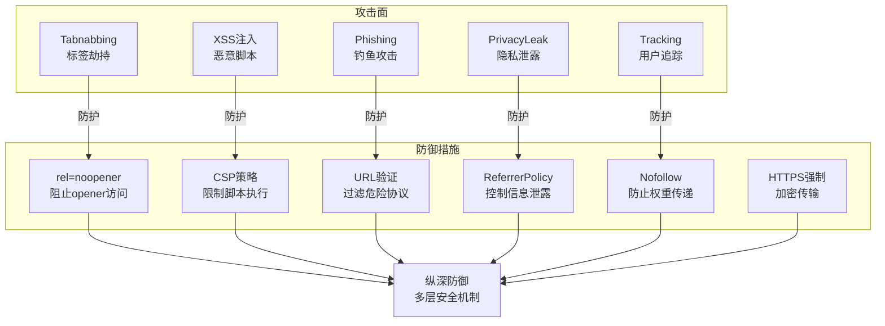

# 链接安全、可访问性与最佳实践

> 本文为《04-超链接》专题拆分系列第 3/3 篇（共 3 篇）。上一篇：[链接样式交互与进阶优化](/docs/html5/01-基础知识/04-超链接-2-样式交互与进阶优化) ｜ 第一篇：[链接基础与属性](/docs/html5/01-基础知识/04-超链接-1-链接基础与属性)。

## 安全与隐私

链接安全是 Web 安全的重要组成部分，涉及 XSS、钓鱼、隐私泄露等多种风险。

### 安全防护体系总览



### 标签劫持防护（Tabnabbing）

使用 `target="_blank"` 时，新页面可通过 `window.opener` 访问原页面，存在被恶意利用的风险。

**攻击原理：**

```html
<!-- ❌ 不安全的链接 -->
<a href="https://malicious.com" target="_blank">访问外部网站</a>
```

恶意网站可执行：

```javascript
// 恶意网站代码
if (window.opener) {
  // 将原页面重定向到钓鱼网站
  window.opener.location = 'https://phishing-site.com'
  // 用户回到原标签时，看到的是钓鱼网站
}
```

**防御措施：**

```html
<!-- ✅ 安全的链接 -->
<a href="https://example.com" 
   target="_blank" 
   rel="noopener noreferrer">
  外部链接
</a>
```

**属性说明：**
- `noopener`：阻止新页面访问 `window.opener`
- `noreferrer`：不发送 Referer 头，同时隐含 `noopener`

### XSS 防护

避免在 `href` 中使用危险协议：

```html
<!-- ❌ 危险：XSS 漏洞 -->
<a href="javascript:alert('XSS')">点击</a>
<a href="javascript:void(0)" onclick="dangerous()">链接</a>
<a href="data:text/html,<script>alert('XSS')</script>">数据</a>

<!-- ✅ 安全：使用按钮处理动作 -->
<button type="button" onclick="handleClick()">执行操作</button>

<!-- ✅ 安全：正常导航 -->
<a href="/page.html">跳转页面</a>
```

### 用户输入验证

用户生成的链接必须验证和清理：

```javascript
// URL 安全验证
function sanitizeUserUrl(url) {
  try {
    const parsed = new URL(url, window.location.origin)
    
    // 白名单协议
    const allowedProtocols = ['http:', 'https:', 'mailto:', 'tel:']
    if (!allowedProtocols.includes(parsed.protocol)) {
      return null
    }
    
    // 防止 javascript: 伪协议混淆
    if (parsed.protocol === 'javascript:') {
      return null
    }
    
    // 域名黑名单（示例）
    const blockedDomains = ['malicious.com', 'phishing.com']
    if (blockedDomains.some(domain => parsed.hostname.includes(domain))) {
      return null
    }
    
    return parsed.href
  } catch {
    return null
  }
}

// 使用示例
const userInput = 'https://example.com'
const safeUrl = sanitizeUserUrl(userInput)
if (safeUrl) {
  link.href = safeUrl
}
```

### 内容安全策略（CSP）

通过 CSP 进一步限制危险行为：

```html
<!-- HTTP 响应头 -->
Content-Security-Policy: default-src 'self'; script-src 'self'

<!-- HTML meta 标签 -->
<meta http-equiv="Content-Security-Policy" 
      content="default-src 'self'; script-src 'self'">

<!-- 限制内联脚本和 eval -->
<meta http-equiv="Content-Security-Policy"
      content="script-src 'self' 'unsafe-inline'">
```

### 隐私保护

控制 Referer 头泄露敏感信息：

```html
<!-- 完全隐私保护 -->
<a href="https://example.com" 
   target="_blank" 
   rel="noopener noreferrer"
   referrerpolicy="no-referrer">
  隐私链接
</a>

<!-- 默认安全策略 -->
<a href="https://example.com">
  标准链接（自动使用 strict-origin-when-cross-origin）
</a>

<!-- 特定场景 -->
<a href="https://partner.com" referrerpolicy="origin">
  合作伙伴链接（仅传递域名）
</a>
```

### HTTPS 强制

始终使用 HTTPS：

```html
<!-- ✅ 正确 -->
<a href="https://example.com">安全链接</a>

<!-- ❌ 避免 -->
<a href="http://example.com">不安全链接</a>

<!-- ❌ 协议相对 URL（可能导致混合内容） -->
<a href="//example.com">可能不安全</a>
```

### 安全检查清单

```javascript
// 自动检查并修复链接安全属性
function secureLinks() {
  document.querySelectorAll('a[href]').forEach(link => {
    const href = link.getAttribute('href')
    
    // 跳过空链接和锚点
    if (!href || href.startsWith('#') || href.startsWith('javascript:')) {
      return
    }
    
    try {
      const url = new URL(href, window.location.origin)
      const isExternal = url.origin !== window.location.origin
      
      // 外部链接必须设置安全属性
      if (isExternal && link.target === '_blank') {
        if (!link.rel.includes('noopener')) {
          link.rel += ' noopener'
        }
        if (!link.rel.includes('noreferrer')) {
          link.rel += ' noreferrer'
        }
      }
    } catch (e) {
      console.warn('无效的 URL:', href)
    }
  })
}

// 页面加载后执行
document.addEventListener('DOMContentLoaded', secureLinks)
```

### 完整安全示例

```html
<!DOCTYPE html>
<html lang="zh-CN">
<head>
  <meta charset="UTF-8" />
  <meta http-equiv="Content-Security-Policy" 
        content="default-src 'self'; script-src 'self'; style-src 'self' 'unsafe-inline'">
  <title>安全链接示例</title>
</head>
<body>
  <!-- ✅ 安全的外部链接 -->
  <a href="https://example.com" 
     target="_blank" 
     rel="noopener noreferrer"
     referrerpolicy="strict-origin-when-cross-origin">
    外部链接 ↗
  </a>
  
  <!-- ✅ 安全的内部链接 -->
  <a href="/about.html">关于我们</a>
  
  <!-- ✅ 安全的下载链接 -->
  <a href="/files/document.pdf" 
     download="document.pdf" 
     type="application/pdf">
    下载文档 (PDF, 2.5MB)
  </a>
  
  <!-- ✅ 安全的邮件链接 -->
  <a href="mailto:support@example.com?subject=咨询">
    联系支持
  </a>
</body>
</html>
```

## 可访问性（Accessibility）

可访问性确保所有用户（包括使用辅助技术的用户）都能有效使用链接。这是 Web 开发的法律要求和道德责任。

### WCAG 核心原则

链接可访问性遵循 WCAG 的四大原则：

| 原则         | 要求                         | 链接实现要点                   |
| ------------ | ---------------------------- | ------------------------------ |
| 可感知       | 信息必须可被用户感知         | 提供明确的链接文本             |
| 可操作       | 用户必须能操作界面           | 支持键盘导航                   |
| 可理解       | 用户必须能理解信息           | 链接文本清晰描述目标           |
| 健壮性       | 内容可被各种用户代理解析     | 使用标准 HTML 语义             |

### 链接文本最佳实践

**❌ 避免：**

```html
<!-- 不明确的文本 -->
<a href="/page.html">点击这里</a>
<a href="/page.html">更多</a>
<a href="/page.html">阅读更多</a>
<a href="/page.html">链接</a>

<!-- 仅用 URL 作为文本 -->
<a href="https://example.com">https://example.com</a>

<!-- 重复的"了解更多" -->
<div class="products">
  <div><h3>产品 A</h3><a href="/a">了解更多</a></div>
  <div><h3>产品 B</h3><a href="/b">了解更多</a></div>
</div>
```

**✅ 推荐：**

```html
<!-- 明确描述目标 -->
<a href="/about.html">关于我们</a>
<a href="/products.html">查看产品列表</a>
<a href="/contact.html">联系客服团队</a>

<!-- 包含上下文 -->
<p>了解更多信息，请访问<a href="/docs">文档中心</a>。</p>

<!-- 区分相同文本 -->
<div class="products">
  <div>
    <h3>产品 A</h3>
    <a href="/a" aria-label="了解产品 A 的详情">了解详情</a>
  </div>
  <div>
    <h3>产品 B</h3>
    <a href="/b" aria-label="了解产品 B 的详情">了解详情</a>
  </div>
</div>
```

### 非文本链接

图片、图标等非文本链接必须提供替代文本：

```html
<!-- ✅ 图片链接：使用 alt 描述 -->
<a href="/home">
  
</a>

<!-- ✅ 图标链接：使用 aria-label -->
<a href="/search" aria-label="搜索">
  <svg aria-hidden="true"><!-- 搜索图标 --></svg>
</a>

<!-- ✅ 装饰性图片：空 alt + aria-label -->
<a href="/home" aria-label="返回首页">
  
</a>

<!-- ✅ 图标 + 文本组合 -->
<a href="/settings">
  <svg aria-hidden="true"><!-- 齿轮图标 --></svg>
  <span>设置</span>
</a>
```

### 键盘导航

链接必须完全支持键盘操作：

```html
<style>
/* ✅ 清晰的焦点样式 */
a:focus {
  outline: 2px solid #0066cc;
  outline-offset: 2px;
}

/* ✅ 仅键盘聚焦显示轮廓 */
a:focus:not(:focus-visible) {
  outline: none; /* 鼠标点击时隐藏 */
}

a:focus-visible {
  outline: 2px solid #0066cc;
  outline-offset: 2px;
}

/* ❌ 永远不要这样做 */
a:focus {
  outline: none; /* 移除焦点指示器 = 可访问性失败 */
}
</style>
```

**键盘交互：**
- `Tab`：移动到下一个链接
- `Shift + Tab`：移动到上一个链接
- `Enter`：激活链接（导航）
- `Space`：不适用于链接（仅用于按钮）

### 外部链接提示

明确告知用户链接将在新窗口打开：

```html
<!-- ✅ 方法 1：文本提示 -->
<a href="https://example.com" target="_blank" rel="noopener noreferrer">
  外部网站 <span class="sr-only">（在新窗口打开）</span>
</a>

<!-- ✅ 方法 2：图标 + aria-label -->
<a href="https://example.com" 
   target="_blank" 
   rel="noopener noreferrer"
   aria-label="访问外部网站（在新窗口打开）">
  外部网站 <span aria-hidden="true">↗</span>
</a>

<!-- ✅ 方法 3：title 属性（补充信息） -->
<a href="https://example.com" 
   target="_blank" 
   rel="noopener noreferrer"
   title="在新窗口打开">
  外部网站 ↗
</a>
```

### ARIA 属性应用

```html
<!-- 当前页面 -->
<a href="/home" aria-current="page">首页</a>

<!-- 禁用状态 -->
<span class="disabled-link" aria-disabled="true">暂不可用</span>

<!-- 描述性标签 -->
<a href="/download/manual.pdf" 
   aria-label="下载产品手册 PDF（2.5MB）">
  下载手册
</a>

<!-- 链接组 -->
<nav aria-label="主导航">
  <a href="/home">首页</a>
  <a href="/about">关于</a>
</nav>

<nav aria-label="页脚链接">
  <a href="/privacy">隐私政策</a>
  <a href="/terms">使用条款</a>
</nav>
```

### 屏幕阅读器优化

```html
<!-- 隐藏装饰性元素 -->
<a href="/home">
  
  <span>返回首页</span>
</a>

<!-- 仅对屏幕阅读器可见 -->
<style>
.sr-only {
  position: absolute;
  width: 1px;
  height: 1px;
  padding: 0;
  margin: -1px;
  overflow: hidden;
  clip: rect(0, 0, 0, 0);
  white-space: nowrap;
  border-width: 0;
}
</style>

<a href="/download/file.pdf">
  <svg aria-hidden="true"><!-- 下载图标 --></svg>
  <span class="sr-only">下载文件（PDF，2.5MB）</span>
</a>
```

### 完整可访问性示例

```html
<!DOCTYPE html>
<html lang="zh-CN">
<head>
  <meta charset="UTF-8" />
  <title>可访问链接示例</title>
  <style>
    /* 导航样式 */
    .nav {
      display: flex;
      gap: 20px;
      list-style: none;
      padding: 0;
    }
    
    .nav a {
      padding: 10px 15px;
      text-decoration: none;
      color: #333;
      border-radius: 4px;
      transition: background 0.2s;
    }
    
    .nav a:hover {
      background: #f0f0f0;
    }
    
    .nav a:focus-visible {
      outline: 2px solid #0066cc;
      outline-offset: 2px;
    }
    
    .nav a[aria-current="page"] {
      background: #0066cc;
      color: white;
    }
    
    /* 外部链接图标 */
    .external::after {
      content: " ↗";
      font-size: 0.8em;
    }
    
    /* 屏幕阅读器专用 */
    .sr-only {
      position: absolute;
      width: 1px;
      height: 1px;
      padding: 0;
      margin: -1px;
      overflow: hidden;
      clip: rect(0, 0, 0, 0);
      white-space: nowrap;
      border-width: 0;
    }
  </style>
</head>
<body>
  <nav aria-label="主导航">
    <ul class="nav" role="list">
      <li><a href="/home" aria-current="page">首页</a></li>
      <li><a href="/products">产品</a></li>
      <li><a href="/about">关于我们</a></li>
      <li>
        <a href="https://partner.com" 
           target="_blank" 
           rel="noopener noreferrer"
           class="external">
          合作伙伴
          <span class="sr-only">（在新窗口打开）</span>
        </a>
      </li>
    </ul>
  </nav>
</body>
</html>
```

## 最佳实践

### 路径管理

```html
<!-- ✅ 推荐：相对路径 -->
<a href="/about.html">关于我们</a>
<a href="../docs/readme.html">文档</a>
<a href="./contact.html">联系我们</a>

<!-- ⚠️ 谨慎使用：绝对路径 -->
<a href="https://example.com/about.html">关于我们</a>
```

**优势：**

- 便于在不同环境（开发、测试、生产）间迁移
- 减少代码修改成本

::: tip
协议相对 URL（`//example.com`）在现代项目里通常不建议使用：它会把当前页面的协议"继承"过去，容易在少数场景里引入不符合预期的混合内容或安全策略问题。多数情况下直接使用 `https://` 更明确。
:::

### 链接语义化

```html
<!-- ✅ 导航链接使用 <nav> -->
<nav aria-label="主导航">
  <a href="/home">首页</a>
  <a href="/about">关于</a>
</nav>

<!-- ✅ 页脚链接使用 <footer> -->
<footer>
  <a href="/privacy">隐私政策</a>
  <a href="/terms">使用条款</a>
</footer>

<!-- ✅ 内容链接保持内联 -->
<p>了解更多信息，请访问<a href="/docs">文档中心</a>。</p>
```

### SEO 优化

```html
<!-- 内部链接传递权重 -->
<a href="/products/laptop.html">笔记本电脑</a>

<!-- 外部链接控制权重传递 -->
<a href="https://partner.com" rel="nofollow">合作伙伴</a>

<!-- 用户生成内容 -->
<a href="https://user-blog.com" rel="ugc nofollow">用户博客</a>

<!-- 分页导航 -->
<link rel="prev" href="/page1.html" />
<link rel="next" href="/page3.html" />
```

## 实战案例

<h4>026-smart-navigation-class.html</h4>

```html
<!-- 来源：4-超链接.md - SmartNavigation 智能导航管理系统 -->
<!DOCTYPE html>
<html lang="zh-CN">
<head>
  <meta charset="UTF-8">
  <meta name="viewport" content="width=device-width, initial-scale=1.0">
  <title>SmartNavigation - 智能链接管理系统</title>
  <style>
    * {
      margin: 0;
      padding: 0;
      box-sizing: border-box;
    }

    body {
      font-family: -apple-system, BlinkMacSystemFont, "Segoe UI", sans-serif;
      line-height: 1.6;
      color: #333;
      background: #f5f7fa;
    }

    /* 导航栏 */
    .navbar {
      position: fixed;
      top: 0;
      left: 0;
      right: 0;
      height: 60px;
      background: white;
      box-shadow: 0 2px 12px rgba(0,0,0,0.08);
      display: flex;
      align-items: center;
      padding: 0 30px;
      z-index: 1000;
    }

    .navbar-brand {
      font-size: 22px;
      font-weight: 700;
      color: #0066cc;
      text-decoration: none;
    }

    .nav-links {
      display: flex;
      gap: 8px;
      margin-left: auto;
      list-style: none;
    }

    .nav-links a {
      padding: 8px 16px;
      text-decoration: none;
      color: #555;
      border-radius: 6px;
      font-size: 14px;
      transition: all 0.2s;
      position: relative;
    }

    .nav-links a:hover {
      background: #e3f2fd;
      color: #0066cc;
    }

    .nav-links a.active {
      background: #0066cc;
      color: white;
      font-weight: 500;
    }

    /* 外部链接标识 */
    .nav-links a.external::after {
      content: " ↗";
      font-size: 11px;
      opacity: 0.7;
    }

    /* 主内容区 */
    main {
      max-width: 900px;
      margin: 100px auto 40px;
      padding: 0 20px;
    }

    h1 {
      font-size: 32px;
      color: #222;
      margin-bottom: 12px;
    }

    .subtitle {
      color: #666;
      margin-bottom: 30px;
      font-size: 16px;
    }

    /* 功能演示卡片 */
    .demo-grid {
      display: grid;
      grid-template-columns: repeat(auto-fit, minmax(280px, 1fr));
      gap: 20px;
      margin-top: 24px;
    }

    .demo-card {
      background: white;
      border-radius: 12px;
      padding: 24px;
      box-shadow: 0 2px 12px rgba(0,0,0,0.06);
    }

    .demo-card h3 {
      font-size: 17px;
      color: #333;
      margin-bottom: 10px;
      display: flex;
      align-items: center;
      gap: 8px;
    }

    .demo-card p {
      color: #666;
      font-size: 14px;
      line-height: 1.7;
      margin-bottom: 14px;
    }

    /* 链接按钮样式 */
    .link-btn {
      display: inline-flex;
      align-items: center;
      gap: 6px;
      padding: 10px 20px;
      background: linear-gradient(135deg, #0066cc, #0052a3);
      color: white !important;
      text-decoration: none;
      border-radius: 8px;
      font-weight: 500;
      font-size: 14px;
      transition: all 0.3s;
    }

    .link-btn:hover {
      transform: translateY(-2px);
      box-shadow: 0 4px 12px rgba(0,102,204,0.3);
    }

    .link-btn.download { background: linear-gradient(135deg, #28a745, #20883d); }
    .link-btn.email { background: linear-gradient(135deg, #dc3545, #c82333); }
    .link-btn.external { background: linear-gradient(135deg, #fd7e14, #e67e22); }

    /* 控制面板 */
    .control-panel {
      background: white;
      border-radius: 12px;
      padding: 28px;
      margin-top: 30px;
      box-shadow: 0 2px 12px rgba(0,0,0,0.06);
    }

    .control-panel h3 {
      font-size: 18px;
      color: #333;
      margin-bottom: 20px;
      padding-bottom: 12px;
      border-bottom: 2px solid #f0f0f0;
    }

    .controls-row {
      display: flex;
      flex-wrap: wrap;
      gap: 16px;
      align-items: center;
    }

    .control-group {
      display: flex;
      align-items: center;
      gap: 8px;
    }

    .control-group label {
      font-size: 13px;
      color: #555;
      font-weight: 500;
    }

    .toggle-switch {
      position: relative;
      width: 44px;
      height: 24px;
    }

    .toggle-switch input {
      opacity: 0;
      width: 0;
      height: 0;
    }

    .toggle-slider {
      position: absolute;
      cursor: pointer;
      top: 0; left: 0; right: 0; bottom: 0;
      background-color: #ccc;
      border-radius: 24px;
      transition: 0.3s;
    }

    .toggle-slider:before {
      position: absolute;
      content: "";
      height: 18px;
      width: 18px;
      left: 3px;
      bottom: 3px;
      background-color: white;
      border-radius: 50%;
      transition: 0.3s;
    }

    input:checked + .toggle-slider {
      background-color: #0066cc;
    }

    input:checked + .toggle-slider:before {
      transform: translateX(20px);
    }

    /* 统计面板 */
    .stats-panel {
      display: grid;
      grid-template-columns: repeat(auto-fit, minmax(150px, 1fr));
      gap: 16px;
      margin-top: 20px;
    }

    .stat-item {
      background: #f8f9fa;
      padding: 18px;
      border-radius: 8px;
      text-align: center;
    }

    .stat-value {
      font-size: 28px;
      font-weight: 700;
      color: #0066cc;
    }

    .stat-label {
      font-size: 12px;
      color: #888;
      margin-top: 4px;
      text-transform: uppercase;
      letter-spacing: 0.5px;
    }

    /* 日志区域 */
    .log-area {
      margin-top: 24px;
      background: #1e1e1e;
      border-radius: 8px;
      padding: 16px;
      max-height: 200px;
      overflow-y: auto;
      font-family: 'Monaco', 'Menlo', monospace;
      font-size: 12px;
      line-height: 1.8;
    }

    .log-entry {
      padding: 2px 0;
      border-bottom: 1px solid #333;
    }

    .log-time { color: #6a9955; }
    .log-type-info { color: #569cd6; }
    .log-type-warn { color: #dcdcaa; }
    .log-type-error { color: #f44747; }
    .log-msg { color: #d4d4d4; }
  </style>
</head>
<body>

  <!-- 导航栏 -->
  <nav class="navbar" id="mainNav">
    <a href="#" class="navbar-brand">🚀 SmartNav</a>
    <ul class="nav-links" id="navLinks">
      <li><a href="#home" data-nav="internal">首页</a></li>
      <li><a href="#products" data-nav="internal">产品</a></li>
      <li><a href="#about" data-nav="internal">关于</a></li>
      <li><a href="#contact" data-nav="internal">联系</a></li>
      <li><a href="https://developer.mozilla.org"
             target="_blank"
             rel="noopener noreferrer"
             data-nav="external"
             class="external">MDN 文档</a></li>
    </ul>
  </nav>

  <main>
    <h1>🧠 SmartNavigation</h1>
    <p class="subtitle">企业级智能链接管理系统 — 自动安全处理、性能优化、行为追踪</p>

    <!-- 功能演示 -->
    <div class="demo-grid">

      <div class="demo-card">
        <h3>🔒 自动安全处理</h3>
        <p>自动为外部链接添加 rel="noopener noreferrer"，防止标签劫持攻击。</p>
        <a href="https://github.com" target="_blank" class="link-btn external">
          外部链接 ↗
        </a>
      </div>

      <div class="demo-card">
        <h3>⬇️ 智能下载管理</h3>
        <p>自动检测 download 属性，跨源时切换为 Fetch + Blob 方案。</p>
        <a href="#" download="example.pdf" onclick="event.preventDefault();" class="link-btn download">
          下载文件
        </a>
      </div>

      <div class="demo-card">
        <h3>✉️ 协议链接增强</h3>
        <p>mailto/tel/sms 等协议链接自动添加图标和交互反馈。</p>
        <a href="mailto:support@example.com?subject=咨询" class="link-btn email">
          发送邮件
        </a>
      </div>

      <div class="demo-card">
        <h3>📊 行为数据收集</h3>
        <p>实时记录所有链接点击事件，支持埋点分析和用户行为研究。</p>
        <span style="color: #888; font-size: 13px;">点击任意链接查看日志 ↓</span>
      </div>

    </div>


    <!-- 控制面板 -->
    <div class="control-panel">
      <h3>⚙️ 控制面板（功能开关）</h3>

      <div class="controls-row">
        <div class="control-group">
          <label>自动安全属性</label>
          <label class="toggle-switch">
            <input type="checkbox" id="toggleSecurity" checked>
            <span class="toggle-slider"></span>
          </label>
        </div>

        <div class="control-group">
          <label>预加载下一页</label>
          <label class="toggle-switch">
            <input type="checkbox" id="togglePrefetch" checked>
            <span class="toggle-slider"></span>
          </label>
        </div>

        <div class="control-group">
          <label>点击事件追踪</label>
          <label class="toggle-switch">
            <input type="checkbox" id="toggleTracking" checked>
            <span class="toggle-slider"></span>
          </label>
        </div>

        <div class="control-group">
          <label>外部链接新窗口</label>
          <label class="toggle-switch">
            <input type="checkbox" id="toggleNewTab" checked>
            <span class="toggle-slider"></span>
          </label>
        </div>
      </div>

      <!-- 统计数据 -->
      <div class="stats-panel">
        <div class="stat-item">
          <div class="stat-value" id="totalLinks">0</div>
          <div class="stat-label">总链接数</div>
        </div>
        <div class="stat-item">
          <div class="stat-value" id="internalLinks">0</div>
          <div class="stat-label">内部链接</div>
        </div>
        <div class="stat-item">
          <div class="stat-value" id="externalLinks">0</div>
          <div class="stat-label">外部链接</div>
        </div>
        <div class="stat-item">
          <div class="stat-value" id="clickCount">0</div>
          <div class="stat-label">点击次数</div>
        </div>
      </div>

      <!-- 日志输出 -->
      <h4 style="margin-top: 20px; color: #555;">📋 实时日志</h4>
      <div class="log-area" id="logArea">
        <div class="log-entry">
          <span class="log-time">[系统]</span>
          <span class="log-type-info">[INFO]</span>
          <span class="log-msg">SmartNavigation 初始化完成，等待操作...</span>
        </div>
      </div>
    </div>

  </main>


  <script>
    /**
     * SmartNavigation - 企业级智能链接管理系统
     *
     * 功能：
     * - 自动为外部链接添加安全属性 (rel=noopener noreferrer)
     * - 智能预加载用户可能访问的页面
     * - 全局链接点击事件追踪与埋点
     * - 动态统计与监控面板
     */
    class SmartNavigation {
      constructor(options = {}) {
        this.config = {
          autoSecurity: true,       // 自动添加安全属性
          enablePrefetch: true,     // 启用预加载
          enableTracking: true,     // 启用点击追踪
          externalNewTab: true,     // 外部链接新窗口打开
          ...options
        }

        this.stats = {
          total: 0,
          internal: 0,
          external: 0,
          clicks: 0
        }

        this.logContainer = document.getElementById('logArea')
      }

      /**
       * 初始化：扫描并处理所有链接
       */
      init() {
        this.log('info', '开始扫描页面链接...')

        const links = document.querySelectorAll('a[href]')
        this.stats.total = links.length

        links.forEach(link => {
          // 分类处理
          if (this.isExternalLink(link)) {
            this.stats.external++
            if (this.config.autoSecurity) {
              this.secureExternalLink(link)
            }
          } else {
            this.stats.internal++
            if (this.config.enablePrefetch) {
              this.setupPrefetch(link)
            }
          }

          // 绑定点击追踪
          if (this.config.enableTracking) {
            this.trackClick(link)
          }
        })

        this.updateStats()
        this.log('info', `扫描完成：共 ${this.stats.total} 个链接（内部 ${this.stats.internal} / 外部 ${this.stats.external}）`)
      }

      /**
       * 判断是否为外部链接
       */
      isExternalLink(link) {
        try {
          const url = new URL(link.href)
          return url.origin !== window.location.origin && url.protocol.startsWith('http')
        } catch {
          return false
        }
      }

      /**
       * 为外部链接添加安全属性
       */
      secureExternalLink(link) {
        // 设置 target="_blank"
        if (this.config.externalNewTab && !link.target) {
          link.target = '_blank'
        }

        // 确保 rel 包含 noopener noreferrer
        const relValues = new Set((link.rel || '').split(/\s+/).filter(Boolean))
        relValues.add('noopener')
        relValues.add('noreferrer')
        link.rel = Array.from(relValues).join(' ')

        // 添加外部标识类名
        link.classList.add('smart-external')

        this.log('info', `已加固外部链接: ${link.href.slice(0, 50)}...`)
      }

      /**
       * 设置内部链接的预加载
       */
      setupPrefetch(link) {
        // 使用 IntersectionObserver 在链接可见时预加载
        const observer = new IntersectionObserver(
          (entries) => {
            entries.forEach(entry => {
              if (entry.isIntersecting) {
                const prefetchLink = document.createElement('link')
                prefetchLink.rel = 'prefetch'
                prefetchLink.href = entry.target.href
                document.head.appendChild(prefetchLink)

                this.log('info', `已预加载: ${entry.target.href}`)
                observer.unobserve(entry.target)
              }
            })
          },
          { rootMargin: '50px' }
        )

        observer.observe(link)
      }

      /**
       * 追踪链接点击事件
       */
      trackClick(link) {
        link.addEventListener('click', (e) => {
          this.stats.clicks++
          this.updateStats()

          const linkData = {
            type: this.isExternalLink(link) ? 'external' : 'internal',
            href: link.href,
            text: link.textContent.trim().slice(0, 30),
            timestamp: new Date().toISOString(),
            target: link.target || '_self',
            rel: link.rel || ''
          }

          this.log('info', `🖱️ 点击 [${linkData.type}] "${linkData.text}" → ${linkData.href}`)

          // 可在此处接入真实的埋点系统
          // gtag('event', 'click', { event_category: 'link', ...linkData })
        })
      }

      /**
       * 更新统计数据展示
       */
      updateStats() {
        document.getElementById('totalLinks').textContent = this.stats.total
        document.getElementById('internalLinks').textContent = this.stats.internal
        document.getElementById('externalLinks').textContent = this.stats.external
        document.getElementById('clickCount').textContent = this.stats.clicks
      }

      /**
       * 输出日志到控制台和界面
       */
      log(type, message) {
        const time = new Date().toLocaleTimeString()
        console.log(`[${time}] [${type.toUpperCase()}] ${message}`)

        const entry = document.createElement('div')
        entry.className = 'log-entry'
        entry.innerHTML = `
          <span class="log-time">[${time}]</span>
          <span class="log-type-${type}">[${type.toUpperCase()}]</span>
          <span class="log-msg">${message}</span>
        `

        this.logContainer.appendChild(entry)
        this.logContainer.scrollTop = this.logContainer.scrollHeight
      }
    }


    // ====== 初始化 SmartNavigation ======

    const smartNav = new SmartNavigation()

    // DOM 加载完成后初始化
    document.addEventListener('DOMContentLoaded', () => {
      smartNav.init()
    })


    // ====== 控制面板交互 ======

    document.getElementById('toggleSecurity').addEventListener('change', function () {
      smartNav.config.autoSecurity = this.checked
      smartNav.log('info', `自动安全属性: ${this.checked ? '✅ 已启用' : '❌ 已禁用'}`)
    })

    document.getElementById('togglePrefetch').addEventListener('change', function () {
      smartNav.config.enablePrefetch = this.checked
      smartNav.log('info', `预加载功能: ${this.checked ? '✅ 已启用' : '❌ 已禁用'}`)
    })

    document.getElementById('toggleTracking').addEventListener('change', function () {
      smartNav.config.enableTracking = this.checked
      smartNav.log('info', `点击追踪: ${this.checked ? '✅ 已启用' : '❌ 已禁用'}`)
    })

    document.getElementById('toggleNewTab').addEventListener('change', function () {
      smartNav.config.externalNewTab = this.checked
      smartNav.log('info', `外部链接新窗口: ${this.checked ? '✅ 已启用' : '❌ 已禁用'}`)
    })

  </script>

</body>
</html>
```

### 案例 1：智能导航系统

一个自动识别内外链、添加安全属性、统计埋点的智能链接管理系统。

```javascript
/**
 * SmartNavigation - 智能导航管理系统
 * 功能：
 * 1. 自动识别内外链并添加相应属性
 * 2. 安全属性自动补全
 * 3. 点击事件统一埋点
 * 4. 外部链接视觉标识
 * 5. 下载链接特殊处理
 */
class SmartNavigation {
  constructor(options = {}) {
    this.options = {
      // 当前域名（用于判断内外链）
      currentDomain: window.location.hostname,
      // 是否自动给外部链接添加 target="_blank"
      externalNewTab: true,
      // 是否自动添加安全属性
      autoSecure: true,
      // 是否显示外部链接图标
      showExternalIcon: true,
      // 埋点回调
      onTrack: null,
      // 选择器范围
      container: document.body,
      ...options
    }
    
    this.init()
  }

  init() {
    this.container = typeof this.options.container === 'string'
      ? document.querySelector(this.options.container)
      : this.options.container
    
    if (!this.container) {
      console.warn('[SmartNavigation] 容器元素未找到')
      return
    }
    
    this.processAllLinks()
    this.bindEvents()
    this.addStyles()
  }

  /**
   * 处理所有链接
   */
  processAllLinks() {
    const links = this.container.querySelectorAll('a[href]')
    
    links.forEach(link => {
      this.classifyLink(link)
      this.enhanceLink(link)
    })
    
    console.log(`[SmartNavigation] 已处理 ${links.length} 个链接`)
  }

  /**
   * 分类链接
   */
  classifyLink(link) {
    const href = link.getAttribute('href')
    
    // 跳过空链接、锚点、JavaScript
    if (!href || href === '#' || href.startsWith('javascript:') || href.startsWith('data:')) {
      link.dataset.linkType = 'special'
      return
    }
    
    // 判断链接类型
    try {
      const url = new URL(href, window.location.href)
      
      if (url.protocol === 'mailto:' || url.protocol === 'tel:' || url.protocol === 'sms:') {
        link.dataset.linkType = 'protocol'
      } else if (url.protocol === 'http:' || url.protocol === 'https:') {
        if (url.hostname === this.options.currentDomain ||
            url.hostname === `www.${this.options.currentDomain}`) {
          link.dataset.linkType = 'internal'
          
          // 进一步分类
          if (url.pathname.match(/\.(pdf|doc|xls|zip|rar)$/i)) {
            link.dataset.linkSubtype = 'download'
          } else if (url.hash) {
            link.dataset.linkSubtype = 'anchor'
          }
        } else {
          link.dataset.linkType = 'external'
        }
      } else {
        link.dataset.linkType = 'other'
      }
    } catch (e) {
      link.dataset.linkType = 'invalid'
    }
  }

  /**
   * 增强链接
   */
  enhanceLink(link) {
    const type = link.dataset.linkType
    
    switch (type) {
      case 'external':
        this.enhanceExternalLink(link)
        break
        
      case 'internal':
        this.enhanceInternalLink(link)
        break
        
      case 'protocol':
        this.enhanceProtocolLink(link)
        break
    }
  }

  /**
   * 增强外部链接
   */
  enhanceExternalLink(link) {
    // 新窗口打开
    if (this.options.externalNewTab) {
      link.target = '_blank'
    }
    
    // 安全属性
    if (this.options.autoSecure) {
      if (!link.rel.includes('noopener')) {
        link.rel = (link.rel + ' noopener').trim()
      }
      if (!link.rel.includes('noreferrer')) {
        link.rel = (link.rel + ' noreferrer').trim()
      }
    }
    
    // 外部链接标识
    if (this.options.showExternalIcon && !link.querySelector('.ext-icon')) {
      const icon = document.createElement('span')
      icon.className = 'ext-icon'
      icon.setAttribute('aria-hidden', 'true')
      icon.textContent = '↗'
      link.appendChild(icon)
    }
    
    // 无障碍提示
    if (!link.getAttribute('aria-label')) {
      const originalText = link.textContent.replace(/↗$/, '').trim()
      link.setAttribute('aria-label', `${originalText}（外部链接，将在新窗口打开）`)
    }
  }

  /**
   * 增强内部链接
   */
  enhanceInternalLink(link) {
    const subtype = link.dataset.linkSubtype
    
    // 下载链接
    if (subtype === 'download' && !link.hasAttribute('download')) {
      // 尝试从 URL 提取文件名
      const filename = link.pathname.split('/').pop()
      if (filename) {
        link.download = filename
      }
    }
  }

  /**
   * 增强协议链接
   */
  enhanceProtocolLink(link) {
    // 添加协议类型的 ARIA 标签
    const protocol = link.href.split(':')[0]
    const labels = {
      mailto: '发送邮件',
      tel: '拨打电话',
      sms: '发送短信'
    }
    
    if (labels[protocol] && !link.getAttribute('aria-label')) {
      link.setAttribute('aria-label', `${labels[protocol]}: ${link.textContent}`)
    }
  }

  /**
   * 绑定事件
   */
  bindEvents() {
    // 使用事件委托
    this.container.addEventListener('click', (e) => {
      const link = e.target.closest('a[href]')
      if (!link) return
      
      // 埋点
      this.trackClick(link)
    })
    
    // 监控动态添加的链接
    if (typeof MutationObserver !== 'undefined') {
      const observer = new MutationObserver((mutations) => {
        mutations.forEach(mutation => {
          mutation.addedNodes.forEach(node => {
            if (node.nodeType === Node.ELEMENT_NODE) {
              const links = node.tagName === 'A' && node.hasAttribute('href') 
                ? [node] 
                : Array.from(node.querySelectorAll('a[href]') || [])
              
              links.forEach(link => {
                this.classifyLink(link)
                this.enhanceLink(link)
              })
            }
          })
        })
      })
      
      observer.observe(this.container, {
        childList: true,
        subtree: true
      })
    }
  }

  /**
   * 点击埋点
   */
  trackClick(link) {
    const data = {
      type: link.dataset.linkType || 'unknown',
      subtype: link.dataset.linkSubtype || null,
      url: link.href,
      text: link.textContent.trim().slice(0, 100),
      target: link.target,
      rel: link.rel,
      timestamp: Date.now(),
      page: window.location.pathname
    }
    
    // 自定义回调
    if (typeof this.options.onTrack === 'function') {
      this.options.onTrack(data)
    }
    
    // Google Analytics 集成
    if (typeof gtag === 'function') {
      gtag('event', 'link_click', {
        event_category: 'navigation',
        event_label: data.type,
        value: 1
      })
    }
    
    // 控制台日志（开发模式）
    if (process.env.NODE_ENV === 'development') {
      console.log('[SmartNavigation] Link clicked:', data)
    }
  }

  /**
   * 添加样式
   */
  addStyles() {
    if (document.getElementById('smart-nav-styles')) return
    
    const style = document.createElement('style')
    style.id = 'smart-nav-styles'
    style.textContent = `
      .ext-icon {
        margin-left: 2px;
        font-size: 0.85em;
        opacity: 0.7;
        display: inline-block;
      }
      
      a[data-link-type="external"]:hover .ext-icon {
        opacity: 1;
      }
      
      a[data-link-subtype="download"]::before {
        content: "⬇ ";
        font-size: 0.9em;
      }
      
      a[data-link-type="protocol"][href^="mailto:"]::before {
        content: "✉ ";
      }
      
      a[data-link-type="protocol"][href^="tel:"]::before {
        content: "📞 ";
      }
    `
    document.head.appendChild(style)
  }

  /**
   * 获取统计报告
   */
  getReport() {
    const links = this.container.querySelectorAll('a[data-link-type]')
    const stats = {}
    
    links.forEach(link => {
      const type = link.dataset.linkType
      stats[type] = (stats[type] || 0) + 1
    })
    
    return {
      total: links.length,
      breakdown: stats,
      timestamp: new Date().toISOString()
    }
  }
}

// 使用示例
// const smartNav = new SmartNavigation({
//   externalNewTab: true,
//   autoSecure: true,
//   showExternalIcon: true,
//   onTrack: (data) => {
//     // 发送到分析服务器
//     sendToAnalytics('/api/track', data)
//   }
// })
```

### 案例 2：多语言切换导航栏

已在[国际化链接](/docs/html5/01-基础知识/04-超链接-2-样式交互与进阶优化#国际化链接-internationalization-i18n)章节提供完整的 Vue 实现，此处补充纯 HTML 版本：

```html
<!DOCTYPE html>
<html lang="zh-CN">
<head>
  <meta charset="UTF-8" />
  <meta name="viewport" content="width=device-width, initial-scale=1.0" />
  <title>多语言导航示例</title>
  <style>
    .lang-switcher {
      display: inline-flex;
      align-items: center;
      gap: 4px;
      padding: 4px;
      background: #f0f0f0;
      border-radius: 20px;
    }
    
    .lang-switcher a {
      display: flex;
      align-items: center;
      gap: 4px;
      padding: 6px 14px;
      border-radius: 16px;
      text-decoration: none;
      color: #555;
      font-size: 14px;
      transition: all 0.2s;
    }
    
    .lang-switcher a:hover {
      background: #e0e0e0;
    }
    
    .lang-switcher a.active {
      background: #0066cc;
      color: white;
      box-shadow: 0 2px 4px rgba(0,102,204,0.3);
    }
    
    .lang-flag {
      font-size: 18px;
      line-height: 1;
    }
    
    .lang-name {
      font-weight: 500;
    }
    
    /* 响应式 */
    @media (max-width: 600px) {
      .lang-name {
        display: none;
      }
      
      .lang-switcher a {
        padding: 8px 10px;
      }
    }
  </style>
</head>
<body>
  <header>
    <h1>网站标题</h1>
    
    <!-- 多语言切换导航 -->
    <nav class="lang-switcher" aria-label="语言切换">
      <a 
        href="/zh-CN/about" 
        hreflang="zh-CN" 
        lang="zh-CN" 
        rel="alternate"
        aria-current="page"
        class="active"
      >
        <span class="lang-flag" aria-label="简体中文">🇨🇳</span>
        <span class="lang-name">简体</span>
      </a>
      
      <a 
        href="/zh-TW/about" 
        hreflang="zh-TW" 
        lang="zh-TW" 
        rel="alternate"
      >
        <span class="lang-flag" aria-label="繁體中文">🇹🇼</span>
        <span class="lang-name">繁體</span>
      </a>
      
      <a 
        href="/en/about" 
        hreflang="en" 
        lang="en" 
        rel="alternate"
      >
        <span class="lang-flag" aria-label="English">🇺🇸</span>
        <span class="lang-name">EN</span>
      </a>
      
      <a 
        href="/ja/about" 
        hreflang="ja" 
        lang="ja" 
        rel="alternate"
      >
        <span class="lang-flag" aria-label="日本語">🇯🇵</span>
        <span class="lang-name">日本語</span>
      </a>
    </nav>
  </header>
  
  <main>
    <article>
      <h2>关于我们</h2>
      <p>这是页面的主要内容区域...</p>
    </article>
  </main>
  
  <footer>
    <p>&copy; 2025 Example Inc.</p>
  </footer>
</body>
</html>
```

## 常见问题排查

<h4>020-anchor-links-smooth-scroll.html</h4>

```html
<!-- 来源：4-超链接.md - 内部锚点链接与平滑滚动 -->
<!DOCTYPE html>
<html lang="zh-CN">
<head>
  <meta charset="UTF-8">
  <meta name="viewport" content="width=device-width, initial-scale=1.0">
  <title>内部锚点链接与平滑滚动</title>
  <style>
    * {
      margin: 0;
      padding: 0;
      box-sizing: border-box;
    }

    body {
      font-family: -apple-system, BlinkMacSystemFont, "Segoe UI", sans-serif;
      line-height: 1.6;
      color: #333;
    }

    /* 固定导航栏 */
    .navbar {
      position: fixed;
      top: 0;
      left: 0;
      right: 0;
      background: #fff;
      box-shadow: 0 2px 8px rgba(0,0,0,0.1);
      padding: 15px 30px;
      z-index: 1000;
      display: flex;
      justify-content: space-between;
      align-items: center;
    }

    .navbar h1 {
      font-size: 20px;
      color: #0066cc;
    }

    .nav-links {
      display: flex;
      gap: 20px;
      list-style: none;
    }

    .nav-links a {
      color: #555;
      text-decoration: none;
      padding: 8px 16px;
      border-radius: 4px;
      transition: all 0.3s;
      font-size: 14px;
    }

    .nav-links a:hover {
      background: #e3f2fd;
      color: #0066cc;
    }

    /* 平滑滚动 */
    html {
      scroll-behavior: smooth;
      scroll-padding-top: 80px; /* 为固定导航栏留出空间 */
    }

    main {
      margin-top: 80px;
      max-width: 900px;
      margin-left: auto;
      margin-right: auto;
      padding: 40px 20px;
    }

    section {
      min-height: 400px;
      padding: 60px 40px;
      margin-bottom: 40px;
      border-radius: 12px;
      background: #f8f9fa;
      border-left: 4px solid #0066cc;
    }

    section:nth-child(even) {
      border-left-color: #28a745;
    }

    section:nth-child(3n) {
      border-left-color: #fd7e14;
    }

    section h2 {
      font-size: 28px;
      margin-bottom: 20px;
      color: #222;
    }

    section p {
      font-size: 16px;
      color: #666;
      line-height: 1.8;
    }

    .feature-list {
      list-style: none;
      margin-top: 20px;
    }

    .feature-list li {
      padding: 10px 0;
      padding-left: 24px;
      position: relative;
      color: #555;
    }

    .feature-list li::before {
      content: "✓";
      position: absolute;
      left: 0;
      color: #28a745;
      font-weight: bold;
    }

    /* 返回顶部按钮 */
    .back-to-top {
      position: fixed;
      bottom: 30px;
      right: 30px;
      width: 50px;
      height: 50px;
      background: #0066cc;
      color: white;
      border: none;
      border-radius: 50%;
      cursor: pointer;
      font-size: 24px;
      display: flex;
      align-items: center;
      justify-content: center;
      box-shadow: 0 4px 12px rgba(0,102,204,0.3);
      transition: all 0.3s;
      opacity: 0;
      visibility: hidden;
    }

    .back-to-top.visible {
      opacity: 1;
      visibility: visible;
    }

    .back-to-top:hover {
      background: #0052a3;
      transform: translateY(-2px);
    }

    /* 高亮效果 */
    section:target {
      animation: highlight 1s ease-out;
    }

    @keyframes highlight {
      0% { background-color: #fff3cd; }
      100% { background-color: #f8f9fa; }
    }
  </style>
</head>
<body>

  <!-- 固定导航栏 -->
  <nav class="navbar" aria-label="主导航">
    <h1>📚 产品文档</h1>
    <ul class="nav-links">
      <li><a href="#features">产品特色</a></li>
      <li><a href="#specs">技术规格</a></li>
      <li><a href="#reviews">客户评价</a></li>
      <li><a href="#faq">常见问题</a></li>
      <li><a href="#top">返回顶部</a></li>
    </ul>
  </nav>

  <main id="top">
    <!-- 产品特色 -->
    <section id="features">
      <h2>🎯 产品特色</h2>
      <p>我们的产品采用最新技术栈开发，具有以下核心特色：</p>
      <ul class="feature-list">
        <li>高性能架构设计，支持百万级并发访问</li>
        <li>完善的权限管理系统，支持 RBAC 模型</li>
        <li>丰富的 API 接口，支持 RESTful 和 GraphQL</li>
        <li>实时数据同步，WebSocket 长连接支持</li>
        <li>多端适配，Web、iOS、Android 全平台覆盖</li>
      </ul>
    </section>

    <!-- 技术规格 -->
    <section id="specs">
      <h2>⚙️ 技术规格</h2>
      <p>详细的技术参数和性能指标：</p>
      <ul class="feature-list">
        <li>前端框架：React 18 / Vue 3 / Angular 17</li>
        <li>后端服务：Node.js / Python / Go 微服务架构</li>
        <li>数据库：PostgreSQL + Redis 缓存集群</li>
        <li>容器化部署：Docker + Kubernetes 编排</li>
        <li>监控体系：Prometheus + Grafana 可视化</li>
      </ul>
    </section>

    <!-- 客户评价 -->
    <section id="reviews">
      <h2>💬 客户评价</h2>
      <p>来自全球客户的真实反馈：</p>
      <ul class="feature-list">
        <li>"系统稳定性极高，上线至今零故障" —— 某大型互联网公司</li>
        <li>"API 设计规范，文档完善，接入非常顺畅" —— 知名 SaaS 企业</li>
        <li>"技术支持响应迅速，问题解决效率很高" —— 金融科技公司</li>
        <li>"性能优化做得很好，页面加载速度提升明显" —— 电商平台</li>
      </ul>
    </section>

    <!-- 常见问题 -->
    <section id="faq">
      <h2>❓ 常见问题</h2>
      <p>用户最关心的问题解答：</p>
      <ul class="feature-list">
        <li>Q: 是否支持私有化部署？<br>A: 支持，提供完整的部署文档和技术支持。</li>
        <li>Q: 数据安全保障机制？<br>A: 采用 AES-256 加密传输，符合 GDPR 合规要求。</li>
        <li>Q: 如何获取技术支持？<br>A: 提供工单系统、在线客服、电话支持多种渠道。</li>
        <li>Q: 定价方案如何？<br>A: 提供免费版、专业版、企业版多种套餐可选。</li>
      </ul>
    </section>
  </main>

  <!-- 返回顶部按钮 -->
  <button class="back-to-top" onclick="scrollToTop()" aria-label="返回顶部">↑</button>

  <script>
    // JavaScript 控制滚动（备用方案）
    document.querySelectorAll('a[href^="#"]').forEach(anchor => {
      anchor.addEventListener('click', function (e) {
        const targetId = this.getAttribute('href')
        if (targetId === '#') return

        const targetElement = document.querySelector(targetId)
        if (targetElement) {
          // 使用原生 scrollIntoView API
          targetElement.scrollIntoView({
            behavior: 'smooth',
            block: 'start'
          })
        }
      })
    })

    // 返回顶部按钮显示/隐藏逻辑
    const backToTopBtn = document.querySelector('.back-to-top')

    window.addEventListener('scroll', () => {
      if (window.scrollY > 300) {
        backToTopBtn.classList.add('visible')
      } else {
        backToTopBtn.classList.remove('visible')
      }
    })

    // 返回顶部函数
    function scrollToTop() {
      window.scrollTo({
        top: 0,
        behavior: 'smooth'
      })
    }
  </script>

</body>
</html>
```

### 问题 1：外部链接缺少安全属性

**症状：** 控制台警告、安全审计失败、Lighthouse 警告

```html
<!-- ❌ 问题代码 -->
<a href="https://example.com" target="_blank">外部链接</a>

<!-- ✅ 解决方案 -->
<a href="https://example.com" target="_blank" rel="noopener noreferrer">外部链接</a>
```

**自动修复脚本：**

```javascript
// 批量修复外部链接
document.querySelectorAll('a[target="_blank"]').forEach(link => {
  if (!link.rel.includes('noopener')) {
    link.rel += ' noopener noreferrer'
  }
})
```

### 问题 2：锚点跳转不流畅

**症状：** 页面瞬间跳转，用户体验差

**解决方案：**

```css
/* 方案 1：全局平滑滚动 */
html {
  scroll-behavior: smooth;
}

/* 方案 2：特定容器平滑滚动 */
.scroll-container {
  scroll-behavior: smooth;
  overflow-y: auto;
}
```

```javascript
// 方案 3：JavaScript 控制（更灵活）
function smoothScrollTo(target) {
  const element = document.querySelector(target)
  if (element) {
    element.scrollIntoView({
      behavior: 'smooth',
      block: 'start'
    })
  }
}

// 使用
<a href="#section" onclick="event.preventDefault(); smoothScrollTo('#section')">
  跳转到章节
</a>
```

### 问题 3：空链接导致页面跳转

**症状：** 点击 `href="#"` 后页面滚动到顶部

```html
<!-- ❌ 问题代码 -->
<a href="#" onclick="handleClick()">提交</a>

<!-- ✅ 解决方案 1：使用按钮 -->
<button type="button" onclick="handleClick()">提交</button>

<!-- ✅ 解决方案 2：阻止默认行为 -->
<a href="#" onclick="event.preventDefault(); handleClick()">提交</a>

<!-- ✅ 解决方案 3：使用 JavaScript void -->
<a href="javascript:void(0)" onclick="handleClick()">提交</a>
```

### 问题 4：下载链接不工作

**症状：** 点击下载链接却在浏览器中打开文件

**原因分析：**
1. 跨域限制
2. 缺少 `download` 属性
3. 服务器未设置正确的 `Content-Disposition`

**解决方案：**

```html
<!-- 方案 1：同源文件直接下载 -->
<a href="/files/document.pdf" download="文档.pdf">下载</a>

<!-- 方案 2：跨域文件需服务器配置 -->
<!-- 服务器响应头： -->
<!-- Content-Disposition: attachment; filename="document.pdf" -->
<!-- Access-Control-Allow-Origin: * -->

<!-- 方案 3：JavaScript Fetch 下载 -->
<script>
async function downloadFile(url, filename) {
  try {
    const response = await fetch(url)
    const blob = await response.blob()
    const blobUrl = URL.createObjectURL(blob)
    
    const link = document.createElement('a')
    link.href = blobUrl
    link.download = filename
    link.click()
    
    URL.revokeObjectURL(blobUrl)
  } catch (error) {
    console.error('下载失败:', error)
    alert('下载失败，请稍后重试')
  }
}
</script>
```

### 问题 5：链接样式混乱

**症状：** 不同状态的链接颜色混乱，某些状态不生效

**原因：** CSS 伪类顺序错误

```css
/* ❌ 错误顺序 */
a:hover { color: red; }
a:visited { color: purple; } /* 已访问状态会覆盖悬停状态 */

/* ✅ 正确顺序：LVHA */
a:link { color: blue; }      /* 1. 未访问 */
a:visited { color: purple; } /* 2. 已访问 */
a:hover { color: red; }      /* 3. 悬停 */
a:active { color: orange; }  /* 4. 激活 */
a:focus { outline: 2px solid blue; } /* 5. 聚焦 */
```

### 问题 6：移动端点击区域过小

**症状：** 移动设备上难以准确点击链接

**解决方案：**

```css
/* 增大点击区域 */
a {
  display: inline-block;
  padding: 12px 16px; /* 至少 44x44px */
  min-height: 44px;
  min-width: 44px;
}

/* 或使用伪元素扩大点击区域 */
a.small-link::before {
  content: '';
  position: absolute;
  top: -10px;
  right: -10px;
  bottom: -10px;
  left: -10px;
}
```

### 问题 7：邮件链接中文乱码

**症状：** `mailto:` 链接的主题或正文显示乱码

**解决方案：**

```html
<!-- ❌ 未编码 -->
<a href="mailto:test@example.com?subject=反馈&body=你好">发送邮件</a>

<!-- ✅ URL 编码 -->
<a href="mailto:test@example.com?subject=%E5%8F%8D%E9%A6%88&body=%E4%BD%A0%E5%A5%BD">
  发送邮件
</a>

<!-- ✅ JavaScript 动态生成 -->
<script>
function createMailtoLink(email, subject, body) {
  const params = new URLSearchParams({
    subject: subject,
    body: body
  })
  return `mailto:${email}?${params.toString()}`
}

const link = createMailtoLink('test@example.com', '反馈', '你好，我想咨询...')
</script>
```

### 问题 8：链接无法复制或新标签打开

**症状：** SPA 应用中链接无法复制或右键新标签打开

**原因：** 使用 JavaScript 拦截了点击事件

**解决方案：**

```html
<!-- ❌ 错误做法 -->
<a href="#" onclick="navigate('/page')">页面</a>

<!-- ✅ 正确做法 -->
<a href="/page" onclick="event.preventDefault(); router.push('/page')">页面</a>

<!-- ✅ 或使用 History API -->
<a href="/page" data-spa-link>页面</a>

<script>
document.querySelectorAll('[data-spa-link]').forEach(link => {
  link.addEventListener('click', (e) => {
    e.preventDefault()
    history.pushState({}, '', link.href)
    // 触发路由更新
  })
})
</script>
```

### 问题 9：预加载资源浪费带宽

**症状：** 使用了 `prefetch`/`preload` 后，用户并未访问该资源，造成流量浪费

**原因分析：**
1. 预加载了过多不确定会被访问的资源
2. 未考虑用户的网络环境和设备类型
3. 在移动网络下仍然进行预加载

**解决方案：**

```javascript
// ✅ 智能预加载策略
class SmartPreloader {
  constructor() {
    this.prefetched = new Set()
    this.init()
  }
  
  init() {
    // 1. 检测网络状况
    this.checkNetworkConditions()
    
    // 2. 监听用户意图信号
    this.setupIntentSignals()
    
    // 3. 监控性能指标
    this.monitorPerformance()
  }
  
  checkNetworkConditions() {
    const connection = navigator.connection || navigator.mozConnection || navigator.webkitConnection
    
    if (connection) {
      // 省流模式下不预加载
      if (connection.saveData) {
        console.log('[SmartPreloader] 省流模式，禁用预加载')
        this.disabled = true
        return
      }
      
      // 慢速网络降低预加载强度
      if (['slow-2g', '2g'].includes(connection.effectiveType)) {
        this.prefetchThreshold = 0.9 // 只预加载确定性高的资源
      }
    }
  }
  
  setupIntentSignals() {
    // 鼠标悬停预加载（桌面端）
    if (window.matchMedia('(pointer:fine)').matches) {
      document.addEventListener('mouseover', (e) => {
        const link = e.target.closest('a[href]')
        if (link && link.href && !this.prefetched.has(link.href)) {
          this.prefetch(link.href)
        }
      }, { passive: true })
    }
    
    // 视口内的链接预加载
    const observer = new IntersectionObserver((entries) => {
      entries.forEach(entry => {
        if (entry.isIntersecting && entry.target.href) {
          // 根据设备类型决定延迟
          const delay = window.matchMedia('(pointer:coarse)').matches ? 3000 : 1000
          setTimeout(() => this.prefetch(entry.target.href), delay)
          observer.unobserve(entry.target)
        }
      })
    }, { rootMargin: '100px' })
    
    document.querySelectorAll('a[href]').forEach(a => observer.observe(a))
  }
  
  prefetch(url) {
    if (this.disabled || this.prefetched.has(url)) return
    
    this.prefetched.add(url)
    
    const link = document.createElement('link')
    link.rel = 'prefetch'
    link.href = url
    document.head.appendChild(link)
  }
  
  monitorPerformance() {
    // 监控 PerformanceObserver 检测缓存命中率
    if ('PerformanceObserver' in window) {
      const observer = new PerformanceObserver((list) => {
        list.getEntries().forEach(entry => {
          if (entry.transferSize === 0) {
            console.log(`[SmartPreloader] 缓存命中: ${entry.name}`)
          }
        })
      })
      observer.observe({ entryTypes: ['resource'] })
    }
  }
}

// 初始化
// new SmartPreloader()
```

### 问题 10：多语言站点 hreflang 配置错误

**症状：** 搜索引擎未正确展示对应语言的页面，或出现重复内容警告

**常见错误及解决方案：**

```html
<!-- ❌ 错误 1：缺少 x-default 回退版本 -->
<link rel="alternate" hreflang="en" href="/en/page" />
<link rel="alternate" hreflang="zh" href="/zh/page" />
<!-- 应添加 -->
<link rel="alternate" hreflang="x-default" href="/page" />

<!-- ❌ 错误 2：hreflang 值与实际内容语言不一致 -->
<!-- 页面是简体中文，但 hreflang 写成了 zh-TW -->
<a href="/cn/page" hreflang="zh-TW">简体中文</a>
<!-- 应改为 -->
<a href="/cn/page" hreflang="zh-CN">简体中文</a>

<!-- ❌ 错误 3：自引用缺失（Google 要求每个页面声明自身） -->
<!-- /en/page.html 中应该包含 -->
<link rel="alternate" hreflang="en" href="/en/page.html" />

<!-- ❌ 错误 4：使用错误的 BCP 47 格式 -->
<a href="/page" hreflang="chinese">中文</a>  <!-- ❌ 错误 -->
<a href="/page" hreflang="zh-CN">中文</a>  <!-- ✅ 正确 -->

<!-- ✅ 完整的正确配置示例 -->
<head>
  <!-- 这是 /zh-CN/about 页面的 head -->
  <link rel="alternate" hreflang="zh-CN" href="https://example.com/zh-CN/about" />
  <link rel="alternate" hreflang="zh-TW" href="https://example.com/zh-TW/about" />
  <link rel="alternate" hreflang="en" href="https://example.com/en/about" />
  <link rel="alternate" hreflang="ja" href="https://example.com/ja/about" />
  <link rel="alternate" hreflang="x-default" href="https://example.com/about" />
  <link rel="canonical" href="https://example.com/zh-CN/about" />
</head>
```

**验证工具：**
- Google Search Console → 国际化报告
- [Hreflang Tags Testing Tool](https://www.hreflangtags.com/)
- [Merlin Hreflang Checker](https://www.merlin-digital-marketing.co.uk/hreflang-checker/)

### 问题 11：CSP 导致链接行为异常

**症状：** 设置 CSP 后，某些链接功能失效，如 `ping` 属性不工作、`javascript:` 协议被阻止

**原因：** CSP 策略过于严格，限制了必要的功能

**解决方案：**

```html
<!-- ❌ 过于严格的 CSP -->
<meta http-equiv="Content-Security-Policy" 
      content="default-src 'self'; script-src 'self'" />

<!-- ✅ 合理配置的 CSP -->
<meta http-equiv="Content-Security-Policy" 
      content="
        default-src 'self';
        script-src 'self' 'unsafe-inline';
        connect-src 'self' https://analytics.example.com;
        img-src 'self' data: https:;
        report-uri /csp-report
      " />

<!-- 如果需要 ping 属性工作，确保允许连接到 ping URL -->
<!-- ping 属性发送 POST 请求到指定 URL -->
<meta http-equiv="Content-Security-Policy" 
      content="connect-src 'self' https://ping.example.com" />

<!-- 调试技巧：先使用 Report-Only 模式 -->
<meta http-equiv="Content-Security-Policy-Report-Only" 
      content="default-src 'self'; report-uri /csp-report" />
```

### 问题 12：链接在 iframe 中行为异常

**症状：** 嵌入 iframe 的页面中，链接的 `target="_top"` 不生效，或者被父页面拦截

**解决方案：**

```html
<!-- iframe 中的页面 -->
<!-- ✅ 强制在最顶层窗口打开 -->
<a href="https://example.com" target="_top">跳出 iframe</a>

<!-- 父页面设置 sandbox 属性 -->
<!-- ⚠️ sandbox 会限制 iframe 中链接的行为 -->
<iframe 
  src="embedded.html" 
  sandbox="allow-same-origin allow-scripts allow-popups allow-top-navigation">
</iframe>

<!-- sandbox 属性详解 -->
<!-- 
  allow-top-navigation: 允许链接使用 target=_top/_parent
  allow-popups: 允许弹出窗口（target=_blank）
  allow-same-origin: 允许同源请求
  allow-scripts: 允许执行脚本
-->

<!-- JavaScript 检测是否在 iframe 中 -->
<script>
function isInIframe() {
  try {
    return window.self !== window.top
  } catch (e) {
    // 跨域 iframe 会抛出异常
    return true
  }
}

// 如果在 iframe 中，修改链接行为
if (isInIframe()) {
  document.querySelectorAll('a[target="_blank"]').forEach(link => {
    // 添加额外提示
    link.title = '将在新窗口中打开'
  })
}
</script>
```

## 兼容性说明

### 浏览器支持

| 特性                 | Chrome | Firefox | Safari | Edge | IE      | 说明                     |
| -------------------- | ------ | ------- | ------ | ---- | ------- | ------------------------ |
| `<a>` 基础属性       | ✅      | ✅       | ✅      | ✅    | ✅       | 所有浏览器完全支持       |
| `download`           | ✅      | ✅       | ✅      | ✅    | ❌       | IE 不支持                |
| `download` 跨域      | ⚠️      | ⚠️       | ⚠️      | ⚠️    | ❌       | 需服务器 CORS 配置       |
| `referrerpolicy`     | ✅      | ✅       | ✅      | ✅    | ❌       | IE 会忽略                |
| `rel="noopener"`     | ✅      | ✅       | ✅      | ✅    | ⚠️       | 现代浏览器默认启用       |
| `ping`               | ✅      | ✅       | ✅      | ✅    | ❌       | 可能被隐私设置禁用       |
| 协议链接 (`mailto:`) | ✅      | ✅       | ✅      | ✅    | ✅       | 依赖设备环境             |
| `hreflang`           | ✅      | ✅       | ✅      | ✅    | ✅       | 完全支持                 |
| 资源提示 (`<link>`)  | ✅      | ✅       | ⚠️      | ✅    | ❌       | Safari 部分支持          |

### 注意事项

1. **`download` 属性**：
   - IE 不支持
   - 跨域需要服务器配合（CORS + `Content-Disposition`）
   - 建议提供降级方案

2. **`referrerpolicy`**：
   - 旧浏览器会退回到默认策略
   - 不同浏览器默认策略可能不同

3. **`ping` 属性**：
   - 隐私插件可能禁用
   - 不能作为唯一统计手段
   - 需配合其他分析工具

4. **协议链接**：
   - 行为依赖设备环境
   - 移动端体验更好
   - 桌面端可能无响应

5. **测试建议**：
   - 关键业务流程需在主流浏览器测试
   - 移动端和桌面端都要测试
   - 不同网络环境下测试

## 参考资料

### 官方规范

- [MDN: `<a>`: The Anchor element](https://developer.mozilla.org/zh-CN/docs/Web/HTML/Element/a)
- [MDN: 创建超链接](https://developer.mozilla.org/zh-CN/docs/Learn/HTML/Introduction_to_HTML/Creating_hyperlinks)
- [WHATWG HTML Living Standard — The `a` element](https://html.spec.whatwg.org/multipage/text-level-semantics.html#the-a-element)

### 安全与隐私

- [OWASP: Cross-Site Scripting (XSS)](https://owasp.org/www-community/attacks/xss/)
- [W3C: Content Security Policy Level 3](https://www.w3.org/TR/CSP3/)
- [MDN: rel="noopener"](https://developer.mozilla.org/zh-CN/docs/Web/HTML/Link_types/noopener)
- [MDN: Referrer Policy](https://developer.mozilla.org/zh-CN/docs/Web/HTTP/Headers/Referrer-Policy)

### 可访问性

- [WCAG 2.2 Guidelines](https://www.w3.org/TR/WCAG22/)
- [MDN: 可访问性指南](https://developer.mozilla.org/zh-CN/docs/Web/Accessibility)
- [W3C: Web Accessibility Tutorials - Links](https://www.w3.org/WAI/tutorials/links/)

### SEO

- [Google: 链接方案](https://developers.google.com/search/docs/advanced/guidelines/link-schemes)
- [Google: rel 属性值](https://developers.google.com/search/docs/advanced/guidelines/qualify-outbound-links)
- [Google: 多语言站点 hreflang](https://developers.google.com/search/docs/specialty/international/multilingual-sites)

### 性能优化

- [MDN: Resource Hints](https://developer.mozilla.org/zh-CN/docs/Web/HTML/Element/link#resource_hints)
- [web.dev: Preload, Prefetch, Priorities](https://web.dev/preload-prefetch-and-priorities-in-chrome-77/)
- [W3C: Resource Hints Level 3](https://www.w3.org/TR/resource-hints-3/)

### 工具与测试

- [HTML 验证器](https://validator.w3.org/)
- [Lighthouse - Web 性能和可访问性审计](https://developers.google.com/web/tools/lighthouse)
- [axe DevTools - 可访问性测试](https://www.deque.com/axe/)
- [Hreflang Tags Testing Tool](https://www.hreflangtags.com/)

---

**最后更新：** 2025-06-12  
**文档版本：** v3.0  
**适用标准：** HTML Living Standard, WCAG 2.2, RFC 3986 (URI), BCP 47 (Language Tags)
