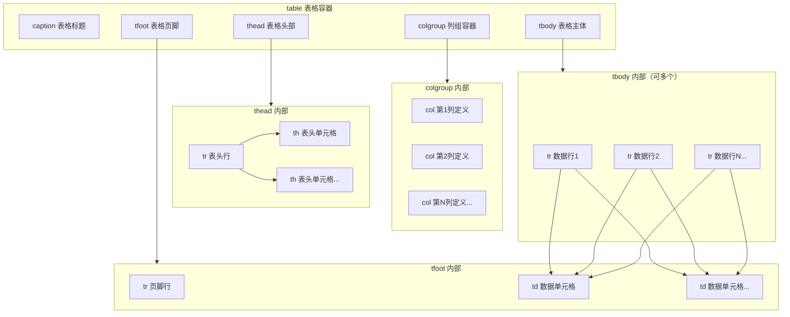
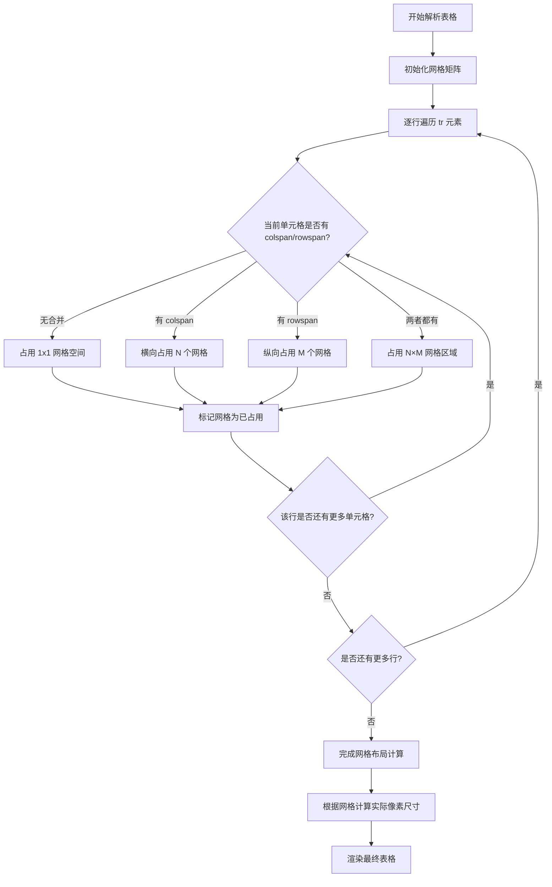

# 表格基础与语义化

## 概述

HTML 表格（`<table>`）是用于展示结构化二维数据的语义化元素。它将数据按行和列组织，适用于展示数据报表、价格对比、课程安排、统计信息等场景。

### 核心特性

- **语义化结构**：通过 `<thead>`、`<tbody>`、`<tfoot>` 等标签明确表格结构
- **可访问性支持**：通过 `<caption>`、`scope`、`headers` 等属性提升屏幕阅读器体验
- **灵活的布局控制**：支持单元格合并、列组样式、响应式设计
- **丰富的 JavaScript API**：提供完整的 DOM 操作接口

### 适用场景

| 场景 | 适用性 | 说明 |
|------|--------|------|
| 数据报表 | ✅ 推荐 | 财务报表、统计报表、分析报告 |
| 价格对比表 | ✅ 推荐 | 产品定价、套餐对比 |
| 课程表/排班表 | ✅ 推荐 | 时间安排、资源分配 |
| 数据列表 | ⚠️ 谨慎 | 简单列表建议使用 `<ul>`/`<ol>` |
| 页面布局 | ❌ 不推荐 | 使用 CSS Grid/Flexbox |

:::: warning

**重要提示**：表格应仅用于展示表格数据，**切勿用于页面布局**。布局应使用 CSS Grid、Flexbox 等现代布局技术。

::::

### 表格 DOM 结构层次图



## 快速入门

### 最简表格示例

```html
<!DOCTYPE html>
<html lang="zh-CN">
<head>
  <meta charset="UTF-8">
  <title>最简表格</title>
</head>
<body>
  <table>
    <tr>
      <td>第一行第一列</td>
      <td>第一行第二列</td>
    </tr>
    <tr>
      <td>第二行第一列</td>
      <td>第二行第二列</td>
    </tr>
  </table>
</body>
</html>
```

### 完整结构示例

```html
<table>
  <caption>学生成绩表</caption>
  <thead>
    <tr>
      <th scope="col">姓名</th>
      <th scope="col">数学</th>
      <th scope="col">英语</th>
    </tr>
  </thead>
  <tbody>
    <tr>
      <td>张三</td>
      <td>85</td>
      <td>92</td>
    </tr>
    <tr>
      <td>李四</td>
      <td>76</td>
      <td>88</td>
    </tr>
  </tbody>
  <tfoot>
    <tr>
      <td>平均分</td>
      <td>80.5</td>
      <td>90</td>
    </tr>
  </tfoot>
</table>
```

---

<a id="tag-reference"></a>

## 标签速查表

### 基础标签

| 标签 | 作用 | 是否必需 | 主要属性 |
|------|------|----------|----------|
| `<table>` | 表格容器 | ✅ 必需 | `border`（已废弃） |
| `<caption>` | 表格标题 | ⚠️ 推荐 | 全局属性 |
| `<tr>` | 表格行 | ✅ 必需 | `align`、`valign`、`bgcolor`（均已废弃） |
| `<th>` | 表头单元格 | ⚠️ 推荐 | `scope`、`colspan`、`rowspan`、`headers`、`abbr` |
| `<td>` | 数据单元格 | ✅ 必需 | `colspan`、`rowspan`、`headers` |

### 结构标签

| 标签 | 作用 | 是否必需 | 说明 |
|------|------|----------|------|
| `<thead>` | 表格头部 | ⚠️ 推荐 | 包含列标题，提升可访问性 |
| `<tbody>` | 表格主体 | ⚠️ 推荐 | 包含数据行，可以有多个 `<tbody>` |
| `<tfoot>` | 表格页脚 | ⏸️ 可选 | 包含汇总信息 |

### 列组标签

| 标签 | 作用 | 是否必需 | 主要属性 |
|------|------|----------|----------|
| `<colgroup>` | 列组容器 | ⏸️ 可选 | `span` |
| `<col>` | 单个列定义 | ⏸️ 可选 | `span` |

---

<a id="table-structure"></a>

## 表格结构标签

### `<thead>` - 表格头部

**作用**：定义表格的列标题区域，增强语义化和可访问性。

**特点**：
- 通常包含一组 `<th>` 元素
- 支持多行表头
- 打印长表格时，浏览器可能重复显示表头

```html
<thead>
  <tr>
    <th scope="col">姓名</th>
    <th scope="col">年龄</th>
    <th scope="col">职业</th>
  </tr>
</thead>
```

### `<tbody>` - 表格主体

**作用**：包含表格的主要数据内容。

**特点**：
- 一个表格可以包含多个 `<tbody>`，用于数据分组
- 必须包含至少一个 `<tr>` 元素
- 便于样式化（如斑马纹效果）

```html
<tbody>
  <tr>
    <td>张三</td>
    <td>25</td>
    <td>工程师</td>
  </tr>
  <tr>
    <td>李四</td>
    <td>30</td>
    <td>设计师</td>
  </tr>
</tbody>
```

### `<tfoot>` - 表格页脚

**作用**：定义表格的汇总或总结信息。

**特点**：
- 通常包含合计、平均值等统计信息
- 在 HTML5 中可以放在 `<table>` 内的任何位置，浏览器会自动渲染到表格底部
- 每个表格只能有一个 `<tfoot>`

```html
<tfoot>
  <tr>
    <td>总计</td>
    <td>-</td>
    <td>55</td>
  </tr>
</tfoot>
```

### `<caption>` - 表格标题

**作用**：为表格提供可见的标题或说明。

**特点**：
- 必须是 `<table>` 的第一个子元素
- 默认显示在表格上方
- 可通过 CSS `caption-side` 属性控制位置（`top` 或 `bottom`）

```html
<table>
  <caption>2023年第四季度销售数据</caption>
  <!-- 表格内容 -->
</table>
```

### 多 tbody 分组示例

```html
<table>
  <caption>员工考勤统计</caption>
  <thead>
    <tr>
      <th>姓名</th>
      <th>出勤天数</th>
      <th>请假天数</th>
    </tr>
  </thead>
  <tbody>
    <tr><td colspan="3">技术部</td></tr>
    <tr>
      <td>张三</td>
      <td>22</td>
      <td>0</td>
    </tr>
    <tr>
      <td>李四</td>
      <td>20</td>
      <td>2</td>
    </tr>
  </tbody>
  <tbody>
    <tr><td colspan="3">市场部</td></tr>
    <tr>
      <td>王五</td>
      <td>21</td>
      <td>1</td>
    </tr>
  </tbody>
  <tfoot>
    <tr>
      <td>合计</td>
      <td>63</td>
      <td>3</td>
    </tr>
  </tfoot>
</table>
```

---

<a id="table-attributes"></a>

## 表格与单元格属性

### `<table>` 标签属性

#### 已废弃属性（使用 CSS 替代）

| 属性 | 作用 | CSS 替代方案 |
|------|------|--------------|
| `border` | 边框宽度 | `border` |
| `cellpadding` | 单元格内边距 | `padding`（应用在 `th`、`td`） |
| `cellspacing` | 单元格间距 | `border-spacing` |
| `width` | 表格宽度 | `width` |
| `height` | 表格高度 | `height` |
| `align` | 水平对齐 | `margin` + `auto` 或 `text-align` |
| `bgcolor` | 背景颜色 | `background-color` |
| `frame` | 外边框样式 | `border` |
| `rules` | 内边框样式 | `border` |

#### 已废弃的无障碍属性

| 属性 | 说明 | 现代替代方案 |
|------|------|--------------|
| `summary` | 曾用于为屏幕阅读器提供表格摘要，HTML5 中已废弃 | 使用 `<caption>` 或 `aria-describedby` |

### `<tr>` 标签属性

所有属性已废弃，使用 CSS 替代：

| 属性 | CSS 替代方案 |
|------|--------------|
| `align` | `text-align` |
| `valign` | `vertical-align` |
| `bgcolor` | `background-color` |

### `<th>` 和 `<td>` 共享属性

| 属性 | 作用 | 适用标签 | 示例 |
|------|------|----------|------|
| `colspan` | 横跨列数 | `<th>`、`<td>` | `<td colspan="3">` |
| `rowspan` | 纵跨行数 | `<th>`、`<td>` | `<td rowspan="2">` |
| `headers` | 关联表头 ID | `<th>`、`<td>` | `<td headers="name dept">` |

### `<th>` 特有属性

| 属性 | 作用 | 可选值 | 示例 |
|------|------|--------|------|
| `scope` | 表头作用范围 | `col`、`row`、`colgroup`、`rowgroup` | `<th scope="col">` |
| `abbr` | 缩写（屏幕阅读器使用） | 文本 | `<th abbr="ID">身份证号</th>` |

### `<td>` 特有属性

| 属性 | 作用 | 说明 |
|------|------|------|
| `colspan` | 合并列 | 默认值为 `1` |
| `rowspan` | 合并行 | 默认值为 `1` |
| `headers` | 关联表头 | 用于复杂表格的可访问性 |

### 已废弃的单元格属性

| 属性 | CSS 替代方案 |
|------|--------------|
| `align` | `text-align` |
| `valign` | `vertical-align` |
| `bgcolor` | `background-color` |
| `width` | `width` |
| `height` | `height` |
| `nowrap` | `white-space: nowrap` |

---

<a id="cell-merging"></a>

## 单元格合并

<h4>035-table-course-schedule.html</h4>

```html
<!-- 来源：6-表格.md - 完整课程表（rowspan/colspan 单元格合并） -->
<!DOCTYPE html>
<html lang="zh-CN">
<head>
  <meta charset="UTF-8">
  <meta name="viewport" content="width=device-width, initial-scale=1.0">
  <title>课程表 - 单元格合并示例</title>
  <style>
    * { margin: 0; padding: 0; box-sizing: border-box; }

    body {
      font-family: -apple-system, BlinkMacSystemFont, "Segoe UI", sans-serif;
      line-height: 1.6;
      color: #333;
      background: #f5f7fa;
      padding: 40px 20px;
    }

    .container { max-width: 900px; margin: 0 auto; }

    h1 { text-align: center; color: #222; margin-bottom: 8px; font-size: 32px; }
    .subtitle { text-align: center; color: #666; margin-bottom: 30px; font-size: 15px; }

    /* 课程表样式 */
    table {
      border-collapse: collapse;
      width: 100%;
      background: white;
      box-shadow: 0 4px 20px rgba(0,0,0,0.08);
      border-radius: 12px;
      overflow: hidden;
    }

    caption {
      font-size: 22px;
      font-weight: 700;
      color: #222;
      padding: 20px 16px 12px;
      text-align: center;
    }

    th, td {
      border: 1px solid #d0d5dd;
      padding: 14px 10px;
      text-align: center;
      font-size: 14px;
    }

    /* 星期标题行 */
    thead tr:first-child th {
      background: linear-gradient(135deg, #0066cc, #0052a3);
      color: white;
      font-weight: 600;
      padding: 16px 10px;
      letter-spacing: 0.5px;
    }

    /* 时间段列 */
    .time-header {
      background: linear-gradient(135deg, #28a745, #20883d);
      color: white !important;
      font-weight: 700;
      min-width: 80px;
    }

    /* 课程单元格颜色 */
    tbody td {
      transition: all 0.2s;
      cursor: default;
    }

    tbody td:hover {
      background-color: #e3f2fd !important;
      transform: scale(1.02);
      z-index: 1;
      position: relative;
    }

    /* 斑马纹效果 */
    tbody tr:nth-child(odd) td:not(.time-header) {
      background-color: #fafbfc;
    }

    /* 不同科目颜色 */
    .subject-math { background-color: #fff3e0; }
    .subject-chinese { background-color: #fce4ec; }
    .subject-english { background-color: #e8eaf6; }
    .subject-physics { background-color: #e0f2f1; }
    .subject-chemistry { background-color: #f3e5f5; }
    .subject-biology { background-color: #e8f5e9; }
    .subject-pe { background-color: #ffebee; }
    .subject-music { background-color: #fff8e1; }
    .subject-art { background-color: #e0f7fa; }
    .subject-history { background-color: #fbe9e7; }
    .subject-geography { background-color: #f1f8e9; }
    .subject-study { background-color: #eceff1; }

    /* 页脚 */
    tfoot td {
      background: #f8f9fa;
      color: #666;
      font-size: 13px;
      font-style: italic;
    }

    /* 说明面板 */
    .legend-panel {
      display: flex;
      flex-wrap: wrap;
      gap: 12px;
      justify-content: center;
      margin-top: 24px;
      padding: 18px;
      background: white;
      border-radius: 10px;
      box-shadow: 0 2px 8px rgba(0,0,0,0.06);
    }

    .legend-item {
      display: flex;
      align-items: center;
      gap: 6px;
      font-size: 13px;
      color: #555;
    }

    .legend-color {
      width: 20px;
      height: 14px;
      border-radius: 3px;
      border: 1px solid #ddd;
    }

    /* 技术说明卡片 */
    .tech-info {
      background: white;
      border-radius: 10px;
      padding: 24px;
      margin-top: 24px;
      box-shadow: 0 2px 8px rgba(0,0,0,0.06);
    }

    .tech-info h3 { color: #333; margin-bottom: 12px; font-size: 17px; }
    .tech-info p { color: #666; font-size: 14px; line-height: 1.7; margin-bottom: 10px; }

    .code-inline {
      font-family: 'Monaco', monospace;
      background: #f0f0f0;
      padding: 2px 8px;
      border-radius: 4px;
      font-size: 13px;
      color: #0066cc;
    }
  </style>
</head>
<body>

  <div class="container">
    <h1>📅 课程表示例</h1>
    <p class="subtitle">演示 rowspan 和 colspan 的实际应用</p>

    <!-- 课程表 -->
    <table>
      <caption>🏫 高一（3）班课程表</caption>

      <thead>
        <tr>
          <th></th>
          <th>周一</th>
          <th>周二</th>
          <th>周三</th>
          <th>周四</th>
          <th>周五</th>
        </tr>
      </thead>

      <tbody>
        <!-- 上午时段 (rowspan=4 跨越4行) -->
        <tr>
          <td class="time-header" rowspan="4">上午<br><small style="font-weight:400;font-size:11px;">08:00-12:00</small></td>
          <td class="subject-math">数学</td>
          <td class="subject-chinese">语文</td>
          <td class="subject-english">英语</td>
          <td class="subject-physics">物理</td>
          <td class="subject-chemistry">化学</td>
        </tr>
        <tr>
          <td class="subject-chinese">语文</td>
          <td class="subject-math">数学</td>
          <td class="subject-physics">物理</td>
          <td class="subject-english">英语</td>
          <td class="subject-biology">生物</td>
        </tr>
        <tr>
          <td class="subject-english">英语</td>
          <td class="subject-physics">物理</td>
          <td class="subject-math">数学</td>
          <td class="subject-chemistry">化学</td>
          <td class="subject-chinese">语文</td>
        </tr>
        <tr>
          <td class="subject-pe">体育</td>
          <td class="subject-chemistry">化学</td>
          <td class="subject-biology">生物</td>
          <td class="subject-math">数学</td>
          <td class="subject-english">英语</td>
        </tr>

        <!-- 下午时段 (rowspan=2 跨越2行) -->
        <tr>
          <td class="time-header" rowspan="2">下午<br><small style="font-weight:400;font-size:11px;">14:00-17:30</small></td>
          <td class="subject-music">音乐</td>
          <td class="subject-art">美术</td>
          <td class="subject-pe">体育</td>
          <td class="subject-history">历史</td>
          <td class="subject-geography">地理</td>
        </tr>
        <tr>
          <td class="subject-study">自习</td>
          <td class="subject-study">班会</td>
          <td class="subject-study">自习</td>
          <td class="subject-study">自习</td>
          <td class="subject-study">自习</td>
        </tr>
      </tbody>

      <tfoot>
        <tr>
          <td colspan="6">
            📌 备注：如有变动，以教务处通知为准 | 每节课45分钟，课间休息10分钟
          </td>
        </tr>
      </tfoot>
    </table>


    <!-- 科目图例 -->
    <div class="legend-panel">
      <div class="legend-item"><div class="legend-color subject-math"></div> 数学</div>
      <div class="legend-item"><div class="legend-color subject-chinese"></div> 语文</div>
      <div class="legend-item"><div class="legend-color subject-english"></div> 英语</div>
      <div class="legend-item"><div class="legend-color subject-physics"></div> 物理</div>
      <div class="legend-item"><div class="legend-color subject-chemistry"></div> 化学</div>
      <div class="legend-item"><div class="legend-color subject-biology"></div> 生物</div>
      <div class="legend-item"><div class="legend-color subject-pe"></div> 体育</div>
      <div class="legend-item"><div class="legend-color subject-music"></div> 音乐</div>
      <div class="legend-item"><div class="legend-color subject-art"></div> 美术</div>
      <div class="legend-item"><div class="legend-color subject-history"></div> 历史</div>
      <div class="legend-item"><div class="legend-color subject-geography"></div> 地理</div>
      <div class="legend-item"><div class="legend-color subject-study"></div> 自习/班会</div>
    </div>


    <!-- 技术说明 -->
    <div class="tech-info">
      <h3>🔧 使用的技术要点</h3>
      <p>
        • <strong>rowspan="4"</strong>：「上午」时间列跨越4行数据，将第1-4节归为同一时间段<br>
        • <strong>rowspan="2"</strong>：「下午」时间列跨越2行数据，将第5-6节归为同一时间段<br>
        • <strong>colspan="6"</strong>：页脚备注横跨全部6列，用于显示表格级别的说明信息
      </p>
      <p>
        浏览器在渲染时维护一个<strong>二维网格矩阵</strong>来跟踪哪些位置已被合并单元格占用。
        遇到 rowspan 时，后续行的对应位置会被自动跳过。
      </p>
    </div>

  </div>

</body>
</html>
```

### colspan - 横向合并

**作用**：让单元格横跨多列。

**使用场景**：
- 表头分组
- 合并统计行
- 创建跨列标题

```html
<table>
  <thead>
    <tr>
      <th rowspan="2">姓名</th>
      <th colspan="3">成绩</th>
    </tr>
    <tr>
      <th>数学</th>
      <th>英语</th>
      <th>物理</th>
    </tr>
  </thead>
  <tbody>
    <tr>
      <td>张三</td>
      <td>85</td>
      <td>92</td>
      <td>78</td>
    </tr>
  </tbody>
  <tfoot>
    <tr>
      <td colspan="4">全班平均分：85</td>
    </tr>
  </tfoot>
</table>
```

### rowspan - 纵向合并

**作用**：让单元格纵跨多行。

**使用场景**：
- 分组标识
- 时间段标注
- 分类标签

```html
<table>
  <thead>
    <tr>
      <th>时间段</th>
      <th>节次</th>
      <th>课程</th>
    </tr>
  </thead>
  <tbody>
    <tr>
      <td rowspan="2">上午</td>
      <td>第1节</td>
      <td>数学</td>
    </tr>
    <tr>
      <td>第2节</td>
      <td>语文</td>
    </tr>
    <tr>
      <td rowspan="2">下午</td>
      <td>第3节</td>
      <td>英语</td>
    </tr>
    <tr>
      <td>第4节</td>
      <td>体育</td>
    </tr>
  </tbody>
</table>
```

### 单元格合并算法流程图

浏览器在渲染带有 `colspan` 和 `rowspan` 的表格时，需要经过复杂的计算过程来确定每个单元格的位置和大小：



::: tip 合并算法要点

1. 浏览器维护一个二维矩阵来跟踪哪些网格位置已被占用
2. 遇到 `colspan="3"` 时，当前行及后续受影响行的对应位置会被标记为"已占用"
3. 后续单元格遇到已占用的位置时自动跳过
4. 如果计算结果导致某行列数不一致，浏览器会尝试自动修正或产生布局错误

:::

### 完整课程表示例

```html
<!DOCTYPE html>
<html lang="zh-CN">
<head>
  <meta charset="UTF-8">
  <title>课程表 - 合并单元格示例</title>
  <style>
    table {
      border-collapse: collapse;
      width: 80%;
      margin: 20px auto;
    }
    th, td {
      border: 1px solid #333;
      padding: 12px;
      text-align: center;
    }
    .time-header {
      background-color: #e3f2fd;
      font-weight: bold;
    }
    .day-header {
      background-color: #f5f5f5;
    }
    caption {
      font-size: 1.5em;
      font-weight: bold;
      margin-bottom: 15px;
    }
  </style>
</head>
<body>
  <table>
    <caption>课程表</caption>
    <thead>
      <tr class="day-header">
        <th></th>
        <th>周一</th>
        <th>周二</th>
        <th>周三</th>
        <th>周四</th>
        <th>周五</th>
      </tr>
    </thead>
    <tbody>
      <tr>
        <td class="time-header" rowspan="4">上午</td>
        <td>数学</td>
        <td>语文</td>
        <td>英语</td>
        <td>物理</td>
        <td>化学</td>
      </tr>
      <tr>
        <td>语文</td>
        <td>数学</td>
        <td>物理</td>
        <td>英语</td>
        <td>生物</td>
      </tr>
      <tr>
        <td>英语</td>
        <td>物理</td>
        <td>数学</td>
        <td>化学</td>
        <td>语文</td>
      </tr>
      <tr>
        <td>体育</td>
        <td>化学</td>
        <td>生物</td>
        <td>数学</td>
        <td>英语</td>
      </tr>
      <tr>
        <td class="time-header" rowspan="2">下午</td>
        <td>音乐</td>
        <td>美术</td>
        <td>体育</td>
        <td>历史</td>
        <td>地理</td>
      </tr>
      <tr>
        <td>自习</td>
        <td>班会</td>
        <td>自习</td>
        <td>自习</td>
        <td>自习</td>
      </tr>
    </tbody>
    <tfoot>
      <tr>
        <td colspan="6">备注：如有变动，以教务处通知为准</td>
      </tr>
    </tfoot>
  </table>
</body>
</html>
```

---

<a id="colgroup"></a>

## 列组样式控制

<h4>036-table-colgroup-pricing.html</h4>

```html
<!-- 来源：6-表格.md - 产品价格表（colgroup 列组样式） -->
<!DOCTYPE html>
<html lang="zh-CN">
<head>
  <meta charset="UTF-8">
  <meta name="viewport" content="width=device-width, initial-scale=1.0">
  <title>产品价格表 - colgroup 列组样式</title>
  <style>
    * { margin: 0; padding: 0; box-sizing: border-box; }

    body {
      font-family: -apple-system, BlinkMacSystemFont, "Segoe UI", sans-serif;
      line-height: 1.6;
      color: #333;
      background: #f5f7fa;
      padding: 40px 20px;
    }

    .container { max-width: 900px; margin: 0 auto; }

    h1 { text-align: center; color: #222; margin-bottom: 8px; font-size: 32px; }
    .subtitle { text-align: center; color: #666; margin-bottom: 30px; font-size: 15px; }

    /* 价格表格 */
    table {
      border-collapse: collapse;
      width: 100%;
      background: white;
      box-shadow: 0 4px 20px rgba(0,0,0,0.08);
      border-radius: 12px;
      overflow: hidden;
    }

    caption {
      font-size: 22px;
      font-weight: 700;
      color: #222;
      padding: 24px 16px 16px;
      text-align: center;
    }

    th, td {
      border: 1px solid #e0e0e0;
      padding: 16px 14px;
      font-size: 14px;
      vertical-align: middle;
    }

    th {
      font-weight: 600;
      color: white;
      padding: 18px 14px;
    }

    tbody tr {
      transition: background-color 0.2s;
    }

    tbody tr:hover {
      background-color: #f8f9ff !important;
    }

    /* 斑马纹 */
    tbody tr:nth-child(even) {
      background-color: #fafbfc;
    }

    /* 价格列特殊样式 */
    .price-value {
      font-size: 18px;
      font-weight: 700;
      color: #dc3545;
    }

    /* 状态标签 */
    .status-badge {
      display: inline-block;
      padding: 4px 12px;
      border-radius: 20px;
      font-size: 12px;
      font-weight: 600;
    }

    .badge-hot { background: #fee; color: #dc3545; }
    .badge-new { background: #efe; color: #28a745; }
    .badge-sale { background: #fff3cd; color: #856404; }

    /* 列组说明面板 */
    .colgroup-info {
      display: grid;
      grid-template-columns: repeat(3, 1fr);
      gap: 16px;
      margin-top: 28px;
    }

    .col-info-card {
      padding: 20px;
      border-radius: 10px;
      border-left: 4px solid;
    }

    .col-name { background-color: #e3f2fd; border-left-color: #0066cc; }
    .col-desc { background-color: #f8f9fa; border-left-color: #888; }
    .col-price { background-color: #fff3e0; border-left-color: #fd7e14; }

    .col-info-card h4 { font-size: 15px; margin-bottom: 6px; }
    .col-info-card p { font-size: 13px; color: #666; line-height: 1.6; }

    /* 代码展示 */
    .code-block {
      background: #1e1e1e;
      color: #d4d4d4;
      padding: 16px 20px;
      border-radius: 8px;
      font-family: 'Monaco', monospace;
      font-size: 13px;
      line-height: 1.7;
      overflow-x: auto;
      margin-top: 24px;
    }
    .tag { color: #569cd6; }
    .attr { color: #9cdcfe; }
    .value { color: #ce9178; }
    .comment { color: #6a9955; }

    @media (max-width: 768px) {
      .colgroup-info { grid-template-columns: 1fr; }
    }
  </style>
</head>
<body>

  <div class="container">
    <h1>💰 产品价格表</h1>
    <p class="subtitle">使用 colgroup/col 批量设置列样式</p>

    <!-- 价格表 -->
    <table>
      <caption>🛒 Apple 产品价格一览</caption>

      <!-- 列组定义：批量控制每列的宽度和背景色 -->
      <colgroup>
        <!-- 产品名称列：25% 宽度，浅蓝背景 -->
        <col style="width: 25%; background-color: #e3f2fd;" />
        <!-- 产品描述列：50% 宽度，默认背景 -->
        <col style="width: 50%;" />
        <!-- 价格列：25% 宽度，浅橙背景，右对齐 -->
        <col style="width: 25%; background-color: #fff3e0; text-align: right;" />
      </colgroup>

      <thead>
        <tr>
          <th scope="col">产品名称</th>
          <th scope="col">产品描述</th>
          <th scope="col">价格</th>
        </tr>
      </thead>

      <tbody>
        <tr>
          <td><strong>iPhone 15 Pro</strong><br><span class="status-badge badge-hot">🔥 热销</span></td>
          <td>A17 Pro 芯片，钛金属设计，4800万像素主摄，USB-C 接口，支持 Action Button</td>
          <td><span class="price-value">¥8,999</span></td>
        </tr>

        <tr>
          <td><strong>MacBook Air M3</strong></td>
          <td>M3 芯片，13.6 英寸 Liquid 视网膜显示屏，最长 18 小时电池续航，静音无风扇设计</td>
          <td><span class="price-value">¥9,499</span></td>
        </tr>

        <tr>
          <td><strong>iPad Pro M2</strong><br><span class="status-badge badge-new">✨ 新品</span></td>
          <td>M2 芯片，12.9 英寸 Liquid 视网膜 XDR 显示屏，支持 Apple Pencil 悬停功能</td>
          <td><span class="price-value">¥9,299</span></td>
        </tr>

        <tr>
          <td><strong>AirPods Pro 2</strong><br><span class="status-badge badge-hot">🔥 热销</span></td>
          <td>H2 芯片驱动，自适应音频模式，主动降噪，个性化空间音频，MagSafe 充电盒</td>
          <td><span class="price-value">¥1,899</span></td>
        </tr>

        <tr>
          <td><strong>Apple Watch Ultra 2</strong><br><span class="status-badge badge-sale">📉 特惠</span></td>
          <td>S9 SiP 芯片，49mm 钛金属表壳，3000 尼特亮度显示屏，双频 GPS 精准定位</td>
          <td><span class="price-value"><del style="color:#999;font-size:14px;">¥6,999</del> ¥6,499</span></td>
        </tr>

        <tr>
          <td><strong>Mac Mini M2</strong></td>
          <td>M2 / M2 Pro 芯片可选，紧凑设计，支持多显示器输出，丰富的接口配置</td>
          <td><span class="price-value">¥4,499</span></td>
        </tr>
      </tbody>

      <tfoot>
        <tr style="background: linear-gradient(135deg, #667eea, #764ba2); color: white;">
          <th colspan="2" style="text-align: right;">总计（以上全部）：</th>
          <th style="font-size: 20px;">¥40,694</th>
        </tr>
      </tfoot>
    </table>


    <!-- 列组说明 -->
    <div class="colgroup-info">
      <div class="col-info-card col-name">
        <h4>📝 第 1 列 — 产品名称</h4>
        <p>宽度 25%，浅蓝色背景突出显示。包含产品名和状态标签。</p>
      </div>
      <div class="col-info-card col-desc">
        <h4>📋 第 2 列 — 产品描述</h4>
        <p>宽度 50%（最大），承载详细的文字描述信息。默认背景色。</p>
      </div>
      <div class="col-info-card col-price">
        <h4>💵 第 3 列 — 价格</h4>
        <p>宽度 25%，浅橙色背景强调，右对齐显示金额数值。</p>
      </div>
    </div>


    <!-- 核心代码 -->
    <div class="code-block">
<span class="comment">&lt;!-- 使用 &lt;colgroup&gt; + &lt;col&gt; 批量定义列样式 --&gt;</span>
<span class="tag">&lt;table&gt;</span>
  <span class="tag">&lt;caption&gt;</span>产品价格表<span class="tag">&lt;/caption&gt;</span>

  <span class="tag">&lt;colgroup&gt;</span>
    <span class="comment">&lt;!-- 第1列：产品名 --&gt;</span>
    <span class="tag">&lt;col</span> <span class="attr">style</span>=<span class="value">"width:25%; background:#e3f2fd"</span> /&gt;

    <span class="comment">&lt;!-- 第2列：描述 --&gt;</span>
    <span class="tag">&lt;col</span> <span class="attr">style</span>=<span class="value">"width:50%"</span> /&gt;

    <span class="comment">&lt;!-- 第3列：价格 --&gt;</span>
    <span class="tag">&lt;col</span> <span class="attr">style</span>=<span class="value">"width:25%; background:#fff3e0"</span> /&gt;
  <span class="tag">&lt;/colgroup&gt;</span>

  <span class="tag">&lt;thead&gt;</span>...<span class="tag">&lt;/thead&gt;</span>
  <span class="tag">&lt;tbody&gt;</span>...<span class="tag">&lt;/tbody&gt;</span>
<span class="tag">&lt;/table&gt;</span>
    </div>

  </div>

</body>
</html>
```

### `<colgroup>` 和 `<col>` 概述

**作用**：批量设置列的样式，无需为每个单元格添加类名。

**优势**：
- 减少重复的 CSS 类定义
- 统一控制列宽、背景色
- 提高代码可维护性

### `<colgroup>` 标签

**属性**：
- `span`：指定列组包含的列数

```html
<table>
  <colgroup span="2" style="background-color: #f0f0f0;"></colgroup>
  <colgroup style="background-color: #e0e0e0;"></colgroup>
  <thead>
    <tr>
      <th>列1</th>
      <th>列2</th>
      <th>列3</th>
    </tr>
  </thead>
  <tbody>
    <tr>
      <td>数据1</td>
      <td>数据2</td>
      <td>数据3</td>
    </tr>
  </tbody>
</table>
```

### `<col>` 标签

**属性**：
- `span`：指定该列定义跨越的列数

**支持的 CSS 属性**：
- `width`
- `background-color`
- `border`
- `visibility`

```html
<table>
  <colgroup>
    <col style="width: 200px; background-color: #e3f2fd;">
    <col style="width: 300px;">
    <col style="width: 150px; background-color: #fff3e0;">
  </colgroup>
  <thead>
    <tr>
      <th>产品名称</th>
      <th>描述</th>
      <th>价格</th>
    </tr>
  </thead>
  <tbody>
    <tr>
      <td>iPhone 14</td>
      <td>最新款智能手机</td>
      <td>¥5999</td>
    </tr>
  </tbody>
</table>
```

### 完整示例：价格表

```html
<!DOCTYPE html>
<html lang="zh-CN">
<head>
  <meta charset="UTF-8">
  <title>列组样式示例</title>
  <style>
    table {
      border-collapse: collapse;
      width: 100%;
      max-width: 800px;
      margin: 20px auto;
    }
    th, td {
      border: 1px solid #ddd;
      padding: 12px;
      text-align: left;
    }
    th {
      background-color: #333;
      color: white;
      font-weight: bold;
    }
    .name-col {
      width: 25%;
      background-color: #e3f2fd;
      font-weight: bold;
    }
    .desc-col {
      width: 50%;
    }
    .price-col {
      width: 25%;
      background-color: #fff3e0;
      text-align: right;
      font-weight: bold;
    }
  </style>
</head>
<body>
  <table>
    <caption>产品价格表</caption>
    <colgroup>
      <col class="name-col">
      <col class="desc-col">
      <col class="price-col">
    </colgroup>
    <thead>
      <tr>
        <th>产品名称</th>
        <th>描述</th>
        <th>价格</th>
      </tr>
    </thead>
    <tbody>
      <tr>
        <td>iPhone 14</td>
        <td>最新款智能手机，A16芯片，超视网膜XDR显示屏</td>
        <td>¥5999</td>
      </tr>
      <tr>
        <td>MacBook Pro</td>
        <td>高性能笔记本电脑，M2芯片，16GB内存</td>
        <td>¥12999</td>
      </tr>
      <tr>
        <td>iPad Pro</td>
        <td>专业平板电脑，12.9英寸Liquid视网膜XDR显示屏</td>
        <td>¥8499</td>
      </tr>
    </tbody>
  </table>
</body>
</html>
```

---

<a id="table-css"></a>

## 表格 CSS 样式

### 基础样式模板

```css
/* 表格基础样式 */
table {
  border-collapse: collapse;
  width: 100%;
  margin: 20px 0;
  font-family: Arial, sans-serif;
}

/* 单元格样式 */
th, td {
  border: 1px solid #ddd;
  padding: 12px;
  text-align: left;
}

/* 表头样式 */
th {
  background-color: #f2f2f2;
  font-weight: bold;
  color: #333;
}

/* 斑马纹效果 */
tbody tr:nth-child(even) {
  background-color: #f9f9f9;
}

/* 鼠标悬停效果 */
tbody tr:hover {
  background-color: #f5f5f5;
  cursor: pointer;
}
```

### 边框控制

```css
/* 合并边框 */
table {
  border-collapse: collapse;
}

/* 分离边框 */
table {
  border-collapse: separate;
  border-spacing: 10px; /* 单元格间距 */
}
```

### 表格布局算法

```css
/* 自动布局（默认）- 根据内容调整列宽 */
table {
  table-layout: auto;
}

/* 固定布局 - 根据第一行或设定的宽度分配列宽 */
table {
  table-layout: fixed;
  width: 100%;
}
```

**性能提示**：`table-layout: fixed` 渲染速度更快，适合内容量大的表格。

### 对齐控制

```css
/* 水平对齐 */
th, td {
  text-align: left;   /* 左对齐 */
  text-align: center; /* 居中 */
  text-align: right;  /* 右对齐 */
}

/* 垂直对齐 */
th, td {
  vertical-align: top;     /* 顶部对齐 */
  vertical-align: middle;  /* 居中（默认） */
  vertical-align: bottom;  /* 底部对齐 */
  vertical-align: baseline; /* 基线对齐 */
}
```

### 标题样式控制

```css
caption {
  font-size: 1.2em;
  font-weight: bold;
  text-align: left;
  padding: 10px;
  caption-side: top;    /* 默认在表格上方 */
  /* caption-side: bottom; */ /* 标题在表格下方 */
}
```

### 空单元格处理

```css
/* 隐藏空单元格的边框 */
table {
  empty-cells: hide;
}

/* 显示空单元格的边框 */
table {
  empty-cells: show;
}
```

### 高级样式示例

```css
/* 现代化表格样式 */
.modern-table {
  border-collapse: collapse;
  width: 100%;
  box-shadow: 0 2px 15px rgba(0, 0, 0, 0.1);
  border-radius: 8px;
  overflow: hidden;
}

.modern-table th {
  background: linear-gradient(135deg, #667eea 0%, #764ba2 100%);
  color: white;
  padding: 15px;
  text-align: left;
  font-weight: 600;
  text-transform: uppercase;
  letter-spacing: 0.5px;
}

.modern-table td {
  padding: 12px 15px;
  border-bottom: 1px solid #e0e0e0;
}

.modern-table tbody tr:last-child td {
  border-bottom: none;
}

.modern-table tbody tr:hover {
  background-color: #f8f9ff;
  transition: background-color 0.3s ease;
}
```

### 固定表头 + 固定首列（双方向 Sticky）

当表格同时需要固定表头和固定首列时，需要精心处理层级关系和定位策略：

```html
<!DOCTYPE html>
<html lang="zh-CN">
<head>
  <meta charset="UTF-8">
  <title>固定表头+固定首列</title>
  <style>
    .sticky-table-container {
      width: 100%;
      height: 400px;
      overflow: auto;
      position: relative;
      border: 1px solid #ddd;
    }

    .sticky-table {
      border-collapse: collapse;
      min-width: 800px;
    }

    .sticky-table th,
    .sticky-table td {
      border: 1px solid #ddd;
      padding: 12px;
      min-width: 120px;
      white-space: nowrap;
    }

    /* 表头基础样式 */
    .sticky-table thead th {
      background-color: #333;
      color: white;
      position: sticky;
      top: 0;
      z-index: 2;
    }

    /* 左上角交叉单元格（同时固定顶部和左侧） */
    .sticky-table thead th:first-child {
      left: 0;
      z-index: 4; /* 最高层级，确保不被其他 sticky 元素遮挡 */
      background-color: #222;
    }

    /* 首列固定 */
    .sticky-table th:first-child,
    .sticky-table td:first-child {
      position: sticky;
      left: 0;
      background-color: white;
      z-index: 1;
    }

    /* 首列表头特殊处理 */
    .sticky-table thead th:first-child {
      z-index: 4;
      background-color: #222;
    }

    /* 首列数据单元格阴影效果 */
    .sticky-table td:first-child {
      box-shadow: 2px 0 5px rgba(0, 0, 0, 0.1);
      font-weight: 500;
    }

    /* 表头阴影效果 */
    .sticky-table thead th:not(:first-child) {
      box-shadow: 0 2px 5px rgba(0, 0, 0, 0.1);
    }

    /* 斑马纹 */
    .sticky-table tbody tr:nth-child(even) {
      background-color: #f9f9f9;
    }

    .sticky-table tbody tr:hover {
      background-color: #f0f0f0;
    }
  </style>
</head>
<body>
  <div class="sticky-table-container">
    <table class="sticky-table">
      <thead>
        <tr>
          <th>产品名称</th>
          <th>类别</th>
          <th>价格</th>
          <th>库存</th>
          <th>销量</th>
          <th>评分</th>
          <th>上架日期</th>
        </tr>
      </thead>
      <tbody>
        <tr>
          <td>iPhone 15 Pro</td>
          <td>手机</td>
          <td>¥8999</td>
          <td>1250</td>
          <td>3580</td>
          <td>4.8</td>
          <td>2024-01-15</td>
        </tr>
        <tr>
          <td>MacBook Air M3</td>
          <td>笔记本</td>
          <td>¥9499</td>
          <td>680</td>
          <td>1920</td>
          <td>4.7</td>
          <td>2024-03-08</td>
        </tr>
        <tr>
          <td>AirPods Pro 2</td>
          <td>耳机</td>
          <td>¥1899</td>
          <td>3200</td>
          <td>8650</td>
          <td>4.9</td>
          <td>2023-09-22</td>
        </tr>
        <!-- 更多数据行... -->
        <tr>
          <td>iPad Air M2</td>
          <td>平板</td>
          <td>¥4799</td>
          <td>960</td>
          <td>2340</td>
          <td>4.6</td>
          <td>2024-03-15</td>
        </tr>
        <tr>
          <td>Apple Watch Ultra 2</td>
          <td>手表</td>
          <td>¥6499</td>
          <td>420</td>
          <td>1180</td>
          <td>4.7</td>
          <td>2023-09-22</td>
        </tr>
        <tr>
          <td>Mac Mini M2</td>
          <td>台式机</td>
          <td>¥4499</td>
          <td>550</td>
          <td>890</td>
          <td>4.5</td>
          <td>2023-01-18</td>
        </tr>
      </tbody>
    </table>
  </div>
</body>
</html>
```

::: warning 双方向 Sticky 注意事项

1. **z-index 层级管理**：左上角交叉单元格需要最高 z-index（通常为 4）
2. **背景色设置**：所有 sticky 元素必须设置不透明的背景色，否则滚动时会出现透明重叠问题
3. **box-shadow 增强**：添加阴影可以清晰区分固定区域与滚动区域
4. **容器高度限制**：外层容器必须设置固定高度并启用 `overflow: auto`
5. **min-width 设置**：表格需要设置足够的 `min-width` 以触发水平滚动

:::

---

<a id="table-responsive"></a>
