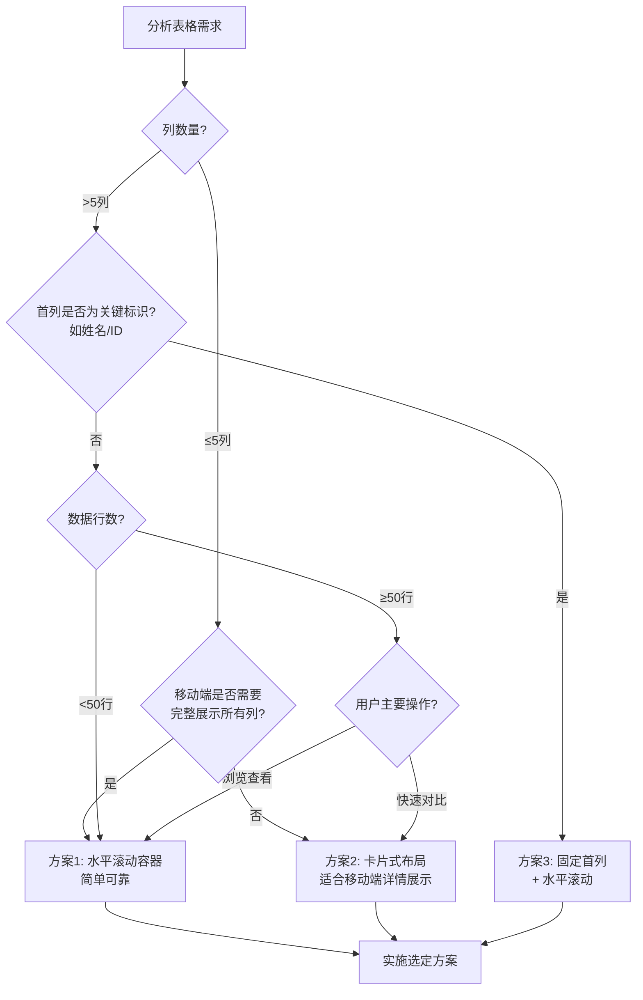

# 表格高级样式与交互

> 本文为《06-表格》专题拆分系列第 2/3 篇（共 3 篇）。上一篇：[表格基础与语义化](/docs/html5/01-基础知识/06-表格-1-表格基础与语义化) ｜ 下一篇：[表格可访问性与最佳实践](/docs/html5/01-基础知识/06-表格-3-可访问性与最佳实践)。

## 响应式表格设计

### 响应式方案决策树

根据不同的业务场景和数据特征，选择最合适的响应式方案：



### 方案 1：水平滚动容器

**适用场景**：列数较多，需要保留所有数据列。

```html
<!DOCTYPE html>
<html lang="zh-CN">
<head>
  <meta charset="UTF-8">
  <meta name="viewport" content="width=device-width, initial-scale=1.0">
  <title>响应式表格 - 水平滚动</title>
  <style>
    .table-container {
      overflow-x: auto;
      -webkit-overflow-scrolling: touch;
      border: 1px solid #ddd;
      border-radius: 4px;
    }
    
    table {
      border-collapse: collapse;
      width: 100%;
      min-width: 800px; /* 设置最小宽度触发滚动 */
    }
    
    th, td {
      border: 1px solid #ddd;
      padding: 12px;
      text-align: left;
      white-space: nowrap; /* 防止内容换行 */
    }
    
    th {
      background-color: #333;
      color: white;
      position: sticky;
      top: 0;
      z-index: 10;
    }
  </style>
</head>
<body>
  <div class="table-container">
    <table>
      <thead>
        <tr>
          <th>姓名</th>
          <th>年龄</th>
          <th>职业</th>
          <th>城市</th>
          <th>邮箱</th>
          <th>电话</th>
          <th>部门</th>
        </tr>
      </thead>
      <tbody>
        <tr>
          <td>张三</td>
          <td>25</td>
          <td>工程师</td>
          <td>北京</td>
          <td>zhang@example.com</td>
          <td>13800138000</td>
          <td>技术部</td>
        </tr>
      </tbody>
    </table>
  </div>
</body>
</html>
```

### 方案 2：卡片式布局

**适用场景**：移动端展示，行数较少。

```html
<!DOCTYPE html>
<html lang="zh-CN">
<head>
  <meta charset="UTF-8">
  <meta name="viewport" content="width=device-width, initial-scale=1.0">
  <title>响应式表格 - 卡片式</title>
  <style>
    table {
      border-collapse: collapse;
      width: 100%;
    }
    
    th, td {
      border: 1px solid #ddd;
      padding: 12px;
      text-align: left;
    }
    
    /* 桌面端正常显示 */
    @media (min-width: 601px) {
      th {
        background-color: #f2f2f2;
      }
    }
    
    /* 移动端卡片布局 */
    @media (max-width: 600px) {
      thead {
        display: none;
      }
      
      tbody tr {
        display: block;
        margin-bottom: 15px;
        border: 1px solid #ddd;
        border-radius: 8px;
        padding: 10px;
        background-color: #fff;
        box-shadow: 0 2px 4px rgba(0,0,0,0.1);
      }
      
      td {
        display: block;
        text-align: right;
        border: none;
        padding: 8px 0;
        border-bottom: 1px solid #eee;
      }
      
      td:last-child {
        border-bottom: none;
      }
      
      td::before {
        content: attr(data-label) ": ";
        float: left;
        font-weight: bold;
        color: #333;
      }
    }
  </style>
</head>
<body>
  <table>
    <thead>
      <tr>
        <th>姓名</th>
        <th>年龄</th>
        <th>职业</th>
        <th>城市</th>
      </tr>
    </thead>
    <tbody>
      <tr>
        <td data-label="姓名">张三</td>
        <td data-label="年龄">25</td>
        <td data-label="职业">工程师</td>
        <td data-label="城市">北京</td>
      </tr>
      <tr>
        <td data-label="姓名">李四</td>
        <td data-label="年龄">30</td>
        <td data-label="职业">设计师</td>
        <td data-label="城市">上海</td>
      </tr>
    </tbody>
  </table>
</body>
</html>
```

### 方案 3：固定首列

**适用场景**：首列为关键标识，需要始终可见。

```html
<!DOCTYPE html>
<html lang="zh-CN">
<head>
  <meta charset="UTF-8">
  <title>响应式表格 - 固定首列</title>
  <style>
    .table-wrapper {
      overflow-x: auto;
      position: relative;
      border: 1px solid #ddd;
    }
    
    table {
      border-collapse: collapse;
      width: 100%;
      min-width: 800px;
    }
    
    th, td {
      border: 1px solid #ddd;
      padding: 12px;
      white-space: nowrap;
    }
    
    /* 固定首列 */
    th:first-child,
    td:first-child {
      position: sticky;
      left: 0;
      background-color: white;
      z-index: 1;
      box-shadow: 2px 0 5px rgba(0,0,0,0.1);
    }
    
    th:first-child {
      background-color: #333;
      color: white;
      z-index: 2;
    }
    
    th {
      background-color: #f2f2f2;
    }
  </style>
</head>
<body>
  <div class="table-wrapper">
    <table>
      <thead>
        <tr>
          <th>产品名称</th>
          <th>Q1销量</th>
          <th>Q2销量</th>
          <th>Q3销量</th>
          <th>Q4销量</th>
          <th>年度总计</th>
        </tr>
      </thead>
      <tbody>
        <tr>
          <td>产品A</td>
          <td>1200</td>
          <td>1500</td>
          <td>1800</td>
          <td>2000</td>
          <td>6500</td>
        </tr>
        <tr>
          <td>产品B</td>
          <td>800</td>
          <td>950</td>
          <td>1100</td>
          <td>1300</td>
          <td>4150</td>
        </tr>
      </tbody>
    </table>
  </div>
</body>
</html>
```

### 方案 4：优先级隐藏

**适用场景**：列有明确优先级，可选择性隐藏低优先级列。

```css
/* 定义列优先级 */
.priority-1 { }
.priority-2 { }
.priority-3 { }

/* 移动端隐藏低优先级列 */
@media (max-width: 768px) {
  .priority-3 {
    display: none;
  }
}

@media (max-width: 480px) {
  .priority-2,
  .priority-3 {
    display: none;
  }
}
```

---

<a id="css-grid-alternative"></a>

## CSS Grid 替代表格布局

### 何时使用 CSS Grid 代替 `<table>`

虽然 `<table>` 是展示表格数据的语义化选择，但在某些场景下，CSS Grid 可能是更好的选择：

| 场景 | 推荐方案 | 原因 |
|------|----------|------|
| 真正的表格数据（报表、统计） | ✅ `<table>` | 语义化、可访问性好、原生支持关联关系 |
| 页面整体布局 | ✅ CSS Grid | 更灵活、更适合非表格内容 |
| 表单布局 / 仪表盘卡片 | ✅ CSS Grid | 不需要表格语义，布局更自由 |
| 复杂的图文混排 | ✅ CSS Grid | 支持不规则区域放置 |
| 需要屏幕阅读器支持的数据 | ✅ `<table>` | 原生提供导航和关联功能 |
| 需要导出 Excel/CSV 的数据 | ✅ `<table>` | 可直接从 DOM 提取结构化数据 |

### CSS Grid 实现表格布局示例

```html
<!DOCTYPE html>
<html lang="zh-CN">
<head>
  <meta charset="UTF-8">
  <title>CSS Grid 表格布局</title>
  <style>
    .grid-table {
      display: grid;
      grid-template-columns: repeat(4, 1fr); /* 4列等宽 */
      gap: 1px;
      background-color: #ddd;
      border: 1px solid #ddd;
      max-width: 800px;
      margin: 20px auto;
    }

    .grid-cell {
      background-color: white;
      padding: 12px;
      text-align: center;
    }

    /* 表头样式 */
    .grid-header {
      background-color: #f2f2f2;
      font-weight: bold;
    }

    /* 特定列宽调整 */
    .grid-cell:first-child {
      grid-column: span 1;
      text-align: left;
      font-weight: 500;
    }

    /* hover 效果 */
    .grid-row:hover .grid-cell {
      background-color: #f9f9f9;
    }
  </style>
</head>
<body>
  <div class="grid-table" role="table" aria-label="产品信息表">
    <!-- 表头 -->
    <div class="grid-cell grid-header" role="columnheader">产品名称</div>
    <div class="grid-cell grid-header" role="columnheader">类别</div>
    <div class="grid-cell grid-header" role="columnheader">价格</div>
    <div class="grid-cell grid-header" role="columnheader">库存</div>
    
    <!-- 数据行 -->
    <div class="grid-cell" role="cell">iPhone 15</div>
    <div class="grid-cell" role="cell">手机</div>
    <div class="grid-cell" role="cell">¥8999</div>
    <div class="grid-cell" role="cell">1250</div>
    
    <div class="grid-cell" role="cell">MacBook Pro</div>
    <div class="grid-cell" role="cell">笔记本</div>
    <div class="grid-cell" role="cell">¥14999</div>
    <div class="grid-cell" role="cell">680</div>
    
    <div class="grid-cell" role="cell">AirPods Pro</div>
    <div class="grid-cell" role="cell">耳机</div>
    <div class="grid-cell" role="cell">¥1899</div>
    <div class="grid-cell" role="cell">3200</div>
  </div>
</body>
</html>
```

::: tip Grid vs Table 选择建议

- **数据密集型应用**（后台管理系统、数据分析）：优先使用 `<table>`
- **展示型页面**（产品列表、仪表盘）：CSS Grid 更灵活
- **混合需求**：可以用 `<table>` 存放核心数据，用 CSS Grid 处理周围布局
- **可访问性优先**：始终选择 `<table>` 并配合 ARIA 属性

:::

---

<a id="table-editable"></a>

## 表格编辑功能

<h4>038-table-editable-crud.html</h4>

```html
<!-- 来源：6-表格.md - contenteditable 可编辑表格（增删改查） -->
<!DOCTYPE html>
<html lang="zh-CN">
<head>
  <meta charset="UTF-8">
  <meta name="viewport" content="width=device-width, initial-scale=1.0">
  <title>可编辑表格 - 增删改查 CRUD</title>
  <style>
    * { margin: 0; padding: 0; box-sizing: border-box; }

    body {
      font-family: -apple-system, BlinkMacSystemFont, "Segoe UI", sans-serif;
      line-height: 1.6;
      color: #333;
      background: #f5f7fa;
      padding: 40px 20px;
    }

    .container { max-width: 1000px; margin: 0 auto; }

    h1 { text-align: center; color: #222; margin-bottom: 8px; font-size: 32px; }
    .subtitle { text-align: center; color: #666; margin-bottom: 24px; font-size: 15px; }

    /* 工具栏 */
    .toolbar {
      display: flex;
      gap: 10px;
      margin-bottom: 16px;
      flex-wrap: wrap;
    }

    .btn {
      padding: 10px 20px;
      border: none;
      border-radius: 8px;
      font-size: 14px;
      font-weight: 600;
      cursor: pointer;
      transition: all 0.2s;
      display: inline-flex;
      align-items: center;
      gap: 6px;
    }

    .btn:hover:not(:disabled) { transform: translateY(-1px); box-shadow: 0 4px 12px rgba(0,0,0,0.15); }
    .btn:disabled { opacity: 0.5; cursor: not-allowed; }

    .btn-primary { background: linear-gradient(135deg, #0066cc, #0052a3); color: white; }
    .btn-success { background: linear-gradient(135deg, #28a745, #20883d); color: white; }
    .btn-danger { background: linear-gradient(135deg, #dc3545, #c82333); color: white; }
    .btn-warning { background: linear-gradient(135deg, #fd7e14, #e67e22); color: white; }

    /* 表格样式 */
    table {
      border-collapse: collapse;
      width: 100%;
      background: white;
      box-shadow: 0 4px 16px rgba(0,0,0,0.08);
      border-radius: 12px;
      overflow: hidden;
    }

    caption {
      font-size: 18px;
      font-weight: 700;
      padding: 18px 16px 12px;
      text-align: left;
    }

    th, td {
      border: 1px solid #e0e0e0;
      padding: 12px 14px;
      font-size: 14px;
      text-align: left;
    }

    th {
      background: linear-gradient(135deg, #0066cc, #0052a3);
      color: white;
      font-weight: 600;
      position: sticky;
      top: 0;
      z-index: 2;
    }

    /* 可编辑单元格 */
    td[contenteditable="true"] {
      outline: none;
      transition: background-color 0.15s;
      cursor: text;
    }

    td[contenteditable="true"]:hover {
      background-color: #e3f2fd;
    }

    td[contenteditable="true"]:focus {
      background-color: #bbdefb;
      box-shadow: inset 0 0 0 2px #0066cc;
    }

    /* 操作按钮列 */
    .action-btn {
      padding: 5px 10px;
      border: none;
      border-radius: 4px;
      font-size: 12px;
      cursor: pointer;
      transition: all 0.2s;
      margin-right: 4px;
    }

    .btn-edit { background: #cce5ff; color: #0066cc; }
    .btn-edit:hover { background: #0066cc; color: white; }

    .btn-delete { background: #ffebee; color: #dc3545; }
    .btn-delete:hover { background: #dc3545; color: white; }

    /* 斑马纹 */
    tbody tr:nth-child(even) td { background-color: #fafbfc; }
    tbody tr:hover td { background-color: #f0f7ff !important; }

    /* 状态标签 */
    .status-tag {
      display: inline-block;
      padding: 3px 10px;
      border-radius: 12px;
      font-size: 12px;
      font-weight: 600;
    }
    .tag-active { background: #d4edda; color: #155724; }
    .tag-inactive { background: #f8d7da; color: #721c24; }

    /* 日志区域 */
    .log-area {
      background: #1e1e1e;
      color: #d4d4d4;
      padding: 14px 18px;
      border-radius: 8px;
      max-height: 150px;
      overflow-y: auto;
      font-family: 'Monaco', monospace;
      font-size: 12px;
      line-height: 1.7;
      margin-top: 20px;
    }

    .log-entry { padding: 1px 0; border-bottom: 1px solid #333; }
    .log-time { color: #6a9955; }
    .log-action { color: #569cd6; }
    .log-data { color: #ce9178; }

    /* 统计信息 */
    .stats-bar {
      display: flex;
      gap: 20px;
      justify-content: center;
      margin-top: 16px;
      font-size: 13px;
      color: #666;
    }
    .stats-bar strong { color: #0066cc; }
  </style>
</head>
<body>

  <div class="container">
    <h1>✏️ 可编辑数据表格</h1>
    <p class="subtitle">contenteditable + JavaScript 完整增删改查（CRUD）</p>

    <!-- 工具栏 -->
    <div class="toolbar">
      <button class="btn btn-success" onclick="addRow()">
        ➕ 新增行
      </button>

      <button class="btn btn-warning" onclick="exportData()">
        📤 导出 JSON
      </button>

      <button class="btn btn-primary" onclick="saveAllChanges()">
        💾 保存所有修改
      </button>

      <span style="margin-left:auto;color:#888;font-size:13px;display:flex;align-items:center;">
        💡 点击单元格可直接编辑
      </span>
    </div>


    <!-- 可编辑表格 -->
    <table id="editableTable">
      <caption>📋 员工信息管理表</caption>

      <thead>
        <tr>
          <th scope="col" style="width:50px;">ID</th>
          <th scope="col">姓名</th>
          <th scope="col">部门</th>
          <th scope="col">职位</th>
          <th scope="col">邮箱</th>
          <th scope="col">状态</th>
          <th scope="col" style="width:140px;">操作</th>
        </tr>
      </thead>

      <tbody id="tableBody">

        <tr data-id="1">
          <td>#001</td>
          <td contenteditable="true" data-field="name">张三</td>
          <td contenteditable="true" data-field="dept">技术部</td>
          <td contenteditable="true" data-field="role">高级工程师</td>
          <td contenteditable="true" data-field="email">zhangsan@example.com</td>
          <td><span class="status-tag tag-active">在职</span></td>
          <td>
            <button class="action-btn btn-edit" onclick="editRow(this)">✏️ 编辑</button>
            <button class="action-btn btn-delete" onclick="deleteRow(this)">🗑️ 删除</button>
          </td>
        </tr>

        <tr data-id="2">
          <td>#002</td>
          <td contenteditable="true" data-field="name">李四</td>
          <td contenteditable="true" data-field="dept">产品部</td>
          <td contenteditable="true" data-field="role">产品经理</td>
          <td contenteditable="true" data-field="email">lisi@example.com</td>
          <td><span class="status-tag tag-active">在职</span></td>
          <td>
            <button class="action-btn btn-edit" onclick="editRow(this)">✏️ 编辑</button>
            <button class="action-btn btn-delete" onclick="deleteRow(this)">🗑️ 删除</button>
          </td>
        </tr>

        <tr data-id="3">
          <td>#003</td>
          <td contenteditable="true" data-field="name">王五</td>
          <td contenteditable="true" data-field="dept">设计部</td>
          <td contenteditable="true" data-field="role">UI 设计师</td>
          <td contenteditable="true" data-field="email">wangwu@example.com</td>
          <td><span class="status-tag tag-inactive">离职</span></td>
          <td>
            <button class="action-btn btn-edit" onclick="editRow(this)">✏️ 编辑</button>
            <button class="action-btn btn-delete" onclick="deleteRow(this)">🗑️ 删除</button>
          </td>
        </tr>

        <tr data-id="4">
          <td>#004</td>
          <td contenteditable="true" data-field="name">赵六</td>
          <td contenteditable="true" data-field="dept">市场部</td>
          <td contenteditable="true" data-field="role">市场专员</td>
          <td contenteditable="true" data-field="email">zhaoliu@example.com</td>
          <td><span class="status-tag tag-active">在职</span></td>
          <td>
            <button class="action-btn btn-edit" onclick="editRow(this)">✏️ 编辑</button>
            <button class="action-btn btn-delete" onclick="deleteRow(this)">🗑️ 删除</button>
          </td>
        </tr>

      </tbody>
    </table>

    <!-- 统计信息 -->
    <div class="stats-bar">
      总行数：<strong id="rowCount">4</strong> |
      已修改：<strong id="modifiedCount">0</strong> 处
    </div>

    <!-- 操作日志 -->
    <h3 style="margin-top:24px;font-size:16px;color:#555;">📋 操作日志</h3>
    <div class="log-area" id="logArea">
      <div class="log-entry">
        <span class="log-time">[系统]</span>
        <span class="log-action">[初始化]</span>
        可编辑表格已加载，共 <span class="log-data">4</span> 条记录
      </div>
    </div>

  </div>

  <script>
    let nextId = 5
    let modifiedCount = 0

    // ====== CRUD 操作函数 ======

    /** 新增行 */
    function addRow() {
      const tbody = document.getElementById('tableBody')
      const tr = document.createElement('tr')
      tr.dataset.id = nextId

      tr.innerHTML = `
        <td>#${String(nextId).padStart(3, '0')}</td>
        <td contenteditable="true" data-field="name">新员工</td>
        <td contenteditable="true" data-field="dept">待分配</td>
        <td contenteditable="true" data-field="role">待定</td>
        <td contenteditable="true" data-field="email">@example.com</td>
        <td><span class="status-tag tag-active">在职</span></td>
        <td>
          <button class="action-btn btn-edit" onclick="editRow(this)">✏️ 编辑</button>
          <button class="action-btn btn-delete" onclick="deleteRow(this)">🗑️ 删除</button>
        </td>
      `

      tbody.appendChild(tr)
      updateStats()
      log('新增', `添加了第 ${nextId} 条记录`)

      // 聚焦到新行的第一个可编辑单元格
      tr.querySelector('[contenteditable]').focus()

      nextId++
    }

    /** 编辑行 */
    function editRow(btn) {
      const tr = btn.closest('tr')
      const editableCells = tr.querySelectorAll('[contenteditable]')

      if (btn.textContent.includes('保存')) {
        // 保存模式 → 切换回编辑模式
        editableCells.forEach(cell => cell.contentEditable = false)
        btn.textContent = '✏️ 编辑'
        log('保存', `保存了 ID=#${tr.dataset.id} 的修改`)
      } else {
        // 编辑模式 → 切换回保存模式
        editableCells.forEach(cell => cell.contentEditable = true)
        btn.textContent = '💾 保存'
        editableCells[0].focus()
        log('编辑', `开始编辑 ID=#${tr.dataset.id}`)
      }
    }

    /** 删除行 */
    function deleteRow(btn) {
      const tr = btn.closest('tr')
      const id = tr.dataset.id
      const name = tr.querySelector('[data-field="name"]').textContent

      if (confirm(`确定要删除「${name}」(ID=${id}) 吗？`)) {
        tr.style.transition = 'all 0.3s'
        tr.style.opacity = '0'
        tr.style.transform = 'translateX(-30px)'
        setTimeout(() => tr.remove(), 300)

        updateStats()
        log('删除', `已删除 ID=#${id} (${name})`)
      }
    }

    /** 导出数据为 JSON */
    function exportData() {
      const rows = document.querySelectorAll('#tableBody tr')
      const data = []

      rows.forEach(tr => {
        const cells = tr.querySelectorAll('[data-field]')
        const row = {}
        cells.forEach(cell => row[cell.dataset.field] = cell.textContent.trim())
        row.id = tr.dataset.id
        data.push(row)
      })

      console.table(data)
      log('导出', `导出了 ${data.length} 条记录`, JSON.stringify(data, null, 2))

      alert(`已导出 ${data.length} 条记录！\n请打开浏览器控制台查看完整 JSON 数据。`)
    }

    /** 保存所有修改 */
    function saveAllChanges() {
      const allEditable = document.querySelectorAll('#tableBody [contenteditable]')
      let count = 0
      allEditable.forEach(cell => cell.contentEditable = false)

      log('保存', `已完成全局保存操作`)
      modifiedCount = 0
      updateStats()

      // 模拟保存成功提示
      const btn = event.target
      const originalText = btn.innerHTML
      btn.innerHTML = '✅ 已保存!'
      setTimeout(() => btn.innerHTML = originalText, 1500)
    }


    // ====== 辅助函数 ======

    function updateStats() {
      document.getElementById('rowCount').textContent = document.querySelectorAll('#tableBody tr').length
      document.getElementById('modifiedCount').textContent = modifiedCount
    }

    function log(action, detail, extra = '') {
      const time = new Date().toLocaleTimeString()
      const entry = document.createElement('div')
      entry.className = 'log-entry'

      let html = `<span class="log-time">[${time}]</span> `
      html += `<span class="log-action">[${action}]</span> ${detail}`
      if (extra) html += `<br><span class="log-data">${extra}</span>`

      entry.innerHTML = html
      document.getElementById('logArea').appendChild(entry)

      // 自动滚动到底部
      const logArea = document.getElementById('logArea')
      logArea.scrollTop = logArea.scrollHeight
    }

    // 监听单元格内容变化
    document.addEventListener('input', (e) => {
      if (e.target.matches('[contenteditable]')) {
        modifiedCount++
        updateStats()
      }
    })
  </script>

</body>
</html>
```

### contenteditable 单元格编辑

利用 HTML5 的 `contenteditable` 属性，可以实现单元格的原位编辑（Inline Editing）：

```html
<!DOCTYPE html>
<html lang="zh-CN">
<head>
  <meta charset="UTF-8">
  <title>可编辑表格</title>
  <style>
    .editable-table {
      border-collapse: collapse;
      width: 100%;
      max-width: 700px;
      margin: 20px auto;
    }

    .editable-table th,
    .editable-table td {
      border: 1px solid #ddd;
      padding: 12px;
      text-align: center;
    }

    .editable-table th {
      background-color: #333;
      color: white;
    }

    /* 可编辑单元格样式 */
    .editable-cell {
      cursor: text;
      transition: all 0.2s ease;
      position: relative;
    }

    .editable-cell:hover {
      background-color: #f0f7ff;
      outline: 2px dashed #2196F3;
      outline-offset: -2px;
    }

    /* 编辑状态样式 */
    .editable-cell:focus {
      outline: 2px solid #2196F3;
      outline-offset: -2px;
      background-color: #e3f2fd;
      box-shadow: 0 0 8px rgba(33, 150, 243, 0.3);
    }

    /* 已修改标识 */
    .modified {
      background-color: #fff8e1 !important;
    }

    .modified::after {
      content: '●';
      color: #ff9800;
      font-size: 8px;
      position: absolute;
      top: 4px;
      right: 4px;
    }

    /* 操作按钮区 */
    .toolbar {
      max-width: 700px;
      margin: 10px auto;
      display: flex;
      gap: 10px;
    }

    .toolbar button {
      padding: 8px 16px;
      border: none;
      border-radius: 4px;
      cursor: pointer;
      font-size: 14px;
    }

    .btn-primary { background-color: #2196F3; color: white; }
    .btn-success { background-color: #4CAF50; color: white; }
    .btn-warning { background-color: #FF9800; color: white; }
  </style>
</head>
<body>
  <div class="toolbar">
    <button class="btn-primary" onclick="addRow()">➕ 新增行</button>
    <button class="btn-success" onclick="saveChanges()">💾 保存修改</button>
    <button class="btn-warning" onclick="toggleEditMode()">✏️ 切换编辑模式</button>
  </div>

  <table class="editable-table" id="dataTable">
    <caption>员工信息表（点击单元格可直接编辑）</caption>
    <thead>
      <tr>
        <th>姓名</th>
        <th>部门</th>
        <th>职位</th>
        <th>薪资</th>
        <th>入职日期</th>
      </tr>
    </thead>
    <tbody>
      <tr>
        <td class="editable-cell" contenteditable="true">张三</td>
        <td class="editable-cell" contenteditable="true">技术部</td>
        <td class="editable-cell" contenteditable="true">前端工程师</td>
        <td class="editable-cell" contenteditable="true">25000</td>
        <td class="editable-cell" contenteditable="true">2023-03-15</td>
      </tr>
      <tr>
        <td class="editable-cell" contenteditable="true">李四</td>
        <td class="editable-cell" contenteditable="true">设计部</td>
        <td class="editable-cell" contenteditable="true">UI设计师</td>
        <td class="editable-cell" contenteditable="true">20000</td>
        <td class="editable-cell" contenteditable="true">2022-11-20</td>
      </tr>
      <tr>
        <td class="editable-cell" contenteditable="true">王五</td>
        <td class="editable-cell" contenteditable="true">产品部</td>
        <td class="editable-cell" contenteditable="true">产品经理</td>
        <td class="editable-cell" contenteditable="true">30000</td>
        <td class="editable-cell" contenteditable="true">2023-06-01</td>
      </tr>
    </tbody>
  </table>

  <script>
    // 记录原始值用于比较变化
    const originalValues = new Map();
    let editMode = true;

    // 选中单元格全部文本（现代 Selection API；document.execCommand('selectAll') 已废弃）
    function selectAllCellContent(el) {
      const selection = window.getSelection();
      const range = document.createRange();
      range.selectNodeContents(el);
      selection.removeAllRanges();
      selection.addRange(range);
    }

    // 初始化：记录原始值
    document.querySelectorAll('.editable-cell').forEach(cell => {
      originalValues.set(cell, cell.textContent);
      
      // 监听输入事件
      cell.addEventListener('input', function() {
        if (this.textContent !== originalValues.get(this)) {
          this.classList.add('modified');
        } else {
          this.classList.remove('modified');
        }
      });

      // 监听键盘事件
      cell.addEventListener('keydown', function(e) {
        // Tab 键跳转到下一个单元格
        if (e.key === 'Tab') {
          e.preventDefault();
          const cells = Array.from(document.querySelectorAll('.editable-cell'));
          const currentIndex = cells.indexOf(this);
          const nextIndex = e.shiftKey 
            ? (currentIndex - 1 + cells.length) % cells.length
            : (currentIndex + 1) % cells.length;
          cells[nextIndex].focus();
          
          // 选中全部文本方便替换
          selectAllCellContent(this);
        }
        
        // Enter 键确认并跳到下一行同列
        if (e.key === 'Enter' && !e.shiftKey) {
          e.preventDefault();
          const cells = Array.from(document.querySelectorAll('.editable-cell'));
          const currentIndex = cells.indexOf(this);
          // 获取当前行的单元格数量
          const row = this.closest('tr');
          const cellsInRow = row.querySelectorAll('.editable-cell');
          const cellIndexInRow = Array.from(cellsInRow).indexOf(this);
          // 尝试获取下一行同位置的单元格
          const nextRow = row.nextElementSibling;
          if (nextRow) {
            const nextRowCells = nextRow.querySelectorAll('.editable-cell');
            if (nextRowCells[cellIndexInRow]) {
              nextRowCells[cellIndexInRow].focus();
              selectAllCellContent(nextRowCells[cellIndexInRow]);
            }
          }
        }
      });
    });

    // 切换编辑模式
    function toggleEditMode() {
      editMode = !editMode;
      document.querySelectorAll('.editable-cell').forEach(cell => {
        cell.contentEditable = editMode;
        cell.style.cursor = editMode ? 'text' : 'default';
      });
    }

    // 新增行
    function addRow() {
      const tbody = document.querySelector('#dataTable tbody');
      const newRow = document.createElement('tr');
      const headers = ['姓名', '部门', '职位', '薪资', '入职日期'];
      headers.forEach(() => {
        const cell = document.createElement('td');
        cell.className = 'editable-cell';
        cell.contentEditable = 'true';
        cell.textContent = '';
        
        // 绑定相同的事件监听器
        cell.addEventListener('input', function() {
          if (this.textContent !== originalValues.get(this)) {
            this.classList.add('modified');
          } else {
            this.classList.remove('modified');
          }
        });
        
        originalValues.set(cell, '');
        newRow.appendChild(cell);
      });
      tbody.appendChild(newRow);
      
      // 自动聚焦第一个单元格
      newRow.querySelector('.editable-cell').focus();
    }

    // 保存修改
    function saveChanges() {
      const changes = [];
      document.querySelectorAll('.editable-cell.modified').forEach(cell => {
        changes.push({
          rowIndex: cell.closest('tr').rowIndex,
          cellIndex: cell.cellIndex,
          oldValue: originalValues.get(cell),
          newValue: cell.textContent.trim()
        });
        // 更新原始值
        originalValues.set(cell, cell.textContent.trim());
        cell.classList.remove('modified');
      });
      
      if (changes.length > 0) {
        console.log('保存的变更:', changes);
        alert(`成功保存 ${changes.length} 处修改！\n详细信息请查看控制台`);
        // 这里可以发送到服务器...
      } else {
        alert('没有需要保存的修改');
      }
    }
  </script>
</body>
</html>
```

### 批量编辑模式

对于需要同时修改多条数据的场景，可以结合复选框实现批量编辑：

```javascript
// 批量编辑状态管理
class BatchEditor {
  constructor(tableSelector) {
    this.table = document.querySelector(tableSelector);
    this.selectedRows = new Set();
    this.init();
  }

  init() {
    // 为每行添加复选框
    this.table.querySelectorAll('tbody tr').forEach((row, index) => {
      const firstCell = row.cells[0];
      const checkbox = document.createElement('input');
      checkbox.type = 'checkbox';
      checkbox.dataset.rowIndex = index;
      checkbox.addEventListener('change', (e) => this.toggleRowSelection(index, e.target.checked));
      firstCell.prepend(' ');
      firstCell.prepend(checkbox);
    });
  }

  toggleRowSelection(index, selected) {
    if (selected) {
      this.selectedRows.add(index);
    } else {
      this.selectedRows.delete(index);
    }
    this.updateToolbarState();
  }

  // 批量修改某列的值
  batchUpdate(columnIndex, newValue) {
    this.selectedRows.forEach(rowIndex => {
      const row = this.table.rows[rowIndex + 1]; // +1 因为有 thead
      if (row && row.cells[columnIndex]) {
        row.cells[columnIndex].textContent = newValue;
        row.cells[columnIndex].classList.add('modified');
      }
    });
  }

  updateToolbarState() {
    const count = this.selectedRows.size;
    console.log(`已选中 ${count} 行`);
  }
}

// 使用示例
const editor = new BatchEditor('#batchTable');
// editor.batchUpdate(2, '新部门'); // 批量将第3列改为"新部门"
```

---

<a id="table-drag-drop"></a>

## 表格拖拽排序

<h4>039-table-drag-sort.html</h4>

```html
<!-- 来源：6-表格.md - 原生 Drag and Drop API 表格拖拽排序 -->
<!DOCTYPE html>
<html lang="zh-CN">
<head>
  <meta charset="UTF-8">
  <meta name="viewport" content="width=device-width, initial-scale=1.0">
  <title>表格拖拽排序</title>
  <style>
    * { margin: 0; padding: 0; box-sizing: border-box; }

    body {
      font-family: -apple-system, BlinkMacSystemFont, "Segoe UI", sans-serif;
      line-height: 1.6;
      color: #333;
      background: #f5f7fa;
      padding: 40px 20px;
    }

    .container { max-width: 800px; margin: 0 auto; }

    h1 { text-align: center; color: #222; margin-bottom: 8px; font-size: 32px; }
    .subtitle { text-align: center; color: #666; margin-bottom: 24px; font-size: 15px; }

    .hint {
      text-align: center;
      color: #888;
      font-size: 13px;
      margin-bottom: 20px;
      padding: 10px;
      background: linear-gradient(135deg, #fff3cd, #ffeaa7);
      border-radius: 6px;
    }

    /* 拖拽表格 */
    table {
      border-collapse: collapse;
      width: 100%;
      background: white;
      box-shadow: 0 4px 16px rgba(0,0,0,0.08);
      border-radius: 12px;
      overflow: hidden;
    }

    caption {
      font-size: 18px;
      font-weight: 700;
      padding: 18px 16px 14px;
      text-align: left;
    }

    th, td {
      border: 1px solid #e0e0e0;
      padding: 14px 16px;
      font-size: 14px;
      text-align: left;
    }

    th {
      background: linear-gradient(135deg, #28a745, #20883d);
      color: white;
      font-weight: 600;
      position: sticky;
      top: 0;
      z-index: 2;
    }

    /* 可拖拽行 */
    tbody tr {
      cursor: grab;
      transition: all 0.2s ease;
      user-select: none;
    }

    tbody tr:hover td {
      background-color: #f0f9ff !important;
    }

    /* 拖拽中的行 */
    tr.dragging {
      opacity: 0.5;
      background: #e3f2fd !important;
      transform: scale(0.98);
    }

    /* 放置目标行 */
    tr.drag-over {
      border-top: 3px solid #0066cc;
      background-color: #f0f4ff !important;
    }

    tr.drag-over td:first-child::after {
      content: "↓ 放置到此处";
      display: inline-block;
      margin-left: 10px;
      color: #0066cc;
      font-weight: 600;
      font-size: 12px;
    }

    /* 斑马纹 */
    tbody tr:nth-child(even) td { background-color: #fafbfc; }

    /* 排序列 */
    .drag-handle {
      cursor: grab;
      color: #bbb;
      font-size: 18px;
      transition: color 0.2s;
    }
    .drag-handle:hover { color: #666; }
    tr:hover .drag-handle { color: #333; }

    /* 优先级标签 */
    .priority-badge {
      display: inline-block;
      padding: 4px 12px;
      border-radius: 20px;
      font-size: 12px;
      font-weight: 600;
    }
    .p-high { background: #fee; color: #dc3545; }
    .p-medium { background: #fff3cd; color: #856404; }
    .p-low { background: #d4edda; color: #155724; }

    /* 操作日志 */
    .log-area {
      background: white;
      border-radius: 10px;
      padding: 18px;
      margin-top: 24px;
      box-shadow: 0 2px 8px rgba(0,0,0,0.06);
    }

    .log-area h4 { color: #555; margin-bottom: 10px; font-size: 15px; }

    .log-list {
      max-height: 180px;
      overflow-y: auto;
      font-size: 13px;
      line-height: 1.8;
    }

    .log-item {
      padding: 4px 0;
      border-bottom: 1px solid #eee;
      color: #666;
    }

    .log-item strong { color: #0066cc; }
    .log-arrow { color: #28a745; }
  </style>
</head>
<body>

  <div class="container">
    <h1>🖱️ 表格拖拽排序</h1>
    <p class="subtitle">原生 HTML5 Drag and Drop API — 行级拖拽重排</p>

    <div class="hint">
      ☝️ 拖拽左侧 ⠿ 图标来调整任务优先级顺序
    </div>


    <!-- 可拖排序列表 -->
    <table id="sortableTable">
      <caption>📋 任务优先级管理（可拖拽排序）</caption>

      <thead>
        <tr>
          <th style="width:50px;">⠿</th>
          <th style="width:60px;">序号</th>
          <th>任务名称</th>
          <th style="width:120px;">优先级</th>
          <th style="width:140px;">负责人</th>
          <th style="width:110px;">截止日期</th>
        </tr>
      </thead>

      <tbody id="sortableBody">

        <tr draggable="true" data-id="task-1">
          <td><span class="drag-handle" title="拖拽排序">⠿</span></td>
          <td>#01</td>
          <td><strong>完成用户认证模块重构</strong></td>
          <td><span class="priority-badge p-high">🔴 高</span></td>
          <td>张三</td>
          <td>2024-06-15</td>
        </tr>

        <tr draggable="true" data-id="task-2">
          <td><span class="drag-handle" title="拖拽排序">⠿</span></td>
          <td>#02</td>
          <td><strong>优化首页加载性能</strong></td>
          <td><span class="priority-badge p-high">🔴 高</span></td>
          <td>李四</td>
          <td>2024-06-18</td>
        </tr>

        <tr draggable="true" data-id="task-3">
          <td><span class="drag-handle" title="拖拽排序">⠿</span></td>
          <td>#03</td>
          <td>编写 API 接口文档</td>
          <td><span class="priority-badge p-medium">🟡 中</span></td>
          <td>王五</td>
          <td>2024-06-22</td>
        </tr>

        <tr draggable="true" data-id="task-4">
          <td><span class="drag-handle" title="拖拽排序">⠿</span></td>
          <td>#04</td>
          <td>设计新版 Dashboard 界面</td>
          <td><span class="priority-badge p-medium">🟡 中</span></td>
          <td>赵六</td>
          <td>2024-06-25</td>
        </tr>

        <tr draggable="true" data-id="task-5">
          <td><span class="drag-handle" title="拖拽排序">⠿</span></td>
          <td>#05</td>
          <td>修复移动端适配 Bug</td>
          <td><span class="priority-badge p-low">🟢 低</span></td>
          <td>孙七</td>
          <td>2024-06-30</td>
        </tr>

        <tr draggable="true" data-id="task-6">
          <td><span class="drag-handle" title="拖拽排序">⠿</span></td>
          <td>#06</td>
          <td>整理技术债务清单</td>
          <td><span class="priority-badge p-low">🟢 低</span></td>
          <td>周八</td>
          <td>2024-07-05</td>
        </tr>

      </tbody>
    </table>


    <!-- 操作日志 -->
    <div class="log-area">
      <h4>📋 拖拽操作日志</h4>
      <div class="log-list" id="logList">
        <div class="log-item">系统就绪，等待拖拽操作...</div>
      </div>
    </div>

  </div>

  <script>
    /**
     * 原生 HTML5 Drag and Drop API 实现表格行拖拽排序
     *
     * 核心事件：
     * - dragstart：开始拖拽
     * - dragover：拖拽经过目标
     * - dragleave：离开目标
     * - drop：放置到目标
     * - dragend：拖拽结束
     */

    const tbody = document.getElementById('sortableBody')
    let draggedRow = null

    // 为每一行绑定拖拽事件
    tbody.querySelectorAll('tr').forEach(row => {
      row.addEventListener('dragstart', handleDragStart)
      row.addEventListener('dragend', handleDragEnd)
      row.addEventListener('dragover', handleDragOver)
      row.addEventListener('drop', handleDrop)
      row.addEventListener('dragleave', handleDragLeave)
    })


    /** 开始拖拽 */
    function handleDragStart(e) {
      draggedRow = this
      this.classList.add('dragging')

      // 设置拖拽数据和效果
      e.dataTransfer.effectAllowed = 'move'
      e.dataTransfer.setData('text/plain', this.dataset.id)

      // 延迟添加样式以避免闪烁
      setTimeout(() => this.style.opacity = '0.4', 0)

      addLog(`开始拖拽: 「${this.querySelector('td:nth-child(3)').textContent.trim()}」`)
    }


    /** 拖拽结束 */
    function handleDragEnd() {
      this.classList.remove('dragging')
      this.style.opacity = ''

      // 清除所有行的 drag-over 样式
      tbody.querySelectorAll('tr').forEach(row => {
        row.classList.remove('drag-over')
      })

      draggedRow = null
    }


    /** 拖拽经过目标行 */
    function handleDragOver(e) {
      if (!draggedRow || draggedRow === this) return

      // 允许放置
      e.preventDefault()
      e.dataTransfer.dropEffect = 'move'

      // 高亮当前目标行
      this.classList.add('drag-over')
    }


    /** 离开目标行 */
    function handleDragLeave() {
      this.classList.remove('drag-over')
    }


    /** 放置到目标位置 */
    function handleDrop(e) {
      e.preventDefault()

      if (this === draggedRow) return

      // 获取所有行
      const rows = Array.from(tbody.querySelectorAll('tr'))
      const fromIndex = rows.indexOf(draggedRow)
      const toIndex = rows.indexOf(this)

      // 记录被移动的任务信息
      const taskName = draggedRow.querySelector('td:nth-child(3)').textContent.trim()

      // 执行 DOM 移动
      if (fromIndex < toIndex) {
        // 向下移动：插入到目标行之后
        this.parentNode.insertBefore(draggedRow, this.nextSibling)
      } else {
        // 向上移动：插入到目标行之前
        this.parentNode.insertBefore(draggedRow, this)
      }

      // 更新序号
      updateRowNumbers()

      // 记录日志
      addLog(
        `移动: 「${taskName}」从第 <strong>${fromIndex + 1}</strong> 位 → 第 <strong>${toIndex + 1}</strong> 位`,
        true
      )

      // 清除高亮
      this.classList.remove('drag-over')
    }


    /** 更新每行的序号显示 */
    function updateRowNumbers() {
      const rows = tbody.querySelectorAll('tr')
      rows.forEach((row, index) => {
        row.querySelector('td:nth-child(2)').textContent =
          '#' + String(index + 1).padStart(2, '0')
      })
    }


    /** 添加日志条目 */
    function addLog(message, isMove = false) {
      const logList = document.getElementById('logList')
      const item = document.createElement('div')
      item.className = 'log-item'

      const time = new Date().toLocaleTimeString()
      item.innerHTML = `<strong>[${time}]</strong> ${isMove ? '<span class="log-arrow">↕️</span>' : ''} ${message}`

      // 如果不是初始消息，移除它
      if (logList.children.length === 1 && logList.children[0].textContent.includes('系统就绪')) {
        logList.innerHTML = ''
      }

      logList.appendChild(item)
      logList.scrollTop = logList.scrollHeight
    }

  </script>

</body>
</html>
```

### 原生 Drag and Drop API 实现

使用 HTML5 原生拖拽 API 实现表格行的拖拽排序功能：

```html
<!DOCTYPE html>
<html lang="zh-CN">
<head>
  <meta charset="UTF-8">
  <title>表格拖拽排序</title>
  <style>
    .sortable-table {
      border-collapse: collapse;
      width: 100%;
      max-width: 600px;
      margin: 20px auto;
    }

    .sortable-table th,
    .sortable-table td {
      border: 1px solid #ddd;
      padding: 12px;
      text-align: left;
    }

    .sortable-table th {
      background-color: #333;
      color: white;
    }

    /* 可拖拽行样式 */
    .sortable-row {
      cursor: grab;
      transition: all 0.2s ease;
      user-select: none;
    }

    .sortable-row:hover {
      background-color: #f5f5f5;
    }

    /* 拖拽中状态 */
    .sortable-row.dragging {
      opacity: 0.5;
      background-color: #e3f2fd;
      cursor: grabbing;
    }

    /* 拖拽目标指示线 */
    .sortable-row.drag-over {
      border-top: 3px solid #2196F3;
      border-bottom: 3px solid #2196F3;
    }

    /* 拖拽手柄图标 */
    .drag-handle {
      cursor: grab;
      color: #999;
      font-size: 18px;
      margin-right: 10px;
      user-select: none;
    }

    .drag-handle:hover {
      color: #333;
    }

    /* 排序后动画 */
    .sortable-row.sort-moved {
      animation: highlightMove 0.5s ease;
    }

    @keyframes highlightMove {
      0% { background-color: #c8e6c9; }
      100% { background-color: transparent; }
    }

    .order-number {
      display: inline-block;
      width: 24px;
      height: 24px;
      line-height: 24px;
      text-align: center;
      background-color: #eee;
      border-radius: 50%;
      font-size: 12px;
      margin-right: 8px;
    }
  </style>
</head>
<body>
  <table class="sortable-table" id="sortableTable">
    <caption>任务优先级排序（拖拽行调整顺序）</caption>
    <thead>
      <tr>
        <th style="width: 40px;">#</th>
        <th style="width: 40px;"></th>
        <th>任务名称</th>
        <th>负责人</th>
        <th>截止日期</th>
        <th>优先级</th>
      </tr>
    </thead>
    <tbody>
      <tr class="sortable-row" draggable="true">
        <td><span class="order-number">1</span></td>
        <td><span class="drag-handle">☰</span></td>
        <td>完成首页重构</td>
        <td>张三</td>
        <td>2024-02-28</td>
        <td>🔴 高</td>
      </tr>
      <tr class="sortable-row" draggable="true">
        <td><span class="order-number">2</span></td>
        <td><span class="drag-handle">☰</span></td>
        <td>修复登录Bug</td>
        <td>李四</td>
        <td>2024-02-20</td>
        <td>🔴 高</td>
      </tr>
      <tr class="sortable-row" draggable="true">
        <td><span class="order-number">3</span></td>
        <td><span class="drag-handle">☰</span></td>
        <td>编写API文档</td>
        <td>王五</td>
        <td>2024-03-05</td>
        <td>🟡 中</td>
      </tr>
      <tr class="sortable-row" draggable="true">
        <td><span class="order-number">4</span></td>
        <td><span class="drag-handle">☰</span></td>
        <td>优化数据库查询</td>
        <td>赵六</td>
        <td>2024-03-10</td>
        <td>🟢 低</td>
      </tr>
      <tr class="sortable-row" draggable="true">
        <td><span class="order-number">5</span></td>
        <td><span class="drag-handle">☰</span></td>
        <td>单元测试覆盖</td>
        <td>钱七</td>
        <td>2024-03-15</td>
        <td>🟢 低</td>
      </tr>
    </tbody>
  </table>

  <script>
    class TableDragSort {
      constructor(tableId) {
        this.table = document.getElementById(tableId);
        this.draggedRow = null;
        this.placeholder = null;
        this.init();
      }

      init() {
        const rows = this.table.querySelectorAll('.sortable-row');
        
        rows.forEach(row => {
          // 拖拽开始
          row.addEventListener('dragstart', (e) => this.handleDragStart(e, row));
          // 拖拽结束
          row.addEventListener('dragend', (e) => this.handleDragEnd(e));
          // 拖拽经过
          row.addEventListener('dragover', (e) => this.handleDragOver(e, row));
          // 进入目标
          row.addEventListener('dragenter', (e) => this.handleDragEnter(e, row));
          // 离开目标
          row.addEventListener('dragleave', (e) => this.handleDragLeave(e, row));
          // 放置
          row.addEventListener('drop', (e) => this.handleDrop(e, row));
        });
      }

      handleDragStart(e, row) {
        this.draggedRow = row;
        row.classList.add('dragging');
        
        // 设置拖拽数据
        e.dataTransfer.effectAllowed = 'move';
        e.dataTransfer.setData('text/plain', row.rowIndex);
        
        // 创建半透明拖拽图像
        e.dataTransfer.setDragImage(row, 0, 0);
        
        // 延迟添加样式以避免拖拽图像也受到影响
        setTimeout(() => {
          row.style.opacity = '0.4';
        }, 0);
      }

      handleDragEnd(e) {
        if (this.draggedRow) {
          this.draggedRow.classList.remove('dragging');
          this.draggedRow.style.opacity = '1';
          this.draggedRow = null;
        }
        
        // 清除所有 drag-over 状态
        this.table.querySelectorAll('.sortable-row').forEach(row => {
          row.classList.remove('drag-over');
        });
        
        // 更新序号
        this.updateOrderNumbers();
      }

      handleDragOver(e, row) {
        e.preventDefault(); // 允许放置
        e.dataTransfer.dropEffect = 'move';
      }

      handleDragEnter(e, row) {
        if (row !== this.draggedRow) {
          row.classList.add('drag-over');
        }
      }

      handleDragLeave(e, row) {
        row.classList.remove('drag-over');
      }

      handleDrop(e, targetRow) {
        e.preventDefault();
        targetRow.classList.remove('drag-over');

        if (this.draggedRow && targetRow !== this.draggedRow) {
          const tbody = this.table.querySelector('tbody');
          const allRows = Array.from(tbody.querySelectorAll('.sortable-row'));
          
          // 获取源位置和目标位置
          const fromIndex = allRows.indexOf(this.draggedRow);
          const toIndex = allRows.indexOf(targetRow);
          
          // 判断是向上还是向下移动
          if (fromIndex < toIndex) {
            // 向下移动：插入到目标元素之后
            targetRow.parentNode.insertBefore(
              this.draggedRow, 
              targetRow.nextSibling
            );
          } else {
            // 向上移动：插入到目标元素之前
            targetRow.parentNode.insertBefore(
              this.draggedRow, 
              targetRow
            );
          }
          
          // 添加移动动画
          this.draggedRow.classList.add('sort-moved');
          setTimeout(() => {
            this.draggedRow.classList.remove('sort-moved');
          }, 500);

          // 输出新的排序
          this.logNewOrder();
        }
      }

      updateOrderNumbers() {
        const rows = this.table.querySelectorAll('.sortable-row');
        rows.forEach((row, index) => {
          const orderNum = row.querySelector('.order-number');
          if (orderNum) {
            orderNum.textContent = index + 1;
          }
        });
      }

      logNewOrder() {
        const rows = this.table.querySelectorAll('.sortable-row');
        const newOrder = Array.from(rows).map((row, index) => ({
          position: index + 1,
          taskName: row.cells[2]?.textContent?.trim()
        }));
        console.log('新排序:', newOrder);
      }
    }

    // 初始化拖拽排序
    const sortableTable = new TableDragSort('sortableTable');
  </script>
</body>
</html>
```

::: tip 拖拽排序最佳实践

1. **视觉反馈**：拖拽时改变透明度、高亮目标位置
2. **触屏兼容**：考虑使用 Touch Events 作为降级方案
3. **键盘支持**：为无障碍访问提供上下箭头键调整顺序的功能
4. **持久化**：排序变更后及时保存到服务器或 localStorage
5. **撤销功能**：允许用户撤销误操作

:::

---

<a id="table-print"></a>
