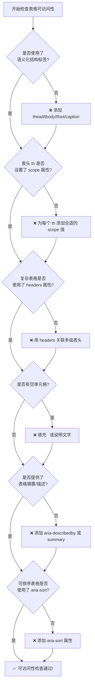
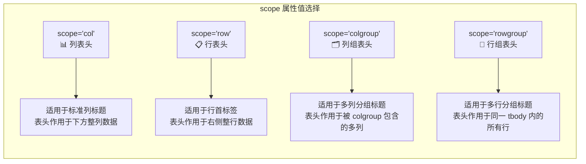

# 表格可访问性与最佳实践

> 本文为《06-表格》专题拆分系列第 3/3 篇（共 3 篇）。上一篇：[表格高级样式与交互](/docs/html5/01-基础知识/06-表格-2-高级样式与交互) ｜ 第一篇：[表格基础与语义化](/docs/html5/01-基础知识/06-表格-1-表格基础与语义化)。

## 表格打印优化

<h4>040-table-print-optimization.html</h4>

```html
<!-- 来源：6-表格.md - 表格打印优化 -->
<!DOCTYPE html>
<html lang="zh-CN">
<head>
  <meta charset="UTF-8">
  <meta name="viewport" content="width=device-width, initial-scale=1.0">
  <title>表格打印优化</title>
  <style>
    /* ========== 屏幕显示样式 ========== */

    * { margin: 0; padding: 0; box-sizing: border-box; }

    body {
      font-family: -apple-system, BlinkMacSystemFont, "Segoe UI", sans-serif;
      line-height: 1.6;
      color: #333;
      background: #f5f7fa;
      padding: 40px 20px;
    }

    .container { max-width: 900px; margin: 0 auto; }

    h1 { text-align: center; color: #222; margin-bottom: 8px; font-size: 32px; }
    .subtitle { text-align: center; color: #666; margin-bottom: 24px; font-size: 15px; }

    /* 打印按钮 */
    .print-actions {
      display: flex;
      justify-content: center;
      gap: 16px;
      margin-bottom: 24px;
    }

    .btn-print {
      padding: 12px 28px;
      background: linear-gradient(135deg, #0066cc, #0052a3);
      color: white;
      border: none;
      border-radius: 10px;
      font-size: 16px;
      font-weight: 600;
      cursor: pointer;
      transition: all 0.3s;
      box-shadow: 0 4px 14px rgba(0,102,204,0.3);
    }
    .btn-print:hover {
      transform: translateY(-2px);
      box-shadow: 0 6px 20px rgba(0,102,204,0.4);
    }

    /* 表格样式 */
    table {
      border-collapse: collapse;
      width: 100%;
      background: white;
      box-shadow: 0 4px 16px rgba(0,0,0,0.08);
      border-radius: 12px;
      overflow: hidden;
    }

    caption {
      font-size: 22px;
      font-weight: 700;
      padding: 24px 16px 16px;
      text-align: center;
    }

    th, td {
      border: 1px solid #d0d5dd;
      padding: 13px 14px;
      font-size: 14px;
      text-align: left;
    }

    th {
      background: linear-gradient(135deg, #333, #555);
      color: white;
      font-weight: 600;
      letter-spacing: 0.3px;
    }

    /* 斑马纹 */
    tbody tr:nth-child(even) td { background-color: #fafbfc; }
    tbody tr:hover td { background-color: #e8f4fd !important; }

    tfoot {
      background: #f8f9fa;
      font-weight: 600;
    }

    tfoot td {
      border-top: 2px solid #ccc;
    }

    /* 页脚信息 */
    .print-footer-info {
      margin-top: 30px;
      padding: 20px;
      background: white;
      border-radius: 10px;
      box-shadow: 0 2px 8px rgba(0,0,0,0.06);
    }

    .print-footer-info h3 { color: #333; margin-bottom: 12px; font-size: 17px; }
    .print-footer-info ul { list-style: none; font-size: 14px; color: #666; line-height: 1.9; }
    .print-footer-info li { padding-left: 20px; position: relative; }
    .print-footer-info li::before { content: "🖨️"; position: absolute; left: 0; }


    /* ========== 打印专用样式 (@media print) ========== */

    @media print {

      /* 隐藏不需要打印的元素 */
      body {
        background: white !important;
        padding: 0 !important;
        margin: 0 !important;
        color: black !important;
        -webkit-print-color-adjust: exact;
        print-color-adjust: exact;
      }

      .container { max-width: 100% !important; margin: 0 !important; padding: 0 !important; }

      h1, .subtitle, .print-actions, .print-footer-info {
        display: none !important;
      }

      table {
        box-shadow: none !important;
        border-radius: 0 !important;
        page-break-inside: avoid;
        font-size: 11pt;
      }

      caption {
        font-size: 18pt;
        padding: 15pt 10pt 10pt;
        text-align: center;
        font-weight: bold;
      }

      th, td {
        border: 1pt solid #999 !important;
        padding: 7pt 9pt !important;
        font-size: 10pt;
        vertical-align: middle;
      }

      th {
        background: #333 !important;
        color: white !important;
        -webkit-print-color-adjust: exact;
        print-color-adjust: exact;
      }

      tbody tr:nth-child(even) td {
        background-color: #f5f5f5 !important;
        -webkit-print-color-adjust: exact;
        print-color-adjust: exact;
      }

      tbody tr:hover td {
        background: transparent !important;
      }

      tfoot {
        background: #eee !important;
        -webkit-print-color-adjust: exact;
        print-color-adjust: exact;
      }

      /* 每页重复表头 */
      thead {
        display: table-header-group;
      }

      /* 每页重复表脚 */
      tfoot {
        display: table-footer-group;
      }

      /* 避免行被分页截断 */
      tr {
        page-break-inside: avoid;
      }

      /* 分页控制 */
      @page {
        size: A4 landscape;
        margin: 15mm 10mm;
      }

      @page :first {
        margin-top: 10mm;
      }

      /* 打印页眉页脚（CSS Paged Media 边距盒语法）
         ⚠️ @top-center/@bottom-center 与 counter(pages) 目前浏览器不支持，
         仅 Paged.js、Prince 等打印排版引擎实现；浏览器打印预览的页眉页脚由打印设置控制。
         浏览器中可用的替代方案见下方 .page-header/.page-footer 固定定位写法 */
      @page {
        @top-center { content: "2024年Q2销售报表 — 机密文件"; font-size: 9pt; color: #888; }
        @bottom-center { content: "第 " counter(page) " 页 / 共 " counter(pages) " 页"; font-size: 9pt; color: #888; }
      }
    }
  </style>
</head>
<body>

  <div class="container">
    <h1>🖨️ 表格打印优化</h1>
    <p class="subtitle">@media print + @page — 专业级打印输出效果</p>


    <!-- 打印操作按钮 -->
    <div class="print-actions">
      <button class="btn-print" onclick="window.print()">
        🖨️ 打印此表格
      </button>
    </div>


    <!-- 数据表格 -->
    <table id="printTable">
      <caption>📊 2024 年第二季度 (Q2) 销售数据汇总</caption>

      <thead>
        <tr>
          <th scope="col">区域</th>
          <th scope="col">产品线</th>
          <th scope="col">销售额 (万元)</th>
          <th scope="col">同比增长</th>
          <th scope="col">目标完成率</th>
          <th scope="col">客户数</th>
          <th scope="col">负责人</th>
        </tr>
      </thead>

      <tbody>
        <tr>
          <td><strong>华东区</strong></td>
          <td>企业软件</td>
          <td>¥ 2,850</td>
          <td style="color:#28a745;">↑ 23.5%</td>
          <td>118%</td>
          <td>156</td>
          <td>张三</td>
        </tr>
        <tr>
          <td></td>
          <td>云服务</td>
          <td>¥ 1,920</td>
          <td style="color:#28a745;">↑ 45.2%</td>
          <td>134%</td>
          <td>89</td>
          <td>张三</td>
        </tr>
        <tr>
          <td><strong>华南区</strong></td>
          <td>企业软件</td>
          <td>¥ 2,340</td>
          <td style="color:#28a745;">↑ 18.7%</td>
          <td>105%</td>
          <td>132</td>
          <td>李四</td>
        </tr>
        <tr>
          <td></td>
          <td>云服务</td>
          <td>¥ 1,650</td>
          <td style="color:#28a745;">↑ 38.9%</td>
          <td>112%</td>
          <td>67</td>
          <td>李四</td>
        </tr>
        <tr>
          <td><strong>华北区</strong></td>
          <td>企业软件</td>
          <td>¥ 1,980</td>
          <td style="color:#dc3545;">↓ 5.2%</td>
          <td>92%</td>
          <td>98</td>
          <td>王五</td>
        </tr>
        <tr>
          <td></td>
          <td>云服务</td>
          <td>¥ 1,420</td>
          <td style="color:#28a745;">↑ 29.3%</td>
          <td>101%</td>
          <td>54</td>
          <td>王五</td>
        </tr>
        <tr>
          <td><strong>西南区</strong></td>
          <td>企业软件</td>
          <td>¥ 1,250</td>
          <td style="color:#28a745;">↑ 31.4%</td>
          <td>125%</td>
          <td>76</td>
          <td>赵六</td>
        </tr>
        <tr>
          <td></td>
          <td>云服务</td>
          <td>¥ 890</td>
          <td style="color:#28a745;">↑ 52.1%</td>
          <td>148%</td>
          <td>43</td>
          <td>赵六</td>
        </tr>
      </tbody>

      <tfoot>
        <tr>
          <td colspan="2"><strong>Q2 总计</strong></td>
          <td><strong>¥ 14,300</strong></td>
          <td><strong style="color:#28a745;">↑ 26.8%</strong></td>
          <td><strong>114.3%</strong></td>
          <td><strong>715</strong></td>
          <td>—</td>
        </tr>
        <tr>
          <td colspan="7" style="text-align:center;font-size:12px;color:#888;">
            报表生成时间：2024-07-01 09:30 | 数据来源：CRM 系统 | 保密等级：内部公开
          </td>
        </tr>
      </tfoot>
    </table>


    <!-- 打印优化说明 -->
    <div class="print-footer-info">
      <h3>📋 已应用的打印优化技术</h3>
      <ul>
        <li><strong>@media print</strong>：隐藏按钮、标题等非必要元素，仅保留表格内容</li>
        <li><strong>@page { size: A4 landscape }</strong>：A4 纸横向打印，适合宽表格</li>
        <li><strong>thead { display: table-header-group }</strong>：每页自动重复表头</li>
        <li><strong>tfoot { display: table-footer-group }</strong>：每页自动重复表脚</li>
        <li><strong>tr { page-break-inside: avoid }</strong>：防止单行数据被分页截断</li>
        <li><strong>table { page-break-inside: avoid }</strong>：防止表格被分页拆开</li>
        <li><strong>print-color-adjust: exact</strong>：强制打印背景色和图片（默认浏览器会省略）</li>
        <li><strong>@top-center / @bottom-center</strong>：CSS Paged Media 的页眉/页脚边距盒，标准语法但<strong>浏览器目前不支持</strong>（仅 Paged.js/Prince 等打印引擎）；浏览器中请用固定定位的 .page-header/.page-footer 模拟</li>
      </ul>
    </div>

  </div>

</body>
</html>
```

### @media print 基础配置

打印表格时需要进行专门的样式优化，确保输出效果专业且易读：

```css
@media print {
  /* 隐藏不必要的页面元素 */
  body * {
    visibility: hidden;
  }

  /* 只显示表格及其容器 */
  .print-area,
  .print-area * {
    visibility: visible;
  }

  /* 打印专用表格样式 */
  table {
    border-collapse: collapse;
    width: 100%;
    font-size: 11pt; /* 打印时适当缩小字体 */
    line-height: 1.4;
  }

  th, td {
    border: 1pt solid #333; /* 使用 pt 单位更精确 */
    padding: 8pt;
    text-align: left;
  }

  /* 表头样式 */
  thead th {
    background-color: #333 !important;
    color: white !important;
    -webkit-print-color-adjust: exact; /* 强制打印背景色 */
    print-color-adjust: exact;
  }

  /* 斑马纹（打印友好） */
  tbody tr:nth-child(even) {
    background-color: #f5f5f5 !important;
    -webkit-print-color-adjust: exact;
    print-color-adjust: exact;
  }

  /* 移除悬停效果 */
  tbody tr:hover {
    background-color: transparent !important;
  }

  /* 分页控制 */
  tr {
    page-break-inside: avoid; /* 避免行内分页 */
  }

  thead {
    display: table-header-group; /* 每页重复表头 */
  }

  tfoot {
    display: table-footer-group; /* 每页重复页脚 */
  }

  /* 标题样式 */
  caption {
    font-size: 16pt;
    font-weight: bold;
    caption-side: top;
    padding-bottom: 10pt;
  }

  /* 页面设置 */
  @page {
    size: A4 landscape; /* 横向 A4 */
    margin: 1.5cm;
  }

  /* 第一页可以有不同边距 */
  @page :first {
    margin-top: 2cm;
  }
}
```

### 完整打印优化示例

```html
<!DOCTYPE html>
<html lang="zh-CN">
<head>
  <meta charset="UTF-8">
  <title>表格打印优化</title>
  <style>
    /* 屏幕显示样式 */
    .screen-only {
      display: block;
    }

    .print-only {
      display: none;
    }

    .data-table {
      border-collapse: collapse;
      width: 100%;
      margin: 20px 0;
    }

    .data-table th,
    .data-table td {
      border: 1px solid #ddd;
      padding: 12px;
      text-align: center;
    }

    .data-table th {
      background-color: #333;
      color: white;
    }

    /* 打印按钮 */
    .print-btn {
      padding: 10px 20px;
      background-color: #4CAF50;
      color: white;
      border: none;
      border-radius: 4px;
      cursor: pointer;
      font-size: 16px;
      margin: 20px 0;
    }

    .print-btn:hover {
      background-color: #45a049;
    }

    /* ====== 打印样式 ====== */
    @media print {
      /* 隐藏屏幕专用元素 */
      .screen-only {
        display: none !important;
      }

      /* 显示打印专用元素 */
      .print-only {
        display: block !important;
      }

      /* 页面重置 */
      body {
        margin: 0;
        padding: 0;
        font-family: "SimSun", "宋体", serif; /* 打印常用字体 */
      }

      /* 表格容器 */
      .print-area {
        width: 100%;
      }

      /* 表格样式 */
      .data-table {
        width: 100% !important;
        font-size: 10pt;
        border: 2pt solid #000;
      }

      .data-table th,
      .data-table td {
        border: 1pt solid #000 !important;
        padding: 6pt 8pt;
      }

      /* 强制打印背景色 */
      .data-table th {
        background-color: #333 !important;
        color: #fff !important;
        -webkit-print-color-adjust: exact !important;
        print-color-adjust: exact !important;
      }

      /* 重要行高亮 */
      .highlight-row {
        background-color: #ffffcc !important;
        -webkit-print-color-adjust: exact !important;
        print-color-adjust: exact !important;
        font-weight: bold;
      }

      /* 分页控制 */
      .data-table tr {
        page-break-inside: avoid;
      }

      .data-table thead {
        display: table-header-group;
      }

      .data-table tfoot {
        display: table-footer-group;
      }

      /* 避免孤行/寡行 */
      .data-table tbody tr:last-child {
        page-break-after: auto;
      }

      /* 页码显示 */
      .page-footer {
        position: fixed;
        bottom: 0;
        left: 0;
        right: 0;
        text-align: center;
        font-size: 9pt;
        color: #666;
        border-top: 1pt solid #ccc;
        padding-top: 5pt;
      }

      /* 打印页眉 */
      .page-header {
        position: fixed;
        top: 0;
        left: 0;
        right: 0;
        text-align: center;
        font-size: 9pt;
        color: #666;
        border-bottom: 1pt solid #ccc;
        padding-bottom: 5pt;
      }

      /* 页面设置（@bottom-center 边距盒浏览器不支持，仅打印排版引擎实现；
         浏览器中可用固定定位的页脚元素替代） */
      @page {
        size: A4 landscape;
        margin: 1.5cm 1cm;
        @bottom-center {
          content: "第 " counter(page) " 页 / 共 " counter(pages) " 页";
          font-size: 9pt;
        }
      }

      @page :first {
        margin-top: 2cm;
      }

      /* 隐藏链接URL */
      a[href]::after {
        content: none !important;
      }
    }
  </style>
</head>
<body>
  <!-- 屏幕显示的操作按钮 -->
  <div class="screen-only">
    <button class="print-btn" onclick="window.print()">🖨️ 打印表格</button>
  </div>

  <!-- 打印专用的页眉 -->
  <div class="print-only page-header">
    机密文件 · 内部使用 · 请勿外传
  </div>

  <div class="print-area">
    <table class="data-table">
      <caption>2024年第一季度销售报表</caption>
      <thead>
        <tr>
          <th>序号</th>
          <th>产品名称</th>
          <th>销售额（万元）</th>
          <th>同比增长</th>
          <th>占比</th>
          <th>备注</th>
        </tr>
      </thead>
      <tbody>
        <tr class="highlight-row">
          <td>1</td>
          <td>企业版 SaaS</td>
          <td>1,280</td>
          <td>+35.2%</td>
          <td>42%</td>
          <td>⭐ 明星产品</td>
        </tr>
        <tr>
          <td>2</td>
          <td>个人版订阅</td>
          <td>680</td>
          <td>+18.5%</td>
          <td>22%</td>
          <td></td>
        </tr>
        <tr>
          <td>3</td>
          <td>定制开发服务</td>
          <td>520</td>
          <td>+12.3%</td>
          <td>17%</td>
          <td></td>
        </tr>
        <tr>
          <td>4</td>
          <td>技术咨询</td>
          <td>350</td>
          <td>+8.7%</td>
          <td>11%</td>
          <td></td>
        </tr>
        <tr>
          <td>5</td>
          <td>培训服务</td>
          <td>230</td>
          <td>+22.1%</td>
          <td>8%</td>
          <td></td>
        </tr>
      </tbody>
      <tfoot>
        <tr>
          <td colspan="2"><strong>合计</strong></td>
          <td><strong>3,060</strong></td>
          <td><strong>+23.8%</strong></td>
          <td><strong>100%</strong></td>
          <td></td>
        </tr>
      </tfoot>
    </table>
  </div>

  <!-- 打印专用的页脚 -->
  <div class="print-only page-footer">
    报表生成时间：2024年04月01日 · 数据来源：ERP系统
  </div>
</body>
</html>
```

::: tip 打印优化技巧

1. **`@page` 规则**：控制纸张大小、方向、边距
2. **`display: table-header-group`**：让 `<thead>` 在每页重复显示
3. **`page-break-inside: avoid`**：避免行被分割到两页
4. **`print-color-adjust: exact`**：强制打印背景色（部分浏览器支持）
5. **使用 pt 单位**：打印时比 px 更精确
6. **测试打印**：使用浏览器的"打印预览"功能验证效果

:::

---

<a id="table-javascript"></a>

## JavaScript 操作 API

### DOM 接口

#### 获取表格元素

```javascript
// 通过选择器获取
const table = document.querySelector('table');
const rows = document.querySelectorAll('tr');
const cells = document.querySelectorAll('td');

// 通过 ID 获取
const tableById = document.getElementById('myTable');
```

#### 表格特有属性

```javascript
const table = document.querySelector('table');

// 获取所有行（HTMLCollection）
const rows = table.rows;
console.log(`总行数: ${rows.length}`);

// 获取表格头部（HTMLTableSectionElement）
const tHead = table.tHead;

// 获取表格主体集合（HTMLCollection）
const tBodies = table.tBodies;

// 获取表格页脚
const tFoot = table.tFoot;

// 获取标题元素
const caption = table.caption;
```

#### 行特有属性和方法

```javascript
const table = document.querySelector('table');
const row = table.rows[0];

// 获取行中的所有单元格
const cells = row.cells;
console.log(`该行单元格数: ${cells.length}`);

// 获取行索引
console.log(`行索引: ${row.rowIndex}`);

// 获取所在 tbody 中的索引
console.log(`Section 索引: ${row.sectionRowIndex}`);
```

#### 单元格特有属性

```javascript
const cell = document.querySelector('td');

// 获取单元格列索引
console.log(`列索引: ${cell.cellIndex}`);

// 获取/设置内容
cell.textContent = '新内容';
cell.innerHTML = '<strong>新内容</strong>';
```

### 动态创建表格

#### 创建表格结构

```javascript
// 创建表格
const table = document.createElement('table');
const caption = table.createCaption();
caption.textContent = '动态创建的表格';

// 创建表头
const thead = table.createTHead();
const headerRow = thead.insertRow();
['姓名', '年龄', '职业'].forEach(text => {
  const th = document.createElement('th');
  th.textContent = text;
  headerRow.appendChild(th);
});

// 创建表格主体
const tbody = table.createTBody();
const data = [
  { name: '张三', age: 25, job: '工程师' },
  { name: '李四', age: 30, job: '设计师' }
];

data.forEach(item => {
  const row = tbody.insertRow();
  Object.values(item).forEach(value => {
    const cell = row.insertCell();
    cell.textContent = value;
  });
});

// 创建表格页脚
const tfoot = table.createTFoot();
const footerRow = tfoot.insertRow();
const footerCell = footerRow.insertCell();
footerCell.colSpan = 3;
footerCell.textContent = '这是页脚';

// 添加到页面
document.body.appendChild(table);
```

#### 动态添加/删除行

```javascript
const table = document.querySelector('table');
const tbody = table.tBodies[0];

// 在末尾添加行
const newRow = tbody.insertRow(); // insertRow(-1) 也是末尾
newRow.insertCell().textContent = '新姓名';
newRow.insertCell().textContent = '新年龄';
newRow.insertCell().textContent = '新职业';

// 在指定位置插入行
const rowAtIndex = tbody.insertRow(0); // 在第一行位置插入

// 删除行
tbody.deleteRow(0); // 删除第一行
```

#### 动态添加/删除单元格

```javascript
const row = document.querySelector('tr');

// 在末尾添加单元格
const newCell = row.insertCell();
newCell.textContent = '新单元格';

// 在指定位置插入单元格
const cellAtIndex = row.insertCell(0); // 在第一个位置插入

// 删除单元格
row.deleteCell(0); // 删除第一个单元格
```

### 表格排序实现

```javascript
function sortTable(table, columnIndex, ascending = true) {
  const tbody = table.tBodies[0];
  const rows = Array.from(tbody.rows);
  
  rows.sort((a, b) => {
    const aText = a.cells[columnIndex].textContent.trim();
    const bText = b.cells[columnIndex].textContent.trim();
    
    // 尝试数字排序
    const aNum = parseFloat(aText);
    const bNum = parseFloat(bText);
    
    if (!isNaN(aNum) && !isNaN(bNum)) {
      return ascending ? aNum - bNum : bNum - aNum;
    }
    
    // 字符串排序
    return ascending 
      ? aText.localeCompare(bText, 'zh-CN')
      : bText.localeCompare(aText, 'zh-CN');
  });
  
  // 重新插入排序后的行
  rows.forEach(row => tbody.appendChild(row));
}

// 使用示例
const table = document.querySelector('table');
sortTable(table, 1, true); // 按第2列升序排序
```

### 表格筛选实现

```javascript
function filterTable(table, columnIndex, keyword) {
  const tbody = table.tBodies[0];
  const rows = tbody.rows;
  const lowerKeyword = keyword.toLowerCase();
  
  for (let row of rows) {
    const cellText = row.cells[columnIndex].textContent.toLowerCase();
    row.style.display = cellText.includes(lowerKeyword) ? '' : 'none';
  }
}

// 使用示例
const table = document.querySelector('table');
filterTable(table, 0, '张'); // 筛选第1列包含"张"的行
```

### 表格数据导出

#### 导出为 CSV

```javascript
function exportTableToCSV(table, filename = 'data.csv') {
  const rows = table.querySelectorAll('tr');
  const csv = [];
  
  rows.forEach(row => {
    const cols = row.querySelectorAll('td, th');
    const rowData = Array.from(cols).map(cell => {
      // 处理包含逗号或引号的内容
      let text = cell.textContent.replace(/"/g, '""');
      if (text.includes(',') || text.includes('"') || text.includes('\n')) {
        text = `"${text}"`;
      }
      return text;
    });
    csv.push(rowData.join(','));
  });
  
  const csvContent = csv.join('\n');
  const BOM = '\uFEFF'; // UTF-8 BOM，确保中文正常显示
  const blob = new Blob([BOM + csvContent], { type: 'text/csv;charset=utf-8;' });
  const link = document.createElement('a');
  link.href = URL.createObjectURL(blob);
  link.download = filename;
  link.click();
}

// 使用示例
exportTableToCSV(document.querySelector('table'), '学生成绩.csv');
```

---

<a id="virtual-scroll-worker"></a>

## 大数据量表格渲染

### 虚拟滚动 + Web Worker 完整实现

当表格数据量达到万行级别时，直接渲染所有 DOM 节点会导致严重的性能问题。虚拟滚动（Virtual Scrolling）结合 Web Worker 可以有效解决这一问题：

```html
<!DOCTYPE html>
<html lang="zh-CN">
<head>
  <meta charset="UTF-8">
  <title>大数据量表格 - 虚拟滚动 + Web Worker</title>
  <style>
    .virtual-table-container {
      width: 100%;
      height: 600px;
      overflow: auto;
      position: relative;
      border: 1px solid #ddd;
    }

    .virtual-table {
      border-collapse: collapse;
      width: 100%;
      table-layout: fixed;
    }

    .virtual-table th {
      position: sticky;
      top: 0;
      background-color: #333;
      color: white;
      padding: 12px;
      text-align: left;
      z-index: 10;
      border: 1px solid #444;
    }

    .virtual-table td {
      padding: 10px 12px;
      border-bottom: 1px solid #eee;
      white-space: nowrap;
      overflow: hidden;
      text-overflow: ellipsis;
      height: 44px; /* 固定行高 */
      box-sizing: border-box;
    }

    .virtual-table tbody tr {
      contain: strict; /* CSS Containment 优化 */
    }

    .virtual-table tbody tr:hover {
      background-color: #f5f5f5;
    }

    /* 加载状态 */
    .loading-overlay {
      position: absolute;
      top: 0;
      left: 0;
      right: 0;
      bottom: 0;
      background: rgba(255,255,255,0.8);
      display: flex;
      align-items: center;
      justify-content: center;
      z-index: 100;
    }

    .spinner {
      width: 40px;
      height: 40px;
      border: 4px solid #f3f3f3;
      border-top: 4px solid #3498db;
      border-radius: 50%;
      animation: spin 1s linear infinite;
    }

    @keyframes spin {
      0% { transform: rotate(0deg); }
      100% { transform: rotate(360deg); }
    }

    /* 统计信息栏 */
    .stats-bar {
      padding: 10px 15px;
      background-color: #f8f9fa;
      border: 1px solid #ddd;
      border-top: none;
      display: flex;
      justify-content: space-between;
      font-size: 14px;
      color: #666;
    }

    /* 搜索筛选栏 */
    .filter-bar {
      padding: 15px;
      background-color: #f8f9fa;
      border: 1px solid #ddd;
      border-bottom: none;
      display: flex;
      gap: 15px;
      flex-wrap: wrap;
    }

    .filter-bar input,
    .filter-bar select {
      padding: 8px 12px;
      border: 1px solid #ddd;
      border-radius: 4px;
      font-size: 14px;
    }

    .filter-bar input {
      width: 250px;
    }
  </style>
</head>
<body>
  <div class="filter-bar">
    <input type="text" id="searchInput" placeholder="🔍 搜索关键字...">
    <select id="columnFilter">
      <option value="-1">所有列</option>
      <option value="0">ID</option>
      <option value="1">名称</option>
      <option value="2">分类</option>
      <option value="3">价格</option>
    </select>
    <span id="resultCount" style="line-height: 36px; color: #666;"></span>
  </div>

  <div class="virtual-table-container" id="tableContainer">
    <div class="loading-overlay" id="loadingOverlay">
      <div class="spinner"></div>
      <span style="margin-left: 15px;">正在加载数据...</span>
    </div>
    
    <table class="virtual-table" id="virtualTable">
      <thead>
        <tr>
          <th style="width: 80px;">ID</th>
          <th style="width: 200px;">产品名称</th>
          <th style="width: 120px;">分类</th>
          <th style="width: 120px;">价格</th>
          <th style="width: 150px;">库存</th>
          <th style="width: 140px;">更新时间</th>
        </tr>
      </thead>
      <tbody id="tableBody"></tbody>
    </table>
  </div>

  <div class="stats-bar">
    <span id="visibleInfo"></span>
    <span id="performanceInfo"></span>
  </div>

  <script>
    // ========== Web Worker 代码（内联创建）==========
    const workerCode = `
      // Web Worker：负责数据处理和筛选
      self.onmessage = function(e) {
        const { type, data } = e.data;
        
        switch(type) {
          case 'FILTER':
            const filtered = filterData(data.allData, data.keyword, data.columnIndex);
            self.postMessage({ type: 'FILTER_RESULT', data: filtered });
            break;
            
          case 'SORT':
            const sorted = sortData(data.array, data.columnIndex, data.ascending);
            self.postMessage({ type: 'SORT_RESULT', data: sorted });
            break;
            
          case 'GENERATE':
            const generated = generateMockData(data.count);
            self.postMessage({ type: 'GENERATE_RESULT', data: generated });
            break;
        }
      };
      
      function filterData(data, keyword, columnIndex) {
        if (!keyword) return data;
        const lowerKeyword = keyword.toLowerCase();
        return data.filter(item => {
          if (columnIndex === -1) {
            // 搜索所有字段
            return Object.values(item).some(val => 
              String(val).toLowerCase().includes(lowerKeyword)
            );
          }
          const keys = Object.keys(item);
          const key = keys[columnIndex];
          return String(item[key]).toLowerCase().includes(lowerKeyword);
        });
      }
      
      function sortData(array, columnIndex, ascending) {
        return [...array].sort((a, b) => {
          const keys = Object.keys(a);
          const key = keys[columnIndex];
          const valA = a[key];
          const valB = b[key];
          
          const numA = parseFloat(valA);
          const numB = parseFloat(valB);
          
          if (!isNaN(numA) && !isNaN(numB)) {
            return ascending ? numA - numB : numB - numA;
          }
          
          return ascending 
            ? String(valA).localeCompare(String(valB), 'zh-CN')
            : String(valB).localeCompare(String(valA), 'zh-CN');
        });
      }
      
      function generateMockData(count) {
        const categories = ['电子产品', '服装', '食品', '家居', '图书'];
        const result = [];
        
        for (let i = 1; i <= count; i++) {
          result.push({
            id: i,
            name: \`产品-\${i}-\${Math.random().toString(36).substring(2, 8)}\`,
            category: categories[Math.floor(Math.random() * categories.length)],
            price: (Math.random() * 10000 + 100).toFixed(2),
            stock: Math.floor(Math.random() * 10000),
            updateTime: \`2024-\${String(Math.floor(Math.random() * 12) + 1).padStart(2, '0')}-\${String(Math.floor(Math.random() * 28) + 1).padStart(2, '0')}\`
          });
        }
        
        return result;
      }
    `;

    // 创建 Blob URL 用于 Worker
    const workerBlob = new Blob([workerCode], { type: 'application/javascript' });
    const workerUrl = URL.createObjectURL(workerBlob);
    const dataWorker = new Worker(workerUrl);

    // ========== 主线程代码 ==========
    class HighPerformanceVirtualTable {
      constructor(options) {
        this.container = options.container;
        this.tbody = options.tbody;
        this.rowHeight = options.rowHeight || 44;
        this.bufferSize = options.bufferSize || 5; // 上下缓冲行数
        
        this.allData = [];
        this.filteredData = [];
        this.scrollTop = 0;
        
        this.isProcessing = false;
        this.renderTimer = null;
        
        this.init();
      }

      init() {
        // 生成大量测试数据
        this.generateLargeDataset(100000); // 10万条数据
        
        // 绑定滚动事件（使用 requestAnimationFrame 优化）
        this.container.addEventListener('scroll', () => {
          if (this.renderTimer) cancelAnimationFrame(this.renderTimer);
          this.renderTimer = requestAnimationFrame(() => this.handleScroll());
        });

        // 监听 Worker 返回的消息
        dataWorker.onmessage = (e) => this.handleWorkerMessage(e.data);
      }

      generateLargeDataset(count) {
        // 通过 Worker 异步生成数据
        dataWorker.postMessage({ type: 'GENERATE', data: { count } });
      }

      handleWorkerMessage(message) {
        switch(message.type) {
          case 'GENERATE_RESULT':
            this.allData = message.data;
            this.filteredData = [...this.allData];
            this.hideLoading();
            this.render();
            this.updateStats();
            break;
            
          case 'FILTER_RESULT':
            this.filteredData = message.data;
            this.render();
            this.updateStats();
            this.isProcessing = false;
            break;
            
          case 'SORT_RESULT':
            this.filteredData = message.data;
            this.render();
            this.isProcessing = false;
            break;
        }
      }

      hideLoading() {
        document.getElementById('loadingOverlay').style.display = 'none';
      }

      handleScroll() {
        this.scrollTop = this.container.scrollTop;
        this.render();
      }

      render() {
        const startTime = performance.now();
        
        const visibleHeight = this.container.clientHeight;
        const totalHeight = this.filteredData.length * this.rowHeight;
        
        // 设置 tbody 总高度（撑开滚动条）
        this.tbody.style.height = \`\${totalHeight}px\`;
        this.tbody.style.position = 'relative';
        
        // 计算可见范围
        const startIndex = Math.max(0, Math.floor(this.scrollTop / this.rowHeight) - this.bufferSize);
        const endIndex = Math.min(
          this.filteredData.length,
          startIndex + Math.ceil(visibleHeight / this.rowHeight) + this.bufferSize * 2
        );
        
        // 使用 DocumentFragment 批量更新 DOM
        const fragment = document.createDocumentFragment();
        
        for (let i = startIndex; i < endIndex; i++) {
          const item = this.filteredData[i];
          const row = document.createElement('tr');
          row.style.position = 'absolute';
          row.style.top = \`\${i * this.rowHeight}px\`;
          row.style.left = '0';
          row.style.right = '0';
          row.style.contain = 'strict'; // 性能优化关键！
          
          row.innerHTML = \`
            <td>\${item.id}</td>
            <td>\${item.name}</td>
            <td>\${item.category}</td>
            <td>¥\${Number(item.price).toLocaleString()}</td>
            <td>\${Number(item.stock).toLocaleString()}</td>
            <td>\${item.updateTime}</td>
          \`;
          
          fragment.appendChild(row);
        }
        
        // 一次性更新 DOM
        this.tbody.innerHTML = '';
        this.tbody.appendChild(fragment);
        
        // 更新可见信息
        const endTime = performance.now();
        document.getElementById('visibleInfo').textContent = 
          \`显示: \${startIndex + 1} - \${endIndex} 条 / 共 \${this.filteredData.length.toLocaleString()} 条\`;
        document.getElementById('performanceInfo').textContent = 
          \`渲染耗时: \${(endTime - startTime).toFixed(2)}ms\`;
      }

      updateStats() {
        document.getElementById('resultCount').textContent = 
          \`共 \${this.allData.length.toLocaleString()} 条数据\`;
      }

      // 搜索过滤（委托给 Worker）
      search(keyword, columnIndex = -1) {
        if (this.isProcessing) return;
        this.isProcessing = true;
        
        dataWorker.postMessage({
          type: 'FILTER',
          data: {
            allData: this.allData,
            keyword,
            columnIndex
          }
        });
      }

      destroy() {
        dataWorker.terminate();
        URL.revokeObjectURL(workerUrl);
      }
    }

    // ========== 初始化 ==========
    const virtualTable = new HighPerformanceVirtualTable({
      container: document.getElementById('tableContainer'),
      tbody: document.getElementById('tableBody'),
      rowHeight: 44,
      bufferSize: 10
    });

    // 搜索功能绑定
    let searchTimeout;
    document.getElementById('searchInput').addEventListener('input', (e) => {
      clearTimeout(searchTimeout);
      searchTimeout = setTimeout(() => {
        const keyword = e.target.value.trim();
        const columnIdx = parseInt(document.getElementById('columnFilter').value);
        virtualTable.search(keyword, columnIdx);
      }, 300); // 300ms 防抖
    });
  </script>
</body>
</html>
```

::: warning 大数据量表格注意事项

1. **CSS Containment**：使用 `contain: strict` 或 `contain: content` 告诉浏览器元素的隔离性，大幅减少布局计算范围
2. **Web Worker**：将数据筛选、排序等 CPU 密集型操作放到 Worker 线程，避免阻塞主线程 UI
3. **requestAnimationFrame**：替代直接的 scroll 事件处理，避免过度渲染
4. **DocumentFragment**：批量 DOM 操作，减少重排次数
5. **防抖（Debounce）**：搜索输入等高频事件需要防抖处理
6. **内存管理**：大数据集注意内存占用，必要时使用 IndexedDB 或分页加载

:::

---

<a id="table-a11y"></a>

## 可访问性指南

### 可访问性检查清单流程图



### scope 属性值选择指南



### 核心原则

1. **使用语义化标签**：`<thead>`、`<tbody>`、`<tfoot>`、`<th>`
2. **提供标题**：始终使用 `<caption>`
3. **关联表头**：使用 `scope` 或 `headers` 属性
4. **避免空单元格**：空单元格使用 `&nbsp;` 或描述性文本

### scope 属性

**作用**：明确表头与数据单元格的关系，帮助屏幕阅读器用户理解表格结构。

| 值 | 说明 | 适用场景 |
|---|------|----------|
| `col` | 列表头 | 标准表头 |
| `row` | 行表头 | 行首标签 |
| `colgroup` | 列组表头 | 多列分组 |
| `rowgroup` | 行组表头 | 多行分组 |

```html
<!-- 标准列表头 -->
<table>
  <thead>
    <tr>
      <th scope="col">姓名</th>
      <th scope="col">年龄</th>
      <th scope="col">职业</th>
    </tr>
  </thead>
  <tbody>
    <tr>
      <td>张三</td>
      <td>25</td>
      <td>工程师</td>
    </tr>
  </tbody>
</table>

<!-- 行表头 -->
<table>
  <thead>
    <tr>
      <th scope="col">项目</th>
      <th scope="col">Q1</th>
      <th scope="col">Q2</th>
    </tr>
  </thead>
  <tbody>
    <tr>
      <th scope="row">销售额</th>
      <td>100万</td>
      <td>120万</td>
    </tr>
    <tr>
      <th scope="row">利润</th>
      <td>20万</td>
      <td>25万</td>
    </tr>
  </tbody>
</table>
```

### headers 属性

**作用**：在复杂表格中，精确关联单元格与多个表头。

```html
<table>
  <thead>
    <tr>
      <th id="name" rowspan="2">姓名</th>
      <th id="semester1" colspan="2">第一学期</th>
      <th id="semester2" colspan="2">第二学期</th>
    </tr>
    <tr>
      <th id="mid1">期中</th>
      <th id="final1">期末</th>
      <th id="mid2">期中</th>
      <th id="final2">期末</th>
    </tr>
  </thead>
  <tbody>
    <tr>
      <th id="zhang" headers="name">张三</th>
      <td headers="zhang semester1 mid1">85</td>
      <td headers="zhang semester1 final1">90</td>
      <td headers="zhang semester2 mid2">88</td>
      <td headers="zhang semester2 final2">92</td>
    </tr>
  </tbody>
</table>
```

### ARIA 属性增强

```html
<!-- 为表格添加角色标签 -->
<table role="table" aria-label="产品销售数据统计表">
  <caption>2023年销售数据</caption>
  <!-- 表格内容 -->
</table>

<!-- 为表格添加详细描述 -->
<table aria-describedby="table-description">
  <caption>销售数据</caption>
  <!-- 表格内容 -->
</table>
<div id="table-description" class="sr-only">
  此表格展示了2023年各产品的销售额、销售量和增长率数据。
</div>

<!-- 可排序表格 -->
<table>
  <thead>
    <tr>
      <th scope="col" aria-sort="ascending">
        姓名
        <button aria-label="按姓名降序排列">↓</button>
      </th>
      <th scope="col" aria-sort="none">
        分数
        <button aria-label="按分数升序排列">↑</button>
      </th>
    </tr>
  </thead>
  <!-- 表格内容 -->
</table>
```

### 可访问性最佳实践

```html
<!-- ✅ 推荐：完整的可访问性实现 -->
<table>
  <caption>
    <strong>学生成绩表</strong>
    <span class="sr-only">包含姓名、数学、英语、物理四列数据</span>
  </caption>
  <thead>
    <tr>
      <th scope="col">姓名</th>
      <th scope="col">数学</th>
      <th scope="col">英语</th>
      <th scope="col">物理</th>
    </tr>
  </thead>
  <tbody>
    <tr>
      <th scope="row">张三</th>
      <td>85</td>
      <td>92</td>
      <td>78</td>
    </tr>
  </tbody>
</table>

<!-- ❌ 避免：缺少可访问性属性 -->
<table>
  <tr>
    <td>姓名</td>
    <td>数学</td>
    <td>英语</td>
  </tr>
  <tr>
    <td>张三</td>
    <td>85</td>
    <td>92</td>
  </tr>
</table>
```

---

<a id="table-performance"></a>

## 性能优化建议

### 1. 使用固定表格布局

```css
table {
  table-layout: fixed;
  width: 100%;
}
```

**优势**：
- 浏览器只需读取第一行即可确定列宽
- 渲染速度比 `auto` 布局快
- 适合大数据量表格

### 2. 避免深层嵌套

```html
<!-- ❌ 避免：深层嵌套 -->
<table>
  <tr>
    <td>
      <table>
        <tr>
          <td>
            <table>...</table>
          </td>
        </tr>
      </table>
    </td>
  </tr>
</table>

<!-- ✅ 推荐：扁平结构或使用其他布局方式 -->
<div class="grid-container">
  <!-- 使用 CSS Grid -->
</div>
```

### 3. 虚拟滚动（大数据量）

```javascript
// 仅渲染可视区域的行
class VirtualTable {
  constructor(container, data, rowHeight = 40) {
    this.container = container;
    this.data = data;
    this.rowHeight = rowHeight;
    this.visibleRows = Math.ceil(container.clientHeight / rowHeight);
    
    this.init();
  }
  
  init() {
    // 创建表格外壳
    this.table = document.createElement('table');
    this.tbody = document.createElement('tbody');
    this.table.appendChild(this.tbody);
    
    // 设置总高度（用于滚动条）
    const totalHeight = this.data.length * this.rowHeight;
    this.table.style.height = `${totalHeight}px`;
    
    this.container.appendChild(this.table);
    this.render();
    
    // 监听滚动
    this.container.addEventListener('scroll', () => this.render());
  }
  
  render() {
    const scrollTop = this.container.scrollTop;
    const startIndex = Math.floor(scrollTop / this.rowHeight);
    const endIndex = Math.min(startIndex + this.visibleRows + 5, this.data.length);
    
    // 清空现有内容
    this.tbody.innerHTML = '';
    
    // 渲染可见行
    for (let i = startIndex; i < endIndex; i++) {
      const row = this.createRow(this.data[i], i);
      row.style.transform = `translateY(${i * this.rowHeight}px)`;
      this.tbody.appendChild(row);
    }
  }
  
  createRow(data, index) {
    const row = document.createElement('tr');
    Object.values(data).forEach(value => {
      const cell = document.createElement('td');
      cell.textContent = value;
      row.appendChild(cell);
    });
    return row;
  }
}
```

### 4. 延迟加载图片

```html
<table>
  <tbody>
    <tr>
      <td>产品A</td>
      <td></td>
    </tr>
  </tbody>
</table>
```

### 5. 减少重排重绘

```javascript
// ❌ 避免：频繁操作 DOM
const tbody = document.querySelector('tbody');
data.forEach(item => {
  const row = tbody.insertRow();
  row.insertCell().textContent = item.name;
});

// ✅ 推荐：批量更新
const tbody = document.querySelector('tbody');
const fragment = document.createDocumentFragment();
data.forEach(item => {
  const row = document.createElement('tr');
  const cell = document.createElement('td');
  cell.textContent = item.name;
  row.appendChild(cell);
  fragment.appendChild(row);
});
tbody.appendChild(fragment);
```

### 6. 使用 CSS Containment

```css
.table-row {
  contain: content;
}
```

**作用**：告诉浏览器该元素的样式不会影响外部元素，优化渲染性能。

---

<a id="best-practices"></a>

## 最佳实践

### 1. 结构完整性

```html
<!-- ✅ 推荐：完整的语义化结构 -->
<table>
  <caption>表格标题</caption>
  <thead>
    <tr>
      <th scope="col">列标题</th>
    </tr>
  </thead>
  <tbody>
    <tr>
      <td>数据</td>
    </tr>
  </tbody>
  <tfoot>
    <tr>
      <td>汇总</td>
    </tr>
  </tfoot>
</table>
```

### 2. 样式分离

```html
<!-- ❌ 避免：内联样式 -->
<table border="1" cellpadding="10" bgcolor="#f0f0f0">

<!-- ✅ 推荐：CSS 类 -->
<table class="data-table">
```

```css
.data-table {
  border-collapse: collapse;
}

.data-table th,
.data-table td {
  border: 1px solid #ddd;
  padding: 10px;
}
```

### 3. 响应式设计

```html
<div class="table-responsive">
  <table>
    <!-- 表格内容 -->
  </table>
</div>
```

```css
.table-responsive {
  overflow-x: auto;
  -webkit-overflow-scrolling: touch;
}
```

### 4. 可访问性清单

- [ ] 添加 `<caption>` 标题
- [ ] 使用 `<thead>`、`<tbody>`、`<tfoot>` 结构
- [ ] 为 `<th>` 添加 `scope` 属性
- [ ] 复杂表格使用 `headers` 属性
- [ ] 避免空单元格，使用 `&nbsp;` 或说明文字
- [ ] 提供表格说明（`aria-describedby` 或 `<caption>` 补充描述）

### 5. 性能优化清单

- [ ] 使用 `table-layout: fixed`
- [ ] 避免表格嵌套
- [ ] 大数据量使用虚拟滚动
- [ ] 图片使用懒加载
- [ ] 批量操作 DOM

### 6. 代码组织示例

```html
<!DOCTYPE html>
<html lang="zh-CN">
<head>
  <meta charset="UTF-8">
  <meta name="viewport" content="width=device-width, initial-scale=1.0">
  <title>最佳实践示例</title>
  <style>
    /* 基础样式 */
    .data-table {
      border-collapse: collapse;
      width: 100%;
      margin: 20px 0;
    }
    
    .data-table th,
    .data-table td {
      border: 1px solid #ddd;
      padding: 12px;
      text-align: left;
    }
    
    .data-table th {
      background-color: #f2f2f2;
      font-weight: bold;
    }
    
    /* 斑马纹 */
    .data-table tbody tr:nth-child(even) {
      background-color: #f9f9f9;
    }
    
    /* 响应式 */
    .table-responsive {
      overflow-x: auto;
      -webkit-overflow-scrolling: touch;
    }
    
    /* 屏幕阅读器专用 */
    .sr-only {
      position: absolute;
      width: 1px;
      height: 1px;
      padding: 0;
      margin: -1px;
      overflow: hidden;
      clip: rect(0, 0, 0, 0);
      white-space: nowrap;
      border: 0;
    }
  </style>
</head>
<body>
  <div class="table-responsive">
    <table class="data-table">
      <caption>
        <strong>学生成绩统计表</strong>
        <span class="sr-only">包含学生姓名、数学成绩、英语成绩三列</span>
      </caption>
      <thead>
        <tr>
          <th scope="col">姓名</th>
          <th scope="col">数学</th>
          <th scope="col">英语</th>
        </tr>
      </thead>
      <tbody>
        <tr>
          <th scope="row">张三</th>
          <td>85</td>
          <td>92</td>
        </tr>
        <tr>
          <th scope="row">李四</th>
          <td>76</td>
          <td>88</td>
        </tr>
      </tbody>
      <tfoot>
        <tr>
          <td colspan="3">平均分：数学 80.5，英语 90</td>
        </tr>
      </tfoot>
    </table>
  </div>
</body>
</html>
```

---

<a id="table-faq"></a>

## 常见问题排查

### 问题 1：表格边框不显示

**原因**：默认情况下表格没有边框。

**解决方案**：

```css
table {
  border-collapse: collapse;
}

th, td {
  border: 1px solid #ddd;
}
```

### 问题 2：单元格间距过大

**原因**：`border-spacing` 或遗留的 `cellspacing` 属性。

**解决方案**：

```css
table {
  border-collapse: collapse;
  /* 或 */
  border-spacing: 0;
}
```

### 问题 3：表格宽度超出容器

**原因**：表格内容过宽或未设置响应式。

**解决方案**：

```html
<div style="overflow-x: auto;">
  <table style="min-width: 600px;">
    <!-- 表格内容 -->
  </table>
</div>
```

### 问题 4：合并单元格后布局错乱

**原因**：`colspan` 或 `rowspan` 计算错误。

**排查方法**：
1. 确保每行的总列数一致
2. 使用调试工具检查单元格位置
3. 逐步添加合并，检查效果

```html
<!-- 正确示例 -->
<table>
  <tr>
    <td colspan="2">合并2列</td>
    <td>普通单元格</td>
  </tr>
  <tr>
    <td>单元格1</td>
    <td>单元格2</td>
    <td>单元格3</td>
  </tr>
</table>
```

### 问题 5：表头与数据不对齐

**原因**：表头和数据单元格宽度不一致。

**解决方案**：

```css
table {
  table-layout: fixed;
  width: 100%;
}

th, td {
  width: 25%; /* 每列占 25% */
}
```

### 问题 6：移动端表格显示不佳

**解决方案**：参考 [响应式表格设计](/docs/html5/01-基础知识/06-表格-2-高级样式与交互#table-responsive) 章节。

### 问题 7：表格在 Safari 中 sticky 定位失效

**原因**：Safari 对 `position: sticky` 在表格元素上的实现存在兼容性问题。

**解决方案**：

```css
/* 方案一：使用 wrapper 容器包裹 */
.sticky-wrapper {
  position: relative;
}

/* 方案二：为 Safari 添加 -webkit- 前缀 */
th {
  position: -webkit-sticky;
  position: sticky;
  top: 0;
  z-index: 10;
}

/* 方案三：使用 JavaScript polyfill 作为降级方案 */
if (!CSS.supports('position', 'sticky')) {
  // 加载 sticky-polyfill 库
}
```

::: tip Safari Sticky 兼容性提示

- iOS Safari 13+ 已基本支持表格内的 `position: sticky`
- macOS Safari 13+ 同样支持
- 对于更早版本，建议使用水平滚动方案作为替代

:::

### 问题 8：大量数据导致页面卡顿

**现象**：表格数据超过 1000 行时，页面出现明显卡顿、滚动不流畅。

**解决方案层次**：

```javascript
// 层次 1：基础优化
// 1. 使用 table-layout: fixed
// 2. 减少不必要的嵌套和复杂 CSS 选择器

// 层次 2：虚拟滚动（推荐）
// 参考 [大数据量表格渲染](#virtual-scroll-worker) 章节

// 层次 3：Web Worker 分离数据处理
// 将筛选、排序等操作放到 Worker 线程

// 层次 4：分页加载
// 服务端分页，每次只加载一页数据
class PaginatedTable {
  async loadPage(page = 1, pageSize = 50) {
    const response = await fetch(`/api/data?page=${page}&size=${pageSize}`);
    const { data, total } = await response.json();
    this.render(data);
    this.updatePagination(page, Math.ceil(total / pageSize));
  }
}
```

### 问题 9：表格复制粘贴丢失格式

**现象**：从网页表格复制到 Excel 时，格式混乱或数据错位。

**解决方案**：

```javascript
// 方案一：提供专门的复制功能（推荐）
function copyTableAsTSV(table) {
  const rows = table.querySelectorAll('tr');
  const tsv = [];
  
  rows.forEach(row => {
    const cells = row.querySelectorAll('th, td');
    const rowData = Array.from(cells)
      .map(cell => cell.textContent.trim())
      .join('\t'); // Tab 分隔
    tsv.push(rowData);
  });
  
  navigator.clipboard.writeText(tsv.join('\n')).then(() => {
    alert('已复制为 TSV 格式，可直接粘贴到 Excel');
  });
}

// 方案二：使用 Clipboard API 自定义复制行为
document.addEventListener('copy', (e) => {
  const selection = window.getSelection();
  if (selection.anchorNode?.closest('table')) {
    e.preventDefault();
    e.clipboardData.setData('text/plain', getTableAsTSV(selection.anchorNode.closest('table')));
    e.clipboardData.setData('text/html', getTableAsHTML(selection.anchorNode.closest('table')));
  }
});
```

### 问题 10：打印时表格被截断或分页不合理

**现象**：长表格打印时，表头只在首页显示，或者某一行被分割到两页。

**解决方案**：

```css
@media print {
  /* 确保每页都显示表头 */
  thead {
    display: table-header-group;
  }
  
  /* 避免行内分页 */
  tr {
    page-break-inside: avoid;
  }
  
  /* 避免表格整体被截断 */
  table {
    page-break-inside: auto;
  }
  
  /* 控制分页位置 */
  tbody tr {
    break-inside: avoid-page;
  }
  
  /* 对于特别长的表格，考虑强制分页 */
  .page-break-before {
    page-break-before: always;
  }
}
```

### 调试技巧

```javascript
// 检查表格结构
const table = document.querySelector('table');
console.log('表格行数:', table.rows.length);
console.log('表格列数:', table.rows[0]?.cells.length);

// 检查可访问性
const ths = document.querySelectorAll('th');
ths.forEach(th => {
  if (!th.hasAttribute('scope')) {
    console.warn('表头缺少 scope 属性:', th);
  }
});

// 检查响应式
const tableWidth = table.offsetWidth;
const containerWidth = table.parentElement.offsetWidth;
if (tableWidth > containerWidth) {
  console.warn('表格宽度超出容器，需要响应式处理');
}

// 检查合并单元格
function checkMergedCells(table) {
  const rows = table.rows;
  let maxCols = 0;
  
  for (let row of rows) {
    let colCount = 0;
    for (let cell of row.cells) {
      colCount += cell.colSpan || 1;
    }
    if (colCount !== maxCols && maxCols !== 0) {
      console.warn(`行 ${row.rowIndex} 的列数不一致`);
    }
    maxCols = colCount;
  }
}

// 性能分析
function analyzeTablePerformance(table) {
  const rowCount = table.rows.length;
  const cellCount = table.querySelectorAll('td, th').length;
  const nestedTables = table.querySelectorAll('table table').length;
  
  console.log('=== 表格性能分析 ===');
  console.log(`总行数: ${rowCount}`);
  console.log(`总单元格数: ${cellCount}`);
  console.log(`嵌套表格数: ${nestedTables}`);
  
  if (rowCount > 500) {
    console.warn('⚠️ 行数过多，建议使用虚拟滚动');
  }
  if (nestedTables > 0) {
    console.warn('⚠️ 存在嵌套表格，影响渲染性能');
  }
  if (cellCount > 5000) {
    console.warn('⚠️ 单元格过多，考虑分页或虚拟滚动');
  }
}
```

---

<a id="browser-compatibility"></a>

## 浏览器兼容性

### 表格相关特性兼容性一览

| 特性 | Chrome | Firefox | Safari | Edge | 说明 |
|------|--------|---------|--------|------|------|
| `<table>` 基础支持 | ✅ 全支持 | ✅ 全支持 | ✅ 全支持 | ✅ 全支持 | HTML 基础标签 |
| `border-collapse` | ✅ 1.0+ | ✅ 1.0+ | ✅ 1.2+ | ✅ 12+ | 边框合并模式 |
| `border-spacing` | ✅ 1.0+ | ✅ 1.0+ | ✅ 1.0+ | ✅ 12+ | 边框间距 |
| `table-layout: fixed` | ✅ 14+ | ✅ 1+ | ✅ 1+ | ✅ 12+ | 固定布局算法 |
| `empty-cells` | ✅ 1.0+ | ✅ 1.0+ | ✅ 1.2+ | ✅ 12+ | 空单元格显示 |
| `caption-side` | ✅ 1.0+ | ✅ 1.0+ | ✅ 1.0+ | ✅ 12+ | 标题位置 |
| `position: sticky` (表格内) | ✅ 56+ | ✅ 59+ | ⚠️ 13+ (有限制) | ✅ 16+ | 固定定位 |
| `contain` 属性 | ✅ 52+ | ✅ 69+ | ✅ 15.4+ | ✅ 79+ | CSS Containment |
| `col` / `colgroup` | ✅ 1.0+ | ✅ 1.0+ | ✅ 1.0+ | ✅ 12+ | 列组定义 |
| `scope` 属性 | ✅ 全支持 | ✅ 全支持 | ✅ 全支持 | ✅ 全支持 | 可访问性 |
| `headers` 属性 | ✅ 全支持 | ✅ 全支持 | ✅ 全支持 | ✅ 全支持 | 复杂表格 |
| `contenteditable` | ✅ 1.0+ | ✅ 3.5+ | ✅ 3+ | ✅ 12+ | 可编辑 |
| Drag and Drop API | ✅ 全支持 | ✅ 全支持 | ⚠️ 有限支持 | ✅ 全支持 | 拖拽排序 |
| Web Workers | ✅ 4+ | ✅ 3.5+ | ✅ 4+ | ✅ 12+ | 后台线程 |
| `@page` 规则 | ✅ 2.0+ | ✅ 19+ | ✅ 2.0+ | ✅ 12+ | 打印控制 |
| `print-color-adjust` | ✅ 97+ | ✅ 97+ | ✅ 15.4+ | ✅ 97+ | 打印背景色 |

::: warning 重要兼容性提醒

1. **Safari sticky 限制**：Safari 中 `position: sticky` 在 `<thead>` 上可能表现不一致，建议测试或在旧版 Safari 中使用降级方案
2. **IE 浏览器**：IE11 及以下不支持 `position: sticky`、CSS Containment、Web Workers（部分）、ES6+ 语法
3. **移动端 Safari**：iOS Safari 13 以下对表格内 sticky 支持不完善，建议使用水平滚动作为 fallback
4. **打印背景色**：`print-color-adjust` 在部分浏览器中仍为实验性特性，重要内容不应依赖背景色传达信息

:::

### Polyfill 与降级方案

```javascript
// 检测浏览器能力并提供降级方案
const BrowserCompat = {
  // 检测 sticky 支持
  supportsSticky: CSS.supports('position', 'sticky'),
  
  // 检测 CSS Containment 支持
  supportsContainment: CSS.supports('contain', 'strict'),
  
  // 检测 Web Worker 支持
  supportsWorker: typeof Worker !== 'undefined',
  
  // 应用降级策略
  applyFallbacks() {
    if (!this.supportsSticky) {
      console.warn('当前浏览器不支持 position: sticky，使用 JS 滚动监听替代');
      this.enableStickyPolyfill();
    }
    
    if (!this.supportsContainment) {
      console.info('当前浏览器不支持 CSS Containment，性能可能受影响');
    }
  },
  
  enableStickyPolyfill() {
    // 简化的 sticky polyfill 实现
    const stickyElements = document.querySelectorAll('[data-sticky]');
    
    window.addEventListener('scroll', () => {
      const scrollTop = window.pageYOffset;
      
      stickyElements.forEach(el => {
        const parent = el.parentElement;
        const parentRect = parent.getBoundingClientRect();
        const elRect = el.getBoundingClientRect();
        const stickyTop = parseInt(el.dataset.stickyTop) || 0;
        
        if (parentRect.top < stickyTop && parentRect.bottom > el.offsetHeight) {
          el.style.position = 'fixed';
          el.style.top = `${stickyTop}px`;
          el.style.width = `${elRect.width}px`;
        } else {
          el.style.position = '';
          el.style.top = '';
          el.style.width = '';
        }
      });
    }, { passive: true });
  }
};

// 页面加载后检测
document.addEventListener('DOMContentLoaded', () => {
  BrowserCompat.applyFallbacks();
});
```

---

<a id="table-resources"></a>

## 相关资源

### 官方文档

- [MDN - HTML `<table>` 元素](https://developer.mozilla.org/zh-CN/docs/Web/HTML/Element/table)
- [MDN - `<thead>` 元素](https://developer.mozilla.org/zh-CN/docs/Web/HTML/Element/thead)
- [MDN - `<tbody>` 元素](https://developer.mozilla.org/zh-CN/docs/Web/HTML/Element/tbody)
- [MDN - `<tfoot>` 元素](https://developer.mozilla.org/zh-CN/docs/Web/HTML/Element/tfoot)
- [MDN - `<th>` 元素](https://developer.mozilla.org/zh-CN/docs/Web/HTML/Element/th)
- [MDN - `<td>` 元素](https://developer.mozilla.org/zh-CN/docs/Web/HTML/Element/td)
- [MDN - `<caption>` 元素](https://developer.mozilla.org/zh-CN/docs/Web/HTML/Element/caption)

### 可访问性资源

- [W3C - 表格可访问性教程](https://www.w3.org/WAI/tutorials/tables/)
- [WAI-ARIA 表格设计指南](https://www.w3.org/TR/wai-aria-practices/examples/table/table.html)

### 进阶阅读

- [响应式表格设计模式](https://css-tricks.com/responsive-data-tables/)
- [CSS 表格布局指南](https://developer.mozilla.org/zh-CN/docs/Web/CSS/CSS_Table)
- [CSS Containment 规范](https://www.w3.org/TR/css-contain-1/)
- [Web Workers API](https://developer.mozilla.org/zh-CN/docs/Web/API/Web_Workers_API)
- [Clipboard API](https://developer.mozilla.org/zh-CN/docs/Web/API/Clipboard_API)

### 推荐工具库

| 库名 | 用途 | 特点 |
|------|------|------|
| [Ag-Grid](https://www.ag-grid.com/) | 企业级表格组件 | 功能全面、虚拟滚动、支持 React/Vue/Angular |
| [TanStack Table](https://tanstack.com/table) | Headless 表格库 | 无 UI、框架无关、轻量级 |
| [Handsontable](https://handsontable.com/) | Excel-like 电子表格 | 公式支持、协同编辑 |
| [DataTable](https://datatables.net/) | jQuery 表格插件 | 成熟稳定、插件丰富 |
| [react-virtualized](https://github.com/bvaughn/react-virtualized) | React 虚拟列表 | 高性能列表/表格渲染 |

---
